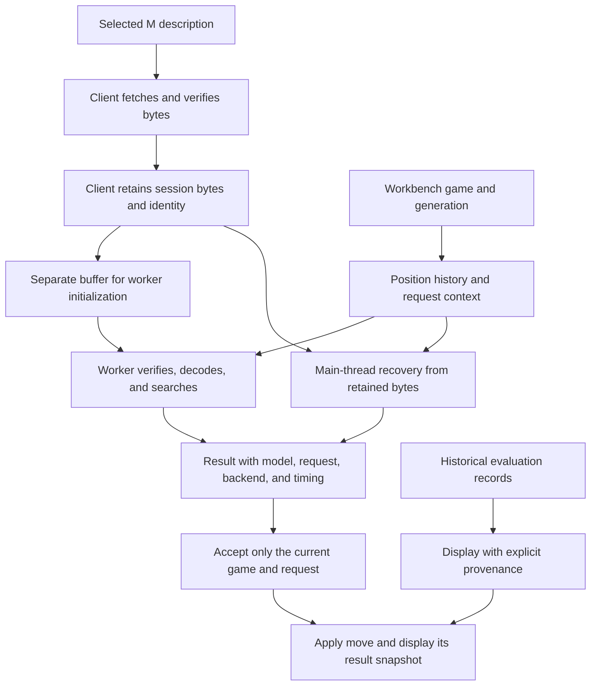
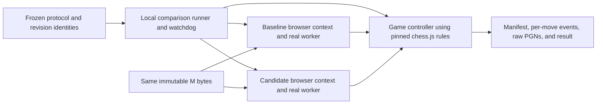

# Tinyaz: verified M delivery and bounded software evaluation

- **Author:** Hansel Hansel, with Codex
- **Status:** Proposed. All sections approved. Overview & Goals, Technical Plan, Alternatives Considered, model-loading A, evaluation runtime 1, and raw en-passant choice 3 approved by Hansel on 2026-11-01. Detailed Implementation, including Non-Functional Requirements, approved on 2026-11-02. Saved to the owner-selected destination on 2026-11-02. The five-stage independent EGM review completed on 2026-11-02. Its 21 document actions are addressed by the linked resolution under Hansel's standing auto-accept and subsequent approve/continue instruction. Production implementation and its required verification remain pending; resolving text is not a measured strength result.
- **Date:** 2026-11-01
- **Updated:** 2026-11-02
- **Predecessor:** [Accepted concepts brief](../../../concepts_brief.md), SHA256 `c69431e2c09bf93a186a94345e452da06097381bb9777364bdef3d5188be9feb`.
- **Predecessor resolution:** [Resolved annotated review](../../../goldfish_review_report.md). Hansel accepted all six text proposals on 2026-11-01.
- **Current review and resolution:** [Five-stage report](../reviews/2026-11-02-tinyaz-verified-m/consolidated_review_report.md) and [annotated resolution](../reviews/2026-11-02-tinyaz-verified-m/resolution/goldfish_review_report.md). The latter preserves the original reviewed snapshot and exact amendment patch. All original source findings remain open until implementation evidence exists.
- **Existing design authority:** [Approved M ladder](2026-08-29-tinyaz-m-ladder-design.md).
- **Source baseline:** `bb76439ea7bb4ae84bf15fe1276d75dc336d3cec`. The working branch is `chore/egm-bootstrap-tinyaz`, with existing documentation changes.
- **Selected model-loading architecture:** [Option A](../../../architecture_options.md). The browser client downloads, verifies, and retains M bytes for worker execution and main-thread recovery.
- **Selected evaluation runtime:** [Option 1: real browser contexts](../../../evaluation_options.md). The primary cohort exercises actual thinker and worker code with M bytes held constant.
- **Selected input convention:** [Choice 3: browser raw en-passant retention](../../../encoding_options.md). Align browser input with live Python; preserve separate legal-move rules and record the inspected FEN-training limitation.

## Overview

The browser's model label and stored ratings do not establish which checkpoint is choosing its moves. The source review found that browser loading selects the small S checkpoint while constants and card metadata identify the medium M checkpoint. The Python engine used through UCI already defaults to M. UCI is the command protocol used by chess GUIs and the bot.

This design restores intended delivery of the existing trained M checkpoint, exposes loading failures, identifies the active checkpoint, and rejects results from retired games or requests. It then establishes whether verified software changes improve play under a bounded, reproducible comparison. It does not assume the software fixes will raise Elo.

Browser players should know which model is playing and retain control when loading or thinking fails. Researchers should be able to distinguish a different checkpoint, a software change, more search, and a different measuring method. The first milestone ends with repaired delivery, completed documentation repairs, recorded verification commands and outcomes, and a predeclared comparison result or an inconclusive stop.

The existing M model has 2,426,706 parameters. S has 640,018. This work keeps the from-scratch model goal and the under-3M parameter limit. It uses existing weights before considering a later learning experiment.

## The Problem

The [drift report](../../../2026-11-01_DRIFT_REPORT.md) identifies ten distinct findings. F1 is the approved M-delivery requirement left unmet. F2 and F3 are inaccurate source comments. F4 through F9 are missing public-interface names in owning README contracts. F10 is missing documentation of existing UCI invalid-position behavior. The documentation findings do not establish nine additional strength defects.

The review also found failure paths that undermine model and result attribution. Failed browser loading can become random weights. A worker-to-main fallback can reload weights after readiness without refreshing the reported identity. Reset can leave an earlier search able to return into a new game. These are source-supported risks, not observed live incidents or quantified Elo losses.

Verification and measurement have separate limits. The recorded npm baseline includes 16 existing failures and stops before its TypeScript stage; separately passing chess tests do not make the full command green. PyTorch-dependent checks were not run in the checked environments. The existing snapshot comparison uses one software implementation for both models and at most eight games. It cannot by itself prove that a new engine implementation is stronger.

A larger search budget may change moves while using the same weights. A new rating protocol may change a reported number without changing moves. Loading existing M into the browser does not change the Python engine's M default. Combining these effects would obscure why a result changed and could lead to unnecessary training.

All ten implementation findings remain OPEN. This design draft does not repair code, rerun model tests, play matches, or validate a live deployment.

## Goals

1. **Restore intended model delivery.** Browser trained play must use verified existing M weights. Readiness, fallback, completed results, and card claims must identify the active checkpoint. A missing, corrupt, or mismatched intended model produces a visible failure. Random demonstration is explicitly selected and carries no trained-model rating claim. Preserve existing S utilities and legacy S/M reading.
2. **Keep results attached to their game and model.** Reset, engine replacement, and delayed replies must not apply old work to the current game. A failed turn remains stopped until explicit recovery. Carry forward the accepted checkpoint pinning, retry, and deadline requirements from the brief. Technical Plan 3 and Detailed Implementation 3 define their interfaces and fixtures.
3. **Close all ten findings with the right evidence.** Repair F1 in behavior and its contracts. Correct F2/F3 comments without changing migrations or database initialization. Complete the owning inventories for F4-F9. Document F10's current valid-prefix retention and silent command handling. Keep each finding open until its own completion evidence exists.
4. **Record required verification results.** Account for every existing failure and missing check in the accepted verification ledger. Preserve actual application integration and authentication contracts. Verify model encoding, inference, legal moves, search value/history behavior, and restoration after failure using focused fixtures. Declare numerical tolerances before parity results. Distinguish a passing subset from a green full suite.
5. **Isolate any playing-strength effect.** Preserve existing M bytes as the control. Keep browser S-to-M delivery separate from an actual same-M software change. Preserve fresh-root 64-visit results. Verify an identical-engine control before candidate comparisons. Require browser/Python parity evidence before Python games support a browser claim. Freeze software and model identities, openings, outcomes, and statistical rules before games. Report faults, raw results, uncertainty, and stopping reason. Do not claim a Python software gain when its execution did not change.
6. **Keep each authorized experiment finite.** Carry forward the accepted one-machine, one-game-at-a-time limits: a 10-minute preflight; at most 20 complete opening/color pairs, 40 games, or the newly authorized 24 hours for the comparison; 30-second readiness and 90-second command watchdogs; 4 GiB aggregate evaluation-process resident memory; and 256 MiB of new outputs. Preserve incomplete records and faults. A fault or an early resource/time stop makes the strength result inconclusive. These limits are ceilings, not performance or statistical-power claims. Detailed Implementation 5 defines the required accounting before any run.
7. **Preserve honest historical claims.** Keep historical Stockfish-instrument results, Lichess BOT-pool ratings, and one-visit controls separate. Treat missing checkpoint or measurement provenance as unknown. Preserve the old eight-game instrument and historical records. A supported no-gain result can finish this milestone; a higher Elo number is not required for delivery correctness.
8. **Keep implementation and documentation together.** Every later meaningful code change includes affected README contracts, usage/API/configuration documentation, and design progress updates. Keep edited source and test files below 400 lines. Inspect each final diff and compare docs with behavior, interfaces, invariants, side effects, paths, and commands before a green commit or completion claim. Record why no doc change is needed when applicable. Preserve approved requirements and unrelated dirty work.

## Non-Goals

- Retraining or changing checkpoint bytes, model width, training data, targets, or the learning objective in this milestone.
- Starting training automatically after a disappointing or inconclusive comparison. A later training proposal needs an observed learning weakness or demonstrated target defect and its own criteria and budget.
- Adding a clock-management mode, increasing the published 64-visit budget, caching position evaluations, or retaining search trees between moves. Those require separate evidence and decisions.
- Changing F10 to atomic position parsing, changing migration discovery, or adding database behavior to fix comments and index omissions.
- Rebuilding the Grok authoring template, changing unrelated auth/PWA runtime behavior, or weakening checks to obtain green output. Portable test repair remains in scope.
- Expanding TypeScript serialization, introducing a model registry or publication service, or redesigning legacy promotion in order to select existing M.
- Publishing weights or metadata, deploying the app, changing a live bot/account, or running paid or remote compute.
- Replacing missing measurements with old checkpoint ratings, changing the rating instrument without a separate label, or promising a numerical Elo gain.

## Open Questions

The verification ownership, environment, commands, tolerances, experiment protocol, file map, estimates and rollback are specified by the approved Detailed Implementation and the owner-authorized review resolution on 2026-11-02. The accepted six resolution decisions and the owner's A/1/3 selections remain authoritative.

- **Execution evidence:** Actual environment imports, required test results, browser latency/resource use, numeric parity, final candidate identity and comparison outcomes remain unmeasured. These are required future outputs, not assumed passes or new policy decisions for the implementer.
- **Known deferred compatibility:** Python/browser draw-claim behavior and the inspected default-FEN training versus live raw-target input convention remain distinct. Do not claim full-engine or training consistency from numeric parity, or automatically retrain to address either gap.
- **Review:** The owner-selected final destination is this file. All five stages and nine fresh reviewers completed. Their 21 document actions have explicit resolution edits, preserving original IDs/severities and known coverage limits. Approval, review and text resolution do not establish code completion, a new full-suite pass, or an Elo gain.

## Critical User Journeys

### CUJ 1. Play with the intended trained model

- **Given:** The current M bytes are available and match the selected checkpoint description.
- **When:** A player opens the workbench and requests a model move.
- **Then:** The client verifies and retains those bytes. The worker searches with them. The card and completed result identify that model. A browser move records its own visits and timing.

### CUJ 2. Recover without changing the model

- **Given:** M is verified and a worker becomes unavailable before the operation deadline.
- **When:** The client makes its one permitted transition to main-thread execution.
- **Then:** It retires the worker and decodes the retained bytes. No second weight download occurs. The response identifies the actual backend. If time or recovery fails, the turn stops visibly.

### CUJ 3. Reset or retry after a failure

- **Given:** A search or initialization is pending, or a turn has failed.
- **When:** The player resets, retries the engine, or retries the move.
- **Then:** Old work cannot mutate the current game or its UI state. A retry is explicit and has a new request identity. Reset can clear a move failure but does not hide an unresolved load failure.

### CUJ 4. Select a random demonstration deliberately

- **Given:** The player chooses the separate random-demo action.
- **When:** A new demo engine session starts.
- **Then:** It uses deterministic S random weights and is labeled untrained. It shows no trained-checkpoint rating claim. Switching modes replaces the engine session and invalidates earlier work.

### CUJ 5. Compare software with unchanged weights

- **Given:** The browser fixture, identities, control checks, and frozen protocol have passed preflight.
- **When:** The local runner plays the one accepted comparison cohort.
- **Then:** Both versions use the same M bytes, fixed 64 visits, and the same recorded game rules. Results include raw games, faults, timing, and the stopping reason. The runner neither trains nor publishes. A fault or early resource stop leaves the strength result inconclusive.

## Technical Plan (Architecture)

Technical Plan approved by Hansel on 2026-11-01. It specifies future implementation behavior. Existing source and the ten original findings are unchanged.

### 1. Selected boundaries and data flow

The browser client owns checkpoint loading and the retained binary, as selected in option A. The primary comparison runs actual engine code in real browser contexts, as selected in evaluation option 1. The workbench remains the authority for the game. Workers receive complete requests rather than maintaining a second game between moves. Each search still starts a fresh tree.



The browser runtime requires no new JavaScript dependency, model service, registry, or database. It uses the project's installed Playwright, Vite, React, and chess.js packages. Detailed Implementation 4 separately defines the Python verification environment and dependency declarations. Exact tool and browser identities are captured before a run. The local inspection found Node 24.4.1, Playwright 1.62.1, Vite 8.2.2, chess.js 1.4.0, and an existing Playwright Chromium executable. This was a path/version inspection, not a launched-browser or performance check. Execution must re-record the actual versions and executable hash.

### 2. Checkpoint description and verification

Extend the selected-model constants beside `WEIGHTS_URL` and `MODEL_NAME`. The trained description contains the model name, URL, packed version, parameter count, byte length, and expected SHA256. Use the current M control: 2,426,706 parameters, 9,706,840 bytes, SHA256 `b716fe7b9a663c8c839f49cefd592ebc7ba771452057bac2404c24f48d2af4ee`. Do not change the general S channel default.

Create a small checkpoint module for shared types and raw-buffer validation. Check the header, supported S/M architecture, declared/exact length, finite tensor payload, and digest. Trained readiness requires the expected M description to match. Missing cryptographic verification support is a visible environment failure. Do not bypass verification or return random weights.

Change `loadPlayWeights` to return verified bytes and identity, not decoded tensors. Its default becomes the intended M description. This is an intentional internal API change. Update the client, worker, and owning contracts together. The worker stops calling this loader. Preserve `randomWeights`, generic S/M unpacking, the S writer, and the existing packed format. The separate gauntlet remains outside this workflow and is not used as the comparison runner.

The client fetches once per initialized trained session. It retains the verified binary privately. Worker initialization receives a separate buffer. The retained original must never be transferred away or exposed as a mutable view to the UI. The worker independently checks the received bytes against the pinned identity, then decodes them. It performs no weight fetch. Main-thread recovery decodes the retained original after retiring the worker.

Do not attach the current hash to old rating records without evidence. A later public weight replacement must update its matching selection description under a separately approved publication design. If current frontend selection and served bytes disagree, this milestone fails visibly rather than silently following the new file.

For the explicit random demonstration, the client generates the existing deterministic S weights with seed 2026 and uses the S packer in memory. It computes their digest and retains the resulting binary through the same ownership boundary. The mode is `random-demo`, not trained M. No file is published. There is no new M-writing use case.

### 3. Internal interfaces

The following describes data contracts, not production implementation code.

```text
CheckpointSpec
  name, url, packedVersion, parameterCount, byteLength, expectedSha256

ModelIdentity
  mode: trained | random-demo
  modelName, sha256, packedVersion, parameterCount, channels, sourceId
  seed: 2026 for the explicit demo; absent for trained M

GamePosition
  initialFen, movesUci[], expectedFen

RequestContext
  engineSessionId, gameGeneration, requestId, position, requestedVisits

SessionReady
  engineSessionId, modelIdentity

EngineState
  stage: loading | starting | ready | thinking | recovering | failed | stopped
  engineSessionId, modelIdentity?, backend?, backendEpoch, activeContext?, error?

ThinkResponse
  context, modelIdentity, backend, backendEpoch
  kind: move with result | terminal with terminal
  SearchOutcome fields defined in Detailed Implementation 3
  completedVisits, searchMs, moveElapsedMs, attempts[]
```

A trained identity requires the selected M digest. A demo identity requires its generated S digest and explicit mode. The UI cannot infer mode from a rating record. Request IDs increase within the workbench session. The engine session and backend epoch distinguish replacement engines and workers. Validate messages at the runtime boundary; TypeScript assertions alone are insufficient.

Keep `createThinker` as the application factory. It returns the initial `ready` promise, a current-state getter/subscription, `think(request)`, `cancel(requestId)`, and `terminate()`. The initial ready promise identifies the immutable session model. Ongoing backend and failure changes use state notifications and per-response fields. Request-scoped notifications carry the same context. A retired request cannot publish a failure or completion into a newer request. This avoids treating the first readiness report as the current backend forever.

The trained factory is the default. A separate explicit `random-demo` factory option creates a new session. No URL parameter or failed fetch can silently change the mode. Detailed Implementation 2 and 3 specify the field declarations, exports, and call-site migrations.

### 4. Preserve history inside a fresh search

The workbench captures an immutable position snapshot before awaiting the engine. It includes the initial FEN, complete UCI move sequence, and expected current FEN. A shared position helper replays those moves through chess.js and verifies the final FEN. Reject malformed moves or a mismatched final position before search. This private reconstruction never partially mutates the workbench game.

The current `oneVisit` reconstructs a board from FEN and loses earlier repetition counts. A rules-only probe reproduced the difference with a repeated knight sequence. This establishes a search-context defect to cover with a focused regression before changing it. The probe did not measure model strength.

Extend `search` and `searchAsync` to accept either a complete position or a legacy FEN string. Normal workbench requests use the complete position. Legacy FEN callers keep their current limited-history analysis behavior. Build one private history-bearing board for a request. Each visit pushes its selected line and restores the board in a `finally` path. Verify root FEN and history restoration after completion, cancellation, and injected error. Do not retain a tree or board between requests.

Keep selection, priors, value-sign backup, tie-breaking, and the 1/64 visit meanings unchanged. A new root expansion still consumes the first visit. Check cancellation and remaining time at visit boundaries. Main-thread search continues to yield so cancellation can be observed. An incomplete search is an abort, not a successful 64-visit result. A terminal root produces a typed terminal outcome through the engine protocol, not an illegal move or an operational-fault label.

The current browser and Python terminal predicates have a demonstrated draw-claim difference. Do not silently change Python training or UCI draw handling here. Numeric encoding/inference fixtures and full-game rule compatibility are separate checks. Preserve the known difference in the verification ledger. Python games cannot be offered as browser-strength evidence until the required compatibility exists. The primary browser comparison does not depend on that claim.

**Owner-approved input convention, 2026-11-01:** Hansel selected [en-passant choice 3](../../../encoding_options.md) after a source-level probe reproduced a second compatibility gap. Retain the raw target from the initial FEN or last double pawn move beside the private history-bearing board. Pass it into browser encoding even when no legal capture exists.

Restore that raw target on every undo, error, and cancellation path. Leave chess.js legality and repetition rules, Python encoding, and default-FEN dataset generation unchanged. Detailed Implementation specifies the exact state, APIs, files, and parity cases.

A FEN-only caller cannot recover raw information omitted before the request. The input change can alter logits, priors, and moves with existing M; selection, softmax, and backup arithmetic stay unchanged. It joins the combined software treatment and establishes neither a strength gain nor a fix for the inspected training/live-input difference. These are approved implementation requirements; the source remains unrepaired.

### 5. Worker protocol and recovery

Introduce an explicitly versioned internal thinker protocol, independent of packed-weight version 1. Initialization carries the protocol version, engine session, backend epoch, model identity, and the separate binary buffer. The worker verifies and decodes it before acknowledging readiness. A think received before successful initialization is rejected. Remove both worker-side implicit random paths.

A think carries its request context and the remaining operation budget. A response echoes context and reports actual backend/identity, completed work, and timing. A malformed or obsolete message is not accepted as a move. The client compares every response with its active session, epoch, and request. The workbench performs the additional game-generation and position check before applying a legal move.

| Event                                                         | Handling                                                                                      |
| ------------------------------------------------------------- | --------------------------------------------------------------------------------------------- |
| HTTP, format, length, digest, or trained-model mismatch       | Reject loading; retain a visible load failure. No random substitution.                        |
| Worker unavailable at construction/startup or transport crash | Retire that worker. Transition once to main execution from retained bytes if budget remains.  |
| Worker model verification or request identity mismatch        | Fail visibly. Do not treat inconsistent data as an ordinary retry.                            |
| Terminal position                                             | Return a typed terminal outcome. Do not run a retry or manufacture a move.                    |
| Search exception or illegal result                            | Stop the turn with a diagnostic category. Retry requires explicit action.                     |
| Cancellation or expired deadline                              | Reject/discard the attempt. Never start fallback after the deadline.                          |
| Engine disposal                                               | Abort initialization, retire the worker, settle pending promises, and reject future requests. |

Within a session, a successful worker-to-main recovery remains on main execution. An explicit engine retry creates a new engine session. A reset cancels or invalidates current work without changing the pinned checkpoint. A busy worker can be terminated; a later request recreates worker execution from retained bytes. That replacement increments the backend epoch and is recorded. Main-thread work stops cooperatively; a new request waits for its cleanup rather than running two main searches concurrently.

### 6. Deadlines and timing

Use the client's monotonic clock as the acceptance authority. Initialization and each requested move have an explicit start and a 90-second deadline. If a move is queued while initialization is pending, its budget includes that wait and cannot extend the initialization deadline. A move requested after successful initialization gets its own 90-second operation budget. Fallback never resets that clock.

Keep the existing eight-second worker-start acknowledgement timer as a subordinate bound after verified bytes are available. Its expiry can trigger the one permitted recovery only while the total budget remains. It is not another weight-loading attempt. The evaluation runner's accepted 30-second readiness watchdog is stricter and remains independent.

Pass remaining time to the worker, which establishes its own local monotonic check. The client still rejects a response received after its authoritative deadline. Abort fetches, terminate a stalled worker, and cancel asynchronous main search when possible. Browser scheduling and a synchronous evaluation can delay a callback. The deadline prevents acceptance or a new retry after expiry; it is not a hard real-time CPU preemption promise. Measure overrun and responsiveness instead of hiding them.

Record initial fetch/verification and backend setup separately from core search time. Record every attempt and disposition. `moveElapsedMs` covers readiness wait, queueing, setup, failed attempts, recovery, and result delivery after the request began. Core `searchMs` remains a distinct measurement. Diagnostics can record partial work; only a complete move response may claim its completed visit budget.

### 7. Workbench and card behavior

Keep game ownership in `Workbench`. Extract engine session/subscription and request-lifetime handling into a small hook so edited files stay below 400 lines. A reset increments the game generation and replaces the current game. Success, error, and finalization callbacks all check current ownership. An old callback cannot clear a newer request's thinking state or overwrite its error/result.

Provide explicit retry-engine and retry-move actions where applicable. The move retry preserves the position and starts a new request. Reset starts a new game. A load failure stays visible while recovery is pending and until recovery succeeds. Automatic-turn effects do not repeatedly restart a failed turn. The deliberate random-demo action changes mode only after a click and starts a new game/session.

The selected visit count describes the next request. Card timing, tree, value, identity, and visit count come from the last completed response snapshot. Changing the selector cannot relabel an old result. Convert value to the display perspective from that request's side to move. Keep user-facing diagnostics short; retain request IDs and detailed failures in diagnostic/run records.

The model name and parameter count come from verified identity. Random-demo mode is labeled untrained and hides trained rating claims. Legacy metadata remains unchanged and is shown as recorded history with unverified checkpoint provenance where appropriate. Missing records are unavailable, not running. The one-visit random control is not called an Elo. Label arithmetic estimates by their actual convention and architecture; they are not measured whole-move compute.

`Roadmap` is neutral project-method text, separate from active-session identity and recorded results. Make it prop-free, render a visible `Project stages` heading and the three stage descriptions below, and remove metadata-derived `current`, `rated`, `done`, and `later` badges. It never displays a numerical rating or declares the current session rated. It may remain visible in both trained and demo mode because it describes the project method. Workbench removes the `current`/`rated` call and all phase/rating derivation used to describe the active session. Session status, reset text, and the header derive model/mode information from current verified engine state; stored metadata never supplies an active-session Elo. CardPanel alone may display preserved recorded results under the explicit historical/unbound labels already required here. In demo mode, hide trained-checkpoint rating results everywhere in the rendered Workbench. ThinkPanel's next-request selector explains only its visit budget and does not promise publication or confer a rated mode.

| Stage | Title | Exact body                                                                             |
| ----- | ----- | -------------------------------------------------------------------------------------- |
| 0     | Play  | An untrained net demonstrates legal moves and the search tree.                         |
| 1     | Learn | Human games train the policy. Random-move controls are recorded separately.            |
| 2     | Climb | Self-play trains candidate checkpoints. Each recorded result states its search budget. |

### 8. Primary browser comparison

Use a dedicated evaluation-only Playwright runner and a small local Vite fixture. The fixture imports actual chess engine modules. It is not a new app route, public API, training entrypoint, or general evaluation platform. Use a separate component fixture to mount the actual workbench for UI behavior checks. Do not weaken the existing generic smoke command's path/auth/deployment checks to make it serve this purpose.



The provisional Python comparison filename in the brief is refined by the owner's real-browser selection. The driver uses the already installed JavaScript Playwright API. It does not add a Python browser dependency or claim a new Python engine result. The approved Detailed Implementation section lists the exact browser driver, fixture, baseline preparation, records, watchdog, and test file map.

Start fixture servers with explicit evaluation configuration and `configFile: false`. Bind loopback addresses. Do not load the production Vite configuration, migration hooks, or auth/PWA bootstrap. Serve only the pinned engine source roots, shared fixture, installed dependencies, and controlled model assets. The component fixture uses the installed React tooling and actual component code. No fixture entrypoint is included in the production app.

Use one recorded Chromium executable and the same launch configuration for both versions. Open two isolated player contexts for a game. Play one game at a time and close prior contexts before starting another game. The Node-side game controller uses the same pinned chess.js version as the fixture; it does not run MCTS or substitute Python draw rules. Supply full move history to the candidate. The baseline adapter supplies its legacy FEN-only request. That history difference is part of the software treatment, not hidden by rewriting baseline code.

Pin the baseline source to `bb76439ea7bb4ae84bf15fe1276d75dc336d3cec`. Freeze the candidate at an exact verified implementation commit before the final cohort. Prepare both source snapshots in separate run-owned directories and serve those immutable snapshots. Disable HMR and update-driven reloads. Do not check out over the active work or modify original production files. Share only the recorded dependency installation and record its identity.

The primary comparison is **same-M browser software**, not S-to-M delivery. The old source requests S, so the baseline fixture must explicitly serve the exact M body at that legacy request path. Record that normalization, delivered hash, response status, and ready parameter/source fields. The candidate must request the intended M URL and natively report the matching digest. Never forge a native baseline digest that its old API does not report. Attribute baseline identity to controlled delivery plus loaded-architecture evidence.

Any failed model request, random fallback, unexpected worker closure/backend change, illegal move, or protocol discrepancy makes the comparison inconclusive. This includes an old fallback that cannot preserve verifiable identity. Recovery scenarios are exercised separately and recorded, not converted into selective strength wins. Candidate UI checks independently verify the unmodified M URL and fail on an S request, so the baseline normalization cannot mask a candidate loader bug.

Before candidate games, run an identical-engine control with disjoint short fixtures. It must verify model delivery, deterministic request results, legal game handling, color swaps, and raw-record accounting. The 10-minute preflight also records cold readiness, 64-visit move latency, memory, and runtime identities. If that control or preflight cannot complete within its limits, stop before the primary cohort.

Use one locked set of 20 opening/color pairs for the final cohort. Development and control fixtures are separate. Lock candidate identity, openings, outcome rules, and the statistical method before observing candidate results. Do not tune successive candidates on that final set or silently extend the sample. The exact positions and decision method are specified in Detailed Implementation 6, approved on 2026-11-02.

The controller uses the pinned browser-library checkmate/draw predicates. It validates every engine move. There is no synthetic material winner or added ply adjudication in this browser protocol. A nonterminal game interrupted by the run cap stays incomplete. This is a new, labeled browser comparison instrument, separate from the historical Stockfish instrument. Preserve the historical 160-ply/material protocol and its records unchanged.

Enforce one machine, one game at a time, the newly authorized 24-hour/40-game cohort cap, 30-second readiness and 90-second command watchdogs, 4 GiB aggregate evaluation-process resident memory, and 256 MiB of new run-owned outputs. Account for the controller, fixture servers, Chromium, and descendants. An external watchdog must be able to stop stalled browser-side work. Temporary fixture/profile/cache artifacts belong to the run and are accounted for; pre-existing dependencies and control weights remain unchanged. Record cleanup and verify that owned processes and listening ports are gone.

Persist the run manifest before games. It contains revision and source hashes, tool/browser/dependency identities, checkpoint proof and normalization, rule convention, visits, openings, resource limits, and statistical plan. Record each request, response, actual backend, attempts, timing, faults, game ID, color, moves, and outcome. Write raw PGNs and incremental events. Record a final completion or stop reason even after a crash. Never write results into public weights or legacy rating metadata.

A complete error-free cohort can support the predeclared browser-software comparison. Report W/D/L, paired uncertainty, and limitations. An incomplete or faulty cohort cannot make a strength claim. No result is automatically a new Stockfish-scale Elo, Lichess rating, or proof of a trained-weight gain. Retraining remains a separate decision.

### 9. Component and contract map

| Boundary                                               | Planned change                                                                                                              | Owning documentation                                      |
| ------------------------------------------------------ | --------------------------------------------------------------------------------------------------------------------------- | --------------------------------------------------------- |
| Model constants and `weights.ts`                       | Selected M description; strict verified-buffer loading; preserve S utilities and packed format                              | Chess README and root model-selection description         |
| New checkpoint/position/protocol modules               | Shared identity checks, history reconstruction, request/result contracts, and message guards                                | Chess and worker READMEs                                  |
| `think-client.ts` and `think.worker.ts`                | Client-owned bytes, strict initialization, deadlines, actual state/results, one recovery, cancellation/disposal             | Chess and worker READMEs                                  |
| `mcts.ts`                                              | History-bearing per-request board, restoration, cancellation checks, and typed terminal handling; same fresh-tree selection | Chess README and search API documentation                 |
| Workbench, engine hook, card, think panel, and Roadmap | Current-request ownership, explicit recovery/demo actions, truthful model/history/result display                            | Chess component README and play usage                     |
| F2/F3 source comments                                  | Correct migration/initialization descriptions without behavior changes                                                      | Migration and library contracts if comparison requires it |
| F4-F9 inventories and F10 behavior                     | Exact owning-interface additions and existing UCI error/state documentation                                                 | Owning READMEs from the repair register                   |
| Browser evaluation driver and fixtures                 | Real-browser comparison, controlled baseline, game/record/resource management                                               | Training/scripts READMEs and experiment protocol          |
| Verification environment and focused tests             | Per-failure ledger, declared numerical checks, history/error/control cases, no weakened integration checks                  | Root/training verification docs and experiment protocol   |

Detailed Implementation 2 enumerates the concrete source, documentation, and test files. Add any later required file to that map and its owning contract before editing it. Keep source/test files below 400 lines through scoped modules. Include code and corresponding documentation in each green change. Compare the final diff with actual behavior, interfaces, invariants, side effects, file paths, and commands before committing or reporting completion. The ten findings close only on implementation evidence. Drafting does not close them.

## Alternatives Considered

The selected approach uses existing M, retains verified bytes in the client, and evaluates actual engine code in real browser contexts. These decisions come from the [accepted brief](../../../concepts_brief.md), [loading choice](../../../architecture_options.md), and [evaluation choice](../../../evaluation_options.md), and [raw en-passant choice](../../../encoding_options.md). The alternatives below preserve the reasons for those choices and the conditions for later work.

### A1. Change all architecture defaults to M

- **Mechanism and benefit:** Make M the implicit width for tensor creation and parameter counting across helpers.
- **Costs and failure conditions:** Existing random generation, the TypeScript writer, tests, and S tools depend on the S default. A global width change can break those boundaries without fixing checkpoint selection consistently.
- **Reason not selected:** The approved repair selects M at the play-loading boundary. It preserves S utilities and legacy packed readers. Changing every architecture default is unnecessary for that repair.
- **Disposition:** Rejected for this milestone. A future default change needs its own compatibility case.

### A2. Retrain immediately

- **Mechanism and benefit:** New data, targets, or optimization could improve learned predictions if learning is the bottleneck.
- **Costs and failure conditions:** Training spends compute and changes the checkpoint before delivery and measurement are dependable. Better weights can still be hidden by a wrong loader or mislabeled by stale metadata. A result would also mix software and learned-weight effects.
- **Reason not selected:** Use existing M for the first repair and comparison. Training needs a repeatable learning weakness or demonstrated target defect, corrected inputs where needed, a separate budget, and independent pass/stop criteria.
- **Disposition:** Deferred. A disappointing software comparison does not automatically open training.

### A3. Increase visits immediately

- **Mechanism and benefit:** Existing controls can allocate more search to the same weights and test whether additional thinking helps.
- **Costs and failure conditions:** More visits consume time and can increase timeout or responsiveness problems. They change the compute budget. A higher-budget result cannot be relabeled as a new fixed-64 result.
- **Reason not selected:** Preserve fresh-root 64 visits for the primary comparison. Verify identity, correctness, and latency first. A later visit-versus-strength experiment must have its own declared budget and label.
- **Disposition:** Deferred. The current design does not rule out useful extra search.

### A4. Build clock management, caching, or tree reuse first

- **Mechanism and benefit:** A time manager could allocate available time; evaluation caching could avoid repeated work; tree reuse could retain useful search statistics.
- **Costs and failure conditions:** These add interruption rules, state ownership, invalidation, memory limits, and work-accounting decisions. Reused statistics change what a later request gains from 64 new visits. Benefit is unmeasured.
- **Reason not selected:** Repair context and delivery, then profile. Admit a follow-up only when evidence supports that specific change. The approved per-request history board still starts a fresh search tree and retains no search state between requests.
- **Disposition:** Deferred separately. These are not prerequisites for delivering existing M.

### A5. Change the rating ruler or use easier opposition as the improvement

- **Mechanism and benefit:** Another protocol or opponent population can answer a different playing-strength question. Easier opposition may produce more wins.
- **Costs and failure conditions:** A changed number alone cannot identify a software or weight improvement. Openings, game-end rules, opponent settings, and populations can all change the instrument.
- **Reason not selected:** Preserve the historical Stockfish instrument and records. Label the selected browser comparison separately and hold its method fixed across both software arms. It measures the browser-software comparison rather than replacing the historical Elo or Lichess rating.
- **Disposition:** Rejected as a standalone strength claim. New instruments remain valid when their purpose and limitations are explicit.

### A6. Treat F4-F9 index omissions as runtime defects

- **Mechanism and benefit:** Auditing the omitted exports can reveal an independent implementation issue if one exists.
- **Costs and failure conditions:** Missing names in a README do not by themselves justify changing behavior. Runtime refactors can create regressions in unrelated libraries and make the repair harder to verify.
- **Reason not selected:** Revalidate the exact export sets and complete their owning contracts. Admit a runtime repair only on separate evidence, with its own regression and documentation changes.
- **Disposition:** Rejected. F4-F9 remain documentation repairs.

### A7. Make F10 position parsing atomic now

- **Mechanism and benefit:** Validate a whole move list before replacing the stored position. Invalid commands would leave no applied prefix.
- **Costs and failure conditions:** This changes an existing error/state contract. It requires compatibility and history tests. No valid-game requirement violation or strength effect was established by the documentation finding.
- **Reason not selected:** Document the current valid-prefix retention and silent command handling. Keep the engine behavior unchanged for F10.
- **Disposition:** Rejected for this milestone. A later atomic-parsing change needs an approved behavior decision.

### A8. Restore the whole Grok template to make tests green

- **Mechanism and benefit:** Recreating missing authoring assets and repository defaults could satisfy some template-specific checks.
- **Costs and failure conditions:** This expands beyond chess into authoring support and workspace assumptions. It could conceal the actual ownership of a failing check or alter auth/PWA behavior to satisfy a fixture.
- **Reason not selected:** Classify failures in the verification ledger. Isolate portable fixtures, preserve real application integration checks, and decide ownership before moving or removing an authoring-template check. A passing subset is still reported as a subset.
- **Disposition:** Rejected. Narrow verification repair remains in scope.

### A9. Build a publication service now

- **Mechanism and benefit:** Coherent release activation and rollback could prevent mixed weights/metadata and old measurements attached to new bytes.
- **Costs and failure conditions:** A publication redesign adds lifecycle and compatibility work across training callers before this milestone needs new weights. An incomplete redesign could create another activation path.
- **Reason not selected:** The first comparison uses unchanged control assets and an evaluation-only runner. Verified identity fails visibly on a mismatch. Before later publication, explicitly decide missing-result behavior, complete-release identity, activation, single-writer coordination, runtime checks, and rollback.
- **Disposition:** Deferred until publication enters an approved scope. Current publisher risks remain documented.

### A10. Adopt stronger external engine weights

- **Mechanism and benefit:** External weights could provide another practical engine or comparison baseline.
- **Costs and failure conditions:** They change the from-scratch model goal. They do not demonstrate an improvement to the project's own learned weights or repair its delivery/evaluation defects.
- **Reason not selected:** The existing goal and parameter constraint remain authoritative. This milestone uses the project's existing M checkpoint.
- **Disposition:** Outside the current goal. A goal change needs explicit owner approval.

### A11. Let the worker load and download again on fallback (loading B)

- **Mechanism and benefit:** Normal loading stays in the worker. The client retains identity without keeping the original 9.7 MB binary.
- **Costs and failure conditions:** Recovery needs another fetch, verification, and decode within the remaining deadline. It fails if the network/cache is unavailable or the served asset differs from the pinned checkpoint. Less retained client data does not establish a lower total peak.
- **Reason not selected:** Hansel selected A. One client owns the download and retains verified bytes for recovery without another network request. Its memory cost remains an explicit measurement.
- **Disposition:** Not selected. Reconsider only through an approved loading-architecture change.

### A12. Let the worker load and return bytes to the client (loading C)

- **Mechanism and benefit:** Loading begins in the worker and the client receives a recovery copy before readiness is accepted.
- **Costs and failure conditions:** Both sides participate in a binary handoff and acknowledgement. A worker failure, missing buffer, cancellation, or out-of-order message before that handoff completes must not create a ready session. The client still retains the binary.
- **Reason not selected:** Hansel selected A, which places download and retention in one owner and avoids the return handshake. No startup or memory advantage of C was measured.
- **Disposition:** Not selected. A future measured need can support a new decision.

### A13. Use TypeScript search in Node as the primary comparison (runtime 2)

- **Mechanism and benefit:** A small adapter can run the same search modules without UI or browser-startup orchestration.
- **Costs and failure conditions:** It does not measure loading, worker recovery, or browser timing. Browser-to-Node parity is required before results support a browser algorithm claim. Adapter, dependency, history, and adjudication differences can invalidate the comparison.
- **Reason not selected:** Hansel selected real browser contexts for the first comparison. That exercises the actual thinker and worker. Separate component checks still cover UI claims and interactions.
- **Disposition:** Not selected as primary. Node remains useful for focused unit and controller tests; no Node engine-adapter project is added here.

### A14. Use the existing Python UCI engine as the primary comparison (runtime 3)

- **Mechanism and benefit:** Reuse the established UCI path to study Python engine behavior or compare checkpoint weights under an explicit Python protocol.
- **Costs and failure conditions:** Python already defaults to M. An unchanged Python engine cannot measure browser software repairs. The recorded draw-claim difference prevents assuming full-engine equivalence. Missing PyTorch, hidden faults, identity drift, or an altered instrument can also invalidate results.
- **Reason not selected:** Hansel selected the actual browser runtime. Keep Python checks and historical UCI records in their proper scope. Python results may support a browser claim only when the required compatibility evidence exists.
- **Disposition:** Not selected as primary. The Python runtime and old rating instrument remain unchanged by this choice.

### A15. Keep both en-passant encoders unchanged (input choice 1)

- **Mechanism and benefit:** Retain browser legal-target input and live Python raw-target input. Numeric checks on identical normalized FENs can still compare inference for those identical inputs. The primary browser-to-browser experiment remains usable with its stated software treatment.
- **Costs and failure conditions:** Live-history inputs still differ after ordinary double pawn moves and pinned-capture positions. Normalizing Python through default FEN would conceal that runtime difference if presented as full input parity. Python games still cannot support a browser claim without separate input/rule compatibility evidence.
- **Reason not selected:** Hansel selected choice 3 on 2026-11-01 to align browser input with the existing live Python raw-target convention. Keeping both unchanged would leave that accepted input repair undone.
- **Disposition:** Not selected. Preserve normalized-FEN parity only as its narrower test scope; do not use it to declare live-history compatibility.

### A16. Make Python encode only legal en-passant targets (input choice 2)

- **Mechanism and benefit:** Change Python plane 16 to include a target only when a legal en-passant capture exists. This aligns it with the current browser and the inspected default-FEN training-row path, including absent adjacent pawns and pinned captures. Other planes, checkpoint shape, weights and rules can remain unchanged.
- **Costs and failure conditions:** Existing Python inference inputs and moves can change. That is a separate Python software treatment and cannot inherit historical ratings. It does not establish a strength gain, full historical training provenance, or compatible draw-claim behavior. Regenerating data or training is outside this milestone.
- **Reason not selected:** Hansel selected browser raw-target retention instead, preserving the current Python encoder and Python inference convention. Changing Python as well would exceed that chosen repair and obscure the comparison's software treatment.
- **Disposition:** Not selected. Any later Python convention change requires its own explicit behavior decision and evidence.

### A17. Retain raw en-passant input in the browser (selected input choice 3)

- **Mechanism and benefit:** Carry the raw target from the initial FEN or last legal double pawn move beside the private history-bearing board. Pass it to the actual browser encoder and restore it with every undo/error/cancel. This aligns browser plane 16 with current live Python while preserving Python code, existing M bytes, and separate public legal-move/repetition rules.
- **Costs and failure conditions:** chess.js can discard the target when no adjacent enemy pawn exists. `fen({ forceEnpassantSquare: true })` alone cannot recover that discarded target after an ordinary `e2e4`, although it can expose a retained pinned target. Explicit position/search state is required; a missing restoration or inferred target can change model input incorrectly. An already-normalized FEN-only caller cannot recover omitted information. The inspected training path stores default FEN and reconstructs boards, so its input convention can still differ from live raw-target input. This does not establish the exact provenance of every historical M training row.
- **Reason selected:** This is Hansel's approved choice 3. It fixes the specified browser/live-Python input mismatch without changing the Python encoder. Raw target remains model input only, never a manufactured legal capture or altered repetition key.
- **Disposition:** Selected for this milestone. It joins the combined same-M browser software treatment and may alter logits, priors and moves. Exact thirteen-case parity and raw-target restoration are required. No strength gain, training consistency, new weights or retraining is implied. The draw-claim difference remains separate.

## Non-Functional Requirements

These requirements apply to the proposed implementation below. None is an observed performance result.

- **Identity:** Verify the exact M control before trained readiness, independently verify the worker copy, and keep one immutable model identity per engine session. Retain packed v1 S/M reading and S utility defaults. Do not manufacture historical checkpoint provenance.
- **Failure and ownership:** Every pending operation settles on success, explicit cancellation, disposal, or failure. Replaced sessions and requests cannot update a current game. Worker recovery uses retained bytes once; failed turns require explicit action. Main searches run sequentially and yield between bounded groups of visits.
- **Deadlines:** Initialization and a move each have the approved 90-second total-operation rule. The eight-second worker acknowledgement is subordinate. A late result is rejected even if browser scheduling delays physical interruption. The runner independently enforces 30-second readiness and 90-second command watchdogs.
- **Responsiveness:** Prefer the worker. In browser checks, record main-thread timer gaps during a real M fallback and verify that Reset can be delivered and invalidates the pending move. Report maximum observed gap and cancellation delay. Do not invent a latency target or call a cooperative deadline hard CPU preemption.
- **Resources:** Use one existing local machine and one game at a time. The throughput preflight is at most 10 minutes. The final cohort is at most 20 complete pairs, 40 games, or the newly authorized 24 hours. Aggregate evaluation-process RSS is at most 4 GiB; all new evaluation-workspace outputs together are at most 256 MiB. Unknown accounting, a fault, or an early cap stop prevents a strength conclusion.
- **Reproducibility:** Freeze both source revisions, the shared dependency installation, Chromium binary/configuration, M hash, rules, opening order, fixtures, and analysis before candidate games. Never hot-reload or silently resume a partial final cohort. A new candidate or changed method needs a new decision and an unused final set.
- **Scope and data:** Bind evaluation servers to loopback and block external browser requests. Keep profiles, snapshots, caches, logs, and results inside one explicit temporary evaluation workspace. Do not include credentials in records. No training, publishing, database migration, deployment, or live account action is part of this implementation.
- **Maintainability:** Keep every edited source and test file below 400 lines. Commit a green change with its affected contracts and design progress. Compare code and docs before each commit and final handoff. A passing subset or recorded skip never becomes a green full-suite claim.

## Detailed Implementation Plan

Detailed Implementation, including Non-Functional Requirements, approved by Hansel on 2026-11-02. Overview & Goals, Technical Plan, Alternatives Considered, loading A, browser runtime 1, and raw en-passant choice 3 remain approved. All F1-F10/K1/K2 and supplementary R-M08-S/R-M08-A implementation findings remain OPEN. The file map and rules describe planned work; review-resolution edits are documentation changes, not completed functional repairs.

### 1. Approval scope, baseline, and verification ownership

Use the existing `chore/egm-bootstrap-tinyaz` branch. Before implementation, capture its full status, tracked diff, untracked documentation inventory, M/S hashes, and baseline test outputs outside the repository. Preserve unrelated work. Review and commit the accepted EGM documentation separately before functional changes; stage explicit paths, never the entire dirty tree by default. Do not commit to `main`.

The primary functional control remains source `bb76439ea7bb4ae84bf15fe1276d75dc336d3cec` and existing M SHA256 `b716fe7b9a663c8c839f49cefd592ebc7ba771452057bac2404c24f48d2af4ee`. The future candidate is one exact green implementation commit, resolved before games. Documentation-only baseline capture does not change the source control. Hash the selected M/S assets and legacy metadata again after verification and after the comparison.

Hansel selected [raw en-passant choice 3](../../../encoding_options.md) on 2026-11-01. Align the browser input plane with live Python by retaining the raw target from initial FEN or the last double pawn move. Leave Python encoding and default-FEN data generation unchanged. This can change browser logits, priors and moves with existing M. The comparison therefore tests the combined browser software repair, including this input change; it does not isolate the gain from each individual fix. The inspected FEN-based training path can still differ from live Python's raw-target convention. Do not claim that this choice repairs training/inference consistency or guarantees strength. Retraining remains outside this milestone.

**Ownership decision approved on 2026-11-02:** Move the four checks that read Grok authoring documents into an explicit `test:template-authoring` command. Three currently live in `brand-check.test.mjs`; the fourth is the recipe check in `write-atomic.test.mjs`. Keep all four assertions. Require an explicit `GROK_TEMPLATE_ROOT` containing the real authoring documents. Missing input fails that command; it is never reported as a pass or silently skipped. This app does not ship those authoring documents, so that command is an upstream authoring contract, separate from the required application test gate. Keep all brand-marker, atomic-write, authentication, PWA runtime, Nitro wiring, and deployed-asset checks required for the app. This decision does not edit the global AGENTS instructions or recreate the Grok template.

The existing 16 failures have the following exact ownership and repair plan. Reproduce them first with saved environment names and versions, without dumping secret values. Implementation and verification results are pending for every row.

| ID  | Recorded failing test                                                    | Owner and chosen repair                                                                                   | Future evidence                                                                                             |
| --- | ------------------------------------------------------------------------ | --------------------------------------------------------------------------------------------------------- | ----------------------------------------------------------------------------------------------------------- |
| V01 | `SKILL.md and AGENTS.md name the marker path and bound this script uses` | Authoring contract. Move unchanged assertion to the explicit authoring gate.                              | Selected template path plus the actual pass/fail, or clearly unavailable external input.                    |
| V02 | `the sections that own the brand-task prohibition never affirm a wait`   | Authoring contract. Move its section parser and assertions with V01.                                      | No weakening or omission of the prohibited wording checks.                                                  |
| V03 | `SKILL.md tells the pass to self-check with the flag this CLI accepts`   | Authoring contract. Retain the CLI-flag assertion in that gate.                                           | A missing skill fails the explicit command.                                                                 |
| V04 | `the build side resolves the template's shipped app-env`                 | App behavior. Supply a temporary `.grok/app-env.json` to the existing `buildAuthEnabled(root, env)` seam. | File false, explicit true override, missing/malformed no-op, and indeterminate-dev behavior remain covered. |
| V05 | `platform chrome overwrites share-card metas and always sets og:title`   | PWA behavior. Pass an empty temporary filesystem and explicit metadata/environment context.               | Existing title/card assertions pass independently of this workspace's title and card files.                 |
| V06 | `published grok.me slug is still a title fallback`                       | PWA behavior. Give the test an explicitly empty site.                                                     | The slug fallback is still asserted.                                                                        |
| V07 | `emits og:image for a public host and prefers a custom card`             | PWA behavior. Create the intended card in that test's temporary root.                                     | Custom-card precedence remains asserted.                                                                    |
| V08 | `placeholder og:image appends site.color when it is 6-digit hex`         | PWA behavior. Use a root without a custom card and an explicit color.                                     | Placeholder color validation remains asserted.                                                              |
| V09 | `document title entities are not double-escaped on og:title`             | PWA behavior. Remove incidental site-title precedence through an explicit fixture.                        | Escaping assertion unchanged.                                                                               |
| V10 | `injects into documents with no head element`                            | PWA behavior. Isolate filesystem/site context.                                                            | Existing fallback injection and title assertions remain.                                                    |
| V11 | `streaming injector matches </HEAD> case-insensitively`                  | PWA behavior. Isolate streaming context in the same way.                                                  | Case-insensitive streaming assertion remains.                                                               |
| V12 | `uses the app name in the injected title tag`                            | PWA behavior. Supply no competing site title.                                                             | App-name fallback remains asserted.                                                                         |
| V13 | `the template ships auth off`                                            | App-env reader behavior. Rename to describe a controlled fixture with auth false.                         | Fixture file is read; missing real app-env still means no override, not an auth-default change.             |
| V14 | `the wrapped command runs with the app env applied`                      | App-env CLI behavior. Copy the exact wrapper to a temporary `scripts/` beside the fixture app-env.        | Child receives false, without relying on this checkout's absent file.                                       |
| V15 | `the CLI still runs when invoked through a symlinked path`               | App-env CLI behavior. Symlink that fixture's scripts directory and invoke the copied wrapper.             | Real-path root resolution and child exit/signal propagation remain covered.                                 |
| V16 | `every hand-over the og skill prints is one this script accepts`         | Authoring contract. Move the recipe parsing assertions to the explicit authoring gate.                    | All documented card/banner/site handovers are still checked against the shipped parser.                     |

Do not change runtime auth defaults, missing-file handling, environment precedence, host validation, or PWA rendering to repair these fixtures. Clear and restore only relevant environment flags in test workers. Clean temporary directories on completion. Keep the Nitro `serverDir`, middleware/assets, and virtual-identity real-file assertions in the required PWA suite.

### 2. Unified file map

`Modify` means a scoped future edit. `Create` means a new future file. Paths beginning `./` are relative to this repository. Planned files are shown as paths rather than links until they exist. No file deletion is planned. Splitting tests moves assertions, not coverage. If a further split or behavioral repair is required, update this map and its owning contract before making it; architecture changes still require owner approval.

| Action | File                                                                       | Change and rationale                                                                                                                                                                                                                                                                                                                                                                                                                                                                                                                                                                                      |
| ------ | -------------------------------------------------------------------------- | --------------------------------------------------------------------------------------------------------------------------------------------------------------------------------------------------------------------------------------------------------------------------------------------------------------------------------------------------------------------------------------------------------------------------------------------------------------------------------------------------------------------------------------------------------------------------------------------------------- |
| Modify | `./package.json`                                                           | Add named script/core/browser gates and evaluation commands below. Keep dependencies and build/deployment commands unchanged. The default application test command must discover new core tests.                                                                                                                                                                                                                                                                                                                                                                                                          |
| Modify | `./scripts/brand-check.test.mjs`                                           | Move only V01-V03 and their document-only helpers to the authoring gate. Preserve every application brand/marker test.                                                                                                                                                                                                                                                                                                                                                                                                                                                                                    |
| Modify | `./scripts/write-atomic.test.mjs`                                          | Move only V16 and its document traversal to the authoring gate. Preserve filesystem safety, CLI, and handover behavior tests.                                                                                                                                                                                                                                                                                                                                                                                                                                                                             |
| Modify | `./scripts/check-auth-invariant.test.mjs`                                  | Repair V04 through the existing explicit-root API. Preserve divergence and unavailable-dev checks.                                                                                                                                                                                                                                                                                                                                                                                                                                                                                                        |
| Modify | `./scripts/with-app-env.test.mjs`                                          | Repair V13-V15 with exact-source temporary wrapper fixtures. Preserve override, missing/malformed file, exit-code, signal, and symlink semantics.                                                                                                                                                                                                                                                                                                                                                                                                                                                         |
| Modify | `./scripts/grok-pwa-plugin.test.mjs`                                       | First move the complete block from `injects before </head>` through `snapshotOgIdentity stamps card=custom from a public card file` into the head test file. Isolate remaining contexts, including streaming cases. Keep deployment integration assertions here. The existing file is 506 lines; both resulting files must be below 400.                                                                                                                                                                                                                                                                  |
| Create | `./scripts/grok-pwa-head.test.mjs`                                         | Own the moved head/meta/card tests and isolated temporary contexts. Together with the preceding file, repair V05-V12 without editing PWA runtime.                                                                                                                                                                                                                                                                                                                                                                                                                                                         |
| Create | `./scripts/template-authoring/contract.mjs`                                | Retain V01-V03/V16 in an explicit Node test entrypoint whose basename does not match the application's `*.test.mjs` discovery. Require `GROK_TEMPLATE_ROOT`, fail on missing docs, and use this checkout's actual parser/marker constants.                                                                                                                                                                                                                                                                                                                                                                |
| Create | `./scripts/template-authoring/README.md`                                   | State authoring ownership, required input paths, all four checks, failure behavior, and the separate invocation.                                                                                                                                                                                                                                                                                                                                                                                                                                                                                          |
| Modify | `./migrations/auth/0001_auth.sql`                                          | F2: correct the header about automatic nested migration discovery. Change comments only; preserve every SQL statement and filename.                                                                                                                                                                                                                                                                                                                                                                                                                                                                       |
| Modify | `./src/lib/db.ts`                                                          | F3: correct `getSql` JSDoc about pg versus PGlite initialization. No query, connection, migration, or ordering change.                                                                                                                                                                                                                                                                                                                                                                                                                                                                                    |
| Modify | `./src/lib/chess/constants.ts`                                             | Add the selected M descriptor and stable operation/protocol limits. Move the existing `paramCount` formula here unchanged so checkpoint validation and weights do not form an import cycle. Keep `CHANNELS` and implicit utility width at S.                                                                                                                                                                                                                                                                                                                                                              |
| Create | `./src/lib/chess/checkpoint.ts`                                            | Own descriptor/identity/verified-binary types, strict raw format/count/length/finite/digest validation, and identity comparison. Import architecture constants, not the decoder.                                                                                                                                                                                                                                                                                                                                                                                                                          |
| Modify | `./src/lib/chess/weights.ts`                                               | Default trained loading to selected M; return verified binary and identity; accept abort signal. Remove automatic random fallback. Re-export `paramCount` for existing callers. Preserve generic S/M unpacking and S pack/random helpers.                                                                                                                                                                                                                                                                                                                                                                 |
| Modify | `./src/lib/chess/encode.ts`                                                | Implement approved raw-target plane 16. Accept explicit raw-target state from search; preserve a one-argument entrypoint that derives it from actual history or the loaded raw FEN. Preserve the other 18 planes and policy layout. Never alter the rules board to force an illegal capture.                                                                                                                                                                                                                                                                                                              |
| Create | `./src/lib/chess/position.ts`                                              | Define immutable `GamePosition`, snapshot/replay full UCI history into a private board, retain initial/raw en-passant state, and verify expected legal-convention FEN without partially changing UI state. Own raw-target derivation and push/undo helpers.                                                                                                                                                                                                                                                                                                                                               |
| Create | `./src/lib/chess/mcts-core.ts`                                             | Extract selection/expansion/backup and one-visit board plus raw-target restoration behind an internal evaluator boundary. This supports deterministic fake-evaluator failure tests without adding a test flag to the public engine. Preserve selection arithmetic and tie order.                                                                                                                                                                                                                                                                                                                          |
| Create | `./src/lib/chess/search-types.ts`                                          | Own readonly move, child, terminal, SearchOutcome and SearchControl declarations. mcts.ts re-exports its existing result names; position.ts owns GamePosition.                                                                                                                                                                                                                                                                                                                                                                                                                                            |
| Modify | `./src/lib/chess/mcts.ts`                                                  | Build one private root-history/raw-target state per request, pass raw target to the actual encoder, expose typed move/terminal outcomes, run sync/async visit loops with cancellation/deadline checks, and retain separate core timing. Legacy FEN input keeps its documented limited history.                                                                                                                                                                                                                                                                                                            |
| Modify | `./src/lib/chess/gauntlet.ts`                                              | Migrate its one search-result consumer to the typed outcome API and fail on an unexpected terminal result inside its nonterminal loop. Preserve opponent, visits, 240-ply/material rule, gates, and publication behavior. Do not execute its publishing CLI as a check.                                                                                                                                                                                                                                                                                                                                   |
| Create | `./src/lib/chess/think-protocol.ts`                                        | Own protocol v1 message unions, runtime guards, context equality, error categories, and result/state types. Packed-weight version remains independently v1.                                                                                                                                                                                                                                                                                                                                                                                                                                               |
| Create | `./src/lib/chess/think-message-guards.ts`                                  | Validate unknown protocol, identity, context and result records with exact field/range constraints. Use type-only imports to avoid a runtime cycle. think-protocol.ts owns public types and re-exports the guard boundary.                                                                                                                                                                                                                                                                                                                                                                                |
| Create | `./src/lib/chess/think-runtime.ts`                                         | Centralize the actual fetch/Worker/monotonic-clock/timer capabilities used by the client. Unit tests replace those capabilities through Node mocks, without new player options, URLs, or production test modes.                                                                                                                                                                                                                                                                                                                                                                                           |
| Create | `./src/lib/chess/think-worker-client.ts`                                   | Own the worker transport, acknowledgement timer, pending-request map, strict reply checks, listener cleanup, and retirement. Model loading remains outside this module.                                                                                                                                                                                                                                                                                                                                                                                                                                   |
| Create | `./src/lib/chess/think-main.ts`                                            | Own decoded main-thread execution, cooperative cancellation, queue cleanup, and sequential requests from the same retained checkpoint.                                                                                                                                                                                                                                                                                                                                                                                                                                                                    |
| Create | `./src/lib/chess/think-session.ts`                                         | Internal request-lease helper, not a second engine factory or public protocol. Own raw entry validation (context shape plus the engine-session alias, `capturePosition` before any await or slot claim, preserving the existing codes/order/causes), the single active request slot, the immutable copied entry context, monotonic request IDs, the permanent deadline timer, attempt recording, the independently settled public promise, matching cancel/stop, final outcome verification with fresh monotonic deadline checks, deep freezing of context/outcome/attempts, and the small typed RequestEvent boundary consumed by `createThinker`.                                                                                                                                                                                                                                                                                   |
| Create | `./src/lib/chess/think-state.ts`                                           | Internal state-publication helper, not a second engine factory or public protocol. Own the immutable `EngineState` snapshot, the listener set, safe immediate delivery, idempotent unsubscribe, and terminal stopped delivery; construct and deep-freeze the canonical ready/failed nested records; project an already-owned `ThinkSession` `RequestEvent` plus controller-supplied immutable `BackendFacts` and fatal-policy `preserveFailure` flag into display state through a closed readonly `StateTransition` union. Own no model loading, initialization, ready-promise lifecycle, backend/epoch/recovery, or request ownership.                                                                                                                                                                                                                                                                                   |
| Create | `./src/lib/chess/think-failure.ts`                                       | Internal shared failure-normalization helper, not a second engine factory or public protocol. Own `Failure` construction with ordinary constructor assignments, bounded `diag`, the `RequestFault` typed record, `fault`/`faultOf` normalization, and the shared `isSessionFatal` policy using canonical types only. Own no state, backend, deadline or transport behavior; no ports bag or options record. Preserve bounded diagnostics, local original causes and the exact eighteen-code validation; the client keeps its public export through a named re-export.                                    |
| Modify | `./src/lib/chess/think-client.ts`                                          | Keep `createThinker` as the factory. Own bytes/session/deadline/state, one permitted availability recovery, explicit mode, and final response acceptance. Delegate transport, main execution, and raw request entry validation/capture so the file stays below 400 lines.                                                                                                                                                                                                                                                                                                                                                                        |
| Modify | `./src/workers/think.worker.ts`                                            | Require a verified initialization message before any think; independently validate the transferred copy; run actual search with remaining time; echo identity/context. Remove fetch and implicit random paths. A busy-worker cancellation retires that worker.                                                                                                                                                                                                                                                                                                                                            |
| Create | `./src/lib/chess/checkpoint.test.ts`                                       | Test actual M identity/header/count and S compatibility; reject missing, truncated, extra, corrupt, non-finite, unsupported, and digest-mismatched bodies. Exercise failed/aborted fetch and missing crypto.                                                                                                                                                                                                                                                                                                                                                                                              |
| Create | `./src/lib/chess/position.test.ts`                                         | Test immutable snapshots, castling/en-passant/promotion replay, initial/raw targets, double pawn moves without adjacent capturers, pinned captures, target expiry, bad-prefix rejection, final-FEN mismatch, and repetition history versus FEN-only input. Check exact encoder planes.                                                                                                                                                                                                                                                                                                                    |
| Create | `./src/lib/chess/mcts-context.test.ts`                                     | Use the internal evaluator boundary for forced mate/value sign, terminal draw, root visit accounting, board/history/raw-target restoration after a mid-descent throw or cancellation, and fresh-tree behavior. Compare sync/async paths and real deterministic S wrappers.                                                                                                                                                                                                                                                                                                                                |
| Create | `./src/lib/chess/think-client.test.ts`                                     | Test initialization/think/termination races, total deadlines and eight-second acknowledgement, one worker-to-main availability recovery with no re-fetch, independent buffer ownership, main cleanup serialization, stale contexts, malformed replies, errors, and explicit demo. Split internal test groups into the next file to keep both below 400.                                                                                                                                                                                                                                                   |
| Create | `./src/lib/chess/think-protocol.test.ts`                                   | Own message/error guard cases, init ordering, unsupported versions, invalid visit counts, duplicate replies, current versus retired epochs, and attempt-record validation.                                                                                                                                                                                                                                                                                                                                                                                                                                |
| Create | `./src/lib/chess/think-lifecycle.test.ts`                              | Own client controller/lifecycle cases not covered by the client suite: recovery provenance (explicit wire errors never recover; genuine ack expiry/transport crash recovers once), queued-state fields, dispose at fetch/verify/ack/queued phases and during actually dispatched main work, exact stage/identity/backend transitions, subscriber exception/unsubscribe/reentrancy, raw entry-context alias and old-finally isolation checks. Deadline-authority and dispatched-main blocks move to their own suites; the held-body loading-to-starting queued-context case lives in `think-retirement.test.ts`. Reuse the shared fixtures; no 90-second waits, native worker or React.                |
| Create | `./src/lib/chess/think-worker.test.ts`                                   | Own actual worker-handler cases: safe Node import with no bootstrap effects, one `createWorkerHandler`/`send` boundary, pre-init `NOT_READY`, init-once, repeated/failed init as terminal fatal, busy `BUSY`, malformed/version/model/envelope faults, no ready/result after fatal, independent byte verification, and real `structuredClone` transfer-list behavior. Use the production handler with the real pinned M bytes; no copied search logic, fetch or random weights.                                                                                                                              |
| Create | `./src/lib/chess/think-deadline.test.ts`                                 | Own deadline/cancellation authority cases moved from the lifecycle suite plus new regressions: the moved initialization-deadline block, delayed-timer init and request expiry with late transport failures and zero post-expiry construction/decode/recovery counters, direct loader abort classification (pre-aborted zero fetch, body/digest abort preserving original cause), and terminal final-control checks. Reuse the shared fixtures; no 90-second waits, native worker or model inference.                                                                                                |
| Create | `./src/lib/chess/think-main.test.ts`                                    | Own actually dispatched main-backend cases moved from the lifecycle suite plus new regressions: a real dispatched search held in cleanup, cancel bound to the captured handle, serial nonoverlap, a waiting successor rejected at its own unchanged deadline, an actually dispatched successor keeping its entry-anchored `SearchControl.deadlineMs` after a nonzero cleanup wait, post-cleanup preflight preventing expired successor invocation, and cancellation isolation from successor handles. Reuse the shared fixtures; no model inference beyond the approved one-visit S control path.                                                                                                                           |
| Create | `./src/lib/chess/think-retirement.test.ts`                            | Own captured-worker retirement and late-event isolation regressions plus the strengthened held-loading queued-context case: a late failed transport after the request deadline retires the captured worker with zero decode, a closed attempt, deferred backend and no remaining timer; repeated old errors and malformed/old messages on the retired channel cannot decode or revive readiness; a permitted successor receives a fresh epoch/backend, completes untouched by repeated old events; expiry inside the final backend publication retires the just-assigned worker with no remaining operation timer; an idle orphan fault inside a terminating recovery escapes no listener; and a request submitted while the load body is held keeps its exact queued context through the starting publication with identity/backend/epoch facts. Reuse delayedClock, FakeWorker and shared fixtures; no new production seam, native worker, model inference or game.                                                                                                                           |
| Modify | `./src/lib/chess/think-test-fixtures.ts`                                   | Own shared canonical test sample records (positions, request contexts, session envelopes, identities, and result/error/fatal message samples) plus the extended harness machinery (`mCheckpoint`, `FakeWorker` honoring transfer lists, `workerFactory`, `makeClock`/`clockRuntime`/`delayedClock`, `patchRuntime`, `tick`/`pause`/`until`, `fetchOnce`, `sessionOf`/`readyMsg`/`moveOutcome`/`contextOf`, `rejection`/`expectCode`) imported by the protocol, client, lifecycle and worker test modules. Test-only consumers; no production import, runtime knob, player test mode, or alternate engine.                                |
| Modify | `./src/lib/chess/chess.test.ts`                                            | Preserve existing geometry/policy/S tests, migrate typed result assertions, and make actual M reading/count/architecture checks required rather than conditional on asset presence.                                                                                                                                                                                                                                                                                                                                                                                                                       |
| Modify | `./src/components/chess/board.tsx`                                       | Typing-only migration: accept the completed response's readonly sparse Square-keyed heatmap record (`ThinkResult["heatmap"]`) instead of the wide string map. Preserve every square, marker, callback, orientation, and DOM behavior.                                                                                                                                                                                                                                                                                                                                                               |
| Create | `./src/components/chess/use-thinker.ts`                                    | Extract React engine lifetime/subscription and request ownership. Clean up on unmount, guard all callbacks by session/request/generation, and expose explicit recovery actions. The game stays in Workbench.                                                                                                                                                                                                                                                                                                                                                                                              |
| Modify | `./src/components/chess/workbench.tsx`                                     | Capture full history before awaiting; replace game on reset; validate current ownership and legal result before applying. Stop automatic repeat after a failed turn. Add explicit engine/move retry and random-demo actions. Keep visit selection separate from the last completed snapshot. Remove metadata-derived active-session phase, rating, status, reset and header claims; migrate the prop-free Roadmap call.                                                                                                                                                                                   |
| Create | `./src/components/chess/workbench-controls.tsx`                            | Extract the existing controls row (Play White, Play Black, conditional Retry move, conditional Retry engine, and the trained/random-demo switch) as a pure presentation component. Props are booleans and callbacks only; preserve button order, DOM, labels, classes, conditions, and callback behavior without game, engine, identity, history, effect, or fault props.                                                                                                                                                                                                                                                                                             |
| Modify | `./src/components/chess/card-panel.tsx`                                    | Read active name/count/source/mode from verified identity. Label stored ratings and counts as historical/unbound, label missing evaluation records unavailable, hide trained claims in demo, and use completed-result visits/timing. Label arithmetic as an architecture-specific estimate.                                                                                                                                                                                                                                                                                                               |
| Modify | `./src/components/chess/think-panel.tsx`                                   | Accept the completed response and its value perspective; show core search versus whole-move timing and completed visits. Preserve the next-request selector. Selector copy describes next-request visits without a rated/publication promise.                                                                                                                                                                                                                                                                                                                                                             |
| Modify | `./src/components/chess/roadmap.tsx`                                       | Make Roadmap() a prop-free Project stages display with the exact neutral method descriptions. Remove current<1320 text and current/rated/done/later badges. No live rating lookup or metadata mutation.                                                                                                                                                                                                                                                                                                                                                                                                   |
| Create | `./train/requirements-verify.txt`                                          | Pin the four verification libraries listed below for the local Python environment. This is a verification input, not a training launch.                                                                                                                                                                                                                                                                                                                                                                                                                                                                   |
| Modify | `./train/pyproject.toml`                                                   | Add already-used `zstandard>=0.25` to the optional training/data dependencies. This closes the documented undeclared import without changing base NumPy-only package use. Keep existing Torch/chess compatibility ranges.                                                                                                                                                                                                                                                                                                                                                                                 |
| Modify | `./train/scripts/test_encode.py`                                           | Add shared policy/encoder cases with actual move history, raw initial FEN and pinned/non-capturable targets, plus mandatory existing-M load/count/identity coverage. Replace its fixed `/tmp/tinyaz-m-roundtrip.bin` scratch path with an automatically cleaned temporary path. Do not change Python encoding or write public weights.                                                                                                                                                                                                                                                                    |
| Modify | `./train/scripts/test_engine_uci.py`                                       | Add F10 valid-prefix/no-response assertions (including raw `ep_square` equality) and pinned child environments for CLI/wrapper checks, delegating hook/env/identity/launch mechanics to `uci_child_test_support.py`. Prefix the absolute project environment bin directory; fail if python3 resolves elsewhere. The temporary sitecustomize hook records the actual child executable, resolved path, binary digest, prefixes and full version to an identity JSON sidecar, preserving stdout/protocol. Require each child to match the running parent interpreter, record bounded labeled identity evidence before cleanup and clean scratch paths; probe a wrong-python3 selection rejected before any child launches. Preserve handshake/default M/visits/terminal/legal-search/help assertions and the production wrapper; stay below 400 lines. |
| Modify | `./train/scripts/test_climb_loop.py`                                       | Replace the two real-game cases with the required controlled snapshot aggregation and synthetic-row dispatch/append checks defined below. Preserve all other assertions, budget and strict-improvement checks, and public-weight/no-metadata-write protection. Use cleaned temporary paths and context-managed patches; forbid real model loading, search, games, pools, training, or publication. Keep the test below 400 lines.                                                                                                                                                                         |
| Create | `./train/scripts/uci_child_test_support.py` | Test-only support for `test_engine_uci.py`: own the temporary `sitecustomize` identity hook, pinned project-venv child environment construction, `python3` resolution against the actual child `PATH`, bounded identity sidecar validation, parent/child build/executable comparison, the help-only subprocess launcher, and the no-spawn wrong-selection check boundary. Never imported by production code or included in functional-runtime input snapshots.                                                                                                                                                                         |
| Create | `./train/scripts/test_climb_real_regressions.py`                           | Retain the original identical-S eight-game/one-visit snapshot and one-game/one-visit generated-policy legality test bodies and assertions, with cleaned scratch output. This standalone deferred script is excluded from required/default gates. Do not execute it in this milestone, count it as passed, or report it as a skip satisfying required coverage. A later real run needs its own approved budget.                                                                                                                                                                                            |
| Create | `./train/scripts/test_mcts.py`                                             | Add fake-evaluator value/visit/forced-mate/terminal and supplied-board restoration tests, including the reproduced failure below. Use no optimizer or self-play generation.                                                                                                                                                                                                                                                                                                                                                                                                                               |
| Modify | `./train/src/tinyaz/mcts.py`                                               | Put each descent/evaluation/backup's pushed moves behind `finally`-protected restoration. Preserve normal selection, root counts, terminal predicates, noise, and move choice. This scoped fault-path repair is justified by the fake-evaluator probe; it is not a new Python-strength treatment.                                                                                                                                                                                                                                                                                                         |
| Create | `./train/scripts/check_browser_parity.py`                                  | Public bootstrap verifies its candidate bytes and replaces itself with the frozen Node parity supervisor. Frozen isolated reference-child mode verifies the six allowed Python modules/origins and actual M planes/policy/value under CPU Float32 and one thread. Bound diagnostics; reject mismatch or missing evidence.                                                                                                                                                                                                                                                                                 |
| Create | `./train/fixtures/browser-protocol.json`                                   | Machine-readable protocol v1: fixed baseline/M identity, visits, limits, rule and statistical method IDs, and exact fixture hashes. Candidate commit is resolved into the run manifest, avoiding a self-referential Git hash in a committed file. Freeze required check IDs, IPC/record schema versions and exact HEARTBEAT_TIMEOUT self-test acceptance.                                                                                                                                                                                                                                                 |
| Create | `./train/fixtures/browser-openings.json`                                   | Store exactly the 20 final prefixes below, with stable IDs and standard initial FEN. No candidate-result-dependent edits.                                                                                                                                                                                                                                                                                                                                                                                                                                                                                 |
| Create | `./train/fixtures/browser-parity.json`                                     | Store the thirteen numeric cases below, their exact initial positions/moves, expected raw targets and policy-coordinate convention. Do not put final opening results into development fixtures.                                                                                                                                                                                                                                                                                                                                                                                                           |
| Create | `./train/fixtures/README.md`                                               | Explain schemas, numeric/development/control versus final roles, exact hashes, and the rule against tuning on the final set.                                                                                                                                                                                                                                                                                                                                                                                                                                                                              |
| Create | `./train/scripts/browser_eval/cli.mjs`                                     | Parse only `check`, `parity`, `preflight`, and `compare`; resolve explicit paths/revisions and start a monitored child. Permit a development-only `WORKTREE` candidate for check/parity, never preflight/compare. Do not offer cap increases, training, or publication flags.                                                                                                                                                                                                                                                                                                                             |
| Create | `./train/scripts/browser_eval/run.mjs`                                     | Run one monitored phase from frozen inputs, consume verified completed receipts through prerequisites.mjs, register children/listeners, and send bounded ordered records over supervisor IPC. Close servers/browser in finally; never self-authorize admission or extend deadlines.                                                                                                                                                                                                                                                                                                                       |
| Create | `./train/scripts/browser_eval/snapshots.mjs`                               | Prepare the exact browser, six-module Python, launcher/harness and fixture snapshots defined below; use candidate Git-object and active-byte comparisons, immutable extracted hashes and frozen import-origin proof. WORKTREE is check/parity only and never a committed prerequisite. Do not mutate original inputs or dependencies.                                                                                                                                                                                                                                                                     |
| Create | `./train/scripts/browser_eval/server.mjs`                                  | Start standalone Vite with explicit immutable snapshot root, configFile:false, installed Tailwind and React plugins, snapshot @ alias, no HMR, confined filesystem/scan roots, loopback-only ports, run-owned cache and controlled M/metadata routes. Keep baseline legacy-URL normalization and exclude production migration/auth/PWA hooks.                                                                                                                                                                                                                                                             |
| Create | `./train/scripts/browser_eval/fixture.html`                                | Local evaluation-only entry document. It is served by the fixture server and never registered as an app route.                                                                                                                                                                                                                                                                                                                                                                                                                                                                                            |
| Create | `./train/scripts/browser_eval/fixture.mjs`                                 | Import actual selected snapshot modules, adapt old/new thinker APIs, expose bounded evaluation operations and numeric exports, and preserve native versus externally established identity evidence. No alternative search implementation.                                                                                                                                                                                                                                                                                                                                                                 |
| Create | `./train/scripts/browser_eval/workbench-fixture.mjs`                       | Import the actual candidate Workbench and actual src/styles.css through the snapshot alias and mount with React. Use real Playwright actions and external fault injection, without production routes or component test props.                                                                                                                                                                                                                                                                                                                                                                             |
| Create | `./train/scripts/browser_eval/browser.mjs`                                 | Launch the recorded local Chromium through public launchServer/connect, register its process and loopback RPC listener before contexts/model work, and own isolated contexts, bounded operations and teardown. Reject external requests/model failures/backend changes in the cohort. Put all temp/artifacts in the evaluation workspace.                                                                                                                                                                                                                                                                 |
| Create | `./train/scripts/browser_eval/checks.mjs`                                  | Run declared real worker/main/UI failure checks, numeric export, A/A control and preflight. Before interaction, assert computed board grid and square geometry from the real stylesheet/Tailwind compilation. Keep all records separate from strength games.                                                                                                                                                                                                                                                                                                                                              |
| Create | `./train/scripts/browser_eval/match.mjs`                                   | Use pinned chess.js as the controller, replay opening/history, validate every move/outcome, complete color swaps, and retain an interrupted nonterminal game without adjudicating a winner.                                                                                                                                                                                                                                                                                                                                                                                                               |
| Create | `./train/scripts/browser_eval/canonical-json.mjs`                       | Single canonical byte codec/hash owner: recursive ASCII key ordering with integer-like keys compared as ASCII text (`"10"` before `"2"`), compact UTF-8 with exactly one final LF, strict canonical re-parse and copied-buffer SHA-256. No filesystem, process or application import; every record and IPC byte measurement uses this owner. |
| Create | `./train/scripts/browser_eval/canonical-json.test.mjs`                  | Independent literal-byte, ordering, rejection and digest cases for the canonical codec: integer-like keys, duplicate/noncanonical/invalid-UTF-8 reads and snapshot-copy behavior. |
| Create | `./train/scripts/browser_eval/collector-protocol.mjs`                | Collector/teardown message transitions over the same supervisor-owned run state/ID authority. No separate registry or factory. Prepared-1 same-API integration repair: signal authorization accepts the private native-authorized cached workload descendant set declared by s2c sample unions while known supervisor/collector identities stay refused. |
| Create | `./train/scripts/browser_eval/driver-protocol.mjs`                    | Driver message transitions over the single supervisor-owned run state/ID authority. No separate registry or factory. C4b-03 role append (scope `c4b-scope-03-bridge-integrated.json`; action/path unchanged): the existing module gains the shared `bridgeError`/`defer` helpers moved WHOLE byte-exact from `driver-bridge-wire.mjs` lines 61-86 including all comments — protocol exports grow to EXACT4 `driverD2S`, `driverS2D`, `bridgeError`, `defer` while `driver-bridge-wire.mjs` keeps its EXACT3 surface by importing them locally and re-exporting the IDENTICAL functions (no wrapper); the pure helpers invoke no IO/clock/callback at import, the original `driverD2S`/`driverS2D` bodies stay byte-preserved, and the protocol never imports any bridge module. C4b-04 role append (scope `c4b-scope-04-whole-bridge-capacity.json`; action/path unchanged): the module gains the pure private `createDriverBridgeActual({state:st,transport}) -> frozen {retainBody,joinActual}` factory — the WHOLE 31-line block moved byte-exact from `driver-bridge-wire.mjs` lines 380-410 including all comments, over the SAME `st.actual` receipt Set and trusted transport — protocol exports grow to EXACT5 `driverD2S`, `driverS2D`, `bridgeError`, `defer`, `createDriverBridgeActual` while the original validators and shared helpers stay byte-identical and the protocol still never imports any bridge module. |
| Create | `./train/scripts/browser_eval/identity-schema.mjs`                    | Executable/Python/backend/environment/CommonIdentity validation built on schema-primitives.mjs and schema-constants.mjs only. |
| Create | `./train/scripts/browser_eval/protocol-values.mjs`                    | Stateless closed driver/collector/native compound field validators and shared predicates/constants. No registry or channel factory. |
| Create | `./train/scripts/browser_eval/receipt-files.mjs`                       | Private runtime owner for confined stable receipt-record bytes, parse/hash binding to an optional declared ref, and actual retained-input ref verification via the streaming artifact inspector. prerequisites.mjs retains receipt/DAG/identity/selftest/live-probe/admission policy. Root48 (declarations recorded before use): `confinedRead(root,rel,name,io?)`, `loadRecord(root,rel,kind,declared?,io?)` and `verifyInputRefs(root,inputs,io?)` thread the SAME optional private `io` registrar with JSON reads implemented over an explicitly owned bounded FileHandle so a failure cannot falsely prove close — stable byte/hash/parse checks and exact error mappings preserved; it keeps importing `confined`/`hashFileRef` directly from artifact-files with no artifact-store dependency. |
| Create | `./train/scripts/browser_eval/record-finalization.mjs`                | Corrective 56 (declared before use — not yet implemented): the `buildFinalFromClosedFacts` input becomes the EXACT 11-fact closed bundle (the Evidence `finalInputs()` nine facts plus the Records-obtained `artifactRefs`/`eventsRef`) with the WHOLE canonical copy, own byPath Map and WHOLE pure aggregation move bound by the [corrective-56 private contract](#corrective-56-private-contract-declared-before-creationuse); the planned record-inputs.mjs leaf imports only the pure `EXIT_CODES` here, no backedge. Pure canonical final/check-evidence/completion construction and eligibility helpers. records.mjs retains native/capture callbacks, IO/state/close/final/receipt order; no second writer. Root48 (declarations recorded before use): it gains the pure synchronous aggregation export `buildFinalFromClosedFacts({headFields,commonIdentitySha256,request,claims,phaseDirectory,artifactRefs,eventsRef,recordedProof,identityProven,identityMismatch,cleanupOk}) -> FinalRecord` — synchronously canonical-copies the complete plain input bundle (no functions/handles/token objects/Maps accepted), builds a LOCAL path->ref Map from the owned `artifactRefs`, calls the SAME existing pure `deriveSelfTestChecks`/`resolvePhaseChecks`/`resolveStatus`/`resolveAnalysisEligible`/`buildFinal`, and deep-freezes ONLY its independently owned `FinalRecord` validated by `assertRecord("final",...)` — no `{status,proof}` capability, callback, Promise, writer method, await, clock read, IO, queue, lifetime or verifier callback; `headFields.phase` alone selects ordinary versus `watchdog-selftest`, `request.unplannedFaultCount` keeps the exact safe-integer-or-1 fallback, and a requested pass with actual identity mismatch or a failed non-cleanup check yields failed FIRST while unproven identity/cleanup or nonzero faults yields inconclusive. |
| Create | `./train/scripts/browser_eval/record-schema.mjs`                        | Single closed-envelope schema/constant owner for records, prerequisites and supervisor-protocol: version-1 record/check/parent validation, frozen REQUIRED_CHECK_IDS/REQUIRED_PARENT_PHASES/PROTOCOL_IDS/MODEL_IDENTITY/BASELINE_COMMIT/FIXED_LIMITS, exact common/environment/backend identity shapes and stable bounded error codes. Public exports re-export the schema-primitives/schema-constants/identity-schema owners unchanged. |
| Create | `./train/scripts/browser_eval/record-schema.test.mjs`                   | Exact envelope/type/check-set cross-field cases: every record/phase/status literal, closed fields, Hash64/uint64/native-Pid bounds, full common/environment shapes, required-check sets and invalid coherence combinations. |
| Create | `./train/scripts/browser_eval/private-fs.mjs` | Declared before creation: shared harness-private default filesystem backend, sole exports privateFs and createPrivateReadStream. Metadata/path methods and raw FD stat/read/write/sync/close invoke actual Node synchronous FS immediately within caller prearmed/guarded issuance; completed value/original throw delivers through one setImmediate, never deferred fresh FS. Same Promise APIs, no clock/deadline/queue/debt authority. Cold bounded Readable uses emitClose:false; only actual close success or proven never-issued open emits physical close. Ambiguous open/close remains strongly retained/unknown; after ambiguous close never reuse integer FD for another operation. Private stream accepts captured assertEffectLive for each fresh read and bounded delivery; mandatory close remains allowed. One raw-resource storage Set, no new receipt ledger; existing issueActual/OwnedFile remains authority. Functional runtime union111, helpers unchanged. |
| Create | `./train/scripts/browser_eval/private-fs.test.mjs` | TEST-only default sync syscall/fair delivery, original errors, real FD and ambiguous-close/reuse safety, cold stream/guard/close controls. Excluded from runtime. |
| Create | `./train/scripts/browser_eval/private-fs-phase.test.mjs` | TEST-only causal unavailable async-pool Store/Recorder/footprint/receipt controls and complete runtime import closure. Existing async injected fixture bodies/results/errors remain; interception targets the same shared privateFs facade instead of Node's global provider. Excluded from runtime. |
| Create | `./train/scripts/browser_eval/process-accounting.mjs` | Declared before use: accepted terminal identity addendum; pure capacity delegation, functional runtime114; no extra proof/debt/time authority. |
| Create | `./train/scripts/browser_eval/process-inspections.mjs` | Declared before use: accepted terminal identity addendum; pure capacity delegation, functional runtime114; no extra proof/debt/time authority. |
| Create | `./train/scripts/browser_eval/terminal-test-fixtures.mjs` | Declared before use: accepted terminal identity addendum; PURE TEST-only, runtime-excluded; no extra proof/debt/time authority. |
| Create | `./train/scripts/browser_eval/terminal-identity.test.mjs` | Declared before use: accepted terminal identity addendum; PURE TEST-only, runtime-excluded; no extra proof/debt/time authority. |
| Create | `./train/scripts/browser_eval/terminal-consumers.test.mjs` | Declared before use: accepted terminal identity addendum; PURE TEST-only, runtime-excluded; no extra proof/debt/time authority. |
| Create | `./train/scripts/browser_eval/terminal-identity.test.py` | Declared before use: accepted terminal identity addendum; PURE TEST-only, runtime-excluded; no extra proof/debt/time authority. |
| Create | `./train/scripts/browser_eval/accounting-trace.mjs` | Passive bounded scalar accounting timing data; exact declaration in runtime passive accounting trace addendum. Functional runtime112, no authority/IO/timer. |
| Create | `./train/scripts/browser_eval/accounting-trace.test.mjs` | PURE genuine first-fault/data/capacity/nested-owner controls, runtime excluded. |
| Create | `./train/scripts/browser_eval/accounting-trace-io.test.mjs` | PURE private FS/transport/held/error boundary controls, runtime excluded. |
| Create | `./train/scripts/browser_eval/artifact-files.mjs`                    | Corrective 57 (declared before use — not yet implemented): the WHOLE OwnedFile owner — `isFileHandle`, the genuine-OwnedFile identity/receipt WeakMap, the ONE strong raw-resource `{handle,owned}` Set, `openActual` and `ownedFileCloseReceipt` with their full comments — delegates to the planned artifact-owned-file.mjs `createOwnedFileOperations({issueActual,storeFail})` leaf below (IDENTICAL returned references re-exported under the same names; `OwnedFile.close` becomes the private MAX2-total-raw-attempts cached flow joining the SAME prearmed `closeDebt`, superseding the earlier instant-reject-then-outer-retry wording, and an issued-open rejection/unadoptable return joins its OWN prearmed `closeDebt` before error), per the [corrective-57 private contract](#corrective-57-private-contract-declared-before-creationuse). Corrective 55 (declared before use — not yet implemented): the ArtifactFiles-private strong raw-resource `{handle,owned}` Set (add raw resource immediately after open resolves BEFORE shape validation, pin the minted OwnedFile on the same entry, remove ONLY after actual raw close success with the SAME `settleClose`/`closeDebt`) and the WHOLE `normRel` -> existing `schema-primitives.isRelPath` delegation (FIRST empty/type `STORE_PATH` priority/message and all path checks preserved) are specified in the [corrective-55 private contract](#corrective-55-private-contract-declared-before-creationuse). Confined paths, durable atomic file primitives and bounded streaming artifact hashing/inventory. artifact-store.mjs retains queue/reservation/lane/seal ownership and re-exports the read APIs unchanged. Root48 (declarations recorded before use): gains the shared tracked-IO leaves `issueActual(retainActual, issueThunk) -> Promise<T>` (deferred RAW-effect receipt registered through `retainActual` BEFORE `issueThunk` is invoked inside try/catch — the receipt fulfills on the actual fulfilled-or-thrown result while the original value/error stays on the operation channel; a registrar throw issues nothing, an unobserved/ambiguous issued operation never gets synthetic fulfillment and it does NOT settle an open-handle debt), `openActual(retainActual, issueOpenThunk) -> Promise<OwnedFile>` (pre-arms a SEPARATE real-close debt before the raw open, adopts the returned FileHandle immediately before validation; `OwnedFile` exposes only tracked `stat/read/write/sync/close` methods — every call uses `issueActual`, a fulfilled open retires only the raw receipt never the close debt, rejected close retains debt plus original fault, definite no-open may retire the never-opened debt while ambiguous creation cannot, repeated close after proven actual close is idempotent), and optional private `io` on `confined(root,rel,name,io?)`/`tempIn(dir,base,io?)`/`dirSync(dir,io?)`/`hashFileRef(abs,rel,io?)`/`writeAtomic(abs,bytes,io?)` — `writeAll` may consume an OwnedFile write without double-registering the same syscall; existing callers/default behavior stay valid and unsupported-directory-sync policy never fabricates closure. R4 corrective (declarations recorded before use): one more private export `ownedFileCloseReceipt(genuineOwnedFile) -> Promise<void>` returns the SAME already-existing close-debt promise via the module-private WeakMap that binds only genuine constructor-produced OwnedFile — forged/spread/proxy aliases reject, it creates no receipt/queue/clock/ledger/status/resolver and never resolves the debt itself, the OwnedFile method roster stays exactly stat/read/write/sync/close, only actual close success fulfills the receipt and the first error stays sticky; raw-open registration/issuance state is retained internally so only an internally observed pre-issuance/no-resource path may retire never-opened debt — a generic raw-open rejection or missing returned handle is NOT no-creation proof, with no caller flag, error-code-only certificate, fake close or permission bypass. |
| Create | `./train/scripts/browser_eval/artifact-owned-file.mjs` | Corrective 57 (declared before creation — PLANNED, not yet created): the WHOLE OwnedFile owner extracted from artifact-files.mjs under ONE pure factory `createOwnedFileOperations({issueActual,storeFail}) -> frozen {openActual,ownedFileCloseReceipt}` — TWO trusted ArtifactFiles function bindings validated/captured at pure construction and never invoked there (no callback/IO/clock/queue/timer/hold/ledger); ArtifactFiles instantiates it ONCE and re-exports the IDENTICAL returned references under the same names, signatures `openActual(retainActual,issueOpenThunk)`/`ownedFileCloseReceipt(genuineOwnedFile)` and the exact `stat`/`read`/`write`/`sync`/`close` OwnedFile roster unchanged. The leaf owns `isFileHandle`, the genuine-OwnedFile identity/receipt WeakMap, the ONE strong raw-resource `{handle,owned}` Set, the arming/pinning order and the universal `OwnedFile.close` cached flow of at most TWO total raw-close attempts per handle joined by every repeated/concurrent/outer-retry call to the SAME prearmed `closeDebt` (the earlier instant-reject-then-outer-retry wording superseded, preserved history); an issued-open rejection or unadoptable return retains its cause and awaits the SAME acquisition's `closeDebt` before error — never a completed-leaf failure, no new ledger/counter/clock/queue/scoped registrar/global barrier/resolver/status and no extra retry time/grace. The complete private contract is the [corrective-57 private contract](#corrective-57-private-contract-declared-before-creationuse). Functional runtime input; never TEST or a BackendPython helper. |
| Create | `./train/scripts/browser_eval/artifact-store.mjs`                       | Corrective 57 (declared before use — not yet implemented): inside the delegated completion trio the WHOLE first-primary/containment/failure-recovery/held-safe flow further delegates to the planned artifact-completion-failure.mjs `createCompletionFailureMethods` leaf over seven borrowed context bindings, and the universal OwnedFile physical-close boundary is the planned artifact-owned-file.mjs `createOwnedFileOperations` leaf, per the [corrective-57 private contract](#corrective-57-private-contract-declared-before-creationuse). Corrective 55 (declared before use — not yet implemented): the three prepared-completion transaction methods delegate ONCE to the frozen trio returned by `createStoreCompletionMethods` in artifact-completion.mjs over the exact 18-field `completionContext` with the synchronous `sealPhaseCore` factoring; the complete private contract is the [corrective-55 private contract](#corrective-55-private-contract-declared-before-creationuse). Confined async artifact IO inside the workspace: atomic writeOnce/append/replace sinks, ephemeral deletion, phase sealing, logical-byte ArtifactRefs and cumulative whole-workspace footprint admission under the fixed ordinary/final reserve split; delegate path/durable-file/inventory primitives to artifact-files.mjs. No process, model or browser operation. Root48 (declarations recorded before creation/use): `createArtifactStore({workspaceRoot,readFootprint,monotonicNow,lifetime})` gains the optional trusted `lifetime` member — absent, the Store creates its OWN real default `createWatchdogLifetime()`; supplied, the brand-checked EXACT owner is retained before any IO and its `retainActual` becomes the frozen storeContext/ActualIO registrar for every operational sink, confined metadata, OwnedFile, raw syscall, completion preparation/publication, mandatory accounting and full readback — no noop fallback, mutable replacement or unjoined default debt ledger. Private `artifactStoreLifetime(store) -> LifetimeOwner` returns only the genuine WeakMap association, rejecting forged/unassociated objects and creating no handle/IO. The Store privately mints the opaque `storeOwner` token validated by `completion-publication.mjs` on every mutation, owns the exact methods `prepareCompletion({phaseDirectory,bytes}) -> Promise<PreparedCompletion>` (resolves only after actual temp close/accounting, still-live safe transaction associated, NO caller retainFinalizerUntil callback — the constructor owner is used), `publishPreparedCompletion(prepared,preparedVerification) -> Promise<{completionRef,verified}>` (paired single-use token, fresh canonical memo/readback/accounting/seal inside ONE owned outer queue operation) and `containPreparedCompletion(prepared,cause) -> Promise<FailedPublication>` (idempotent only for the SAME already-contained failed capability; preserves actual failed/partial bytes in the EXACT original temp, restores a matching canonical file without overwriting unknown data, required sync and fresh canonical-absence proof before failure-safe hold release — `FailedPublication` is descriptive `{failedTemporaryPath,failedTemporaryRef}` plus the retained primary error, never a receipt/status/proof). The transaction `safeSettlement` deferred is registered through the SAME owner's `retainFinalizerUntil` BEFORE any prepare/verify/publish effect; every raw effect and SEPARATE actual-close debt is prearmed before its issue, and only genuine immutable sealed publication or complete actual preseal containment fulfills it — a caught verifier rejection alone never does. Functional runtime input. |
| Create | `./train/scripts/browser_eval/artifact-sinks.mjs` | Root48 (declared before creation — PLANNED, not yet created): the WHOLE `openArtifact`/sink lifecycle extracted from artifact-store237-362 under the exact frozen `openStoreArtifact({artifactId, path, mode, lane}, storeContext)` private factory — `storeContext` is constructed and frozen ONCE by the Store as `{root, lanes, enqueue, usable, checkSeal, reserve, release, reconcile, postAccounting, immutable, activePaths, activeArtifactIds, closedArtifactIds, markIoFault, retainActual}` with the same store-owned Sets mutated only inside the existing queue: `reserve(bytes,lane)` returns the SAME opaque reservation, `release(res)` is the existing Set-delete result, `reconcile(res)` moves committed bytes into unobserved/finalBytes BEFORE awaiting `postAccounting()` (a rejection does not undo committed charges), `enqueue(op)` is the existing queue function — sinks enqueue only their outer open/append/close operations and no leaf inside one may enqueue and await itself, `markIoFault` only latches the existing store IO fault (never selects phase status), `retainActual` is the SAME owner's registrar. Imports only `node:fs` promises, `node:path`, `confined`/`tempIn`/`writeAll`/`dirSync`/`hashFileRef`/`storeFail as fail` plus the tracked-IO leaves from artifact-files — no artifact-store/prerequisites/records import, Buffer used normally, lane validation via `storeContext.lanes`, no sink-local budget/queue/clock and no facade back-import. A returned handle is owned before any guard can fail; a public timeout or append error never fabricates close. Functional runtime input. |
| Create | `./train/scripts/browser_eval/completion-file-observation.mjs` | Root48 corrective (declared before creation — PLANNED, not yet created; current completion-publication source rejected, FULL expanded parent restored before this structural extraction): the completion-file observation leaf extracted from completion-publication.mjs — the failed-temp streaming observation plus the duplicated actual close/temp-state/dirsync/fresh-canonical-absence routines move here preserving all actual guards, expanded comments and original result/error semantics. Corrective 53 (declarations recorded before use — supersedes the dated-51 SOLE-export/single-observer role wording, which stays preserved history; still PLANNED, the added export is not yet implemented or verified green): the role expands to completion-file observations for failed preservation AND bounded prepared readback, and the roster becomes EXACTLY TWO private exports — `observeFailedCompletionFile({tempAbs,tempRel,phaseAbs,canonicalAbs,fileId,maxBytes,io,ownedFiles}) -> Promise<{failedTemporaryPath,failedTemporaryRef}>` (unchanged first argument/result) and `readPreparedCompletionFile({workspaceRoot,phaseDirectory,canonicalRel,tempAbs,tempRel,fileId,byteLength,sha256,io,ownedFiles}) -> Promise<PreparedRead>` receiving only the ten explicit read facts plus the same resources — never the whole mutable entry, a PreparedCompletion or owner/stage/cause objects: `io` is the same private ActualIO registrar; `fileId` is the nonlossy original identity captured from the adopted original writer, never a present path after a failed open; `maxBytes` is the pinned intended/reserved completion ceiling, not a caller phase budget; `ownedFiles` is the same parent-private `{writer,failedReader}` slot object, each slot pinned before further await, a new failedReader acquired only after the old slot's genuinely fulfilled close receipt, never overwriting an unclosed original. Corrective 54 (declarations recorded before use — supersedes the corrective-53 prepared-read move-here phrasing that follows, which stays preserved history; still PLANNED, the declared leaf is not yet created, implemented or verified green): the WHOLE prepared-reader routine and its responsibility comments move FURTHER into the new completion-prepared-read.mjs (its own unique Create row below), whose SOLE export `createPreparedCompletionReader({acquireReader}) -> readPreparedCompletionFile` is a pure trusted factory — it captures and validates the supplied trusted function immediately at construction, invokes nothing and creates no IO/queue/clock/timer/hold/ledger or mutable dependency/result object. Observation calls it ONCE at pure module composition with its OWN module-private `acquireReader({retain,tempAbs,ownedFiles}) -> Promise<genuineOwnedFile>` closure — the SAME actual acquisition path serving BOTH reader paths over the ONE uncertainty WeakSet/latch and parent-owned `{writer,failedReader}` slots (existing latch and non-null slot checked before issuing, the SAME latch armed before openActual, the adopted genuine reader pinned before the next await, ONLY successful adoption clearing the latch; rejected or unadoptable opens stay sticky across retries with no fresh-reader substitution for unknown debt, and the callback acquires a real resource only, never attesting closure/status/verification or clearing ambiguity) — then exports the returned stable function as the DIRECT constant alias `readPreparedCompletionFile`, keeping this roster EXACTLY TWO and parent EXACTLY SIX with unchanged capability/owner/stage/first-primary/recovery/publish/restore/seal authority; no caller-selectable acquisition override and no callbacks enter the caller's ten-fact object. DAG becomes CompletionPublication -> CompletionFileObservation -> CompletionPreparedRead -> ArtifactFiles plus CompletionFileObservation -> ArtifactFiles with no Observation/Parent/Store/Graph/Recorder back-import or cycle, and the SAME io/retainActual plus genuine OwnedFile/closeDebt remain — no alternate registrar or proof flag. Preserved corrective-53 history: the WHOLE prepared-file read implementation and its responsibility comments move here from parent `readPreparedCompletion`: `readPreparedCompletionFile` returns the SAME frozen seven-field `PreparedRead` `{workspaceRoot,phaseDirectory,canonicalRef,temporaryRef,fileId,bytes,io}` — fresh owned Buffer over the exact same private `io`, `canonicalRef` projected from ACTUAL verified bytes, real `temporaryRef`; it is NOT published/ordinary VerifiedEvidence and cannot mint a verification token, and the graph still calls parent `readPreparedCompletion(genuinePrepared)` itself — no public plain-PreparedRead input or callback bypass. The parent keeps EXACTLY its existing six exports and sole opaque-capability/entry-lookup, phase/stage/owner checks, strong owner+phase recovery, first-fault authority and all publication/restore/semantic-seal mutations — it validates the genuine prepared stage, copies the exact private input snapshots, delegates, retains the FIRST thrown operation fault on that SAME entry (null/undefined/nonextensible values included, a later genuine close never clears the original transaction fault, and a prepared read still attempts actual close after a read failure while keeping the original read rejection when close also fails) and rethrows the original error channel. `ownedFiles` stays EXACT `{writer,failedReader}` — each null or a genuine OwnedFile, never cloned. BOTH readers share ONE module-private acquisition-uncertainty latch keyed by the SAME parent-owned `ownedFiles` object — no ledger/resolver/public setter, settling no debt and merely forbidding success while actual debt stays unknown: armed BEFORE `openActual`/actual issue; an adopted genuine handle is pinned to `failedReader` before the next await and successful adoption clears only that latch; an issued/rejected/unadoptable open with no handle leaves it sticky across retries — never overwritten or substituted by a later fresh reader — forbidding fresh acquisition/contained results while latched; a null original identity is never no-creation proof, genuinely adopted slots close truthfully first, and unknown original identity rejects before any contained result. Nonlossy bigint `dev`/`ino` identity (`stat({bigint:true})`, opened-reader stat, path `lstat`) is copied before the first await, never serialized/rounded, with regular/no-symlink/full dev+ino checks and exact size/mtime compared through the read and a FRESH post-close stat; only bounded byte counts convert for existing numeric ArtifactRef fields against the BigInt pinned byte ceiling. Genuine close fulfillment is observed through the ALREADY-EXISTING artifact-files `ownedFileCloseReceipt` armed on the SAME receipt BEFORE any close attempt — the private observed-fulfillment flag changes only from that genuine fulfillment, never from public return/error inference or a raced derived receipt — and the required final order closes original/old reader resources, observes/reads the actual original, genuinely closes the final reader, then takes FRESH post-close original identity/size/mtime, the required dirSync and FRESH canonical absence before any frozen FailedPublication. DAG stays Parent -> Observation -> ArtifactFiles, never reversed and never to Store/Graph. Bounded 64 KiB streaming with exact count/size ceiling, stable regular original identity across actual close, fresh post-close temp stat, required dirsync and fresh canonical-absence proof; the contained descriptive result requires genuinely fulfilled original/reader close receipts — a lost/replaced/unknown original or any outstanding resource is never contained, and there is no queue/clock/status/phase/exit/seal/owner registry. Imports only node fs/crypto/path, canonical hashing and artifact-files — no parent/Store/Recorder/ReceiptVerification/Prerequisites back-import and no Native/process/model/browser side effect. Functional runtime input. |
| Create | `./train/scripts/browser_eval/completion-prepared-read.mjs` | Corrective 54 (declared before file creation/use — PLANNED, not yet created; not yet implemented or verified green): the whole prepared-completion-reader owner — the WHOLE prepared-reader routine and its responsibility comments move here from completion-file-observation.mjs (which received them from completion-publication.mjs under corrective 53), preserving every actual guard, comment and original result/error semantics and adapting only the lexical acquisition dependency plus the declared first-close-fault repair. SOLE export `createPreparedCompletionReader({acquireReader}) -> readPreparedCompletionFile` — a pure trusted factory that captures and validates the supplied trusted acquisition function immediately at construction, invokes nothing, and creates no IO/queue/clock/timer/hold/ledger or mutable dependency/result object; the returned stable function accepts EXACTLY the ten-fact object `{workspaceRoot,phaseDirectory,canonicalRel,tempAbs,tempRel,fileId,byteLength,sha256,io,ownedFiles}` and returns Promise of the SAME frozen seven-field `PreparedRead` `{workspaceRoot,phaseDirectory,canonicalRef,temporaryRef,fileId,bytes,io}` — descriptive file readback only, never published VerifiedEvidence or receipt/token/status authority, and no callbacks enter the caller's ten-fact object. `acquireReader` is the EXACT completion-file-observation.mjs module-private closure `acquireReader({retain,tempAbs,ownedFiles}) -> Promise<genuineOwnedFile>` shared by BOTH reader paths over the ONE uncertainty WeakSet/latch and `{writer,failedReader}` slots — bound ONCE at pure module composition, exported by observation as the direct constant alias `readPreparedCompletionFile`, never a permissive mock or caller-selectable override; the factory validates each actual returned OwnedFile brand via the existing `ownedFileCloseReceipt` before reliance so a forged/mock lookalike cannot yield positive readback. First-close-fault repair inside the moved routine: arm the handler on the SAME genuine `ownedFileCloseReceipt` BEFORE the close and capture the FIRST arbitrary close rejection with an explicit presence flag (null/undefined included) alongside bounded real-close retry — an earlier read rejection still wins, but absent any read failure ANY failed close attempt rethrows the exact FIRST close error EVEN IF a later real close physically settled; the `failedReader` slot clears ONLY on genuine receipt fulfillment so a positive prepared read never loses a close fault, while the failure-observation genuine boolean stays descriptive failed-preservation only. Exact bigint `dev`/`ino`/`mtimeNs`, owned identity snapshot before await, original source bounds, EXACT-64-lowercase private `sha256` shape before effects, owned Buffer copy/read-error retention and the fresh post-close FULL regular/dev+ino/size/mtimeNs/count/hash check all stay53. Imports only `node:fs`/`node:crypto` plus actual artifact-files primitives; DAG CompletionPublication -> CompletionFileObservation -> CompletionPreparedRead -> ArtifactFiles plus CompletionFileObservation -> ArtifactFiles — no Observation/Parent/Store/Graph/Recorder back-import or cycle, same `io`/retainActual and genuine OwnedFile/closeDebt, no alternate registrar or proof flag. Functional runtime input. |
| Create | `./train/scripts/browser_eval/completion-publication.mjs` | Root48 (declared before creation — PLANNED, not yet created): owned completion TEMP capability and publication owner. A module-private WeakMap keyed by frozen opaque `PreparedCompletion` objects — no constructor, plain-object import, bytes/path override or setter exposed; the internal entry pins the store-owner token, normalized root/phase, fixed canonical `<phase>/completion.json` target, exclusive original temp path, file identity `{dev,ino}`, intended bytes/hash, the same `io` registrar and transaction stage, and cannot be cloned or reused after failed preservation/seal. The entry also privately owns the `{writer,failedReader}` resource slots — each strongly pinned before further awaits, an unclosed original is never overwritten, and strong private retention holds from before acquisition through sealed/truthfully-contained settlement independently of nonextensible error properties, which are optional diagnostics only and never the sole recovery or strong-ownership path. Exact private exports: `prepareCompletionFile({storeOwner,root,phaseDirectory,bytes,io}) -> Promise<PreparedCompletion>`, `publishCompletionFile(prepared,storeOwner) -> Promise<ArtifactRef>` (returns internally only after raw rename/dirsync — never after store accounting/readback/seal), `retainFailedCompletion(prepared,storeOwner,cause) -> Promise<{failedTemporaryPath,failedTemporaryRef}>` (actual observed temp ref or null when unreadable, never intended-byte ref; the WHOLE failed-temp streaming observation plus the actual close/temp-state/dirsync/fresh-canonical-absence routines delegate to completion-file-observation.mjs `observeFailedCompletionFile` over the same parent-private `{writer,failedReader}` slots, with genuinely fulfilled original/reader close receipts required; cannot fulfill while canonical absence/required sync/real close remain unproven), `markPublicationSealed(prepared,storeOwner): void`, and `readPreparedCompletion(prepared) -> Promise<PreparedRead>` — NO caller io/path/ref/ignore arguments; it obtains its real IO binding from the branded entry, opens the owned temp with pre-armed close debt, requires regular confined identity/size plus stable before/after stats and exact byte count/hash (private `{dev,ino}` identity without lossy serialization; completion reads bounded by the actual reserved final-record size, other large input refs keep bounded streaming hashes; close must genuinely succeed before returning). The private export roster also includes `recoverPreparedCompletion(storeOwner,phaseDirectory) -> PreparedCompletion|null` — a PURE reverse lookup over the SAME genuine owner+normalized-phase/opaque-capability entry association installed BEFORE preparation's first await/filesystem effect/acquisition: no extra capability constructor, IO, queue, status/proof setter, error-property reader or second debt ledger; a wrong/unregistered owner rejects, a registered owner with no matching phase returns null meaning NO RECOVERY ASSOCIATION and never safe-containment/no-creation proof, a match returns the SAME opaque capability (never clone/entry/handles/boolean), it never replaces an existing owner+phase attempt so a duplicate prepare rejects before effects, and the strong association persists until sealed/truthfully-contained terminal ownership with nonextensible primary errors needing no mutation; on a pre-capability rejection the genuine Store recovers via this exact lookup and drives the SAME private file-owner containment core inside its already-owned queue transaction — it must NOT await its enqueued public containPreparedCompletion (selfwait), only actual containment obligations settle the safe transaction, a missing/wrong/unknown lookup stays held/unproven with no writeOnce/untimed/safe-error fallback, and the original primary error remains the operation fault. `PreparedRead` is exactly `{workspaceRoot,phaseDirectory,canonicalRef,temporaryRef,fileId,bytes,io}` — `canonicalRef` is the projected fixed target derived from ACTUAL temp bytes (never a published receipt), `bytes` a fresh owned Buffer copy, ref/metadata frozen snapshots; callers cannot supply a PreparedRead to the verifier. Preparation builds the declared inventory BEFORE creating the temp; private verification requires the canonical target absent and removes exactly one temp entry only after path/ref/file-identity match — any other extra/missing/changed file fails, failed temps stay normal visible retained evidence and can never act as canonical refs. No Native/process/status authority, no post-seal mutation. Imports only artifact-files leaves; NEVER receipt-verification or the Store. Functional runtime input. |
| Create | `./train/scripts/browser_eval/artifact-completion.mjs` | Corrective 57 (declared before use — not yet implemented): the WHOLE retainEntryPrimary/containCore/failure-recovery/held-safe flow delegates further to the planned artifact-completion-failure.mjs `createCompletionFailureMethods({storeOwner,postAccounting,reconcile,immutable,activePaths,completionByPrepared,markIoFault}) -> frozen {retainPrimary,containCore,failAfterContainment}` leaf while this facade keeps the same trio/context/seal/phase authority, per the [corrective-57 private contract](#corrective-57-private-contract-declared-before-creationuse). Corrective 55 (declared before creation — PLANNED, not yet created): the sole Store-completion transaction owner extracted from artifact-store.mjs under ONE pure factory `createStoreCompletionMethods(completionContext) -> frozen {prepareCompletion, publishPreparedCompletion, containPreparedCompletion}` with the exact approved signatures `prepareCompletion({phaseDirectory,bytes})`, `publishPreparedCompletion(prepared,preparedVerification)`, `containPreparedCompletion(prepared,cause)` over an EXACT 18-field borrowed/Store-owned `completionContext` — ONE actual owner hold armed before any reserve/effect through genuine seal or truthful containment, once-enqueued public methods with direct same-queue contain/sealPhaseCore calls, actual Graph/Parent bindings (fresh `new Map()` memo per real verifyReceiptGraph call, exact 10-field VerifiedEvidence and 6-field consume association, bigint fileId), retained failed-temp evidence protection and conservative at-most-once full-reservation reconcile. The complete private contract is the [corrective-55 private contract](#corrective-55-private-contract-declared-before-creationuse) above. Functional runtime input; never TEST or a BackendPython helper. |
| Create | `./train/scripts/browser_eval/artifact-completion-failure.mjs` | Corrective 57 (declared before creation — PLANNED, not yet created): the whole completion failure/containment owner extracted from artifact-completion.mjs under ONE pure factory `createCompletionFailureMethods({storeOwner,postAccounting,reconcile,immutable,activePaths,completionByPrepared,markIoFault}) -> frozen {retainPrimary,containCore,failAfterContainment}` — EXACTLY seven borrowed bindings captured from the SAME 18-field `completionContext`, pure validation/capture only at construction; `retainPrimary` keeps the FIRST arbitrary value (sealed guard BEFORE any cause/registry mutation, postseal contain rejects without mutation), `containCore` runs DIRECTLY inside the already-owned queue (never public enqueue/self-wait, genuine same-cap contained idempotence, EXACT owned failed-temp restore with no overwrite + real close/dirsync/fresh absence, immutable protection BEFORE clearing only own claims, fresh `postAccounting`, full-reservation `reconcile` at most ONCE latched before await, own `safeSettlement` resolved only by genuine own-IO/close settlement), `failAfterContainment` awaits the SAME per-entry `entry.safeSettlement` armed before first prepare effect BEFORE exposing the original operation rejection; actual required IO latches the SAME shared `markIoFault` while owned cleanup still runs despite sticky `usable`, `entry.requiredIoStarted` is set privately before the actual required call — no ledger/queue/clock/second owner/global `whenSettled`/backedge. Static imports only Parent `recoverPreparedCompletion`/`retainFailedCompletion` and pure ArtifactFiles `storeFail`. The complete private contract is the [corrective-57 private contract](#corrective-57-private-contract-declared-before-creationuse). Functional runtime input; never TEST or a BackendPython helper. |
| Create | `./train/scripts/browser_eval/artifact-store.test.mjs`                  | Path/symlink confinement, logical-versus-allocated bytes, cumulative reserve/pending-concurrent admission, stale/unavailable accounting, atomic write/fsync/rename/reconciliation fault order and phase sealing cases with injected filesystem/footprint controls. |
| Create | `./train/scripts/browser_eval/records-finalization.test.mjs`             | Test-only owner for the SEVEN original finalization cases: positive checks/exitCode output, finalization-in-progress cleanup events and final hashes, immutable snapshots, competing-finalizer rejection and post-close refusal. The discovered unfinished-evidence closure cases own to record-lifecycle.test.mjs. |
| Create | `./train/scripts/browser_eval/records.mjs`                                 | Corrective 60 (declared before use — not yet implemented): the WHOLE private finalization/binding pipeline — the expanded private A/B bodies, the four `bindRuntime`/`closeEvidenceBeforeCutoff`/`sealClosedEvidence`/`finalize` methods, the private binding/caches and the private actual-A `captureSettled` seal guard — delegates to the planned record-finalizer.mjs `createRecorderFinalizer` leaf over the EXACT12 trusted same-instance context, with the four facade members delegated by IDENTICAL function references, per the [corrective-60 private contract](#corrective-60-private-contract-declared-before-creationuse); the 56/58/59 bindings are unchanged and records.mjs keeps sole writer/state/status/close/lifecycle/WeakMap authority. Corrective 59 (declared before use — not yet implemented): the WHOLE corrective-58 descriptive bookkeeping observer — actual clock sampling, safe arbitrary-value description, five-field payload, once-only notification and the existing best-effort `process.emitWarning` fallback — is owned by the planned record-bookkeeping.mjs pure leaf per the [corrective-59 private contract](#corrective-59-private-contract-declared-before-creationuse); the 58 semantic binding is unchanged and records.mjs keeps sole call-placement/writer/state/close authority. Corrective 58 (declared before use — not yet implemented): the optional `onBookkeepingSettlement` observer binds the exact five-field descriptive payload, the once-only truthful post-settlement notification and the best-effort `process.emitWarning` fallback specified in the [corrective-58 private contract](#corrective-58-private-contract-declared-before-creationuse); the `bindRuntime` signature and the Store result authority stay unchanged. Corrective 56 (declared before use — not yet implemented): `bindRuntime` binds once BEFORE FIRST RECORDER USE (the earlier first-timed-method boundary is superseded), canonical snapshots/input guards delegate to the planned record-inputs.mjs pure leaf, the Evidence roster becomes the Records-private `{capture,finishClosedEvidence,finalInputs}` and the complete A-settles-before-B/late-fence/close-all/observer contract is the [corrective-56 private contract](#corrective-56-private-contract-declared-before-creationuse). Sole supervisor recorder/state machine for canonical workspace/manifest/running/events/artifacts/final/completion records. Enforce exact receipt timing, manifest-before-collector and actual-running-before-driver ordering, cumulative workspace footprint and final-record reserve; delegate canonical bytes, schema validation and artifact IO to canonical-json.mjs, record-schema.mjs and artifact-store.mjs; delegate the attempt/admission/latch wrapper and pending-actual unfinished-evidence closure orchestration to record-lifecycle.mjs while remaining sole canonical writer/state/status owner; preserve failed and abandoned evidence. Root48 (declarations recorded before use): the Recorder privately associates the EXACT store lifetime by WeakMap (no rebind/alias/noop) and `phaseRecorderLifetime(recorder) -> LifetimeOwner` returns only that genuine inherited association. `recorder.bindRuntime({lifetime,nowMonoMs,onBookkeepingSettlement}) -> void` is callable at most once before FIRST RECORDER USE: it validates the SAME branded lifetime whose `retainActual` is the recorder's inherited registrar, installs the mandatory verifier-debt binding, and `onBookkeepingSettlement` remains descriptive-only — it cannot alter immutable bytes, re-enter containment, create mandatory IO, replace verified results or change status. Timed methods `recorder.closeEvidenceBeforeCutoff(request,{deadlineMonoMs}) -> Promise<void>` and `recorder.sealClosedEvidence() -> Promise<{completionRef,verified}>` run the SAME real held pipeline through record-evidence.mjs capture-A then the record-lifecycle `fenceFinalEvidence`/`continueFinalEvidence` single-use continuation — the v2 fence lands AFTER mandatory verifier callback/fact handling, capture settles before continuation, and no post-seal reclassification or Native work after the original cutoff is admitted. A bound legacy `finalize` rejects `RECORDER_STATE` BEFORE effects (never a fallback); the unbound legacy `finalize` retains compatibility through the SAME real held pipeline, stays untimed and returns only `completionRef`. Completion bytes aggregate through the record-finalization.mjs pure `buildFinalFromClosedFacts` delegation — records keeps sole writer/status authority.                                                                                                                                                                                                                                                                                                                                                      |
| Create | `./train/scripts/browser_eval/record-lifecycle.mjs`                      | Corrective 56 (declared before use — not yet implemented): the exact v2 token/ticket WeakMap identities, neutral actual-body receipts registered BEFORE `fn`, the no-self-wait/exclude-own-token drain, B preregistration ONLY AFTER A actually settles and the `closeIncompleteEvidence` outside-the-drained-set preregistration/all-sink-close/same-promise contract are the [corrective-56 private contract](#corrective-56-private-contract-declared-before-creationuse). Private leaf runtime owner for the recorder attempt/admission/error-latching wrapper and the pending-actual fence plus unfinished-evidence closure orchestration: `createRecorderLifecycle({readState,latchFailure,closeAdmission,closeWriters,retainActual})` returns frozen `{attempt,closeIncompleteEvidence,fenceFinalEvidence,continueFinalEvidence}`; records.mjs supplies the four trusted recorder closures plus the REQUIRED trusted `retainActual` from the Recorder's inherited genuine owner (`retainActual === inheritedLifetime.retainActual` by composition — no independent ledger/clock/queue and no operational noop/default), and remains sole canonical writer/state/status/sink owner. Root48 v2 LATE fence (declarations recorded before use): `attempt(fn)` keeps its exact contract while additionally preregistering the actual body receipt in the SAME private pending Set and SAME shared registrar BEFORE synchronous `fn(currentBodyToken)` invocation (existing ordinary callbacks ignore the extra private argument; a body receipt fulfills only on its actual result/error settlement and never proves sink/child closure); `fenceFinalEvidence(currentBodyToken) -> Promise<FinalEvidenceTicket>` validates an active token of THIS lifecycle/current body with `finalizing===true`/`finalized===false` and no installed fence, installs the permanent final-evidence admission fence and invokes `closeAdmission()` synchronously BEFORE first await, then snapshots/drains every OTHER pre-fence actual attempt receipt excluding only this token — no new attempt of any kind (fault/cleanup/resource included) enters after the evidence fence and it neither closes files nor calls global `whenSettled`; `continueFinalEvidence(ticket, fn) -> Promise<T>` is the ONLY route through the final fence — it requires the genuine unused ticket, successful actual capture settlement, drained other bodies and no sticky failure, consumes the ticket and preregisters a separate actual continuation receipt BEFORE `fn()` invocation without reopening ordinary admission. `CurrentBodyToken`/`FinalEvidenceTicket` are frozen opaque WeakMap-branded objects never serialized as wire/record/status/proof; forged/foreign/expired/already-used capabilities reject `RECORDER_STATE` BEFORE new effects, a premature `sealClosedEvidence` while capture is pending rejects before consuming the ticket and stays callable later, capture rejection closes all actually acquired sinks and leaves no sealable facts, and a valid continuation is single-use even if its callback fails. The v2 fence lands AFTER mandatory verifier callback/fact handling — actual awaited cleanup/fault events admitted while callbacks ran finish BEFORE the fence. No timer/IO/queue/clock/native/status, no new wire/schema/receipt/passed result. Functional runtime input. |
| Create | `./train/scripts/browser_eval/record-evidence.mjs` | Corrective 56 (declared before creation — PLANNED, not yet created; supersedes the dated prior `capture({running, request, claims, prerequisites, expectedSelfTest, deadlineMonoMs, closeAdmission}) -> Promise<ClosedEvidence>` signature, which stays preserved history and is no longer the current API): actual mandatory verifier invocation and immutable fact capture under the original cutoff, for records only. `createEvidenceCapture({workspace, manifest, verifyIdentity, verifyCleanup, nowMonoMs, retainActual}) -> pure factory invoking nothing` returns ONLY the private frozen `{capture, finishClosedEvidence, finalInputs}` roster held inside records.mjs — `capture({running, request, claims, deadlineMonoMs}) -> Promise<void>` once only, NO-ARG `finishClosedEvidence() -> opaque ClosedEvidence` callable only after the late fence/other-body drain/ALL actual sink closes, and NO-ARG `finalInputs()` returning the fresh deeply frozen EXACT-nine `{headFields, commonIdentitySha256, request, claims, phaseDirectory, recordedProof, identityProven, identityMismatch, cleanupOk}` bundle excluding `artifactRefs`/`eventsRef`; `ClosedEvidence` stays an opaque module-owned immutable capability, never caller JSON/status/proof. The full capture/finish/finalInputs contract is the [corrective-56 private contract](#corrective-56-private-contract-declared-before-creationuse). Mandatory real verifiers stay mandatory with exact run/phase/common identity and full expected-finalizer/scope bindings; `nowMonoMs` uses the SAME store/watchdog hrtime origin (the real bound function timed, EXPLICIT null for the private unbound legacy mode); callback tasks are retained BEFORE invocation through the supplied `retainActual` (the SAME lifetime registrar, not a second ledger) and the actual clock is checked after actual settlement — no fresh Native/experimental start after `deadlineMonoMs`, cleanup verification reads the actual already-settled private proof and final identity recheck launches no new child/model/import; an outer race never proves a noncooperative verifier stopped. No file writer and no alternate status ladder; `resolveStatus`/`resolveAnalysisEligible` stay the sole outcome ladder. Functional runtime input. |
| Create | `./train/scripts/browser_eval/record-inputs.mjs` | Corrective 56 (declared before creation — PLANNED, not yet created): the whole pure-input leaf for records.mjs owning ONLY canonical snapshots and the unchanged pure input/schema guards — exact four exports `captureRecorderInputs({workspace,manifest,verifyIdentity,verifyCleanup}) -> deeply frozen {workspace,manifest,phaseDirectory}`, `captureFinalizationRequest({intent,checks,prerequisites,expectedSelfTest}) -> deeply frozen {request,claims,parents,nested}`, `validateFinalizationIntent(request) -> void` and `validateRunningInput(runningSnapshot,{workspaceId,runId,phase,commonIdentitySha256}) -> void`; imports only canonical-json.mjs, record-schema.mjs and the pure `EXIT_CODES` from record-finalization.mjs — no Records/Store/IO/lifetime/Native/clock import and no writer/status/state authority. The complete private contract is the [corrective-56 private contract](#corrective-56-private-contract-declared-before-creationuse). Functional runtime input; never TEST or a BackendPython helper. |
| Create | `./train/scripts/browser_eval/record-bookkeeping.mjs` | Corrective 59 (declared before creation — PLANNED, not yet created): the WHOLE optional bookkeeping-observer owner extracted from records.mjs under ONE pure factory `createBookkeepingObserver({runId,phase,nowMonoMs,onBookkeepingSettlement}) -> frozen {observeCaptureClosed,notifySettled}` — FOUR trusted fixed values (the captured manifest `runId`/`phase` strings, the SAME real bound `nowMonoMs` clock function and the optional `onBookkeepingSettlement` function) validated/captured at pure construction and never invoked there — no clock/callback/IO/timer/queue/hold at construction. records.mjs constructs it ONLY when the optional observer exists after a valid `bindRuntime`, calls NO-ARG `observeCaptureClosed()` only after A really closed ALL evidence handles plus `finishClosedEvidence`, and calls `notifySettled({hasPrimary,primary})` at most once after own-safe B settlement or a failed A with every acquired handle genuinely closed — the exact corrective-58 five-field payload, safe arbitrary-value description, detached continuation and existing best-effort `process.emitWarning` fallback stay unchanged, with no lifetime/`retainActual`/Store capability, no backedge and no settlement-certification authority. The complete private contract is the [corrective-59 private contract](#corrective-59-private-contract-declared-before-creationuse). Functional runtime input; never TEST or a BackendPython helper. |
| Create | `./train/scripts/browser_eval/record-finalizer.mjs` | Corrective 60 (declared before creation — PLANNED, not yet created): the whole private recorder finalization/binding owner extracted from records.mjs under ONE pure factory `createRecorderFinalizer({store,workspace,manifest,phaseDirectory,state,lifecycle,closeWriters,headFields,verifyIdentity,verifyCleanup,owner,io}) -> frozen {bindRuntime,closeEvidenceBeforeCutoff,sealClosedEvidence,finalize}` — EXACTLY twelve trusted same-instance context keys captured at pure construction (no IO, callback invocation, clock read, timer, default owner, second lifecycle/queue, proof or new status) and EXACTLY four frozen returned methods, no other export or result. records.mjs creates ONE instance only after its real lifecycle/headFields exist — passing its owned `ws`/`mf` snapshots, the original `phaseDirectory`, the SAME actual `state`/`lifecycle`/`closeWriters`/`headFields`, the original mandatory `verifyIdentity`/`verifyCleanup` callbacks, the genuine `artifactStoreLifetime(store)` owner and the SAME frozen private `io` — and delegates the four facade members by IDENTICAL function references with no async wrappers, aliases or extra public surface; it keeps all ordinary Recorder methods, lifecycle/state/headFields/owner/io creation, the actual `closeWriters` and the genuine `phaseRecorderLifetime` WeakMap. The private `captureSettled` flag is set ONLY after the SAME awaited real A attempt fulfilled and its raw lifecycle finally settled; `sealClosedEvidence` checks bound/once/actual `captureSettled`/`pending`/sticky/state BEFORE assigning `sealPromise` or invoking the privileged continuation — a premature call rejects caller-correctable `RECORDER_STATE` that never consumes a ticket, caches a rejected seal promise or poisons the later genuine legal call. Imports ONLY canonical-json.mjs, artifact-store.mjs `phaseArtifactRefs`, record-finalization.mjs `buildCompletion`/`buildFinalFromClosedFacts`, record-inputs.mjs `captureFinalizationRequest`/`validateFinalizationIntent`, record-evidence.mjs `createEvidenceCapture`, record-bookkeeping.mjs `createBookkeepingObserver` and receipt-verification.mjs `verifyPreparedReceiptGraph` — never records.mjs, a lifecycle constructor, watchdog, process/native, fixture/test or a second lifetime. The complete private contract is the [corrective-60 private contract](#corrective-60-private-contract-declared-before-creationuse). Functional runtime input; never TEST or a BackendPython helper. |
| Create | `./train/scripts/browser_eval/receipt-verification.mjs` | Root48 (declared before creation — PLANNED, not yet created): the WHOLE exact-byte receipt-graph verifier extracted from prerequisites — owns ordinary canonical verification plus the narrowly branded prepared-temp variant while prerequisites keeps admission/probes/public snapshot boundary. Exact exports: `verifyReceiptGraph(args, memo, io?)` (`args` retains `{workspaceRoot,completionRef,expectedIdentity}`; ordinary graph verifies fixed canonical completion paths, exact stable bytes and current error codes/semantics), `verifyPreparedReceiptGraph({preparedCompletion,expectedIdentity})` (validates/snapshots the FULL expectedIdentity BEFORE await, calls `readPreparedCompletion` itself, then runs the same private full-graph core over those exact bytes and fixed phase — manifest/running/final/workspace, full common identity, check evidence, all input refs, final/status/exit/prerequisite equality, nested selftest and full closure — with its OWN fresh memo; NO caller memo/completion bytes/boolean/digest-only identity/ignore list/callback substitutes; only genuine success returns a frozen opaque `PreparedVerification` token backed by a SECOND private WeakMap binding the exact PreparedCompletion identity, canonicalRef, temporaryRef, fileId and owned expectedIdentity snapshot — private execution authority for this one publication, never serialized or accepted by public admission/status APIs), `consumePreparedVerification(preparedCompletion,preparedVerification)` (synchronously rejects forged/mismatched/used tokens, consumes once, returns the frozen `{workspaceRoot,phaseDirectory,canonicalRef,temporaryRef,fileId,expectedIdentity}` association for the store to recheck the still-owned temp before rename), plus the unchanged pure `selftestOutcome`/`addClosure` needed by prerequisites' remaining wrappers. Corrective 52 (Root-approved, declarations recorded before use): a supplied `io` is the EXACT frozen same-owner `ActualIO` (`retainActual`) forwarded unchanged through the graph into receipt-files only — the direct incomplete-phase filesystem calls belong to `prerequisites.inspectIncompletePhase`, not the graph — each real graph invocation still carries a fresh memo, a malformed supplied binding rejects before any filesystem operation, and there is no default new ledger/noop/fallback or copied registration authority. Existing public `verifyReceipt` keeps its three named inputs and copy-before-await boundary; the extracted graph core imports `phaseArtifactRefs` DIRECTLY from artifact-files where it lives, and the allowed direction is Store→ReceiptVerification→CompletionPublication/ReceiptFiles/ArtifactFiles with CompletionPublication→ArtifactFiles — no Store/Prerequisites import here and no facade back-import or runtime cycle. Functional runtime input. |                                                                                                                                                                                                                                                                                                                                                      |
| Create | `./train/scripts/browser_eval/records.test.mjs`                        | Sole-writer write order, immutable input snapshots, chunk/sink settlement, mandatory cleanup/identity callback failures, inventory/final/completion ordering and post-seal rejection with controlled stores and fixture evidence. |
| Create | `./train/scripts/browser_eval/prerequisites.mjs`                           | Own completed-receipt verification, artifact/hash/identity checks, fixed phase dependency closure, WORKTREE/internal-selftest and abandoned/workspace admission behind the mandatory live-identity probe. Delegate canonical bytes, schema validation and artifact IO to the shared owners; records.mjs remains the bounded sole writer. Root48 (declarations recorded before use): the whole exact-byte receipt-graph core delegates to receipt-verification.mjs (`verifyReceiptGraph`/`selftestOutcome`/`addClosure`) while prerequisites keeps admission/probes/public snapshot boundary and the `verifyReceipt` three-input/copy-before-await contract; `phaseArtifactRefs` is consumed through artifact-files where it lives, with no new store dependency. Corrective 52 (Root-approved, declarations recorded before use): `verifyReceipt(args,io?)`, `admitPhase(args,io?)`, `verifyInternalSelfTest(args,io?)` and `inspectIncompletePhase(args,io?)` gain an optional PRIVATE second `io` argument — every existing first named-args object, async rejection/error semantics, return shape and wire stays unchanged; an omitted `io` keeps legacy readonly compatibility, a supplied malformed binding rejects before any filesystem operation in the existing argument-error style, and operational callers bind the EXACT frozen same-owner `ActualIO` forwarded unchanged through `verifyReceiptGraph`/receipt-files/direct incomplete-phase calls with a fresh memo per real graph invocation — no new ledger/noop/fallback. Public prerequisite policy, live identity probes, original absolute deadlines and authority stay unchanged and MUST finish before the original experiment/native cutoff; evidence-only graph/prepared/canonical filesystem verification issues no Native probe and may join approved post-cutoff evidence sealing — the `io` is never authority for post-cutoff Native or admission/identity/cleanup bypass.                                                                                                                                                                                                                                                                                                                                                                                                   |
| Create | `./train/scripts/browser_eval/prerequisites-evidence.test.mjs`             | Test-only owner for retained-input/check-evidence tampering, stable parsed-byte binding, nested selftest and closure/memoization regressions. Uses actual production owners plus controlled test-only fixtures. |
| Create | `./train/scripts/browser_eval/prerequisites.test.mjs`                      | Cover failed/missing/altered completion, identity/path/symlink/WORKTREE/closure/abandoned cases, exact required ID sets and expected self-test acceptance.                                                                                                                                                                                                                                                                                                                                                                                                                                                |
| Create | `./train/scripts/browser_eval/watchdog.mjs`                                | Corrective 64 (declared before use; see `#### Corrective 64 private Driver actual-scope and cleanup composition (declared before use)` — PLANNED, not yet implemented): the WHOLE existing `cleanupArgs` declaration — all comments/guards/defaults/body per the literal `input64-whole-cleanup-args-input.json` authority — moves into the existing watchdog-shutdown.mjs under the pure private `createWatchdogCleanupArgs({config,capabilities,state,timing}) -> cleanupArgs` function (`now = timing.now`/`T = FIXED_LIMITS.timing` aliases unchanged); this facade imports and calls the ONE factory and assigns the SAME returned function to `control.cleanupArgs` — no new path, state or control authority, no wrapper and no second cleanup controller. Own external supervisor lifecycle, phase clocks and ordinary-work admission, 500 ms heartbeats/2000 ms stall rule, independent 30/90-second timers, fixed phase limits, immediate stop wake and expected self-test. Delegate the fork/IPC driver channel to watchdog-driver.mjs (prepared-1 extraction), the staged 0/2/4/5-second signal/proof sequencing to watchdog-cleanup.mjs and native ownership/RSS/listener proof to processes.mjs, process-ownership.mjs and process-macos.py. Root48 (declarations recorded before use): the operational facade creates ONE genuine default `createWatchdogLifetime()` FIRST and passes it by EXACT identity to Store, Recorder and the Native monitor before any effects (WD validates identity among lifetime/recorder/store/monitor associations — no global singleton, second registry, copied/noop or mutable replacement). It binds a branded `createNativeHorizon` through the same private owner: the phase end/absolute deadline is established from original `hrtime` and `horizon.initialize(deadlineMonoMs)` runs BEFORE any acquisition or IO, all later updates are `narrow` min-only, first stop narrows old handles, nested scopes never use a parent scope writer, and the PUBLIC Watchdog API stays exactly `{run, requestStop}` while the ordinary-admission fence/settlement seam lives in the privateOps roster.                                                                                                                                                                                                                                                                                                                                             |
| Create | `./train/scripts/browser_eval/process-macos.py`                            | Retain only isolated same-directory core loading, command parsing, the complete bounded collector JSON-lines dispatch, the private fixed-lsof exec gate and main. All lazy ctypes/ABI/native primitives delegate to process-macos-native.py (delegated split decision 2026-11-02). Use only the selected Python standard library; no model imports.                                                                                                                                                                                                                                                                                                                                            |
| Create | `./train/scripts/browser_eval/processes.mjs`                               | Own process lifecycle, actual spawn handle, transport/request allocator, serialized scheduling and sticky fault authority behind the unchanged public roster. Delegate the child/frame/request transport to process-transport.mjs (prepared-1 extraction), cached identity/ancestry/group ownership to process-ownership.mjs, the gated lsof wrapper transport to process-lsof.mjs, native bootstrap/root/probe/signal/listener IO proof to process-proof.mjs (proof-split decision), original absolute-deadline capture/assertion and bounded waits to process-budget.mjs (budget/observation split decision), the complete RSS observation cycle and projection to process-observation.mjs (same decision) and the closed backend-identity capture to process-backend.mjs (backend-owner decision). The whole collector lifecycle delegates to process-runtime.mjs (readable-runtime split decision). Every helper process is accounted and reaped. Root48 (declarations recorded before use): `createProcessMonitor` gains the optional trusted members `horizon = null` and `lifetime = undefined` — a supplied branded `NativeHorizon` reader is bound once through `bindProcessHorizon` before effects and a supplied branded `WatchdogLifetime` is retained by exact WeakMap association; private `processMonitorLifetime(monitor)` returns only that genuine association, never rebind/alias/noop. The whole `ownOperation(handle)` acquisition/`retainActual`/`actualSettled`/`finish` factory moves to the `createProcessLifetimeOwner` owner in process-runtime.mjs over the SAME queue and shared registrar — no second queue/ledger/authority; the 13 public monitor keys stay EXACTLY unchanged. The WHOLE existing 42-line capture/`op` block moves whole from `processes.mjs` into the additional private module factory export `createProcessOperationCapture({clock, nowMonoMs, queue, readBounds}) -> frozen {captureOperationBound, op}` in existing process-runtime.mjs — declared before its future use and preserving the same comments, guards and layout over the SAME `clock`/`queue`; pure construction invokes no callback, timer, queue or IO. `readBounds()` is the facade-owned armed/brand guard returning `{constructorDeadlineMs, laterDeadlineMs}`; strict deadline capture and BudgetHandle construction delegate to existing process-budget.mjs with `createBudgetHandle` for handle creation over the SAME queue (`queue.track` acquisitions belong to `createProcessLifetimeOwner`, never this capture factory). The monotonic STOPPING rejection stays on facade ORDINARY `op` entry around `factory.op` — never inside `readBounds`/`captureOperationBound` — so a repeated stop may still validate and min-narrow after stopping. No public monitor-key change, no second owner/clock/queue; the runtime `{start, stopAndReap}` returned roster stays unchanged. Capacity decision 50 (declared before use): the WHOLE seven-line default `realClock` object moves to existing process-runtime.mjs as private module export `realProcessClock`; the facade imports `realProcessClock as realClock` and passes that SAME object via existing `config.clock`. The constructor default, member function references and `process.hrtime.bigint()` origin remain unchanged. No declaration invokes a clock/timer/native/IO function, freezes the object, creates a second clock or changes any public roster.                                                                                                                                                                                                                                                       |
| Create | `./train/scripts/browser_eval/process-runtime.mjs`                    | Own the whole collector lifecycle extracted from processes.mjs under the readable-runtime split decision (17): pure/lazy construction over the monitor's ONE shared state object (child, transport, lsof, ready evidence, own UID, sample timer, tick state) and the monitor's borrowed authorities (op/enqueue/queue/nextRid/markFault/hasAccountingFault/proofs/runCycle/getApi plus the named borrowed registerHelper/signalHelper/proveTransition callbacks): real spawn and bootstrap-ready wait, bootstrap proof, lsof composition, first observation, sampling tick, private wire-only teardown and collector-last stop/reap under the one readiness BudgetHandle and per-call handles. No second queue, request allocator, fault, clock or state authority. Root48 (declarations recorded before use): the WHOLE existing `ownOperation(handle)` acquisition/`retainActual`/`actualSettled`/`finish` factory moves whole from `processes.mjs` as `createProcessLifetimeOwner({queue, retainActual}) -> ownOperation` — it validates `queue.track`/`whenSettled` and the supplied shared registrar, aliases the outer callback locally as `retainSupervisorActual`, and for each handle takes the existing owner acquisition, captures `queue.whenSettled(handle)` while it exists, synchronously calls `retainSupervisorActual(actualSettled)` BEFORE returning ownOperation and before enqueue/spawn/unqueued work, retains existing handle disposal only on actualSettled fulfillment, and keeps per-operation `retainActual(p)` acquiring that same handle until truthful p fulfills — a receipt rejection never releases an acquisition and a registration throw issues no IO. The WHOLE existing 42-line capture/`op` block moves whole from `processes.mjs` into the additional private module factory export `createProcessOperationCapture({clock, nowMonoMs, queue, readBounds}) -> frozen {captureOperationBound, op}` in existing process-runtime.mjs — declared before its future use and preserving the same comments, guards and layout over the SAME `clock`/`queue`; pure construction invokes no callback, timer, queue or IO. `readBounds()` is the facade-owned armed/brand guard returning `{constructorDeadlineMs, laterDeadlineMs}`; strict deadline capture and BudgetHandle construction delegate to existing process-budget.mjs with `createBudgetHandle` for handle creation over the SAME queue (`queue.track` acquisitions belong to `createProcessLifetimeOwner`, never this capture factory). The monotonic STOPPING rejection stays on facade ORDINARY `op` entry around `factory.op` — never inside `readBounds`/`captureOperationBound` — so a repeated stop may still validate and min-narrow after stopping. No public monitor-key change, no second owner/clock/queue; the runtime `{start, stopAndReap}` returned roster stays unchanged. The ONE collector physical receipt is deferred on the SAME shared supervisor owner pre-armed BEFORE spawn (debt on the owner, not an ordinary queue acquisition or another ledger); a returned ChildProcess is adopted into existing transport immediately before PID/bootstrap checks and its real `transport.whenReaped()` fulfillment (exit plus BOTH output closes) bridges that deferred — public error/reap/end/destroy never fulfills it, definite no-creation may fulfill a no-child receipt, and failed-start NEVER attaches collector reap to a START ordinary handle (that attachment is removed so ordinary drain cannot wait for collector exit before issuing collector-last shutdown). Runtime keeps WHOLE start/bootstrap/ready/lsof/sampling and the private stopping fence/startHandle/collectorPhysical/stopFlow state; the complete stop flow delegates to the `process-stop.mjs` owner constructed once over the SAME state/clock/authority. Runtime's returned keys stay EXACTLY `{start,stopAndReap}`; the facade's 13 public monitor keys and private WeakMap associations stay unchanged. Functional runtime input. Capacity decision 50 (declared before use): this existing owner also exports the WHOLE default `realProcessClock` object moved literally from the facade, with members `{setTimeout,clearTimeout,setInterval,clearInterval,nowMonoNs:()=>process.hrtime.bigint().toString()}`. The facade imports it as `realClock` and passes the SAME object as `config.clock`; construction remains pure, with no invocation, freezing, second object/origin or returned/public roster change. |
| Create | `./train/scripts/browser_eval/process-horizon.mjs` | Corrective 62 (declared before use; see `#### Corrective 62 private owner-brand and constructor binding (declared before use)`): the module export roster becomes EXACT3 — existing `createNativeHorizon`/`bindProcessHorizon` plus NEW pure private `assertNativeHorizon(owner) -> void` over the SAME existing OWNERS WeakMap (owner-identity checker only, never proof of clock/reader-monitor pairing or cleanup). The `PLANNED, not yet created` wording below is a dated declaration — the module already exists at 135 lines, while the new guard is still declared before implementation and not green. Root48 (declared before creation — PLANNED, not yet created): pure branded one-shot original-end/min-only reader+writer and synchronous subscription binding — no timer, clock, queue, process, IO or status owner of its own. `createNativeHorizon() -> frozen {reader, initialize(deadlineMonoMs), narrow(deadlineMonoMs)}` with module-owned owner/reader branded through private WeakMaps (caller JSON/duck objects cannot substitute): `reader` is the frozen readonly `{read(), subscribe(callback)}` capability — `read()` is null while unarmed and otherwise the finite nonnegative safe-integer absolute hrtime-ms bound and never exposes initialize/narrow; `subscribe(callback)` registers synchronously, immediately calls it with the current bound if armed, returns an idempotent unsubscribe, invokes every live subscriber synchronously for initialization/strict narrowing, stores the lower bound FIRST then invokes ALL listeners despite individual exceptions and only afterward throws the first listener error, and removes a just-added listener when its immediate call throws. `initialize(deadlineMonoMs)` is allowed exactly ONCE — any second call including equal/wider rejects; `narrow(deadlineMonoMs)` rejects before initialization or on invalid bounds and after arm synchronously publishes only `min(current,supplied)` — no reset/extension/dispose-as-success/duration/timer/Native query. Private `bindProcessHorizon({reader,queue}) -> {originalDeadlineMonoMs(), readDeadlineMonoMs(), releaseAfter(actualSettlementPromise)}` validates the real branded reader and uses the SAME `queue.narrowAll` — every strict update reaches already acquired ACTIVE/QUEUED/UNQUEUED BudgetHandles, transport pending replies, backpressure, lsof/backend/proof waits and physical-debt lifetimes with no dummy query refresh or additional queue; `releaseAfter` accepts ONLY the runtime's truthful actual drain/reap settlement (never a public timeout/rejection), removes the subscription only on fulfillment and retains it on rejection/unproven debt. Functional runtime input. |
| Create | `./train/scripts/browser_eval/watchdog-lifetime.mjs` | Root48 (declared before creation — PLANNED, not yet created): the supervisor's actual referenced-lifetime/deferred physical-debt owner — no request queue, phase clock, Native capability, record/schema/status authority or independent writer. `createWatchdogLifetime({createHold = defaultReferencedHold} = {}) -> frozen {retainActual, retainFinalizerUntil, whenSettled}` plus the pure brand guard `assertWatchdogLifetime(owner): void` over a private WeakMap/brand — only the actual factory mints the frozen owner. `defaultReferencedHold` creates ONE actual referenced Node timer in the SAME supervisor on first debt and returns an idempotent release — a process-lifetime handle only, never a deadline/control clock or new phase duration; the operational facade always constructs the DEFAULT and isolated leaf tests alone may inject a `createHold` spy (no operational hold-factory or fake-lifetime switch). `retainActual(physicalSettlementPromise) -> void` synchronously registers debt BEFORE the issuer invokes actual callback/IO; `retainFinalizerUntil(safeSettlementPromise) -> void` registers the publication transaction's safe-exit debt BEFORE any possible completion publication; a receipt rejection is observed but NEVER releases debt or claims safe settlement — no public timeout, thrown operation error, error callback or destroy/end/close invocation proves actual closure, and every created open FD/stream/actual child retains SEPARATE real-close/reap debt from its raw-effect receipt. `whenSettled() -> Promise<void>` observes actual registered debt (not public outcomes) and fulfills only at genuine zero — rejected/unproven debt stays pending, an internal publication never waits on a `whenSettled` snapshot containing its OWN safe receipt, and the top-level caller takes a FRESH barrier only after issuance closes and its safe transaction settles. Functional runtime input. |
| Create | `./train/scripts/browser_eval/process-stop.mjs` | Root48 (declared before creation — PLANNED, not yet created): the WHOLE Native stop-flow owner — `createProcessStop({state, clock, authority}) -> frozen {stopAndReap, teardownCollector}` constructed once by process-runtime over the SAME shared Runtime state, EXACT `config.clock` and borrowed frozen authorities (`op`, `ownOperation`, `queue.settled`, `queue.narrowAll`, `captureOperationBound`, `nowMonoMs`, `nextRid`, `markFault`, nullable `releaseHorizonAfter`) — pure construction with no spawn/timer/Native call/queue acquisition/clock read/state transition at construction and no other export. `stopAndReap(options) -> Promise<{exitCode:number|null}>` owns the WHOLE frozen one-stop flow preserving the public method's argument/result/error channel: first valid stop reserves ONE flow, synchronously fences new external operation/start/register/tick admission and clears the sampling timer, narrowly expires ONLY the actual pending startHandle via the same hrtime/min-only authority, captures `ordinaryDrain = queue.settled({excludeHandle: stopHandle})` EVEN WHEN child is currently null, creates the one PASSIVE `actualStopSettlement = ordinaryDrain.then(() => collectorPhysicalAfterDrain())` (rereads the actual adopted collector receipt after genuine drain — exit with one pipe open, missing transport with acquired child, unsettled FD/query or rejected physical debt stays unproven; proven no-child requires closed admission plus actually drained start/acquisition state) registered through the stop handle's `retainActual` BEFORE bounded waiting and forwarded to `releaseHorizonAfter` — it contains neither stop's own actualSettled/acquisition, the public promise nor global `lifetime.whenSettled`, so it cannot self-wait; only while the original handle is live may it issue existing wire-only shutdown/EOF, then waits actualStopSettlement under that handle and rechecks the actual clock before the actual reap result — on drain/reap deadline failure it retains `CLEANUP_UNPROVEN` and starts NO late teardown send or Native action, repeated stops MIN-only narrow the SAME first handle/flow with no second acquired handle/scheduler/replay, and a previously rejected result never becomes success. `teardownCollector(handle) -> Promise<{exitCode:number|null}>` is the private borrowed-handle wire-only teardown used by standalone bootstrap failure and the stop owner after its drain — before every fresh wire/EOF action it asserts the supplied original handle live, uses current transport sendNoAck/close/reap and `nextRid`, owns no handle/deadline/flow/drain itself, and returns only the existing handle-bounded PUBLIC `transport.reap` attempt (never collectorPhysical/ordinaryDrain/actualStopSettlement); null transport alone is not no-child proof. Imports only `waitHandle` from process-budget, existing `TIMING_LIMITS` and pure option/error helpers — no Runtime/facade/Store/Recorder/lifetime/horizon/transport import; direction is Facade→Runtime→Stop→Budget/constants only, acyclic. Functional runtime input. |
| Create | `./train/scripts/browser_eval/process-proof.mjs`                           | Own the native registration/probe/signal/listener IO proof extracted from processes.mjs under the proof-split decision: bootstrap supervisor/collector tuple/UID/resolved-image/lineage proof and root acknowledgement, arbitrary PID-to-native root proof, scoped fresh probe/signal authorization, and captured-PID/per-port listener projection, all over the monitor's single ownership/protocol/transport/deadline state through explicit callbacks. The inspectPids wire wrapper delegates to `process-observation.mjs#readProcessInspections` (diagnostic-repair move 22) while this owner keeps its local two-argument `inspect` delegator and all classification authority. No parallel registry, spawn or wire variant. Functional runtime input. |
| Create | `./train/scripts/browser_eval/process-listeners.mjs` | Port-overlap capacity split declared before creation: move the WHOLE listener-proof block from process-proof.mjs into private createProcessListenerProof({ownership,enqueue,inspect,ownUid,requireHealthy,lsofQueries,acct}). Same references, same operation handle/retainer, no new queue/clock/registry. Keep live-PID queries sequential before independent port bodies, at most THREE active, deterministic results, first error preserved and all issued outcomes joined. Failure min-expires ONLY the listener-operation handle; actual receipts and mandatory fd3 closes remain owned. Functional runtime input; BackendIdentity.helpers unchanged. |
| Create | `./train/scripts/browser_eval/listener-query.test.mjs` | TEST-only causal serial320ms miss, bounded port concurrency/result association, failure/expiry admission and genuine gated physical ownership. Excluded from runtime inputs. Existing createListenerProofFixture gains optional awaited onPortQuery(port,opts) strict-parser feed; existing roster unchanged. |
| Create | `./train/scripts/browser_eval/process-budget.mjs`                      | Own the original absolute-deadline helpers under the budget/observation split decision: trusted `{deadlineMonoMs}` option validation and capture-before-enqueue horizon clamp (min of constructor-captured, later-narrower getter, call and fixed-ceiling bounds), same-hrtime remaining-budget and assertion helpers and cancellable bounded waits shared by monitor/proof/transport/lsof/backend. Leaf: no registry, process, native call, background timer or IO on import. Functional runtime input. |
| Create | `./train/scripts/browser_eval/process-observation.mjs`                     | Own the fixed-point RSS observation owner under the budget/observation split decision: the complete bounded coverage cycle, native-duration and supervisor completed-gap checks, safe aggregate admission and the current-observation projection, over the monitor's same ownership/send/allocator/clock/state callbacks with commit through explicit callbacks. No second ownership/protocol/state authority. Under the diagnostic-repair move (decision 22) it also owns `readProcessInspections(pids, handle, {send, nextRid})`: the shared inspectPids sample-request wire wrapper extracted verbatim from process-proof.mjs, returning `reply.inspected` with no validation/IO/state/clock authority of its own. Functional runtime input. |
| Create | `./train/scripts/browser_eval/processes.test.mjs`                          | Cover collector transport/startup, sample partition, signal and listener wiring and backend identity with the real C4a1 validator against a controlled fake collector. Ownership registry cases move to process-ownership.test.mjs, lsof cases to process-lsof.test.mjs and actual-native proof to native-supervision.test.mjs.                                                                                                                                                                                                                                                                                                                                                                                                                                     |
| Create | `./train/scripts/browser_eval/process-macos-native.py`                  | Own the lazy ctypes libproc core under the delegated split decision: BackendError/fault constants, explicit BsdInfo/TaskInfo ctypes fields and ABI sizes, lazy bind_libproc signatures, and the bounded PID/read/path/RSS/identity/probe/signal/UID-discovery primitives. No CDLL, entrypoint or loop on import; loaded by process-macos.py from the explicit frozen sibling path only. Prepared-1 ABI extraction (decision 07): constants/fault types/structures/lazy binding move to process-macos-abi.py through an explicit same-directory load with the shared symbols re-exported so existing callers keep one API. Bounded Native-path repair (decision 27): `pid_path` decodes the returned path bytes as STRICT UTF-8 and maps malformed bytes to the existing BackendError `unclassifiable-process` with bounded detail — the returned-count, NUL-terminator, absolute-path, bracketing and ESRCH/UID/EPERM-EACCES permission contract is unchanged. |
| Create | `./train/scripts/browser_eval/process-macos-abi.py`                     | Own the shared native ABI layer under the prepared-1 readable-split decision: native constants and fault taxonomy/BackendError, the explicit field-by-field BsdInfo/TaskInfo ctypes declarations and Backend callable record, platform/size/offset checks and lazy fixed libproc symbol/signature binding. No CDLL or loop on import; loaded by process-macos-native.py from the explicit frozen sibling path only. Third BackendIdentity.helpers Python owner. |
| Create | `./train/scripts/browser_eval/process-macos.test.py`                     | Test-only owner covering both Python owners: lazy binding, ABI sizes/offsets, buffer retry, bracketed reads, ESRCH confirmation, signal refusal on tuple change, exec-gate parsing, fixed lsof argv, bounded collector frames and gate ordering over injected fake callables and streams. Stdlib `unittest` only; Sol runs it once with the selected Python `-I -B`. |
| Create | `./train/scripts/browser_eval/process-ownership.mjs`                     | Own the run's cached full-tuple registry: registered roots, transitive PPID and isolated owned-group discovery, retained identity through reparenting/group change, empty-group retirement, scope/kind membership, signal-target assertions and port-holder bookkeeping. No process or IPC work. |
| Create | `./train/scripts/browser_eval/process-ownership.test.mjs`                | Transitive ancestry and isolated-group discovery, each tuple once, retained membership through reparent/group change, empty-group retirement, PID/group reuse exclusion, foreign-UID distinction, registration/executable failures, workload scopes and port-adoption refusal. |
| Create | `./train/scripts/browser_eval/process-lsof.mjs`                          | Own `/usr/sbin/lsof` result parsing and the gated wrapper transport: spawn the selected Python helper with private descriptor 3, register its own full tuple under the caller's scope, deliver the single authorized exec frame, settle the fd-3 write, observe the permitted same-tuple transition, bound output and reap every helper handle under one deadline. Delegate the pure fixed-lsof field grammar to process-lsof-fields.mjs (lsof-fields split decision). No shell or arbitrary query. |
| Create | `./train/scripts/browser_eval/process-lsof-io.mjs`                      | Own ONE gated wrapper child's complete physical lifecycle under the lsof child-IO readable split decision (map 160 to 161): `createLsofChildIO({retainActual, onPhysicalSettled})` creates the DEFERRED physical receipt and registers it before the caller initiates spawn; `attach(child)` installs named stdout/stderr/fd3-error/exit/close listeners on the returned child before PID/bootstrap validation; `neverSpawned(error)` truthfully settles only the no-child receipt; `writeGate(frame)` and `closeGate()` arm the real fd-3 callback/error outcome BEFORE every issued end/write (end-invocation/writableEnded is never proof; one tracked issue, idempotent close); `done` resolves on real exit plus BOTH output closes and rejects promptly on actual child/pipe/overflow error with an immediate rejection observer; `snapshot()`/`output()` expose copied actual facts and bounded <=4 MiB captures; `finishFlow()` completes the gate flow. Named listeners, captured buffers AND the isolated `onPhysicalSettled` dispose callback release only after BOTH physical fulfillment AND finishFlow — never on early receipt while the flow still parses under the same budget. No spawn, path, root, signal, timer, clock, queue or Native authority. Functional runtime input. |
| Create | `./train/scripts/browser_eval/process-lsof-fields.mjs`                   | Own the pure fixed-lsof `-F0pn` field grammar under the lsof-fields split decision: strict UTF-8 decode, real NUL field terminators plus newline process/file-set separators, canonical PID/port/numeric and known-letter checks, exact exit/stderr rules and the `{rows:[{address,port,pid}]}` result re-exported by process-lsof.mjs. Pure: no subprocess, native call, clock, IO or cached state. Functional runtime input. |
| Create | `./train/scripts/browser_eval/process-lsof.test.mjs`                     | NUL field parsing, exact exit-0/exit-1 semantics, malformed/warning unavailability, registration-before-authorization order, same-PID transition, post-ack fast exit, pre-ack exit/gate failure and fixed argv with injected transports and clocks. |
| Create | `./train/scripts/browser_eval/workspace-footprint.mjs`                   | Own the async whole-workspace lstat observer: every phase/input/model/profile/cache/temp/log subtree once, conservative allocated charge `max(size, blocks*512)` including directory and symlink allocation, no symlink recursion, nondecreasing scan starts, one in-flight walk and real error/unavailable state. |
| Create | `./train/scripts/browser_eval/workspace-footprint.test.mjs`              | Temporary trees, allocated-versus-logical charge, directory/link allocation, no link traversal, cumulative subtrees counted once, stale/failed scan unavailable, missing allocation/unsafe-integer failure and dynamic-traversal non-atomicity. |
| Create | `./train/scripts/browser_eval/watchdog-cleanup.mjs`                      | Corrective 64 (declared before use; see `#### Corrective 64 private Driver actual-scope and cleanup composition (declared before use)` — PLANNED, not yet implemented): the trusted outer `settleWorkloadHandles` keeps this SAME order — it FIRST awaits the actual `state.ops.whenOrdinarySettled()` chain outside its drained body (including admitted nested callback/own nested shutdown/STOP), then initiates own parent/own-nested `channel.reap`/`close` under the SAME original deadline (a null channel never skips the other debts), then `finishDriverActualScope(capabilities.driverActualScope)` and the required already-scheduled liveEvidence — all before the collector-last ordering inside this real controller, with no parent fence while a selected nested STOP is still owed; the fixed Native graceful/+2 s TERM/+4 s KILL stages start independently of that actual chain/FS on the ORIGINAL captured start/end — no new grace, clock or late Native. Own the staged cleanup controller: graceful 0..2 s window, TERM at +2 s, KILL at +4 s, descendants-first with fresh exact-tuple proof before every signal, protected healthy accounting roots, workload/listener proof while the collector is alive, collector stopped/reaped last by +5 s, and the privately settled proof bound by `verifyCleanup`. Root48 (declarations recorded before use): outside-cleanup trusted `settleWorkloadHandles` joins the ACTUAL admitted ordinary chain plus driver exit/BOTH-close settlement before the collector-last ordering — ordinary actual chain, driver exit and BOTH output closes, send callbacks, verifier debt and physical cleanup all settle in order before collector reap; it observes only the original armed horizon, never a fresh deadline, and a rejection proves nothing about physical closure. |
| Create | `./train/scripts/browser_eval/watchdog-cleanup.test.mjs`                 | Exact 0/2/4/5-second order, descendants before roots, tuple recheck before every signal, no replacement-PID kill, unrelated port reuse untouched, collector-last ordering, selftest scope preserving the parent, unproven/failure dispositions and forged/early claimed-proof rejection. |
| Create | `./train/scripts/browser_eval/native-supervision.test.mjs`               | One serial actual-native suite: real selected-Python collector, real controlled children, real libproc sampling, real gated loopback listener queries, blocked heartbeat, TERM/reparent, cleanup/collector order and failure teardown, all in `finally` with fresh PID proof. Never counted as passed by unit-only evidence. |
| Create | `./train/scripts/browser_eval/process-transport.mjs`                     | Own the collector child/stream/frame/request lifecycle extracted from processes.mjs under the prepared-1 repair decision: bounded LF-inclusive byte framing, strict incremental UTF8, legal multi-frame chunks, blank/partial-EOF/malformed settlement, bounded pending replies/writes/backpressure, bootstrap-ready deadlines and child/pipe reap. Delegate the pure bounded LF byte assembly to process-framing.mjs (readable-runtime split decision). No transport decision alone proves a PID; processes.mjs keeps all native root/ownership/RSS/listener/backend authority. |
| Create | `./train/scripts/browser_eval/process-framing.mjs`                   | Own the bounded LF byte-assembly extracted from process-transport.mjs under the readable-runtime split decision (17): pre-concatenation 1 MiB inclusive-LF bound on every complete frame and on the one incomplete tail, legal coalesced/multi-frame chunks, blank/overflow/truncated-EOF fault calls and finish/discard buffer release. Pure byte framing only: no requestIds, validators, timers, process IO or a second failure authority. Functional runtime input. |
| Create | `./train/scripts/browser_eval/process-backend.mjs`                       | Own the closed `darwin-arm64-libproc-v1` `BackendIdentity` capture under the backend-owner decision: pure bounded same-process assembly from the monitor's verified ready facts plus actual resolved-Python/lsof/libproc/three-helper digests and observed OS build, validated by `assertBackendIdentity`. No spawn, native or import-side IO; functional runtime input. |
| Create | `./train/scripts/browser_eval/process-backend-reader.mjs`                  | Own the one bounded owned-reader group extracted from process-backend.mjs under the backend-reader readable split decision (21): `createBackendReader({handle, retainActual, statFile, createStream})` returns `{readFact(abs, cap, tag, binary = false)}` over the SAME already-captured borrowed BudgetHandle — actual-clock assertLive before each IO initiation, deferred stat/stream physical receipts registered through the injected retention callback BEFORE the IO thunk runs, named stream/expiry listeners released only at the observed real `close`, text reads bounded by the caller cap, binary reads streamed into the sha256/count without whole-buffer retention, and pre/post stat dev/ino/size/mtime stability. `readFact` keeps the exact contract: binary returns `{sha256, byteLength}`, text returns `{buf, sha256}`. No independent deadline, clock, queue, registry, native or process authority, no constructor IO, no close grace. Functional runtime input. |
| Create | `./train/scripts/browser_eval/watchdog-driver.mjs`                       | Corrective 66 (declared before use; see `#### Corrective 66 whole physical-observer and awaiter owner binding (declared before use)` — PLANNED, not yet implemented): the WHOLE 47-line actual physical booleans/`notePhysical` plus exit/BOTH-pipe-close observer block and comments move to the leaf's new private `observeDriverPhysicalChild`, invoked ONCE immediately after `physicalChild.adopt(child)`/before connected/pid/user reads over the returned actual pipe refs with the borrowed `onPipeClose` updating the SAME public `outClosed`/`errClosed`/`noteSettle` — EXACT3 exports/EXACT13 ctor/EXACT9 roster unchanged, the observer is never re-exported, and the synchronous `child.send` catch settles `settle(error, true)` on the existing error channel. Corrective 65 (declared before creation/use; see `#### Corrective 65 private Driver actual owner (declared before creation/use)` — leaf created; delegation current, not verified green): the WHOLE scope brand/tree, constructor admission, SAME shared neutral-receipt prearming, module-owned strong pending-resource index and the WHOLE original `fail` error factory described below delegate to the `watchdog-driver-actual.mjs` leaf — the module roster stays EXACT3 `createDriverChannel` plus IDENTICAL re-exports of the leaf's `createDriverActualScope`/`finishDriverActualScope` (EXACT13 constructor fields, EXACT9 public roster unchanged), the module imports `driverError` as the SAME `fail` with no duplicate error constructor, and `beginDriverActualAttempt`/`driverError` are never re-exported; the corrective-64 wording below stays valid as the SAME contract whose private owner is now the leaf. Corrective 64 (declared before use; see `#### Corrective 64 private Driver actual-scope and cleanup composition (declared before use)` — PLANNED, not yet implemented): the module gains TWO private named exports making the roster EXACT3 `createDriverChannel`/`createDriverActualScope`/`finishDriverActualScope` — the pure scope factory mints a frozen WeakMap-branded DriverActualScope (same-registrar/every-ancestor-open validation BEFORE parent properties, synchronous child enrollment, no IO/timer/receipt/clock/queue or second debt counter), and finish permanently fences ctor/send/enrollment for the ENTIRE enrolled subtree before passively joining the SAME real receipts (parent aggregate includes enrolled nested and partial-ctor attempts; nested joins ONLY its own subtree). `createDriverChannel` gains REQUIRED trusted `retainActual`+`actualScope` — EXACT13 constructor fields, EXACT9 returns unchanged — validating scope brand/exact registrar/exact runId/open+unused admission before fork (ONE ctor attempt per scope), prearming rawfork-issuance AND separate physical-child receipts with the SAME registrar, installing persistent actual exit+`stdout.close`+`stderr.close` observers immediately before user work, and preregistering the required send-callback receipt BEFORE serialization/protocol/timers/reentry/`child.send` (always callback form, never `send.length`). Only genuine exit+BOTH actual close events retire physical debt — the WC07 `closed===true` shortcut wording in this row is DATED, superseded by the R4 actual events plus required scope (preserved history). Own the driver channel extracted from watchdog.mjs under the prepared-1 repair decision: explicit frozen cwd/entrypoint Node fork with detached referenced child and the IPC message/send/close/error lifecycle, bounded accepted-message queue and backpressure, through the same run-bound validator. Watchdog keeps clocks, resources, admission, cleanup and final outcome. WC07 correction landed (truthful-evidence decision 37, repair-authored pending Sol verification): persistent actual expected stdout/stderr close observation retained for the full channel lifetime including close before first reap — only genuine `closed===true`/observed close counts, `destroyed` is never physical proof, a missing expected pipe stays invalid/unproven, reap waits actual exit plus BOTH closes through a channel-scope settleNote rather than late listeners, and no thrown validation may abandon the returned child. Root48 (declarations recorded before use): the channel gains a REQUIRED trusted `retainActual` registrar while the public channel keys stay EXACTLY `{send, close, reap, pid, exited, exitCode, connected, failed, closedByUs}` — before fork, both raw fork issuance and the physical child lifecycle receipts are pre-registered, raw error and physical closure remain separate debts, send-callback and EXIT/BOTH-close ownership precede invocation, and missing pid, null pipes, destroyed child, disconnect or rejected reap never prove absence/closure. |
| Create | `./train/scripts/browser_eval/watchdog-driver-actual.mjs`               | Corrective 66 (declared before use; see `#### Corrective 66 whole physical-observer and awaiter owner binding (declared before use)` — PLANNED, not yet implemented): the roster becomes EXACT5 — the four existing private exports unchanged plus `observeDriverPhysicalChild({child, physicalChild, onPipeClose}) -> frozen {stdout, stderr}` (EXACT3 trusted refs -> frozen two actual pipe refs, no caller proof boolean), owning the WHOLE 47-line Driver physical-facts/listener block and comments with only the borrowed `onPipeClose` public-callback substitution — an effectful subscription to the already-owned adopted handle over the SAME genuine `physicalChild` receipt, not a pure constructor or new IO issuer; JS intrinsics only, no imports/back-edge (the EXACT4 wording below is DATED superseded, preserved history). Corrective 65 (declared before creation/use; see `#### Corrective 65 private Driver actual owner (declared before creation/use)` — leaf created; consumer wiring current, not verified green): the WHOLE private Driver actual owner extracted from watchdog-driver.mjs under the literal `65-expanded-driver-whole-owner-input.json` move authority — the WHOLE 24-30 error factory, the WHOLE 36-116 scope brand/enrollment/tree plus pending-index regions and the WHOLE 138-149 constructor admission/prearm guards move cohesively with every comment; the semantic D1-D7 repairs are identified separately, not new requirements. EXACT4 private exports `createDriverActualScope`/`finishDriverActualScope`/`beginDriverActualAttempt`/`driverError`: the pure scope factory and subtree finish join carry the SAME64 brand/enrollment/fence contract (parent `runId` MAY DIFFER; the child constructor still matches its OWN scope `runId`); `beginDriverActualAttempt({retainActual,runId,actualScope}) -> frozen {isOpen,rawFork,physicalChild,armSend}` is the sole effectful prearming owner — the TWO neutral reserved receipt promises (rawfork issuance, physical child) are created and indexed in the SAME scope and the module-owned strong pending Set BEFORE the FIRST reentrant retainer call — `physicalChild` is a 3-member capability `{promise, settle, adopt}` and the DRIVER owns the actual exit plus BOTH pipe-close event listeners, calling the private physical settle only on true facts — and `driverError` is the WHOLE original fail factory imported by Driver as `fail`. JS intrinsics only; no Node/Driver/Config/Shutdown/back import; DAG Driver -> leaf one-way. Functional runtime input; never TEST or a BackendPython helper. |
| Create | `./train/scripts/browser_eval/watchdog-records.mjs`                      | Corrective 63 (declared before use; see `#### Corrective 63 private watchdog consumer and capacity binding (declared before use)`): the adapter constructor takes EXACT8 trusted fields `{recorder,pgnEvidence,workspaceRoot,manifestRel,commonIdentity,phase,onObserverFault,io}` — existing validation priority first, then ONE provided frozen `io` of exact shape `{retainActual}` whose function equals the genuine `phaseRecorderLifetime(recorder).retainActual`, the SAME object forwarded UNCHANGED as `loadRecord`'s FIFTH arg (`manifestInputs` passes `undefined` declared); `finalizeAndRead` gains a PRIVATE second `{deadlineMonoMs}` bound that awaits real `closeEvidenceBeforeCutoff` then NO-ARG `sealClosedEvidence` and returns `{completionRef,final}`, so the `verifyReceipt` readback wording below is DATED (superseded by 63 — verification lives inside immutableStore publication) and the returned roster stays EXACT12. Own the private recorder/artifact-evidence adapter under the watchdog readable-owner split decision (13): the real `appendEvent`/`appendArtifactChunk` calls with a contiguous private artifact-call ordinal separate from the unchanged wire `recordSeq`, persisted-metadata-only `pgnEvidence` observation before each `recorded` ack, synchronous first-stop freeze and bounded copied snapshot into `summary.gameEvidence`, the `game-stop` cleanup association, the completion `ArtifactRef` -> `verifyReceipt`/`VerifiedEvidence.final` readback, and the `closeIncompleteEvidence` delegation exposed as the direct arrow-property reference `closeIncompleteEvidence: lifecycle.closeIncompleteEvidence` (same cached promise/sync-fence authority, no `this`, no wrapper). No writer, status or native authority; no wire or schema field. Functional runtime input. |
| Create | `./train/scripts/browser_eval/watchdog-ordinary.mjs`                     | Own the private ordinary-work queue under corrective 61 (declared before use; see `#### Corrective 61 private contract (declared before creation/use)`): sole export `createWatchdogOrdinaryQueue({ctx,retainActual})` — EXACT2 trusted constructor keys — returning frozen EXACT4 `{enqueue,ordinaryAdmissionOpen,closeOrdinaryAdmission,whenOrdinarySettled}`; the WHOLE `MAX_QUEUE=256`/chain/queued/enqueue block moves here from watchdog-operations.mjs with every comment, guard, error catch and finally, owning the ONE closed admission fence and the SAME actual admitted chain prearmed through existing `artifact-files.issueActual` BEFORE each `chain.then`. The pure constructor captures only the SAME ctx and genuine `ctx.retainActual` refs plus the ONE chain/counter/closed flag — no ctx callback, clock, timer, IO, retainer or default-owner work — and imports ONLY `issueActual` (DAG Operations -> Ordinary -> ArtifactFiles; no backedge, native, records, watchdog or test import). No second queue, Set, fence copy, status or proof authority; no wire or schema field. Functional runtime input. |
| Create | `./train/scripts/browser_eval/watchdog-operations.mjs`                   | Corrective 64 (declared before use; see `#### Corrective 64 private Driver actual-scope and cleanup composition (declared before use)` — PLANNED, not yet implemented): the operation `ctx` carries the SAME opaque `ctx.driverActualScope` reference derived by config, and the existing `runInternalSelfTest` trusted callback context gains the EXACT field `parentDriverScope: ctx.driverActualScope` alongside the original deadlineMonoNs/signal/etc — never deep-copied, canonical/JSON-serialized or exposed as driver/wire proof. Corrective 61 (see `#### Corrective 61 private contract (declared before creation/use)`): the WHOLE ordinary queue, queued counter, MAX256 ceiling, enqueue block and closed admission flag are delegated to the new private `watchdog-ordinary.mjs` owner, whose `closeOrdinaryAdmission`/`whenOrdinarySettled` this roster returns as IDENTICAL references; operations keeps sole dispatch/selftest authority and applies the `ctx.stopped` initial fence AFTER the pure factory, BEFORE exposing dispatch. Own the private validated driver dispatch/selftest owner under the watchdog readable-owner split decision (13): `register`/`begin`/`end`/`event`/`artifact`/`finish`/`closed` handling over the shared run context with real Native deadlines, the fixed-first-preflight `runInternalSelfTest` handshake with independent `verifyInternalSelfTest` receipt proof and current-remaining `begun` ack, and the serialized bounded ordinary-work queue. No phase-clock reset, wire field, process launch or final-writer authority. Functional runtime input. Root48 (declarations recorded before use): the private roster becomes frozen `{dispatch, selftestEvidence, closeOrdinaryAdmission, whenOrdinarySettled}` while the PUBLIC Watchdog API stays exactly `{run, requestStop}`. `closeOrdinaryAdmission(): void` is synchronous and idempotent — it runs on first-failure stop and on admitted normal finish BEFORE awaited record/IO, preserving existing heartbeat/first-stop wake behavior, and never awaits its own chain inside a body. `whenOrdinarySettled()` is NOT async — it synchronously throws `IPC_INVALID` before the fence and after the fence returns the SAME actual admitted-chain settlement including callback/verifier/error/finally paths — no public race, copied initial-zero Promise, second queue, status authority or fabricated receipt. `ctx.retainActual` is prearmed through existing `issueActual` BEFORE queueing/issuing each actual body; existing MAX256/counters/error handling/catch/finally/raw body semantics remain. |
| Create | `./train/scripts/browser_eval/watchdog-runtime.mjs`                      | Corrective 66 (declared before use; see `#### Corrective 66 whole physical-observer and awaiter owner binding (declared before use)` — PLANNED, not yet implemented): the Awaiter import path changes only — `createWatchdogAwaiter` is imported from existing watchdog-config.mjs instead of watchdog-shutdown.mjs and the SAME ONE factory is still called once per run over identical refs; public exports and lifecycle contract unchanged (the corrective-63 "into watchdog-shutdown.mjs" wording below is DATED superseded, preserved history). Corrective 64 (declared before use; see `#### Corrective 64 private Driver actual-scope and cleanup composition (declared before use)` — PLANNED, not yet implemented): Runtime passes `actualScope: capabilities.driverActualScope` to the real `createDriverChannel` alongside the SAME `io.retainActual`, and the operational nested selftest assembly forwards the trusted callback's `parentDriverScope` unchanged into the child's `internalContext.parentDriverScope` — no new owner/registrar/queue or driver authority. Corrective 63 (declared before use; see `#### Corrective 63 private watchdog consumer and capacity binding (declared before use)`): `captureWatchdogRuntimeConfig(options,defaultClock?)` gains the optional PRIVATE trusted default-clock second arg consumed over the ORIGINAL options object; the WHOLE `bounded`/`checkLive` public-wait primitive plus ALL comments moves to existing watchdog-shutdown.mjs as pure private `createWatchdogAwaiter({timing,control,makeError})`, Runtime creating ONE instance per run over the SAME timing/control/fail and delegating identical refs; W3 binds the pure-payload-then-SYNC-stop/narrow/fence-before-callbacks order and W4 keeps the SAME initial actual footprint scan retained in `state.resourceTask` until actual settlement. Own the private run-context capture and lifecycle extraction under the watchdog runtime readable-split decision (15): `captureWatchdogRuntimeConfig` owns the whole constructor/run-context validation and derivation (config, selftest-only internalContext bound/signal, workspaceRoot/manifestRel) with no timer/IO/spawn/await, and `runWatchdogLifecycle` owns the whole run-entry/bootstrap/supervision/shutdown routine over the grouped `{config,capabilities,state,timing,control}` context supplied by the watchdog facade. No second state or validator, no wire/public/status change. Functional runtime input. |
| Create | `./train/scripts/browser_eval/watchdog-config.mjs`                       | Corrective 66 (declared before use; see `#### Corrective 66 whole physical-observer and awaiter owner binding (declared before use)` — PLANNED, not yet implemented): the roster becomes EXACT3 — `captureWatchdogRuntimeConfig`/`createWatchdogOperationContext` plus `createWatchdogAwaiter({timing, control, makeError}) -> frozen {bounded, checkLive}` receiving the WHOLE unchanged 44-line factory and ALL comments moved from watchdog-shutdown.mjs (the exact corrective-63 pure contract; owner-only move, no re-export/extra clock/queue/state/back-import). Corrective 64 (declared before use; see `#### Corrective 64 private Driver actual-scope and cleanup composition (declared before use)` — PLANNED, not yet implemented): the selftest-only `internalContext` gains the REQUIRED private `parentDriverScope` — mandatory/genuine for `watchdog-selftest` only, retained by reference, original `deadlineMonoNs`+genuine-AbortSignal validation and argument priority unchanged, no new top-level public option or permissive nested root fallback. A top phase derives ONE root scope via pure `createDriverActualScope({retainActual:inheritedOwner.retainActual,runId,parentScope:null})`; a nested selftest requires its supplied nonnull parent and calls the SAME factory with that parent (cross-owner/closed/forged rejects before IO, brand validated before parent props). Grouped `capabilities.driverActualScope` is that ONE scope and `createWatchdogOperationContext` forwards the SAME opaque reference as `ctx.driverActualScope` — never copied/canonicalized/serialized. Corrective 63 (declared before use; see `#### Corrective 63 private watchdog consumer and capacity binding (declared before use)`): the trusted `defaultClock?` second arg is consumed over the ORIGINAL `options` object (never spread/cloned — nonenumerable own `life`/`horizon` preserved under strict-own policy) with the SAME Facade `realClock`, the default applying ONLY when the own clock is absent while an explicit own `undefined`/`null` clock stays invalid and one-arg callers stay compatible — no new clock/owner/export or fake flag; W1 normalizes the internal `onBookkeepingSettlement` null-absence to `undefined` at the `Recorder.bindRuntime` boundary WITHOUT weakening the Recorder guard. Corrective 62 (declared before use; see `#### Corrective 62 private owner-brand and constructor binding (declared before use)`): the trusted `lifetime`/`nativeHorizon`/`onBookkeepingSettlement` options are consumed under existing 30/31/48/52 authority — the pure capture derives GENUINE `phaseRecorderLifetime(recorder)`, validates supplied-owner brand/equality and asserts a supplied `nativeHorizon` BEFORE any `reader`/`initialize`/`narrow` property read, never constructing a new default owner; EXACT grouped `capabilities.{lifetime,nativeHorizon,onBookkeepingSettlement,io}` and operation `ctx.{retainActual,io}` forward the SAME values, no second ledger. Own the pure config/context extraction under the final readable-owners decision (19): the whole `captureWatchdogRuntimeConfig(options)` validation/derivation plus the whole pure `createWatchdogOperationContext(groupedContext)` literal assembly moved from watchdog-runtime.mjs and watchdog-operations.mjs, with the original private import APIs preserved through named re-exports from those modules. Genuine signal/capability refs stay references; serializable config stays copied/frozen. No timer, IO, Native action or second authority. Functional runtime input. |
| Create | `./train/scripts/browser_eval/watchdog-shutdown.mjs`                     | Corrective 66 (declared before use; see `#### Corrective 66 whole physical-observer and awaiter owner binding (declared before use)` — PLANNED, not yet implemented): the roster becomes EXACT2 — `createWatchdogShutdown`/`createWatchdogCleanupArgs`; the WHOLE unchanged 44-line `createWatchdogAwaiter` plus ALL comments moves to existing watchdog-config.mjs, so the corrective-64 EXACT3 roster wording below is DATED superseded (preserved history) — no re-export, extra queue/clock/state or back-import. Corrective 64 (declared before use; see `#### Corrective 64 private Driver actual-scope and cleanup composition (declared before use)` — PLANNED, not yet implemented): the module roster becomes EXACT3 factories `createWatchdogShutdown`/`createWatchdogAwaiter`/`createWatchdogCleanupArgs` — the existing `{finalize,shutdown}` return and the Awaiter EXACT3-in/EXACT2-out unchanged. The moved `settleWorkloadHandles` FIRST awaits the SAME actual `state.ops.whenOrdinarySettled()` after its synchronous fence from OUTSIDE the ordinary body it drains (including admitted nested callback/own nested shutdown/STOP), then initiates own parent/own-nested `channel.reap`/`close` under the SAME original deadline (null channel never skips other debts), THEN `finishDriverActualScope(capabilities.driverActualScope)` and joins the required already-scheduled liveEvidence — all before collector-last in the SAME real cleanup controller, no parent fence while a selected nested STOP is still owed, and a constructor-failed scope stays owed despite `state.channel` null. STOP-envelope issuance and existing reap/close initiation precede finish including partial startup; after Native cleanup progresses it joins the SAME `state.resourceTask` actual bodies before intent/A; the timed finalize caller passes the ORIGINAL `state.cleanupEnd` and awaits real capture-A then actual FS B without racing B away (outcome ONLY `verified.final`); only the TOP phase takes a FRESH `capabilities.lifetime.whenSettled()` after all issuance fenced plus its own safe transaction/incomplete drain — nested joins only its scoped actual handles/own transaction. Corrective 63 (declared before use; see `#### Corrective 63 private watchdog consumer and capacity binding (declared before use)`): the module export roster becomes EXACT2 `{createWatchdogShutdown,createWatchdogAwaiter}` — the sole new pure private `createWatchdogAwaiter({timing,control,makeError}) -> frozen {bounded,checkLive}` receives the WHOLE `bounded`/`checkLive` declarations plus ALL comments moved from watchdog-runtime.mjs (constructor captures refs only: no timer/IO/clock/callback/owner; NOT a physical-settlement proof), the DAG adds Runtime -> Shutdown with no back-import, the existing `{finalize,shutdown}` return stays unchanged, the current finalize caller later adds `{deadlineMonoMs:state.cleanupEnd}` for the timed `finalizeAndRead`, and Shutdown joins the retained initial/periodic actual bodies AFTER Native cleanup progress and BEFORE intent/A. Own the bounded shutdown/finalization extraction under the final readable-owners decision (19): `createWatchdogShutdown(context)` over the same grouped `{config,capabilities,state,timing,control}` run context returns `{finalize(expected), shutdown()}` holding the whole bounded cleanup/finalization/outcome-fallback/shutdown sequence from the facade, calling the real records adapter/cleanup/driver settlement through control.cleanupArgs/intentOutcome/rssExceeded and capabilities. No writer/proof/status override, no facade import, pure construction with IO only in methods. Functional runtime input. Root48 (declarations recorded before use): the top-level shutdown takes a FRESH `lifetime.whenSettled()` barrier only after issuance closes and the publication safe transaction settles — the same actual deferred-debt owner, never a `whenSettled` snapshot containing its own safe receipt, second ledger or copied zero promise. |
| Create | `./train/scripts/browser_eval/watchdog-cleanup-context.mjs` | Private runtime leaf, declared before creation on 2026-11-07: whole createWatchdogCleanupArgs moves from watchdog-shutdown with identical facade re-export; adds pure cleanupProofEnd(start,C,scope) for the approved captured P and late-continuation guards. No new clock/owner/wire. Functional runtime input. |
| Create | `./train/scripts/browser_eval/watchdog-faults.mjs` | Private runtime leaf, declared before creation: whole fault array and recordFault body move from facade into pure createWatchdogFaultRecorder({nowNs,lifetime,scope}); same sole fault authority, one bounded passive first-fault description through existing lifetime owner. Functional runtime input. |
| Create | `./train/scripts/browser_eval/failed-cleanup.test.mjs` | TEST-only owner declared before creation: actual cached-stop failure upgrades/validation/settled joins; P-bound verifier IO and late continuation guards; first-fault and strict freshness diagnostic controls. Real existing owners and controlled child/clock effects, no Native/browser/model/phase authority or exports. Excluded from runtime input union. |
| Create | `./train/scripts/browser_eval/process-macos-wire.test.py`                | Test-only owner for closed collector/gate frame, ID/sequence/root/signal/UTF8 cases moved from process-macos.test.py: literal negative producer and gate cases including correct-run wrong identity/query/fields and no exec before authorization. Selected Python `-I -B` once; excluded from the runtime union and BackendIdentity.helpers. |
| Create | `./train/scripts/browser_eval/supervisor-protocol-native.test.mjs`       | Test-only owner for the two accepted-protocol native-consumer repairs: sequential fresh one-shot exec gates after consumption, concurrent/reused/cross-channel ID conflicts, private native-authorized cached workload-descendant signals and protected accounting-root refusal, all against the actual validator. Excluded from the runtime union. |
| Create | `./train/scripts/browser_eval/supervisor-protocol.mjs`                     | Own the single run-global duplex IPC validator: closed driver/collector/gated-exec variants, per-direction sequences, shared request/operation/record ID registries, sticky channel faults, signal/exec/teardown authorization bindings, and the frozen IPC/timing/resource aliases re-exported from record-schema.mjs. No timers, clocks or process launch. Prepared-1 same-API integration repair: a fresh one-shot exec authorization is admitted only after the prior gate was consumed, and signal authorization reaches the native-bound cached workload union while still refusing protected accounting roots.                                                                                                                                                                                                                                                                                                                                                                                                                                                                             |
| Create | `./train/scripts/browser_eval/supervisor-protocol-lifecycle.test.mjs` | Test-only owner for idle/begun/end/stop/terminal order, exact acks, global fault cleanup-only continuation, immutable authorization/root bindings and closed compound regressions. |
| Create | `./train/scripts/browser_eval/supervisor-protocol.test.mjs`          | Frame/sequence/ID/ack transitions, closed driver/collector/exec-gate variants, byte ceilings, sticky driver fault beside a healthy collector, teardown-only collector continuation and fixed declaration values. |
| Create | `./train/scripts/browser_eval/schema-constants.mjs`                   | Frozen fixed pin/check/phase/limit/protocol declarations; imports only primitive freeze support. record-schema.mjs remains the public contract owner through named re-exports. |
| Create | `./train/scripts/browser_eval/schema-primitives.mjs`                  | Strict shared primitive/closed-shape/path/ref/identity checks and bounded schema failures. No schema/constants back-import. |
| Create | `./train/scripts/browser_eval/stats.mjs`                                   | Implement the paired sign/binomial rule and conditional exact interval below, using small-count arithmetic with no new statistics dependency. Do not compute or publish a global Elo.                                                                                                                                                                                                                                                                                                                                                                                                                     |
| Create | `./train/scripts/browser_eval/stats.test.mjs`                              | Test empty/all-tied pairs, extreme counts, exact reference probabilities/intervals, color bookkeeping, and exclusion of inference on incomplete/faulty cohorts.                                                                                                                                                                                                                                                                                                                                                                                                                                           |
| Create | `./train/scripts/browser_eval/match.test.mjs`                              | Test legal history, color-swapped pair accounting, mate/draw outcomes, illegal replies, time stops, and incomplete-pair retention with deterministic stub transports. Actual engine execution is covered separately in browser checks.                                                                                                                                                                                                                                                                                                                                                                    |
| Create | `./train/scripts/browser_eval/watchdog.test.mjs`                           | Test driver lifecycle, heartbeat/operation/phase deadlines, resource stops and fault paths with controlled driver transports and clocks. No long real-time sleeps; staged signal/proof cases live in watchdog-cleanup.test.mjs and actual-native proof in native-supervision.test.mjs. Corrective 38 moved the two whole high-resource-poll cases to watchdog-resource.test.mjs (seven named cases remain local); repair-authored, UNVERIFIED pending Sol execution. Corrective 39 (declarations recorded before use) additionally moves the WHOLE genuine selftest handshake positive-control case `the genuine selftest handshake produces a real verified completionRef` here from watchdog-evidence-boundaries.test.mjs with all assertions/comments intact — eight named cases local — and strengthens it to observe the four recorder-derived passed selftest checks without caller-supplied claims; real selftest controller/ref/probe remain.                                                                                                                                                                                                                                                                                                                                                                                                                       |
| Create | `./train/scripts/browser_eval/snapshots.test.mjs`                          | Test pinned scope and dirty functional/Python input rejection, shadowed/unexpected Python imports, frozen hash stability, baseline M proof, read-only dependency sharing, output containment and WORKTREE-parent rejection for committed preflight/compare plus mismatched development-content rejection.                                                                                                                                                                                                                                                                                                 |
| Create | `./train/scripts/browser_eval/test-fixtures.mjs`                      | TEST-ONLY shared fixture owner imported solely by the browser_eval suites: closed CommonIdentity/receipt/record builders, temporary workspace/store constructors and controlled cleanup/identity/probe callbacks. Never imported by production modules, never a runtime/setup/native authority, and excluded from the functional-runtime input union. |
| Create | `./train/scripts/browser_eval/process-budget.test.mjs`                | Test-only owner for the original-deadline/narrowing/queue/late-result obligations with an injected monotonic clock: one handle reaches active reply and post-ack activation; queued expiry never dispatches; the actual chain remains owned after public timeout. Excluded from the functional-runtime input union and BackendIdentity.helpers. |
| Create | `./train/scripts/browser_eval/process-transport.test.mjs`             | Test-only owner for strict UTF8/LF byte framing, coalesced legal frames, exact real validator/ID/ack bindings, ready/reply deadlines, send(false) without replay and EOF/error/exit plus BOTH actual pipe closes. Uses the actual C4a1 validator, never a permissive protocol mock. Excluded from the functional-runtime input union and BackendIdentity.helpers. |
| Create | `./train/scripts/browser_eval/process-backend-setup.test.mjs` | C4b-09 static backend-identity TEST owner DECLARED before creation under scope `c4b-scope-09-static-backend-identity.json` (see `#### C4b-09 static backend identity and startup comparison private contract (declared before creation/use)` and the owning README C4b-09 section): meaningful pure-fake coverage of the new setup entries — the strict `parsePythonVenvConfiguration` closed-failure matrix (duplicate/unknown/missing/malformed lines, non-false system-site, unpinned version, relative home/executable), strict-UTF-8/ready-shaped/malformed-argument rejection before IO, config binding mismatches, expectation snapshot immunity and match/mismatch through the genuine capture under a borrowed handle and retainer, spent-handle no-IO proof, and omitted-expectation isolated compatibility — over fakeClock/fakeFileSystem/createBudgetHandle and a genuine lifetime only, no Kernel/real child/environment mutation, platform fakes explicitly isolated never availability evidence. Excluded from the functional-runtime input union. |
| Create | `./train/scripts/browser_eval/process-backend.test.mjs`               | Test-only owner for the complete closed BackendIdentity/prefix/build/helper identity, one same-clock entry horizon, budget-before-IO, bounded text/binary bytes, stable pre/post facts, ENOENT-only cache absence and observed close on EOF/error/abort. No real Native call or unregistered process. Excluded from the functional-runtime input union and BackendIdentity.helpers. |
| Create | `./train/scripts/browser_eval/watchdog-records.test.mjs`              | Test-only owner for the WC08 integration through the REAL C4a1 `createPhaseRecorder`/artifact-store and `verifyReceipt` readback with owned temporary workspaces, injected cleanup controller and trusted PGN evidence: mixed event/artifact ordinals, actual ArtifactRefs, the existing `operation` event kind, coherent status/exit intent pairs, snapshot-fault fault-count capture, failed-stop inconclusive 2 and normal-finish null reason; no fabricated pass. Corrective 39 (declarations recorded before use) keeps the same actual recorder/store constructors and retained IO assertions while lifecycle-aware teardown and actual held-close errors are corrected — a known successfully sealed recorder is never sent to closeIncompleteEvidence and no refusal is weakened. Corrective 46 (declarations recorded before use): the WHOLE local `setupRecordAdapter`/`settleRecordCleanup` helpers move to the new `watchdog-records-test-fixtures.mjs` leaf and the seven named adapter cases delegate through IDENTICAL imported aliases — no local mirror implementation remains. Excluded from the functional-runtime input union and BackendIdentity.helpers. |
| Create | `./train/scripts/browser_eval/completion-publication.test.mjs` | TEST-ONLY discovered suite (Root48 declared before creation — PLANNED, not yet created): controlled real-store filesystem publication regressions — prepared opaque-capability forgery/reuse-after-seal rejection, failed publication preserving the actual failed/partial bytes in the EXACT original temp with required sync/fresh canonical-absence proof and real handle closes before failure-safe hold release, fresh canonical memo/readback/accounting/seal inside the one owned queue transaction, and lifetime-hold retention on stalled verifier/raw effect/close — over the genuine `createArtifactStore`/`completion-publication`/`receipt-verification`/`artifact-files` owners with controlled clock/registrar injections; no Native subprocess/model/browser work, no proof setter or debug hook. Imports only already-declared helpers/production contracts plus node assert/test — never a helper-to-test cycle; discovered by the unchanged `*.test.mjs` glob. Excluded from the functional-runtime input union and BackendIdentity.helpers. |
| Create | `./train/scripts/browser_eval/receipt-publication.test.mjs` | TEST-ONLY discovered suite (Root48 declared before creation — PLANNED, not yet created): exact prepared-temp/full-inventory verification and post-gone closure admission races on real temporary evidence — `verifyPreparedReceiptGraph` full-graph coverage (manifest/running/final/workspace, full common identity, check evidence, all input refs, final/status/exit/prerequisite equality, nested selftest, full closure), single-use `PreparedVerification` token consumption/forgery/mismatch rejection, declared-inventory-before-temp ordering where any extra/missing/changed file fails, and ordinary `verifyReceiptGraph` fixed canonical path/exact-byte cases — over genuine store/recorder/receipt-verification owners with real temporary workspaces. Imports only already-declared helpers/production contracts plus node assert/test — never a helper-to-test cycle; discovered by the unchanged `*.test.mjs` glob. Excluded from the functional-runtime input union and BackendIdentity.helpers. |
| Create | `./train/scripts/browser_eval/record-evidence.test.mjs` | TEST-ONLY discovered suite (Root48 declared before creation — PLANNED, not yet created): mandatory verifier/cutoff/frozen-eligibility regressions over the genuine `createPhaseRecorder`/`record-evidence`/`record-lifecycle` owners — callback tasks retained BEFORE invocation through the SAME lifetime registrar and clock-checked after actual settlement, no fresh Native/experimental start after `deadlineMonoMs`, late/failed/unknown positive results never promoting closed facts, the v2 LATE final-evidence fence landing AFTER mandatory verifier callback/fact handling with capture-A actually settling before single-use continuation-B, bound-legacy `finalize` rejecting `RECORDER_STATE` before effects while the unbound legacy path runs the SAME real held pipeline, and real recorder/adapter result assertions — controlled clocks/verifier callbacks only, no always-true proof or second ledger. Imports only already-declared helpers/production contracts plus node assert/test — never a helper-to-test cycle; discovered by the unchanged `*.test.mjs` glob. Excluded from the functional-runtime input union and BackendIdentity.helpers. |

| Create | `./train/scripts/browser_eval/watchdog-records-test-fixtures.mjs` | Corrective 70 (declared before use; see `#### Corrective 70 new teardown TEST leaf and fixture-binding rebalance (declared before use)`): the WHOLE expanded `observeRecorderFixtureClosure` moves to the base owner — this leaf imports and re-exports the IDENTICAL observer keeping the EXACT4 roster `setupRecordAdapter`/`settleRecordCleanup`/`registerCleanup`/`observeRecorderFixtureClosure` with ALL 59 `registerCleanup` bytes/comments preserved; no new path, action or runtime change. Corrective 68 (declared before use; see `#### Corrective 68 whole record-cleanup helper and suite capacity repair (declared before use)`): this leaf already exists at 266 lines — the adapter-only `exactly two named exports` and `PLANNED, not yet created` wording below is a dated declaration preserved as history — and its private export roster becomes EXACT3 `setupRecordAdapter`/`settleRecordCleanup`/`registerCleanup` after source, with the accepted future corrective-67 `observeRecorderFixtureClosure` observer making EXACT4; no new path, action or runtime change. TEST-ONLY record-adapter fixture leaf (declared under corrective 46 before creation — PLANNED, not yet created): owns the WHOLE local adapter setup/settle helpers moved from `watchdog-records.test.mjs` with original comments, actual argument/default meanings and caller result/error preserved — exactly two named exports: `setupRecordAdapter(t, {phase = "check", runId = "R1", pgnEvidence = null, verifyCleanup} = {}) -> Promise<{clk, env, adapter, boot, events, observerFaults, binding}>` (the original setup option/return roster; `env` preserves the original genuine workspace/store/manifest/recorder/inputs/supervisor/monitor/monitorCalls/cleanup/readFile/removeWorkspace meanings) and `settleRecordCleanup(clk, env, binding, phase = "check", runId = "R1") -> Promise<CleanupProof>` (original-outcome-adopting — calls EXACT `binding.cleanup.run` once with the existing phase-workload/supervisor/expectedFinalizer/original captured-start+5000 shape and drains that ORIGINAL q; no manual 500-pending pump, new grace or proof setter). Minimal correction during the move: ONE `cleanupMonitorFixture` and ONE `createRunDrainBinding` over that SAME monitor, and the real temporary store/workspace/input bytes/manifest/`createPhaseRecorder` constructed directly through the existing genuine `makeStore`/`fixtureWorkspace`/`fixtureCommonIdentity`/`writeWorkspaceOnce`/`writeFixtureInputs`/`fixtureManifest`/`createPhaseRecorder` exports so there is NO unused second raw controller; `env.cleanup` is the SAME `binding.cleanup` and recorder `verifyCleanup` uses that exact `binding.cleanup.verifyCleanup` except the already-intentional negative-test override which stays a genuine failing callback. It uses the existing `registerFixtureTeardown`/`ownFixtureAttempt`/`issueFixtureBody` with preregistered slots/local actual-body array BEFORE factory/FS/finalize effects — the acquired root is saved immediately before canonicalization, the recorder lands before later effects, closure joins the actual factory first then all actual finalize/body debt then `binding.settleActual`, a real incomplete close runs only when not genuinely successfully finalized, and a successful actual finalize alone marks sealed — a rejected/unknown close prevents removal and retains the original error/root/instrumentation, never catch-close-error-then-rm. An observer wrapper of the actual recorder finalize retains only the current pre-R4 sealing-observation meaning — it is NOT a future R4 WeakMap association or second owner; genuine-constructor FS/FileHandle instrumentation compatibility remains open for R4 as already frozen. Imports only node fs/path, genuine records/test-fixtures, supervision identity, the base watchdog fixture clock/monitor, the drain leaf, the FS owner and the `watchdog-records` production adapter — NEVER any `*.test.mjs`, the run/evidence/cleanup fixture owners or itself; no helper-to-test import, no cycle, no import-time effects, no test() declaration — discovered tests remain `watchdog-records.test.mjs`. Excluded from the functional-runtime input union and BackendIdentity.helpers. |
| Create | `./train/scripts/browser_eval/watchdog-test-fixtures.mjs`               | Corrective 70 (declared before use; see `#### Corrective 70 new teardown TEST leaf and fixture-binding rebalance (declared before use)`): the WHOLE `instrumentRecorderFs` moves to the child leaf — identically re-exported here — and the WHOLE expanded `observeRecorderFixtureClosure` moves in from the records leaf — the roster becomes EXACT11; no new path, action or runtime change. Corrective 67 (declared before use; see `#### Corrective 67 genuine watchdog fixture bindings and readable existing owners (declared before use)`): the WHOLE `watchdogTestClock` moves to the drain leaf and the WHOLE `cleanupMonitorFixture` plus private `FAIL`/`keyOf` move to the child leaf — both re-exported here IDENTICALLY so the roster and every importer/callsite stay unchanged and the `fakeClock` import drops; no new path, action or runtime change. TEST-ONLY shared watchdog-suite fixture owner (bounded watchdog repair decision): `watchdogTestClock()` over the shared fake monotonic clock; `forkDriverFixture({runId, phase, commonIdentitySha256, pid, script})` — a faithful `forkImpl(entry,args,{execPath,execArgv,cwd,stdio})` fake child with REAL `createProtocolValidator` d2s envelopes and separately driven exit/stdout-close/stderr-close/disconnect/send-callback settlement — moved whole to `watchdog-child-test-fixtures.mjs` under truthful-evidence decision 37, with this owner re-exporting the same signature/returned roster unchanged; `cleanupMonitorFixture({runId, clock, supervisor, collector, rows, script})` — a controlled monitor matching the accepted return roster over explicit scripted facts only, with retained `registeredPorts`, coherent full-tuple/scope signal checks before any scripted side effect, and `stopChannel` delegating to the actual scripted channel `reap()` (T3); `watchdogRecordWorkspace({phase, runId, clock, verifyCleanup, commonIdentity})` — an owned temporary workspace with a REAL UNSTARTED `createPhaseRecorder` over actual `makeWorkspace`/`fixtureManifest`/retained-input factories. No real process/Native/model/browser, no proof authority. Corrective 41 (declarations recorded before use): this owner gains exactly three PRIVATE helper-to-helper exports — `assembleOwnedWatchdogCheckWorkspace({runId, supervisor, monitor, monitorCalls, cleanup, slots}) -> Promise<Env>` receiving the WHOLE real check-workspace acquisition whole from the run fixture (fixed `"check"` phase; same genuine `makeStore`/`fixtureWorkspace(fixtureCommonIdentity)`/`writeWorkspaceOnce`/`writeFixtureInputs`/`fixtureManifest`/`createPhaseRecorder` constructors; `cleanup` is the SAME real-controller tap passed by the caller and `verifyCleanup` forwards its real verifier; `verifyIdentity` copies the actual workspace `commonIdentity`; fills ONLY `slots.root` immediately after acquisition/realpath BEFORE the next writes, `slots.recorder` BEFORE subsequent use and `slots.env` BEFORE return; `Env` retains every original `watchdogRecordWorkspace` key — `workspaceRoot`, `store`, `workspace`, `manifest`, `recorder`, `inputs`, `supervisor`, `monitor`, `monitorCalls`, `cleanup`, `readFile`, `removeWorkspace`; no new global debt after a closed fence, no added clock/controller/queue or global dispose, no catch converting a factory error into success), `closeOwnedWatchdogWorkspace(slots) -> Promise<void>` receiving the WHOLE actual recorder-close policy — `closeIncompleteEvidence` on the acquired recorder only while `slots.recorderSealed` is false, a genuinely resolved real `finalize` alone sets `recorderSealed` and a rejection never marks sealed nor is converted, no controller/driver/global-owner waits inside, and a missing/failed/unresolved close never authorizes deletion — and `removeOwnedWatchdogWorkspace(slots) -> Promise<void> | undefined` receiving the WHOLE owned root removal — `env.removeWorkspace()` when the env was acquired else the exact `slots.root` else none — invoked only by the same per-test owner's remove stage after actual debt, physical closes and instrumentation restoration succeed, never an early finally delete. `slots` is the SAME caller-owned preregistered mutable object and these helpers touch ONLY `root`/`recorder`/`env`/`recorderSealed` — driver/controller/global-owner/closed-latch/run aggregates stay with the run fixture; helpers are inert at import and add no t.after, ledger, WeakMap alias, brand or fake flag. `watchdogRecordWorkspace` keeps its existing signature/body compatible. The DAG stays acyclic: this base owner imports only node primitives, existing production records/cleanup/protocol, the real base `test-fixtures.mjs` constructors and the supervision fake-clock/child re-export — NEVER the run/drain/evidence/cleanup TEST fixture owners or a global dispose. Corrective 43 (declarations recorded before use): the whole existing `row(pid,ppid,kind,workload,scope)` builder and the `OBS` literal constant move whole from the run fixture — this owner then exports exactly nine named exports — while the run fixture re-exports the IDENTICAL objects unchanged; `row` uses the already-imported supervision `identity` and no new dependency is added. Excluded from the functional-runtime input union and BackendIdentity.helpers. |
| Create | `./train/scripts/browser_eval/watchdog-run-test-fixtures.mjs`          | TEST-ONLY per-run setup owner (readable test-owner split 34): the WHOLE existing watchdog.test.mjs per-run setup and temporal/driver-control block — `yieldTurn() -> Promise<void>`; `heldGate() -> {held,promise,release}`; `drain(clk,p,max=60) -> Promise<T>` advancing the fake clock in ordered 500 ms steps with real IO turns; `row(pid,ppid,kind,workload,scope) -> row`; the `OBS` controlled observation constant; `setupRun(t,{monitorScript={},rows=[],driverScript={},faultGate=null}={}) -> Promise<{clk,env,driver,monitor,monitorCalls,journal,w}>` binding the SAME real cleanup controller into recorder verifyCleanup — the returned roster exposes `monitor` so tests can observe/wrap the actual injected entry and read projected samples without a production hook, and `journal` records the actual journaled fork path so `driver.forkImpl` is passed as the real `spawnImpl` into createWatchdog; `liveStart(clk,driver) -> Promise<void>` awaiting actual fork-channel readiness before hello; `closeFacts(driver):void`; `FINISH(requestedStatus,requestedExitCode) -> driverFinishFields`. Imports only actual production factories/protocol and the existing test fixture owner; no test() declaration, Native/phase/proof authority or new runtime export. All nine named lifecycle/temporal/signal/once-send cases are retained across the discovered owners: nine remain local in watchdog.test.mjs currently (the N08 command case `a command operation with fresh heartbeats expires at its original deadline` moved same-path to watchdog-boundaries.test.mjs under capacity move 36 and is declared under corrective 47 to move whole again to the PLANNED `watchdog-driver-boundaries.test.mjs`; the later T5 companion joined locally), and corrective 38 moved the two whole resource cases to watchdog-resource.test.mjs leaving seven local (eight after the corrective-39 handshake move). Corrective 39 (declarations recorded before use) adds two PRIVATE bindings: `createRunDrainBinding({monitor, clock, runId, recordEvent = null}) -> {cleanup, trackRun, settleActual}` — `cleanup` is a transparent nonasync `run` tap forwarding exactly once to the ONE real `createCleanupController` with the original argument q/result/error and `verifyCleanup` forwarded unchanged (the actual controller is `Object.freeze({run, verifyCleanup})` and is never mutated or replaced — the tap mints no proof, association or second controller); `trackRun(originalPromise) -> that SAME Promise` associates the raw `w.run` body with the observed real cleanup flow through a WeakMap keyed on the ORIGINAL promise (existing `drain(clk, p, max = 60)` keeps its signature and consults only that entry — no wrapper or Promise.all association); `settleActual() -> Promise<void>` joins the actual registered controller/required-settlement bodies after issuance is closed, separately from the bounded public run outcome. `setupRun` retains every existing key and the ACTUAL `w` capability unchanged plus additive `run()` (one-shot returning the original raw `w.run` Promise, rejecting before effects after disposal — never a shape-compatible replacement for `w`) and `dispose()` (the SAME per-test disposal Promise); every caller moves to the returned owned `run()`. The original-stage clock policy is literal 38-drain-binding advice over the SAME real controller: hold fake time while real start/register/FS/callback prerequisites settle, advance only unconsumed ORIGINAL +2000 then +4000 with the actual TERM event awaited before the next advance, ZERO advance at the spent end while real IO/required-settlement drains — `max` is finite scheduler bookkeeping, never another time allowance. Corrective 40 (declarations recorded before use): the WHOLE drain/binding group — the ONE module-private original-promise WeakMap, `createRunDrainBinding`, the bound original-stage `drain`/scheduler and `yieldTurn` — moves whole to the new `watchdog-drain-test-fixtures.mjs` leaf and this owner imports and re-exports the IDENTICAL four function objects unchanged (no wrapper, no second WeakMap or controller) while retaining the WHOLE `setupRun`/`heldGate`/`row`/`OBS`/`liveStart`/`closeFacts`/`FINISH` under the same import path for existing consumers. `setupRun` uses the imported binding/drain and returns the ACTUAL `w0` watchdog capability unchanged — `w` is never a shape-compatible `{run, requestStop}` replacement — plus the additive one-shot owned `run()`/`dispose()`; a shared-owner dispose (including another factory's) synchronously closes owned-run admission. Assembly/resource registration lands through prearmed local slots or a raw-parent aggregate BEFORE workspace acquisition and writes so a release fired before refs fill keeps late-acquired env/recorder/driver genuinely owned and closed — or retained unproven — rather than silently skipped because refs were null during the one release pass; resource closure joins raw callback/record/controller/file debt separately from the public result, a known successfully sealed recorder is never sent the forbidden incomplete-close while a genuine unfinished recorder closes, and a rejected promise never counts as descriptor close. `drain` input MUST be an actual associated original promise — an unassociated wrapper input rejects `FIXTURE_CONFIG` BEFORE any clock advance (all actual consumers bind the ORIGINAL p/q in the later caller pass); the bound run tap preregisters its local actual-body slot BEFORE `actual.run(q)`. Corrective 41 (declarations recorded before use): the WHOLE workspace acquisition, actual recorder-close and owned-root-removal block delegates whole to the base `watchdog-test-fixtures.mjs` owner's three declared PRIVATE exports — `assembleOwnedWatchdogCheckWorkspace` builds the genuine env under the SAME preregistered caller `slots` (this owner still preregisters the assembly receipt and supplies `runId`/`supervisor`/`monitor`/`monitorCalls`/`cleanup`), `closeOwnedWatchdogWorkspace` runs the actual unfinished-recorder close policy awaited inside settle after raw run/controller/callback/record/file bodies join, and `removeOwnedWatchdogWorkspace` runs the owned root removal from the remove stage — while this owner keeps the driver/`w0`/controller ownership, the closed latch, the late-body aggregate and the raw run bindings; `slots.recorderSealed` is armed false BEFORE acquisitions and set only by a genuinely resolved real `finalize`. The returned roster, the ACTUAL `w0`, the owned `run()`/`dispose()` and every existing key/API/result/error/observation stay unchanged; Corrective 42 (declarations recorded before use): the WHOLE existing `heldGate` temporal primitive plus its explanatory comment moves to the `watchdog-drain-test-fixtures.mjs` leaf, which then exports exactly four existing functions (`createRunDrainBinding`, `drain`, `yieldTurn`, `heldGate`); this owner imports and re-exports the IDENTICAL `heldGate` function unchanged — `held` stays a caller-controlled mutable field starting `true`, `promise` is the same real deferred Promise and `release` its original resolver, with no new callback, clock, queue, status, controller, WeakMap or ledger — so the accepted import path and returned roster stay identical. Corrective 43 (declarations recorded before use): the whole existing `row`/`OBS` primitives move to the base owner and `liveStart`/`closeFacts`/`FINISH` move to the child leaf — all re-exported here IDENTICALLY so the accepted import path and roster stay unchanged — and this owner's local prearmed actual-settlement array gains the raw assembly receipt through the drain leaf's private `issueFixtureBody` BEFORE the body is invoked, awaited success-or-failure BEFORE final resource slots are read or late bodies close, with the raw `finalizeImpl`/monitor-`start` bodies also preregistered through the SAME aggregate BEFORE their invocations independently of the bounded public `w.run` and only a genuine `finalize` fulfillment setting `sealed`. Corrective 44 (declarations recorded before use): the raw monitor register bodies include the ACTUAL original `monitor.registerRoot` — captured and preregistered through the SAME prearmed local aggregate via `issueFixtureBody` BEFORE invocation, the identical original result/Promise returned and the original args/error/`this` binding preserved; `monitorCalls` still records only the original implementation's calls — no new authority, proof, queue, synthetic receipt or permission/status hook. No new file, no new named export and no runtime/wire/schema requirement change. Excluded from the functional-runtime input union and BackendIdentity.helpers. |
| Create | `./train/scripts/browser_eval/watchdog-cleanup-test-fixtures.mjs`      | Corrective 67 (declared before use; see `#### Corrective 67 genuine watchdog fixture bindings and readable existing owners (declared before use)`): `SUP`, `COL` and the WHOLE `fixture` move to the child leaf, identically re-exported — the thirteen-name roster unchanged; `makeArgs` keeps the original public reap bound/error and joins the SAME owned driver scopes via `finishDriverActualScope` only after the positive reaps, before collector-last; no new path, action or runtime change. TEST-ONLY cleanup setup owner (readable test-owner split 34): the WHOLE existing watchdog-cleanup.test.mjs setup/constants/driver block — `row(pid,ppid,kind,workload,scope)`, `ROWS`, `SUP`, `COL`, `OBS`, `args(clk,extra={})`, `advanceBy(clk,rounds=6)`, `drive(clk,p,max=40)`, `fixture(rows,script={}) -> {clk,monitor,calls,cc}` plus (truthful-evidence decision 37): `makeArgs(extra={})` building the same controller input with a genuine per-scope selected channel settlement callback (global `args` remains for deliberate missing/invalid cases), a `drivers` map binding each driver row's actual selected fake channel, and `closeDriverFacts(drivers)` emitting the genuine exit/both-pipe-close facts; `stopResult` binds an actual fake child/channel lifetime and returns its real settlement rather than proving exit/pipes from a canned result — over the same real cleanup controller and existing scripted test-only monitor/clock. No new registry/clock/queue/proof authority, process or top-level IO. All sixteen named cleanup cases are retained across the discovered owners: fourteen remain local in watchdog-cleanup.test.mjs, the WHOLE withheld-driver-close case `driver settlement with a withheld handle close stays unproven until it settles` moved same-path to watchdog-boundaries.test.mjs under capacity move 36 and is declared to move whole again to the PLANNED `watchdog-driver-boundaries.test.mjs`, and under corrective 46 the WHOLE existing named case `staged offsets anchor to the ORIGINAL captured start under delayed IO` is likewise declared to move whole to `watchdog-driver-boundaries.test.mjs` — all fifteen original local purposes retained; no helper-to-test import cycle. Corrective 43 (declarations recorded before use): `drivers` and `closeDriverFacts` move whole to the child leaf and `advanceBy` moves whole to the drain leaf — each re-exported here as the IDENTICAL function object keeping the accepted import path — and the owned `makeEvidenceWorkspace` factory's local prearmed actual-settlement array gains the raw assembly receipt through `issueFixtureBody` BEFORE the body is invoked, awaited BEFORE final `stBinding`/`stRecorder` slots are read or the real close runs so settle never observes a null-slot gap mid-acquisition. Corrective 44 (declarations recorded before use): the WHOLE existing `drive(clk, p, max = 40)` helper and its preceding comment move whole to the drain leaf — this owner re-exports the IDENTICAL function object so the accepted import path and roster stay unchanged; the default `max` stays 40, not `drain`'s 60, and it remains the same stage-only associated-original helper with no new behavior, clock or authority. Corrective 39 (declarations recorded before use) receives the WHOLE `makeEvidenceWorkspace(t, {clock, parentRunId = "R1", parentSupervisor})` implementation from watchdog-evidence-test-fixtures.mjs — the same `{env, commonIdentity, parentSupervisor, selftestRef, prerequisites, parentManifest, dispose}` roster — which the evidence helper re-exports unchanged; this owner may import run/fs/test-fixtures/records helpers but NEVER the evidence helper. The factory builds genuine check then parity retained ancestor receipts through the existing `runReceiptPhase` ONLY as graph preconditions (row shape `{phase, runId, completion: actual.completionRef}` — parity receives the check row and the parent preflight receives check+parity rows supplied identically to both manifest and the createWatchdog constructor), while the nested selftest stays the REAL recorder bound to the actual `createCleanupController.verifyCleanup` with caller checks `[]` and the fresh `verifyInternalSelfTest` positive control. WHOLE `drive(clk, p, max)` delegates the same original-stage drain policy as `drain`; `fixture().cc` is the SAME real controller observed by `createRunDrainBinding`; existing `drivers`/`makeArgs` remain standalone exports and `closeDriverFacts` takes ONE observed driver. Registration lands before makeStore/mkdtemp/workspace/input/record effects through preregistered slots/a raw-parent aggregate armed BEFORE effect — late-acquired recorders/sinks enter the already closed disposal and are physically closed (a known successfully sealed recorder is not sent to closeIncompleteEvidence); on assembly failure the original error is retained and every acquired real FileHandle/sink is safe-closed before rm — no fabricated close or WeakMap alias. Corrective 40 (declarations recorded before use): `drive` continues delegating to the SAME `drain` function object — now owned by `watchdog-drain-test-fixtures.mjs` and re-exported identically through `watchdog-run-test-fixtures.mjs` — and this owner may import the drain leaf directly; no reverse edge or cycle. Excluded from the functional-runtime input union and BackendIdentity.helpers. |
| Create | `./train/scripts/browser_eval/record-lifecycle.test.mjs`               | Test-only owner (readable test-owner split 34): the four whole discovered unfinished-evidence-closure cases moved from records-finalization.test.mjs — pending sink-open drains before real closes with the same-promise fence and no fabricated running/final/completion/seal, pending-append drains with every real sink close attempted despite one rejection, retained sticky failure while the closure drains, and active-finalizer/post-seal closure refusal — plus their small local setup over genuine test-fixtures/records/schema imports. The seven original finalization cases remain in records-finalization.test.mjs unchanged. Corrective 39 (declarations recorded before use) keeps the same actual recorder/store constructors and retained IO assertions while lifecycle-aware teardown and actual held-close errors are corrected — a known successfully sealed recorder is never sent to closeIncompleteEvidence and no refusal is weakened. Excluded from the functional-runtime input union and BackendIdentity.helpers. |
| Create | `./train/scripts/browser_eval/watchdog-boundaries.test.mjs`             | TEST-ONLY owner (residual-boundaries decision 35): the meaningful boundary regressions for the declared pending-repair bindings — no fresh Native probe after closed ordinary admission or inside post-receipt-IO, collector never reaped before pending required live-evidence or actual driver pipe settlement, pending/failed running-write takes the real incomplete drain, malformed supplied `cleanupStartMonoMs` rejected without a fresh window, synchronous observer errors captured without delaying stages, spent partial-start dispatching zero fresh Native calls, exact `IPC_INVALID` before another deadline, and actual high-current>4GiB/lower-current rapid-finish ineligibility — over the existing TEST-ONLY fixture helpers and actual production/record/receipt APIs. It additionally owns the two WHOLE same-path moved cases under the source6 capacity move (36): the pure N08 command case `a command operation with fresh heartbeats expires at its original deadline` (full 90000 ms command horizon, fresh 500 ms heartbeats, actual OPERATION_TIMEOUT at the original bound — a PURE case, not a real-90-second Native test) moved from watchdog.test.mjs, and `driver settlement with a withheld handle close stays unproven until it settles` (modeled child exit/stdout-close/withheld-stderr-close settlement) moved from watchdog-cleanup.test.mjs — both whole moves landed under capacity move 36. The invalid/spent `selftestEvidence` case moved whole to `watchdog-evidence-boundaries.test.mjs` under truthful-evidence decision 37 (same original name/assertions, genuine evidence-fixture data replacing invalid placeholder inputs; eight cases remain here) and moves again to `watchdog-selftest-evidence.test.mjs` under corrective 39 (declarations recorded before use). The withheld-driver-close case is declared to move whole again to the PLANNED `watchdog-driver-boundaries.test.mjs`, and under corrective 47 the pure N08 command case is likewise declared to move whole again to `watchdog-driver-boundaries.test.mjs` — same original name, assertions, comments and purpose — leaving the six residual-boundary regressions here, which retain all original late-ordinary/FINISH no-revival purposes in fresh independently eligible idle ready contexts for each kind (non-poisoned channel, no active-operation blocker) with actual retained event/artifact absence after owned settlement and real ack absence/one first stop/ineligible outcome. No production debug hook, no fabricated positive control. Excluded from the functional-runtime input union and BackendIdentity.helpers. |

| Create | `./train/scripts/browser_eval/watchdog-driver-boundaries.test.mjs` | TEST-ONLY discovered suite (declared before creation — PLANNED, not yet created): owns the WHOLE original case `driver settlement with a withheld handle close stays unproven until it settles` moved from `watchdog-boundaries.test.mjs` (it moved there whole from `watchdog-cleanup.test.mjs` under capacity move 36 and moves again whole here with every comment, assertion and purpose retained) — the restored original physical observations are exit + stdout-close while stderr stays owed, `destroyed` true with `closed` false never settling, a cached actual close-before-reap counting, and a missing required pipe staying invalid/unproven — over the genuine `createDriverChannel`/`forkDriverFixture`/`createObservedDriver` and the REAL `createCleanupController` under controlled scripted facts only; NO real process/Native, proof setter or debug hook. Under corrective 46 it additionally receives the WHOLE existing named case `staged offsets anchor to the ORIGINAL captured start under delayed IO` moved from `watchdog-cleanup.test.mjs` with every assertion, comment, flag and timestamp unchanged — actual TERM+2000/KILL+4000 and the retained actual driver exit+BOTH-close facts belong to the same physical-driver cleanup boundary — over the existing genuine `ROWS`/`fixture`/`makeArgs`/`drivers`/`closeDriverFacts`/`drive` exports, no new test purpose or API. Under corrective 47 it additionally receives the WHOLE existing named pure command case `a command operation with fresh heartbeats expires at its original deadline` moved from `watchdog-boundaries.test.mjs` (it moved there whole from `watchdog.test.mjs` under capacity move 36) with every assertion/comment/flag/timestamp unchanged — the original full 90000 ms command horizon, valid 500 ms heartbeats, actual same-clock send-observer timestamps, per-tick no-stop and actual OPERATION_TIMEOUT at the original bound observed over the real channel; a PURE case, never a real-90-second Native test. The negative withheld-driver case always releases the actual withheld facts before join even when an assertion fails — no close fiction. Imports only already-declared helpers and production contracts plus node assert/test — never a helper-to-test cycle; discovered by the unchanged `*.test.mjs` glob. Excluded from the functional-runtime input union and BackendIdentity.helpers. |

| Create | `./train/scripts/browser_eval/watchdog-child-test-fixtures.mjs`      | Corrective 70 (declared before use; see `#### Corrective 70 new teardown TEST leaf and fixture-binding rebalance (declared before use)`): the WHOLE expanded `instrumentRecorderFs` plus all authored commentary and its necessary imports moves in from the base — the roster becomes EXACT12, the original `watchdog-test-fixture` `FIXTURE_CONFIG` error channel is preserved through a name-only local alias beside the existing `FAIL`, and `Child -> FS/Drain` stays acyclic (NEVER Base/Run/Evidence/RecordsFixture); no new path, action or runtime change. Corrective 69 (declared before use; see `#### Corrective 69 new driver TEST leaf and expanded readable restore (declared before use)`): the WHOLE `forkDriverFixture`/`createObservedDriver`/`drivers` factories plus their private dependencies/comments moved to the `watchdog-driver-test-fixtures.mjs` leaf — this owner imports and re-exports the IDENTICAL three factories keeping the EXACT11 roster and `closeDriverFacts` local; no new action beyond that leaf's ONE Create row, no roster or behavior change. Corrective 67 (declared before use; see `#### Corrective 67 genuine watchdog fixture bindings and readable existing owners (declared before use)`): the roster becomes EXACT11 — `liveStart`/`closeFacts`/`FINISH` move whole to the drain leaf (identically re-exported), the WHOLE `cleanupMonitorFixture`+`FAIL`/`keyOf` and the cleanup `fixture`/`SUP`/`COL` move in, `createObservedDriver` gains REQUIRED trusted `retainActual`+`actualScope` forwarded to the real constructor (additive `actualScope` in its return), `drivers` gains the REQUIRED third `{retainActual, parentScope = null}` context minting each entry's OWN genuine scope before the ctor, and `forkDriverFixture` gains `releaseSendCallbacks(error = null)`; no new path, action or runtime change. TEST-ONLY child/driver leaf owner (created under truthful-evidence decision 37): owns the WHOLE `forkDriverFixture` implementation unchanged while `watchdog-test-fixtures.mjs` re-exports the same signature/returned roster; additionally owns the actual real-channel assembly `createObservedDriver({clock,runId,pid,phase="check",commonIdentitySha256}) -> {driver,channel,errors}` — `driver` is the exact `forkDriverFixture` result, `channel` is the REAL `createDriverChannel` over the actual `createProtocolValidator` with injected `driver.forkImpl`, absolute module/cwd/execPath and no inherited test flags, and `errors` retains the actual onError values. Import DAG: this leaf imports only node Events plus the actual driver/protocol owners; the base fixture imports/re-exports it; the evidence helper imports base+child; tests import helpers only — no helper-to-test cycle, no real process/Native. Corrective 43 (declarations recorded before use): exactly seven named exports — the five whole existing primitives `drivers(clk,specs={})`, `closeDriverFacts({driver})`, `liveStart(clk,driver)`, `closeFacts(driver)` and `FINISH(requestedStatus,requestedExitCode)` move in identically (the cleanup/run fixtures re-export the SAME function objects) and `liveStart` imports `yieldTurn` from the drain leaf, NEVER the run fixture. Excluded from the functional-runtime input union and BackendIdentity.helpers. |

| Create | `./train/scripts/browser_eval/watchdog-driver-test-fixtures.mjs`  | Corrective 69 (declared before creation; see `#### Corrective 69 new driver TEST leaf and expanded readable restore (declared before use)` — leaf created as readable source-only, not yet verified green): owns the WHOLE `forkDriverFixture`/`createObservedDriver`/`drivers` factories plus ALL their private dependencies/comments moved from `watchdog-child-test-fixtures.mjs`, plus the WHOLE original 23-line `watchdogTestClock` moved from `watchdog-drain-test-fixtures.mjs` — EXACT4 exports with every signature/option/return/behavior and the identical function identities unchanged from accepted 67 (the required trusted `retainActual`/`actualScope` binding, differing nested runIds under the SAME registrar, and the `releaseSendCallbacks` all-callback release included). `watchdog-child-test-fixtures.mjs` imports and re-exports the IDENTICAL three factories preserving its EXACT11 roster (`closeDriverFacts` stays there over the drain facts); `watchdog-drain-test-fixtures.mjs` imports and re-exports the IDENTICAL clock preserving its EXACT11 roster; base aliases unchanged. Imports ONLY `node:events`, `copyDeep` from protocol-values, `createProtocolValidator` from supervisor-protocol, the production Driver/Actual scope owners and the supervision `fakeClock` — NEVER the drain/child/base/run/evidence TEST owners; no back-edge, new clock/owner/queue/proof or Native behavior. Import-time is pure while the factory CALLS keep their effectful controlled-fake-channel and genuine held-debt behavior. Excluded from the functional-runtime input union and BackendIdentity.helpers; no `test()` declaration — same `*.test.mjs` glob discovery unchanged. |

| Create | `./train/scripts/browser_eval/watchdog-evidence-test-fixtures.mjs`   | TEST-ONLY evidence/IO fixture owner (created under truthful-evidence decision 37; literal37 API restored under corrective 38): `makeEvidenceWorkspace(t,{clock,parentRunId="R1",parentSupervisor}) -> Promise<{env,commonIdentity,parentSupervisor,selftestRef,prerequisites,parentManifest,dispose}>` — one realpath temp workspace, real store/records/retained tiny inputs and genuine ArtifactRefs; `env` passed to the existing `runReceiptPhase` carries the ACTUAL store, workspaceRoot, ws and inputs while check/parity ancestor fixture receipts may reuse `runReceiptPhase` for graph preconditions as explicitly synthetic library evidence. The exact selftest manifest owner `{phase:"preflight",runId:parentRunId,supervisor:parentSupervisor}` has final inconclusive/2/HEARTBEAT_TIMEOUT, scoredGames 0/unplannedFaultCount 0 and the four derived checks passed, produced by a REAL recorder plus the actual `createCleanupController.verifyCleanup` under coherent synthetic tuple/port/observation facts — never an always-true proof callback or the canned proof callback. The actual parent preflight manifest is built and returned UNWRITTEN — its write stays with the watchdog runtime, with no parent manifest/running write before the actual watchdog performs it; a fresh `verifyInternalSelfTest` positive control is validated with the whole CommonIdentity, the exact real ref/owner and the observed same-live parent before negative cases; never a ProcessIdentity as CommonIdentity or a fabricated `{ref,sha256}`. Corrective 43 (declarations recorded before use): `makePreflightRun`'s local prearmed aggregate preregisters the raw `finalizeImpl`/monitor-`start` bodies BEFORE their invocations independently of the bounded public `w.run` — only a genuine `finalize` fulfillment marks the recorder sealed and the strict production `RECORDER_STATE` close refusal is never weakened. Corrective 44 (declarations recorded before use): the ACTUAL original `monitor.registerRoot` is likewise captured and preregistered through the SAME prearmed local aggregate via `issueFixtureBody` BEFORE invocation — the identical original result/Promise returned and the original args/error/`this` binding preserved, no new authority/proof/queue or synthetic receipt. `gateFs` is delegated to the `watchdog-fs-test-fixtures.mjs` leaf and re-exported here unchanged so the accepted owning path stays stable; the leaf's two per-test teardown owner functions are internal helper-to-helper bindings, never re-exported. `makePreflightRun(t,{evidence,clock,runInternalSelfTest,monitorScript={},driverScript={}}) -> Promise<{w,driver,monitor,monitorCalls,cleanup,journal,run,dispose}>` — the actual createWatchdog for phase `"preflight"` over the REAL recorder/store and the SAME real cleanup verifier, the injected genuine fake fork driver, the exact preflight manifest/common identity/prerequisites and ONE fake hrtime clock; the trusted default callback returns `{completionRef:evidence.selftestRef}` and a caller-supplied trusted callback passes through unchanged so both actual ordinary post-callback guards can be observed; `run` is a FUNCTION `run() -> Promise<Outcome>` that starts actual `w.run()` exactly once, registers its actual body before invocation, retains the original caller outcome/error and is joined on dispose — construction never starts the runtime and a call after disposal or a second start rejects before effects; the runtime writes its OWN parent manifest/running exactly once with no prewritten parent and no `stMonitor.monitor` dereference (the destructured monitor is the monitor). Every `dispose` is idempotent ordered closure through the leaf's shared per-test owner: ownership is registered before effects, ALL controlled gates and genuine fake-child exit/BOTH-close facts are released first, only explicit original stages are driven, actual callbacks/bodies/IO and the run are joined, instrumentation is restored, genuine sinks are physically closed and only then is the owned workspace removed — release, an error or a timeout is never actual settlement and retained failures are never swallowed. No constructor-effect test-only ops, no Store/Recorder wrapper association, no public runtime hook, fake Native flag, fabricated ref/verifier/schema or top-level process/Native. Corrective 39 (declarations recorded before use): the WHOLE `makeEvidenceWorkspace` implementation moves to `watchdog-cleanup-test-fixtures.mjs` and this helper re-exports the exact function unchanged so the accepted import path stays stable; genuine check then parity retained ancestors are built through the existing `runReceiptPhase` ONLY as graph preconditions (`{phase,runId,completion}` rows — parity receives check, the parent receives check+parity supplied identically to both the manifest and the createWatchdog constructor); `makePreflightRun` retains the literal37 arguments and exact returned keys including the `run` FUNCTION and supplies the same genuine prerequisites to both manifest and createWatchdog; an injected test callback must itself preregister its genuine body with `ownFixtureAttempt` before its effects; the default callback still returns `{completionRef:evidence.selftestRef}`; only `makeEvidenceWorkspace` and `gateFs` are re-exported — no WeakMap wrapper association. Excluded from the functional-runtime input union and BackendIdentity.helpers. Root48 GE producer TEST API (declarations recorded before use): `makePreflightRun`'s existing options object adds ONLY optional `rows=[]` passed verbatim to `cleanupMonitorFixture` (array/function semantics unchanged) — all existing args/defaults/returned roster stay exact. The default `knownRoots` 6000->`identity(6000)` binds the ACTUAL configured fake child pid 6000, remains `monitorScript`-overridable, and arbitrary unknown roots still reject; the debt caller supplies an explicit coherent row/full tuple/scope/liveSet KILL producer with no proof setter. The actual earlier fault/`eventFileHandle` body is held and observed, never a send-ack proxy. |

| Create | `./train/scripts/browser_eval/watchdog-evidence-boundaries.test.mjs` | TEST-ONLY discovered suite (created under truthful-evidence decision 37): a first stop while the injected trusted callback is genuinely held cancelling post-callback admission on the real AbortSignal/post-callback recheck lane (observing ZERO real receipt-verifier IO admitted after the held callback release — the callback itself is owned unchanged via `ownFixtureAttempt` with narrowly scoped test FS instrumentation registered before use and restored only at safe disposal), a stop while the genuine selftest receipt READ is held leaving the post-IO Native probe undispatched, the required-verifier debt observation (all OTHER driver exit/BOTH-close debt settled BEFORE the bound while the actual required receipt/verifier body is held, proving collector-last waits for it — earlier stop/event IO held too so required verification is shown to begin independently, then the genuine post-IO captured-end recheck admits no new Native probe), the spent partial-start actual zero-fresh-monitor/Native-call assertion, and pending AND failed genuine `preflight/running.json` rename bodies taking the real incomplete drain with no fabricated final/completion/seal (a released real running.json may truthfully exist; an injected original IO error never becomes a fake positive). Corrective 39 (declarations recorded before use): the WHOLE genuine selftest handshake positive-control case moves to `watchdog.test.mjs` and the WHOLE `selftestEvidence validates its bound and never probes past the original end` case moves to `watchdog-selftest-evidence.test.mjs`, freeing this suite for its actual callback/running-write/debt regressions under the readable cap. Test declarations only — no helper-to-test import. Excluded from the functional-runtime input union and BackendIdentity.helpers. |
| Create | `./train/scripts/browser_eval/watchdog-resource.test.mjs`            | Test-only owner (created under corrective 38, repair-authored UNVERIFIED pending Sol execution): receives the TWO WHOLE high-resource-poll cases moved from watchdog.test.mjs with every assertion/comment/flag and name preserved, PLUS under corrective 72 the WHOLE genuine internalContext signal/configuration guard case `internalContext requires a genuine platform AbortSignal` moved whole from watchdog.test.mjs with every assertion/comment/identity preserved, PLUS under corrective 73 the WHOLE interrupted pending-start case `an interrupted pending start leaves no fabricated running or final records` moved whole from watchdog-boundaries.test.mjs with every original assertion/comment/name preserved — a PRIVATE actual `monitor.start` entry tap on the returned monitor awaited BEFORE the monitorCalls assertion (same original function/this/args/result/error; no fixed readiness poll, production hook, second owner or clock), the synchronous REQUESTED first stop then releases the SAME held start gate `{started:false}` before the real drain, and the unconditional finally first-stop/gate-release/closeFacts/drain can never strand running fake work — the current owner holds FOUR named cases and the earlier three-case inventory is dated — `a transient measured overage stays ineligible after a lower rapid finish` (explicit `atMonoNs` 777 assertion retained) and the companion `a finish before the first resource poll still stops on the retained overage` (starts CLEAN before driver ready, the actual scripted high projection is injected and read through the returned monitor, current then lowers with the sticky peak/flag, the still-live run is proven before finish is emitted without running the high resource poll — the fresh causal finish guard, never an already-stopped state — and asserts the actual RESOURCE_RSS ineligible outcome with low/current versus retained peak/sample time; synthetic projected Native facts, never an actual Native measurement). Imports only already-declared test helper exports; discovered by the unchanged `*.test.mjs` glob with no test declarations inside helpers. Local watchdog.test.mjs named cases drop eight to seven under corrective 72; all 64 original names stay retained across the discovered owners. Excluded from the functional-runtime input union and BackendIdentity.helpers. |
| Create | `./train/scripts/browser_eval/watchdog-fs-test-fixtures.mjs`         | Corrective 70 (declared before use; see `#### Corrective 70 new teardown TEST leaf and fixture-binding rebalance (declared before use)`): the WHOLE per-test teardown group — the ONE `owners` WeakMap, private `ownerFor` and the `registerFixtureTeardown`/`disposeFixture`/`ownFixtureAttempt` exports — moves to the new `watchdog-teardown-test-fixtures.mjs` leaf; this owner imports and re-exports the IDENTICAL three functions keeping the EXACT4 roster with `gateFs` local, retains the identical private pure `FAIL`/`deferred` it still needs, and no duplicate owners WeakMap exists — the "owns the two PRIVATE TESTONLY per-test ownership exports" wording below is DATED superseded (preserved history); no new path, action or runtime change. Test-only leaf owner (created under corrective 38, repair-authored UNVERIFIED pending Sol execution): owns the WHOLE exact-path gate ownership/real-filesystem interception group and the needed module-private state moved out of watchdog-evidence-test-fixtures.mjs, importing only node filesystem/path primitives — no evidence/base/production verifier dependency. `gateFs(t,{workspaceRoot,relativePath,operation}) -> {entered:Promise<void>,release(error=null),join():Promise<void>,restore():void}` — an owned one-shot exact-path `node:fs` promises interception with `operation` ONLY `"read"` or `"rename"`: `"read"` calls the ORIGINAL real readFile then holds its genuine bytes; `"rename"` holds immediately before the ORIGINAL rename to the exact `running.json` target and issues it on release (a supplied Error deliberately rejects that admitted IO); the path predicate canonicalizes the observed existing parent directory with realpath then rejoins the basename so macOS `/var` vs `/private/var` aliases cannot bypass the gate (the rename target need not exist yet); the raw receipt is armed before invocation; `entered` discriminates the actual selected guard on the truthful entry channel while original errors reject on the original caller; `release` is never a join — `join()` waits the actual issued raw operation AND its relevant continuation settlement, preserving the original result/error independently; `restore()` runs only after closed issuance and actual settlement; all other paths and calls delegate unchanged. No `kinds` filter, no multigate, no polling and no write/unlink API. Also owns the two PRIVATE TESTONLY per-test ownership exports declared before their use: `registerFixtureTeardown(t,{release,settle,restore,remove}) -> void` — one module-private per-test WeakMap owner, callbacks registered before effects, ONE `t.after` installed, registration permanently closed when disposal starts — and `disposeFixture(t) -> Promise<void>` — idempotent, caching the SAME actual Promise. Disposal invokes ALL release callbacks first (controlled gates plus real fake-child exit/BOTH-close facts, original explicit timer advances only), then joins every truthful actual settle callback, then restores instrumentation, then removes owned roots — every callback invoked even if one throws, errors retained, no silent catch-to-success, no failed/unavailable settlement authorizing removal, expected injected operation errors staying on their asserted caller channel and close/unknown debt never counting as settled. No poll, external Native/process, runtime identity/status/queue authority or second operational ledger. Corrective 39 (declarations recorded before use): adds the PRIVATE helper-to-helper `ownFixtureAttempt(t, issueThunk)` returning the identical direct result or original Promise returned by `issueThunk` — a deferred actual-return/body receipt is registered BEFORE invoking the thunk, its synchronous throw or original rejection is preserved on the caller channel, and the receipt settles on actual raw completion; it never invents descriptor close or safe exit from a rejection and is NOT re-exported by the evidence helper. The per-test owner order is exact: the cached deferred promise and the closed registration/admission fence are set synchronously BEFORE any callback executes (including reentrant dispose); ALL release callbacks are invoked first without awaiting any (no release waits for a later release); then their actual returned bodies and every registered settle callback are joined; restore unwinds LIFO; owned roots are removed ONLY once every required body/physical close is actually settled — a timeout or rejection alone never proves safe settlement and never deletes in finally. Closed registration rejects NEW external factory/run work while already-admitted bodies finish acquiring through preregistered slots or a raw-parent aggregate armed BEFORE effect — late-returned sinks/controller q fill those existing slots and are joined; no fresh global registration after the fence and no silently dropped late-acquired debt. Gate `join` fences only its own wrapper/original-FS/return settlement — actual run/controller/callback/recorder continuations are separately preregistered on the SAME owner and all joined before restore/remove; never a nested join->global dispose or mutually waiting gates. `gateFs` exact semantics: exactly ONE matching operation consumes the gate synchronously when matching is claimed (all later legitimate calls delegate unchanged while still instrumented); `release` latches permanently even before the match so a delayed match cannot create a newly held gate after release; for `"read"` the entered channel resolves only AFTER the actual original read bytes arrive or the actual read failure rejects, before the caller return is released; `restore` rejects unless gate issuance and admitted wrappers are genuinely settled. `watchdog-evidence-test-fixtures.mjs` re-exports ONLY `gateFs`; `makeEvidenceWorkspace`/`makePreflightRun` `dispose` delegate to the SAME per-test owner so one factory cannot delete a workspace while another still holds an admitted run/IO; child/base/run import DAG unchanged — no helper-to-test import or cycle. Corrective 40 (declarations recorded before use): `gateFs` `entered` REJECTS the actual original read failure after that original read settles — while the original caller still receives the same failure — rather than resolving on failure, and healthy original bytes still resolve `entered` before the held caller return; an already-admitted matching wrapper completing canonicalization after `release` still receives the latched injected error — never silently discarded as never selected — with no new delayed held gate and the whole wrapper still preregistered before canon/IO. A per-test owner restore failure never continues to root removal as if instrumentation safely restored — the original error/root are retained and actual settlement stays distinct; no callback/release/close error is silently converted to cleanup success. Corrective 43 (declarations recorded before use): new-entry fencing and already-admitted-wrapper selection eligibility stay distinct — closing NEW entry or a gate `join` never makes an already-registered canon wrapper ineligible for its first matching one-shot/latching, the original read error still wins over an injected error with `entered` rejecting the actual failure, and every actual wrapper continuation is joined before restore/remove. Root48 GE3/GE4 instrumentation (declarations recorded before use): genuine Store/Recorder construction goes through REAL FS/FileHandle instrumentation — no spread-object WeakMap aliases or fake owner; the earliest confinement/lstat IO observer binds the actual window plus the true ordinary-chain join and collector bound before later legitimate FS sealing (no claimed leaf-read equals all IO); ALL release flows order release first, then actual body/handle joins, then LIFO restore/remove. Excluded from the functional-runtime input union and BackendIdentity.helpers. |
| Create | `./train/scripts/browser_eval/watchdog-teardown-test-fixtures.mjs` | Corrective 70 (declared before creation; see `#### Corrective 70 new teardown TEST leaf and fixture-binding rebalance (declared before use)` — PLANNED, not yet created): TEST-ONLY per-test teardown owner extracted WHOLE from `watchdog-fs-test-fixtures.mjs` — EXACTLY three private exports `registerFixtureTeardown(t, {release, settle, afterSettle, restore, remove} = {}) -> void`, `disposeFixture(t) -> Promise<void>` returning the SAME cached actual Promise, and `ownFixtureAttempt(t, issueThunk) -> the IDENTICAL direct result/original Promise` — plus the ONE `owners` WeakMap, private `ownerFor` and the private pure `FAIL`/`deferred` it needs, all with original comments/layout/guards. Fixed order: the synchronous registration fence and cached deferred land BEFORE any callout, ALL releases invoke first, the actual release/settle bodies join, ALL `afterSettle` observations await, restore unwinds LIFO, and remove runs ONLY once genuinely safe. Pure node/JS intrinsics only — NO project imports, no top-level effects, no `test()` declaration, the SAME one per-test ledger with no second owner/clock/proof. `watchdog-fs-test-fixtures.mjs` imports and re-exports the IDENTICAL three keeping EXACT4 with local `gateFs` — DAG FS -> this leaf one-way. Excluded from the functional-runtime input union and `BackendIdentity.helpers`; never imported by production modules or `test()` declarations. |
| Create | `./train/scripts/browser_eval/watchdog-drain-test-fixtures.mjs`        | Corrective 69 (declared before use; see `#### Corrective 69 new driver TEST leaf and expanded readable restore (declared before use)`): the WHOLE `watchdogTestClock` moved further to the `watchdog-driver-test-fixtures.mjs` leaf — this owner imports and re-exports the IDENTICAL function keeping the EXACT11 roster; no new action beyond that leaf's ONE Create row. Corrective 67 (declared before use; see `#### Corrective 67 genuine watchdog fixture bindings and readable existing owners (declared before use)`): the roster becomes EXACT11 — the seven existing exports unchanged plus the WHOLE `watchdogTestClock` (this leaf imports the SAME `fakeClock` directly) and the WHOLE `liveStart`/`closeFacts`/`FINISH` from the child leaf, each re-exported identically by its old owners; no new path, action or runtime change. TEST-ONLY drain/binding leaf owner (declared under corrective 40 before creation — created as readable source-only pending Sol verification; the WHOLE drain/binding group moves out of `watchdog-run-test-fixtures.mjs` as one cohesive whole so both owners stay readable without packing): owns exactly seven already-declared exports — the WHOLE existing `heldGate() -> {held, promise, release}` temporal primitive moves whole with its explanatory comment from `watchdog-run-test-fixtures.mjs` under corrective 42 (`held` starts `true` and stays a caller-controlled mutable field with no automatic change, `promise` is the same real deferred Promise and `release` its original resolver — no new callback, clock, queue or status; the run fixture re-exports the IDENTICAL function unchanged keeping the accepted import path and roster); corrective 43 (declarations recorded before use): the whole `advanceBy(clk, rounds = 6)` partial-advance helper moves in from the cleanup fixture identically re-exported there (each round advances 500 then yields two real turns — never a pending-promise drain), and PRIVATE `issueFixtureBody(bodies, issueThunk) -> T` is added — a deferred raw-completion receipt pushed SYNCHRONOUSLY into the SAME caller-prearmed local actual-settlement array BEFORE `issueThunk` is invoked, returning the IDENTICAL direct result/original Promise with a synchronous error rethrown and the original rejection on the caller channel, the receipt fulfilling only on actual body completion fulfilled OR rejected — no descriptor close/pass/safe exit from rejection, no new owner/clock/queue/global registration/status hook, the caller closing untrusted issuance and joining the fresh dynamic array including the factory parent before reading final slots (no cached zero promise, no global dispose, no self-wait); corrective 47 (declarations recorded before use): the transparent `recordEvent` delegation prearms the actual callback completion through the existing `issueFixtureBody(meta.bodies, () => recordEvent(arg))` — the existing graceful/TERM/KILL stage facts and deferred receipts are recorded FIRST, then the SAME original callback result/error is directly invoked, returned and rethrown with NO extra `.then` deferral masking a synchronous error; the neutral completion receipt is the actual body settlement success OR error, never physical close or proof, an original production callback error stays an actual accounting failure, and the one controller/WeakMap/q/clock stays unchanged — plus private deferred graceful/TERM/actual-settlement receipts replacing turn-count polling in `drain` (held fake time awaits the actual stage receipt or the original `p` settlement, `max` counts scheduler state transitions rather than IO turns, and a later genuine stage still triggers the unconsumed ORIGINAL +2000/+4000 advances after more than `max` turns — no rewind, 500 ms fallback, new grace or poll timeout); corrective 44 (declarations recorded before use): the WHOLE `drive(clk, p, max = 40)` stage-only bound-drain helper and its comment move in from the cleanup fixture, which re-exports the IDENTICAL function unchanged — `max` default stays 40, not `drain`'s 60, and no new behavior, clock or authority is added — alongside `createRunDrainBinding({monitor, clock, runId, recordEvent = null}) -> {cleanup, trackRun, settleActual}` over the SAME real `Object.freeze({run, verifyCleanup})` `createCleanupController` per binding (the transparent nonasync `run` tap forwards exactly once with the original argument q/result/error — its local actual-body receipt/slot is preregistered BEFORE `actual.run(q)` is invoked and observer bodies before their effects — `verifyCleanup` unchanged, the frozen object never mutated, no proof/association/second controller minted; `trackRun(originalPromise)` returns that SAME Promise and associates the raw body in the ONE module-private WeakMap keyed on the ORIGINAL promise; `settleActual()` joins the actual registered controller/required-settlement/event-callback bodies after issuance is closed, independently of the bounded public run outcome, with no nested global dispose or self-wait), `drain(clk, p, max = 60) -> Promise` adopting the ORIGINAL p outcome — input MUST be an actual original Promise associated through `trackRun` or the bound `cleanup.run` tap: an unassociated or `.finally`/`Promise.all` wrapper input is rejected with `FIXTURE_CONFIG` BEFORE any clock advance and there is NO blanket 500 ms-per-pending fallback (`max` is finite scheduler bookkeeping, never another time allowance; the literal 38-drain-binding original-stage policy holds fake time while real prerequisites settle, advances only unconsumed ORIGINAL +2000 then +4000 with the actual TERM event awaited, and advances ZERO at/through the captured end while real IO/required settlement drains), and `yieldTurn() -> Promise<void>` the unchanged real setImmediate turn. Imports ONLY node primitives plus the actual production `watchdog-cleanup.mjs` controller — NEVER imports run/cleanup/evidence test fixtures, no test() declaration, no top-level effects, no runtime/wire/proof/schema authority. DAG: `watchdog-run-test-fixtures.mjs` -> this leaf -> production `watchdog-cleanup.mjs`; `watchdog-cleanup-test-fixtures.mjs` -> run/this leaf permitted; no reverse edge or cycle. `watchdog-run-test-fixtures.mjs` imports and re-exports the IDENTICAL four function objects unchanged so existing consumers keep the same owning import path. Excluded from the unchanged `*.test.mjs` discovery, the functional-runtime input union and BackendIdentity.helpers. |
| Create | `./train/scripts/browser_eval/watchdog-selftest-evidence.test.mjs` | TEST-ONLY discovered suite (declared under corrective 39 — PLANNED, not yet created): owns the WHOLE current case `selftestEvidence validates its bound and never probes past the original end` moved from watchdog-evidence-boundaries.test.mjs plus the restored original malformed/spent assertions on fresh genuinely eligible contexts — malformed `deadlineMonoMs` values `[1.5, Infinity, "end", null]` each returning null and `IPC_INVALID` faults on the actual `createWatchdogOperations` API over genuine root/CommonIdentity/ref, a spent bound returning null with ZERO receipt-verification admissions and ZERO probes, and the useful actual shutdown-held-read post-IO observation kept as a separate clearly named case (a held re-verification receipt read released only after the captured original cleanup end is spent — exactly the one positive-handshake probe and zero post-bound probes, never an `/unreachable` guard or ProcessIdentity substitute). The required verifier-debt observation case may coherently live in this suite with the already-required selftest purpose — reflected in this owner description before any case creation or move. Imports only already-declared test helper exports; discovered by the unchanged `*.test.mjs` glob; no `test()` in excluded helpers. Excluded from the functional-runtime input union and BackendIdentity.helpers. |
| Create | `./train/scripts/browser_eval/supervision-test-fixtures.mjs`          | Shared TEST-ONLY explicit fake monotonic clock, referenced fake ChildProcess/IPC/streams and actual-validator-bound collector/driver fixture assembly. No production mode, no Native/process/import side effect, no assertion or safety bypass; reuses existing C4a1 test-fixtures exports where appropriate. Excluded from the functional-runtime input union and BackendIdentity.helpers. |
| Create | `./train/scripts/browser_eval/native-test-fixtures.mjs`               | PLANNED TEST-only owner DECLARED under current correction 81a (CURRENT71 binding) before creation — still absent, not created/executed/green (see `#### Current correction 81a — native TEST fixture CURRENT71 declarations (declared before creation/use)` and the owning README CURRENT71 contract): ONE sole private export `createNativeTestHarness({runId,recordRoot,pythonExecutable,helperPath,fixtureEntry,evidenceRoot,lifetime})` — `lifetime` a REQUIRED trusted `createWatchdogLifetime` owner shared exactly — returning the frozen twelve members `{runId,bounds,clock,createMonitor,spawnImpl,forkImpl,entry,launch,settleHandles,snapshot,finish,endCollectorInputForEof}`; shared bounded real fixture ownership/group deadline/output accounting/actual handle settlement and same-tuple finally cleanup for native-supervision.test.mjs, using existing production monitor/cleanup APIs with no raw/group/PID-only kill or protocol/native mock in the actual group. Excluded from the functional-runtime input union and BackendIdentity.helpers. |
| Create | `./train/scripts/browser_eval/native-fixture-io.mjs`              | PLANNED TEST-only trusted Node-only leaf DECLARED under current correction 81c2 (CURRENT74 binding) before creation — ABSENT, not created/executed/green (see `#### Current correction 81c2 — native-fixture IO/admission TEST leaves CURRENT74 declaration (declared before creation/use)` and the owning README CURRENT74 contract): sole private export `createNativeFixtureIO({inputs,state,bounds,clock,constants,observe,getAdmission})` returning frozen EXACT8 `{spawnImpl,forkImpl,waitPrivate,sendPrivate,deferred,guardedText,guardedError,waitUntil}` — the whole deferred/error-text/wait/physical-spawn/fork/private wait+send groups moved out of the harness over the SAME borrowed original state/bounds/clock/constants and frozen `observe` closures (same strong children/receipt index, original real Node spawn/fork, no resource/retainer/timer/IO at construction); `getAdmission` invoked ONLY inside admitted runtime methods/handlers returning the ONE already-composed admission instance. Imports ONLY Node builtins, never parent/admission/other project module — DAG parent -> this leaf one-way acyclic. Excluded from the functional-runtime input union and BackendIdentity.helpers. |
| Create | `./train/scripts/browser_eval/native-fixture-admission.mjs`      | PLANNED TEST-only leaf DECLARED under current correction 81c2 (CURRENT74 binding) before creation — ABSENT, not created/executed/green: sole private export `createNativeFixtureAdmission({inputs,state,bounds,clock,constants,observe,io})` returning frozen EXACT8 `{checkFixtureArgv,createMonitor,onPrivateFrame,validateInbound,entry,launch,guardedText,guardedError}` — under current75 (see `#### Current correction 81c4 — native error-formatter whole existing owner (current75, declared before use)`) this leaf is the ONE pure owner of the WHOLE 10-line `guardedText`/`guardedError` error-formatter block moved literal from the IO leaf with the same 4096 bound and explicit presence, the roster growing EXACT6 -> EXACT8 while IO's same-named EXACT8 exports become thin synchronous delegates to `getAdmission().guardedText`/`guardedError` — the whole argv-validation/monitor-composition/private-frame/inbound-validation/entry/launch groups moved out of the harness over the SAME borrowed originals and the injected `io` deferreds; real production `createProcessMonitor`/`createProtocolValidator`/pure protocol-values plus Node builtins only — no fake Native or second authority, and construction invokes NO borrowed callback/timer/IO/process. DAG parent -> this leaf -> production leaves; never imports parent, io or other project module. Excluded from the functional-runtime input union and BackendIdentity.helpers. |
| Create | `./train/scripts/browser_eval/native-fixture.mjs`                     | PLANNED TEST-only owner DECLARED under current correction 81a (CURRENT71 binding) before creation — still absent, not created/executed/green: an explicit small controlled Node child entry exporting NOTHING (ZERO exports) and importing ONLY Node builtins, with the fixed six modes idle/listener/blocked-heartbeat/term-ignore/reparent/finalizer, test-owned registration admission before substantive work, intrinsic finite self-exit `D=F+9500` inside the original per-fixture `F+10000` (F captured before the real fork) so a failed proof cannot leave an indefinite blocked fixture, and the testVersion private direct-IPC table — the WD blocked-heartbeat lane uses only the production driver wire with no private fields on it. No app/model/browser/external network. Excluded from the functional-runtime input union and BackendIdentity.helpers. |
| Create | `./train/scripts/browser_eval/native-fixture-protocol.mjs`           | PLANNED TEST-only trusted Node-only leaf DECLARED under current correction 81b2 (CURRENT72 binding) before creation — created source-only under the same row, NOT executed/green (see `#### Current correction 81b2 — native-fixture-protocol TEST leaf CURRENT72 declaration (declared before creation/use)`, the current73 capacity correction below and the owning README CURRENT72 contract): EXACT5 private exports — current77 adds `createNativeFixtureWaits({clock}) -> frozen {until,within}` (the WHOLE existing bounded wait-primitive block moved literal out of the suite over the SAME borrowed clock, pure construction with no timer/callback invocation, prior four exports byte exact) to `parseNativeFixtureArgv(argv,{die,nowMonoMs})` returning the SAME strict fixed configuration (the whole entry argv parser, pure import with effects only on explicit call over the SAME trusted die/clock closures), `nativeFixtureFieldsExact(msg,base,extra)` returning the SAME boolean (the whole keysExact, imported by the entry IDENTICALLY as `keysExact`), `runNativeListenerFixture({runDirect,sendAdmitted,sendParent,die})` returning the original undefined (the WHOLE real loopback listener mode body plus all owned comments moved in literal under current73 — bind-127.0.0.1:0-after-admission, the actual port report and the REAL `server.close` callback settlement before exit 0; the leaf imports the REAL Node `createServer` itself and the entry keeps a thin `runListener` wrapper over the same four refs), and `runBlockedHeartbeatFixture({conf,die,malformed,nowMonoMs,isObj,keysExact,adoptChild,markAdmitted})` returning the original undefined (the whole blocked-heartbeat driver plus all owned comments/constants, its eight captured trusted references unchanged, only `admitted=true` becoming `markAdmitted()` on the SAME entry-private flag, no new state/queue/owner/clock/ledger or configurable timing/wire fields) — plus the moved parser/driver-only constants and the owned driver header; imports only Node builtins, never harness/entry/other project module — DAG `native-fixture.mjs -> this leaf` one-way acyclic, keeping the whole transitive child import closure Node-builtins-only. Excluded from the functional-runtime input union and BackendIdentity.helpers. |
| Create | `./train/scripts/browser_eval/native-normal-test-cases.mjs`   | TEST-only suite helper under current correction 81e (corrective 76 binding) — created source-only at 379 lines, UNEXECUTED, not executed/green (see `#### Current correction 81e — native-normal-test-cases TEST helper (corrective 76, declared before creation/use)` and the owning README CURRENT76 contract): ONE private export `runNativeNormalCases(ctx) -> Promise<void>` over the exact15 context keys `{h,monitor,ready,lifetime,clock,bounds,runId,nestedRunId,order,normal,until,within,fixtureMeta,recOf,assertSettledChild}` — the SAME already-created genuine group capabilities plus the existing suite control state `normal` (`formalDone` initially false, set true only after actual formal cleanup returns — control only, never proof/status/owner/clock/queue/budget authority), rejecting the original arbitrary failure unchanged; the suite retains N01's SAME local pure `isIdentity` predicate/assertions while the leaf holds a private EXACT copy (a copy input, never an undeclared export), and it owns the WHOLE moved local `sendClose` plus comments and the Phase2-4 normal cases with the identified semantic repairs (full-tuple/raw-round N03 correlation, actual direct-root exit observation, thunk `within` spent-bound guards, prearmed send receipt, genuine `whenSettled` EOF replacing the poll, complete finally lifecycle refs, persisted bounded raw trace under unchanged 4 MiB, and the N03 closed-listener stimulus meeting N06); import effect-free, invoked once inside the SAME existing serial group — imports ONLY `node:assert/strict` and the existing `watchdog-cleanup.mjs`, no backimport to suite/harness/IO/admission, no app/browser/model/Python. Same hard 4 MiB/60 s group/10 s fixture bounds, original Native5+owner semantics unchanged. Excluded from the functional-runtime input union and BackendIdentity.helpers. |
| Create | `./train/scripts/browser_eval/driver-bridge-wire.mjs`             | C4b-02 readable-bridge correction DECLARED before creation under scope `c4b-scope-02-readable-bridge.json` (see `#### C4b-02 readable driver-bridge split private contract (declared before creation/use)` and the owning README C4b-02 section): the private wire/dispatch leaf — EXACT3 exports `bridgeError`, `defer`, `createDriverBridgeWire(ctx)` where the pure factory takes the SAME private ctx6 `{runId,manifest,transport,signal,state,endLatch}` (ctx created only by the facade; state is the ONE original mutable closure over maps/counters, never caller status/proof) and returns frozen EXACT15 `{sendFrame,onFrame,onTransportClose,onExternalAbort,startHeartbeat,clearHeartbeat,terminate,sessionFault,admissible,raced,freshId,claimId,retainBody,joinActual,unwind}` — the WHOLE original raw-send/ACK-dispatch/parent-envelope/subscription-callback/heartbeat/fault/admission/ID blocks. The transport receives the validated PLAIN frame object; canonicalBytes only bounds the ceiling. Each raw send carries a neutral actual receipt armed BEFORE serialization/send (neutral resolves only at the real callback or definite pre-issue failure; an uncertain sync throw rejects the public with the exact value while the actual stays pending); retainBody preregisters a neutral actual completion before any real body invocation; joinActual is a PASSIVE local actual-receipt join after closed admission — never a global owner whenSettled or self-wait; the factory invokes no transport/timer/callback and does no IO. Imports only existing pure primitives/constants/canonical JSON. Functional runtime input. |
| Create | `./train/scripts/browser_eval/driver-bridge-methods.mjs`          | C4b-02 readable-bridge correction DECLARED before creation under the same scope: the private ordinary-methods leaf — sole export `createDriverBridgeMethods(ctx,wire) -> frozen {register,operation,event,artifact}` over the SAME ctx6 plus the SAME wire instance. Owns the WHOLE register/operation/event/artifact public bodies, the exact OperationResult validation, the ordinary 256 pending bound and the ONE serialized recordChain over the wire's single seq/state.recordSeq/ID counters/ACK maps — no second queue, validator or clock. Queued bodies check admissible before issue and after each await; every actual record body/work/iterator.next is retained before effect; event payload and registration metadata are snapshotted before queue awaits, chunk bytes before the lookahead await, and ACK-returned refs/identity/listener arrive fresh copied/frozen. The genuine checkSerialized intent is preserved: a serialization/byte failure consumes no recordSeq or pending ACK slot. May import shared `bridgeError`/`defer` from the wire leaf, never the facade. DAG facade -> methods -> wire -> pure primitives. Functional runtime input. C4b-07 (declared before use; see the `#### C4b-07` private contract): `pull` gains exactly two `wire.admissible()` guards — immediately BEFORE the retained `iterator.next` and immediately AFTER the awaited successful raw outcome — a stop during a pending pull admits no second pull or late frame (375); the artifactId/path wording is clarified to concurrently-active path and closed-ID reuse (a completed path may bind a fresh artifactId). |
| Create | `./train/scripts/browser_eval/driver-bridge.mjs`                  | C4b-01 first bridge foundation DECLARED before creation under scope `c4b-scope-01-driver-bridge.json` (see `#### C4b-01 driver bridge private contract (declared before creation/use)` and the owning README C4b-01 section): the driver-side bridge owner speaking the EXISTING `driver-protocol.mjs` d2s/s2d wire inside the supervisor-forked driver process — sole export `createDriverCapabilities({runId,manifest,transport,signal}) -> Object.freeze({capabilities,start,finish,close})` with frozen EXACT7 capabilities `{runId,manifest,signal,register,operation,event,artifact}` and private session controls invoked only by later run assembly. One seqOut across hello/heartbeat/register/begin/end/event/artifact/finish/closed, exact expected seqIn per parent frame, local `${runId}:driver:<type>:<counter>` request/record/artifact IDs, caller-supplied operationId exact, pending ACKs installed before send, per-flow actual receipts prearmed+retained before every raw send/serialization/work callback, 500 ms heartbeat over the SAME trusted transport.clock, one live/pending operation, serialized one-recordSeq ordinary/artifact delivery bounded 256, unchanged six-field finish and `{gracefulCloseAttempted,expectedShutdowns}` closed. No fork/createDriverChannel/Native/Store/Recorder/filesystem/model/browser/network/second validator or proof/status authority. Functional runtime input. |
| Create | `./train/scripts/browser_eval/driver-bridge-test-fixtures.mjs` | C4b-04 whole-capacity correction DECLARED before creation under scope `c4b-scope-04-whole-bridge-capacity.json` (see `#### C4b-04 whole bridge capacity correction private contract (declared before creation/use)` and the owning README C4b-04 section): the TEST-only shared fixture leaf — EXACT9 exports `RUN`, `SHA`, `MANIFEST`, `MANIFEST_PATH`, `LISTENER`, `flush`, `deferred`, `makeEnv`, `driveStart`, the WHOLE original fixture block (full571 lines 25-128) lifted with the fake send/message transport, the fake interval clock (heartbeat control only — the real default lifetime hold is a genuine lazy hold, never a fake timer), the pinned run/manifest constants and the env/start drivers over the REAL `createProtocolValidator` oracle and a real `createWatchdogLifetime`. `makeEnv(t,opts)` takes the real Node TestContext and arms actual teardown BEFORE effects; a per-env private tracker wraps each send's original raw callback once and `deferred(env)` binds each controlled release to that env; teardown closes ordinary admission through the original signal abort, resolves still-pending controlled gates/work with a harmless valid OperationResult, delivers unreturned real fake send callbacks, then awaits a genuine fresh `owner.whenSettled` before dropping transport/unsubscribe. Imports only bridge facade/canonical/supervisor-protocol/lifetime/test primitives; no back-import from either TEST owner. Excluded from the functional-runtime union. |
| Create | `./train/scripts/browser_eval/driver-bridge-lifecycle.test.mjs` | C4b-04 TEST-only lifecycle owner DECLARED before creation under the same scope: owns the WHOLE final THREE original cases (full571 lines 432-571) — finish exact-fields + close join/unwind, close-after-stop held-body ordering, and the real callback-error/unknown-sync-throw fault pair — moved with every original name/assertion/purpose preserved while `driver-bridge.test.mjs` keeps the first ten. Imports the IDENTICAL shared fixture bindings; no TEST back-import. Excluded from the functional-runtime union. |
| Create | `./train/scripts/browser_eval/driver-bridge.test.mjs`             | C4b-01 TEST-only suite DECLARED before creation under the same scope: meaningful pure fake transport/fake clock only — no real child/kernel/browser/model/filesystem — driving `createDriverCapabilities` against the existing REAL `createProtocolValidator` as the complete emitted-wire oracle (no new production validator) plus a real `createWatchdogLifetime` registrar where actual ownership is needed. Covers hello/start ordering and subscriber-before-reentrant-reply, send-false submitted once, real callback before/after public ACK, exact registered/begun/recorded ack binding (tuple/listener/ref), pending 500 ms heartbeat with a pending operation and no work before begun, independent stop while callback/work held, contiguous event/artifact recordSeq across multichunk artifacts and final/nonfinal refs, malformed/duplicate/wrong/late ACKs, reused operation IDs, nil throws and late errors held truthfully, and the one-sequence finish/close lifecycle with no fabricated proof. Excluded from the functional-runtime input union. |
| Create | `./train/scripts/browser_eval/README.md`                                   | Contract for all entrypoints/helpers, schemas, lifecycle, caps, side effects, local invocation, and required failure cases.                                                                                                                                                                                                                                                                                                                                                                                                                                                                               |
| Create | `./train/scripts/browser_eval/process-monitor-test-fixtures.mjs`          | TEST-ONLY monitor fixture owner moved whole from processes.test.mjs under the observing-unit repair decision (25): `createMonitorFixture({script={},wrapper,collectorChild=null,getDeadlineMonoMs=null}={}) -> {clock,fixture,monitor,dir,wrappers,spawns,cleanup}`, `monitorBootstrapScript()`, `monitorReadyOptions()` and `startMonitorFixture(env)` over fake spawn/collector children and the REAL validator, with the mkdtemp record root normalized through realpathSync BEFORE helper paths, the selected frozen Python constants for collector image/invocation/prefix/version and the separate realpathSync(process.execPath) supervisor image. No spawn, Native call, assertion or proof authority; temp files exist only inside the factory and are removed by cleanup. Excluded from the functional-runtime input union and BackendIdentity.helpers. |
| Create | `./train/scripts/browser_eval/process-lifecycle.test.mjs`                 | Test-only owner for the monitor lifecycle group moved from processes.test.mjs plus the original actual-lifetime observations: spent start performs no spawn, explicit shorter stop narrows ACTIVE ordinary work under the unchanged global getter, startup public failure retains the returned child/pipe receipt until real settlement, already-exited collector with one open pipe stays owned through public stop failure until the actual close, the tick withhold/expiry/teardown ordering fixture (private tickQueued reset recorded as static evidence only) and the latched-overage-then-lower-sticky cases with fault===null plus healthy scoped probe/cleanup. Real createProcessMonitor and facade ownOperation only; no production hook, fault reset or source-text test. Excluded from the functional-runtime input union. |
| Create | `./train/scripts/browser_eval/process-lsof-fields.test.mjs`               | Test-only owner for the WHOLE parser-only cases moved from process-lsof.test.mjs: NUL field grammar, exact exit-0/exit-1 semantics, malformed/warning unavailability, address/range/UTF-8 strictness, unchanged assertions. Entry-gate integration stays in process-lsof.test.mjs. Excluded from the functional-runtime input union. |
| Create | `./train/scripts/browser_eval/process-lsof-io.test.mjs`                   | Test-only owner for the pure createLsofChildIO lifecycle: physical fulfillment requires exit plus BOTH output closes plus the closed fd-3 issuance decision (no early exit-only fulfillment while a first closeGate end can still issue), every issued end's real callback/error accounted before settlement, fd3 end-callback ERROR polarity preserved (callback-before-error-event ordering), a pre-write fd3 error latched as a failed gate, late-work refusal after neverSpawned and after an independent finishFlow closure, and named listener/buffer/isolated-dispose release only at the genuine physical+finishFlow boundary. Also owns the WHOLE full-entry deferred-registration/early-exit/delayed-no-frame-end case moved from process-lsof.test.mjs (28): exit+closes before the issuance decision keep physical pending, the issued end's held callback is owed until its real outcome, and named listener release is observed through the entry path at the shared boundary. Faithful fake ChildProcess/streams only; no process or permissive protocol. Excluded from the functional-runtime input union. |
| Create | `./train/scripts/browser_eval/process-backend-reader.test.mjs`            | Test-only owner for the reader/stream physical ownership cases moved from process-backend.test.mjs plus the original observations: post-public-timeout pending receipt and retained listeners released only at the real late close (end/destroy/rejection never close), binary streaming through a fake that reuses/mutates the chunk buffer after each data callback proving the ORIGINAL ordered digest (retaining references until EOF must fail) and no whole-binary concat in the actual path, preserving cap/pre-post-stat/raw IO and close semantics. Excluded from the functional-runtime input union. |
| Create | `./train/scripts/browser_eval/process_macos_test_support.py`              | Test-only fake ABI/library/ctypes-buffer/backend scaffolding moved whole from process-macos.test.py under the observing-unit repair decision (25): `load_sibling(name, filename)`, `FakeFunction`, `FakeLibproc` and `make_backend(native, ...)` for scripted fake Native methods only. No assert, test discovery, real CDLL/libproc/os.kill/process or import side effect; loaded by path under `python -I -B`. Excluded from the runtime union and BackendIdentity.helpers. |
| Create | `./train/scripts/browser_eval/process_macos_path_test_cases.py`        | TEST-ONLY pid-path case companion under the bounded Native-path repair decision (27): `make_pid_path_cases(N, fake_be) -> type[unittest.TestCase]` (N the already loaded native module, fake_be the synthetic backend constructor) holds the WHOLE moved PidPathTests class/scaffolding/assertions (length/NUL/gone/relative/absolute) plus strict malformed-UTF8 and denied-path cases against synthetic callables only; injected with the already loaded native module and the existing fake backend constructor, bound back into the `python -I -B process-macos.test.py` globals for discovery. Stdlib declarations only; no production import/CDLL/kill/side effect, no third command, no sys.path fallback. The qualified membership correction below adds `make_discover_stability_cases(N, fake_be, bsd_struct)` returning the whole discovery TestCase class through the same loader. Excluded from the functional input union and BackendIdentity.helpers. |
| Create | `./train/scripts/browser_eval/process-lsof-test-fixtures.mjs`            | TEST-ONLY lsof gate fixture owner moved whole from process-lsof.test.mjs under the gate-fixture readable split decision (26): `createLsofGateFixture({script={},spawned=[]}={}) -> {clock,protocol,order,children,lq,mk}` — the REAL createProtocolValidator, fake clock/spawn, ordered registration/transition/signal spies, createLsofQueries and the captured handle factory preserving registerError/alwaysPre/transitions semantics — and `finishLsofFixture(child,stdout="",code=0)` driving optional fake stdout plus real exit then BOTH closes (never used to fabricate an exit in the failed-spawn test). Pure fake construction on call only; no process/IO/scheduler/validator authority, no permissive mock, no cycles. Excluded from the functional-runtime input union and BackendIdentity.helpers. |
| Modify | `./README.md`                                                              | Document verified trained M and explicit demo/recovery usage only after implemented; retain dated historical claims; add required verification commands and links to protocol/evidence.                                                                                                                                                                                                                                                                                                                                                                                                                   |
| Modify | `./src/README.md`                                                          | Reconcile the browser model boundary, full-position request ownership, and worker/component links with implemented behavior.                                                                                                                                                                                                                                                                                                                                                                                                                                                                              |
| Modify | `./src/lib/README.md`                                                      | F5: add the three omitted preview exports; reconcile F3 comment and the changed chess API boundary.                                                                                                                                                                                                                                                                                                                                                                                                                                                                                                       |
| Modify | `./src/lib/app-data/README.md`                                             | F6: document the two connector-host constants with source ownership and host roles. No connector behavior edit.                                                                                                                                                                                                                                                                                                                                                                                                                                                                                           |
| Modify | `./src/lib/auth/README.md`                                                 | Preserve F7 original nine-name repair and add separate R-M08-A JwksFetch callback role/signature. No runtime/auth configuration edit or secret-value disclosure.                                                                                                                                                                                                                                                                                                                                                                                                                                          |
| Modify | `./src/lib/chess/README.md`                                                | F8 plus every new/changed chess export, internal/public boundary, raw-loader return type, raw-target encoder/history contract, typed search result, visit meanings, deadlines, cancellation, demo, and side effects. Replace obsolete drift statements only with verified evidence.                                                                                                                                                                                                                                                                                                                       |
| Modify | `./src/workers/README.md`                                                  | Replace old init/think protocol, fetch/random behavior, and missing-validation notes with the implemented strict binary initialization and runtime guards.                                                                                                                                                                                                                                                                                                                                                                                                                                                |
| Modify | `./src/components/chess/README.md`                                         | Document hook and props, game/request ownership, reset/retry/demo, completed-result display, and historical-card labels that identify records as unbound or unavailable.                                                                                                                                                                                                                                                                                                                                                                                                                                  |
| Modify | `./scripts/README.md`                                                      | Preserve F4 original 24-name repair and add separate R-M08-S fifteen-name supplementary inventory below. Reconcile current source exports with owning entries; document portable fixtures, retained authoring checks and preserved integration assertions. Do not edit shared PWA runtime for an index repair.                                                                                                                                                                                                                                                                                            |
| Modify | `./train/README.md`                                                        | Preserve the historical rating protocol and default settings; document local verification environment, the narrow Python restoration fix, browser comparison, and no automatic training/publication. Describe required controlled climb checks and the separately retained real S regressions as deferred non-pass coverage.                                                                                                                                                                                                                                                                              |
| Modify | `./train/scripts/README.md`                                                | Register numeric parity, new MCTS test and browser entrypoint with exact commands, prerequisites, limits, output meaning, and side effects. Describe required controlled climb checks and the separately retained real S regressions as deferred non-pass coverage.                                                                                                                                                                                                                                                                                                                                       |
| Modify | `./train/src/README.md`                                                    | Qualify verification versus operational work with the required controlled climb boundary, retained real-regression script, and separate non-passing coverage disposition. Preserve accurate package ownership and import contracts.                                                                                                                                                                                                                                                                                                                                                                       |
| Modify | `./train/src/tinyaz/README.md`                                             | F9 geometry names and F10 valid-prefix/no-response behavior; document guaranteed fault-path restoration after verification. State the existing raw-target encoder and the distinct default-FEN training-row convention. Keep draw-claim difference explicit. Describe required controlled climb checks and the separately retained real S regressions as deferred non-pass coverage.                                                                                                                                                                                                                      |
| Create | `./docs/experiments/README.md`                                             | Index the one bounded browser protocol and distinguish it from the retained historical rating instruments.                                                                                                                                                                                                                                                                                                                                                                                                                                                                                                |
| Create | `./docs/experiments/tinyaz-software-plan.md`                               | Own the frozen protocol, V01-V16/missing-check ledger, F1-F10 closure evidence, device/tool hashes, phase/commit checklist, numeric parity, results interpretation, rollback, and final code-to-doc comparison.                                                                                                                                                                                                                                                                                                                                                                                           |
| Modify | `./docs/superpowers/specs/2026-11-02-tinyaz-verified-m-software-design.md` | Record implementation progress/evidence without changing approved requirements. This file is the canonical design and current checklist. The root design_draft.md contains only a pointer; do not maintain a second current checklist.                                                                                                                                                                                                                                                                                                                                                                    |

**Verify-only inputs:** `package-lock.json`, `tsconfig.json`, `.gitignore`, `migrations/README.md`, `migrations/auth/README.md`, parent directory READMEs, `scripts/grok-pwa-shared.mjs`, auth/PWA runtime, Python UCI/rating/training/publishing entrypoints, checkpoint binaries, public/bundled metadata, accepted concepts brief/review artifacts, dated drift report, and approved historical specs. No changes are planned to them. Scripts-only package edits do not justify a lockfile refresh. Existing `.venv/` ignore rules cover `train/.venv`. Existing parent links and accurate migration contracts need no edit unless final comparison finds an actual mismatch. Record that reason in the change evidence.

#### Corrective 55 private contract (declared before creation/use)

Declared before creation/use under delegated authority — `./train/scripts/browser_eval/artifact-completion.mjs` is currently ABSENT (PLANNED, not yet created; not implemented or verified green) and the ArtifactFiles strong-resource binding below is declared before use, also not yet implemented. This subsection is the complete private contract that the artifact-store.mjs and artifact-files.mjs map rows link to; it changes no requirement and implies no source edit by itself.

**One-factory Store delegation and borrowed context.** The module's SOLE export is the pure factory `createStoreCompletionMethods(completionContext) -> frozen {prepareCompletion, publishPreparedCompletion, containPreparedCompletion}`. The constructor is pure: it validates and captures its trusted context before returning and invokes no callback, IO, clock, timer, queue, hold or transaction. The Store constructs it ONCE and attaches the three functions to the SAME genuine frozen store; the existing store-owner WeakMap/`artifactStoreLifetime` getter remains the sole identity association. Exact approved signatures: `prepareCompletion({phaseDirectory,bytes}) -> Promise<PreparedCompletion>`, `publishPreparedCompletion(prepared,preparedVerification) -> Promise<{completionRef,verified}>`, `containPreparedCompletion(prepared,cause) -> Promise<FailedPublication>`.

The separate frozen `completionContext` has EXACTLY 18 fields `{root,enqueue,usable,checkSeal,reserve,release,reconcile,postAccounting,immutable,activePaths,markIoFault,retainActual,storeOwner,io,retainFinalizerUntil,completionByPhase,completionByPrepared,sealPhaseCore}`: the first 12 borrow the current Store closures/Sets/function identities; the last 6 are Store-owned private bindings — ONE minted frozen `storeOwner` token, the Store's EXACT frozen `io` object (registrar/finalizer are the SAME constructor-owner functions), the SAME `retainFinalizerUntil`, ONE strong phase Map `completionByPhase`, ONE prepared WeakMap `completionByPrepared`, and `sealPhaseCore`, the WHOLE existing `sealPhase` body factored into a synchronous lexical core (public `sealPhase` still enqueues the core; a successful publication invokes it DIRECTLY under the already-owned queue, never awaiting its own enqueued public method; normRel, every active-path check and identical sealedDirs semantics preserved). No entire state object, second queue, ledger, clock, second owner, global `whenSettled`, caller proof flag or verifier callback. Entries retain the original phase/capability/reservation/first arbitrary fault/claims/safe deferred; file stages stay Parent-owned, never duplicated. Existing Store methods/IO/accounting/results and artifact-sinks stay unchanged except the factory attachment and the whole seal-core factoring.

**Actual immutable Graph/Parent bindings.** The real Graph exports are `verifyReceiptGraph(args,memo,io?)`, `verifyPreparedReceiptGraph({preparedCompletion,expectedIdentity})`, `consumePreparedVerification(prepared,verification)`, `selftestOutcome` and `addClosure`. Each real ordinary/post-publication invocation binds an ACTUAL `new Map()` memo, never prepared-seeded. Ordinary VerifiedEvidence has EXACTLY 10 fields `{workspaceId,runId,phase,commonIdentity,completionRef,completion,final,manifest,running,closure}` and only `verified.final` feeds status/outcomes — no invented VerifiedReceipt/type/status adapter; `consumePreparedVerification` returns the EXACT 6-field frozen `{workspaceRoot,phaseDirectory,canonicalRef,temporaryRef,fileId,expectedIdentity}` association and private `fileId` dev/ino stay bigint, never JSON-cloned or serialized. The Parent's six exports plus the seven-field `PreparedRead` supply every recheck — no new Graph/Parent export. The helper statically imports `consumePreparedVerification`/`verifyReceiptGraph` from receipt-verification, the Parent prepare/publish/retainFailed/markSealed/recover/readPrepared functions, and actual pure byte/path primitives; the Recorder separately invokes the REAL `verifyPreparedReceiptGraph` — no injected verifier callback, arbitrary bytes/read override or proof boolean. DAG: Store -> ArtifactCompletion -> Graph -> Parent/ReceiptFiles/ArtifactFiles and ArtifactCompletion -> Parent/ArtifactFiles; Parent -> Observation -> PreparedRead -> ArtifactFiles. Never helper -> Store/Recorder/Prerequisites/Watchdog/Native and no back-cycle.

**Same-queue, hold, ownership and failure sequence.** Each public method enqueues ONCE; internal containment calls the Parent directly under the already-owned queue and a preparation/publication catch never awaits the public `containPreparedCompletion` queued behind itself. Pure request copy/phase validation is synchronous before the first await and a duplicate live phase rejects before replacing. A valid transaction installs its strong phase entry and arms the SAME `retainFinalizerUntil(safeSettlement)` BEFORE reserve/footprint/preparation/verification/any effect — no registration failure may issue IO — and the ONE actual owner hold runs continuously from prepared return/external prepared verification until genuine sealed success or fully contained/accounted failure, never a transient zero.

Preparation: usable/seal plus all canonical active/immutable guards, fixed canonical-path claim, FULL intended-byte reservation in the final lane, then Parent `prepareCompletionFile` with the exact owner/root/phase/owned bytes/io. Caller bytes are copied before await and the phase association is strong; the returned capability associates immediately on return; the reconcile-attempt latch arms BEFORE the single `reconcile(res)` that moves reservation/unobserved/finalBytes ahead of its own await even when it rejects. Parent `readPreparedCompletion(genuineCap)` then pins the actual temp ref/bigint fileId and genuinely closes, and the actual temp path is claimed before the queue returns — no guessed temp name/metadata and no bypass of Parent sticky-primary guards. Strong phase/capability ownership survives nonextensible primary errors. A pre-capability prepare rejection retains the FIRST arbitrary fault, recovers ONLY through the existing pure `recoverPreparedCompletion(SAME storeOwner, normalized phase)` — a null/foreign/unknown lookup is HELD/UNPROVEN, never no-creation proof or writeOnce fallback — associates the SAME capability and drives direct containment. Required failures remain the original operation rejection after complete safe containment, never a success-shaped exception or ref.

Publication: exact Store association/terminal/foreign guards, then `consumePreparedVerification` consumes the genuine pair token ONCE inside the queue. Parent `readPreparedCompletion` runs and the current root/phase/canonical+temp refs/full bigint fileId/io are rechecked against the pinned consumed association and entry before the unchanged `publishCompletionFile(cap,storeOwner)`; the Parent's positive-primary guards forbid earlier-fault revival and no extra rename reservation is taken. `postAccounting` then a FRESH real `verifyReceiptGraph({workspaceRoot:root,completionRef,expectedIdentity:association.expectedIdentity},new Map(),io)` — full inventory/input/check/selftest/closure/real-close stays mandatory. Pure owner/stage/other-active-path preflight runs BEFORE the final synchronous mutation batch; only after the genuine readback are THIS transaction's claims removed, `sealPhaseCore` invoked, the canonical ref marked immutable, the Parent marked sealed and the safe deferred resolved — no required fallible await/IO after the first semantic seal mutation, and immutable success is never retracted or reclassified.

Containment: `retainFailedCompletion` under the SAME capability/owner restores matching canonical bytes to the EXACT original temp without overwriting an unknown file — actual original and reader closure, post-close identity/size/mtimeNs, required sync and FRESH canonical absence are all required; lost/replaced/unknown/acquisition/close failures stay held. Failed bytes are never deleted and no intended ref is invented. The actual retained failed temp is protected through the existing Store immutable registry from the ACTUAL returned owned path (never caller data), and failure-safe claims stay while unproven, so generic writeOnce/deleteEphemeral/append/replace cannot erase failed evidence once those claims clear; sealed/contained terminal tombstones plus the first fault block duplicates and revival — containment is idempotent only for the SAME already-contained capability, never a new attempt.

Conservative partial disposition: the FULL original reservation stays pending on unknown/partial and a null failed ref is never zero. Only actual original containment AND required fresh whole-workspace accounting may reconcile that SAME full reservation AT MOST ONCE, latched before await — never release/reduce/re-reserve created or unknown bytes, double-reconcile after a rejection, undo committed growth/finalBytes or clear sticky faults; after an attempted reconcile already moved bytes, later required fresh accounting may establish failure-safe disposition without another reconcile. Unknown/stalled accounting/ownership/readback/closure stays HELD with no false safe exit; the conservative admission charge is never reported as the measured actual footprint. Only real sealed success or complete actual containment/accounting/real-effect settlement resolves the safe deferred — no global `whenSettled` inside this transaction or nested phase. All status/outcomes keep coming from actual `verified.final` unchanged; the Store facade/genuine getter association stays sole owner and the Parent/Graph/file DAG stays unchanged.

**Existing ArtifactFiles strong-resource binding (declared before use, not yet implemented).** artifact-files.mjs adds ONE module-private STRONG Set of raw-resource entries `{handle,owned}`: each raw returned resource is added IMMEDIATELY after open resolves BEFORE shape validation, the minted OwnedFile is pinned on the same entry, and the entry is removed ONLY after the actual raw close succeeds just before/with the SAME `settleClose`/`closeDebt` — an unknown/unadoptable/failed close stays strongly owned. No exported registry/drain/resolver/status/caller flag and no new closeDebt/lifetime/clock/retry authority; the SAME WeakMap getter and the exact five OwnedFile methods stay unchanged and the Parent strong capability/resource associations remain required, not replaced. For readable capacity the WHOLE `normRel` guard delegates to EXISTING `schema-primitives.isRelPath`, preserving the FIRST empty/type `STORE_PATH` error priority/message and every later path check including the same not-confined error when the predicate is false; a direct existing-leaf import keeps the graph acyclic and already hashed. No new ArtifactFiles API, OwnedFile method, getter change or IO path is created and no green source claim is made.

#### Corrective 56 private contract (declared before creation/use)

Declared before creation/use under delegated authority — `./train/scripts/browser_eval/record-inputs.mjs` is currently ABSENT (PLANNED, not yet created; not implemented or verified green), `record-evidence.mjs` remains PLANNED, and the records.mjs/record-lifecycle.mjs/record-finalization.mjs changes below are declared before use, also not yet implemented. This subsection is the complete private contract that the records.mjs, record-lifecycle.mjs, record-evidence.mjs, record-finalization.mjs and record-inputs.mjs map rows link to; it changes no requirement and implies no source edit by itself. It binds the already-approved timing amendment (the v2 late evidence fence lands AFTER the mandatory verifier callbacks; the original experiment and Native cleanup cutoffs do not move — only filesystem evidence sealing may finish afterward, separately reported) and the R4 lifecycle over the actual Graph/Parent methods already frozen. One named SWE writer still owns the actual Store51 source; this contract creates no concurrent source window and uses the actual Store51 literal three methods `prepareCompletion`/`publishPreparedCompletion`/`containPreparedCompletion` after its frozen close — no qualified or invented Graph API. It makes no behavioral or gate claim: the actual Store51 helper exists but stays NOT_PREPARED and overcap, and intermediate subset states stay partial/not prepared.

**Whole pure-input leaf — record-inputs.mjs, exact four exports.** The module owns ONLY canonical snapshots and the unchanged pure input/schema guards moved whole out of records.mjs; it imports canonical-json.mjs, record-schema.mjs and the existing pure `EXIT_CODES` from record-finalization.mjs, and imports no Records, Store, IO, lifetime, Native or clock owner — no writer/status ladder or state mutation moves here, and factory/callback functions are validated but never copied, invoked or returned as factual authority.

- `captureRecorderInputs({workspace,manifest,verifyIdentity,verifyCleanup}) -> independently owned deeply frozen {workspace,manifest,phaseDirectory}` — moves the WHOLE current mandatory-callback type checks, workspace/manifest canonical copies + `assertRecord`, workspaceId equality, commonIdentity digest equality and phase-directory derivation, preserving the `RECORDER_CONFIG` messages and error order; Records retains the actual callbacks and state.
- `captureFinalizationRequest({intent,checks,prerequisites,expectedSelfTest}) -> independently owned deeply frozen {request,claims,parents,nested}` — moves the WHOLE canonical copy-before-await block with the same `[]`/`[]`/`null` defaults and error channel; no final intent/schema/status validation moves before the original state guards.
- `validateFinalizationIntent(request) -> void` — moves the WHOLE existing allowed-intent status/`EXIT_CODES` guard unchanged; Records calls it INSIDE the original lifecycle-admitted A after the manifest/running/once guards, preserving sticky/correctable priority.
- `validateRunningInput(runningSnapshot,{workspaceId,runId,phase,commonIdentitySha256}) -> void` — moves the WHOLE existing `assertRecord` running and manifest-equality guard; Records still canonical-copies BEFORE attempt, validates INSIDE attempt after the original state guards and retains the actual write/`state.running` assignment — no sticky error moves outside its original attempt.

**Lifecycle exact v2, no extra queue.** Sole export `createRecorderLifecycle({readState,latchFailure,closeAdmission,closeWriters,retainActual}) -> frozen {attempt,closeIncompleteEvidence,fenceFinalEvidence,continueFinalEvidence}`; `retainActual` is the REQUIRED SAME inherited owner function. The exact v2 token/ticket WeakMap identities, neutral actual-body receipts registered BEFORE `fn` invocation/queueing, the original result/error/latch channel, the all-admission fence, the no-self-wait/exclude-own-token drain and the B preregistration ONLY AFTER A actually settles are all preserved; there is no public token retrieval, timer, second debt ledger or global `whenSettled`, and `readState`/`closeAdmission`/the real `closeWriters` remain Recorder-owned closures. `closeIncompleteEvidence` stays an IDENTICAL direct function reference on the Recorder: its ONE valid closure is preregistered OUTSIDE the pending set it drains, fences synchronously, awaits every earlier actual body (including late-open acquisitions), attempts ALL actual sink closes and preserves the original failure; repeated valid calls return the SAME promise including failure, and a competing/finalized state rejects BEFORE installing or caching an invalid fence so it cannot steal a later valid finalizer. No proof/final/completion/running/seal is fabricated, and arbitrary thrown values must not make latch bookkeeping skip actual receipt settlement or replace the operation's original first value.

**Exact Evidence private bridge.** Sole module export `createEvidenceCapture({workspace,manifest,verifyIdentity,verifyCleanup,nowMonoMs,retainActual})`: construction is pure — it validates and captures independently owned immutable workspace/manifest and functions and performs no IO/callback/time read; `nowMonoMs` is the real bound function for timed capture or EXPLICIT null for Records' private unbound legacy mode — no invented Infinity, fake start time or default/noop clock; `retainActual` is the REQUIRED SAME inherited function. The factory returns ONLY the private frozen `{capture,finishClosedEvidence,finalInputs}` accessible solely inside records.mjs — never the Recorder facade or wire; these are not alternative record writers, status setters or caller-fact APIs. This supersedes the dated prior `capture({running,request,claims,prerequisites,expectedSelfTest,deadlineMonoMs,closeAdmission}) -> Promise<ClosedEvidence>` declaration, which stays preserved history and is no longer the current API.

- `capture({running,request,claims,deadlineMonoMs}) -> Promise<void>`, once only: independently snapshots canonical inputs before await. A timed instance requires a finite nonnegative safe-integer ORIGINAL absolute `deadlineMonoMs`; the explicit untimed private instance requires it omitted — no caller mode flag. The exact existing first-argument shapes for `verifyIdentity`/`verifyCleanup` are preserved; ONLY in timed mode a trusted second `{deadlineMonoMs}` is passed unchanged in meaning to those mandatory wrappers so they bind actual Native per-call original options, while untimed calls keep their original one-argument invocation. Before EACH live call the same `nowMonoMs` is validated/read and no call issues once the original end is spent — no fresh Native after the original end. An actual receipt is preregistered with `retainActual` BEFORE invoking each callback and fulfilled only when THAT actual callback settles; operation errors stay separate. After actual settlement the clock is read again; missing/late/invalid/error results remain unproven and cannot promote facts. A still-pending mandatory body is never raced away and a raw result is never mistaken for physical close; actual noncooperative debt stays referenced with no new grace or force-exit. Identity mismatch is only a genuine on-time unequal observation, and the cleanup proof scope/finalizer/head/schema rules preserve actual current logic including the selftest expected-PARENT supervisor and the empty caller-claims rule. No caller proof booleans or replaceable verifier functions.
- `finishClosedEvidence() -> opaque ClosedEvidence`, NO arguments: requires successful actual capture and no previous finish; called by Records ONLY after the v2 late fence + other-body drain + ALL real evidence sink closes have succeeded; it deep-freezes the copied genuine private capture. This trusted internal ordering capability is NOT an independent physical-close certificate; no method takes caller facts/proof/closure callbacks, and a failed capture/close exposes no sealable facts.
- `finalInputs() -> fresh independently owned deeply frozen EXACT9 plain fields {headFields,commonIdentitySha256,request,claims,phaseDirectory,recordedProof,identityProven,identityMismatch,cleanupOk}`: rejects before `finishClosedEvidence`, preserves the same real captured facts across every access, and excludes `artifactRefs`/`eventsRef` (Records obtains those only after actual closure); no mutable callback aliases/Maps/Buffers/capabilities.

Records retains its initial independently frozen `{parents,nested}` snapshots privately from `captureFinalizationRequest` through the NO-ARG `sealClosedEvidence`: B uses EXACT parents as the completion prerequisites and EXACT nested as expectedSelfTest without fresh caller input, and the record head/expected common identity are the original validated workspace/manifest snapshots.

**Records sole authority and complete A/B order.** Exports retain `writeWorkspaceOnce`/`createPhaseRecorder` and add ONLY the pure `phaseRecorderLifetime(recorder)` getter over the genuine module WeakMap — the same inherited `artifactStoreLifetime(store)` pattern, rejecting forged objects; the public Watchdog roster stays unchanged. The returned roster retains all ordinary methods plus `bindRuntime({lifetime,nowMonoMs,onBookkeepingSettlement})`, `closeEvidenceBeforeCutoff(request,{deadlineMonoMs})` and NO-ARG `sealClosedEvidence()`. Binding is once BEFORE FIRST RECORDER USE — exact brand/identity and a valid clock/optional descriptive callback are checked before mutation, and an invalid/repeated/late binding cannot replace a valid tuple. Ordinary attempt entry marks use synchronously; a valid incomplete closure's existing Recorder-owned `closeAdmission` marks use synchronously, preserving the direct closure function identity. A bound public untimed `finalize` rejects caller-correctable `RECORDER_STATE` before callback/IO and never poisons away the timed path; the unbound legacy path runs an explicit private untimed A then B with the SAME true lifetime/held publication and no outer spanning attempt or self-wait.

A captures request/checks/parents/nested before await; inside ONE attempt it validates manifest/running/once then intent and sets finalizing/stopped synchronously. Capture is invoked while the trusted POST_STOP_KINDS remain admitted and the mandatory cleanup callback may await a real cleanup append. AFTER actual fact handling it installs `fenceFinalEvidence(currentBodyToken)`, drains every OTHER admitted body, then invokes the Recorder-owned close-all — closing ALL artifact and event sinks despite an individual failure, preserving the actual events ref and first error, the correct final lane and late acquisitions. Only after successful closure does it call `finishClosedEvidence` and retain the genuine ticket + capture instance. A must ACTUALLY settle before B (no global owner barrier here); an A failure closes the genuine acquired evidence and leaves no usable ticket/facts/publication — it never routes to containment with a null/invented capability.

B validates the premature/once/sticky/state guards BEFORE consuming the ticket or caching the seal promise, then `continueFinalEvidence` preregisters the separate actual body. It obtains the actual retained inventory via `phaseArtifactRefs({workspaceRoot:store.root,phaseDirectory},io)` with ONE private frozen `{retainActual:inheritedLifetime.retainActual}` binding reused unchanged across Records-owned inventory operations — SAME registrar/owner, no new owner or ledger, no no-op legacy FS. It builds the final via the pure `buildFinalFromClosedFacts` helper, writes `final.json` through the Store final lane, gets a FRESH complete inventory, builds the completion using the captured parents/nested, then runs the actual `prepareCompletion`, verifies via the actual `verifyPreparedReceiptGraph({preparedCompletion,expectedIdentity:ws.commonIdentity})` and runs the actual `publishPreparedCompletion -> {completionRef,verified}`. A prepared-verification rejection calls ONLY the genuine `containPreparedCompletion(actualPrepared,cause)`, preserving the exact original primary and awaiting truthful safe failure; the Store internally owns before-cap failure. There is no writeOnce completion shortcut, postseal verification, callback verifier, second status derivation or retry of an ended transaction — only the actual immutable Store result marks finalized/sealedResult and `verified.final` remains the sole outcome feed; ordinary graph invocations keep binding a fresh `new Map()` memo, never prepared-seeded.

The descriptive `onBookkeepingSettlement` may observe actual capture/seal times/errors from the real bound clock but cannot submit status/proof/time overrides or change eligibility; its thrown/rejected result stays externally observable diagnostics yet cannot replace the primary transaction outcome, invoke containment after seal, retract `verified.final` or require postseal IO. No new public observer/fault API — existing trusted callback/error reporting composition is used and the exact Store result stays authority. The top-level fresh lifetime barrier remains WD responsibility AFTER issuance is closed and the own safe transaction settles; nested never waits healthy-parent debt.

**Pure final aggregation and DAG.** record-finalization.mjs preserves every export and adds `buildFinalFromClosedFacts({headFields,commonIdentitySha256,request,claims,phaseDirectory,artifactRefs,eventsRef,recordedProof,identityProven,identityMismatch,cleanupOk}) -> independently owned deeply frozen FinalRecord`: it canonical-copies the WHOLE plain input, owns its byPath Map, and keeps the WHOLE original pure claims/checks/fault/status/analysis/buildFinal/`assertRecord` logic — safe-integer fault fallback, selftest empty-claims, error codes/status priority/summary/schema all preserved; no callback, state, IO, timer, proof setter or writer. DAG: Records -> Store/getter + Graph + Inputs + Lifecycle + Evidence + Finalization; Inputs -> canonical/schema/Finalization; Evidence -> canonical/schema/Finalization only; Lifecycle -> no IO/Records; Finalization -> canonical/schema only — never Store->Records/Graph->Prerequisites, Evidence->Records, Inputs->Records or pure helper->IO. The new input owner enters the functional-runtime input union; tests stay excluded and the BackendPython inventory is unchanged. Actual Records399/Lifecycle87/Finalization205 stay unchanged from the selected baseline: the WHOLE pure-input owner is adopted now to leave readable margin — no guard, state/writer authority, assertion or explanatory comment is dropped — but the complete source must still measure under 400 and be inspected for readability; no passing count is established in advance.

#### Corrective 57 private contract (declared before creation/use)

Declared before creation/use under delegated authority — `./train/scripts/browser_eval/artifact-owned-file.mjs` and `./train/scripts/browser_eval/artifact-completion-failure.mjs` are currently ABSENT (PLANNED, not yet created; not implemented or verified green), and the artifact-files.mjs/artifact-store.mjs/artifact-completion.mjs delegation updates below are declared before use, also not yet implemented. This subsection is the complete private contract that the artifact-files.mjs, artifact-owned-file.mjs, artifact-store.mjs, artifact-completion.mjs and artifact-completion-failure.mjs map rows link to; it changes no requirement and implies no source edit by itself. It is DOCS-ONLY: no execution/test/gate or green claim and no source count/hash audit claim — the expanded artifact-store.mjs helper stays honest NOT_PREPARED and intermediate subset states stay partial/not prepared. The corrective source subsets stay sequential — (A) artifact-owned-file.mjs + artifact-files.mjs, then (B) artifact-completion-failure.mjs + artifact-completion.mjs — with artifact-store.mjs READONLY for this corrective source pass and every WHOLE move preserving all meaningful comments/guards, actual implementation errors corrected explicitly rather than a cap shave.

**Whole OwnedFile owner — artifact-owned-file.mjs, exact two-field factory.** The module's SOLE export is the pure factory `createOwnedFileOperations({issueActual,storeFail}) -> frozen {openActual,ownedFileCloseReceipt}`: the TWO trusted actual function bindings from ArtifactFiles are validated/captured at pure construction and never invoked there — no callback, IO, clock, timer, queue, hold or ledger at construction. ArtifactFiles instantiates it ONCE and re-exports the IDENTICAL returned function references under its existing `openActual`/`ownedFileCloseReceipt` names — no extra facade keys, resolver, registry, drain, debug hook or caller proof option. Caller signatures stay exact: `openActual(retainActual,issueOpenThunk) -> Promise<OwnedFile>` and `ownedFileCloseReceipt(genuineOwnedFile) -> Promise<void>`; the OwnedFile method roster stays exactly `stat`/`read`/`write`/`sync`/`close`. The WHOLE existing `isFileHandle` brand check, the genuine-OwnedFile identity/receipt WeakMap, the ONE strong raw-resource `{handle,owned}` Set, `openActual` and `ownedFileCloseReceipt` plus their full explanatory comments move into the factory; ArtifactFiles retains the existing `issueActual` raw-effect owner, `storeFail` and all confined/durable/hash/inventory policy. The leaf imports NO ArtifactFiles/Store/Graph/Records/Lifetime — the trusted two-function injection avoids a backedge — and shares ONE SAME `closeDebt` per actual acquisition under the same owner `retainActual` and the same WeakMap/strong Set, never another ledger/counter/clock/queue/owner/status authority.

**Open arming, pinning and issued-open debt.** Arming stays BEFORE open issuance: a definite pre-issuance registration failure starts no actual open and preserves its original error/never-created completion on the immediate old channel. Every returned raw resource is pinned BEFORE shape validation and the minted wrapper is pinned in the SAME entry, removed ONLY on a genuine raw-close success with the same `settleClose`. The original arbitrary first-close fault is retained separately from physical closure — a later real close may settle the receipt but never clears the fault. Where a pending attempt entry is pinned before issue, attempt metadata (which a definite no-resource path may retire) is distinct from the returned resource entry, which ONLY an actual raw-close success retires — no fake hold. For an ISSUED open rejection or an unadoptable returned resource, the unknown real-close debt is never converted into a completed leaf failure that lets Graph/Store contain and settle safe: the leaf retains the original arbitrary cause plus raw-resource/attempt ownership and awaits the SAME acquisition's OWN prearmed `closeDebt` before exposing the required failure. The definite never-issued/pre-issuance branch stays distinct and immediate — no errno whitelist, timeout, GC, raw result or null handle is no-creation proof; unknown stays pending/referenced and strongly owned with no new retry authority.

**Universal bounded `OwnedFile.close` — private MAX2 raw attempts.** ALL bound callers (the generic readOwned/hash/dirSync/writeAtomic/sink.close paths and the Parent readers/writer) already use the same `OwnedFile.close`, so the compositional physical-settlement boundary is owned ONCE here. Each OwnedFile starts at most ONE cached actual-close flow whose association is installed BEFORE its first raw issue or any reentrant callback can ask for another flow; that flow makes at most TWO actual raw-close attempts TOTAL for the handle. A genuine raw-close success alone marks closed, removes the strong resource entry and fulfills the SAME prearmed `closeDebt`; a retained first-attempt arbitrary fault survives a later real success (the second real close may settle the receipt but does not clear the fault). After the bounded attempts the flow awaits the SAME existing `closeDebt` before exposing a required close failure, so two failed/ambiguous attempts leave `close()` pending/referenced — a real physical settlement stays distinct from a raw-close failure and no timeout/error/GC substitutes closure. Repeated, concurrent and outer-retry calls join this same flow and issue NO extra raw closes; an already-physically-closed call with a retained fault rethrows the same first value after the actual receipt, and a proven-closed/no-error call stays idempotent success. This is the documented PRIVATE retry/settlement refinement superseding the earlier instant-reject-then-outer-retry wording, which stays preserved history rather than a current contradiction; the existing outer at-most-two loops in Parent/ReceiptFiles remain harmless and must not produce extra raw attempts. The legacy unbound direct raw FileHandle path retains its old compatibility behavior and no fabricated receipt; the actual noResource pre-issue branch is unchanged; and no scoped registrar, extra aggregate/global `whenSettled`, new debt counter/owner/clock, caller switch, exported debug hook, ledger, resolver, status, extra retry time or grace is introduced — the method's cached flow is its ordinary actual operation promise.

**Whole completion failure owner — artifact-completion-failure.mjs, exact seven-field factory.** The module's SOLE export is `createCompletionFailureMethods({storeOwner,postAccounting,reconcile,immutable,activePaths,completionByPrepared,markIoFault}) -> frozen {retainPrimary,containCore,failAfterContainment}`: the seven bindings are EXACT borrowed values captured from the SAME 18-field `completionContext`, validated/captured only — no IO/hold/callback at construction. Static imports are only Parent `recoverPreparedCompletion`/`retainFailedCompletion` and pure ArtifactFiles `storeFail`; no import back to ArtifactCompletion/Store/Graph/Recorder/Lifetime and no queue/clock/second owner/ledger. artifact-completion.mjs instantiates it ONCE and delegates the WHOLE original retainEntryPrimary + containCore + failure-recovery/held-safe flow to it; the main factory's three-method API and 18-field context stay UNCHANGED.

**`retainPrimary(entry,cause) -> void`** retains the exact FIRST arbitrary value behind `entry.hasPrimary` — it never clears or overwrites it; a transaction-local mutation, never a phase outcome/status setter. The sealed guard runs BEFORE ANY cause/registry mutation: a source successful seal remains immutable and a postseal contain rejects without setting primary or touching registries. The FIRST arbitrary fault — null, undefined or nonextensible included — is preserved exactly.

**`containCore(entry,cause) -> Promise<FailedPublication>`** runs DIRECTLY inside the already-owned queue — it never enqueues or calls the public containment method and never self-waits globally. It validates nonsealed state before mutation; a genuine same-capability already-contained call returns the same actual result separately (same-cap idempotence). It captures the first primary, runs the actual Parent retention/restore/closure/sync/fresh-canonical-absence sequence restoring the EXACT owned failed temp with no overwrite plus real close/dirsync/fresh absence, protects the ACTUAL failed temp in the existing `immutable` registry BEFORE clearing ONLY its own claims, runs the required fresh `postAccounting`, latches the full-reservation `reconcile` AT MOST ONCE BEFORE the await with no refund/double charge, sets contained/result, and resolves its own safe deferred only after genuine own-IO/close settlement — the transaction safe receipt fulfills only after complete truthful containment (including all own real closes and required accounting) or genuine immutable publication, never a close alone. Unknown contain/open/accounting/FD stays held/pending: no refund, release, deletion or forged FailedPublication, and cleanup never calls `usable` or skips because of a sticky fault.

**`failAfterContainment(entry,cause) -> Promise<never>`** performs the WHOLE existing pure same-owner+phase recovery/associate path when `entry.prepared` is absent, preserving a null/foreign/thrown lookup as unknown rather than proof. With a genuine capability it calls `containCore` directly — never the public enqueued method. It retains the original primary independently (a failed containment marks held without clearing the fault), then awaits `entry.safeSettlement` — the SAME per-entry promise armed BEFORE the first prepare reserve/effect — BEFORE exposing the original operation rejection; while unknown, the method and its owning public operation stay pending/referenced. No global `whenSettled`, no enqueue-await self-cycle and no synthetic resolution on rejection: a complete truthful containment fulfills safe and then rejects the exact primary. The explicit public containment wrapper likewise cannot expose a required containment failure until its OWN safe receipt proves settlement; a successful same-cap contained result returns the genuine result, never an error-as-safe claim.

**Shared required-IO fault and `requiredIoStarted`.** An actual required Parent preparation/read/write/close/publish/dirsync and full Graph IO/readback failure invokes the SAME captured `markIoFault` so later generic/other-phase positives reject through the existing `usable` — the original primary channel and accounting-fault priority stay, with no sticky reset. Pure forged owner/entry/phase/token guards run BEFORE their corresponding fresh required IO so malformed arguments are not misclassified as IO; `consumePreparedVerification` stays pure/once/inside-queue and may guard before the required-IO try. Reserve/accounting keeps its existing fault latch unweakened; there is no blanket marking of pure arguments as IO. The leaf's own cleanup IO still runs despite sticky `usable` — `usable` is never a cleanup gate — and a subsequent own-cleanup IO fault also latches required IO while still attempting actual containment. The leaf observes the trusted private `entry.requiredIoStarted` flow field set by the main helper BEFORE the actual required Parent/Graph call, or a direct concrete call-site marking — never a caller flag/status/proof capability or driver proof.

**Retained authority, runtime union and DAG.** ArtifactCompletion keeps its pure context guards, positive method input snapshots/queue entry, strong phase Map/prepared-WeakMap/entry creation, ALL actual Parent/Graph prepared/publish/verify ordering and the synchronous seal batch — the strong phase/prepared associations and the main seal batch authority are NOT moved. Each entry retains `safeSettlement` plus its resolver with no cached global zero; the failure leaf may mutate only the SAME entry's failed/contained fields and the SAME registries — never phase status, record bytes, `sealPhaseCore`, a new hold or the canonical writer — and the original entry stays strongly phase-owned forever including tombstones; full associated comments move with the code. Generic readOwned/hash/dirSync/writeAtomic/sink.close callers, ReceiptFiles and Parent callers are unchanged — the owned close is the universal physical boundary and the legacy unbound raw path is unchanged. DAG: Store -> ArtifactCompletion -> Graph(receipt-verification) -> Parent(completion-publication)/ReceiptFiles/ArtifactFiles; ArtifactCompletion -> Parent/ArtifactFiles; ArtifactCompletion -> CompletionFailure -> Parent/ArtifactFiles; ArtifactFiles -> OwnedFile (artifact-owned-file.mjs, one-way pure factory composition, nothing imported back); Parent -> Observation -> PreparedRead -> ArtifactFiles -> OwnedFile — never helper/leaf -> Store/Recorder/Prerequisites/Watchdog/Native and no back-cycle. Both new owners enter the functional-runtime input union; tests stay excluded and the BackendPython inventory is unchanged.

#### Corrective 58 private contract (declared before creation/use)

Declared before creation/use under delegated authority — the descriptive bookkeeping observer binding below is declared before its Records consumer use and is not yet implemented or verified green. This subsection is the complete private contract that the records.mjs map row links to; it fills the optional observer payload and diagnostic channel left descriptive-only in private contracts 31 and 56, changes no requirement, canonical record, eligibility rule, deadline, Store result or Recorder method roster, and creates no module, runtime dependency, report field, getter or reporter API. It is DOCS-ONLY: no execution/test/gate or green claim.

**Exact observer payload.** `bindRuntime({lifetime,nowMonoMs,onBookkeepingSettlement}) -> void` stays exact. The optional callback receives ONE independently owned deeply frozen descriptive object with EXACTLY five keys:

- `runId`: the Recorder's already captured manifest run ID string.
- `phase`: the Recorder's already captured manifest phase string.
- `captureClosedMonoMs`: the actual bound-clock time after body A successfully closed every evidence handle and finished its closed-evidence capture; otherwise null. Never a deadline, guessed duration or fabricated zero.
- `bookkeepingSettledMonoMs`: the actual bound-clock sample after body B's truthful own-safe settlement, or after A failed and every acquired actual evidence handle has genuinely closed. Never before settlement; unknown closure remains pending and emits no settled report.
- `primaryError`: null on an actual successful transaction; otherwise a separately frozen `{code,detail}` description of the exact retained primary fault — `code` a copied string or null and `detail` a string of at most 400 characters. The original arbitrary fault and its presence flag stay untouched on the transaction's own error channel.

A successful A does not itself notify and creates no report before B. The callback runs at most once per finalization attempt, after truthful actual own settlement; a failed A with unresolved closure stays pending rather than claiming a reportable settlement. With no observer bound there is no extra descriptive work or clock read. The observer and all its values are descriptive only — they cannot submit status, proof, deadline, time or identity overrides.

**Safe arbitrary-value description.** An explicit presence flag keeps no-fault distinct from `throw null` or `throw undefined`; their diagnostic details are the literal strings `null` and `undefined`, never a clean result. For another value a string code/message is copied only under guarded property access, then a guarded String conversion, then a fixed type description if access or conversion itself throws; detail is bounded to 400 characters. The primary thrown object is never canonical-copied, JSON-stringified, mutated, extended or substituted — diagnostic formatting never supersedes its original value.

**Notification and existing Node fallback.** The optional callback is invoked through a detached Promise continuation with a rejection handler installed before invocation; a synchronous throw, rejected result, throwing thenable accessor or asynchronous rejection reaches ONE best-effort diagnostic via Node's EXISTING `process.emitWarning` — code `TINYAZ_BOOKKEEPING_OBSERVER`, type `TinyazBookkeepingObserverWarning`, message `Tinyaz bookkeeping observer failed: ` followed by the safely copied fault description (at most 400 characters of detail). The notification is never awaited as part of A, B, the Store transaction, required actual IO or the shared lifetime — it is not a finalization hold or physical receipt — and a hanging descriptive observer cannot delay or retract completed publication. Descriptive clock-sampling/formatting failures use the same fallback and skip the incomplete observer report without synthesizing a timestamp. Warning emission itself stays best-effort: a throwing handler or replaced diagnostic primitive cannot replace the genuine `{completionRef,verified}` Store result or the original primary fault, and the warning is no canonical event, required postseal IO, phase fault, failed comparison, eligibility override or new public Recorder fault API. No new diagnostics channel, report getter, Recorder field, result property, global warning handler or sink is introduced. The operational WD callback remains a trusted nonthrowing observer and normally emits no warning; its private `recordFault` array alone is not evidence of external postseal diagnosis. Expected-warning tests preserve and capture the exact code/type/bounded detail and independently assert the unchanged authoritative Store result or exact primary failure — no blanket zero-warning pass for injected observer failures.

#### Corrective 59 private contract (declared before creation/use)

Declared before creation/use under delegated authority — `./train/scripts/browser_eval/record-bookkeeping.mjs` is currently ABSENT (PLANNED, not yet created; not implemented or verified green) and the records.mjs delegation below is declared before use, also not yet implemented. This subsection is the complete private contract that the records.mjs and record-bookkeeping.mjs map rows link to; it changes no requirement and implies no source edit by itself. The corrective-58 semantic binding — the exact five-field payload, safe arbitrary-value description, at-most-once truthful post-settlement notification, detached Promise continuation and the existing best-effort `process.emitWarning` fallback — stays normative and unchanged; this corrective adds ONLY the physical module owner for that whole descriptive responsibility and creates no new observer, report field, getter or reporter API. It is DOCS-ONLY: no execution/test/gate or green claim and no source count/hash audit claim — the current Records capacity figures stay forecasts, not proof, and the honest expanded-capacity obligation below is unchanged.

**Sole pure factory and trusted bindings.** The module's SOLE export is the pure factory `createBookkeepingObserver({runId,phase,nowMonoMs,onBookkeepingSettlement}) -> frozen {observeCaptureClosed,notifySettled}`. Construction validates and captures the FOUR trusted fixed values — the already captured manifest `runId`/`phase` strings, the SAME real bound `nowMonoMs` clock function and the optional `onBookkeepingSettlement` function — without invoking the clock or callback, scheduling anything or performing IO. records.mjs constructs it ONLY when the optional observer exists AFTER `bindRuntime` has validated the genuine inherited lifetime/clock/use state; with the observer absent it keeps null and performs NO new descriptive clock/format/notification work. It is not a no-op physical registrar and receives no lifetime/`retainActual`/Store capability. The leaf imports no Records, Store, Lifecycle, Evidence, Native or filesystem owner; module-local pure guard/format/freezing functions plus the EXISTING global `process.emitWarning` suffice — no package dependency, import cycle, backedge, required IO, hold, debt, queue, timer, status, wire, eligibility or native authority. The diagnostic helper cannot certify settlement or decide a phase result; call placement stays Records authority only.

**`observeCaptureClosed() -> void`, NO arguments.** records.mjs calls it ONLY after body A really closed ALL evidence handles and finished `finishClosedEvidence`. The leaf reads the actual bound clock at call time and retains a finite observed time — never a deadline, fabricated zero, caller timestamp or new origin. A clock read/format failure invokes the SAME best-effort corrective-58 warning, marks the descriptive report unavailable and skips the incomplete payload later; it never throws into or delays A, changes captured eligibility or creates a physical receipt, and does NOT notify the observer on a successful A — B is still required.

**`notifySettled({hasPrimary,primary}) -> void`.** records.mjs supplies this trusted private tuple ONLY after actual own-safe B settlement, or a failed A once every acquired actual handle has genuinely closed; `hasPrimary` is the actual explicit presence flag and `primary` is the EXACT original arbitrary value — never a caller/driver proof field — and the leaf cannot reuse the input as a settlement certificate elsewhere. At most one notification per finalization attempt; unknown debt means NO notify. It first reads the true bookkeeping-settled clock, then constructs the independently owned deeply frozen EXACT corrective-58 five-key payload `{runId,phase,captureClosedMonoMs,bookkeepingSettledMonoMs,primaryError}` — `captureClosedMonoMs` stays null on a failed A; `primaryError` is null iff `hasPrimary` is false, else the separately frozen `{code:string|null,detail:string<=400}` description where literal `null`/`undefined` thrown faults stay literal diagnostic strings and property access/String conversion are guarded with the fixed type fallback — never cloning or mutating the original error, and no Evidence raw verifier private error is synthesized into the corrective-58 `primaryError`. A formatting/clock failure warns and skips the incomplete payload without synthesizing a timestamp. The optional callers and public roster APIs are unchanged.

**Detached notification and the existing fallback.** The callback is invoked through the exact corrective-58 detached Promise continuation with its rejection handler installed BEFORE invocation; it is never awaited or retained inside A, B, the Store transaction, required actual IO or the shared lifetime, and a rejected/throwing/hanging callback cannot retract or delay the authoritative completed result. The sole diagnostic stays the ONE best-effort existing `process.emitWarning` — code `TINYAZ_BOOKKEEPING_OBSERVER`, type `TinyazBookkeepingObserverWarning`, message `Tinyaz bookkeeping observer failed: ` plus the bounded safe detail of at most 400 characters — with emission itself guarded; no global warning handler, sink, getter, new report field or diagnostics channel. Expected injected-warning tests stay explicit and a healthy run normally emits no warning. The actual verified Store `{completionRef,verified}` and the original primary stay authority — no postseal required IO, containment, status, fault or eligibility rewrite.

**Records authority, DAG and runtime union.** Records retains ALL canonical writer/state/status and real-close authority: `bindRuntime` before FIRST use, the exact genuine owner association, pending capture/continuation state, the captured parents/nested cache, all original state guards and ordinary methods, synchronous stopped/finalizing state, the actual late fence, all real event/artifact closes and the actual writes/inventory/prepare/prepared-Graph verification/publish/containment — it imports this leaf solely for optional diagnostics, with no timed-to-untimed fallback, callback proof/status input, postseal verification/required IO or global barrier in A/B/nested, and the legacy unbound finalize keeps the same actual held pipeline with no fictional clock/observer. DAG: Records -> Bookkeeping (one-way, zero back imports) alongside the existing Records -> Inputs/Lifecycle/Evidence/Finalization/Store/Graph edges; all other runtime ownership and literal APIs stay exact56/57/58. The new leaf joins the functional-runtime input union; TEST and BackendPython helper inventories are unchanged. Capacity: the whole roughly 90–140-line diagnostic responsibility leaves Records at a projected approximately 365–405 lines with target <=375 — the current 398/400 figures are forecasts, not proof; actual measured full guards are mandatory, with no blank/comment/ternary shaving and no silent coordinator extraction (a further whole coordinator requires its own named private before-use declaration). This contract is declared before use and makes no green claim.

#### Corrective 60 private contract (declared before creation/use)

Declared before creation/use under delegated authority — `./train/scripts/browser_eval/record-finalizer.mjs` is currently ABSENT (PLANNED, not yet created; not implemented or verified green) and the records.mjs delegation below is declared before use, also not yet implemented. This subsection is the complete private contract that the records.mjs and record-finalizer.mjs map rows link to; it changes no requirement, canonical record, eligibility rule, deadline, Store result, public Recorder/Wire roster or the approved Section 3 runtime span, and adds no second owner, queue, status, proof, public fact or new-duration API. All existing corrective-56/57/58/59 semantics stay normative and unchanged; this corrective adds ONLY the physical module owner for the whole private finalization binding pipeline plus the single explicit actual-A settlement guard — the current Records source stays the FULL intentionally preserved expanded537 (KNOWN_OVERSIZE), never a compressed variant, and no source edit is implied by itself. It is DOCS-ONLY: no execution/test/gate or green claim and no source count/hash audit claim — the capacity figures below are forecasts, not proof.

**Sole pure factory and trusted context.** `createRecorderFinalizer({store,workspace,manifest,phaseDirectory,state,lifecycle,closeWriters,headFields,verifyIdentity,verifyCleanup,owner,io}) -> frozen {bindRuntime,closeEvidenceBeforeCutoff,sealClosedEvidence,finalize}` is the SOLE export — EXACTLY twelve trusted constructor keys and EXACTLY four frozen returned methods, no other export or result. Pure construction captures the SAME trusted same-instance references and defines closures only: no IO, callback invocation, clock read, timer, default owner, second lifecycle/queue, proof or new status at construction, and no re-validation or re-copy of trusted context into a new error-priority position; helper-local identical `fail`/`need` error construction preserves the exact existing codes/messages and async rejection channels. records.mjs creates ONE instance only after its real `lifecycle`/`headFields` exist and passes the owned `ws`/`mf` snapshots, the original `phaseDirectory`, the SAME actual `state`/`lifecycle`/`closeWriters`/`headFields`, the original mandatory `verifyIdentity`/`verifyCleanup` callbacks, the genuine `artifactStoreLifetime(store)` owner and the SAME frozen private `io`; it then delegates the four facade members by IDENTICAL function references — no async wrappers, aliases or extra facade surface — and the returned public Recorder roster, `phaseRecorderLifetime` WeakMap semantics and the direct `lifecycle.closeIncompleteEvidence` identity stay unchanged. records.mjs keeps all ordinary Recorder methods, the lifecycle creation, the `readState`/`latchFailure`/admission closures, the actual `closeWriters`, `state`, `headFields`, `owner`/`io` creation and the genuine Recorder WeakMap; the helper owns only `bound`/observer/`pending`/`sealPromise` and the private `captureSettled` flag — state and all authority remain the same Recorder, and it accepts no caller proof booleans, alternate seal intent, borrowed facts or a second owner.

**Whole moved pipeline.** The WHOLE expanded private A/B finalization pipeline, the WHOLE four binding/timed/legacy methods and the WHOLE private binding/caches comment+variables move here from the actual expanded537 records.mjs with all comments — no assertion/comment/guard shortening or blank/ternary packing. `bindRuntime` still binds once BEFORE FIRST RECORDER USE over the SAME genuine lifetime with pure clock/callback validation; a bound legacy `finalize` still rejects `RECORDER_STATE` before effects while the unbound legacy outer stays nonadmitted and awaits the SAME A before B. All exact56/58/59 behavior stays normative: the initial copied parents/prerequisites/expectedSelfTest are retained through the no-arg B, mandatory callbacks run before the late total fence, OTHER actual bodies drain excluding A, ALL true sinks close before `finishClosedEvidence`, no unproven/late facts are promoted, and B keeps the actual inventory with the SAME `io`, the exact-11 aggregation, the final write, a fresh inventory, completion with the initial parents/nested, genuine Store prepare/Graph/consume/publish and `verified.final` authority — no postseal required IO or reclassification, no global self-wait, no fake cap; optional bookkeeping stays the whole record-bookkeeping.mjs owner59 with the detached handled notification only after true own safe settlement, never creating required work or changing the Store outcome.

**Actual-A settlement guard.** The private `captureSettled` flag starts false; the nonadmitted captureEvidenceA wrapper sets it true ONLY after the SAME real `lifecycle.attempt` A actually fulfilled and its raw lifecycle `finally` settled the original receipt — a failed A never sets it and no public bounded promise/race is proof. `sealClosedEvidence` checks bound/once/actual `captureSettled`/`pending`/sticky/state BEFORE assigning `sealPromise` or invoking the privileged continuation; a premature call rejects with caller-correctable `RECORDER_STATE`, consuming no ticket, caching no rejected seal promise and poisoning no later genuine legal call — the later legal call stays usable. A body order, the late fence, sink/fact order and all original validation/state/error priorities stay at their current positions — no public field, status, proof, new duration or lifecycle API change.

**Imports, DAG, runtime union and capacity.** The leaf imports ONLY canonical-json.mjs, `phaseArtifactRefs` from artifact-store.mjs, `buildCompletion`/`buildFinalFromClosedFacts` from record-finalization.mjs, `captureFinalizationRequest`/`validateFinalizationIntent` from record-inputs.mjs, `createEvidenceCapture` from record-evidence.mjs, `createBookkeepingObserver` from record-bookkeeping.mjs and `verifyPreparedReceiptGraph` from receipt-verification.mjs — NEVER records.mjs, a lifecycle constructor, watchdog, process/native, fixture/test or a second lifetime; no existing dependency imports it back, so the records.mjs -> record-finalizer.mjs edge keeps the helper DAG acyclic. records.mjs imports the private factory and removes ONLY the now-unused moved imports. The SAME helper joins the JS functional-runtime input union; the three Python backend helpers, the TEST inventory and the test-only exclusions are unchanged. Capacity: the projected split leaves Records at roughly 310 lines and this helper at roughly 310-345 lines after readable imports/factory/return plus the actual-settlement guard — measured-block forecasts, not cap acceptance; both target <=375 and MUST actually stay under 400, and if the true full layout exceeds 399 the expanded source is preserved and KNOWN_OVERSIZE reported immediately with no shaving. This contract is declared before use and makes no green claim.

#### Corrective 61 private contract (declared before creation/use)

**Sole private ordinary-queue owner.** The PLANNED `./train/scripts/browser_eval/watchdog-ordinary.mjs` is a PRIVATE RUNTIME module whose sole export is `createWatchdogOrdinaryQueue({ctx,retainActual})` — EXACT2 trusted constructor keys — returning `Object.freeze({enqueue,ordinaryAdmissionOpen,closeOrdinaryAdmission,whenOrdinarySettled})`, EXACT4 private returned methods. `ctx` is the SAME already-validated frozen operation context and `retainActual` is EXACTLY `ctx.retainActual` from the SAME genuine validated supervisor lifetime. The pure constructor only captures those refs, defines the four functions and creates the ONE original resolved chain, the ONE queued counter and the ONE closed flag — it invokes no ctx callback, clock or retainer, creates no timer, IO, Native hold or default owner, and validates no new caller fields or error priority. Only operations creates ONE such instance; there is no second queue, Set, duplicated chain/queued counter, second admission fence, copied registry, separate debt ledger, owner/status or proof authority.

**Moved block and imports.** The WHOLE `MAX_QUEUE=256` constant, the `chain`/`queued` declarations and the full enqueue comment+body move from watchdog-operations.mjs WITH every comment, guard, error catch and finally preserved; `firstOpAdmitted` and all dispatch/register/begin/selftest/record logic stay operations, the local fail factory keeps the SAME watchdog-operations error prefix/code/style, and caller `p` result/error plus consumed `chain.catch` paths keep SAME semantics. The module imports ONLY the existing `artifact-files.issueActual` prearming primitive already required by 48 — never operations, watchdog, records, process/Native or tests — so the DAG stays Operations -> Ordinary -> ArtifactFiles with no backedge.

**One fence and the SAME actual admitted chain.** `ordinaryAdmissionOpen(): boolean` is a passive private read of `!closed` ONLY — no callback, clock, IO, proof or other state — so operations dispatch can check the SAME fence BEFORE synchronous `armOperation`/`firstOpAdmitted` mutation without duplicating a closed boolean or deferring arming behind the queue. `closeOrdinaryAdmission(): void` is idempotent SYNCHRONOUS permanent `closed=true`: first-failure stop and admitted normal finish call it through the existing Ops delegate BEFORE awaited IO, and operations applies the initial fence immediately AFTER pure factory creation and BEFORE exposing dispatch iff actual `ctx.stopped()` is true — never inside the pure constructor and never merely because hello/startup admission is not yet open. `enqueue(fn)` declines after closed BEFORE counter/receipt/queue/effects, returning a consumed resolved Promise as ordinary declined dispatch, and overflow keeps the exact MAX256 actual-fault/first-stop/consumed behavior. Every admitted body preregisters neutral actual completion through existing `issueActual(retainActual, issueThunk)` BEFORE `issueThunk` creates `chain.then(fn)` — the SAME genuine retainer unchanged — preserving caller result/error, existing fault accounting, first-stop and counter-finally on all channels including failed registration/issuance: no counter debt leaks and no operation starts before registration. `whenOrdinarySettled()` is NONASYNC: BEFORE the fence it synchronously throws `IPC_INVALID` with no Promise-rejection substitute; AFTER the fence it returns the SAME actual chain `Promise<void>` including actual callback/verifier and original catch/finally paths — no wrapper, race, snapshot, new debt, second clock or nested self-wait/global barrier. Raw FS/child/FD physical receipts stay in their existing owners.

**Returned roster, cleanup, union and capacity.** Operations still returns EXACT frozen `{dispatch,selftestEvidence,closeOrdinaryAdmission,whenOrdinarySettled}` unchanged from 48 — the last two are IDENTICAL new-owner function references, `enqueue` is used only privately, the PUBLIC watchdog API stays exactly `{run,requestStop}`, and end/hello/heartbeat/closed/finish control stays synchronous and independent of the queue. The existing trusted cleanup `settleWorkloadHandles` joins this SAME chain plus actual driver exit and BOTH required pipe closes from OUTSIDE an ordinary body before collector-last under the original end; control closes only and never awaits its own chain, and prearmed actual callback/FS/Native handles remain under the SAME supervisor lifetime. The new owner joins the JS functional-runtime input union; the three Python read-only/backend helpers, the TEST inventory and the test-only exclusions are unchanged. Capacity: removing the whole queue/counter/MAX block leaves operations at a forecast about 340-355 before small io/guard aliases (target <=375) and the new owner at a forecast about 100-150 — full-block forecasts only, not cap acceptance; every module MUST stay under 400 with expanded comments/guards/assertions preserved and unknown oversize reported as KNOWN_OVERSIZE, never shaved. This contract is declared before creation/use; it adds no public API, requirement, status or Section 3 change, changes no 30/31/48 authority, and makes no source-created or verified-green claim.

#### Corrective 62 private owner-brand and constructor binding (declared before use)

**Horizon owner brand (existing path — no new module/map row).** The existing `train/scripts/browser_eval/process-horizon.mjs` module — already 135 lines, so the `PLANNED, not yet created` wording in its map row and README entry is a dated declaration — declares the EXACT3 export roster `createNativeHorizon`, `bindProcessHorizon`, `assertNativeHorizon`. NEW pure private `assertNativeHorizon(owner) -> void` consults ONLY the SAME existing OWNERS WeakMap `.has`: a genuine factory-minted owner returns `void`; a primitive, null, forged, spread or proxied input rejects with the existing PROCESS_HORIZON error style carrying owner-brand detail BEFORE any owner property read, mutation or effect. It holds no constructor, callback, time, IO, owner, ledger, status or proof role and sets no success marker; the original factory owner keys `{reader, initialize, narrow}`, the reader's EXACT2 `{read, subscribe}` and the binding's EXACT3 methods `{originalDeadlineMonoMs, readDeadlineMonoMs, releaseAfter}` stay unchanged. The checker proves owner IDENTITY only — never clock choice, reader/monitor pairing or cleanup — and is declared before implementation, not green.

**Watchdog config consumption (existing Root 30/31/48/52 authority only).** `captureWatchdogRuntimeConfig` accepts the trusted options `lifetime`, `nativeHorizon` and `onBookkeepingSettlement`; the pure capture derives the GENUINE `phaseRecorderLifetime(recorder)`, validates brand and equality of a supplied owner and NEVER constructs a new default owner. Existing actual `processMonitorLifetime(monitor)` returns the genuine owner or null when unassociated — any associated mismatch rejects. An explicit own `lifetime` OR a `nativeHorizon` option requires a nonnull genuine Native association; a FakeNode capability is allowed ONLY when both operational options are omitted — no `allowFake`/`testMode`/alias switches. The original validation priority runs BEFORE these added private checks. A supplied `nativeHorizon` is asserted BEFORE `reader`/`initialize`/`narrow` property reads, and the nested selftest rejects the parent writer exactly as 30 requires. Operational assembly creates ONE real default lifetime FIRST for Native/Store/Recorder/WD and pairs the Native horizon through the SAME reader — no second phase clock; the guard itself does not prove the pairing.

**Grouped private fields before use.** The consumer reads EXACT grouped `capabilities.{lifetime, nativeHorizon, onBookkeepingSettlement, io}` where `io` is ONE frozen `{retainActual: lifetime.retainActual}` for WD-owned FS verification forwarded UNCHANGED — the SAME owner retainer, not another ledger. Operation `ctx.{retainActual, io}` forwards the SAME capability values; the ctx retainer preregisters ordinary work BEFORE each `chain.then`. Serializable fields stay owned copies while genuine capability refs remain references; the public Watchdog `{run, requestStop}` roster, the Ops EXACT4 roster, the Native public roster, schema, wire and status stay unchanged. One-time `Recorder.bindRuntime({lifetime, nowMonoMs, onBookkeepingSettlement})` runs BEFORE first Recorder use — no clock read at construction and no timed-to-untimed fallback. The actual run computes the original `phaseEnd`, then arms `nativeHorizon.initialize` BEFORE ANY IO/timer/queue; first-failure stop OR admitted normal finish captures `cleanupEnd` ONCE and synchronously min-narrows BEFORE awaited record/callbacks, catches a listener fault and still tears down — nested scoped bounds only, no writer. This contract is declared before use; it adds no map row, path, module, owner, clock, ledger, public API, requirement, wire/schema field or status change, keeps every count and the approved Section 3 unchanged, and makes no source-created or verified-green claim.

#### Corrective 63 private watchdog consumer and capacity binding (declared before use)

**Private original options plus a trusted default clock.** The existing `captureWatchdogRuntimeConfig` signature becomes `captureWatchdogRuntimeConfig(options, defaultClock?)` — an optional PRIVATE trusted second clock argument; the first args, returns, error validation priority and standalone one-arg caller compatibility stay unchanged. The Facade calls it with the ORIGINAL `options` object and its SAME existing `realClock` — never a spread/clone that drops nonenumerable own `life`/`horizon` fields, which stay preserved under the strict own policy. The default applies ONLY when the own clock is absent: an explicit own `clock` of `undefined`/`null` remains invalid under the original clock guards, omitting the second arg preserves the existing one-arg caller with a provided clock, and a missing clock still fails. No new config export, clock owner, capability bag, public option, fake flag or bypass; the capture stays pure — no time/timer/IO. All 62a strict-own `life`+`horizon` cases keep covering nonenumerable own fields and explicit `undefined`/`null`, and the genuine Native/Recorder owner rules remain.

**Root W1–W4 consumer repairs (existing 30/31/48/52/62/62a authority, no new requirement).** W1 normalizes ONLY the internal `onBookkeepingSettlement` null-absence to omitted/`undefined` at the `Recorder.bindRuntime` boundary (the same one-field nullish-to-`undefined` normalization) WITHOUT weakening the actual Recorder guard, which still accepts only `undefined`/function — no callback invocation, new status or fault while binding. W3 captures the actual RSS/peak/`atMonoNs`/accounting-flag payload PURE first, then runs the SYNC first stop/admission close plus Native horizon min-narrow, THEN runs the resource/fault event callbacks — applied to `latchResource`, the periodic Native overage/invalid branch AND the `Facade.noteFinish` overage branch; ALL measured payloads and the original error counts/outcomes stay retained, with no measurement zeroing and no status weakening. W4 keeps the SAME initial actual footprint scan retained in existing `state.resourceTask` until actual settlement — cleared ONLY at actual settlement, never at a public timeout/stop — and the later Shutdown joins the initial/periodic actual body AFTER Native cleanup progress and BEFORE intent/A, from outside an ordinary body as scoped nested work (never a global healthy-parent zero); direct FS accounting stays available through B. These are repairs to existing 30/31/48/52 paths aligned with 62/62a, not new requirements.

**Whole stop-aware public-wait primitive under the existing Shutdown owner.** The actual Runtime has only 7 hard-cap lines, so real margin is reserved for the W3/W4 repairs — never fit by shaving. The WHOLE existing `bounded`/`checkLive` declarations plus ALL comments move from the actual Runtime into the existing `watchdog-shutdown.mjs` under the SOLE new pure private export `createWatchdogAwaiter({timing,control,makeError}) -> frozen {bounded,checkLive}` — EXACT3 trusted refs in, EXACT2 frozen methods out. `makeError` is the SAME runtime `fail` factory returning `Error`; the error prefix/codes/rejection and the actual old public-wait semantics — the timer plus wake race and `checkLive` paths — are preserved exactly. The pure constructor captures/defines refs ONLY: no timer, IO, clock read, callback or owner work, and it is NOT a physical-settlement proof or public outcome authority — actual physical body retention stays with its own registered owner. Runtime imports the ONE factory, creates ONE instance per run over the SAME timing/control/fail context, removes the whole locals and delegates identical function references; public Runtime exports and the Watchdog2 surface stay unchanged, and the existing `createWatchdogShutdown` returned `{finalize,shutdown}` stays unchanged. The Shutdown module export roster becomes EXACT2 `{createWatchdogShutdown,createWatchdogAwaiter}` — no re-export required. The DAG adds Runtime -> Shutdown (Facade -> Shutdown already exists); Shutdown NEVER imports Runtime or Facade — no cycle, second state or second clock, and no new path/scope/map row. Line forecasts are projections, not cap proof: Runtime saves about 30 lines and Shutdown lands about 246+45 staying under 400 with all comments/guards preserved — soft 375 is NOT a gate, real hard-cap margin is kept, and any true oversize reports KNOWN_OVERSIZE rather than shaving.

**Exact real recorder adapter — same twelve returned methods.** The existing `createWatchdogRecordAdapter` accepts EXACT8 trusted constructor fields `{recorder,pgnEvidence,workspaceRoot,manifestRel,commonIdentity,phase,onObserverFault,io}` — the existing seven plus the `io` already forwarded by Runtime under 68. The original recorder/pgn validation priority runs first; then the adapter requires ONE provided frozen `io` of exact shape `{retainActual}` whose function equals the genuine `phaseRecorderLifetime(recorder).retainActual` — no fallback owner, noop, alias or spread association; pure checks only, no callback/time/IO. The SAME `io` object is kept and forwarded UNCHANGED: the actual `loadRecord(root,rel,kind,declared,io)` takes `io` as its FIFTH arg, so `manifestInputs` calls `loadRecord(workspaceRoot,manifestRel,"manifest",undefined,io)` — no `declaredRef` displacement. The private returned roster stays EXACT12 unchanged: `persistEvent,persistArtifact,freeze,gameStopAssociation,summaryEvidence,recordEvent,recordOperationEnd,composeIntent,manifestInputs,finalizeAndRead,stopOrdinary,closeIncompleteEvidence`. All PGN/current-game associations, the private artifact ordinal, wire `recordSeq`, first-stop, reserved summary and actual fault-count behavior are preserved.

**Timed `finalizeAndRead` binding.** `finalizeAndRead({intent,checks,prerequisites,expectedSelfTest},{deadlineMonoMs}) -> Promise<{completionRef,final}>` keeps the first request object, the return shape and the SAME async error channel, and gains a PRIVATE second trusted ORIGINAL absolute end. `deadlineMonoMs` validates as a finite nonnegative SAFE integer, and the entire initial request/parents/nested owned copy completes BEFORE the first await or any effect — no replacement intent or duration. The method awaits the REAL `recorder.closeEvidenceBeforeCutoff(snapshot,{deadlineMonoMs})`, then calls `recorder.sealClosedEvidence()` with NO args, and returns ONLY `{completionRef:result.completionRef, final:result.verified.final}` from the GENUINE immutableStore result. There is NO untimed `recorder.finalize` fallback and NO post-seal `verifyReceipt`/FS read/canonical copy/validator/Native/status reclassification — the real full-Graph readback lives INSIDE immutableStore publication, so verification is relocated, not removed. The old adapter finalize -> external `verifyReceipt` wording in the records map row is DATED and superseded by this corrective. Any failure preserves the actual original channel and true owned containment; an unknown held stays pending. The current Shutdown 34–59 caller passes the request once; a later update adds `{deadlineMonoMs:state.cleanupEnd}` — the ORIGINAL captured end — without bounding or racing filesystem B away; required live facts and Native cleanup already complete before the cutoff and only receipt FS sealing lands afterward, as already approved.

**Declared before use; bounded sequence; no scope change.** The sole doc edits are the existing canonical Config/Runtime/Shutdown/Adapter map-row descriptions above, which link here while retaining actions/order/count — the 112 identities, scope 101 global/67 active, map 203 rows, final 103 and Create 19 counts all unchanged, and Section 3 stays exact. The Source-63/68/69b proofs are Main-owned records, not new execution claims. After this declaration the implementation runs as sequential SINGLE-writer subsets: the Awaiter producer in the existing Shutdown module; the known W1–W4 fixes plus the default-clock consumer across the three watchdog files; the Adapter only; then the actual Driver/Cleanup/Shutdown held-scope and timed-finalization integration with test compatibility. Every intermediate state is explicitly NOT PREPARED — no silent downgrade, mock, noop or extra Node writer, and this subsection makes no green/stage/safety/runtime-acceptance or source-created claim; Python helpers and public assets stay unchanged.

#### Corrective 64 private Driver actual-scope and cleanup composition (declared before use)

Declared before use under delegated authority — the private Driver actual-scope exports, the `internalContext.parentDriverScope` wiring and the whole `cleanupArgs` move below are declared before use and are not yet implemented or verified green; no source or target execution is implied by this subsection. It is the complete private contract that the watchdog-driver.mjs, watchdog-config.mjs, watchdog-runtime.mjs, watchdog-operations.mjs, watchdog.mjs (facade), watchdog-shutdown.mjs and watchdog-cleanup.mjs map rows and owning README inventories/API sections link to; it changes no approved requirement or user choice, no map action or path order, and no status, wire, schema, public capability bag, clock or ledger authority. It repairs the routine missing existing-30/31/v2 actual-handle binding: Root already accepted candidate `1908ac` and binding `769b1afc`, so the exact field choice and the routine whole-cleanupArgs move carry that authorization — no routine new-private choice here needs another user approval. The current immutable actual base stays `r4-finalization-real-parent-fixture-source-1/handoff.json` SHA `ce2559b7e7ed9309f5d6b5a614604bf097446a0c60b9d6bf053cac791b4e5a2f`. Scope arrays 101 global/67 active, map 203 rows, final 103 and 19 Creates all stay unchanged, and Main owns the 112-actual byte/API-absence/native-203/`070fbf` barrier capture BEFORE any code — the figures are cited as Main-owned proofs, never derived by this docs pass. Existing all-98-scoped plus 14-deps 112 actual stay under the hard-400 readable cap with soft-375 NOT a gate; the three planned tests stay absent and the latest actual selected Record diagnostic 7/7 stays FS-only, not WD/Native/phase acceptance. Every positive claim below is a PLANNED private declaration before use — not an implemented or runtime-pass claim.

**Exact Driver exports and constructor (PLANNED — not implemented).** watchdog-driver.mjs adds TWO private named exports so the module roster becomes EXACT3 `createDriverChannel`, `createDriverActualScope`, `finishDriverActualScope` — no new file and no new public returned channel key. Pure `createDriverActualScope({retainActual, runId, parentScope = null}) -> frozen opaque DriverActualScope` uses a genuine private WeakMap brand: it validates the trusted `retainActual` function and `runId` and a supplied genuine parent BEFORE any parent property read, requires the exact same registrar and every ancestor open, and synchronously enrolls the child before return — creating NO IO, timer, receipt, clock or queue. The strong scope/resource association indexes the SAME already-registered rawfork/physical/sendcallback receipts — no second physical-debt counter, ledger, queue or status authority.

`createDriverChannel` gains the REQUIRED trusted `retainActual` (already Runtime-forwarded) and `actualScope`, making EXACT13 constructor fields `entry, args, cwd, execPath, protocol, runId, clock, forkImpl, onMessage, onError, onExit, retainActual, actualScope`. The original first-argument validation priority is preserved; before fork the channel validates the scope brand, the exact registrar, the exact `runId` and open+unused admission — one scope admits ONE constructor attempt. The returned channel roster stays EXACT9 unchanged: `send, close, reap, pid, exited, exitCode, connected, failed, closedByUs`.

`finishDriverActualScope(scope) -> Promise<void>` validates the genuine scope, synchronously and permanently fences constructor/send AND child enrollment for the ENTIRE enrolled subtree before any await, then passively joins the SAME real receipts — repeated calls share the SAME actual join Promise. There is no STOP, disconnect, signal, Native call, timer, new proof or global healthy-parent zero; unknown, pending or rejected actual debt stays held — no allSettled, no public reap-as-proof and no cached zero. A parent aggregate includes all enrolled nested attempts, including a partial constructor with no returned channel; a nested finish joins ONLY its own subtree, never the parent.

**Prearm and actual-event order.** Before fork the channel preregisters and indexes the rawfork issuance AND the separate physical-child receipts with the SAME registrar. It adopts the actual returned handle/strong entry and installs the persistent actual `exit` AND `stdout.close` AND `stderr.close` observers IMMEDIATELY — before connected/pid/semantic/user work. Only a genuine exit plus BOTH actual close events retire physical debt: NO `.closed`/`.destroyed` shortcut, and a missing pipe, error, disconnect or rejected reap is never absence — so the older WC07 `closed===true` shortcut wording is DATED, superseded by this R4 actual-exit + BOTH actual close events + required-scope contract while staying preserved history. Internal fact and receipt update precede the fallible user notification. A partial-constructor throw stays strongly held and joinable through the precreated scope; a definite trusted no-child synchronous throw may settle the observed no-created branch, while an arbitrary hidden-spawn-then-throw cannot. The original frozen fork options, the validator, cap256, one-submit `send(false)` and the original public-wait error channels are preserved. The required actual send-callback receipt is preregistered/indexed BEFORE serialization, protocol, timers, reentry and `child.send` — always the callback form, never a `send.length` fallback; only actual callback arrival or a definite observed no-issue settles the rawcallback receipt, and a public timeout/error/exit/reap/poison never cancels it. An unknown issued throw stays held; the pending public send set stays the public-wait mechanism only. A new send or constructor call rejects BEFORE effects once the scope is fenced; existing close/reap initiation precedes finish and later repeated calls are passive idempotent observations only — no fresh disconnect after the fence.

**Exact private parent wiring — no caller capability bag.** The selftest-only `internalContext` gains the EXACT field name `parentDriverScope` — mandatory and genuine for `watchdog-selftest` only and retained by reference; the original `deadlineMonoNs` + genuine `AbortSignal` validation and original argument priority stay, and there is no new top-level public option. A top phase config creates ONE root scope through pure `createDriverActualScope({retainActual: inheritedOwner.retainActual, runId, parentScope: null})`; a nested selftest requires its supplied own nonnull `parentDriverScope` and calls the SAME factory with that parent, so a cross-owner, closed or forged parent rejects before IO — the factory's private brand validates before parent properties and there is no permissive nested root fallback. The derived INTERNAL `capabilities.driverActualScope` is that ONE scope; the existing pure `createWatchdogOperationContext` forwards the SAME opaque reference as `ctx.driverActualScope`; the existing `runInternalSelfTest` trusted callback context gains the EXACT field `parentDriverScope: ctx.driverActualScope` alongside the original `deadlineMonoNs`/signal/etc, and the operational nested assembly forwards it unchanged into its own `internalContext.parentDriverScope`. The scope is never deep-copied, canonicalized, JSON-serialized or exposed as a driver/wire proof. Runtime passes `actualScope: capabilities.driverActualScope` to the real `createDriverChannel` alongside the SAME `io.retainActual` — no new owner, registrar, queue or driver authority.

**Whole existing cleanupArgs move and the actual order (PLANNED — not implemented).** The facade at actual ~399 lines cannot absorb the new join, so the WHOLE existing `cleanupArgs` declaration — ALL comments, guards, defaults and body — moves into the existing watchdog-shutdown.mjs under the pure new private FUNCTION `createWatchdogCleanupArgs({config, capabilities, state, timing}) -> cleanupArgs`. The exact literal `input64-whole-cleanup-args-input.json` is the authority for the whole move: the function borrows the SAME grouped refs, the aliases `now = timing.now` and `T = FIXED_LIMITS.timing` keep the same original clock and fixed constants, and the pure constructor invokes no IO or time. The facade imports and calls the ONE factory and assigns the SAME returned function to `control.cleanupArgs` — no new path, state or control authority, no wrapper and no second cleanup controller. The Shutdown module roster becomes EXACT3 factories `createWatchdogShutdown`, `createWatchdogAwaiter`, `createWatchdogCleanupArgs`; the existing `createWatchdogShutdown` return `{finalize, shutdown}` and the Awaiter 3-in/2-out stay unchanged. (Under corrective 66 this EXACT3 roster is DATED — superseded by the EXACT2 `createWatchdogShutdown`/`createWatchdogCleanupArgs` roster once the WHOLE unchanged Awaiter moves to watchdog-config.mjs; preserved history.)

Identified separately from the literal transfer, the functional join delta: the outer `settleWorkloadHandles` must FIRST await the SAME actual `state.ops.whenOrdinarySettled()` after its synchronous fence — INCLUDING admitted nested callbacks, the own nested shutdown and STOP — from OUTSIDE the ordinary body it drains. It then initiates the own parent/own-nested `channel.reap`/`close` under the SAME original deadline — a null channel never skips the other debts — THEN calls `finishDriverActualScope(capabilities.driverActualScope)`, and joins the required already-scheduled liveEvidence — all before the collector-last ordering inside the SAME real cleanup controller, and with no parent fence while a selected nested STOP is still owed. The fixed Native graceful/+2 s TERM/+4 s KILL stages start independently of this actual chain/FS and retain their original captured start/end — no new grace, clock or late Native. A constructor-failed scope stays owed despite `state.channel` null; a scope finish alone is never cleanup proof.

Shutdown's existing STOP-envelope legal issuance and existing reap/close initiation must precede finish, including partial startup. After Native cleanup progresses it joins the SAME `state.resourceTask` initial/periodic actual bodies before intent/A — cleared only at actual settlement, with direct FS accounting kept available through B. The timed finalize caller passes the ORIGINAL `state.cleanupEnd` as the adapter's second argument, awaits the real capture-A then the actual FS B/containment without racing B away, and the outcome is ONLY the actual `verified.final` — no postseal reread, reclassification or fallback pass, and a genuine incomplete close remains when no durable running exists. Only the TOP phase — after all issuance is fenced and its own safe transaction/incomplete drain settles — may take a FRESH `capabilities.lifetime.whenSettled()`; a nested run joins only its scoped actual handles/own transaction, never a healthy-parent global zero. All pending, failed or unproven facts stay ineligible, and no new Native/model work starts after the original cutoff.

**Declaration and bounded single-writer sequence.** The sole doc edits are the existing Driver/Config/Runtime/Operations/Facade/Shutdown/Cleanup map-row descriptions and owning README inventories/API sections, which link here while retaining actions/order — the 101-global/67-active scope arrays, the 203 unique map actions, the 103 final and the 19 Creates all unchanged, and Section 3 `070fbf` stays exact. The old WC07 `closed===true` shortcut and the current no-registrar wording are DATED — superseded by the R4 actual-exit + BOTH actual close events + required-scope contract and preserved as history; no current claim states the actual API is already implemented. This is a docs-only declaration carrying NO actionable code assignment: Main captures the 112-actual byte/API-absence/native-203/`070fbf` barrier BEFORE code. After this declaration the implementation runs as sequential ONE SAME explicit SWE-2-Max writer subsets — Driver only; then Config/Runtime/Ops scope assembly only; then Facade+Shutdown whole-cleanupArgs and actual sequencing only — with actual caps measured after each and any known expanded oversize reported truthfully without trimming, while Root-69/74/source acceptance stays bounded. Functional tests, original-purpose/test compatibility and the final actual code-to-doc/safety/gates stay OPEN — including timed A/B, observer, driver-hold and failure cases plus all WD/Native/phase/C4b/ONE-comparison evidence.

#### Corrective 65 private Driver actual owner (declared before creation/use)

Declared before creation/use under delegated authority — `./train/scripts/browser_eval/watchdog-driver-actual.mjs` was declared while ABSENT and now exists as readable source with the watchdog-driver.mjs consumer delegation wired under this same contract; not verified green. This subsection is the complete private contract that the watchdog-driver.mjs and watchdog-driver-actual.mjs map rows and the owning README inventories/API sections link to; it changes no approved requirement or user choice, no wire, schema, status, public capability bag, clock or ledger authority. It is DOCS-ONLY: no execution/test/gate or green claim and no source count/hash audit claim; the expanded 456 Driver source stays honest NOT_PREPARED with provenance preserved — Actual77 expanded456 Driver `27f565a343783ceffb8cac35045afea4939bc6fff3abd1f17f90f87d11f6838a`, handoff `133d82a9b291c67b7e492f0a1da5714c190e65c229344e1291ceda039aef6590` — and no trimming or target execution is implied. Rootfull061996 and normal40837 D1-D7 below are concrete existing-64/v2 repairs, not new requirements; the semantic corrections are identified separately so no claim says the expanded bytes were already correct. All figures are Main-owned proofs cited, never derived by this docs pass: the map gains exactly ONE unique Create row (203 to 204, all prior actions/paths/order preserved after filtering only the new row), scope arrays become 102 global/68 active, final 104 and 20 Creates (prior 101/67/203/103/19), the current 112-frozen actual becomes 113 after this create, and Section 3 `070fbf` stays exact — Main captures the new-leaf absence/112-byte/204/`070fbf` barrier BEFORE any source. Capacity figures stay projections, never a cap waiver: leaf forecast ~180 and Driver forecast ~370 qualified against the hard-399 actual readable cap with no shaved guards/comments; a known expanded oversize is returned truthfully rather than trimmed.

**Whole leaf owner — watchdog-driver-actual.mjs, EXACT4 private exports.** The literal `65-expanded-driver-whole-owner-input.json` is the move authority: the WHOLE 24-30 error factory, the WHOLE 36-116 scope brand/enrollment/tree plus pending-index regions and the WHOLE 138-149 constructor admission/prearm guards move cohesively with every comment, preserving the original result/error semantics. The module roster is EXACTLY four private exports — `createDriverActualScope`, `finishDriverActualScope`, `beginDriverActualAttempt`, `driverError` — and the leaf uses ONLY JavaScript intrinsics: no Node built-in, Driver, Config, Shutdown, records, watchdog, Native or test import and no back-import; the DAG is one-way `watchdog-driver.mjs -> watchdog-driver-actual.mjs`. The leaf holds no protocol/clock/timer/fork/send/disconnect/Native/queue/writer/status/proof/ledger authority and no public capability bag.

1. `createDriverActualScope({retainActual, runId, parentScope = null}) -> frozen opaque DriverActualScope` — the SAME corrective-64 WeakMap brand, pure constructor and synchronous child-enrollment tree semantics: it validates the trusted `retainActual`/`runId` and a supplied genuine parent BEFORE any parent property read, requires the exact same registrar and every ancestor open, synchronously enrolls the child before return, and creates NO IO, timer, receipt, clock, queue or second debt counter. D2: the parent scope's `runId` MAY DIFFER — only the same-registrar/ancestors-open checks apply across parents — while the child channel constructor still matches its OWN scope's `runId`; the removed cross-parent `runId` equality is the ONLY relaxation, and the own ctor/runId guard plus same-parent registrar/ancestor checks are preserved.
2. `finishDriverActualScope(scope) -> Promise<void>` — SAME64: it validates the genuine scope, synchronously and permanently fences constructor/send AND child enrollment for the ENTIRE enrolled subtree before any await, then passively joins the SAME real receipts; repeated calls share the SAME join Promise; a parent aggregate covers enrolled nested and partial-constructor attempts while a nested finish joins ONLY its own subtree, never the parent — no public reap, global zero, proof, `allSettled` or IO.
3. `beginDriverActualAttempt({retainActual, runId, actualScope}) -> frozen {isOpen, rawFork, physicalChild, armSend}` — EXACT3 arguments -> frozen EXACT4 private capabilities; it owns the SAME constructor registrar/scope/runId/open/one-attempt guards formerly at Driver 138-149, invoked AFTER the original Driver argument guards. `isOpen() -> boolean` reads the SAME private admission. `rawFork` is the trusted neutral `{promise, settle}` raw-issuance receipt. `physicalChild` is `{promise, settle, adopt}` — `adopt(actualReturnedHandle)` pins the SAME resource immediately before semantic reads and never substitutes for or proves closure. `armSend() -> neutral {promise, settle}` preregisters the SAME actual send-callback/no-issue receipt before fallible/reentrant preparations. These returned caps are PRIVATE Driver-owned actual-effect capabilities — never returned public proof/status/cancel methods or caller flags.
4. `driverError(code, detail) -> Error` — the WHOLE original Driver 24-30 `fail` factory plus its comment, unchanged prefix/code/body, exported alias. watchdog-driver.mjs imports `driverError` as the SAME `fail` — no duplicate error constructor.

**Pure scope factory versus effectful begin prearming.** `createDriverActualScope` is a pure ScopeFactory — brand/tree validation plus synchronous enrollment, no effect; `finishDriverActualScope` performs the synchronous permanent fence then passive join only; `beginDriverActualAttempt` is the sole effectful prearming owner that creates and indexes the TWO neutral reserved receipt promises (rawfork issuance plus physical child); `physicalChild` is a 3-member capability `{promise, settle, adopt}` — the DRIVER owns the actual `exit` plus BOTH `stdout.close`/`stderr.close` event listeners and calls the private physical settle only on true facts, never the leaf. (Under corrective 66 this ownership wording is DATED — superseded: the WHOLE physical-facts/listener block moves to the leaf's `observeDriverPhysicalChild`, which Driver invokes once after `adopt`; the settle-only-on-true-facts rule is unchanged. Preserved history.) `begin` itself never forks; the caller may copy the frozen fork arguments before begin, and no fallible callout before the actual fork goes unowned. The leaf adds no new ledger, clock, queue, proof, status or public bag.

**D1/D7 paired prearming — receipts and index BEFORE first retainer reentry.** BOTH the rawfork-issuance and physical-child native Promise receipts are created and indexed in the SAME scope plus the module-owned STRONG pending-entry Set BEFORE the FIRST reentrant `retainActual` call; each SAME `.promise` is registered exactly once — never the entry object — and the index covers retainer reentry. Open is rechecked before the actual fork; a fenced or failed registration BEFORE fork aborts truthfully preissue/no-child — preissue reservations settle and the exact original throw is preserved — and no physical IO can escape the zero snapshot. `armSend` likewise indexes BEFORE registrar/callouts and rejects no-issue after the reentrant fence.

**D2 cross-parent runId.** Remove ONLY the cross-parent `runId` equality; preserve the own constructor/runId guard and the same-parent registrar/ancestor checks.

**D3 independent strong pending index.** The STRONG pending-resource index is independent of WeakMap-key/channel/error reachability; it indexes the SAME real receipts and the adopted actual handle — no new counter or ledger. Unknown/pending physical stays pinned; fulfilled actual entries retire truthfully, including resolved send receipts, so the whole phase does not accumulate all historical messages; subtree join snapshots happen after the fence; no delayed receipt admission.

**D4 raw return/throw versus unknown physical.** The actual fork return OR throw settles RAW issuance and preserves the original error; a returned null/undefined/unadoptable value is NEVER physical-absence proof, and `adopt` binds the actual returned value before any method/getter/semantic/user work while unknown physical stays held. ONLY genuine default-fork identity (`forkImpl === imported fork`) and its accepted synchronous no-child throw branch may retire the physical reservation — an arbitrary injected throw or hidden-spawn unknown may NOT; no errno/return-null/caller-boolean proof. Preissue guards and failed registration are the known NOFORK branches that may retire their reservations without IO.

**D5 physical before fallible public.** The actual pipe close updates physical facts and settles physical BEFORE the fallible public noteSettle/clearTimeout/user observer; public exit retains noteSettle even when `onExit` throws; the original error routing is preserved and no actual receipt is lost behind a public exception.

**D6 late callback error independence.** The actual send callback settles the raw receipt on real arrival and independently retains/routes a late callback error via the existing `onError` when the public wait already finished — the first public result/error is never replaced and no false comment claims a settled promise changes. Callback form, false-once, MAX256, validator, sequence and public bounded semantics are retained; an ambiguous issuance throw holds the raw-callback debt. The PUBLIC `closed` retained flag is NOT physical proof — the actual scope relies on exit plus BOTH actual events only, and the old public view is preserved unless needed for a concrete 64 repair.

**Retained Driver surface, runtime union and DAG.** watchdog-driver.mjs keeps EXACT3 module exports — `createDriverChannel` plus the IDENTICAL re-exported leaf `createDriverActualScope`/`finishDriverActualScope` (the same function references, no wrapper or alias); the EXACT13 constructor fields and EXACT9 public roster are unchanged; the error channel imports the leaf `driverError` as the SAME `fail`; `beginDriverActualAttempt` and `driverError` are NOT re-exported by Driver. All valid corrective-64 content is preserved — the `parentDriverScope` new parent field, the whole `cleanupArgs` move and the Shutdown EXACT3 factories, the Runtime/Operations/Config/Facade/Cleanup bindings and every other approved requirement stay valid; this corrective changes only WHO privately owns the already-declared scope/admission/receipt/error internals and adds the D1-D7 concrete repairs. The leaf joins the functional-runtime input union — never TEST or a BackendPython helper; `BackendIdentity.helpers` stays exactly the three Python sources, the protected Python owners are unchanged, and Section 3 `070fbf` stays exact. DAG: `watchdog-driver.mjs -> watchdog-driver-actual.mjs` one-way; the leaf uses ONLY JS intrinsics and imports nothing back.

**Declaration and bounded single-writer sequence.** The sole doc edits are the ONE new unique Create row, the watchdog-driver.mjs map-row update linking here, this contract and the owning README inventory/API sections — all prior 203 actions/paths/order preserved, the Main-provided 204/global-102/active-68/final-104/20-Create figures cited without derivation, and Section 3 `070fbf` exact. Every positive claim is a PLANNED private declaration before creation/use — never an implemented or runtime-pass claim. This is a docs-only declaration carrying NO actionable code assignment: Main captures the new-leaf absence/112-byte/204/`070fbf` barrier BEFORE source. After this declaration the implementation runs as sequential ONE SAME explicit SWE-2-Max writer subsets — first the bounded two-file new-leaf + Driver correction, then the already-declared 78 scope assembly and the 79 whole-Cleanup consumer — with actual caps measured after each and any known expanded oversize reported truthfully without trimming. No new user gate. Functional safety/tests/WD/Native/phase/C4b/ONE-cohort evidence stays OPEN; the prior seven FS unit passes stay distinct.

#### Corrective 66 whole physical-observer and awaiter owner binding (declared before use)

Declared before use under delegated authority — this subsection is the complete private contract that the watchdog-driver.mjs, watchdog-driver-actual.mjs, watchdog-config.mjs, watchdog-runtime.mjs and watchdog-shutdown.mjs map rows and the owning README inventories/API sections link to. It changes no approved requirement or user choice — no wire, schema, status, public capability bag, clock, queue or ledger authority — and carries NO actionable code assignment. It is DOCS-ONLY: no execution/test/gate or green claim and no source count/hash audit claim. The source-66 input JSON pins the WHOLE actual regions and the unchanged 44-line Awaiter; actual-77d frozen `37ad9859530abd453a3a8708c4a1954613e52f4bea307dab6351e8ac4aa577c8`, the actual-113 identities, the map-204 actions and Section 3 `070fbf` are Main-owned proofs cited, never derived by this docs pass — NO execution. All valid corrective-64/65 content and authority is preserved — the `parentDriverScope` field, the whole `cleanupArgs` move, the leaf scope/admission/prearm contract, the scope-parent/actual-join, timed-A-then-B and fresh-TOP-barrier rules and every other approved requirement stay valid; this corrective changes only WHO owns the already-declared physical pipe-observation block and the already-declared pure Awaiter.

**Expanded-source restore before the whole moves — rejected comment fits preserved as history.** The public-only exact replay proved that the expanded Driver could reach 399 only by condensing comments (step 27, calls 48-67) and expanded Shutdown could reach 399 only by merging a comment (step 44, call 89); both fits are REJECTED. The original full expanded 416-line Driver and 400-line Shutdown — all call provenance and every expanded comment — are explicitly restored BEFORE the whole moves below; no guard, assertion, call or explanatory comment is dropped or shaved to fit. Capacity figures stay projections, never a cap waiver or green claim: leaf forecast ~287 (232+47+binding ~8), Driver ~379 (416-47+borrowed call ~10), Config ~371 (327+44), Shutdown ~356 (400-44), Runtime 380 with an import-path-only change — all against the ACTUAL hard <400 readable cap; a known expanded oversize is returned truthfully rather than trimmed.

**Move A — the leaf gains EXACT FIFTH private export `observeDriverPhysicalChild`.** watchdog-driver-actual.mjs gains `observeDriverPhysicalChild({child, physicalChild, onPipeClose}) -> frozen {stdout, stderr}` — EXACTLY three trusted refs in, the frozen two ACTUAL pipe refs out, and no caller proof boolean. It owns the WHOLE expanded-Driver 109-122 actual physical booleans/`notePhysical` and 161-193 actual-exit plus BOTH pipe-close observer block and comments (47 lines) with ONLY the explicit borrowed public-callback substitution: after each actual pipe fact plus `physicalChild.settle`, it invokes `onPipeClose("stdout" | "stderr")` so the SAME Driver public `outClosed`/`errClosed` and `noteSettle` update — the SAME physical receipt and the internal-first ordering are unchanged. Driver keeps those public flags, the once-reap and every actual user/protocol/send; it calls the ONE observer immediately after `physicalChild.adopt(child)` — before connected/pid/user reads — and uses the returned ACTUAL pipe refs for data/error drains and the public `closed` flags. There is no duplicate actual physical flag or observer: helper getter/missing-pipe/error behavior stays unknown-held, only a genuine exit plus BOTH close EVENTS settle physical, the original early exit listener still runs ahead of the public `onExit`, and physical settlement still precedes the fallible public callback. This is an EFFECTFUL subscription to an already-owned returned handle — NOT a pure constructor and NOT a new IO issuer: no fork, send, disconnect, signal, clock, timer, Native, validator, status, proof, queue, new receipt or ledger. The SAME genuine `physicalChild` receipt from `begin` is used and the strong adopt is already owned. The leaf still uses ONLY JavaScript intrinsics — no imports and no back-import; DAG `watchdog-driver.mjs -> watchdog-driver-actual.mjs` one-way stays. The leaf roster becomes EXACT5 — the previous FOUR exports UNCHANGED plus this observer — while Driver keeps its EXACT3 module exports / EXACT13 constructor fields / EXACT9 public roster and imports the observer as a private binding that is NEVER re-exported.

**Move B — the WHOLE unchanged Awaiter moves Shutdown to existing Config.** The WHOLE unchanged 44-line `createWatchdogAwaiter` factory plus ALL comments moves from expanded Shutdown 400 into existing watchdog-config.mjs. The exact corrective-63 pure contract `{timing, control, makeError} -> frozen {bounded, checkLive}` (EXACT3 trusted refs -> EXACT2 outputs) is unchanged — SAME local `fail = makeError`, body, comments, code and clock refs — pure construction, still a bounded public wait and never physical-settlement proof. Runtime changes ONLY its Awaiter import path from watchdog-shutdown.mjs to watchdog-config.mjs and calls the SAME ONE factory once per run over identical refs. The Config module roster becomes EXACT3 — `captureWatchdogRuntimeConfig`/`createWatchdogOperationContext`/`createWatchdogAwaiter` — and the Shutdown roster becomes EXACT2 `createWatchdogShutdown`/`createWatchdogCleanupArgs`; the corrective-64 Shutdown-EXACT3 and the Config two-export roster wordings are DATED, superseded by these 66 rosters while staying preserved history. No re-export is needed — Runtime imports the factory from Config directly — and there is no extra queue, clock, state or back-import: DAG Runtime -> Config -> Driver -> Actual stays acyclic. The fixed old private API moves owner only; the public WD `{run, requestStop}` roster is unchanged.

**Pure constructors versus the effectful already-owned subscription.** `createDriverActualScope`, `createWatchdogAwaiter` and `createWatchdogCleanupArgs` stay pure capture/validation constructors — the existing Scope4 roster is unchanged — while `beginDriverActualAttempt` (EXACT3 in -> EXACT4 out) REMAINS the effectful paired neutral-receipt pre-arming (retainer hold) accepted from 65, with no actual fork, and `observeDriverPhysicalChild` is deliberately the leaf's single effectful subscription to an already-owned handle, bound at call time to the genuine adopted child handle and never to fresh IO (no new IO issuer). This corrects unintended doc drift BEFORE new observer use; it is not new policy.

**Bundled tiny send-catch semantic fix — existing error channel only.** The synchronous `child.send` catch currently calls `settle(error)`, which would default a caught `null`/`undefined` throw to success; the caught throw ONLY changes to `settle(error, true)` so an ambiguous issued throw keeps its actual callback debt owed, while an ordinary `null`/`undefined` send callback still means success. This is the existing original error channel — no new wire, schema or status.

**Declaration and bounded single-writer sequence.** The sole doc edits are the five existing Actual/Driver/Config/Runtime/Shutdown map-row prefixes and owning README inventories/API sections linking here — the map keeps EXACT 204 unique actions with all prior paths/order preserved and no row added; the 102-global/68-active scope arrays (identical to 56), the 104-final and 20-Create (17 runtime, 3 TEST) figures are Main-provided citations, never derived counts, the three Python helpers/Native-future-two/protected-runtime sets are unchanged, and Section 3 `070fbf` stays exact. All paths are already active, and the new metadata-57 anchors the actual-77d plus the expanded Driver/Shutdown versions only. This is a docs-only declaration carrying NO actionable code assignment: Main captures the 113-actual byte/API-absence/map-204/`070fbf` barrier BEFORE source, then ONE bounded five-owner source repair (Driver, Actual, Config, Runtime, Shutdown) plus docs as needed runs under the SAME sequential single explicit writer — preserving expanded comment history with no new user gate. No source, gate or created claim exists and the new API stays PLANNED; fixtures, tests, actual Native/C4b and the ONE cohort stay OPEN — the prior seven FS unit passes stay distinct.

#### Corrective 67 genuine watchdog fixture bindings and readable existing owners (declared before use)

Declared before use under delegated authority — this subsection is the complete private contract that the watchdog-test-fixtures.mjs, watchdog-child-test-fixtures.mjs, watchdog-drain-test-fixtures.mjs and watchdog-cleanup-test-fixtures.mjs map rows and the owning README subsections link to. It changes no approved requirement or user choice — no wire, schema, status, public capability bag, clock, queue, ledger or proof authority — and carries NO actionable code assignment. It is DOCS-ONLY: no execution/test/gate or green claim. The whole-body moves and rosters are pinned in `67-test-fixture-whole-owner-inputs.json` (SHA `52f558f802f72cca5f2e068585bc32d461350360261437c1e4e9895acc3a2fbd`); every 204 map action/path/order and Section 3 `070fbf` stay exact — the four existing Create rows are only qualified, never duplicated, and no new file, owner, action or runtime is added.

**Whole moves and identical re-exports.** The WHOLE `watchdogTestClock` (23 lines comments+body) moves from the base to the drain leaf, which imports the SAME `fakeClock` directly from the supervision fixture; the base re-exports the IDENTICAL function and the child leaf imports it from the drain leaf, never the base. The WHOLE `liveStart`/`closeFacts`/`FINISH` (27 lines) moves from the child to the drain leaf, identically re-exported by the child; `closeFacts` alone carries the declared binding delta — EVERY still-queued actual send callback releases BEFORE the fake child exit plus BOTH pipe closes, the genuine facts still delivering when a callback throws and the retained first thrown value rethrowing after. The WHOLE `cleanupMonitorFixture` (121 lines) plus private `FAIL`/`keyOf` (6 lines) moves from the base to the child leaf; the base re-exports the IDENTICAL factory. The WHOLE cleanup `fixture` (19 lines) plus `SUP`/`COL` (2 lines) moves from the cleanup fixture to the child leaf — identically re-exported — with the ONE additive binding: a genuine default `createWatchdogLifetime()` created pure/lazy and returned as `lifetime` beside the existing `{clk, monitor, calls, cc}` roster — no debt, timer or IO at construction.

**Additive TEST bindings.** `createObservedDriver` gains REQUIRED trusted `retainActual` + `actualScope`, forwarded unchanged to the real channel constructor, with additive `actualScope` in the `{driver, channel, errors}` return. `drivers(clk, specs = {}, {retainActual, parentScope = null})` takes the REQUIRED third context: each map entry mints its OWN genuine `createDriverActualScope` BEFORE the real constructor — a nested parent runId may differ under the SAME registrar; no hidden default owner. The `forkDriverFixture` eleven return keys gain `releaseSendCallbacks(error = null)`: permanently unlatches the held queue, invokes EVERY still-queued actual callback even when one throws, and rethrows the exact FIRST arbitrary thrown value after ALL attempts — `respondSend` stays the one-callback control and delivery is never close/debt proof. `closeFacts`/`closeDriverFacts` release all queued callbacks before the genuine exit plus BOTH closes. The cleanup `makeArgs` keeps the original public reap bound/error and — only on positive-owned settlement — joins the SAME driver scopes via `finishDriverActualScope` before the collector-last stage. DAG: `Child -> Drain -> production`, `Base -> Child/Drain`, `CleanupFixture -> Base/Child/Drain`; Child/Drain never import Base/Run/Evidence and all four stay TEST-only outside the runtime union. Resulting rosters: Child11, Drain11, Cleanup13 via identical re-exports, Base10 after the later `instrumentRecorderFs` binding; the Records-test leaf stays EXACT3 with the accepted future `observeRecorderFixtureClosure` making EXACT4. All capacities stay projections under the ACTUAL hard <400 readable cap — a known expanded oversize is returned truthfully, never shaved.

**Genuine FS instrumentation and closure observation (landed in source pending verification).** The FS teardown owner gains the OPTIONAL `afterSettle` callback slot — `registerFixtureTeardown(t, {release, settle, afterSettle, restore, remove})` keeps every existing four-option registration valid; `disposeFixture` still synchronously fences/caches before callouts, invokes ALL releases first, joins ALL actual release/settle bodies, then awaits ALL `afterSettle` observations BEFORE any restore/remove — a rejected observation retains BOTH instrumentation and roots with the original errors; `gateFs` stays read/rename-only with no new gate kind or ledger. The base owner gains `instrumentRecorderFs(t, {workspaceRoot, phase, journal, faultGate = null, bodies}) -> frozen {join, restore}` — install AFTER the genuine root/Recorder acquisition and before `w.run` while the Recorder stays the ORIGINAL object: canonical phase paths (`watchdog-selftest` -> `preflight/selftest`) scope manifest/running rename ADMISSION journals in the original `[manifest, monitor.start, running, fork]` order (never a seal marker), saved `fsp.open`/`fsp.rename` delegate all other args/this/results/errors, the append-mode `events.jsonl` acquisition pins the SAME real FileHandle and replaces ONLY its `write` (descriptor restored, handle entries strongly reachable), and the wrapped write preregisters its whole body on the caller's SAME `bodies` aggregate BEFORE inspection — an owned buffer copy claims the FIRST complete canonical `kind:"fault"` at offset zero, the existing `faultGate.entered` latches at the ACTUAL write entry, the still-held gate awaits, then the saved write runs on the original caller channel. `join` fences new interception and waits every admitted wrapper/continuation (never FD closure, never a nested global dispose or own-body self-wait); `restore` returns descriptors only after join and the outer closure validation; the fault gate is unconditionally released before any join; registration precedes install. The Records leaf gains `observeRecorderFixtureClosure({recorder, workspaceRoot, phase, commonIdentity, runs, incompleteClosure}) -> Promise<frozen {state, verified}>` making EXACT4 (`registerCleanup`'s whole 59-line body stays byte-exact): ONLY in the OUTER afterSettle stage after all suppliers/bodies settle, it derives ONE frozen same-owner io, awaits a FRESH `phaseRecorderLifetime(recorder).whenSettled()`, then preopens the EXACT canonical phase `completion.json` via `issueActual` + real `fsp.lstat` — ONLY that actual ENOENT maps to missing, never a generic `EVIDENCE_INCOMPLETE` catch; a present stat runs actual `loadRecord` and `verifyReceipt` with the record's own returned ref -> `"sealed"` plus its exact VerifiedEvidence, while a missing completion is `"unfinished"` ONLY on a fulfilled genuine `incompleteClosure` OR a fulfilled ORIGINAL tracked run plus a fresh owner-zero re-check — a rejected run or caught state error supplies neither fact and every later error retains root/instrumentation. Run and Evidence now pass the ORIGINAL genuine Recorder unchanged — the spread `journaled`/fault/`finalize` wrappers and `recorderSealed`/`sealed` flags are removed; the real FS instrument owns the manifest/running journal plus the fault gate, the exact `monitor.start`/`registerRoot` raw-body taps and the ONE real cleanup binding remain, all ORIGINAL run/callback/controller/finalizer/lateFS bodies stay preregistered BEFORE effects with the SAME promise to `trackRun` (no `Promise.all`/`finally` surrogate), the no-run path retains the exact issued incomplete-close promise and the admitted-run path joins its actual pipeline — never a blind incomplete-close on a finalized recorder or a caught `RECORDER_STATE` as sealed proof — and a nested inner cleanup NEVER calls the shared global barrier. `makePreflightRun` forwards the accepted `rows=[]` unchanged and defaults `knownRoots` 6000 -> `identity(6000)`, `monitorScript`-overridable. No test-case binding changes land here — the direct consumer pass binds later.

**Corrective-70 supersession — owner placements dated, contracts preserved.** Where the corrective-67 subsection above names owners, the placement wording is DATED and superseded by `#### Corrective 70 new teardown TEST leaf and fixture-binding rebalance (declared before use)`: the per-test teardown group (the ONE `owners` WeakMap, private `ownerFor`, `registerFixtureTeardown`/`disposeFixture`/`ownFixtureAttempt`) no longer lives on the FS leaf — it moves WHOLE to the declared `watchdog-teardown-test-fixtures.mjs` leaf and the FS owner re-exports the IDENTICAL three functions keeping EXACT4 with `gateFs` local; `instrumentRecorderFs` is owned by the CHILD leaf — the base re-exports it identically; and `observeRecorderFixtureClosure` is owned by the BASE — the records leaf re-exports it identically keeping EXACT4. The OPTIONAL `afterSettle` slot, the fixed release -> settle -> afterSettle -> restore -> remove order, the instrument's admission-journal/fault-gate/write-wrap contract and the observer's sealed/unfinished classification are UNCHANGED — only WHO privately owns each already-declared block moved, so the earlier FS/base/records owner placements stay preserved history; no requirement is rewritten and no green is claimed.

#### Corrective 68 whole record-cleanup helper and suite capacity repair (declared before use)

Declared before use under delegated authority — this subsection is the complete private contract that the watchdog-records-test-fixtures.mjs and records.test.mjs map rows and the owning README subsection link to. It changes no approved requirement or user choice — no wire, schema, status, public capability bag, clock, queue, ledger or proof authority — and carries NO actionable code assignment. It is DOCS-ONLY: no execution/test/gate or green claim. The concrete failure is the closed 78d2 records.test.mjs at 440 lines, SHA `5aea33d8372589f31a1176b8c766945cbf9cdeefc5a6f330eaf86ca9e1fce8fb`, with all 14 names and the full expanded helper preserved and no tests executed — a Main-owned proof cited, never derived by this docs pass. The repair is ONE whole existing-owner move into the ALREADY-EXISTING 266-line leaf: no new file, map action, path, order or scope change — every 204 map action/path/order and Section 3 `070fbf` stay exact, and the leaf's existing Create row is only qualified, never duplicated. All valid corrective-46 declaration content stays preserved history.

**Exact private TEST API.** `registerCleanup(t, env) -> SAME env` becomes the leaf's third private export — roster EXACT3 `setupRecordAdapter`/`settleRecordCleanup`/`registerCleanup`, with the accepted future corrective-67 `observeRecorderFixtureClosure` observer making EXACT4 under its already-planned budget. The WHOLE helper — every comment, guard and body line, 59 lines pinned in `68-whole-record-cleanup-helper-input.json` — moves unchanged from the actual 440-line records.test.mjs; the source suite imports the IDENTICAL function and drops only the whole helper block plus the now-unused `artifactStoreLifetime` import, while the leaf adds exactly that one `artifactStoreLifetime` import beside its existing `fsp` import. DAG `records.test.mjs -> watchdog-records-test-fixtures.mjs -> existing base/drain/FS/test-fixtures/Records/Store owners` stays one-way: no fixture-to-test edge and no test-fixtures-to-this-owner edge.

**Semantics preserved verbatim.** The additive `env.finalize` attaches to the plain mutable fixture env only — genuine `env.store`/`env.recorder` stay the constructor-produced originals, never spread, proxied or rebranded. It prearms a neutral original-body settlement receipt BEFORE synchronously invoking the real `recorder.finalize` thunk, returns the ORIGINAL result/promise/error unchanged — the before-first-await input snapshot behavior is preserved — and tracks actual finalizer fulfillment separately; a rejected body is never cancelled or retried into a fictional success. The `t.after` teardown joins every admitted actual body first, closes an unfinished recorder — tolerating `RECORDER_STATE` only for a known actually-fulfilled finalizer that already owned closure — awaits the SAME `artifactStoreLifetime` owner's fresh `whenSettled` only after its own issuance closed, then removes the root; any other close failure or unknown debt preserves the root and propagates. Import-time declaration carries no effects, but CALLING `registerCleanup` is EFFECTFUL TEST admission — it installs `t.after` and attaches `env.finalize` — while actual IO stays deferred to the admitted finalizer and teardown bodies; no Native, status, proof, new clock, queue or second-ledger authority — and the TEST-only runtime exclusion is unchanged.

**Capacity, names and the unrelated stimulus drift.** All 14 test names and assertions stay unchanged with every expanded comment — the ONE concrete unrelated stimulus drift in 78d2 is restored in the same source pass: the duplicate-recordId/seq-1/`check/f`/one-byte/`last:false` case carries the ORIGINAL `r1`, never the accidental `r2`, and no other test-body change happens during the lift. Capacity figures stay projections, never a cap waiver: the leaf forecasts ~334 (266 + whole helper + one import; ~385 after the future observer) and the suite ~376 (440 minus whole helper plus import), each required actual <400 readable — a truthful known-oversize is returned rather than shaved, packed or fit-forced.

#### Corrective 69 new driver TEST leaf and expanded readable restore (declared before use)

Declared before use under delegated authority — this subsection is the complete private contract that the new `watchdog-driver-test-fixtures.mjs` Create row, the existing `watchdog-child-test-fixtures.mjs`/`watchdog-drain-test-fixtures.mjs` row qualifiers and the owning README subsection link to. Root has already accepted the exact new four-export leaf — no planning, review or user gate is carried. It changes no approved requirement or user choice — no wire, schema, status, public capability bag, clock, queue, ledger, Native or proof authority — and carries NO actionable code assignment: DOCS-ONLY, no execution/test/gate or green claim.

**Reason and provenance.** The concrete failure is actual-79a: the expanded Child reached 418 and Drain 400 only through forced comment condensation — REJECTED — and the remaining final Child still sat at 400 over cap. The source pass first RESTORED the expanded readable comments/guards before the WHOLE extraction — no new or old comments shaved to fit — using the qualified same-author reconstruction in `wd-79c-proposed-restoration-review/` (the verbatim copy of this author's public rejected tool arguments — NOT a byte-exact recovery and no historical hash); the leaf now exists as readable source-only pending Main/Sol verification. The Record three-component 25-test pass is a PRIOR verified component; its transitive provider imports now changed, so no current phase or full-suite pass is claimed.

**Exact new TEST API — EXACT4 exports.** `watchdog-driver-test-fixtures.mjs` exports exactly `forkDriverFixture`, `createObservedDriver`, `drivers` and `watchdogTestClock`: the WHOLE first three factories plus all their private dependencies/comments move from Child, and the WHOLE original 23-line clock moves from Drain. Every signature/option/return/behavior and the identical function identities stay unchanged from accepted 67 — including the required trusted `retainActual`/`actualScope` registrar binding, differing nested runIds under the SAME registrar, and the `releaseSendCallbacks` all-callback release with first-throw retention. Child imports/re-exports the IDENTICAL three factories preserving EXACT11 and keeps `closeDriverFacts` local over the drain facts; Drain imports/re-exports the IDENTICAL clock preserving EXACT11; base aliases unchanged. The leaf imports ONLY `node:events`, `copyDeep` from protocol-values, `createProtocolValidator` from supervisor-protocol, the production Driver/Actual scope owners and the supervision `fakeClock` — NEVER the Drain/Child/Base/Run/Evidence TEST owners; no back-edge, no new clock/owner/queue/proof or Native behavior. Import-time is pure while the factory CALLS keep their effectful controlled-fake-channel and genuine held-debt behavior — no factory is falsely called pure.

**Counts, exclusions and the before-create barrier.** Main-provided figures cited, never derived: global 103 / active 69 / map 205 / future-final 105 / R4 Creates 21 (17 runtime, 4 TEST); before-create actual 99 scoped + 14 deps = 113, after 100 + 14 = 114; the three original PLANNED test suites stay absent. The Native-future-two, three Python helpers, helper-3/protected-runtime sets and Section 3 `070fbf` stay unchanged; the map's prior 204 actions/paths/order are preserved — the ONE new Create row sits adjacent to the existing Child row. The leaf is EXCLUDED from the functional-runtime input union and `BackendIdentity.helpers`, declares no `test()` and is discovered by the unchanged `*.test.mjs` glob exclusions. The existing Records-test helper stays 327 lines/EXACT3 `setupRecordAdapter`/`settleRecordCleanup`/`registerCleanup` with the accepted future corrective-67 observer making EXACT4. Every existing owner stays readable <400 after the whole moves — no packing. Source-only creation ran under the SAME sequential single writer AFTER the Main actual 113/map-205/`070fbf`/new-leaf-absence barrier; the leaf exists as readable source pending the mandatory same-green verification — actual caps measured after the move and any known oversize returned truthfully.

#### Corrective 70 new teardown TEST leaf and fixture-binding rebalance (declared before use)

Declared before use under delegated authority — this subsection is the complete private contract that the new `watchdog-teardown-test-fixtures.mjs` Create row, the existing watchdog-fs-test-fixtures.mjs / watchdog-child-test-fixtures.mjs / watchdog-test-fixtures.mjs / watchdog-records-test-fixtures.mjs row qualifiers and the owning README subsections link to. Root already accepted the concrete capacity boundary — no planning, review or user gate is carried and no new design is introduced. It changes no approved requirement or user choice — no wire, schema, status, public capability bag, clock, queue, ledger, Native or proof authority — and carries NO actionable code assignment: DOCS-ONLY, no execution/test/gate or green claim, and Section 3 `070fbf` stays exact.

**Reason and provenance — actual-79e returned NOT_PREPARED.** The FS teardown owner closed at 401 after a REJECTED 407->401 prose tightening, the base at 399 after a REJECTED 410->398 tightening plus the genuine +1 comment fix, and the records leaf at 391 after a REJECTED 429->391 tightening — every shrink that condensed authored comments/guards was refused. The full expanded authored inputs (FS 407 `c7db2219c3e2ac2e4066fdf4e038ab3a4d6a9ea59d804170f3ecae494d34c79c`, base 411 `fad42c84cedb701a466b7e191de1c303dd08f2ceb5d67295a579add67e666377`, records 429 `52c6734d9a6345accd1fdffd10a50288ffda5820353cc7d561181e9056c1aa33`) are preserved verbatim under `/tmp/tinyaz-c4a2-sol-review/wd-79e-expanded-author-inputs/` as replayed genuine pre-shrink authored edits — TMP restoration inputs, never acceptance. The expanded regions below move WHOLE with all authored commentary/guards so no owner is packed to fit. The source remains UNACCEPTED until the whole moves land; nothing here is a test pass, prepared or green claim.

**Exact new TEST API — `watchdog-teardown-test-fixtures.mjs`, EXACT3 exports.** The WHOLE per-test teardown group moves whole out of watchdog-fs-test-fixtures.mjs into this NEW TESTONLY path — the ONE `owners` WeakMap plus private `ownerFor` and the three identical exported functions with ALL original comments/layout/guards, plus the private pure `FAIL`/`deferred` it needs (FS retains its own identical private `FAIL`/`deferred` for `gateFs`; no duplicate `owners` WeakMap exists anywhere): `registerFixtureTeardown(t, {release, settle, afterSettle, restore, remove} = {}) -> void`; `disposeFixture(t) -> Promise<void>` returning the SAME cached actual Promise — the synchronous registration fence and cached deferred are installed BEFORE any callout, ALL release callbacks are invoked FIRST, the actual release/settle bodies are joined, ALL `afterSettle` observations are awaited, restore unwinds LIFO, and remove runs ONLY once genuinely safe; `ownFixtureAttempt(t, issueThunk)` returns the IDENTICAL direct result or original Promise with the unchanged synchronous-throw and rejection channels. The leaf has NO project imports — pure node/JS intrinsics only — no top-level effects and no `test()` declaration; it owns the SAME one per-test ledger, no second owner/clock/proof. DAG `watchdog-fs-test-fixtures.mjs -> watchdog-teardown-test-fixtures.mjs` one-way: FS imports and re-exports the IDENTICAL three functions keeping its EXACT4 roster with `gateFs` local, and FS stays node-only except this exact teardown-leaf import. The leaf is EXCLUDED from the functional-runtime input union and `BackendIdentity.helpers` — never imported by production modules or `test()` declarations; suites keep the same owning import path through the FS re-exports.

**Instrument rebalance — the child leaf gains the WHOLE expanded `instrumentRecorderFs`.** `instrumentRecorderFs(t, {workspaceRoot, phase, journal, faultGate = null, bodies}) -> frozen {join, restore}` moves whole — every authored comment and guard — from the base to the child leaf with its necessary imports (node `fsp`/`realpathSync`/`path`/`fsConstants`, Drain `issueFixtureBody`, FS `registerFixtureTeardown`). Its error helper preserves the original `watchdog-test-fixture` `FIXTURE_CONFIG` channel through a name-only local alias where the child's existing `FAIL(code, detail)` conflicts — no error-channel change. The child roster becomes EXACT12 (the original eleven plus instrument); the base imports and re-exports the IDENTICAL function — no duplicate owner. The node real-FS/FileHandle interception stays effectful ONLY on explicit invocation — real same-handle/write delegation, never pure at call. DAG `Child -> FS/Drain` stays acyclic; Child NEVER imports Base/Run/Evidence/RecordsFixture.

**Observer rebalance — the base gains the WHOLE expanded `observeRecorderFixtureClosure`.** `observeRecorderFixtureClosure({recorder, workspaceRoot, phase, commonIdentity, runs, incompleteClosure}) -> Promise<frozen {state, verified}>` moves whole — the exact six argument fields, the actual genuine `phaseRecorderLifetime` owner and fresh `whenSettled`, the `issueActual` plus real `fsp.lstat` preopen where ONLY an actual ENOENT maps to missing — from the records leaf to the base with its needed imports. The base roster becomes EXACT11 (the previous ten — including the instrument now identically re-exported — plus observer); the records leaf imports and re-exports the IDENTICAL observer keeping EXACT4 `setupRecordAdapter`/`settleRecordCleanup`/`registerCleanup`/`observeRecorderFixtureClosure` with ALL 59 `registerCleanup` bytes/comments preserved; DAG `Records -> Base` stays unchanged and acyclic.

**Two identified semantic corrections — the only deltas from the expanded bytes.** (a) The observer's `loadRecord` reads the canonical FILE `${phaseDir}/completion.json` — never the phase DIRECTORY — and retains the returned actual `ref` on the SAME `io`. (b) The instrument's local `join` owns EACH actual write wrapper through the SAME local `wrap` receipt INSIDE the caller's `issueFixtureBody` preregistration — never a global body join and never an own-body self-wait. Every other signature, result, error and guard is unchanged; no new authority.

**Counts, exclusions, placement and the bounded sequence.** Main-provided figures cited, never derived: global 104 / active 70 / map 206 / future-final 106 / R4 Creates 22 (17 runtime + 5 TEST); the three Python helpers, the protected-17, the readonly Native set and the three remaining planned test suites stay unchanged, and Section 3 `070fbf` stays exact. All prior 205 map actions/paths/relative order are preserved — the ONE new Create row sits adjacent to the FS row, and the owning README gains the `watchdog-teardown-test-fixtures.mjs (TEST-ONLY)` API section adjacent to the FS API section. Capacity figures stay projections, never a cap waiver: leaf forecast ~200, FS ~225, Child ~360, Base ~345, Records ~305 against the actual hard <400 readable cap — a known expanded oversize is returned truthfully rather than shaved. This is a docs-only declaration carrying NO actionable code assignment: Main captures the new-leaf absence/map-206/`070fbf` barrier BEFORE any source, then the implementation runs as sequential ONE SAME explicit SWE-2-Max writer subsets — the bounded new-leaf creation plus the FS identical re-export, then the Child/Base/Records whole rebalances — with actual caps measured after each and any known expanded oversize reported truthfully without trimming. Functional safety/tests, original-purpose compatibility and the WD/Native/phase/C4b/ONE-cohort evidence stay OPEN; the prior verified component passes stay distinct prior evidence, never a current green claim.

#### Corrective 71 routine existing-fixture compatibility (declared before use)

Routine existing-fixture compatibility only — declared before use: the records-adapter fixture and the internalContext context test now supply the genuine bindings the R4 runtime already requires (the genuine recorder `bindRuntime` before first use, the frozen same-owner `{retainActual}` io, the mandatory `parentDriverScope` and the caller `deadlineMonoMs`) plus ONE additive returned `finalizeAndRead` helper that forwards the unchanged production call under the ORIGINAL entry-captured end. NO approved requirement, API, wire, schema, status or authority change and no new path or map action; the full actual source-to-doc compare and final status correction before green commit stays mandatory — no tests or green claim here.

#### Corrective 73 real read-gate surface and pending-start causality repair (declared before use)

Declared before use under the same delegated authority — routine actual-failure fixture corrections only, no planning/review gate carried. (a) `receipt-files.readOwned` now opens the genuine OwnedFile and invokes `handle.read(buffer, 0, len, position)` — never `fsp.readFile` — so the EXISTING `gateFs` `"read"` mode additionally intercepts `fsp.open` for the EXACT canonical selected path beside the preserved legacy `fsp.readFile` surface: ONE claim consumes the gate across either read surface, and a claimed open returns the SAME real FileHandle with only `read` replaced by the truthful wrapper — the ORIGINAL read invoked once FIRST with the same this/args, `entered` settling on the actual result/error through the same truthful channel, only the first genuine read's caller return held behind the existing latched release/error, the identical `{bytesRead, buffer}` result returned to the caller, and `fsp.open` plus the saved read descriptors restored only after closed issuance/zero pending and truthful outer settlement — no fabricated bytes/result, replacement handle/proxy, close wrapper or double underlying read, and FD close proof stays the production OwnedFile/same actual owner. The EXACT4 export roster and the `gateFs(t,{workspaceRoot,relativePath,operation}) -> {entered,release,join,restore}` signature stay unchanged; no new gate kind, production IO hook, clock, ledger, queue or helper module. (b) the WHOLE named case `an interrupted pending start leaves no fabricated running or final records` moves from `watchdog-boundaries.test.mjs` to the existing `watchdog-resource.test.mjs` owner — four named cases there — with every original assertion/comment/name preserved: a PRIVATE actual `monitor.start` entry tap on the returned monitor resolves the owned entry receipt at the genuine call (same original function/this/args/result/error) awaited BEFORE the `monitorCalls` assertion instead of the fixed readiness poll, the synchronous REQUESTED first stop then releases the SAME held start gate `{started:false}` before the real drain, and the unconditional finally lands the idempotent first stop, the original gate release, ALL queued callback/childexit and BOTH close/disconnect facts via existing `closeFacts`, then joins the original run/drain — early assertions can never strand running fake work; no production hook, second owner, new clock/grace or Native call. No `070fbf` byte, map action/path/order, scope/active/final/protected count or Python change; no test, Native, phase or green claim — the final same green code-doc compare stays mandatory.

#### Corrective 74 routine evidence-fixture binding and interrupted-start repair (declared before use)

Routine existing-fixture corrections only — declared before use under the same delegated authority, no planning/review gate carried. (a) `makePreflightRun` gains ONLY the OPTIONAL named `faultGate = null` forwarded UNCHANGED into the existing `instrumentRecorderFs` call — the default null preserves the previously hardcoded binding, a supplied gate acts as the SAME FileHandle `kind:"fault"` write gate so the actual earlier record body is a real held write (never a stop-send proxy), and the EXACT7 module exports/returned fixture keys, the `runInternalSelfTest` identity, rows, knownRoots, own body and teardown order stay unchanged. (b) The `watchdog.test.mjs` case `an interrupted monitor.start still reaches genuine teardown` takes the SAME corrective-73 repair as the moved Boundary case: a PRIVATE genuine `monitor.start` entry tap on the returned monitor — original `fn.apply(this, args)`, SAME result/Promise/error and the existing retainer preserved — resolves the owned entry receipt awaited BEFORE the original `monitorCalls` assertion in place of the fixed readiness poll, the synchronous REQUESTED stop lands while the actual start is still held, the SAME owned gate releases `{started:false}` BEFORE the original bounded drain, and the finally unconditionally re-requests the idempotent `REQUESTED` stop, releases the original gate and supplies ALL `closeFacts` driver callbacks/exit/BOTH-close/disconnect BEFORE the original bounded join; all other six cases stay byte-unchanged. NO approved requirement, public API, wire, schema, status, clock, queue, ledger or Native change and no new path or map action — the 206 map actions/paths/order, runtime `070fbf`, global-104/active-70/final-106/protected-17 and the three Python helpers stay exact; no tests or green claim here.

**Current corrective 75 — whole shared-metadata-observer move into the teardown leaf (declared before use).** Routine TEST-only capacity repair only, no planning/review gate carried: the WHOLE `observeSelectedReceiptMetadata(t, workspaceRoot, refPath)` observer including every owned preceding comment moves from BOTH owning suites (`watchdog-evidence-boundaries.test.mjs`, `watchdog-selftest-evidence.test.mjs`) into the existing `watchdog-teardown-test-fixtures.mjs` leaf, which now exports FOUR functions — `registerFixtureTeardown`, `disposeFixture`, `ownFixtureAttempt` (all unchanged) plus the shared observer — importing only `node:fs` promises/`node:path` beside the module-local `registerFixtureTeardown`, with no new owner/map/ledger/status/queue. `watchdog-fs-test-fixtures.mjs` keeps its SAME4 roster (`gateFs` local plus the identical three re-exports, no new re-export) and both suites import the SAME observer DIRECTLY from the leaf — DAG suites -> teardown and FS -> teardown unchanged acyclic, no runtime use. Prior 79h7 actual repair state recorded: `settleRecordWrites` is the SAME instrument join; the actual held fault write plus required re-verification read attribution, the original early-admission guards, the actual selected-metadata positive control and ALL releases BEFORE the true body joins are preserved. NO approved requirement, public API, wire, schema, status, clock, queue, ledger or Native change and no new path or map action — the 206 map actions/paths/order and runtime `070fbf` stay exact; no tests, pass, safety or stage claim here.

#### Current fixture correction 76

The FS read gate retains a separate failure-presence flag so original null or undefined rejection reaches both entered and the caller unchanged. The genuine handshake test observes the actual outgoing begun send, reporting an actual stop instead of using a fixed turn count. Same real owner, unchanged assertions and cleanup order. This records source behavior only.

#### Current fixture correction 77

The teardown leaf gains a fifth private TEST export, `observeDriverBegun(t, driverFixture)`, returning the handled original begun-observation Promise under the same preregistered restore owner with node-only imports and no physical authority; the earlier four-export wording is dated history this supersedes. The genuine lifetime owner now comes from the SAME Store (`artifactStoreLifetime(evidence.env.store)`), and actual `monitor.start` entry, the outgoing begun admission and the fault gate's first-true assignment replace fixed-turn readiness checks. This records source behavior only.

#### Current correction 80a — completion-publication.test.mjs creation (declared before use)

`completion-publication.test.mjs` is created as a pure TEST-only suite under the existing Root48 declaration (the SAME map-206 Create/scope-59 row; no new path, owner or map action): real-filesystem regressions over the genuine Store/lifetime owner and the parent capability APIs — opaque prepared-capability reads plus owner/stage guards, raw publish/seal semantics, a frozen-primary pre-capability fault whose held real writer close still finishes actual containment to the EXACT original temp, and the bounded two-attempt OwnedFile raw close retaining arbitrary null/undefined first faults. Implemented as readable source-only pending Sol verification; no tests were executed here and no green, pass or safety claim is made. The 206 map actions/paths/order and the Section-3 `070fbf` slice stay exact.

#### Current correction 80a2 — artifact-store.test.mjs genuine-handle fault fixtures (declared before use)

Three `artifact-store.test.mjs` fault fixtures now inject their forced sync/zero-progress faults on the SAME real opened FileHandle — an own-property method override preserving the original `this`/arguments on the saved `fsp.open` — instead of spreading handle lookalikes that silently dropped prototype `stat`/`read` methods and made the resource unadoptable. Each `finally` joins the actual op/sink close before fresh same-owner `whenSettled` and the `fsp.open` restore. Test names, assertions and sticky purposes unchanged; source-only, pending Sol verification — no pass claim. The 206 map actions/paths/order and the Section-3 `070fbf` slice stay exact.

#### Current correction 80a3 — whole assert-helper move into test-fixtures (declared before use)

`test-fixtures.mjs` gains the pure TEST-only named export `assertRejectCode(promise, want) -> Promise<void>` — the WHOLE former `artifact-store.test.mjs` local `code` helper moved verbatim (await the promise, `assert.equal(e.code, want)`, else `assert.fail`) plus the `node:assert/strict` import it needs. `artifact-store.test.mjs` imports the IDENTICAL function as `code`, so every call site is unchanged; the local declaration and its separator are the only deletion. No runtime/production change, no new owner, debt, proof or test-to-test import. Source-only, pending Sol verification — no pass claim. The 206 map actions/paths/order and the Section-3 `070fbf` slice stay exact.

#### Current correction 80b — receipt-publication.test.mjs creation plus evidence-boundary corrections (declared before use)

`receipt-publication.test.mjs` is created as a pure TEST-only suite under the existing Root48 declaration (the SAME map-206 Create/scope-59 row; no new path, owner or map action): genuine prepared-graph regressions over real workspaces — a real check receipt copied byte-exact (minus the canonical completion) into a second genuine workspace and pinned by `store.prepareCompletion` — covering the opaque single-use PreparedVerification mint, pairing/consume/frozen-association semantics, authoritative `publishPreparedCompletion` + seal + fresh `verifyReceiptGraph` reverify, a post-mint declared-input mutation failing the fresh canonical readback into real containment, and full-inventory denial of extra phase files or changed declared inputs. Three `prerequisites-evidence.test.mjs` negative cases move their denial to the approved mandatory fullGraph-before-publication boundary — the ghost declared input rejects `recorder.finalize` itself EVIDENCE_INCOMPLETE, and the failed-outcome/wrong-owner nested selftests reject parent preflight generation SELFTEST_INVALID — preserving test names, stimuli and expected codes; no relaxed validation. Implemented as readable source-only pending Sol verification; no tests were executed here and no green, pass or safety claim is made. The 206 map actions/paths/order and the Section-3 `070fbf` slice stay exact.

#### Current correction 80c — record-evidence.test.mjs creation (declared before use)

`record-evidence.test.mjs` is created as a pure TEST-only suite under the existing Root48 declaration (the SAME map-206 Create/scope-59 row; no new path, owner or map action): genuine timed-recorder evidence regressions over real workspaces — a held mandatory verifier callback that cannot mint evidence past the ORIGINAL deadline (premature B rejection, unfulfilled same-owner `whenSettled`, zero post-cutoff verifier calls, truthful inconclusive/exit-2 final), the actually settled capture admitting exactly one legal seal under reentrant premature attempts including `observeCaptureClosed`'s clock read, the late fence permitting a genuine cleanup append inside the mandatory callback, pre-await request snapshot retention, optional bookkeeping-observer rejected/throwing-thenable/hanging independence with real `TINYAZ_BOOKKEEPING_OBSERVER` warning emissions expected (never asserted silence), the unbound legacy `finalize` still minting an independently verifiable completion, and the branded `createNativeHorizon` exact-first-fault/min-only dispatch leaf. Implemented as readable source-only pending Sol verification; no tests were executed here and no green, pass or safety claim is made. The 206 map actions/paths/order and the Section-3 `070fbf` slice stay exact.

#### Current correction 80d — process-lifecycle.test.mjs cached-stop + isolated lifetime-spy repair (declared before use)

`process-monitor-test-fixtures.mjs` gains an optional trusted `lifetime` forwarded as the EXACT SAME reference to the real `createProcessMonitor` constructor (which already accepts the genuine lifetime brand); an omitted option keeps the existing default referenced-hold mint unchanged — no wrapper, copy, second ledger, noop owner or roster change. `process-lifecycle.test.mjs` repairs its two public-timeout cases: a repeated `stopAndReap` now correctly asserts the SAME cached CLEANUP_UNPROVEN rejected promise (never a timed-out -> pass revival), while the real exit plus both pipe closes independently retires the retained physical debt, observed passively through the genuine `processMonitorLifetime` owner's `whenSettled` — never a new public method. The isolated failed-spawn unproven-debt case alone creates its own genuine `createWatchdogLifetime({createHold: spy})` before fixture construction (the frozen isolated leaf-fault exception): the spy records acquisition/release and returns a descriptive release callback with no Node keepalive timer, so the intentionally never-exited child's forever-unproven receipt is asserted pending through the same owner's `whenSettled` with the hold acquired and never released — no synthesized exit, no awaited unknown zero. Every other fixture and test keeps the default real referenced hold. Implemented as readable source-only pending Sol verification; no tests were executed here and no green, pass or safety claim is made. The 206 map actions/paths/order and the Section-3 `070fbf` slice stay exact.

#### Current correction 80e — record-evidence helper boundary + readability restoration (declared before use)

`watchdog-teardown-test-fixtures.mjs` gains two pure TEST-ONLY neutral-observation exports: `observeFixturePromise(promise)` — the WHOLE original `observe` helper moved verbatim with all six fields (settled/fulfilled/rejected/hasError/error/value), original comments and one statement per line, a descriptive live observation that is never physical proof or a new ledger while the caller still awaits the ORIGINAL promise/error — and `captureFixtureThrow(fn) -> {observed, value}` — the shared throw-capture expanded to fully readable try/catch statements preserving the exact arbitrary value on the caller's own channel. The existing five exports are unchanged; no project import, timer, IO, clock, status or owner authority was added and there is no test-to-test import. `record-evidence.test.mjs` imports the IDENTICAL functions as local `observe`/`captureThrow` and restores every original readability/assertion detail lost to cap-fitting packing: the optional-observer and copied-intent-as-result header statements, two `let` declarations on separate lines, the restored `binding.onBookkeepingSettlement` guard braces, separate `assert.equal(premature.rejected, true)`/`assert.equal(premature.hasError, true)` strict boolean assertions, the multi-line observer warning predicate, the expanded observer callback and lookalike getter bodies, and the fully readable request fields — no assertion purpose deleted, the accepted shared-capture/forged-loop refactors retained. Implemented as readable source-only pending Sol verification; no tests were executed here and no green, pass or safety claim is made. The 206 map actions/paths/order and the Section-3 `070fbf` slice stay exact.

#### Current correction 81a — native TEST fixture CURRENT71 declarations (declared before creation/use)

DOCS-ONLY declaration carrying NO actionable code assignment: the two existing map-206 native Create rows (`native-test-fixtures.mjs`, `native-fixture.mjs` — `Create` actions, paths and relative order unchanged, still absent before creation) are now DECLARED TEST-only under the approved current R4 binding — the exact four original native-fixture-preparation artifacts, the accepted final-binding addendum and the N03 budget mapping (current binding `/tmp/tinyaz-c4a2-sol-review/preparation/71-native-current-r4-binding.md`); the detailed owning contract is the `train/scripts/browser_eval/README.md` CURRENT71 section adjacent to the native-supervision.test.mjs suite row. Declared contract: the harness owner has ONE sole private export `createNativeTestHarness({runId,recordRoot,pythonExecutable,helperPath,fixtureEntry,evidenceRoot,lifetime})` — `lifetime` a REQUIRED trusted `createWatchdogLifetime` owner created BEFORE harness/monitor/Store/Recorder/WD and shared exactly — pure construction capturing the original hrtime start/end only, returning the frozen twelve `{runId,bounds,clock,createMonitor,spawnImpl,forkImpl,entry,launch,settleHandles,snapshot,finish,endCollectorInputForEof}`; `createMonitor({runId,horizon=null})` takes either the genuine readonly `NativeHorizon.reader` (legacy `getDeadlineMonoMs` omitted) or the legacy getter of the captured original group end — never both, never a new lifetime; `clock` is the Native5 clock plus WD `nowMonoMs`/`nowUtc` on the ONE `process.hrtime` origin, no time reset. The entry owner exports NOTHING and imports ONLY Node builtins with the fixed six modes idle/listener/blocked-heartbeat/term-ignore/reparent/finalizer, intrinsic `D=F+9500` inside the original `F+10000`, the testVersion private direct-IPC table (common `{testVersion:1,runId,fixtureId,scopeRunId,type,pid}` plus the nine exact type rows — waiting/admit/admitted/listening/descendant-waiting/admit-descendant/descendant-admitted/exit-parent/close), no private fields on the production WD driver wire, and no app/model/browser/external network. N13 `endCollectorInputForEof` returns a copied stdin-end callback receipt distinct from the separate `settleHandles` physical exit+BOTH-close reap, expecting the actual collector exit 2 with the transport's real first fault — no fabricated accounting-fault frame. N03 keeps its real five-second local retirement under `P=F+10000` with later formal cleanup's unchanged original stages; N08 stays the PURE 90000 ms/500 ms-heartbeat `OPERATION_TIMEOUT` unit case — the real group claims no 90-second command; N07 composes the genuine Native/Store/Recorder/Footprint/WD owners under the `createNativeHorizon` owner+reader with the synchronous post-`run()` narrow to the original `Gend`. Budgets stay ONE serial `<=60000` ms group (final `5000` reserved), per-fixture `<=10000` ms, `4 MiB` combined output, real `250`/`<=500` ms, inside the ONE eventual serial fullglob only — no native test is executed by this declaration and no green/pass claim is made; serial lifecycles follow the previous actual exit0+BOTH closes and the final EOF lifecycle follows every normal lifecycle's physical completion, with the original N09/N10/N11/N12 assertions retained. All 206 map rows/actions/order, the approved requirements, `BackendIdentity.helpers` (exactly the three Python owners) and the Section-3 `070fbf` slice stay exact; global-106/active-72/Create-24 figures cited from the current R4 scope, never derived.

#### Current correction 81b2 — native-fixture-protocol TEST leaf CURRENT72 declaration (declared before creation/use)

DOCS-ONLY declaration carrying NO actionable code assignment: ONE new map-207 Create row `native-fixture-protocol.mjs` sits adjacent to the existing `native-fixture.mjs` row — all prior 206 map actions/paths/relative order exact and the new row unique. Root accepted this exact ONE trusted Node-only TEST leaf for the concrete capacity split (binding `/tmp/tinyaz-c4a2-sol-review/preparation/72-native-entry-whole-protocol-capacity.md`; literal moved ranges pinned in adjacent `72-native-entry-whole-protocol-inputs.json`); the owning exact-delegation contract — new-leaf 3 exports, entry 0, harness 1->12 and the transitive Node-only closure — is the `train/scripts/browser_eval/README.md` CURRENT72 section, complete BEFORE creation. Status correction: the earlier entry-absence wording is dated as-of-81a history — `native-fixture.mjs` now exists at an actual 628 readable lines (known oversize, NOT_PREPARED, not ready); `native-test-fixtures.mjs` (harness) and this leaf remain absent, declared before creation. Declared contract: EXACT3 private exports — `parseNativeFixtureArgv(argv,{die,nowMonoMs})` (whole strict argv parser, pure import, effects only on explicit call, SAME trusted die/clock closures, no new origin/ceiling), `nativeFixtureFieldsExact(msg,base,extra)` (whole keysExact boolean, imported by the entry IDENTICALLY as `keysExact`), and `runBlockedHeartbeatFixture({conf,die,malformed,nowMonoMs,isObj,keysExact,adoptChild,markAdmitted})` (the whole blocked-heartbeat driver plus owned comments/constants — all EIGHT trusted fields captured unchanged, only `admitted=true` becoming `markAdmitted()` on the SAME entry-private flag, no new state/queue/owner/clock/ledger or configurable timing/wire fields) — plus the moved parser/driver-only constants and owned driver header, bodies literal apart from `markAdmitted`. The entry retains the actualD timer armed BEFORE waiting/IO, the direct-private modes/admission/fork/descendant mechanics and ZERO exports; its only new local import is this leaf so the WHOLE transitive child closure stays Node-builtins-only — no production/app/browser/model/Python — precisely superseding the earlier direct-imports-Node-only shorthand with no added public capability. DAG `entry -> leaf` one-way acyclic; leaf imports only Node builtins, never harness/entry/project module. All strict malformed/role/seq/manifest/registration/once-submitted-send/finiteAtomics/TERM/EOF/finally behavior, unchanged timer/owner/clock and the production driver wire stay exact. Scope-107/active-73/Create-25 (17 runtime + 8 TEST)/map-207/final-107 figures cited from the accepted current scope, never derived; `BackendIdentity.helpers` stays exactly the three Python owners, all-source TEST runtime stays excluded, and the Section-3 `070fbf` slice stays exact. No tests or Native were invoked and no green/pass claim is made.

#### Current correction 81b4 — native-fixture-protocol listener capacity (current73, declared before use)

DOCS-ONLY status correction carrying NO new actionable assignment and no new map row or scope: the WHOLE 31-line listener mode body — bind-only-`127.0.0.1:0`-after-admission, the actual port report, the REAL `server.close` callback Promise settlement and all four owned comments — moved literal from `native-fixture.mjs` into the EXISTING map-207 leaf as its FOURTH export `runNativeListenerFixture({runDirect,sendAdmitted,sendParent,die})`; the same four trusted refs, pure import, effects only on the explicit call. The REAL Node `createServer` import moved with it and `EXIT_BOUNDED` stays owned by the leaf's existing constants — no new owner. The entry keeps a thin `runListener` wrapper, ZERO exports and the same dispatch; the other three leaf exports/bodies/constants stay exact and the one-way Node-only DAG is unchanged. No new path, clock, ledger, proof, wire, timer, guard, callback or assertion change. Actual counts after the literal move: `native-fixture.mjs` 384 and `native-fixture-protocol.mjs` 348 readable lines, both under 400 with no guard/comment shaved (628 -> 409 -> 384 draft history). Source-only, NOT executed — the manager verifies BEFORE any target import or test.

#### Current correction 81c2 — native-fixture IO/admission TEST leaves CURRENT74 declaration (declared before creation/use)

DOCS-ONLY declaration carrying NO actionable code assignment: TWO new map-209 Create rows `native-fixture-io.mjs` and `native-fixture-admission.mjs` sit adjacent to the existing `native-test-fixtures.mjs` row — all prior 207 map actions/paths/relative order exact and both new rows unique. Root authorized exactly these two cohesive TEST whole-owner splits plus the bundled binding fixes (binding `/tmp/tinyaz-c4a2-sol-review/preparation/74-native-harness-whole-io-and-admission.md`); the detailed owning contract is the `train/scripts/browser_eval/README.md` CURRENT74 section adjacent to current73, complete BEFORE creation. Status correction: earlier absence wording is dated — `native-test-fixtures.mjs` now exists at an actual 941 readable lines (SHA `ccbf6cd0a0f4415346c08211e9722c31c234f33be206ddcb36d4d5386779249f` preserved, known oversize, NOT_PREPARED, source-only not green), `native-fixture.mjs` stands at 384 and `native-fixture-protocol.mjs` at 348 after the current73 move; the two new leaves are ABSENT. Declared contract: `createNativeFixtureIO({inputs,state,bounds,clock,constants,observe,getAdmission})` -> frozen EXACT8 `{spawnImpl,forkImpl,waitPrivate,sendPrivate,deferred,guardedText,guardedError,waitUntil}` (Node builtins only, `getAdmission` invoked only inside admitted runtime methods returning the ONE already-composed admission instance) and `createNativeFixtureAdmission({inputs,state,bounds,clock,constants,observe,io})` -> frozen EXACT6 `{checkFixtureArgv,createMonitor,onPrivateFrame,validateInbound,entry,launch}` (real production `createProcessMonitor`/`createProtocolValidator`/pure protocol-values plus Node builtins, no fake Native/second authority, no borrowed callback/timer/IO/process at construction). Contexts are the SAME frozen 7-field `inputs` (identical `lifetime`, never cloned), original `constants` (`MAX_LIST` 64 diagnostic-only, `MAX_ENTRY_BYTES` silent truncation removed, real frame limits unchanged, combined 4 MiB HARD), frozen `observe` parent closures, and ONE original state/owner/clock/`Gend` — no duplicate registry/queue/counter/horizon/proof or driver-wire change. Parent composes `let admission` -> IO `getAdmission:()=>admission` -> assigns admission -> exposes the frozen public 12 ONLY after both are fully assigned; the parent keeps sole `createNativeTestHarness` 7-input/public-12 EXACT plus retained EOF/finish/settleHandles/snapshot/group accounting and the two pure registry closures; DAG Parent->both leaves, IO no project import, Admission->production leaves, neither leaf imports the parent or each other. The eight bundled binding corrections (selected `monitorRunId` argv binding + exact stdio4, original-bound rechecks with `{deadlineMonoMs:capturedBound}` on every native invocation, no trace truncation/`{truncatedBytes}` substitute under unchanged 4 MiB, synchronous one-shot EOF reservation before the first async sample, original-result send Promise with FIRST-failure preservation, sticky malformed-channel check before queue consumption, ISO `nowUtc` + prearmed `finish` once-promise, and readable one-statement-per-line expansion preserving every original guard/comment) are preserved EXISTING requirements, not new scope; no 4 MiB/60 s/10 s/250/500 widening and no readonly production change. Scope-109/active-75/Create-27 (17 runtime + 10 TEST)/map-209/final-109 figures cited from the accepted current scope, never derived — actual 121 existing paths -> 123 after the two Creates; `BackendIdentity.helpers` stays exactly the three Python owners, all-source TEST runtime stays excluded, and the Section-3 `070fbf` slice stays exact. No tests or Native were invoked and no green/pass claim is made.

#### Current correction 81c4 — native error-formatter whole existing owner (current75, declared before use)

DOCS-ONLY status correction carrying NO new actionable assignment and no new map row or scope: the WHOLE 10-line error-formatter block — both owned comments plus `guardedText` (the bounded 4096 guarded string) and `guardedError` (the explicit presence flag) — moves literal inside the EXISTING map-209 `native-fixture-admission.mjs` factory before runtime use, growing its private returned roster EXACT6 -> EXACT8; `native-fixture-io.mjs` keeps its frozen EXACT8 with the two same-named members becoming thin synchronous delegates to `getAdmission().guardedText`/`guardedError`, invoked only inside admitted runtime methods/handlers after the ONE admission instance is assigned before public exposure — no new owner, ctor callback/invocation, clock, queue or status, and construction invokes neither delegate. Bundled with it: `waitPrivate`'s already-queued branch executes `consume` inside the SAME `waitUntil` thunk under the captured original bound, so an already-spent bound rejects before any queued frame is consumed or any phase/registerPort effect runs; and `endCollectorInputForEof` returns the original-group-bounded public `waitUntil` wait on the raw `out.promise` while the separate retained callback receipt stays strongly held until the actual callback — the public timeout never retires it. No refreshed time/deadline, Native call, schema or source helper; every other guard, comment and statement stays. Actual counts: `native-fixture-io.mjs` 388, `native-fixture-admission.mjs` 375 and `native-test-fixtures.mjs` 388 readable lines, all under the 400 cap with no guard, comment or blank shaved; the map-209 actions/paths/order and the Section-3 `070fbf` slice stay exact. Source-only, NOT executed — the manager verifies BEFORE any target import or test; no green or pass claim.

#### Current correction 81d — native serial suite authored + current helper status (source-only, UNEXECUTED)

DOCS-ONLY status note carrying NO new actionable assignment and no new map row or scope: all five Native TEST helpers now exist as readable source — `native-test-fixtures.mjs` 388 (SOLE private `createNativeTestHarness({runId,recordRoot,pythonExecutable,helperPath,fixtureEntry,evidenceRoot,lifetime})` -> frozen public 12 `{runId,bounds,clock,createMonitor,spawnImpl,forkImpl,entry,launch,settleHandles,snapshot,finish,endCollectorInputForEof}`), `native-fixture.mjs` 384 entry (0 exports, Node builtins only; its header states D = F+9500 as a finite safety guard — actual process events decide compliance, a late overrun fails, no kernel scheduling guarantee), `native-fixture-protocol.mjs` 348 (4 exports), `native-fixture-io.mjs` 388 (`createNativeFixtureIO` -> EXACT8) and `native-fixture-admission.mjs` 375 (`createNativeFixtureAdmission` -> EXACT8 — correcting the prior author-claimed 374 figure). The three-leaf architecture (entry -> protocol leaf; harness parent -> io + admission leaves) and the TEST runtime exclusion stay exact — never in the functional-runtime input union, and `BackendIdentity.helpers` remains exactly the three Python owners. `native-supervision.test.mjs` is authored as ONE serial real Native group covering the frozen N01-N15 matrix over these helpers: real Darwin/arm64 libproc collector, real selected-Python and Node fixtures, real lsof gates/signals/probes, the genuine `createWatchdog` blocked-heartbeat lane over the production driver wire, scoped cleanup, collector-last reap, the one-shot EOF exit-2 lifecycle and finally-bounded primary+cleanup error preservation — original 60 s group / 10 s fixture / 4 MiB bounds, an explicit failure on unsupported platforms and no skip. It has NOT executed — no test, import, Native, green or pass claim. The prior "absent / PLANNED" wording in the earlier subsections stays qualified as dated history rather than erased; the map-209 actions/paths/order and this Section-3 `070fbf` slice stay exact, and the planned serial command remains `node --test --test-concurrency=1 'train/scripts/browser_eval/*.test.mjs'` over the unchanged glob.

#### Current correction 81e — native-normal-test-cases TEST helper (corrective 76, declared before creation/use)

DOCS-ONLY declaration carrying NO actionable code assignment: ONE new map-210 Create row `native-normal-test-cases.mjs` sits adjacent to the native cluster — all prior 209 map actions/paths/relative order exact and the new row unique. Concrete authorized binding `/tmp/tinyaz-c4a2-sol-review/preparation/76-native-normal-case-capacity-and-concrete-fixes.md` (exact moved ranges/bodies/hashes pinned in `76-native-normal-whole-inputs.json`); the detailed owning contract is the `train/scripts/browser_eval/README.md` CURRENT76 section, complete BEFORE creation. Status: the earlier 705-line KNOWNOVERSIZE suite measure stands as dated history (closed baseline `native-suite-81d-not-prepared-1/handoff.json`, 123 existing identities exact); the leaf is now CREATED source-only at an actual 379 readable lines with the suite at 396, both UNEXECUTED, and fresh Native safety plus the serial fullglob remain OPEN — no test, import, Native, green or pass claim. Declared contract: ONE private export `runNativeNormalCases(ctx) -> Promise<void>` taking the exact15 context keys `{h,monitor,ready,lifetime,clock,bounds,runId,nestedRunId,order,normal,until,within,fixtureMeta,recOf,assertSettledChild}` — the SAME already-created genuine group capabilities plus the existing suite control state `normal` (`formalDone` initially false, set true only after actual formal cleanup returns; control-only, no proof/status/owner/clock/queue/budget/proof authority), rejecting the original arbitrary failure unchanged. The suite retains N01's SAME local pure `isIdentity` predicate/assertions while the leaf holds a private EXACT copy (a copy input, never an undeclared export); it owns the WHOLE moved local `sendClose` plus comments and the full Phase2-4 normal cases; import effect-free, explicit work invoked ONCE inside the SAME existing serial group — the suite retains its sole ONE real group over the 35 explicit serial owners, N01 bootstrap, WD/EOF lanes and finally. Module imports ONLY `node:assert/strict` and the existing `watchdog-cleanup.mjs` — no backimport to suite/harness/IO/admission, no app/browser/model/Python — so the suite -> helper -> production-leaf DAG stays one-way and the entry's documented import closure is Node builtins PLUS the closed `native-fixture-protocol.mjs` TEST leaf (transitive deps Node-only; the earlier "Node builtins only" shorthand is corrected descriptively, no policy change). Bundled identified repairs preserved as EXISTING requirements: full-tuple/raw-round N03 `[A,E=A+5000,R<=F+7500]` correlation with canonical uint64 identity assertions; actual direct-root exit observed before `exit.code` (no both-pipe wait while the descendant lives) plus actual C+2000/C+4000 TERM/KILL times and TERM exit+BOTH closes before the fresh gone probe; `within` thunk with spent-bound rejection before effect and `now>=bound` recheck; prearmed `sendClose` owner receipt; genuine `lifetime.whenSettled` replacing the EOF `for(;;)` poll before inspecting actual exit2+BOTHclose/fault; finally retaining refs for EVERY lifecycle including faulted starts; bounded raw trace persisted through the prearmed FS body then fresh owner-zero; and the unneeded ephemeral-server stimulus replaced by the SAME actually closed N03 registered listener port meeting N06. Scope-110/active-77/Create-28 (17 runtime + 11 TEST)/map-210/final-110 figures cited from the accepted current scope, never derived — current 123 existing paths -> 124 after; `BackendIdentity.helpers` stays exactly the three Python owners, all-source TEST runtime stays excluded, original Native5+owner semantics and the same 4 MiB/60 s/10 s/250/500 bounds are unchanged, and the Section-3 `070fbf` slice stays exact. Current77 (same-change correction, declared before any Native import/test — source-only, UNEXECUTED): `native-fixture-protocol.mjs` grows to EXACT5 private exports — `createNativeFixtureWaits({clock}) -> frozen {until,within}` owns the WHOLE existing 31-line bounded wait-primitive block moved literal out of the suite (`77-native-waiters-whole-input.json` pinned), a PURE constructor over the SAME borrowed clock with no timer/callback invocation at import or construction; the suite imports the factory, constructs ONCE over `h.clock`, delegates `until`/`within` identically and the ctx leaf receives the same methods — no duplicate local waiter. Bundled source corrections now authored: both normal `sendClose` issues plus real callback waits PUBLIC bounded — the first close ISSUE `<=F+7500` asserted on the actual call-entry INSIDE the thunk BEFORE the send issues (private local fact), the public send-callback wait under ORIGINAL `min(D,groupEnd)`, physical exit+BOTH closes at `D=F+9500` and absence proof at `P=F+10000`; finalizer `min(D,P,Gend)`; the N03 covering sample `{deadlineMonoMs}` equals the SAME captured `min(F+7500,groupEnd)` outer bound (comment names the admitted observation timestamp, never a private Native commit time); the summary write issue plus PUBLIC wait run inside the ORIGINAL groupEnd thunk with the receipt prearmed BEFORE write and the serialized copy enforced against the SAME combined produced+retained 4 MiB before issue; N07 correlates own-roots/roots-accepted by actual `requestId` in WD_RUN_ID scope and KILLS the accepted `kind:'fixture'` full-tuple workload child — never the direct driver handle, protected bootstrap supervisor/collector roots, a helper, or an earlier normal root. An interim cap-driven trim of the suite (merged stop assertion, shortened EOF comment/thunk) was REJECTED and the pinned full 403-line source restored with ONLY the `createNativeTestHarness` call reflowed — no assertion/comment/guard lost; final readable counts suite 397 / leaf 399 / protocol 392. Map-210 actions/paths/order, the `070fbf` slice and all bounds stay exact; still source-only, UNEXECUTED. Current78 (SourceA, concrete ACTUAL failure repair after the first whole35-owner glob — 324 pass/1 Native bootstrap image fail; root cause pinned-launcher vs exec'd-payload inode divergence, never aliases): `process-backend-reader.mjs` gains SECOND private export `resolvePythonProcessImage(pythonExecutable,{resolvePath})` — canonical `.../Python.framework/Versions/<v>/bin/python<v>` launcher derives ONLY the same-versionroot `Resources/Python.app/Contents/MacOS/Python` payload required to resolve to exactly that confined path; a nonframework resolved executable IS its own image, malformed layout or missing/redirected payload fails ACCOUNTING_UNAVAILABLE; import effect-free. `process-proof.mjs` bootstrap compares the collector's native executable against the derived actual PROCESS image (every tuple/UID/PPID/Node-image guard unchanged); `process-lsof.mjs` uses the same resolved process image for `expectedExecutable`/`fromExecutable` while spawn ARGV stays the selected venv invocation; `BackendIdentity.python` keeps ALL seven launcher fields exact and gains REQUIRED `processImage:{realPath,sha256}` via the same bounded owned reader — distinct payload distinct streamed hash, direct image reuses the launcher fact. Legacy 7-field records reject; fresh receipts/CommonIdentity required; identity-schema/test-fixtures/backend-test/suite-evidence land in SourceB; a future C4b snapshot must populate the full 8 in environment.runtime and monitoring.python with the Native expectedExecutable on processImage.realPath, preserving the parity reference's sys.executable launcher realpath/hash; map-210 actions/paths/order and the `070fbf` slice stay exact; no pass claim until a fresh authorized run. SourceB now wired: `PY_EXEC_SPEC` gains mandatory `processImage:"obj"` with `vPyExec` validating the EXACT-2 `{realPath:"abs",sha256:"hash"}` descriptor — SAME type for `BackendIdentity.python` and `CommonEnvironment.python.runtime`, all seven launcher fields and the monitoring/runtime deepEqual coherence guard unchanged; legacy 7-only records reject SCHEMA_MISSING, fresh receipts required. `PY_RUNTIME` carries the structurally exact nested descriptor; `process-backend.test.mjs` gains direct-image reuse, framework launcher/payload independent-hash, deterministic resolver, missing/redirected/malformed-launcher, missing/relative/bad-sha/extra and processImage-only coherence-drift cases over injected fakes only. The resolver additionally rejects any other recognizable framework `bin/` python layout as ACCOUNTING_UNAVAILABLE — only the canonical launcher derives the payload and only the canonical payload or a nonframework path qualifies as direct image. The serial suite persists the actual `BackendIdentity` via `backendFacts` (+2 source lines, suite 399). Prior glob stands as the actual state (324 pass/1 bootstrap image fail); this repair is UNEXECUTED pending unit checks, fresh Native safety and the required whole35 serial rerun — no green claim. Current79 (helper-only readiness barrier — actual 83B cause: the exec-gated helper was natively inspected while still the pinned LAUNCHER in its pre-payload exec window, same full tuple/UID501/PPID supervisor): `process-observation.mjs` gains a THIRD private export `readHelperReadyInspection({pid,kind,expectedExecutable,pythonExecutable,resolvePath,uid,inspect},handle)` — ONE first same-handle inspection shared by every registration (non-helper rows and rows already at the expected image return with no Python FS resolution); only a pending helper whose `expectedExecutable` equals the deterministic `resolvePythonProcessImage` payload AND whose resolved launcher differs, and whose first row is live exact-launcher with the supplied non-null UID and this supervisor's PPID, qualifies for the bounded wait — fresh same-handle inspections of ONLY that pid with `assertLive` before every read and after each return, every row still live with the same privately-copied full tuple/UID/PPID; gone/unavailable/reuse or UID/PPID change and any third image fail ACCOUNTING_UNAVAILABLE, a launcher row is NEVER returned as proof and only the exact payload row returns — no sleep/tick/clock/budget/queue or owner. `registerRootProved` delegates ONLY its first registration-inspection acquisition to it while every original live/image/UID/PPID/lineage/root-ack/ownership guard keeps position; pure regressions cover launcher→payload, changed tuple/UID/PPID, third image, expiry-zero-reads and single-read paths — no real spawn/Native. Map-210 actions/paths/order, the `070fbf` slice and all bounds stay exact; a fresh required whole35 serial run stays pending — no green claim. Current80 (complete owned context — actual 84A cause: inspect/probe `sample` frames issued with `owned: []`, a stale owned context the wire/discovery semantics could not accept): `readProcessInspections` gains ctx key `getOwnedIdentities` and calls the genuine `ownership.ownedIdentities()` at EVERY issue — the proof `inspect` closure supplies it verbatim, `probeIdentityFresh` likewise sends the full union, and `runCycle` coverage repeats now send the COMPLETE current owned union (never fresh-only) while `fresh` still gates extra rounds and the dedupe map keeps latest actual samples; all native-gap/500 ms/COVERAGE_ROUNDS/commit/peak guards and the third `readHelperReadyInspection` API unchanged. The readiness tuple-negative scripts the SAME pid with a different `startSec`, and the new helper cases share an unconditional `disposeHelperFixture` teardown (fake exit + BOTH pipe closes before the awaited stop join). The stateless Python discovery projection stays a pending separate slice — `project_discovery(rows,owned,roots)` DATA-ONLY (full-tuple live seeds, candidate PGIDs live-seed PGID + all registered root PIDs, transitive PPID closure) with JS ownership the sole ambient-group/PID-reuse authority; only `process-macos.py`/`process-macos-native.py` plus required existing TEST wire/support are the approved readonly-exception targets; Native ABI, six TinyAZ refs, protected 17, `BackendIdentity.helpers` (exact 3), schema/wire/budget/counters, raw emitted rounds and the strict 4 MiB summary fail all stay exact; map-210 actions/paths/order and the `070fbf` slice unchanged — coherent Node-only partial, Native not cleared, no green claim. Current80 continuation (85C differential TEST bridge — source-only): TEST-only `process_macos_test_support.py` gains a guarded `__main__ --project-discovery` mode — the ONLY CLI entry; importing stays effect-free — reading bounded stdin JSON ≤ 64 KiB exactly `{rows,owned,roots}` and emitting the ACTUAL `N.project_discovery` result (native core loaded for definitions only, never bind_libproc/CDLL/OS calls; not a fourth runtime helper); the Node bridge uses `execFileSync` on the exact `PYTHON_EXECUTABLE` with fixed argv `["-I","-B",SUPPORT,"--project-discovery"]`, controlled JSON input, 2 s timeout, 256 KiB maxBuffer, no shell/eval/network. `process-macos-wire.test.py` `fake_n` binds the REAL projector and a new case proves a native `uid-mismatch` inside `discover` still faults ACCOUNTING_UNAVAILABLE/exit 2 before the projector runs — upstream full-UID validation is never forgiven by output projection. `process-ownership.test.mjs` gains differential bridge cases: two genuine `createOwnership` instances share roots/scopes; per complete frame one sees FULL rows, the other the actual projector output keyed by ITS complete owned union (every frame, never roots-only), comparing exact owned/workload/_ownedRows/signal-target parity over reverse-order deep ancestry with unrelated rows proven removed, protected ambient-group data-only rows, reparent+PGID-change retention, dead-root live groups, retired-group pid+pgid tuple reuse (new tuples never inherit) and two-scope protected/wrong-scope rejections; only uid-501 rows in positive data. Source coherent but UNEXECUTED: prior 333/332/1 receipt and the 84A tuple failure stand; fresh static/SDK-unit/mock-Python/full-35 Native gates pending, no green claim. Native helper is 8 identity files pending fresh content hashes; `BackendIdentity.helpers` stays exactly 3 (TEST support excluded), six model refs, protected 17, the `070fbf` slice and map-210 unchanged. Current81 (live-workload listener selection — actual full-35 344/343/1 cause: the single owned-pids union mixed permanently cached-gone PIDs with live ones; lsof exits 1 on ANY unmatched PID while still printing other rows (local manpage + upstream docs/manpage.md DIAGNOSTICS), and the strict parser correctly accepts exit-1 only with BOTH streams empty — no -Q, relaxation, flag or timing change): `process-observation.mjs` gains a FOURTH private export `readLiveWorkloadPids(identities,handle,{inspect,uid})` — privately copies the exact full-tuple snapshot, deduplicates PIDs for ONE fresh same-handle inspect (empty returns [] with no issue), assertLive before and after, fails closed ACCOUNTING_UNAVAILABLE on missing/unavailable/malformed rows or UID drift, skips ONLY native-gone rows or a live same-PID different-tuple reuse (retained caches never evicted), returning the matching live PIDs. `queryListenersScoped` freezes the workload snapshot once, classifies liveness through the SAME enqueue/handle (`uid: ownUid()`), then runs one gated `queryOwnedPids` PER remaining live PID sequentially on the same borrowed handle/retainer/horizon — the old one-union implementation is replaced, never relaxed; every registered-port query still runs including gone owners, and the fresh-holder tuple/declared-port/loopback/unexpected checks stay exact. Declared NEXT-slice TEST fixture: `process-lsof-test-fixtures.mjs` gains a FOURTH export `createListenerProofFixture({script={}}={})` returning frozen `{clock,handle,ownership,proofs,calls,retainActual}` — REAL ownership/proof/protocol factories over fake bounded inspect/query spies plus the REAL strict parser, pure fake-clock/handle, no process/Native/IO — used by existing roomy `process-ownership.test.mjs` for 5 causal regressions; existing 3 export identities unchanged, no new path or authority. The actual 344/343/1 receipt with the 1,787,178-byte summary under 4 MiB and clean collector exit+BOTH-close stands as history; this fix is UNEXECUTED pending the bound test slice and a fresh whole35 gate — no green claim; Native ABI, six model refs, protected 17, `BackendIdentity.helpers` exactly 3, map-210 and the `070fbf` slice unchanged.

#### Current verification — C4a2 green receipt (2026-11-05)

DOCS-ONLY status note carrying NO new actionable assignment, no new map row and no requirement change: on 2026-11-05 the actual owned serial Node command — `node --test --test-concurrency=1` plus the 35 explicit `train/scripts/browser_eval/*.test.mjs` suite paths — naturally exited 0 in 38.9228 s with 352/352 pass, 0 fail/cancel/skip, stderr 0 and no signals; the only warnings were the two deliberate `TINYAZ_BOOKKEEPING_OBSERVER`/`TinyazBookkeepingObserverWarning` null/undefined cases. Evidence: `/tmp/tinyaz-c4a2-sol-review/wd-child-term-ignore-89a-source-1/fullglob-gate/result.json` (stdout SHA `89a729f8804f94fcbcba84f693515d61b796f1b59b2e2fd1dd0407266ae09465`). The real-Native group passed: all 14 created direct handles settled real exit plus BOTH pipe closes, the three collectors exited 0/0/2 (the last the deliberate EOF), the watchdog lane ran, errors are empty, the listener->TERM->reap order held, the collector input EOF was consumed, and combined evidence is 1,748,598 < 4,194,304 bytes (summary SHA `13bb0d53e1cab0ee90326ca1b395a52d16ea2fba4e05b3d4bfe1591fc2e07f56`) under the unchanged 60 s/10 s/9.5 s bounds. The earlier actual 344/343/1, 349/348/1, 350/349/1 and 352/351/1 receipts and every source-only/UNEXECUTED/PLANNED declaration above are dated history, not current status; all 210 map actions/paths/order and this Section-3 `070fbf` slice stay byte-exact. C4a2 implementation and gates are verified at the whole-JS boundary; C4b browser capture/numeric parity/preflight, C5 and the ONE approved 64-visit/20-pair/40-game comparison have NOT run and remain OPEN. Containing-commit publication is owned separately; no Git/remote state is claimed here.

#### C4b-01 driver bridge private contract (declared before creation/use)

Declared before creation/use under scope `c4b-scope-01-driver-bridge.json` on NEW branch `feat/tinyaz-browser-harness` at accepted base `41d5bf36bae8bfd1759a664953b45ce9ac389c5c` — `driver-bridge.mjs` and `driver-bridge.test.mjs` are currently ABSENT (declared before creation; the map gained exactly TWO unique Create rows 210 -> 212 above with all prior actions/paths/order preserved; scope global 113 / active 4). The module is the driver-side bridge owner inside the supervisor-forked driver process speaking the EXISTING `driver-protocol.mjs` wire; transport is the trusted child `process.send`/`message` channel supplied by later run assembly, NEVER `createDriverChannel` (the supervisor forks and owns that transport separately). Sole export `createDriverCapabilities({runId,manifest,transport,signal}) -> Object.freeze({capabilities,start,finish,close})`; `capabilities` is frozen EXACT7 `{runId,manifest,signal,register,operation,event,artifact}` and `start`/`finish`/`close` are private session controls invoked only by later `run.mjs` assembly — no proof/status setters and no Native/Store/Recorder/fork/filesystem/model/browser/network authority. The trusted transport shape is `{pid,send(frame,callback)->boolean,onMessage(fn)->unsubscribe,onClose(fn)->unsubscribe,clock:{setInterval,clearInterval},retainActual(promise)}` — send false means submitted once, never replayed; `retainActual` is the SAME genuine local driver lifetime registrar supplied by run assembly. The constructor validates and canonical-copies/freezes the serializable manifest/run fields (`manifest.runId === runId`, `manifest.phase` in the five wire phases, `manifest.commonIdentitySha256` hex-64) and validates the transport/signal shapes before any await; it retains transport and external-signal capabilities by reference, creates a local genuine AbortController exposing the read-only derived `capabilities.signal` (external abort, actual stop and transport disconnect all propagate into it), performs NO sends and NO timers, and subscribes `onMessage`/`onClose` ONCE before any hello can reenter — subscription/construction failures unwind their own listeners without IO. ONE `seqOut` covers hello/heartbeat/register/begin/end/event/artifact/finish/closed; every parent frame must carry the exact expected `seqIn`, closed field set, ipcVersion 1 and runId exactly once — wrong ids/recordSeq/operationId/tuple/listener/ref, duplicates and late ACKs fault the bridge, and the parent `createProtocolValidator` stays the sole run-global ID/protocol authority (the bridge adds no second validator, allocator or canonical registry). Local fresh IDs namespace `runId:driver:request|record|artifact:<counter>` rejecting reuse/overflow; `operationId` is supplied exact by the caller and never rewritten or re-exposed. Pending ACKs are installed BEFORE each send; BEFORE every raw send, canonical serialization and actual work callback a neutral completion promise is prearmed+retained through `transport.retainActual`, real callback errors are failures even after a public ACK, sync send throws preserve the exact arbitrary value, and unknown actual submission stays held until the real callback — no fake no-issue, no replay on false, and stop/public rejection never retires callback/work debt. `start({manifestPath})` runs once: reserve the actual start waiter before hello, send `hello{pid,phase,commonIdentitySha256}`, await its real callback AND the matching `start{manifestPath,commonIdentitySha256}` exactly, and start the 500 ms heartbeat through `transport.clock` only after hello is issued carrying the current pending/live operationId (null before any begin) — cleared synchronously on stop/fault/close/finish with no late ordinary frames, no bridge deadline/timeout authority. `register(fields) -> {identity,listener}` sends the exact `{requestId,kind,rootPid,expectedExecutable,listener}` wire and resolves only on the exact `registered` ack matching requestId/identity-root tuple/listener; acknowledged `{kind,requestId}` pairs stay privately cached for close. `operation(kind,operationId,work) -> OperationResult`: one pending/live operation, never two; no work before the matching `begun` (`remainingMs` positive <= original kind ceiling); the actual work body is preregistered with the SAME retainer BEFORE invocation and receives `{remainingMs,signal}`; the snapshot actual result sends `end{operationId,result:{status,evidencePaths,detail}}` only while eligible, an independent stop/abort rejects the public wait while the genuine work receipt stays held until actual settlement, and no late end/begun effect follows. `event(kind,payload) -> void` and `artifact(path,mode,chunksAsyncIterable) -> ArtifactRef` serialize through ONE shared recordSeq bounded at 256 pending: event resolves only on the actual `recorded` ack with a null ref; artifact allocates a fresh artifactId and a fresh recordId per <=64 KiB base64 chunk (snapshot before await), awaits each chunk's `recorded` before the next send, emits one final `last:true` (empty streams still send an empty final), requires null nonfinal refs and a valid final ref bound to the exact path, and reuses no concurrently-active path or closed artifact/record ID (a completed path may bind a fresh artifactId — canonical `driver-protocol` semantics unchanged). `finish(PhaseResult)` is private once after ordinary record/op work completes, sending the unchanged six-field finish frame and awaiting the real callback — it synthesizes no status/proof. `close({gracefulCloseAttempted})` is private once after stop or finish, sending `closed` with the supplied attempt flag and every acknowledged registered `{kind,id}` derived privately (no public ID getter), awaiting the real send callback, and clearing owned timers/listeners only after genuine settlement — it never raw-kills, disconnects or claims cleanup proof; the caller closes real resources outside the bridge. Heartbeat ACKs are handled while an operation is pending; the bridge honors `IPC_LIMITS`/`TIMING_LIMITS` byte/field ceilings and rejects beyond them. The TEST suite uses pure fake transport/fake clock with the REAL `createProtocolValidator` as oracle and real `createWatchdogLifetime`; every CODE/TEST source stays below 400 lines or is honestly reported KnownOversize. Functional-runtime union gains `driver-bridge.mjs` ONLY — the TEST file stays excluded. This is a foundation only: no test, import, Native, browser, model, network, Git, hash or count execution occurred, and no green/phase/parity/strength/publication claim is made.

#### C4b-02 readable driver-bridge split private contract (declared before creation/use)

Declared before creation/use under scope `c4b-scope-02-readable-bridge.json` on `feat/tinyaz-browser-harness` at base `41d5bf36bae8bfd1759a664953b45ce9ac389c5c` — `driver-bridge-wire.mjs` and `driver-bridge-methods.mjs` are currently ABSENT (the map gained exactly TWO unique Create rows 212 -> 214 inserted before the `driver-bridge.mjs` row with all prior actions/paths/order preserved; scope global 115 / active 6). Root approved the concrete three-owner capacity split after actual01's expanded-740 source was interrupted mid-compression (the condensed 654/669 is NOT accepted — the public facade is restored to the full expanded 740 first and remains KnownOversize/NOT_PREPARED until the immediate facade+test integration pass; `driver-bridge.test.mjs` stays ABSENT). The wire leaf exports EXACT3 `bridgeError`, `defer`, `createDriverBridgeWire(ctx)` — the pure factory takes the SAME private ctx6 `{runId,manifest,transport,signal,state,endLatch}` (ctx created only by the facade; state is the ONE original mutable closure over flags/maps/counters) and returns frozen EXACT15 `{sendFrame,onFrame,onTransportClose,onExternalAbort,startHeartbeat,clearHeartbeat,terminate,sessionFault,admissible,raced,freshId,claimId,retainBody,joinActual,unwind}` owning the WHOLE raw-send/ACK-dispatch/parent-envelope/subscription-callback/heartbeat/fault/admission/ID blocks. Concrete wire repairs (not scope expansion): the transport receives the validated PLAIN frame object exactly as Node `process.send` and the parent `driver-protocol` expect — `canonicalBytes` only validates the byte ceiling; every raw send arms a neutral actual receipt BEFORE serialization/send (registered strong through real settlement — `state.actual` is the SAME private receipt Set, actual lifetime stays the sole debt/hold authority), which resolves ONLY at the real callback with any error or at a definite pre-issue serialization/ceiling failure, while a separate public promise carries the domain outcome — an uncertain sync send throw rejects the public with the exact arbitrary value yet never marks the actual receipt settled (no fired-flag ignoring a late callback, no fake completion); a real callback error faults the session even after a public ACK or closed; `retainBody(fn)` preregisters the neutral actual before a real body invocation and resolves with the original `{threw,value}` outcome (a rejected domain value is not unclosed physical debt); `joinActual()` is a PASSIVE local join over `state.actual` after closed admission — never a global owner `whenSettled` or self-wait — and the real close callback plus local actual join finish before listeners unwind (facade integration next pass); every public defer's rejections are handled immediately and `endLatch`'s rejection is handled at the factory while ordinary `raced` keeps public waits prompt. The methods leaf's sole export `createDriverBridgeMethods(ctx,wire) -> frozen {register,operation,event,artifact}` owns the WHOLE register/operation/event/artifact bodies, the exact `{status,evidencePaths,detail}` OperationResult validation, the ordinary 256 pending bound and the ONE serialized recordChain — no second queue/validator/clock; every queued ordinary body checks `wire.admissible()` before issue and after each await (no queued record, late iterator or end after stop), each actual record body/work/`iterator.next` is retained before effect, the event payload and registration metadata are snapshotted before queue awaits, chunk bytes before the lookahead await, ACK-returned refs/identity/listener arrive fresh copied/frozen, and the checkSerialized intent holds — serialization/byte failure consumes no recordSeq or pending ACK slot while the actual send still validates the exact frame and 262144 driverBytes/64KiB/256 ceilings. The facade keeps constructor validation, the ONE state, endLatch, snapshotFinish, start/finish/close, the subscriptions and the public assembly; DAG facade -> methods -> wire -> existing pure primitives/constants/canonical JSON — no cycles, prodNative or filesystem. Functional-runtime union adds BOTH leaves (the TEST file remains excluded and ABSENT). No test, import, Native, browser, model, network, Git, hash or count execution occurred and no green/phase/parity/strength/publication claim is made.

#### C4b-03 integrated driver bridge private contract (declared before use)

Declared before use under scope `c4b-scope-03-bridge-integrated.json` on `feat/tinyaz-browser-harness` at base `41d5bf36bae8bfd1759a664953b45ce9ac389c5c` (global 116 / active 7 / map stays 214 — `driver-protocol.mjs` newly activated, no new path or map row): Root approved the WHOLE 26-line `bridgeError`/`defer` helper move plus the immediate facade/test integration. `driver-protocol.mjs` gains the identical helpers (exports4) and never imports any bridge module; `driver-bridge-wire.mjs` keeps EXACT3 `{bridgeError,defer,createDriverBridgeWire}` via local import + IDENTICAL re-export; `driver-bridge-methods.mjs` keeps its sole export; `driver-bridge.mjs` integrates as the facade — sole export `createDriverCapabilities({runId,manifest,transport,signal}) -> frozen {capabilities,start,finish,close}` with capabilities EXACT7 — keeping constructor validation, the ONE original state/maps/seq/counters/recordChain/controller/endLatch (ctx.state additionally carries `actual`, the SAME private strong receipt Set), `snapshotFinish`, controls, subscriptions and public assembly while the WHOLE wire/method bodies delegate to the two leaves over ctx6. Integration corrections (all pre-declared contracts): genuine AbortSignal validated via the platform `AbortSignal.prototype.aborted` getter plus add/removeEventListener; `start` captures the SAME pendingStart object before hello and arms the heartbeat only while the session still admits work (startHeartbeat re-checks internally and a heartbeat send's rejected public promise is handled immediately); `snapshotFinish` check statuses are passed/failed only with the coherent exit/status map; `finish` requires actual ordinary work/queued records/pending begin/live op/pending ACKs AND pending actual receipts settled; `close` is the admitted lifecycle lane — ordinary admission fenced synchronously, real closed-send callback plus passive `joinActual` before unsubscribe, exact arbitrary primary rejection preserved, no endLatch race/global whenSettled/self-wait; `enqueueRecord` prearms the neutral actual BEFORE queue admission over the same ONE chain; `register` sends the copied metadata snapshot; `operation` guards the failed-result detail conversion while rethrowing the exact original; neutral receipts and distinct domain channels preserved throughout. `driver-bridge.test.mjs` (declared, TEST-only): pure fake child transport/fake interval clock — no real kernel/FS/browser/model/children/timers — driving the REAL `createProtocolValidator` as emitted-envelope oracle over a genuine `createWatchdogLifetime` (hold spy only for the deliberately-unknown send fault); ordering/rosters, reentrant start/stop, false-send once with ACK-before-callback debt, 500 ms pending-begin heartbeat with no work before begun, independent stop with released controlled facts, valid operation end plus hostile-String arbitrary throw, event snapshot/recordSeq/serialization no-phantom-slot, multichunk/empty artifact, invalid/mismatched/duplicate envelopes, close joining real callbacks/queued bodies/local actuals with ACK-derived expectedShutdowns, and callback-error versus unknown-sync-throw channels; all held facts released in finally before genuine joins. No test, import, Native, browser, model, network, Git, hash or count execution occurred and no green/phase/parity/strength/publication claim is made.

#### C4b-04 whole bridge capacity correction private contract (declared before creation/use)

Declared before creation/use under scope `c4b-scope-04-whole-bridge-capacity.json` on `feat/tinyaz-browser-harness` at base `41d5bf36bae8bfd1759a664953b45ce9ac389c5c` (global 118 / active 9 / map 214 -> 216 — TWO unique TEST-only Create rows inserted immediately before the `driver-bridge.test.mjs` row with all prior actions/paths/order preserved; the Section-3 `070fbf` slice stays byte-exact). Prior03 authored the partial facade289/methods371/protocol339/wire429 sources and the expanded original thirteen-test source571 — actual03 then ended on manager SIGINT (exit 1/400.053) during the rejected 536/477 compression after explicit comma-expression unsubscribers and repeated tight test rewrites, zero author target execution calls — so the FULL original thirteen-test source571 is restored FIRST and the rejected 536/477 compressions are never the base; every original guard/comment/assertion/name/purpose is preserved with no comma expressions, merged assertions, removed guard braces or comment/header shaving.

`driver-protocol.mjs` gains the pure PRIVATE `createDriverBridgeActual({state:st,transport}) -> frozen {retainBody,joinActual}`: the WHOLE 31-line block moved byte-exact from `driver-bridge-wire.mjs` lines 380-410 including all comments, over the SAME `st.actual` strong receipt Set and the SAME trusted `transport.retainActual` authority — pure construction defines closures only, invoking no retainActual/IO/clock/body itself and adding no second queue/debt/ledger/proof/status/clock/globaljoin. Protocol exports become EXACT5 `{driverD2S,driverS2D,bridgeError,defer,createDriverBridgeActual}` while the original two validators and shared helpers stay byte-identical; the protocol never imports any bridge module. `driver-bridge-wire.mjs` imports and instantiates the pair ONCE over the same refs and exposes the IDENTICAL two refs inside its unchanged frozen EXACT15 — EXACT3 exports and the public wire surface unchanged, ordinary one-expression object reflow only; DAG wire -> protocol, no backedge.

`driver-bridge-test-fixtures.mjs` (TEST-only, runtime-excluded) exports EXACT9 `RUN,SHA,MANIFEST,MANIFEST_PATH,LISTENER,flush,deferred,makeEnv,driveStart` — the WHOLE original fixture block (full571 lines 25-128) plus needed imports/comments over the REAL `createProtocolValidator` oracle and a real `createWatchdogLifetime` (the default lifetime keepalive is a real lazy hold; the fake clock controls heartbeat only). Concrete fixture corrections: `makeEnv(t,{sendImpl,createHold})` takes the real Node TestContext and registers `t.after` BEFORE effects; a per-env private tracker wraps each send's original raw callback once — even a custom `sendImpl` receives the tracked callback — keeping every actually invoked send's callback until delivery and ignoring duplicate teardown delivery; `deferred(env)` registers each controlled release with that env and observes rejection immediately. Teardown closes ordinary admission through the original `signal.abort`, resolves all still-pending controlled gates/work with a harmless valid OperationResult, delivers any unreturned real fake send callbacks — including the deliberately unknown sync-throw submission, truthfully retired only there — then awaits a genuine fresh `owner.whenSettled` and drops transport/unsubscribe only after the actual join.

`driver-bridge-lifecycle.test.mjs` (TEST-only, runtime-excluded) owns the WHOLE final THREE original cases (full571 lines 432-571) — finish exact-fields + close join/unwind, close-after-stop held-body ordering, and the real callback-error/unknown-sync-throw fault pair; `driver-bridge.test.mjs` keeps the first ten — all thirteen original names/order/assertions/purposes preserved across the owners. Both TEST owners import the IDENTICAL shared fixture bindings with no TEST back-import and no wrapper that alters actual ownership; the held-artifact case emits two real chunks before the held gate so the first nonfinal send genuinely exists and the second lookahead body is held, and the callback-error case awaits the actual queued step before the send lookup — no weakened behavior, no new clock/lifetime/ledger, no fabricated debt or proof. No production behavior changes; all still UNEXECUTED, no green claim.

#### C4b-05 final bridge causality completion (test-only strengthening)

Same-scope completion under scope `c4b-scope-05-final-bridge-causality.json` on `feat/tinyaz-browser-harness` at base `41d5bf36bae8bfd1759a664953b45ce9ac389c5c` — same global 118 / active 9 / map 216, no new path, API, owner or authority, all production/runtime code read-only and byte-exact, the Section-3 `070fbf` slice untouched. Current actual surface: `driver-bridge.mjs` 289 sole `createDriverCapabilities` (frozen private `{capabilities,start,finish,close}` session4, capabilities EXACT7); `driver-bridge-wire.mjs` 396 EXACT3/`createDriverBridgeWire` frozen EXACT15; `driver-bridge-methods.mjs` 371 sole `createDriverBridgeMethods` frozen EXACT4; `driver-protocol.mjs` 381 EXACT5 including the pure `createDriverBridgeActual`; `driver-bridge-test-fixtures.mjs` 201 EXACT9; `driver-bridge.test.mjs` 337 first ten cases; `driver-bridge-lifecycle.test.mjs` 180 whole final three. The dated actual04 receipt is the green foundation: the affected whole owners `driver-bridge.test.mjs` 10/10, `driver-bridge-lifecycle.test.mjs` 3/3, `supervisor-protocol.test.mjs` 16/16 and `supervisor-protocol-lifecycle.test.mjs` 12/12 all exited 0 with zero warnings/stderr/timeout and exact 37-file hash closure after; the 352-case C4a2 Native fullglob remains earlier pre-C4b evidence, not fresh against the new protocol bytes, and no Native/browser/phase/run/cohort validation exists.

The one concrete verification fix: in the lifecycle case `close after stop waits held bodies and the closed callback before unsubscribing` the immediate `sent0.cb` -> injected stop could preempt the second lookahead pull before it ever entered the held gate. A controlled `deferred(env)` actual-entry gate is resolved inside the same generator immediately before `await pull.promise` and awaited after the first recorded ACK + `sent0.cb` BEFORE the stop — proving the real lookahead body is held at stop. Close then proves it waits on the held BODY independently of the closed callback: first `done===false` with both facts held, the real `csent.cb(null)` delivered, second `done===false` while only the body remains held, the preserved one-artifact count assertion, then `pull.resolve()` and `await cl`. All original assert calls/order/literals unchanged; the shared unconditional `t.after` teardown still covers early failure — no new clock/readiness poll/global join. The fixture header drops only the conflicting generic timers wording (no Native/kernel-child/filesystem/browser/model work; heartbeat-control fake and genuine lazy hold unchanged). COMPLETED actual gate: Main ran the affected whole owner `node --test train/scripts/browser_eval/driver-bridge-lifecycle.test.mjs` on the fresh immutable 37-file static-cleared source closure — exit0/0.1130 s, tests 3 / pass 3 / fail 0 / cancel 0 / skip 0, warnings [], stderr 0, timeout false, hashes exact after; the 05 source closed exit0/107.337 with marker-triggered owned SIGINT (never a natural exit). No fresh fullglob/Native/phase/run/cohort validation — the dated actual04 receipts and pre-C4b Native 352 stay dated history; the green bridge foundation is ready for Main commit only, and the remaining C4b CLI/server/browser/snapshot/check/parity/preflight/comparison stay unimplemented and unexecuted.

#### C4b-07 first-pull admission fence private contract (declared before use)

Declared before use under scope `c4b-scope-07-bridge-pull-fence.json` on `feat/tinyaz-browser-harness` at base `41d5bf36bae8bfd1759a664953b45ce9ac389c5c` — same global 118 / active 9 / map 216, no new path, API, owner, authority, clock or budget, every other production/runtime byte read-only and byte-exact, the Section-3 `070fbf` slice untouched. ONE production gap found by the final code-doc comparison: `pull` in `driver-bridge-methods.mjs` awaited the retained `iterator.next` without an ordinary-admission check — a stop arriving while the FIRST next was pending let its late value reach the loop and initiate a SECOND next before the post-await fence. The exact two guards: `wire.admissible()` immediately BEFORE the retained `iterator.next` and immediately AFTER the awaited successful raw outcome before returning its value — `out.threw` still rethrows the exact `out.value`, the neutral actual receipt and genuine lifetime retainer are unchanged, no late pull/lookahead/frame follows a stop, and no public race is used as an actual join (`driver-bridge-methods.mjs` 371 -> 375, sole `createDriverBridgeMethods` frozen EXACT4 unchanged). The lifecycle owner (180 -> 218) appends the meaningful causal regression `stop during the first iterator pull admits no second pull or artifact frame`: a controlled iterator whose `next()` increments `pulls`, resolves a controlled `deferred(env)` actual entry and returns the same held `first.promise`; after the real first entry a well-formed stop is injected, the public artifact reject awaited, a real close started, the real closed callback delivered, and only then `first` released `{done:false,value:[1]}` — asserted `pulls === 1` and zero emitted artifact frames are a concrete red without the fence (the same iterator's now-fulfilled second `next()` makes `pulls === 2`) and cannot hang; every controlled fact is registered to the shared unconditional `t.after` teardown, with no arbitrary ticks, readiness polls, new clocks or control time. All thirteen original names/assertions/order preserved — fourteen driver cases total (main 10 / lifecycle 4). Bundled descriptive clarification only: the methods header and owning descriptions now say fresh artifact/record IDs reject concurrently-active path reuse and closed-ID reuse — a completed path may bind a fresh artifactId (implementation and the canonical `driver-protocol` validator unchanged; needed for the already-approved alternating PGN slots). COMPLETED actual07 gate: Main ran the two changed whole owners — `node --test --test-concurrency=1 train/scripts/browser_eval/driver-bridge.test.mjs` -> 10/10 pass, exit0/0.0805 s, and `node --test --test-concurrency=1 train/scripts/browser_eval/driver-bridge-lifecycle.test.mjs` -> 4/4 pass, exit0/0.0801 s, zero fail/cancel/skip, warnings [], stderr 0, timeout false, current 37-file hash closure exact after; the meaningful old-body RED proof ran the immutable controlled prior methods371 against the current lifecycle218 — 4 cases, 3 pass / 1 fail, only the new case failing actual 2 != expected 1, 0 cancel/skip/warnings/stderr/timeout — expected old-body red, never Native/phase/green evidence. The 07 source closed exit0/213.021 with marker-triggered owned SIGINT (never a natural exit). The final bridge foundation is implemented and unit-validated — READY for Main green commit, not yet committed or published; the remaining C4b static-identity/snapshot/CLI/server/browser/check/parity/preflight and the ONE approved comparison stay unimplemented and unrun; the dated actual04 (10/10, 3/3, 16/16, 12/12) and actual05 (3/3, exit0/0.1130 s) receipts stay dated history, the earlier 352-case C4a2 Native fullglob stays pre-C4b dated evidence, and no fresh fullglob/Native/phase/browser/Elo/cohort claim is made.

#### C4b-09 static backend identity and startup comparison private contract (declared before creation/use)

Declared before creation/use under scope `c4b-scope-09-static-backend-identity.json` on `feat/tinyaz-browser-harness` at committed base `63c8923c9d218a983276c6c0d01d16534160257e` — global 119 / active 14 / map 216 -> 217 (exactly ONE unique TEST-only Create row for `process-backend-setup.test.mjs` inserted immediately before the `process-backend.test.mjs` row with all prior actions/paths/order preserved; the Section-3 `070fbf` slice stays byte-exact; the bridge foundation is committed/published at 63c8923 and this slice claims no phase admission or pass). Root approved the static setup capture plus the mandatory fresh startup comparison: BackendIdentity is STATIC OS/software/Python/libproc/tool/helper facts with no PID/readiness token, while the manifest/CommonIdentity must precede phase children — no setup collector, forged ready-shaped envelope, weakened tuple/UID/image proof, no-op phase pass, new user choice or clock. `process-backend-reader.mjs` gains TWO pure data helpers (total four exports): `parsePythonVenvConfiguration(text) -> frozen cfg5 {home,includeSystemSitePackages,version,executable,command}` — strict actual pyvenv.cfg fields only, every required key exactly once, unknown/duplicate/missing/malformed rejected, include-system-site-packages exactly `false`, version pinned to the selected 3.11.14, nonempty absolute home/executable, strict UTF-8 never replacement, no eval/spawn/IO in the parser — and `createBackendIdentityExpectation(value)` returning null ONLY for undefined, supplied malformed/null rejecting synchronously before any IO, validating the closed BackendIdentity, copying and deep-freezing the SAME full-eight-field python identity, and returning a frozen `{assertMatches(actual)}` pure data equality checker with no status/proof getter/setter or callback authority. `process-backend.mjs` exports EXACT3: the original `captureBackendIdentity` VERIFIED-ready entry with every original ready/platform/ABI/Python-invocation/helper/budget/physical-closure guard and error channel preserved; the NEW `captureSetupBackendIdentity` bounded static setup entry — NO ready argument accepted and never a fabricated envelope — reading the actual selected-venv `pyvenv.cfg` through the SAME bounded owned reader, binding config.executable and resolved `home/python<maj.min>` to the SAME canonical resolved selected invocation and version/prefix/command to the selected venv (home realpath is NOT the launcher dirname on the Homebrew layout — resolved executable paths are compared, never those dirs), deriving basePrefix as the canonical launcher parent-parent, then hashing the actual launcher/payload/helpers/lsof/libproc/OS exactly as before — STATIC EXPECTATION data, never a Native availability proof; and the pure `createMonitorBackendCapture({expectedBackendIdentity,captureOptions}) -> frozen {capture(ready,h,retainActual),verifyStartup}` using the same private expectation helper and the genuine `captureBackendIdentity`, never an injected verifier/capture callback — helperPaths copied, expected data snapshot-frozen, `capture` calls the genuine entry with the dynamic SAME original budget h and actual retainActual, `verifyStartup` is null only for omitted isolated-library compatibility and otherwise awaits the genuine capture then checks the same-handle live guard plus pure expected equality (no fake/no-op operational verification). One shared internal bounded static file/OS/hash assembly backs both entries over the original ONE `createBackendReader`, original entry handle/receipts/default 90 s — no copied IO implementation, second ledger or cache. `processes.mjs` gains the optional DATA-only `expectedBackendIdentity` (undefined omitted; malformed/null rejected BEFORE the constructor bound getter or any IO; operational C4b always supplies the frozen `CommonIdentity.environment.monitoring`): the WHOLE backendIdentity capture-options closure delegates to `createMonitorBackendCapture` over the same bound config/clock, the public returned13 roster is unchanged, public `backendIdentity(options)` still performs the fresh actual capture, and only the private `authority.verifyExpectedBackend = backendCapture.verifyStartup` is added — no new public callback/proof hook and omitted-caller behavior retained. `process-runtime.mjs` accepts the private nullable trusted `authority.verifyExpectedBackend` (never a user-provided runtime hook) and awaits the actual same-factory comparison AFTER the real awaitReady AND the existing genuine Native `proveBootstrap`, BEFORE ownUid/ready/lsof/timer/first-cycle/start-ready-resolve commits, using the SAME start h and the SAME `ownOperation` lifetime.retainActual with `h.assertLive` plus the monotonic stopping fence rechecked immediately before/after the awaited stage and before every commit — no new budget, no queued public API or self-wait, no phase/workload admission until actual start resolves; constructor stays pure and the result roster is unchanged. `process-backend-setup.test.mjs` is the TEST-only owner exercising the strict parse/bind closed-failure matrix, UTF-8/ready-shaped/malformed rejection before IO, config mismatch bindings, expectation snapshot immunity and match/mismatch through the genuine capture under a borrowed handle and real retainer, spent-handle no-IO proof, and omitted-expectation compatibility — existing fakeClock/fakeFile/fakeFileSystem/createBudgetHandle plus a genuine lifetime only, no Kernel/real child/environment mutation and all platform fakes explicitly isolated (never availability evidence); excluded from the functional-runtime union. The `environment.monitoring.python === environment.python.runtime` full-eight-field coherence, the original helper-paths/hash capture, the ENOENT-only shared-cache rule and the real reader close receipts stay intact — every fresh actual resolve/stat/read runs under the original live handle with no reset; the launcher seven fields are not repurposed and Runtime070/model6/protected17 are unchanged. No test, import, Native, browser, model, network or Git execution occurred and no green/phase/parity/strength/publication claim is made.

C4b-10 backend guard corrections under scope `c4b-scope-10-backend-guard-corrections.json` (same global 119 / map 217 unchanged / `070fbf` slice byte-exact) close three concrete source-contract gaps in the same owners: `captureSetupBackendIdentity` now binds the ACTUAL host — real `process.platform`/`process.arch` must equal the pinned darwin/arm64 BEFORE any config/FS IO (expected static facts only, never Native readiness), with trusted `osPlatform`/`osArch` adapters defaulting to the real Node properties for isolated tests and malformed supplied adapters failing closed before IO, while the verified-ready entry keeps its Native-ready platform/ABI guards unchanged; ONE same-handle `liveResolve` wrapper over the original supplied resolve function fences every fresh synchronous resolve — `assertLive` BEFORE the actual resolve and AFTER a successful return, raw throws and null/undefined propagating unchanged, no new clock/deadline/IO owner — and is passed into `resolvePythonProcessImage`; and `createMonitorBackendCapture` rejects reserved own authority keys `ready`/`budget`/`retainActual`/`setup`/`pyMeta` in `captureOptions` synchronously BEFORE any IO (`Object.hasOwn` catches even nonenumerable own props) while the genuine passed fields are bound LAST. The setup TEST owner gains the non-darwin/malformed-adapter no-IO case; the existing backend TEST owner gains the reserved-key no-IO case plus the one-live-guarded-resolve case (`node --test --test-concurrency=1 train/scripts/browser_eval/process-backend.test.mjs` and the same for `process-backend-setup.test.mjs` are the meaningful affected-whole-owner commands). No new path/API/authority/schema/budget; no test, import, Native or green claim is made.

#### C4b-11 connected browser/server fixture resources private contract (declared before creation)

Declared before creation under scope `c4b-scope-11-connected-resources.json` on `feat/tinyaz-browser-harness` at committed base `a49f83f473a72c57f5bc66b8d2ded142d35cd074` — global 119 / active 22 / map 217 -> 219 (exactly TWO TEST-only Create rows appended at the unique tail of the unified map immediately before `### 3.`, every prior map action/path/order preserved, the locked Runtime `070fbf` slice byte-exact). The five remaining functional-runtime inputs (`server.mjs`, `browser.mjs`, `fixture.html`, `fixture.mjs`, `workbench-fixture.mjs`) keep their already-mapped Create rows and are implemented under the current accepted C4b contracts below, which supersede the earlier proposal wording in those rows wherever they differ; the two new `*.test.mjs` owners are TEST-only and excluded from the functional-runtime input union. This slice claims no test result, phase admission, Native/browser/model execution or green status — meaningful whole-owner commands for Main are `node --test --test-concurrency=1 train/scripts/browser_eval/server.test.mjs` and `node --test --test-concurrency=1 train/scripts/browser_eval/browser.test.mjs`.

**`server.mjs` — sole export `startFixtureServer({snapshotRoot,harnessRoot,dependenciesRoot,modelRef,arm,capabilities}, dependencies?) -> Promise<frozen {engineUrl,workbenchUrl,listener,close}>`.** All serializable inputs are validated/copied/frozen before the first await: `arm` is exactly `candidate`/`baseline`; `modelRef` is the explicit descriptor `{path:ABS,byteLength,sha256,metadataPath:ABS}` and must equal the `MODEL_IDENTITY` pin from `schema-constants.mjs`; `capabilities` requires a `register` function and a genuine signal. Each supplied root (`snapshot`/`harness`/`dependencies`) is an absolute path, is rejected when the supplied path is itself a symlink or not a real directory, and is canonicalized through `realpath`; the snapshot must contain a real `src/` directory and the fixture HTML is confined under `harnessRoot/train/scripts/browser_eval`. The pinned model/metadata files are canonicalized the same way, read AFTER the listener registration ACK, and the actual model bytes must hash to the `MODEL_IDENTITY` sha256/byteLength — the pin is the authority, never the caller-supplied hash. Vite is configured with `configFile:false`, `envFile:false`, `publicDir:false`, `appType:"custom"`, `server.host:"127.0.0.1"`, `server.port:0`, `server.hmr:false`, `server.fs.strict:true` with `allow` limited to the fixture root, snapshot `src`, the recorded dependencies root and a run-owned cache under `os.tmpdir()`; the `@` alias resolves to the snapshot `src`, and `react`/`react-dom`/`chess.js` resolve explicitly from the recorded dependencies root. Actual `@vitejs/plugin-react` and `@tailwindcss/vite` plugin factories plus the real `vite.createServer` arrive through the `importModule` dependency — defaults dynamically resolve the recorded installed packages via `createRequire(dependenciesRoot)` plus dynamic `import()`, with `lstat`/`stat`/`readFile`/`realpath`/`sha256` adapters defaulting to real Node fs/crypto. The bound listener registers `{kind:"fixture",rootPid:null,expectedExecutable:null,listener:{address:"127.0.0.1",port}}` through `capabilities.register` and the real ACK is awaited BEFORE model bytes are read or any controlled route admits traffic (`admitted` gate answers 503 earlier). Routes are evaluation-only: `/engine` serves the transformed `fixture.html` with the frozen arm/config injected as `window.__tinyazArm` DATA and `/fixture.mjs`; `/workbench` is candidate-only (baseline 404) and serves the same HTML rewritten to `/workbench-fixture.mjs`; `/weights/*` serves ONLY the verified model/metadata bytes — baseline requests to any `/weights/*.bin`/`*.json` normalize to the exact pinned M/metadata while candidate requests outside the exact `MODEL_URL`/`META_URL` fail 404; every controlled delivery is recorded and emitted through `capabilities.event("delivery",fact)` when available — no baseline Native identity is ever fabricated. Every await is fenced by the caller signal, failures after listen close the real server in the catch path, and `close()` runs the genuine `vite.close()` once with error preservation — no raw kill, no proof/status setter, no second listener or cache.

**`browser.mjs` — sole export `openBrowser({environment,workspaceRoot,capabilities}, dependencies?) -> Promise<frozen {openGame,openWorkbench,close}>`.** Inputs validate/copy/freeze before the first await: `environment.chromium` is the recorded EXEC_SPEC `{invocationPath,realPath,sha256,version}` and `environment.launch` the recorded launch literals (`host:"127.0.0.1"`, `headless:true`, `viewport:{width:1280,height:800}`, `deviceScaleFactor:1`, `args:[...strings]`, `securityOptionsSha256` hash) — any deviation or private browser field rejects before work; `workspaceRoot` is absolute; `capabilities` requires `register` plus a genuine signal. The only public Playwright calls are `chromium.launchServer`/`process`/`wsEndpoint`/`connect` plus context/page methods — `launchServer` receives the recorded executable/headless/args, `host:"127.0.0.1"`, `port:0`, `downloadsPath` and `TMPDIR` confined under `workspaceRoot` — no security-flag changes, fallback browsers or external requests. Registration runs in the caller driver Node, never inside Chromium: first `{kind:"browser",rootPid:process().pid,expectedExecutable:environment.chromium.realPath,listener:null}`, then `{kind:"fixture",rootPid:null,expectedExecutable:null,listener:{address:"127.0.0.1",port}}` for the actual ws endpoint — BOTH real ACKs are awaited before `chromium.connect`, context/page creation or model work, and the endpoint must parse as strict `ws://127.0.0.1:<port>` with capability path/token never copied into evidence. `openGame({candidateUrl,baselineUrl}) -> frozen {candidate:{context,page},baseline:{context,page},close}` creates two isolated new contexts on the SAME launched Chromium with the recorded viewport/scale — no cache/tree sharing across games — restricts every page request to the recorded loopback fixture origins via `context.route`, navigates candidate/baseline to their exact URLs, and closes all partially created resources on any error; `openWorkbench(url) -> {context,page,close}` does the same for the one candidate context. Unexpected process exit or browser disconnect becomes a sticky fault that rejects later work; failed requests and page errors are recorded through `capabilities.event("fault",fact)` when available, never silently passed; the expected close is marked BEFORE graceful teardown, `close()` runs real `browser.close()`/`server.close()` once preserving the first error for every duplicate caller, and an external abort rejects ordinary waits and starts that same graceful close — public close is never a Native physical proof. Trusted adapters are the optional second argument only: `importModule` (default the actual installed `playwright` dynamic import) and `mkdir` (default real recursive `fs.mkdir`).

**`fixture.html`/`fixture.mjs` — evaluation-only engine fixture.** The HTML carries only `#root` plus `<script type="module" src="/fixture.mjs">`; the module performs NO model/context work at import and installs exactly `window.__tinyazEval = freeze({initialize,think,numeric,dispose})` driven by the injected `window.__tinyazArm` data. Candidate `initialize()` dynamically imports the actual `@/lib/chess/think-client.ts` `createThinker()`, awaits the real `thinker.ready` and returns the actual `SessionReady` unchanged; `think({requestId,gameGeneration,position,requestedVisits})` constructs the actual `RequestContext` (real `engineSessionId` from the ready response) and returns the actual `ThinkResponse`; `numeric(testCase)` uses the actual `createPositionState`/`pushPositionMove`, `encodeBoard(state.board,state.rawEpTarget)`, `unpackWeights` over the verified delivered bytes, `forward` and `encodeMovePlane`, emitting all planes/logits/legal-UCI-and-indices/raw en-passant target/value/fen/history; `dispose()` terminates the real thinker. Baseline uses the same snapshot modules at their recorded paths — `createThinker()`/`thinker.ready` (the real old Ready, no digest invented) and `think(fen,visits)` over a chess.js-replayed FEN — with the external controlled M delivery recorded separately by the server. No alternate search/encoder/network, no trained-to-random fallback, no weight fetch at import.

**`workbench-fixture.mjs` — candidate UI mount.** Imports the actual `@/components/chess/workbench.tsx` `Workbench`, `react`/`react-dom/client` and the actual `@/styles.css`, and mounts the component as-is via `createRoot` — no production route, component test props, alternate UI or synthetic replacement; baseline arm gets no workbench URL.

**TEST owners.** `server.test.mjs`/`browser.test.mjs` are whole-owner pure-fake suites: injected fake Vite/Playwright namespaces through `importModule`, real confined temporary dirs/files for roots, fixed-shape capabilities with controlled ACK gates. They prove registration ACK ordering before exposure/connect/model reads, root/config/plugin/alias/security/loopback rejections, baseline-only M normalization with candidate-S failure, exact fixture module entries, unconditional partial-startup/abort cleanup, copied immutable inputs, model mismatch close, and duplicate/failure close error preservation — never mirroring config details only and never a real browser/server/model/network/spawn. Excluded from the functional-runtime union.

#### C4b-11c connected-resource corrections and shared fixture leaf (declared before creation)

Declared before creation under scope `c4b-scope-11c-resource-corrections.json` on `feat/tinyaz-browser-harness` at committed base `a49f83f473a72c57f5bc66b8d2ded142d35cd074` — global 128 / active 24 / map 219 -> 221 (exactly TWO Create rows appended at the unique tail of the unified map immediately before `### 3.`, every prior map action/path/order preserved, the locked Runtime `070fbf` slice byte-exact). `browser-contexts.mjs` joins the functional-runtime input union; `connected-resource-test-fixtures.mjs` is TEST-only and excluded from it. This slice corrects concrete `server.mjs`/`server.test.mjs` defects and moves the complete helper bodies from BOTH connected-resource owners whole into one shared leaf; `browser.mjs`/`browser.test.mjs`/`fixture*` stay read-only until the immediately-following 11d slice. No test result, phase admission, Native/browser/model execution or green status is claimed — the meaningful whole-owner command for Main remains `node --test --test-concurrency=1 train/scripts/browser_eval/server.test.mjs`.

**`connected-resource-test-fixtures.mjs` — TEST-only shared leaf, EXACT11 exports** `BROWSER_ENV`, `makeBrowserCaps`, `fakePlaywright`, `makeBrowserArgs`, `SERVER_MODEL_BYTES`, `SERVER_META_BYTES`, `makeServerTree`, `makeServerCaps`, `fakeVite`, `makeServerDeps`, `hitFixture`. Complete helper bodies/comments/private dependencies (`makePage`, `HTML`, the fake server/browser/process) move whole from both connected-resource owners under these alias names; duplicate private caps factories become the arm-named exports so merging changes no behavior. The leaf imports Node plus the existing pure `canonical-json`/`schema-constants`/`test-fixtures` modules only — never `server`/`browser`/`browser-contexts` or any `*.test.mjs` owner. `SERVER_MODEL_BYTES` is a unit-controlled buffer of exactly `MODEL_IDENTITY.byteLength` (no real weights/inference) and `makeServerDeps.sha256` returns the pin only for those bytes — the real Node digest otherwise, so the metadata delivery records its own actual digest. `BROWSER_ENV.launch.securityOptionsSha256` is the REAL `SHA256(canonicalBytes({headless:true,chromiumSandbox:true,ignoreDefaultArgs:false,args:[copiedArgs]}))` — the security binding declared for 11d: actual `launchServer` MUST run `chromiumSandbox:true` (the installed SDK would otherwise add `--no-sandbox`), the browser recomputes and checks this exact constant against the recorded field rather than accepting any hash, no schema field is added and no unspecified security flags appear. `fakePlaywright.chromium` is a CLASS instance exposing public `launchServer`/`connect` (the actual BrowserType surface), and the fake route `Request.url` is a function, not a string.

**`server.mjs` corrections.** (1) `capabilities.signal` is validated through the REAL `AbortSignal.prototype.aborted` getter `.call` inside a guarded try plus `addEventListener`/`removeEventListener` methods — `isObj` plain-object and duck/prototype fakes reject before any IO; (2) the Vite `root` is the canonical SELECTED `snapshotRoot` and `cacheDir` is `<workspace>/cache/<arm>` — the frozen layout `<workspace>/inputs/harness` + `<workspace>/inputs/<arm>` + `<workspace>/inputs/model/tinyaz-m.bin` (metadata confined to the same model dir) is derived after real confinement and any other or mixed root binding rejects; `server.fs.allow` is exactly `[snapshotReal, fixtureDir, depsReal, cacheDir]`, `server.watch:null` disables the filesystem watcher alongside `hmr:false`, and served pages rewrite the module script to permitted `/@fs/<fixtureDir>/<module>` URLs because the Vite root is no longer the harness dir while `@`/`src/styles.css` stay on the selected snapshot; (3) baseline normalization is EXACTLY `/weights/tinyaz-s.bin` -> pinned M — every other `*.bin`/`*.json` request is a 404 on either arm and candidate-S still fails; (4) delivery facts record the ACTUAL served body `byteLength`/`sha256` (the metadata body does not carry the bin SHA) and the controlled `cap.event("delivery")` record is awaited inside the route BEFORE the response — a rejected record surfaces through the async middleware wrapper as `next(error)`, never a detached ignored promise; (5) route admission additionally requires `!signal.aborted && !closing`, `close()` fences admission synchronously before the real `vite.close()`, and `fence()` runs before AND after every fresh await/IO including inside `confineDirectory`/`confineFile`, while the startup catch still closes the real server and rethrows the original cause verbatim.

#### C4b-11d browser/contexts/fixture corrections

Under scope `c4b-scope-11d-compact-identical-authority.json` on `feat/tinyaz-browser-harness` at committed base `a49f83f473a72c57f5bc66b8d2ded142d35cd074` — same global 128 / active 24 / map 221 (the two 11c Create rows already cover both new leaves; every prior map action/path/order preserved, the locked Runtime `070fbf` slice byte-exact). This slice creates the already-declared `browser-contexts.mjs` and corrects concrete `browser.mjs`/`browser.test.mjs`/`fixture.mjs` defects while the shared TEST leaf, `server.mjs` and `server.test.mjs` stay read-only. No test result, phase admission, Native/browser/model execution or green status is claimed — the meaningful whole-owner command for Main remains `node --test --test-concurrency=1 train/scripts/browser_eval/browser.test.mjs`.

**`browser-contexts.mjs` — created exactly as declared.** Sole export `createBrowserContexts({browser,launch,assertLive,noteFault}) -> frozen {openGame,openWorkbench,closeAll}`: a pure constructor over the ONE connected public `Browser` and the copied launch record, invoking nothing at construction. The whole `parseHttpUrl`/loopback route gate/isolated-context/page+worker tracking/`closeOnce`/`openGame`/`openWorkbench` block moves out of `browser.mjs` over the borrowed `assertLive`/`noteFault` closures. Every fresh `newContext`/`route`/`newPage`/`goto` await is fenced BEFORE and immediately AFTER with the returned resource adopted into `owned` BEFORE the post-fence so the finally path can close it; cleanup never runs the ordinary fence; per-context `expected` marks BEFORE the true close; entries leave `owned` only on real close fulfillment; `closeAll` attempts every admitted context retaining the FIRST arbitrary thrown value by an explicit presence flag — never a null sentinel or `??=` — and same-loopback fixture origins are the only permitted requests.

**`browser.mjs` corrections.** `capabilities.signal` uses the genuine `AbortSignal.prototype.aborted` getter `.call` brand check plus listener methods; the `chromium` surface is accepted as a non-null object with public `launchServer`/`connect` (the real BrowserType is a class instance — no plain-object brand); `launchServer` binds `chromiumSandbox:true` and `ignoreDefaultArgs:false`, explicit security-disabling args reject outright, and `securityOptionsSha256` is recomputed EXACTLY over `canonicalBytes({headless:true,chromiumSandbox:true,ignoreDefaultArgs:false,args:[copiedArgs]})`; both registrations keep their fields and ordering with the real ACKs before `connect`. `cap.manifest.phase` makes unexpected worker/model facts sticky only in the `compare`/`preflight` cohorts — deliberate check-phase facts record the same actual fact through `cap.event("fault")` without poisoning the run — while crash/process/disconnect facts stay fatal in every phase; `noteFault` guards synchronous sink throws and rejections. One flag-guarded `teardown` shared by `close()` and the startup catch runs contexts -> browser -> server all-attempted with the first arbitrary value retained; `close()` arms the memoized promise before effects, new ordinary calls reject on `closing`, and the abort listener's close rejection is handled into the sticky slot — never detached, never replacing the primary error channel, no global warning hook.

**`fixture.mjs` corrections.** Delivered model bytes verify the ACTUAL `crypto.subtle` SHA-256 against the injected `cfg.model.sha256` pin before `unpackWeights`/numeric; each raw parity case `{id,initialFen,movesUci,expectedRawEpTarget}` replays `createPositionState(initialFen)` plus ONE `pushPositionMove` per move and compares the actual `rawEpTarget`; `dispose` binds the literal `terminate()` on both arms — no duck fallback, no alternate engine, original `forward(planes,weights)` order preserved.

**`browser.test.mjs` corrections.** Helpers imported whole from `connected-resource-test-fixtures.mjs` under identical local aliases — all nine original test names/assertions preserved — plus added causal coverage: class `BrowserType` positive, duck/prototype signal negative with zero work, wrong/stale/correctly-hashed-unsafe security digests rejected before work, `Request.url()` as a function, held abort at the first `mkdir` blocking launch and registrations, an arbitrary nil first close value retained while every close is still attempted, the abort-driven close rejection handled, and quiet expected teardown vs cohort-sticky vs check-recorded worker close.

#### C4b-11e final existing-resource corrections

Under scope `c4b-scope-11e-final-existing-resource-fixes.json` on `feat/tinyaz-browser-harness` at committed base `a49f83f473a72c57f5bc66b8d2ded142d35cd074` — same global 128 / active 24 / map 221 (no new file, no new map row, the locked Runtime `070fbf` slice byte-exact). Concrete defect fixes only; every case name, assertion, comment and guard is preserved.

**`connected-resource-test-fixtures.mjs`.** `fakeVite` returns the faithful `{calls, createServer}` shape over the SAME recorded calls object — the raw-calls return was the concrete defect behind the actual first-case `TypeError` and the late real-readFile ENOENT after tmp removal. `makeServerTree`/`makeBrowserArgs` register root removal on the ONE existing `watchdog-teardown-test-fixtures` per-test owner (release -> settle -> afterSettle -> restore -> remove under a single `t.after`) instead of independent `t.after` rm, and the tree carries the `inputs/setup/tinyaz-m-metadata.json` retained-metadata path. The roster becomes EXACT12 adding `ownResourceStart(t, issueThunk, {release})`: controlled gates prearm in the owner's release stage BEFORE issue, `ownFixtureAttempt` returns the IDENTICAL original start promise/error channel, and the settle stage awaits the actual start body then closes the produced fake-SDK resource — expected close rejections stay on the asserted caller channel and neutral settlement is never a Native/FD proof. New DAG edge: TEST leaf -> teardown owner (`registerFixtureTeardown`/`ownFixtureAttempt`), no project backedge.

**`server.mjs` corrections.** `cap.event` is REQUIRED — a missing sink rejects before IO; `fence()` wraps EACH `importModule` and confinement await before AND after; the awaited `delivery` record and `transformIndexHtml` recheck admission/signal/closing before `res.end` so a late ACK after close answers 503; the injected arm/config installs `window.__tinyazArm` through `Object.defineProperty` over an in-page deep-freeze literal — a non-writable, non-configurable DATA property; retained metadata binds `<workspace>/inputs/setup/tinyaz-m-metadata.json` so the manifest `inputs.setup` refs bind it; `close()` arms the memoized promise via `Promise.resolve().then` BEFORE the real `vite.close()` effect so a reentrant caller shares the one attempt; the original `isSignal` braced guard is restored.

**`browser.mjs`/`browser-contexts.mjs` corrections.** The actual public `Page.on('worker')`/`Worker.on('close')` events replace the invented `workercreated`. `browser.close()` arms the memoized promise BEFORE any SDK close effect — a reentrant `close()` (a disconnect handler firing mid-close) shares the ONE attempt — and the startup catch routes through the same memoized `close()` so an abort-driven close can neither double-close nor orphan the server. Each admitted context entry owns the same prearmed memoized close promise reused across `game.close`/`closeAll`/the partial-start finally, leaving `owned` only on actual close fulfillment; partial-start catches call the SAME `closeEntries`; all resources are still attempted after an arbitrary `null`/`undefined` first rejection.

**Test-owner corrections.** Every `startFixtureServer`/`openBrowser` issue wraps `ownResourceStart` with controlled gates registered in the owner's release stage — no independent `t.after` rm and no discarded finally descendant. `server.test.mjs` proves the injected config deep-frozen/non-writable by executing the emitted script in `node:vm` and inspecting the real descriptor, and covers missing `cap.event`, a stray `inputs/setup/` metadata path and a post-close delivery ACK answering 503. `browser.test.mjs` drives the actual `worker` event and adds same-promise reentrancy plus a `null`/`undefined` first-value loop inside the existing close cases. `driver-bridge-lifecycle.test.mjs` appends a fifth case — fakeVite, a genuine AbortSignal and a REAL confined temp tree holding the model-read entry — proving the ONE owner ordering release -> actual start-body completion -> fake-SDK close -> root removal through an `afterSettle` probe plus post-dispose ENOENT; the original four bridge cases are preserved. No test result, phase admission, Native/browser/model execution or green status is claimed — the meaningful whole-owner commands for Main remain `node --test --test-concurrency=1` on the three affected owners.

| Action | Path | Purpose |
| ------ | ---- | ------- |
| Create | `./train/scripts/browser_eval/server.test.mjs` | C4b-11 TEST-only owner DECLARED before creation under scope `c4b-scope-11-connected-resources.json` (see `#### C4b-11 connected browser/server fixture resources private contract (declared before creation)` and the owning README C4b-11 section): fake Vite/plugin/fs adapters plus real confined temporary roots — ACK-gated exposure, confinement/descriptor/arm rejections before IO, pinned-model verification with the pin as authority, baseline-S normalization vs candidate-S failure, evaluation-only route rules, injected frozen arm/config, unconditional failure/abort close, delivery-fact emission. No real server listen/model/network. Excluded from the functional-runtime input union. |
| Create | `./train/scripts/browser_eval/browser.test.mjs` | C4b-11 TEST-only owner DECLARED before creation under scope `c4b-scope-11-connected-resources.json` (same contract/README section): fake Playwright namespace — both registration ACKs strictly before connect/context/page/model work, launch literal/environment/workspace/capability validation, strict loopback endpoint parsing with redaction, isolated per-game contexts and origin gating, partial-resource cleanup, sticky unexpected-closure fault vs expected-close marking, abort-driven graceful close and duplicate/failure close error preservation. No real browser/spawn/network. Excluded from the functional-runtime input union. |
| Create | `./train/scripts/browser_eval/browser-contexts.mjs` | C4b-11c functional-runtime leaf DECLARED before creation under scope `c4b-scope-11c-resource-corrections.json` (see `#### C4b-11c connected-resource corrections and shared fixture leaf (declared before creation)` and the owning README C4b-11 section): sole export `createBrowserContexts({browser,launch,assertLive,noteFault}) -> frozen {openGame,openWorkbench,closeAll}` — pure constructor over the ONE connected public `Browser`; the whole per-context/page/origin-gate/close methods move out of `browser.mjs` over the same public functions, no clock/timer/queue/debt-ledger/proof/owner, real effects only through the explicit methods, per-context expected-close before actual close, actual resource pointers retained until true close; DAG `browser -> contexts -> existing pure protocol/values` only — contexts never imports its parent. Included in the functional-runtime input union. |
| Create | `./train/scripts/browser_eval/connected-resource-test-fixtures.mjs` | C4b-11c TEST-only leaf DECLARED before creation under scope `c4b-scope-11c-resource-corrections.json` (same contract/README section): EXACT11 exports `BROWSER_ENV`,`makeBrowserCaps`,`fakePlaywright`,`makeBrowserArgs`,`SERVER_MODEL_BYTES`,`SERVER_META_BYTES`,`makeServerTree`,`makeServerCaps`,`fakeVite`,`makeServerDeps`,`hitFixture` — complete helper bodies moved whole from both connected-resource owners; real canonical `securityOptionsSha256` binding, class-instance `chromium`, function `Request.url`; imports Node plus pure `canonical-json`/`schema-constants`/`test-fixtures` only. Excluded from the functional-runtime input union. |
| Create | `./train/scripts/browser_eval/process-backend-test-fixtures.mjs` | C4b-12 TEST-only leaf DECLARED before creation under scope `c4b-scope-12e-readable-setup.json` (see `#### C4b-12 readable backend setup capacity corrections (declared before creation)` and the owning README C4b-12 section): EXACT4 exports `BACKEND_SETUP` (frozen `{PY,ROOT,PLIST,CFG,HOME,LAUNCH,BASE,HELPERS,CFG_TEXT}`), `backendSetupReady`, `backendSetupFiles`, `backendSetupAdapters` — the WHOLE fake setup fixture block (constants, `resolveLaunch`, `ready`/`fullFs`/`adapters` with all comments) moved verbatim from `process-backend-setup.test.mjs`; imports `schema-constants` plus `supervision-test-fixtures` (`fakeFile`) only, never `process-monitor-test-fixtures` (its import-side interpreter/lsof realpath would change the all-fake suite) and no owner backedge. Excluded from the functional-runtime input union. |
| Create | `./train/scripts/browser_eval/environment.mjs` | C4b-13 functional-runtime owner DECLARED before creation under scope `c4b-scope-13a-setup-provider.json` (see `#### C4b-13 actual environment capture providers (declared before creation)` and the owning README C4b-13 section): exports `captureEnvironment({recordRoot,pythonExecutable,chromiumExecutable},context,adapters?) -> {environment,setupFiles}` — the premanifest ACTUAL audit assembling the isolated Python capture, the unchanged Backend8 static expectation and the browser executable evidence — and `verifyEnvironment({expectedEnvironment,recordRoot},context,adapters?) -> Environment` — the post-stop same-process file/OS/inventory verification, NEVER spawn or Native calls. Imports the Python capture leaf, this setup provider and the Backend — DAG `environment -> python + setup + backend`, never a child of its own providers. Included in the functional-runtime input union. |
| Create | `./train/scripts/browser_eval/environment-python.mjs` | C4b-13 functional-runtime leaf DECLARED before creation under scope `c4b-scope-13a-setup-provider.json` (same contract/README section): sole export `capturePythonEnvironment({pythonExecutable,torchWheelPath},context,adapters?) -> {metadata,packages,setupFiles}` — the ACTUAL isolated selected-Python software audit executed independently BEFORE manifest/Native (interpreter version/prefix/basePrefix, importable package versions, delivered wheel evidence), never monitor-verified, never ready-shaped, never Native proof. Imports this setup provider plus pure metadata helpers only — DAG `python -> setup + pure`, never the parent owner. Included in the functional-runtime input union. |
| Create | `./train/scripts/browser_eval/environment.test.mjs` | C4b-13 TEST-only owner DECLARED before creation under scope `c4b-scope-13a-setup-provider.json` (same contract/README section): TEST entry, no exports — faithful lowlevel adapters (fake spawn/stdio children, bounded clocks, fake fs) over real confined temporary roots covering the provider's physical lifecycle, the Python audit shape and the parent's capture/verify contracts. No actual Native/browser/model/real spawn. Excluded from the functional-runtime input union. |
| Create | `./train/scripts/browser_eval/setup-process.mjs` | C4b-13 functional-runtime leaf DECLARED before creation under scope `c4b-scope-13a-setup-provider.json` (same contract/README section): sole export `runSetupCommand({executable,args,cwd,env,maxBytes},context,adapters?) -> Promise<{stdout,stderr,exitCode}>` — bounded one-shot setup command through the lowlevel spawn (default `node:child_process` spawn, `shell:false`; executable/cwd absolute, all-string argv and flat string env validated/copied before the first await, `maxBytes` positive and bounded by `FIXED_LIMITS.ipc.frameBytes`); context EXACT `{budget,lifetime}` on the SAME BudgetHandle plus genuine `assertWatchdogLifetime` owner; adapters is the isolated lowlevel spawn ONLY. Two neutral fulfill-only receipts (raw issuance, physical child) arm and strong-index BEFORE the first `retainActual` callout; adoption before any shape/pid read; actual exit plus BOTH real pipe closes alone retire the physical debt (public timeout/error/destroy/close-call are never proof; definite pre-issue decline or the default Node documented no-child error settles truthfully, unknown stays held); each pipe counts its total before append, no silent truncation; nonzero exits and stderr are DATA for the parent; the first raw spawn/stdio failure value throws verbatim (presence flag, null/undefined retained); `waitHandle` on the same handle bounds the public wait — no new timer/deadline/ledger/queue, no kill/poll/Native. Imports `process-budget`/`watchdog-lifetime`/`protocol-values`/`record-schema` limits plus Node `child_process` only — never a parent, Native or TEST edge. Included in the functional-runtime input union. |
| Create | `./train/scripts/browser_eval/environment-python-program.mjs` | C4b-13c functional-runtime leaf DECLARED before creation under scope `c4b-scope-13c-program-split.json` (see `#### C4b-13c python program/evidence and setup-actual split private contract (declared before creation)` and the owning README C4b-13c section): SOLE TWO named exports `AUDIT_SCRIPT` and `PIP_RUNNER` as the SAME fixed string bindings — the WHOLE deadline-bootstrap/pip-runner/audit program group moved verbatim from `environment-python.mjs` with every comment/literal byte and `DEADLINE_BOUND` private, no project imports, no IO at import, pure program data. The moved audit keeps all RECORD/wheel checks and closes the two actual false-pass gaps: each row's real installed digest is preserved as private audited data (no new report field) and EVERY ordinary archive file member is compared to it byte-for-byte even when the RECORD hash field is empty — only the exact known regenerated `<dist>.dist-info/RECORD` member is exempt, generated/install-only stay honest separate classes, unmapped members and all other mismatches fail closed — and duplicate archive file-member names reject before any insert/compare instead of silently overwriting. DAG `python facade -> program` only, no backedge. Included in the functional-runtime input union. |
| Create | `./train/scripts/browser_eval/environment-python-evidence.mjs` | C4b-13c functional-runtime leaf DECLARED before creation under scope `c4b-scope-13c-program-split.json` (see `#### C4b-13c python program/evidence and setup-actual split private contract (declared before creation)` and the owning README C4b-13c section): SOLE export `readPythonEnvironmentEvidence({audit,freeze,check,wheelPath,context,adapters?}) -> Promise<{metadata,packages,setupFiles}>` — the WHOLE parse/report/schema/prefix/RECORD/wheel-reader/evidence tail moves later from the same facade over the SAME borrowed budget/lifetime and the genuine backend reader, fixed Node fs/path/crypto plus pure schema/protocol helpers only, no injected verifier/status/phase authority and no subprocess; the helper owns `PIP_VERSION`, `RECORD_CAP`, `WHEEL_CAP` and the identical `acct` factory its whole body needs while the caller keeps the three-child ordering and captured arguments. DAG `python facade -> evidence -> reader/pure`, never reverse. Included in the functional-runtime input union. |
| Create | `./train/scripts/browser_eval/setup-process-actual.mjs` | C4b-13c functional-runtime leaf DECLARED before creation under scope `c4b-scope-13c-program-split.json` (see `#### C4b-13c python program/evidence and setup-actual split private contract (declared before creation)` and the owning README C4b-13c section): SOLE exports `armSetupReceipt` and `adoptSetupHandle` — direct stable aliases of the WHOLE existing arm/adopt pair plus ONE private strong pending set and their complete comments; the same receipt object/settler, no new counter/ledger/clock/owner/resolver copy; the whole actual-resource group moves out of `setup-process.mjs` under its own packet while the provider imports the aliases and retains the exit/pipe facts — no imports, no import-side IO, leaving room for the actual async-no-child/BOTH-pipe-close repair without premature debt retirement. DAG `setup -> actual`, never reverse. Included in the functional-runtime input union. |
| Create | `./train/scripts/browser_eval/environment-files.mjs` | C4b-13 environment static inventory leaf declared before creation: sole export `createEnvironmentFiles(context, adapters)`. Shared bounded owned FS reader, complete inventories, installed RECORD remeasurement and canonical path checks; DAG environment -> files -> reader/pure helpers. No subprocess, parent import or new clock/lifetime. Functional-runtime input. |
| Create | `./train/scripts/browser_eval/environment-test-fixtures.mjs` | C4b-13 TEST-only confined environment fixture declared before creation: sole export `makeEnvironmentFixture(t)`. Lowlevel filesystem/spawn/OS/Playwright interfaces with one shared actual teardown owner. Excluded from functional-runtime inputs. |
| Create | `./train/scripts/browser_eval/snapshot-files.mjs` | C4b-14 declared before creation. Runtime literal union and seven bounded immutable file/Git methods. Exact API and DAG in the C4b-14 immutable input capture contract. |
| Create | `./train/scripts/browser_eval/snapshot-io.mjs` | C4b-14 declared before creation. Private runtime bounded owned FS read/write/list/link operations. Exact API and DAG in the C4b-14 immutable input capture contract. |
| Create | `./train/scripts/browser_eval/snapshot-identity.mjs` | C4b-14 declared before creation. Pure runtime original-ref/model/CommonIdentity assembly. Exact API and DAG in the C4b-14 immutable input capture contract. |
| Create | `./train/scripts/browser_eval/snapshot-reopen.mjs` | C4b-15 private runtime archived-workspace admission leaf, declared before creation. Sole inspectReopenedInputs export; genuine current source/Git/frozen/setup audit, fixed environment capture, no provenance setter. |
| Create | `./train/scripts/browser_eval/phase-fixtures.mjs` | C4b-15 pure runtime protocol/opening validators and fixed compare/preflight schedule, declared before creation. Exact API/DAG in owning contract. |
| Create | `./train/scripts/browser_eval/phase-fixtures.test.mjs` | C4b-15 TEST-only locked protocol/opening/schedule rules regressions, declared before creation. No model/Native/browser work. |
| Create | `./train/scripts/browser_eval/pgn-evidence.mjs` | C4b-16 read-only persisted PGN observer, declared before creation. Exact three-method callback over same budget/lifetime; existing Watchdog observes before ACK and freezes first-stop selection. |
| Create | `./train/scripts/browser_eval/pgn-format.mjs` | C4b-16 runtime canonical PGN/rules replay leaf, declared before creation. Exact API and bounded replay in owning contract. |
| Create | `./train/scripts/browser_eval/pgn-evidence-test-fixtures.mjs` | TEST-only whole actual PGN/Recorder fixture extraction for the authorized 24-hour comparison progress regressions. Exports fixture, own, deferred, operationHarness and terminalComparison; real Store/Recorder/PgnEvidence and controlled ACK transport. No browser/model/Native and excluded from functional-runtime inputs. |
| Create | `./train/scripts/browser_eval/pgn-evidence.test.mjs` | C4b-16 TEST-only real PGN/read/stop-race regressions, declared before creation. No browser/model/Native. |
| Create | `./train/scripts/browser_eval/pgn-summary.mjs` | C4b-16 pure runtime final-facts paired inference, declared before creation. Selected refs bound to actual closed inventory and genuine final cleanup/identity facts. |
| Create | `./train/scripts/browser_eval/pgn-summary.test.mjs` | C4b-16 TEST-only final-facts eligibility/ref/inference regressions, declared before creation. |
| Create | `./train/scripts/browser_eval/page-arm.mjs` | C4b-17 recorded public Page arm, exact API/DAG in owning contract, declared before creation. |
| Create | `./train/scripts/browser_eval/page-arm.test.mjs` | C4b-17 TEST-only public Page/Worker transport regressions, declared before creation. |
| Create | `./train/scripts/browser_eval/run-supervisor.mjs` | C4b-18 genuine supervisor assembly, API/DAG in owning contract, declared before creation. |
| Create | `./train/scripts/browser_eval/run-driver.mjs` | C4b-18 driver IPC and resource assembly, API/DAG in owning contract, declared before creation. |
| Create | `./train/scripts/browser_eval/check-engine.mjs` | C4b-18 real engine checks, API/DAG in owning contract, declared before creation. |
| Create | `./train/scripts/browser_eval/check-workbench.mjs` | C4b-18 actual Workbench checks, API/DAG in owning contract, declared before creation. |
| Create | `./train/scripts/browser_eval/match-observations.mjs` | C4b-18 shared actual observation validators, API/DAG in owning contract, declared before creation. |
| Create | `./train/scripts/browser_eval/reference-child.mjs` | C4b-18 registered private-FD Python child, API/DAG in owning contract, declared before creation. |
| Create | `./train/scripts/browser_eval/parity-reference.py` | C4b-18 isolated numerical reference child, API/DAG in owning contract, declared before creation. |
| Create | `./train/scripts/browser_eval/phase-runners.test.mjs` | C4b-18 TEST-only operational regressions, declared before creation. |
| Create | `./train/scripts/browser_eval/checks.test.mjs` | C4b-18 TEST-only operational regressions, declared before creation. |
| Create | `./train/scripts/browser_eval/run.test.mjs` | C4b-18 TEST-only operational regressions, declared before creation. |
| Create | `./train/scripts/browser_eval/operational-test-fixtures.mjs` | C4b-18 TEST-only scripted public SDK owner, exact API/DAG in owning contract, declared before creation. |
| Create | `./train/scripts/browser_eval/watchdog-parent-admission-test-fixtures.mjs` | C4b-18 TEST-only exact historical parent-probe data, API/DAG in owning contract, declared before creation. |
| Create | `./train/scripts/browser_eval/watchdog-prior-evidence.test.mjs` | C4b-18 TEST-only whole prior/parent re-verification case, exact move in owning contract, declared before creation. |
| Create | `./train/scripts/browser_eval/vite-test-fixtures.mjs` | TEST-only whole fakeVite owner, same public fixture alias with faithful Connect return and configureServer posthook semantics; declared before creation. |
| Create | `./train/scripts/browser_eval/environment-files.test.mjs` | TEST-only bounded concurrent environment file/inventory ownership regressions, declared before creation; no exports/runtime input. |
| Create | `./train/scripts/browser_eval/final-integrity.mjs` | Private genuine same-run final integrity scan/observation owner; exact API/DAG below, declared before creation. |
| Create | `./train/scripts/browser_eval/watchdog-selftest-operation.mjs` | Whole existing fixed-first selftest begin body, exact alias/API below, declared before creation. |
| Create | `./train/scripts/browser_eval/final-integrity.test.mjs` | TEST-only once-bound full scan observation/consumption causal regressions; no exports. |
| Create | `./train/scripts/browser_eval/watchdog-integrity.test.mjs` | TEST-only operational fence/stop/selftest ordering regressions; no exports. |
| Create | `./train/scripts/browser_eval/watchdog-admission.mjs` | Whole pre-driver same-owner parent/own-integrity admission, exact API/DAG below, declared before creation. |
| Create | `./train/scripts/browser_eval/watchdog-integrity-selftest.test.mjs` | TEST-only own-subrun scan and control-receipt ordering regressions, no exports. |
| Create | `./train/scripts/browser_eval/browser-transitions.test.mjs` | TEST-only exact current-Worker retirement intent and future-generation unexpected-close controls, no exports. |
| Create | `./train/scripts/browser_eval/watchdog-finish-ordering.test.mjs` | TEST-only real Recorder normal-finish operation-tail ordering and original-bound regressions, no exports. |
| Create | `./train/scripts/browser_eval/driver-ipc.test.mjs` | TEST-only real Node IPC close-ordering boundary over actual bridge/channel, no exports/runtime input. |
| Create | `./train/scripts/browser_eval/watchdog-native-fault.test.mjs` | TEST-only whole shared-protocol Native fault/cleanup controls moved from finish-ordering, plus exact pending periodic reply ownership, no exports/runtime input. |
| Create | `./train/scripts/browser_eval/await-stage.test.mjs` | TEST-only bounded passive await-marker identity, arbitrary-error, reentry and byte/count controls; no exports/runtime input. |
| Create | `./train/scripts/browser_eval/process-observation.test.mjs` | TEST-only genuine observation timing/fault controls plus whole moved first-sticky collector lifecycle case; no exports/runtime input. |
| Create | `./train/scripts/browser_eval/reference-child.test.mjs` | TEST-only genuine monitor/proof interpreter-entry ordering, strict-image and original-bound controls; no exports/runtime input. |
| Create | `./train/scripts/browser_eval/environment-files-test-fixtures.mjs` | TEST-only whole bounded file fixture moved from environment-files.test.mjs, sole makeEnvironmentFilesFixture export, no runtime input. |
| Create | `./train/scripts/browser_eval/record-cleanup-diagnostics.test.mjs` | TEST-only genuine Recorder/Store cleanup-verifier classification, original-bound and passive reporter controls; no exports/runtime input. |
| Create | `./train/scripts/browser_eval/driver-diagnostics.test.mjs` | TEST-only selected actual catch/real IPC bounded first-error and late-stderr physical closure controls; no exports/runtime input. |
| Create | `./train/scripts/browser_eval/fixture-numeric.mjs` | Candidate-only lazy whole numeric body, sole computeNumeric export; explicit runtime input. |
| Create | `./train/scripts/browser_eval/fixture-transform.test.mjs` | TEST-only genuine Vite baseline/candidate import-analysis boundary; no exports/runtime input. |
| Create | `./train/scripts/browser_eval/cli-shutdown-test-fixtures.mjs` | TEST-only archived CLI workspace and controlled Native/SDK collaborators; exports prepareCliShutdownFixture; no runtime input. |
| Create | `./train/scripts/browser_eval/cli-shutdown-hooks.mjs` | TEST-only isolated Node loader, short test clock and active-resource provenance; no exports/runtime input. |
| Create | `./train/scripts/browser_eval/cli-shutdown.test.mjs` | TEST-only full archived CLI normal/cap/error natural exit, physical pipe and owner-settlement regressions; no exports/runtime input. |

#### C4b-12 readable backend setup capacity corrections (declared before creation)

Under scope `c4b-scope-12e-readable-setup.json` on `feat/tinyaz-browser-harness` at committed base `5f3fb4cc563c1a6859acb5264a073ea47b439215` — global 129 / active 6 / map 221 -> 222 (exactly ONE TEST-only Create row appended at the unique tail of the unified map immediately above, every prior map action/path/order preserved, the locked Runtime `070fbf` slice byte-exact). Source-only capacity corrections; no test result, phase admission, Native execution or green status is claimed — the meaningful whole-owner commands for Main remain `node --test --test-concurrency=1` on `train/scripts/browser_eval/process-backend-setup.test.mjs` and `train/scripts/browser_eval/process-backend.test.mjs`.

**`process-backend-reader.mjs` — roster becomes EXACT6 exports.** The WHOLE `SYSTEM_VERSION_PLIST` constant, its responsibility comments and the complete `defaultReadOsBuild(readFile)` body move out of `process-backend.mjs` verbatim, gaining only the `export` keyword as the sixth private export; the reader already owns the IDENTICAL `acct` factory and the function keeps its pure `readFile` parameter — no IO at import/factory, no new owner/timer/queue/clock. `process-backend.mjs` imports the same function and keeps the SAME `readOsBuild = defaultReadOsBuild` default with the callback still bound to the original backend `readFact` and entry `handle`; the Backend public roster stays EXACT3 and the expanded comment/guard wording is otherwise byte-preserved.

**`process-backend-test-fixtures.mjs` — TEST-only leaf, EXACT4 exports** `BACKEND_SETUP = Object.freeze({PY,ROOT,PLIST,CFG,HOME,LAUNCH,BASE,HELPERS,CFG_TEXT})`, `backendSetupReady`, `backendSetupFiles`, `backendSetupAdapters` — the whole fake Homebrew-layout fixture block moved verbatim; `resolveLaunch` stays private. Imports only `schema-constants` (`PYTHON_EXECUTABLE`/`PYTHON_PREFIX`/`PYTHON_VERSION`) and `supervision-test-fixtures` (`fakeFile`) — never `process-monitor-test-fixtures`, whose import-side interpreter/lsof realpath would change the all-fake suite. DAG one-way: setup test -> leaf -> constants/fixture modules.

**`process-backend-setup.test.mjs`** imports the SAME4 bindings under the local aliases `ready`/`fullFs`/`adapters` and destructures the data constants from `BACKEND_SETUP`; `captureReady`/`captureSetup`/`acct`/`handle` stay in the suite, all eleven original case names/assertions plus the raw-alias and invalid-metadata cases preserved, and `fakeFile` stays imported for later bodies.

**Truthful setup-metadata contract.** `captureSetupBackendIdentity` REQUIRES `options.setupPythonMetadata` EXACT4 `{version,executable,prefix,basePrefix}` pinned to the selected interpreter — the pure `capturePythonSetupMetadata` reader export validates/copies/freezes it BEFORE any IO while `liveResolve` compares the canonical RAW `basePrefix` to the launcher parent-parent, the recorded value keeping the raw alias verbatim. The supplied value is the ISOLATED selected-Python software audit executed independently BEFORE manifest/Native — never monitor-verified, never ready-shaped, never Native proof. The shared `pyMeta` slot carries genuine verified-ready facts on the monitor entry and that isolated setup data on the static entry; the test fixture deliberately models ready-shaped facts only so the two captures compare equal, attesting nothing about real readiness.

#### C4b-13 actual environment capture providers (declared before creation)

Under scope `c4b-scope-13a-setup-provider.json` on `feat/tinyaz-browser-harness` at committed base `f78ed5e75e1f76be68102196f514527358f3a3b2` — global 133 / active 3 / map 222 -> 226 (exactly FOUR Create rows appended at the unique tail of the unified map immediately above, every prior map action/path/order preserved, the locked Runtime `070fbf` slice byte-exact). Source-only declared APIs; this 13a packet creates `setup-process.mjs` alone while `environment.mjs`/`environment-python.mjs`/`environment.test.mjs` are created under their own later packets — no test result, phase admission, Native/browser/model execution or green status is claimed.

**`setup-process.mjs` — functional-runtime leaf, sole export `runSetupCommand({executable,args,cwd,env,maxBytes},context,adapters?) -> Promise<{stdout,stderr,exitCode}>`.** Every serializable input validates and copies before the first await: the closed five-field command, absolute `executable`/`cwd`, an all-string `args` and flat string `env` map, and `maxBytes` a positive safe integer bounded by `FIXED_LIMITS.ipc.frameBytes`; the SAME frozen copies reach the spawn call with `shell:false` and stdio `ignore/pipe/pipe`. `context` is EXACTLY `{budget,lifetime}` — the SAME borrowed BudgetHandle surface (`assertLive`/`onExpire`/`deadlineMonoMs`/`remainingMs`) and a genuinely branded `assertWatchdogLifetime` owner, never minted here; `adapters` is the isolated lowlevel `spawn` ONLY, defaulting to the imported `node:child_process` spawn, and operational callers never supply it. TWO neutral fulfill-only receipts — raw issuance and the physical child — arm and index in the module STRONG pending set BEFORE the first `retainActual` callout, with a live recheck before the actual issue; the returned child is adopted into the strong index BEFORE any shape/pid/semantic read, and the actual `exit` plus BOTH real pipe `close` observers attach before semantic validation. Only the genuine exit plus BOTH pipe closes retire the physical debt — a public timeout, error, destroy or close-call is never proof, a missing pipe stays unproven rather than positive absence, and an unknown/unadoptable/ambiguous injected outcome stays held; a definite pre-issue decline (retainer or live-guard throw, the default Node spawn's synchronous throw or its documented error-without-pid creation failure) settles the unissued reservation truthfully — never a fabricated absent handle. Raw domain outcome stays separate from the neutral physical receipt: nonzero exits and stderr bytes are DATA returned to the parent, bounded per-pipe totals count BEFORE append (a bound crossing records failure, never silent truncation), the first raw spawn/stdio failure value throws verbatim behind an explicit presence flag (null/undefined retained), and the retained task body keeps tracking true physical close even when the public wait rejects early. Success requires the real exit plus BOTH closes, then `waitHandle`'s own `assertLive` recheck against the original absolute bound — pre/post live guards around initiation and success, no new timer/deadline/ledger/queue, no spawnSync/execSync, no poll/retry/kill/Native. Imports `process-budget` (`waitHandle`), `watchdog-lifetime` (`assertWatchdogLifetime`), `protocol-values` and `record-schema` limits plus Node `child_process` only — DAG `setup -> budget/lifetime/protocol-values`, never a parent, Native or TEST edge.

**`environment-python.mjs` — declared functional-runtime leaf, sole export `capturePythonEnvironment({pythonExecutable,torchWheelPath},context,adapters?) -> {metadata,packages,setupFiles}`.** The ACTUAL isolated selected-Python software audit executed independently BEFORE manifest/Native: interpreter version/prefix/basePrefix, importable package versions and delivered wheel evidence through this setup provider — never monitor-verified, never ready-shaped, never Native proof; the audit may self-guard on the ORIGINAL absolute monotonic end, the provider invents no duration. Imports the setup provider plus pure metadata helpers only — DAG `python -> setup + pure`.

**`environment.mjs` — declared functional-runtime owner, exports `captureEnvironment({recordRoot,pythonExecutable,chromiumExecutable},context,adapters?) -> {environment,setupFiles}` and `verifyEnvironment({expectedEnvironment,recordRoot},context,adapters?) -> Environment`.** The premanifest actual audit assembles the isolated Python capture, the unchanged genuine Backend8 static expectation and the browser executable evidence; `verifyEnvironment` is the post-stop same-process file/OS/inventory verification — NEVER spawn or Native calls. Imports Python + Setup + Backend — DAG `environment -> python + setup + backend`, never a child of its own providers.

**`environment.test.mjs` — declared TEST owner.** TEST entry with no exports: faithful lowlevel adapters (fake spawn/stdio children, bounded clocks, fake fs) over real confined temporary roots covering the provider's physical lifecycle, the Python audit shape and the parent's capture/verify contracts. The current wheel cases add bounded stdlib-only Python children; there is no actual Native/browser/model execution. Excluded from the functional-runtime input union; the three runtime owners join it.

#### C4b-13c python program/evidence and setup-actual split private contract (declared before creation)

Under scope `c4b-scope-13c-program-split.json` on `feat/tinyaz-browser-harness` at committed base `f78ed5e75e1f76be68102196f514527358f3a3b2` — global 136 / active 3 / map 226 -> 229 (exactly THREE Create rows appended at the unique tail of the unified map immediately above, every prior map action/path/order preserved, the locked Runtime `070fbf` slice byte-exact). Same-change capacity repair on the frozen provider source plus the two actual audit false-pass corrections below — concrete repair, never new architecture or approval. The 13c packet creates `environment-python-program.mjs` alone; `environment-python-evidence.mjs` and `setup-process-actual.mjs` are created under their own later packets — no test result, phase admission, Native/browser/model execution or green status is claimed.

**`environment-python-program.mjs` — functional-runtime leaf, SOLE TWO named exports `AUDIT_SCRIPT` and `PIP_RUNNER`.** The WHOLE deadline-bootstrap/pip-runner/audit program group moves verbatim out of `environment-python.mjs` with every literal byte and comment; `DEADLINE_BOUND` stays private. No project imports, no IO at import — pure program data. The moved audit keeps every existing RECORD/wheel check and closes two actual false-pass gaps: each RECORD row's real installed digest is preserved as private audited data (never a new stdio field) and EVERY ordinary archive file member is compared to it byte-for-byte even when the RECORD hash field is empty — the one allowed install-side exception is the exact known regenerated `<dist>.dist-info/RECORD` member, an unknown cleared hash on a normal member can no longer avoid comparison, generated and install-only stay honest separate classes with no publisher/installer authenticity claim, and the full-archive unmapped check plus all other mismatches still fail closed. Duplicate archive file-member names reject before any insert/hash comparison instead of silently keeping the last. DAG `python facade -> program`, never a backedge. Included in the functional-runtime input union.

**`environment-python-evidence.mjs` — declared functional-runtime leaf, SOLE export `readPythonEnvironmentEvidence({audit,freeze,check,wheelPath,context,adapters?}) -> Promise<{metadata,packages,setupFiles}>`.** The WHOLE parse/report/schema/prefix/RECORD/wheel-reader/evidence tail moves later from the same facade over the SAME borrowed budget/lifetime and the genuine backend reader — fixed Node fs/path/crypto plus pure schema/protocol helpers only, no injected verifier/status/phase authority, no subprocess. The helper owns `PIP_VERSION`, `RECORD_CAP`, `WHEEL_CAP` and the identical `acct` factory its whole body needs; the caller keeps the three-child ordering and captured arguments. DAG `python facade -> evidence -> reader/pure`, never reverse. Included in the functional-runtime input union.

**`setup-process-actual.mjs` — declared functional-runtime leaf, SOLE exports `armSetupReceipt` and `adoptSetupHandle`.** Direct stable aliases of the WHOLE existing arm/adopt pair plus ONE private strong pending set and their complete comments — the same receipt object/settler, no new counter/ledger/clock/owner/resolver copy. The whole actual-resource group moves out of `setup-process.mjs` under its own packet; the provider imports the aliases and retains the exit/pipe facts. No imports, no import-side IO — leaving room for the actual async-no-child/BOTH-pipe-close repair later without premature debt retirement. DAG `setup -> actual`, never reverse. Included in the functional-runtime input union.

#### C4b-13 environment assembly and static inventory contract

The owning README's identically named section declares the two new cohesive
leaves and exact APIs before creation. The map appends those two paths without
reordering existing entries or changing the locked Runtime slice.
`identity-schema.mjs` exports `assertEnvironment(value)` by delegating to the
existing closed validator. Python facade/evidence expose optional isolated
lowlevel FS/spawn adapters only. Environment capture/reverification bind
options before callouts and borrow their current original budget and the
same genuine lifetime.
Complete Node dependency and Chromium app inventories retain original relative
paths, lengths and digests. Python installation is remeasured from actual
RECORD and metadata files. Post-stop verification performs file/OS/inventory
work only, with no subprocess or Native call. Genuine initial raw sys metadata
and hardware model provenance are retained, never invented as new facts.
Launch sandbox options and their canonical security digest remain exact.
Setup command physical retirement distinguishes a known no-child creation
failure from the mandatory actual closure of both allocated pipes. Root `/`
is accepted as a working directory. Pure causal tests use faithful lowlevel
interfaces and an AST-selected stdlib-only production wheel validator bridge.

The files factory returns exactly frozen `{read, resolve, call, inventory,
pythonInstalled}`. `read(path, cap, tag, binary?)` is the same owned backend
reader result (`{buf,sha256}` or `{byteLength,sha256}`); `resolve(path)` is
synchronously guarded canonicalization; `call(tag, thunk)` retains a neutral
actual receipt before issuing bounded metadata IO.
`inventory(root, links = "none")` returns
`{files,links,sha256}`. Regular files retain complete sorted
`{path,byteLength,sha256}` facts. Link facts are sorted `{path,target}`;
the digest binds both arrays. Only confined relative framework links in
`"framework"` mode and Node `.bin` links in `"node-bin"` mode are accepted;
other links reject. Links are recorded without traversing them, so build
contents are not charged twice. `pythonInstalled(prefix)` returns
`{distributions,records,inventory}` with measured name/version/build digest,
original RECORD descriptors, and the complete site-packages inventory.
The full site inventory catches added unrecorded files such as `.pth`.
Construction has
no IO and captures only the same borrowed context and lowlevel adapters.
The fixture factory returns `{root, context, adapters, audit, write,
spawnCalls, finish, expire}`; write maps a fixture identity path into its
owned physical temporary root. `finish()` releases fake child exit and BOTH
pipe-close controls; the shared teardown owner subsequently joins actual
bodies and fresh lifetime zero before removal. `expire()` advances the
fixture's original clock beyond its original deadline.

Current implementation roles are Sol High implementation, Sol Max
orchestration/review, and Devin review. Earlier SWE provenance is preserved
as dated history. Verification in this milestone requires initial capture in
the same process, genuine lifetime and recorded root; it does not provide a
cross-process provenance admission API. Actual Native startup must still
independently match the complete backend identity before driver admission.

Current lowlevel environment adapter keys are exactly `spawn`, `statFile`,
`createStream`, `resolvePath`, `readdir`, `readlink`, `osPlatform`, `osArch`,
`osRelease`, `osVersion`, `cpus`, `totalmem`, and `loadPlaywright`. Supplied
bindings must be functions and are snapshotted before callouts. Python's
four-function subset is snapshotted independently. Public operations also
snapshot the identical original budget/lifetime references, so mutation of
the caller's context object cannot switch admitted resources mid-operation.
The runtime union adds `environment-files.mjs`; the TEST fixture is excluded.
The two appended map rows preserve all previous row actions and ordering.
The current environment test command includes one bounded real stdlib-only
Python bridge per wheel case. No selected-venv, Torch, model, Native or
browser child executes in that bridge. Historical no-real-spawn wording
applies to the earlier fake-child declaration, not this explicit exception.

Setup and finalizer verification are separate bounded operations. Each
invocation snapshots and uses its supplied original BudgetHandle throughout
that call. Provenance binds the original genuine lifetime, recorded root,
identity and captured data, not the earlier setup handle object. A later
live finalizer handle is accepted after the setup handle is disposed; a
spent current handle still rejects before new IO. Conflicting initial
inventories for the same captured environment cannot overwrite provenance.

The existing TEST fixture additionally exports
`runPythonAuditValidatorCases() -> undefined`, an explicit test-registration
helper. The complete prior wheel bridge/case group moves there without
changing its three case names or assertions. The bridge also AST-selects
actual distribution audit definitions for confined stdlib-only own/vendored
RECORD cases. No tests register at module import. Python audit selection
requires exactly one top-level `<name>-<version>.dist-info/RECORD` matching
normalized distribution name and version; vendored RECORDs remain payload
rows. Failed setup child diagnostics retain exit/output counts and at most
4096 actual stderr bytes, with no return/status or raw-error substitution.

Operational immutable snapshots pass `setupFiles` to `verifyEnvironment`.
Its existing closed options additionally permit optional `setupFiles`, a
strict sorted unique array of exact `{path,bytes}` owned Buffers confined
to `inputs/setup/`. Explicit null/undefined are invalid; only true omission
retains isolated compatibility. Capture pins private exact byte descriptors
before exposing returned buffers. Verification compares supplied descriptors
to that genuine capture association, then performs unchanged file-only
remeasurement. Caller-crafted data cannot set provenance or skip inspection.

#### C4b-14 immutable input capture contract

`snapshots.mjs` exports only `captureInputs({candidate,protocolPath,
workspaceRoot,environment,setupFiles}, {repoRoot,budget,lifetime})` returning
`{workspace,inputs,frozenCliPath}`, and `verifyIdentity({workspaceId,runId,
phase,expectedCommonIdentity,inputs}, {workspaceRoot,budget,lifetime})`
returning the freshly verified CommonIdentity. Each operation snapshots
serializable data and its original capability references before callouts.
Verification calls the genuine file-only `verifyEnvironment` directly;
there is no caller-supplied identity verifier or successful phase stub.
Same-process environment provenance remains required on the original owner,
using the current operation's live handle.

`snapshot-files.mjs` is declared before creation, runtime-only. It exports
frozen literal `RUNTIME_PATHS` and pure `createSnapshotFiles({workspaceRoot,
repoRoot,budget,lifetime})`. The frozen returned roster is exactly
`{readActive,readGit,listGit,listActive,writeFrozen,readFrozen,
linkDependencies}`. Read methods return owned Buffers, list methods return
sorted original relative regular-file paths, write returns the actual
workspace-relative ArtifactRef. Git reads use argv arrays and fixed
read-only commands. The three `inputs/{baseline,candidate,harness}/
node_modules` links share the measured canonical dependency root and are
excluded from frozen-file enumeration. No other links are accepted.

`snapshot-io.mjs` is declared before creation, runtime-only. Sole export
`createSnapshotIO({workspaceRoot,repoRoot,budget,lifetime})` returns frozen
`{call,readAt,writeFrozen,listAt,linkDependencies}`. `call(tag,thunk)` owns
raw metadata settlement before issue; `readAt(root,rel,readonly?,cap?)` returns
stable owned bytes; `listAt(root,prefixes)` returns original regular-file
paths. Explicit write/link operations exclusively create and seal inputs.
Actual open/read/write/close and Git child debt use existing genuine owners
and the same original bound. Mandatory actual close continues on failure;
a timeout cannot prove it complete or supply a new grace period.

`snapshot-identity.mjs` is declared before creation, runtime-only. Sole
exports `validateModelBytes(bytes)`, `inventoryDigest(refs)`, and
`assembleSnapshotIdentity({candidate,baselineFiles,candidateFiles,
harnessFiles,pythonFiles,environment})`. They are pure data validation and
assembly over original-path refs, the selected model pin and the existing
closed CommonIdentity validator. Model checking covers raw magic, packed
version, parameter count, source, exact length/digest and finite floats.

`snapshots.test.mjs` is declared before creation, TEST-only, no exports.
It uses confined temporary filesystem/Git data, actual pinned M bytes, and
existing shared teardown ownership. Synthetic environments are data only;
they cannot pass genuine environment provenance verification. No fixture
phase code, model inference, Native backend or browser executes.

DAG: snapshots -> files + IO + identity + environment; files -> snapshot-io +
setup-process; snapshot-io -> existing owned-file/reader/budget/lifetime
helpers; identity -> canonical/schema constants and closed identity schema.
No child imports its parent or a TEST owner. Runtime union adds both new
private runtime helpers; snapshots tests are excluded. Required missing
future runtime inputs fail closed. Active path sets and bytes are measured
before and after extraction. Committed candidates additionally bind active
executed inputs to the requested Git objects. Baseline stays fixed at
`bb76439ea7bb4ae84bf15fe1276d75dc336d3cec`. Workspace creation and every file
are exclusive, readonly, and never resumed or removed on failure.

The exact current functional runtime union is the following literal list.
Package/lock and all genuine helper imports are included; TEST/docs/support
are excluded. This declaration supersedes earlier runtime registries:

```json
[
  "package-lock.json",
  "package.json",
  "train/fixtures/browser-openings.json",
  "train/fixtures/browser-parity.json",
  "train/fixtures/browser-protocol.json",
  "train/scripts/browser_eval/accounting-trace.mjs",
  "train/scripts/browser_eval/artifact-completion-failure.mjs",
  "train/scripts/browser_eval/artifact-completion.mjs",
  "train/scripts/browser_eval/artifact-files.mjs",
  "train/scripts/browser_eval/artifact-owned-file.mjs",
  "train/scripts/browser_eval/artifact-sinks.mjs",
  "train/scripts/browser_eval/artifact-store.mjs",
  "train/scripts/browser_eval/browser-contexts.mjs",
  "train/scripts/browser_eval/browser.mjs",
  "train/scripts/browser_eval/canonical-json.mjs",
  "train/scripts/browser_eval/check-engine.mjs",
  "train/scripts/browser_eval/check-workbench.mjs",
  "train/scripts/browser_eval/checks.mjs",
  "train/scripts/browser_eval/cli.mjs",
  "train/scripts/browser_eval/collector-protocol.mjs",
  "train/scripts/browser_eval/completion-file-observation.mjs",
  "train/scripts/browser_eval/completion-prepared-read.mjs",
  "train/scripts/browser_eval/completion-publication.mjs",
  "train/scripts/browser_eval/driver-bridge-methods.mjs",
  "train/scripts/browser_eval/driver-bridge-wire.mjs",
  "train/scripts/browser_eval/driver-bridge.mjs",
  "train/scripts/browser_eval/driver-protocol.mjs",
  "train/scripts/browser_eval/environment-files.mjs",
  "train/scripts/browser_eval/environment-python-evidence.mjs",
  "train/scripts/browser_eval/environment-python-program.mjs",
  "train/scripts/browser_eval/environment-python.mjs",
  "train/scripts/browser_eval/environment.mjs",
  "train/scripts/browser_eval/final-integrity.mjs",
  "train/scripts/browser_eval/fixture-numeric.mjs",
  "train/scripts/browser_eval/fixture.html",
  "train/scripts/browser_eval/fixture.mjs",
  "train/scripts/browser_eval/identity-schema.mjs",
  "train/scripts/browser_eval/match-observations.mjs",
  "train/scripts/browser_eval/match.mjs",
  "train/scripts/browser_eval/page-arm.mjs",
  "train/scripts/browser_eval/parity-reference.py",
  "train/scripts/browser_eval/pgn-evidence.mjs",
  "train/scripts/browser_eval/pgn-format.mjs",
  "train/scripts/browser_eval/pgn-summary.mjs",
  "train/scripts/browser_eval/phase-fixtures.mjs",
  "train/scripts/browser_eval/phase-runners.mjs",
  "train/scripts/browser_eval/prerequisites.mjs",
  "train/scripts/browser_eval/private-fs.mjs",
  "train/scripts/browser_eval/process-accounting.mjs",
  "train/scripts/browser_eval/process-backend-reader.mjs",
  "train/scripts/browser_eval/process-backend.mjs",
  "train/scripts/browser_eval/process-budget.mjs",
  "train/scripts/browser_eval/process-framing.mjs",
  "train/scripts/browser_eval/process-horizon.mjs",
  "train/scripts/browser_eval/process-inspections.mjs",
  "train/scripts/browser_eval/process-listeners.mjs",
  "train/scripts/browser_eval/process-lsof-fields.mjs",
  "train/scripts/browser_eval/process-lsof-io.mjs",
  "train/scripts/browser_eval/process-lsof.mjs",
  "train/scripts/browser_eval/process-macos-abi.py",
  "train/scripts/browser_eval/process-macos-native.py",
  "train/scripts/browser_eval/process-macos.py",
  "train/scripts/browser_eval/process-observation.mjs",
  "train/scripts/browser_eval/process-ownership.mjs",
  "train/scripts/browser_eval/process-proof.mjs",
  "train/scripts/browser_eval/process-runtime.mjs",
  "train/scripts/browser_eval/process-stop.mjs",
  "train/scripts/browser_eval/process-transport.mjs",
  "train/scripts/browser_eval/processes.mjs",
  "train/scripts/browser_eval/protocol-values.mjs",
  "train/scripts/browser_eval/receipt-files.mjs",
  "train/scripts/browser_eval/receipt-verification.mjs",
  "train/scripts/browser_eval/record-bookkeeping.mjs",
  "train/scripts/browser_eval/record-evidence.mjs",
  "train/scripts/browser_eval/record-finalization.mjs",
  "train/scripts/browser_eval/record-finalizer.mjs",
  "train/scripts/browser_eval/record-inputs.mjs",
  "train/scripts/browser_eval/record-lifecycle.mjs",
  "train/scripts/browser_eval/record-schema.mjs",
  "train/scripts/browser_eval/records.mjs",
  "train/scripts/browser_eval/reference-child.mjs",
  "train/scripts/browser_eval/run-driver.mjs",
  "train/scripts/browser_eval/run-supervisor.mjs",
  "train/scripts/browser_eval/run.mjs",
  "train/scripts/browser_eval/schema-constants.mjs",
  "train/scripts/browser_eval/schema-primitives.mjs",
  "train/scripts/browser_eval/server.mjs",
  "train/scripts/browser_eval/setup-process-actual.mjs",
  "train/scripts/browser_eval/setup-process.mjs",
  "train/scripts/browser_eval/snapshot-files.mjs",
  "train/scripts/browser_eval/snapshot-identity.mjs",
  "train/scripts/browser_eval/snapshot-io.mjs",
  "train/scripts/browser_eval/snapshot-reopen.mjs",
  "train/scripts/browser_eval/snapshots.mjs",
  "train/scripts/browser_eval/stats.mjs",
  "train/scripts/browser_eval/supervisor-protocol.mjs",
  "train/scripts/browser_eval/watchdog-admission.mjs",
  "train/scripts/browser_eval/watchdog-cleanup-context.mjs",
  "train/scripts/browser_eval/watchdog-cleanup.mjs",
  "train/scripts/browser_eval/watchdog-config.mjs",
  "train/scripts/browser_eval/watchdog-driver-actual.mjs",
  "train/scripts/browser_eval/watchdog-driver.mjs",
  "train/scripts/browser_eval/watchdog-faults.mjs",
  "train/scripts/browser_eval/watchdog-lifetime.mjs",
  "train/scripts/browser_eval/watchdog-operations.mjs",
  "train/scripts/browser_eval/watchdog-ordinary.mjs",
  "train/scripts/browser_eval/watchdog-records.mjs",
  "train/scripts/browser_eval/watchdog-runtime.mjs",
  "train/scripts/browser_eval/watchdog-selftest-operation.mjs",
  "train/scripts/browser_eval/watchdog-shutdown.mjs",
  "train/scripts/browser_eval/watchdog.mjs",
  "train/scripts/browser_eval/workbench-fixture.mjs",
  "train/scripts/browser_eval/workspace-footprint.mjs",
  "train/scripts/check_browser_parity.py"
]
```

Pure verification command: `node --test --test-concurrency=1
train/scripts/browser_eval/snapshots.test.mjs`. Capture checks do not imply
phase admission. WORKTREE remains forbidden for preflight/compare.

The facade uses the IO leaf's bounded `listAt(workspaceRoot,["inputs"])`
for a complete frozen path-set recheck, without expanding the file factory's
seven-method roster. Verification also reads the actual Store-written phase
manifest and binds workspaceId, runId, phase, input refs and CommonIdentity
hash to that record. Synthetic test setup can exercise capture as data, but
cannot pass the fixed genuine environment setup-provenance verification.

Workspace and frozen input files require readonly OS modes. The phase
manifest uses the same bounded owned reader without that mode requirement:
ArtifactStore enforces logical immutability and writes it with normal file
permissions. Its full schema and workspace/run/phase/common/input bindings
remain mandatory. The regression uses genuine ArtifactStore.writeOnce plus
the actual footprint observer, without a manual chmod of the manifest.
The snapshots TEST entry already had a canonical Create row; its existing
row is preserved. Only the three new runtime leaves append map rows.

#### C4b-15 archived workspace admission

`snapshots.mjs` additionally exports private operational
`reopenInputs({workspaceRoot,candidate}, {repoRoot,budget,lifetime})`.
It admits an existing completed immutable workspace in a fresh archived
process. It never rewrites workspace/input files or imports expected hashes
as provenance. The original Git repository root is distinct from the
archived `inputs/harness` record root. Existing source, requested Git
objects, every original frozen inventory, exact readonly dependency links,
model and retained setup are independently remeasured before admission.
The new process performs genuine `captureEnvironment` against its archived
harness and compares actual identity and setup bytes to retained evidence.
Only that successful audit binds the existing owner's private association.

`snapshot-reopen.mjs` is declared before creation, runtime-only. Its sole
export `inspectReopenedInputs({workspaceRoot,candidate}, context)` returns
`{workspace,inputs,repoRoot,recordRoot,producerSetup}` after complete actual
read/hash/identity/setup verification. It receives the same exact capture
context `{repoRoot,budget,lifetime}` and owns no new deadline or lifecycle.
DAG: snapshots -> snapshot-reopen -> existing snapshot files/IO/identity,
environment capture and pure schema helpers. No parent/TEST backedge.
The literal runtime union adds this helper before use. Phase finalization
continues to use fixed file-only verification on the genuine new owner and
archived record root. No callback verifier, proof setter or resume path is
added. Missing runtime inputs continue to fail closed.

#### C4b-15 locked protocol and game schedules

`browser-protocol.json` has closed `{schemaVersion,conventions,limits,
requiredCheckIds,preflight,comparison}` fields. Conventions, literal limits
and every fixed required-check set equal existing schema constants.
Preflight fixes the disjoint A/A FEN and five fresh requests per arm.
Comparison fixes the twenty-opening, forty-game schedule. No fixture field
can supply a pass, a different cap, adjudication or extra cohort.

`browser-openings.json` has closed `{schemaVersion,openings}`. Its ordered
entries are exact `{id,label,initialFen,movesUci}` records for the twenty
prefixes in locked Runtime section 6, with IDs p01 through p20. The ordinary
initial FEN and every six-ply UCI prefix remain literal fixed inputs.

`phase-fixtures.mjs` is declared before creation, runtime-only, exporting
`validateProtocolFixture(value)`, `validateOpeningFixture(value)`, and
`buildGameSchedule({phase,openings?})`. The validators return owned frozen
data and replay the actual pinned chess.js rules; they do no engine work.
The schedule returns exact game records `{gameId,pairNumber,gameNumber,
openingId,candidateColor,initialFen,movesUci}`. Compare uses p01-g1 through
p20-g2 with odd/even pair colors and both games completed before advancing.
Preflight uses only aa-g1/aa-g2 from the disjoint control FEN. No random
opening, tree, timeout loss, material/ply adjudication or inferred result is
introduced. DAG: phase runners/match -> phase-fixtures -> chess.js and
existing pure schema/constants. It never imports a parent or TEST source.

`phase-fixtures.test.mjs` is declared before creation, TEST-only, no exports.
It checks literal protocol bindings, exact locked opening prefixes/legal
rules, disjoint fixtures and schedule/color/accounting. Rules-only fixture
validation is not a played game or inference result.

#### C4b-16 persisted PGN checkpoints

`pgn-evidence.mjs` is declared before creation. Sole export
`createPgnEvidence({workspaceRoot,runId,phase,gameSchedule}, {budget,lifetime})`
returns exactly `{observePersisted,freeze,snapshot}`. Construction copies the
verified fixed schedule and borrows the same original budget and genuine
lifetime. It owns no writer, Native handle, cleanup/status setter or clock.
Only actual Recorder-close metadata followed by a persisted response event
can promote a checkpoint. Existing Watchdog persistence/observer/ACK order,
first-stop freeze, private artifact ordinal and reserved gameEvidence remain
unchanged. First freeze copies the selected games synchronously; later
physical close facts remain diagnostics and never promote or score.

`pgn-format.mjs` is declared before creation, runtime-only. Exports
`checkpointResult(board)`, `serializeCheckpointPgn({phase,game,movesUci,
result})`, and async `replayCheckpointPgn({phase,game,bytes,budget})`.
Actual chess.js rules derive checkmate-first results. The canonical full
PGN carries initial FEN, full mainline, game/opening/pair/color headers and
consistent Result. No comments, variants, omitted prefix, invented terminal
or post-stop PGN patch is accepted. Reads/replay use the existing IPC frame
byte ceiling, without truncation, and yield during replay while retaining
the original bound so independent watchdog timers remain live.

The existing IO `readAt` gains optional fourth `cap`, defaulting to the
unchanged ordinary ceiling and rejecting values beyond it. PGN inspection
passes the fixed frame ceiling, including counted mid-read growth checks.
The existing phase fixture owner additionally exports
`validateGameSchedule({phase,gameSchedule})`, binding the exact preflight or
locked compare schedule before any PGN IO.

`pgn-evidence.test.mjs` is declared before creation, TEST-only, no exports.
Actual temporary PGNs/owned reads cover closed-ref/event promotion,
alternating slots, bad history/result/metadata, and held persistence followed
by synchronous stop and late release. No model, browser or Native runs.
DAG: PGN evidence -> format + fixed schedules + existing bounded snapshot IO;
format -> chess.js and pure constants. No backedge or additional queue.

#### C4b-16 rules-owned match controller

`match.mjs` exports `playGame({game,arms,checkpoint,signal})` and
`createGameCheckpoint({game,capabilities})`. The controller copies the full
initial FEN/history, checks actual chess.js rules before every move, and
returns only a genuine terminal checkpoint. Abort/fault rejects without a
winner. There is no whole-game command timer, material/ply adjudication,
randomness, tree reuse or retry. Each recorded arm transport owns one actual
readiness operation and one command operation per move through existing
capabilities; phase resources supply the actual public fixture results.

`RecordedArmTransport` has `kind`, `initialize()` and `think(request)`.
Initialize returns `{ready,delivery,worker}` with untouched public Ready,
actual delivered path/byteLength/SHA and separate actual Worker observation
`{instanceId,raw}`. Think returns `{response,worker}` with untouched public
response and the actual Worker result message. Baseline fields are never
expanded with invented identity/context. Candidate session/model/context/
worker epoch and all 64 completed visits are checked every turn; baseline
legacy result is cross-checked against its actual worker message and pinned
external M delivery. These are driver-side observations, not Native proof.

The checkpoint factory uses exactly two alternating PGN slots, fresh bridge
artifact IDs, actual final-close ref followed by persisted response-event
ACK, and original recordSeq behavior. No local write or post-stop PGN patch
exists. Operational arm adapters are fixed private producers, not CLI-supplied
verification callbacks. Match tests use raw stub transports only and never
claim actual engine/worker/phase execution.

#### C4b-16 final paired inference

`pgn-summary.mjs` is declared before creation, runtime-only. Sole export
`deriveFinalGameEvidence({request,status,artifactRefs,cleanupOk,
identityProven,faults})` returns `{request,status,pairedCheckPassed}` from
owned JSON data. The existing Finalizer closed-facts compiler invokes it
for compare with supervisor gameEvidence, after genuine cleanup and final
identity verification and before final publication. No closed-evidence
field or caller proof is added. Every selected checkpoint ref must equal
the actual closed artifact inventory. Changed/missing refs make bookkeeping
unproven and ineligible, without substituting a result.

Only complete frozen twenty-pair/forty-game zero-fault data with proven
cleanup/identity and passed method produces inference. Driver inference
namespaces are discarded. Paired-analysis check and analysisEligible follow
the derived actual result; partial/faulted evidence is descriptive and
inconclusive with null inferential fields. No Elo or repeated cohort exists.
DAG: finalization -> pgn-summary -> existing stats/schema helpers, without
IO, callbacks, Native or cleanup/status setters.

`pgn-summary.test.mjs` is declared before creation, TEST-only, no exports.
It covers actual-facts eligibility, incomplete/fault/cleanup/identity gates,
selected-ref mismatch, and driver inference replacement using synthetic
closed data only. These unit results are not played games or proof.

The existing record adapter also discards driver inference namespaces for
compare before snapshot work, including when observer snapshot fails. Only
the actual closed-facts compiler creates pairedAnalysis. This leaves the
ordinary record chain, wire sequence, private artifact ordinal, stop clocks
and cleanup ordering unchanged. Its derived paired-analysis check replaces
the driver's early claim and selected refs must match final closed bytes.

Before an append in the reserved preflight/compare games namespace, the
record adapter snapshots selected PGN refs and rejects writes to selected
paths. Unrelated artifacts retain their original behavior without a snapshot. This guard
runs before both mutation and private artifact-call ordinal consumption.
The observer remains three methods. Its later closed-ref/event check still
revalidates actual bytes and never supplies write authority. A real Recorder
replacement regression proves current bytes and their selected ref survive.
The nested checkpoint DTO omits private result; outer game.result owns it.
Zero-move PGNs receive the same strict blank header/mainline separator as
all later checkpoints, without weakening parsing or result validation.

## C4b-17 recorded public Page arm

`page-arm.mjs` is declared before creation, runtime-only. Sole export
`createPageArm({kind,id,page,context,capabilities})` is a pure constructor
returning exactly `{kind,initialize,think}` for the match controller.
Initialize owns one recorded readiness operation. Each think owns a separate
recorded command operation. No local deadline, second admission queue,
Native proof, cleanup setter or changed engine response is introduced.
The operation body installs a transparent public Worker constructor tap
before actual fixture initialization, retaining only the current ready and
result messages with their actual Worker instance ID. It observes the
actual context response body for the arm's model route and hashes all bytes.
Raw Ready/ThinkResponse and separate observations remain distinct.
Per-operation evidence is persisted before completion. Stops fence records
and model/Worker replacement rejects, preserving actual failures.
DAG: phase runners -> page-arm -> canonical/schema helpers; Page fixture
calls continue through the existing window.__tinyazEval API.
`page-arm.test.mjs` is TEST-only, no exports. Scripted public Page/Context/
Worker interfaces execute the actual injected observer script. Tests prove
begun-before-work, per-move operation scope, raw messages/delivery hashing,
held body closure, wrong bytes/worker and stop fences without an engine run.

The existing canonical codec additionally exports `parseJSONBytes(bytes)`
for strict finite UTF-8 subprocess JSON. It uses the same duplicate-key
parser and canonical owned-copy validation, while permitting Python's
numeric spelling. `parseCanonicalBytes` retains exact-byte record rules.
Raw Python stdout remains unmodified evidence. The existing Watchdog
lifecycle calls fixed genuine `admitPhase` after actual running and before
any driver fork, using existing parent completion refs, same monitor bound
and same IO registrar. Its public wait uses the existing original-bound
bootstrap waiter. The separately retained actual admission body stays
strongly referenced until genuine settlement; shutdown starts Native
teardown independently, then joins that body before finalization. No proof
callback or admission-disable switch exists.

The connected server now consumes the capture/reopen metadata path
`inputs/setup/tinyaz-m.meta.json` through the unchanged modelRef API.
The older `tinyaz-m-metadata.json` name in dated C4b-11 notes is superseded;
there is one retained metadata copy, with no alternate filename accepted.

## C4b-18 operational composition

The mapped `run.mjs` exports `bootstrapWorkspace(options)`,
`runSupervisor(options)` and `runDriver(options)`. The mapped `cli.mjs`
is the executable dispatcher, with no exported API. Public phase commands
select only the fixed phase, protocol, candidate and absolute workspace.
Bootstrap captures once, drains its genuine owner and replaces the process
with the archived CLI. Every archived invocation freshly reopens complete
frozen inputs and actual environment under its own genuine owner before
phase admission. `run-supervisor.mjs` privately exports
`executeSupervisor({phase,workspaceRoot,repoRoot,captured,lifetime,budget,phaseDeadlineMonoMs})`.
The existing Watchdog gains private `phaseDeadlineMonoMs`, a finite min-only
original bound captured before Store/startup and shared by PGN IO and Native
horizon. It is never a CLI option or clock extension.
It assembles the one horizon/protocol/monitor/footprint/Store/Recorder and
Watchdog, retaining fixed file-only identity and actual cleanup callbacks.
`run-driver.mjs` privately exports
`executeDriver({manifestPath,workspaceRoot,repoRoot})`; it owns process IPC,
public server/browser resources and true teardown before closed ACK.
The private fork creates a counted phase-local `driver-tmp` root and binds
its SDK HOME/temp/XDG paths before any public Vite/Playwright call, keeping
launchServer's Node-created temporary profiles inside the workspace.
The nested selftest borrows the existing parent monitor, owner and driver
scope; it never creates a second collector or waits on parent zero. Only
the top lifecycle stops the shared whole-workspace footprint observer.

The mapped `phase-runners.mjs` exports only
`runPhase({manifest,capabilities,resources})`. Resources are fixed run-owned
browser/server handles, frozen common identity, workspace path, genuine
local lifetime, frozen fixtures and actual `selftestEvidence` read through
fixed receipt verification during the first preflight command. The driver
performs that command before the recorded runtime readiness operation;
phase runners validate its actual zero-game timeout final, while the
supervisor independently owns admission and final re-verification. Actual parity uses the frozen fixture and candidate Page
numeric exports. Actual preflight performs the first-begin selftest, ten
fresh-root commands and two rules-only A/A draws. Compare performs the
fixed forty-game schedule and returns raw completed results only. Final
inference stays in the supervisor's closed-facts compiler.

The mapped `checks.mjs` exports only
`runChecks({manifest,capabilities,resources})`. Private `check-engine.mjs`
and `check-workbench.mjs` export `checkEngine(context)` and
`checkWorkbench(context)`, respectively. They execute real fixture/API and
actual Workbench assertions. Trained, loading, failure and demo states retain the full
board, header, ThinkPanel, CardPanel, reset action and unrated Roadmap. Board
squares cover the measured CSS content box within one pixel on every edge.
The recoverable Worker fault owns its complete RequestContext before queuing delivery.
Each actual initializer has its own readiness
operation; functional commands follow sequentially without nesting or
relabelling a whole scenario as readiness. exceptions produce failed check evidence,
never an omitted or successful placeholder group.

`match-observations.mjs` is a private runtime owner of the whole existing
readiness/turn validators, exported as `validateArmReady(arm,observation)`
and `validateArmTurn(arm,ready,observation,request)`. Match and preflight
share these same checks without changing raw engine interfaces.

`reference-child.mjs` privately exports
`runPythonReference({manifest,capabilities,workspaceRoot,lifetime,commonIdentity},adapters?)`.
An isolated optional adapters object accepts only lowlevel `spawn`; its
validated function is snapshotted before any callout. Operational callers
omit adapters. It starts only the archived selected Python with isolated/no-bytecode flags
and private FD3. A genuine registration ACK precedes the run/PID/manifest
bound gate and all Torch/model loading. The gate carries the actual captured four
installed-import descriptors as expected data; the child freshly checks
actual package versions/origins/source hashes before and after inference.
It never imports expected descriptors as evidence of observed bytes.
The original command creates/confines one
counted `parity/tmp` scratch root before spawn. HOME/temp/XDG/Torch cache
paths point there, and the stdlib child verifies actual tempfile selection
before ML imports. Issued stream writes, child exit
and every allocated pipe close remain real owned debt through teardown.
`parity-reference.py` is runtime-only, no public Python API. It validates
the gate and complete frozen six-module inventory before importing Torch,
then checks all thirteen fixtures on CPU float32 in inference mode with
one intra/inter-op thread, every 1216 plane and 4672 logit, value, raw EP
and legal UCI/index mapping. It retains exact failing indices/max errors
at the fixed tolerance and rechecks hashes/origins/extra imports afterward.
The mapped public `check_browser_parity.py` uses stdlib only to validate
requested/frozen launch bindings and process-replaces into archived CLI.
The public macOS wrapper measures preparation with `CLOCK_MONOTONIC_RAW`,
the same epoch as Node `hrtime`, so its one original setup90 deadline crosses
exec unchanged. Capture, checks, Git remaining time and elapsed reporting
use that same clock; the gated reference-child branch stays separate.
The shared environment-child timer bootstrap also subtracts that raw epoch
from its borrowed absolute Node deadline before arming `ITIMER_REAL`; it
never treats the different Python default epoch as remaining time.

#### Accepted final integrity ordering amendment (2026-11-06)

Approved by Hansel on 2026-11-06 (Asia/Singapore), selecting “Approve ordering change (Recommended)”.
The accepted packet SHA256 is `9faa7e66ceba942531ce0a3924b4fe748e7a60840875ae7db7bce349cb3bcbf1`.
The failed five-second replays and complete-guard prototype are retained at
`/tmp/tinyaz-c4a2-sol-review/c4b-check2-identity-reproducer-5/result.json` and
`/tmp/tinyaz-c4a2-sol-review/sol-high-complete-sync-prototype-1793890260949978000/constraint-report.json`.

After the last experimental operation and expected SDK close, and before
requesting normal finish, the supervisor performs one mandatory fresh full
software/environment and frozen-input integrity verification. It is a
supervised command with end = min(commandStart + 90,000 ms, the ORIGINAL
phase work end). The supervisor permanently fences further experimental
operations before this verification; heartbeat, Native RSS/accounting and
workspace monitoring remain active. The scan reads every required current
byte and preserves every existing membership, RECORD, directory, symlink,
size, identity and digest check. It cannot reuse initial or cross-run hashes.

Only the genuine supervisor-owned result, bound to this exact workspace,
run, phase, expected CommonIdentity and complete input references, may be
consumed by final capture A without rerunning the full installed-content
scan. It must have completed within its original command/work bound.
A driver claim, cached starting identity or incomplete/late observation is
never a substitute. A still-pending actual read remains owned and joined.

An admitted normal finish or any stop still captures cleanupStart exactly
once and cleanupEnd = min(cleanupStart + 5,000 ms, phaseDeadline). No scan
may delay a fault/stop or postpone that capture. All fresh live-process
identity, listener, RSS/accounting and actual child/pipe cleanup proofs stay
inside that original five seconds. A validates the same-run integrity result
and actual cleanup proof before cleanupEnd. If the scan is absent, failed,
late or interrupted, the run cannot pass; its actual IO remains owned and
late completion cannot promote eligibility. No identity recollection starts
after the cutoff. Receipt-only filesystem sealing remains separate.

The existing expected heartbeat self-test keeps its FIRST trusted begin
pause exactly where it is. After that immediate pause, and after its OWN
subrun manifest/runId is established, collect one fresh same-subrun full
integrity observation as pre-driver admission, before synthetic heartbeat
silence is injected. This uses the remaining ORIGINAL parent command90 and
phase work bound, never a new allowance. It cannot reuse the parent's or
another run's observation. At the induced stop, consume that exact subrun
observation and require its fresh scoped Native cleanup within the unchanged
five seconds. The required result stays exactly HEARTBEAT_TIMEOUT,
inconclusive/2, zero scored games, analysisEligible false and verified
cleanup. A missing, failed or late pre-injection scan cannot qualify this
control. Neither the trusted first-begin pause nor the injection is delayed
after its admitted boundary; the scan occurs while the parent is paused
and before the synthetic driver/injection is admitted.

At this earlier ordering amendment, the original 10-minute check/parity/preflight and 60-minute comparison ends,
30-second readiness, 90-second command ceiling, output/RSS limits, and one
approved final comparison remain unchanged. This amendment changes when the
fresh final integrity observation is collected, not a resource limit. The later
accepted second-cohort amendment below supersedes only that comparison ceiling.


All new private helpers above belong to the explicit runtime union.
DAG: CLI -> run -> supervisor/driver; driver -> phase runners -> checks,
Page/match and reference child; check owners -> public fixture/Workbench;
reference child -> archived Python entry. No TEST/support source executes.
`run.test.mjs` also imports the existing evidence/FS/drain TEST owners for
a held real parent-read regression, preserving release/join/restore order.
`phase-runners.test.mjs`, `checks.test.mjs` and `run.test.mjs` are TEST-only,
no exports. They use scripted public interfaces and genuine temporary
files/process-data only, without actual browser/Native/Torch execution.

`operational-test-fixtures.mjs` is declared before creation, TEST-only.
Sole export `makeOperationalFixture(t,{phase,fault,holdThink}?)` returns
`{manifest,capabilities,resources,controller,calls,artifacts,events,own,
releaseThink,thinkEntered}`. Its class-shaped public Page/Context/Worker
interfaces execute the actual Page-arm observer script in a VM, with raw
scripted responses and actual pinned-byte hashing. `own(promise)` retains
test bodies; teardown releases gates, joins bodies, closes all contexts and
observes fresh genuine local owner zero before removing controls. It never
imports a runtime consumer into the fixture or admits a real phase.


`vite-test-fixtures.mjs` is declared before creation, TEST-only, with sole
export `fakeVite({address,closeError}?) -> {calls,createServer}`. The whole
fake moves from the connected-resource TEST owner, which reexports the
same name and keeps every existing alias valid. `calls` retains the same
middleware/server/options/createServer observations and adds `postHooks`.
The Connect-shaped middleware app returns itself from `use`. `createServer`
awaits each configure hook, then invokes every truthy returned posthook
with no arguments, matching Vite's request-free post-configuration call.
The production route plugin installs middleware and explicitly returns
void. DAG: connected TEST fixture -> Vite TEST leaf (no imports); existing
server/browser/lifecycle TEST owners -> connected TEST fixture. This leaf
is excluded from the runtime union and adds no production API or resource.


Independent environment content reads use at most sixteen workers under the
same original budget and genuine lifetime. Every issued reader joins its
own raw stat/stream-close receipts on success or failure. Worker joins retain
the first arbitrary failure, including nil, and stop further admission.
Directory inventories enumerate every path, read every file's current bytes,
then recheck every original directory identity and sorted entry set. RECORD
payload and whole installed inventories derive both outputs from one fresh,
complete site content pass within that invocation. The METADATA and RECORD
text read for parsing must match that pass's exact byte length and SHA256.
Legitimate RECORD payloads outside site-packages are separately read under
the same original bound. No initial digest, cross-call cache or mtime
substitutes for a current read.
Default filesystem canonicalization uses pinned Node `realpathSync.native`.
Every resolution, confinement and equality check still executes; explicit
`resolvePath` adapters keep their snapshotted function. No path cache is used. Snapshot final
identity checks likewise read fixed batches of at most sixteen frozen refs,
join each batch's issued work and retain its first exact failure. Snapshot
IO joins only its own raw effects, never nested global lifetime zero.
`environment-files.test.mjs` is declared before creation, TEST-only, no exports.
It imports the existing files owner, budget/lifetime and fake clock helpers;
class-shaped controlled streams prove width, stable full hashes, common-end
expiry, first nil failure and all-issued true-close joins. No new runtime
API, owner, deadline, clock, authority or cache is introduced.


Private `final-integrity.mjs` is declared before creation. Sole export
`createFinalIntegrity({workspaceRoot,manifest,expectedCommonIdentity,workEndMonoMs,lifetime},
{clock,nowMonoMs}?) -> frozen {collect,consume,interrupt,isComplete}`. Construction
copies the complete association before callouts. The collection association is exactly `{workspaceId,runId,phase,expectedCommonIdentity,inputs}` and must match all five captured fields before any scan IO. `collect(association, {deadlineMonoMs})`
runs only the fixed genuine `verifyIdentity` once, under that original end
bounded by workEnd; it returns no driver proof. `consume(args,{deadlineMonoMs})`
returns the exact privately completed identity once for Recorder A, with exact
workspace/run/phase/CommonIdentity/input binding and the current cleanup bound.
`interrupt(reason)` synchronously expires an active scanner through its same
handle; an already completed own observation survives the induced selftest stop.
`isComplete()` is a private control predicate, never final identity authority.
Only lowlevel clock functions are optional; no supplied verifier/status setter.
The operational assembly always supplies this owner to Watchdog and Recorder.
The reserved existing command id is `${runId}:final-integrity`; dispatch fences
all later experimental begin/register/event/artifact requests while heartbeat,
Native, footprint, the matching end and finish remain live. No public capability,
wire, required-check or CLI field changes. First stop never awaits the scan.
The serialized command launch retains the file-only scan in the existing
Watchdog admission-task slot. Native cleanup never waits for that scan;
shutdown joins its actual body after Native teardown before capture A.
Lifecycle `finish` joins its own raw send callback even when normal STOP
arrives first; it preserves the actual send error and final close joins
that same debt. Ordinary waits retain their existing stop races.
The TEST-only `setupRun` adds optional trusted `finalIntegrity`, forwarded
unchanged for controlled lifecycle cases; operational assembly supplies
only its fixed genuine owner.

Private `watchdog-selftest-operation.mjs` is declared before creation. Sole
export `runSelftestBegin(ctx,records,runInternalSelfTest,msg,arm)` receives the
WHOLE existing first-begin handshake, preserving its original deadline, parent
pause, abort, exact receipt validation and ACK. DAG: operations -> selftest leaf
-> prerequisites/owned IO; supervisor -> final-integrity -> snapshots/budget;
Watchdog only forwards the trusted private four-method owner. Both runtime
paths are included in the literal archive union before creation. The two new
TEST owners have no exports and remain outside that union. Implementation:
Sol High; orchestration/review/publication: Sol Max; historical SWE provenance
is retained. The accepted addition is outside the locked Runtime070 block.

Operational selection/result rosters and executable commands are specified
in the [owning harness usage](../../../train/scripts/browser_eval/README.md#operational-command-usage).
Public preparation has one original setup90 bound, pre/post actual IO/hash
checks and same-bound archived transfer rejection before the separate phase
clock. The gated reference-child branch acquires no fresh preparation budget.
Initializers and functional commands are sequential readiness30/command90
operations. The current source/test boundary remains separate from actual
WORKTREE and committed phase evidence; no cohort is launched implicitly.

`watchdog-parent-admission-test-fixtures.mjs` is declared before creation,
TEST-only, exporting `capturePriorReceiptProbes(t,evidence)` and
`awaitEvidenceEntry(gate)`. The latter is the whole existing truthful
entry-wait helper moved from the capacity-bound selftest TEST owner. It owns the
actual receipt-graph reads through the existing teardown/body owner and
same Store lifetime, derives exact historical running tuples, rejects a
prior tuple equal to the current healthy parent and returns only an exact
scripted prior-gone map. No wildcard unavailable bypass or runtime proof
API exists. DAG: evidence TEST owner -> new leaf -> existing receipt/Store/
teardown owners; no backedge. The existing positive selftest case races
actual driver startup against the original run outcome, preserving assertions.
Held-callback/read regressions first account for the exact legitimate parent
probes, then require zero additional probes after stop and real release.

The private driver closes every actual SDK resource before successful finish
inside one original-bound command operation. A failure prevents finish; a
held close remains true body debt while supervisor teardown runs independently.
Finally repeats only each SDK's existing idempotent close/join. The private
`closeSdkResources` function adds no export or wire/API. Its actual function
body is AST-selected by TypeScript's parser in the TEST owner for faithful
class-shaped close-error and held-close controls, without executing a phase.

`watchdog-prior-evidence.test.mjs` is declared before creation, TEST-only,
no exports. It receives the whole captured-end re-verification case from
the selftest TEST owner, preserving its gates/real release/assertions.
The case distinguishes exact current-parent and verified-prior tuple probes,
with no additional probe after expiry. This cohesive split preserves every
original named test and keeps full readable guards under the file cap.

### 3. Exact runtime contracts and source migration

Use `readonly` position/history/context records. IDs are nonempty session strings and monotonically increasing nonnegative integer generation/request/epoch values. Copy the move array and context before the first await. Validate finite numeric fields and visits as integers in `1..4096`, using the existing UCI ceiling as the explicit protocol bound; reject rather than silently clamp protocol input. The UI keeps its 1/64 choices, and the primary runner always requests exactly 64. A response cannot use the next UI selector value to describe an earlier request.

Define the selected descriptor in constants with M's name, `/weights/tinyaz-m.bin`, packed version 1, count 2,426,706, length 9,706,840 and the full pinned SHA256. Raw verification checks the 16-byte `TAZS` header, supported count/width, exact tensor payload length, finite Float32 values, and SHA256. Header source ID is recorded; mode is an explicit session choice, never inferred from a source label or metadata. `loadPlayWeights(spec = SELECTED_CHECKPOINT, signal?)` returns a `VerifiedCheckpoint` containing private retained bytes and `ModelIdentity`. The decoder still accepts a raw S/M binary; verification is mandatory at trained-session entry and in the worker.

Use the following exact declarations. `Sha256` means exactly 64 lowercase hexadecimal characters. All numeric counts and IDs are safe integers. Session strings are nonempty. Durations are finite and nonnegative. These constraints are checked at runtime as well as declared in TypeScript.

`checkpoint.ts` owns these data types. The trained identity is restricted to the pinned M control; generic S/M binary readers remain generic. Inspection of the existing M header found `TAZS`, packed version 1, count 2,426,706, source ID 1, and length 9,706,840 bytes. This was a 16-byte header and file-size read, not a model load.

```ts
export type Sha256 = string;
export type CheckpointSpec = Readonly<{
  name: string;
  url: string;
  packedVersion: 1;
  parameterCount: number;
  byteLength: number;
  expectedSha256: Sha256;
}>;
export type ModelIdentity =
  | Readonly<{
      mode: "trained";
      modelName: "tinyaz-m";
      sha256: Sha256;
      packedVersion: 1;
      parameterCount: 2426706;
      byteLength: 9706840;
      channels: 128;
      sourceId: 1;
    }>
  | Readonly<{
      mode: "random-demo";
      modelName: "tinyaz-s";
      sha256: Sha256;
      packedVersion: 1;
      parameterCount: 640018;
      byteLength: 2560088;
      channels: 64;
      sourceId: 0;
      seed: 2026;
    }>;
export type VerifiedCheckpoint = Readonly<{
  bytes: ArrayBuffer;
  identity: ModelIdentity;
}>;
```

For trained mode, the digest must equal `b716fe7b9a663c8c839f49cefd592ebc7ba771452057bac2404c24f48d2af4ee`. The demo digest is computed from the existing deterministic S generator and S packer with seed 2026. The loader returns the verified binary only to its client owner. A readonly field does not make ArrayBuffer contents immutable; privacy and copies enforce ownership. The UI, state snapshots, and subscribers receive identity, never the retained buffer or a mutable view of it.

Put search data declarations in `search-types.ts`, with type-only re-exports of `ChildStat` and `ThinkResult` in `mcts.ts` so existing import names can migrate together. Put `GamePosition` in `position.ts` and re-export it from the protocol module. Use a single explicit `result` payload for a move and a single explicit `terminal` payload for a terminal result:

```ts
import type { Square } from "chess.js";
export type Promotion = "q" | "r" | "b" | "n";
export type ChildStat = Readonly<{
  san: string;
  uci: string;
  visits: number;
  q: number;
  prior: number;
}>;
export type ThinkResult = Readonly<{
  uci: string;
  san: string;
  from: Square;
  to: Square;
  promotion?: Promotion;
  value: number;
  visits: number;
  ms: number;
  children: readonly ChildStat[];
  heatmap: Readonly<Partial<Record<Square, number>>>;
}>;
export type DrawReason =
  "stalemate" | "insufficient-material" | "threefold-repetition" | "fifty-move";
export type TerminalOutcome =
  | Readonly<{ reason: "checkmate"; winner: "w" | "b" }>
  | Readonly<{ reason: DrawReason; winner: null }>;
export type SearchOutcome =
  | Readonly<{
      kind: "move";
      result: ThinkResult;
      completedVisits: number;
      searchMs: number;
    }>
  | Readonly<{
      kind: "terminal";
      terminal: TerminalOutcome;
      completedVisits: 0;
      searchMs: number;
    }>;
export type SearchControl = Readonly<{
  signal: AbortSignal;
  deadlineMs: number;
  now: () => number;
}>;
export type GamePosition = Readonly<{
  initialFen: string;
  movesUci: readonly string[];
  expectedFen: string;
}>;
```

The `GamePosition` declaration above is owned by `position.ts`, not duplicated in `search-types.ts`. The code block collects the declarations for readability. `search` and `searchAsync` accept `GamePosition | string`, visits, weights, and optional `SearchControl`, and return `SearchOutcome` and `Promise<SearchOutcome>` respectively. There is no result field on a terminal branch and no terminal field on a move branch.

Check terminal predicates in this order: checkmate, stalemate, insufficient material, threefold repetition, fifty-move. The checkmate winner is the opposite of the current turn. These are the installed chess.js 1.4.0 predicates; the last four return winner null. This chooses a diagnostic reason when several draw predicates hold without changing draw eligibility. Do not add generic draw, resignation, timeout, material adjudication, or a new rule predicate. A terminal root returns zero visits. A move requires `completedVisits === result.visits === requestedVisits`, and `result.ms === Math.round(searchMs)`. Keep the existing move/value/child/heatmap meanings. Omit the optional promotion field when no promotion occurred. Compute searchMs once at the completion boundary and derive result.ms from that same measurement. Only complete outcomes become responses; aborts reject and retain diagnostic partial work separately.

`think-protocol.ts` owns these application-facing types. Import `ModelIdentity`, `GamePosition`, and `SearchOutcome` as types from their owning modules:

```ts
export type ErrorCode =
  | "LOAD_HTTP"
  | "LOAD_FORMAT"
  | "LOAD_LENGTH"
  | "LOAD_NONFINITE"
  | "LOAD_DIGEST"
  | "CRYPTO_UNAVAILABLE"
  | "MODEL_MISMATCH"
  | "POSITION_INVALID"
  | "PROTOCOL_INVALID"
  | "PROTOCOL_VERSION"
  | "NOT_READY"
  | "BUSY"
  | "WORKER_UNAVAILABLE"
  | "SEARCH_FAILED"
  | "ILLEGAL_RESULT"
  | "CANCELLED"
  | "DEADLINE"
  | "STOPPED";
export type Backend = "worker" | "main";
export type RequestContext = Readonly<{
  engineSessionId: string;
  gameGeneration: number;
  requestId: number;
  position: GamePosition;
  requestedVisits: number;
}>;
export type Attempt = Readonly<{
  backend: Backend;
  backendEpoch: number;
  setupMs: number;
  elapsedMs: number;
  searchMs: number | null;
  completedVisits: number | null;
  disposition: "complete" | "unavailable" | "cancelled" | "deadline" | "fault";
  code: ErrorCode | null;
}>;
export type FailureData = Readonly<{
  code: ErrorCode;
  diagnostic: string;
  context: RequestContext | null;
  attempts: readonly Attempt[];
}>;
export interface ThinkerFailure extends Error {
  readonly code: ErrorCode;
  readonly diagnostic: string;
  readonly context: RequestContext | null;
  readonly attempts: readonly Attempt[];
}
export type SessionReady = Readonly<{
  engineSessionId: string;
  modelIdentity: ModelIdentity;
  initialBackend: Backend;
  initialBackendEpoch: number;
  fetchMs: number;
  verificationMs: number;
  initializationMs: number;
  attempts: readonly Attempt[];
}>;
export type ThinkResponse = Readonly<{
  context: RequestContext;
  modelIdentity: ModelIdentity;
  backend: Backend;
  backendEpoch: number;
  moveElapsedMs: number;
  attempts: readonly Attempt[];
}> &
  SearchOutcome;
export type EngineState = Readonly<{
  stage: "loading" | "starting" | "ready" | "thinking" | "recovering" | "failed" | "stopped";
  engineSessionId: string;
  backendEpoch: number;
  modelIdentity: ModelIdentity | null;
  backend: Backend | null;
  activeContext: RequestContext | null;
  error: FailureData | null;
}>;
export type ThinkerOptions = Readonly<{ mode?: "trained" | "random-demo" }>;
export interface Thinker {
  readonly ready: Promise<SessionReady>;
  getState(): EngineState;
  subscribe(listener: (state: EngineState) => void): () => void;
  think(context: RequestContext): Promise<ThinkResponse>;
  cancel(requestId: number): boolean;
  terminate(): void;
}
export function createThinker(options?: ThinkerOptions): Thinker;
```

`ErrorCode` remains exactly `LOAD_HTTP`, `LOAD_FORMAT`, `LOAD_LENGTH`, `LOAD_NONFINITE`, `LOAD_DIGEST`, `CRYPTO_UNAVAILABLE`, `MODEL_MISMATCH`, `POSITION_INVALID`, `PROTOCOL_INVALID`, `PROTOCOL_VERSION`, `NOT_READY`, `BUSY`, `WORKER_UNAVAILABLE`, `SEARCH_FAILED`, `ILLEGAL_RESULT`, `CANCELLED`, `DEADLINE`, and `STOPPED`. Diagnostics are strings bounded to 2,048 characters. Preserve the original Error cause locally without serializing it into messages or UI text. Unknown attempt search duration/visit counts use null, rather than invented zeroes. The completed attempt must contain finite measured search duration and exact visit count. Initialization fetch and verification remain separate from backend setup and core search.

The state record always has every field. Its state constraints are:

| Stage      | Required field conditions                                                                                                                                              |
| ---------- | ---------------------------------------------------------------------------------------------------------------------------------------------------------------------- |
| loading    | No identity or backend; error null. A move queued during initialization may supply activeContext.                                                                      |
| starting   | Verified identity; backend identifies the backend being initialized; error null. activeContext is queued request or null.                                              |
| ready      | Verified identity; activeContext and error null. backend may be null only after a busy-worker cancellation retired it and replacement is deferred to the next request. |
| thinking   | Verified identity, actual backend, current activeContext, error null.                                                                                                  |
| recovering | Verified identity, backend main, error null. activeContext is current request or null for startup availability recovery.                                               |
| failed     | error nonnull, activeContext null. Its error carries the failed request context when applicable. Retain any verified identity; no automatic turn restart.              |
| stopped    | activeContext null, backend null. No future request is accepted. Preserve identity and any diagnostic as immutable facts.                                              |

Epoch zero means no backend has been assigned. Increment the epoch before assigning each new worker or main backend, including a replacement after cancellation. Retain the session's one worker-to-main availability transition allowance. A reset does not reset that allowance. Readiness settles once with immutable initial facts; current backend comes from state and each response. Initial ready-state publication precedes resolution of `ready`. Terminal and move completion publish ready state before resolving the request. A request error publishes failed state before rejecting. `cancel` returns true only when it invalidated the matching queued/current request, settles it with CANCELLED, and publishes the appropriate cleanup/ready state. An unknown or already retired ID returns false without affecting a newer request. Busy main cleanup remains sequential; a permitted successor waits inside its own deadline.

`getState` and `subscribe` expose frozen snapshots, including copied/frozen nested contexts, move arrays, errors and attempts. `subscribe` immediately delivers the current state synchronously, catches subscriber exceptions, and returns an idempotent unsubscribe. `terminate` is idempotent, publishes stopped once, settles outstanding operations, clears listeners/timers, and rejects later think calls with STOPPED. A subscription made after termination receives the stopped snapshot once and returns a no-op disposer. UI request ownership still guards success, failure and finalization, including synchronous subscriptions. The hook latches failed turns and invokes another think only for the explicit move-retry action or a newly reset game; load/protocol/session failures require engine retry, which creates a new session.

#### Concrete protocol v1 messages

All protocol messages have a top-level `protocolVersion: 1`, independent of packed-weight version. There is no wire reset or cancellation command. Busy-worker cancellation terminates that worker. A small unscoped fatal message covers invalid input before a worker has a trustworthy session envelope; transport ownership binds it to the current worker instance and epoch.

```ts
type Version = Readonly<{ protocolVersion: 1 }>;
type WireSession = Version &
  Readonly<{
    engineSessionId: string;
    backendEpoch: number;
  }>;
export type InitMessage = WireSession &
  Readonly<{
    type: "init";
    modelIdentity: ModelIdentity;
    bytes: ArrayBuffer;
  }>;
export type ThinkMessage = WireSession &
  Readonly<{
    type: "think";
    context: RequestContext;
    remainingMs: number;
  }>;
export type ReadyMessage = WireSession &
  Readonly<{
    type: "ready";
    modelIdentity: ModelIdentity;
  }>;
export type ResultMessage = WireSession &
  Readonly<{
    type: "result";
    context: RequestContext;
    modelIdentity: ModelIdentity;
    outcome: SearchOutcome;
  }>;
type WireFailure = Readonly<{
  code: ErrorCode;
  diagnostic: string;
  searchMs: number | null;
  completedVisits: number | null;
}>;
export type WorkerErrorMessage = WireSession &
  (
    | Readonly<{ type: "error"; scope: "initialization"; failure: WireFailure }>
    | Readonly<{
        type: "error";
        scope: "request";
        context: RequestContext;
        failure: WireFailure;
      }>
  );
export type FatalMessage = Version &
  Readonly<{
    type: "fatal";
    code: "PROTOCOL_INVALID" | "PROTOCOL_VERSION";
    diagnostic: string;
  }>;
export type ClientMessage = InitMessage | ThinkMessage;
export type WorkerMessage = ReadyMessage | ResultMessage | WorkerErrorMessage | FatalMessage;
```

`remainingMs` is finite, strictly positive, and at most 90,000. A think's outer session equals context.engineSessionId. Requested visits are integers 1..4096; worker backend/epoch in attempt records must agree with the accepting transport. The result message's outcome is converted into the application response's top-level kind/result-or-terminal fields without inventing another result schema. The client supplies backend worker, its authoritative whole-operation duration, and its attempt records. Main execution constructs the same application type directly. The worker never claims to measure client queueing/fetch/recovery time.

Validate inbound values from unknown, including the version, discriminator, exact allowed fields, complete nested context/identity, ArrayBuffer on init, FEN/UCI syntax, safe integers, finite numeric ranges, result branch exclusivity, visit equalities, at most eight child records, and square/value/prior/heatmap constraints. Move UCI equals from+to+optional promotion. Every square is algebraic a1..h8; promotion is q/r/b/n; value and child q lie in [-1,1]; prior and heat values lie in [0,1]; child visits lie in 0..requestedVisits-1 and child UCIs are unique. The legacy ms field is a nonnegative integer. Then validate legality and final position through the reconstructed rules board. Do not accept TypeScript assertions as guards. Worker initialization can occur once per worker; a second init is fatal PROTOCOL_INVALID. A correctly scoped think before successful init returns NOT_READY; a second active think returns BUSY. A fatal input leaves the worker failed and unable to search until the client retires it. Remove both implicit random paths.

Reply disposition is fixed:

1. The listener is bound to one worker object and captured epoch. Once retired, ignore all messages from it, including malformed payloads; record a bounded stale-message diagnostic. It cannot change current state.
2. On the current transport, a valid, fully recognizable old session/epoch or already retired request reply is stale/duplicate and discarded. Unknown future IDs, conflicting contexts for the active request, or an unexpected ready/result ordering are protocol faults. Compare all context fields, including initialFen, complete moves, expectedFen, requestedVisits, generation and request ID.
3. Any unrecognizable/malformed current-channel reply fails immediately with PROTOCOL_INVALID. A recognized unsupported version fails immediately with PROTOCOL_VERSION. An active identity mismatch fails with MODEL_MISMATCH. Retire that worker, settle the owned operation once, publish failed state, and allow no availability recovery for these faults. Do not leave these cases waiting for a timeout.
4. Only worker construction/startup unavailability, the subordinate eight-second acknowledgement expiry, or an actual transport crash can use the one availability recovery, and only before the authoritative operation deadline. A messageerror/deserialization failure is a protocol fault, not availability. Search exceptions, illegal moves, explicit error messages, cancellation and deadlines do not trigger availability recovery.
5. A recognized response arriving after its authoritative deadline is discarded and the request settles DEADLINE. Old failure/finally paths cannot mutate a newer request or game. A successful terminal response is complete protocol work with zero visits and never triggers recovery.

Keep the existing initialization/move deadlines and queueing rules unchanged. Add meaningful acceptance cases to the mapped protocol/client/search tests: every terminal reason and checkmate precedence, both outcome branches, absent/wrong versions, current garbage versus retired garbage, an unknown future request, context/identity mismatch, duplicate results, pre-init think, repeated init, exact visit counts, immediate malformed-reply failure, subscriber exceptions/unsubscribe/disposal, immutable completed display, and no recovery for protocol/model/search faults. Migrate client, worker, hook, all displays, gauntlet and tests in the same green C3 change.

`SearchOutcome` is a discriminated union for both FEN and full-position entrypoints. Update all actual source consumers found by search, including the small gauntlet migration named above. A terminal root bypasses search and returns zero visits; a successful nonterminal move must finish its requested visits. Keep existing move payload fields usable inside the `move` branch. Only the normal application path gains complete earlier repetition history; a legacy FEN input does not claim that history.

Keep `GamePosition(initialFen, movesUci, expectedFen)` as the serialized contract. Its initial FEN retains any explicitly supplied raw en-passant field; `expectedFen` uses chess.js's existing legal-capture convention for position comparison. Derive raw target once during replay, then maintain it beside the private board. Initialize from the initial FEN's fourth field. After each legal double pawn move on one file, set the midpoint square whether or not an enemy pawn can capture. Every other move clears it. Each undo restores the saved prior target together with the board. Do not infer a target from the current pawn arrangement or reload the board from FEN between visits, which would lose history.

Pass this explicit target into `encodeBoard` for every search evaluation. `null` means deliberately empty, while omitted means derive from the board's last actual history move, or `fen({ forceEnpassantSquare: true })` when it has no moves. The latter can preserve a target explicitly loaded from FEN, but cannot reconstruct a target previously removed from a normalized FEN. Record that limitation for legacy FEN callers. The production search path supplies explicit state and does not scan complete history at every neural evaluation. Plane 16 still applies the existing side-to-move rank flip; all other planes stay unchanged.

This raw target is model input only. Preserve chess.js's legal moves, en-passant availability, check/pin checks, repetition key and draw rules. Do not patch private chess.js fields or turn a raw target into a legal capture. Test that the pinned-target fixture has its input bit set but no legal en-passant capture, that a quiet intervening move clears the bit, and that push/undo/error/cancel restore the prior bit. Full-history and identical explicit raw-FEN inputs must match Python; an already-normalized FEN cannot claim discarded information. The baseline fixture keeps the old encoder unchanged. The candidate's native input export must use the actual new path, not parity-only preprocessing.

`SearchControl` is optional only for legacy direct callers. Both thinker backends always supply the active signal/deadline. A direct caller that omits it keeps finite visit-limited analysis without a new external operation timer. Protocol validation still rejects invalid budgets.

Use stable error codes: `LOAD_HTTP`, `LOAD_FORMAT`, `LOAD_LENGTH`, `LOAD_NONFINITE`, `LOAD_DIGEST`, `CRYPTO_UNAVAILABLE`, `MODEL_MISMATCH`, `POSITION_INVALID`, `PROTOCOL_INVALID`, `PROTOCOL_VERSION`, `NOT_READY`, `BUSY`, `WORKER_UNAVAILABLE`, `SEARCH_FAILED`, `ILLEGAL_RESULT`, `CANCELLED`, `DEADLINE`, and `STOPPED`. Preserve the original cause in diagnostics. An obsolete session/epoch/request reply is recorded and discarded. A reply for the active request with different identity/context is a fatal protocol/model fault. Unknown result/error shapes do not become availability recovery.

Initialization starts the 90-second initialization deadline before fetching. The eight-second worker timer starts only when verified bytes are ready to send. A queued move uses the earlier of its own 90-second deadline and the initialization deadline while waiting; worker/main transitions cannot reset either clock. A post-readiness move gets its own total deadline. Check at each visit boundary and before accepting a result. Cancellation of a busy worker terminates it; the next permitted worker is initialized from a new copy of retained bytes with an increased epoch. Retain the one worker-to-main availability transition across the session. Cancelling or resetting is not a second availability retry.

Capture one initial readiness record; publish current backend/failure state separately. A subscriber error must not break engine settlement. Dispose removes timers/listeners and settles initialization/pending requests. A request made while another remains active is `BUSY` unless the old request was explicitly cancelled and is awaiting main cleanup; that successor waits for cleanup within its own budget. The client never runs two main searches concurrently. Do not leave an unhandled rejected readiness promise after React unmount.

For search restoration, preserve the exact initial FEN, full history and raw-target state. Each visit unwinds only the moves it pushed in a `finally` path, including evaluator/encoding errors. A failed visit cannot produce a successful result. Root expansion still counts as visit one; softmax/prior construction, `C_PUCT`, backup signs, tie-breaking and final-selection arithmetic stay unchanged. Raw-target input can change numerical logits/priors and moves, as approved. Use fake-evaluator fixtures to test mechanics through the extracted internal core. Use actual deterministic S and verified M separately to test real inference and delivery.

The Python restoration probe on 2026-11-01 extracted the existing `Node`, expansion, selection, and `search_root` bodies and injected a failure on evaluator call two. From the board after `e2e4`, it returned with `g8h6` still on the supplied stack. No Torch/model was loaded. Formal tests must reproduce this through the real imported module after environment setup, then verify FEN, move stack, turn, rights and counters are restored after the narrow `finally` fix. A normal-path comparison with the same deterministic evaluator must preserve root statistics and best move. Python terminal/draw rules and UCI semantics are unchanged.

### 4. Required verification and numerical parity

Run required gates independently when diagnosing failure so the first failed stage does not hide later results. Then run the combined app command. Keep exact command, revision, environment identity, start/end, exit code, and output paths for each ledger entry. A required check that cannot run remains unresolved; do not relabel it optional to finish.

The local verification target is the inspected machine: Apple M4, `Mac16,12`, 10 logical CPUs, 24 GiB RAM, macOS 26.6.2 (25G83). This is one device, not mobile or cross-browser coverage. Re-record it at execution. Use the same recorded headless Chromium for both arms, viewport 1280×800, device scale 1, one browser, two isolated contexts per game, normal CPU scheduling, no artificial throttling and no disabling security features to obtain a pass. The engine is single-worker CPU JavaScript. Torch parity uses CPU and one intra-op/inter-op thread. Record launch arguments and actual threading/configuration.

Create a project-local Python environment with `/opt/homebrew/opt/python@3.11/bin/python3.11` (inspected version 3.11.14). Pin verification inputs to `numpy==2.3.5`, `chess==1.11.2`, `zstandard==0.25.0`, and `torch==2.10.0`; pin setup pip to 25.2. NumPy/chess/zstandard were inspected locally; Torch is not installed in that interpreter. The selected Torch release has a CPython 3.11 macOS ARM64 wheel on [PyPI](https://pypi.org/project/torch/2.10.0/). This is a compatibility proposal, not an import or parity pass. Record the resolved wheel build, file hashes, complete `pip freeze`, `pip check`, import smoke, Torch runtime and CPU configuration. If installation/import fails, retain the failure and revise the environment explicitly rather than changing versions silently. No torchvision/audio package is required.

Every verification command that can execute `train/scripts/hansel-chess-ai` must inherit a PATH beginning with the absolute `train/.venv/bin` directory. Selecting the parent's absolute Python executable alone does not pin the wrapper child. Use the same explicit child environment for direct CLI and wrapper subprocess checks. Record the parent and actual wrapper-child `sys.executable`, `sys.prefix`, `sys.base_prefix`, Python version, and selected `python3` path. Require the child's environment prefix to match the project verification environment and its interpreter/version to match the recorded parent. Compare the environment prefix as well as resolved executable identity, since virtual-environment executable symlinks can resolve to the base interpreter. Preserve the production wrapper's bare-command behavior.

Do not run operational climb, training, real self-play generation, public promotion, `elo_gauntlet.py`, the publishing TypeScript gauntlet CLI, or a live bot as verification. The current `test_climb_loop.py` dispatcher includes eight real S snapshot games and one real S self-play game. Do not execute that dispatcher before the mapped controlled rewrite. The planned required climb gate calls the real snapshot aggregation and single-worker generation dispatcher only with model-loading and game-playing boundaries replaced by controlled test doubles. It writes synthetic fixture rows to an automatically cleaned temporary directory. Its required assertions must pass. Preserve the original real S regressions separately and record their execution as deferred, not run and not passed. This planned coverage substitution selects the controlled-rewrite recommendation in the accepted review resolution; it does not establish equivalent real inference or self-play coverage. The existing `maybe_promote(keep=False, ...)` public-write protection remains required; no true publication is permitted. The rotator check continues to use its actual controlled HTTP mocks.

| Verification area             | Required evidence and pass condition                                                                                                                                                                                                                                                                                                                                                                                               |
| ----------------------------- | ---------------------------------------------------------------------------------------------------------------------------------------------------------------------------------------------------------------------------------------------------------------------------------------------------------------------------------------------------------------------------------------------------------------------------------- |
| App test recovery             | Every V01-V16 has its owner and actual result. All required script tests, new core tests, `npm test`, and `npm run typecheck` pass. The four external authoring checks have their separate disposition; do not claim they passed without real input.                                                                                                                                                                               |
| Python missing checks         | Run encode, split, revised required controlled climb, UCI, mocked rotator and new MCTS checks in the pinned environment. Every required assertion must pass. Record no-Torch and formerly missing Torch checks separately. Retained real S snapshot/self-play coverage remains deferred and unexecuted, never a pass or equivalent-coverage claim. Actual M identity and thirteen-case numeric parity remain separately mandatory. |
| Checkpoint delivery           | Actual M bytes pass native client and worker verification. Missing/HTTP error, wrong S, corrupt/truncated/extra/non-finite body, digest mismatch, unavailable crypto and aborted fetch produce the intended visible error. No fallback random session.                                                                                                                                                                             |
| Worker/main lifecycle         | Successful real M worker path and deliberate worker-unavailable recovery have the same identity. Count one fetch and one worker-to-main availability recovery. Prove stale init/reply/error/finally cannot update a later request/game. Deadline, dispose, retry, main serialization and no-second-recovery behavior pass unit and browser checks.                                                                                 |
| Search/rules                  | Legal and forced-mate moves, side-to-move backup sign, terminal typed outcomes, one/64 visit meaning, history repetition, and restoration under injected error/cancel pass. Preserve a normal-path selection control.                                                                                                                                                                                                              |
| UI                            | Real Workbench loads M URL with native identity, errors persist without auto-retry loops, Retry/Reset/demo actions work, stale moves are never applied, next-visit selection does not change old result labels, historical records are labeled unbound, and no absent evaluation is called running.                                                                                                                                |
| Browser/Python numeric parity | Same raw M hash, exact input planes and legal-move policy indices on every shared case; every policy logit/value satisfies the declared tolerance. Full-game draw-claim compatibility stays a separate unresolved limitation, not a numeric test pass.                                                                                                                                                                             |
| Harness safety                | Controlled A/A, source/weight proof, legal controller, statistics references, watchdog faults, output containment and complete cleanup pass before final games. Fault scenarios never enter strength scores as losses/wins.                                                                                                                                                                                                        |

#### Controlled climb verification and displaced real coverage

The required controlled climb checks preserve the old observable assertions while identifying their narrower evidence:

1. Rename the required snapshot case to `test_controlled_snapshot_pairs_score_is_half`. Call the real `tinyaz.rate.vs_snapshot` with the same S path twice, `games=8`, and `visits=1`. Before invocation, replace `tinyaz.rate._cpu_eval` with an inert evaluator sentinel and `tinyaz.rate._play_pair` with eight scripted candidate-relative results `[1, -1, 1, -1, 1, -1, 1, -1]`. Assert the existing `games == 8`, `visits == 1`, and `abs(score - 0.5) < 1e-9` conditions, plus four wins, zero draws, and four losses. Assert two evaluator-factory calls with the requested paths and exactly eight pair calls in actual `OPENINGS` order, each with colors `True`, then `False`, and one visit. Install fail-fast guards on `rate.load_model` and `rate.search_root` so an unintended real model/search path fails the test. This verifies real aggregation, visit forwarding, opening/color scheduling, and score accounting. It does not verify that two real identical networks score 0.5.

2. Rename the required generation case to `test_controlled_generate_rows_are_legal_and_written`. Call the real `tinyaz.generate.generate` with `games=1`, `visits=1`, `workers=1`, and an output inside `TemporaryDirectory`. Keep its real `_worker` and `_append_jsonl` paths. Before invocation, replace `_eval_from` with an inert sentinel and `play_game` with a function returning deep-copied fixed rows and a fixed draw outcome. Install fail-fast guards on `generate.load_model`, `generate.search_root`, and `generate.ProcessPoolExecutor`. Assert the evaluator factory and scripted game boundary each receive the expected path/visits and are called exactly once. No actual game is played. The fixture has a standard-start White row with literal policy pair `[76, 1.0]` for `e2e4`, and Black-to-move FEN `rnbqkbnr/pppppppp/8/8/4P3/8/PPPP1PPP/RNBQKBNR b KQkq - 0 1` with literal pair `[76, 1.0]` for `e7e5`; values are zero. These literal indices follow the current rank-flip/plane convention and must not be recomputed to manufacture the expected fixture. Preserve the old nonempty-row, output-exists, and every-index-is-legal assertions using the actual `chess.Board` and `move_index`. Also parse the actual written JSONL and require it to equal the returned fixture rows. Test an intentionally illegal index `4672` through the same legality assertion and require rejection. This verifies actual dispatch, append/serialization, and the legality check on controlled rows. It does not verify `play_game`'s generated policy distributions, actual inference, or legality across a real self-play trajectory.

Context-managed patches must restore module globals after both success and injected failure. Keep the existing public S hash before/after and `maybe_promote(False, ...)` no-metadata-write assertions. Keep M/S and all public/bundled metadata hash checks around the complete verification sequence. No test double may replace the required result assertions with hardcoded success.

Actual M tests remain separately mandatory. `test_encode.py` and `chess.test.ts` must perform the planned real M load/count/identity checks. The actual-browser/Python parity command must independently evaluate the same verified M SHA256 `b716fe7b9a663c8c839f49cefd592ebc7ba771452057bac2404c24f48d2af4ee` on all thirteen declared cases, with exact input planes and integer policy mapping and every finite logit/value within `abs(browser - python) <= 1e-4 + 1e-4 * abs(python)`. Preserve CPU Float32 and one-thread Python configuration. A controlled climb pass cannot replace or satisfy any of those real-model gates. Missing imports, missing real numeric results or numerical failure remain unfinished required verification.

| Ledger ID                   | Evidence obligation                                                                                                                                                             | Status until implementation                                |
| --------------------------- | ------------------------------------------------------------------------------------------------------------------------------------------------------------------------------- | ---------------------------------------------------------- |
| `R-B01-controlled-snapshot` | Required real aggregation with controlled loading/game boundaries; all original games/visits/score assertions and new call-order assertions pass.                               | Pending required repair/check. Failure remains unfinished. |
| `R-B01-controlled-jsonl`    | Required real single-worker dispatch/append with synthetic rows; nonempty/output/legal-index assertions, JSONL equality, negative legality fixture, and no-compute guards pass. | Pending required repair/check. Failure remains unfinished. |
| `R-B01-real-identical-S`    | Original eight-game, one-visit identical-S snapshot regression retained in `test_climb_real_regressions.py`.                                                                    | Deferred outside no-generation scope. Not run. Not passed. |
| `R-B01-real-S-selfplay`     | Original one-game, one-visit generated-row legality regression retained in `test_climb_real_regressions.py`.                                                                    | Deferred outside no-generation scope. Not run. Not passed. |

The two controlled requirements explicitly replace the original real checks for this no-generation milestone. A failed required controlled check remains unfinished repair work. The deferred real S rows are not a passing or skipped required check and do not prove equivalent inference or real self-play coverage. The final handoff must disclose that limitation even if every revised required gate passes. No original real Python integration result may be claimed without its actual evidence.

The thirteen numeric cases are fixed below. Replay the listed moves from the exact initial FEN in both implementations. Preserve that Python board and the candidate's raw-target state; do not rebuild either from the final normalized FEN before encoding. `after-e4` and `after-e4-d5` exercise actual history. `initial-raw-e3` and `pinned-ep` exercise explicit raw FEN fields even though the legal-convention final FEN omits them. Other rows have no earlier moves. Flatten planes in `plane * 64 + square` order. Check the expected raw target, exact planes, legal UCI set and each mapped policy index, including castling, both en-passant directions, queen and underpromotions.

| Case             | Initial FEN                                                   | Moves to replay | Expected raw target |
| ---------------- | ------------------------------------------------------------- | --------------- | ------------------- |
| `start`          | Standard start                                                | None            | `-`                 |
| `after-e4`       | Standard start                                                | `e2e4`          | `e3`                |
| `castle-white`   | `r3k2r/8/8/8/8/8/8/R3K2R w KQkq - 0 1`                        | None            | `-`                 |
| `castle-black`   | `r3k2r/8/8/8/8/8/8/R3K2R b KQkq - 0 1`                        | None            | `-`                 |
| `ep-white`       | `4k3/8/8/3pP3/8/8/8/4K3 w - d6 0 2`                           | None            | `d6`                |
| `ep-black`       | `4k3/8/8/8/3Pp3/8/8/4K3 b - d3 0 2`                           | None            | `d3`                |
| `promote-white`  | `7k/P7/8/8/8/8/8/7K w - - 0 1`                                | None            | `-`                 |
| `promote-black`  | `7k/8/8/8/8/8/p7/7K b - - 0 1`                                | None            | `-`                 |
| `mate`           | `7k/6Q1/6K1/8/8/8/8/8 b - - 0 1`                              | None            | `-`                 |
| `stalemate`      | `7k/5Q2/6K1/8/8/8/8/8 b - - 0 1`                              | None            | `-`                 |
| `after-e4-d5`    | Standard start                                                | `e2e4 d7d5`     | `d6`                |
| `initial-raw-e3` | `rnbqkbnr/pppppppp/8/8/4P3/8/PPPP1PPP/RNBQKBNR b KQkq e3 0 1` | None            | `e3`                |
| `pinned-ep`      | `k3r3/8/8/3pP3/8/8/8/4K3 w - d6 0 2`                          | None            | `d6`                |

For each case, independently load the verified M in browser and Python. Export the browser's actual encoder output, raw policy logits (4,672) and tanh value. Run Python in inference mode on CPU Float32. Require identical Float32 input planes and integer policy mapping. For every finite policy/value element, require `abs(browser - python) <= 1e-4 + 1e-4 * abs(python)`. Record maximum absolute/relative errors and failing indices. Do not compare just the chosen move or averages. Do not widen tolerance after observing a failure; diagnose format/order/kernel differences and seek an explicit protocol change if needed. Numeric parity does not erase different draw-claim rules.

For history, use `g1f3 g8f6 f3g1 f6g8 g1f3 g8f6 f3g1`; the next `f6g8` reaches the third occurrence. Assert full-history search sees the draw while FEN-only reconstruction does not. For forced-mate/value tests use enumerated legal mating moves plus a deterministic fake evaluator, rather than requiring the trained net to pass an arbitrary tactical puzzle. Separate learned ability from search mechanics.

### 5. Browser runner, bounded records, and preflight

The CLI accepts an explicit protocol path, absolute evaluation workspace, candidate ref and optional explicit Chromium/Python executable paths. Resolve the candidate ref once; record the full commit and refuse dirty functional/harness/fixture inputs for preflight and the final cohort. Existing uncommitted documentation changes may remain if enumerated and excluded from executed snapshots. Verify every executed harness file matches the candidate's Git object. Read the baseline only at its fixed commit. Share and hash the installed Node dependency tree/lock identity; both source snapshots use the same actual versions. No `npm install`, package upgrades or browser download occurs inside a timed cohort.

To test a change before its green commit, `check` and `parity` also accept the literal candidate `WORKTREE`. Copy only the explicit source/package/fixture/harness scope into an immutable development snapshot; record its file digests and no invented commit. This mode cannot run preflight/final games or satisfy their frozen-commit prerequisites. After committing a green implementation, run the committed-input check/parity again before preflight. That repeat binds the exact candidate and prerequisites, not a new strength sample. A changed snapshot during capture is rejected rather than read as a mixture.

#### Frozen browser, harness, and Python reference inputs

Keep the JavaScript arm snapshots at `inputs/baseline/` and `inputs/candidate/`. Each contains its commit's `src`, `package.json` and `package-lock.json`. The candidate snapshot additionally contains exactly these Python reference modules at their original relative paths:

```text
train/src/tinyaz/__init__.py
train/src/tinyaz/constants.py
train/src/tinyaz/encode.py
train/src/tinyaz/policy.py
train/src/tinyaz/model.py
train/src/tinyaz/pack.py
```

These six modules form the inspected numeric-reference import closure. Numeric parity imports encode_board, policy mapping and load_model/TinyAZ directly. It does not import mcts, training, data, generation, rating, UCI or promotion. A future additional tinyaz import is rejected until its path is added to this explicit input set and hashed. No Python reference is copied for the baseline arm.

Archive the candidate-owned launcher `train/scripts/check_browser_parity.py`, every executed mapped `train/scripts/browser_eval/` JavaScript/Python helper and HTML/module fixture, and the three mapped JSON fixtures into `inputs/harness/` with original relative paths. Use an explicit allowlist, rather than archiving data/checkpoints or the entire training tree. The allowlist consists of the executable/fixture paths in the unified file map, including the new helper rows below. Tests/README files are not required executed runtime inputs. Archive the candidate's `train/requirements-verify.txt` as recorded setup input too. Nothing is loaded from active harness or Python source after capture. The initially invoked public CLI/launcher may bootstrap capture only after proving its own bytes match the requested candidate object, then re-execs the frozen supervisor/launcher. The same installed dependency environment is recorded and shared read-only; bytecode is not written into frozen inputs.

For a commit candidate, resolve one full commit and compare the active bytes of every executed source, launcher, harness, fixture and six-module Python path with that commit's Git object before capture. Reject missing files, symlinks, dirty/mismatched Python reference files, and mixed captures even if browser source and the launcher remain clean. Hash each extracted regular file, path and size in the immutable manifest; recheck the frozen input digest before use and phase completion. Existing enumerated documentation changes remain excluded. WORKTREE check/parity captures the same explicit scope, verifies before/after content stability, records only a content digest, and never supplies a preflight/compare prerequisite.

The monitored reference child executes this fixed form with argument-array spawning and the selected absolute project Python executable:

```text
<absolute-python> -I -B
  <workspace>/inputs/harness/train/scripts/check_browser_parity.py
  --reference-child --gate-fd 3
  --reference-root <workspace>/inputs/candidate/train/src
  --manifest <workspace>/parity/manifest.json
  --browser-results <workspace>/parity/browser-results.json
```

The reference child first waits on private descriptor 3 for a versioned run-bound start acknowledgement. It imports only standard-library gate code until its driver has registered the child PID/start identity and received supervisor approval. EOF, malformed acknowledgement or deadline expiry fails before Torch, tinyaz, or M loading. The driver supplies that pipe through explicit spawn stdio. After acknowledgement, the child inserts only that explicit frozen reference root for project imports before importing tinyaz. Isolated mode ignores inherited PYTHONPATH and user-site inputs; -B suppresses Python bytecode writes. It verifies each of the six module hashes and the launcher hash before model loading. After import, record resolved `__file__`/spec origins for every `tinyaz` module and reject any outside the frozen root or outside the six-module allowlist. Recheck the frozen hashes at completion. Record sys.executable realpath/hash, Python version, full installed-package identity and the actual numpy/chess/torch import origins. Use the already approved CPU Float32, inference mode and one intra-op/inter-op thread settings. Model input is the run-owned verified M copy. All child processes, output and time remain inside parity's existing monitored 10-minute phase.

Add snapshot/parity admission cases for a dirty encode.py, changed pack.py/model.py, an installed or PYTHONPATH-shadow tinyaz package, a missing allowed module, an unexpected additional tinyaz import, an altered frozen module and WORKTREE-parent rejection for committed preflight/compare plus mismatched development-content rejection. The application and Python source behavior are unchanged by this capture repair.

The standalone servers use only the frozen inputs above. Verify extracted paths stay inside their directory, make source files read-only, and use a read-only shared dependency link. Do not follow that link in output-byte accounting. Each standalone Vite instance uses `configFile: false`, `root` set to its selected immutable snapshot root, a run-owned cache directory, `publicDir: false`, HMR disabled, strict allowed roots, and loopback-only ephemeral ports. The component server registers the installed `@tailwindcss/vite` `tailwindcss()` plugin and `@vitejs/plugin-react` React transform. Resolve `@` to that snapshot's `src`. The Workbench fixture imports that snapshot's actual `src/styles.css` and actual Workbench. With this unchanged stylesheet, the installed Tailwind plugin's automatic class-scanning base is the selected Vite snapshot root. Do not use the active checkout, shared fixture directory, repository parent, or home directory as the scan root, and do not add external `@source` paths. Resolve dependency CSS only through the recorded shared dependency installation. Allow the shared fixture and necessary resolved dependency files without serving the full home/workspace. Serve the retained verified M copy through explicit controlled routes. No production Vite config, migration, auth/PWA hook, route registration, dependency installation, or original-source rewrite is involved. Hash the stylesheet and executed fixture/configuration inputs, and count generated CSS/cache artifacts within the existing workspace output ceiling.

Baseline normalization is exactly one model route: its legacy `/weights/tinyaz-s.bin` request receives the pinned M body. The candidate must request `/weights/tinyaz-m.bin`; an S request is a failure. Log route, status, body length/hash, native ready count/source, observed worker and its closure, and baseline identity provenance `controlled-delivery-plus-ready`. The old API has no native digest; leave that field absent. In the candidate, require native session/result digest and actual worker backend. Every candidate request must echo its frozen context, 64 completed visits and identity. The baseline reports its actual result visits and is observed to keep its initialized worker. A model request failure, fallback, unexpected worker closure, backend change, or inconsistent message during a cohort ends the run as inconclusive. Explicit teardown after a completed game/request is an expected lifecycle event and is marked before closing; it must not be mistaken for a worker fault.

#### macOS watchdog and supervisor contract

##### Selected backend and availability

Use the existing Node supervisor plus one small collector process started with the same explicitly selected absolute project Python executable. The Python helper uses only standard-library ctypes, os, time, errno and JSON modules to call the system `/usr/lib/libproc.dylib`. No compiler, native extension, new package, sudo or /proc dependency is introduced. The selected ABI is the inspected macOS ARM64 one. Require Darwin/arm64, available libproc symbols, exact expected struct layouts/return sizes, the selected Python executable, and `/usr/sbin/lsof` before accepting a monitored phase. Missing/unsupported accounting stops rather than falling back to ps estimates.

The installed SDK at `/Library/Developer/CommandLineTools/SDKs/MacOSX.sdk/usr/include/` declares proc_listpids, proc_pidinfo, proc_pidpath and the following fields. Its source agrees with [Apple's proc_info.h](https://github.com/apple-oss-distributions/xnu/blob/main/bsd/sys/proc_info.h). Inspection found Darwin 25.6.0 arm64, macOS 26.6.2, both project-target Python 3.11 and /usr/bin/python3 paths, /bin/ps, /usr/sbin/lsof and SDK headers. Existing package files identify Playwright 1.62.1, Vite 8.2.2 and chess.js 1.4.0. This is availability/source inspection only; actual libproc calls, collection latency and lsof permission/behavior remain required implementation checks.

| Data                     | Exact source and interpretation                                                                                                                                                                                                                                        |
| ------------------------ | ---------------------------------------------------------------------------------------------------------------------------------------------------------------------------------------------------------------------------------------------------------------------- |
| Discoverable processes   | proc_listpids(PROC_UID_ONLY=4, current UID), with sufficient capacity and a retry if the returned byte count fills the buffer. Never silently use a truncated PID list.                                                                                                |
| Stable identity/ancestry | proc_pidinfo(pid, PROC_PIDTBSDINFO=3, ...), struct proc_bsdinfo: pbi_pid, pbi_ppid, pbi_uid, pbi_pgid, pbi_start_tvsec, pbi_start_tvusec. The start fields are integer seconds and microseconds, not ps's second-resolution printed start date.                        |
| Resident memory          | proc_pidinfo(pid, PROC_PIDTASKINFO=4, ...), struct proc_taskinfo.pti_resident_size, already bytes. Do not substitute virtual size, footprint or decimal kB.                                                                                                            |
| Root executable proof    | proc_pidpath for registered directly spawned roots; compare expected resolved executable path/recorded identity.                                                                                                                                                       |
| TCP listener proof       | /usr/sbin/lsof -nP -a -p <owned-PID-list> -iTCP -sTCP:LISTEN -F0pn; query every recorded fixture/browser RPC port separately at final teardown with -iTCP:<port> in place of -p. Parse NUL-delimited p and n fields, accepting only known loopback binds during a run. |

Use explicit ctypes field widths/alignment from the inspected SDK. For this ABI require sizeof(proc_bsdinfo)=136 and sizeof(proc_taskinfo)=96; verify the declared binding before the first driver. A short result, permission failure, parse failure or unsupported layout is unavailable accounting. For each live owned PID, bracket its taskinfo read with two BSD-info reads and require identical start identity. An ESRCH between reads is a normal exit only when a repeated process lookup confirms the old identity is gone. A still-live unreadable PID, changing identity, inconsistent UID, truncated/unstable list after the retry, collector error/EOF, or an interval over 500 ms between valid samples is ACCOUNTING_UNAVAILABLE. Preserve the last valid sample and the fault. Do not silently retain its RSS as a current observation. Foreign-user processes are not owned; unclassifiable stable current-UID processes prevent proving discovery and invalidate accounting.

```ts
type ProcessIdentity = {
  pid: number;
  startSec: string;
  startUsec: number;
};
type ProcessSample = {
  identity: ProcessIdentity;
  ppid: number;
  pgid: number;
  uid: number;
  residentBytes: number;
};
```

startSec is a decimal integer string to preserve native uint64 values exactly across JSON; startUsec is an integer 0..999999. Key cached ownership by the full tuple, not pid alone. Record OS version/build, helper source hash, Python identity, libproc load path and validated ABI layout, and lsof executable hash in common identities. Record a libproc file hash when its image is readable; if it is supplied only by the OS shared cache, explicitly record OS_SHARED_CACHE with OS/build and ABI identity rather than inventing a file hash. ps is diagnostic availability only; it is not the PID identity or RSS backend. Existing scripts/preview.mjs remains Linux-specific and unchanged.

##### Ownership and process boundaries

cli.mjs is the supervisor entrypoint. It remains outside run.mjs's driver, starts monitoring before the driver, creates the immutable records, and owns deadlines, output admission, stop/cleanup and final evidence. Start the driver through Node fork with an IPC channel, no shell, explicit frozen cwd/entrypoint, and detached:true to give it a separate process group. Keep it referenced and supervised; detachment is group isolation, not authorization to outlive the run. [Node documents detached process-group behavior](https://nodejs.org/docs/latest-v24.x/api/child_process.html#optionsdetached).

Seed ownership with supervisor, collector, driver, every directly spawned helper (including lsof), and explicitly registered Chromium/Python roots, all read back as full start identities. Discover descendants transitively through matching PPID ancestry and through a registered live owned process group. Save each discovered identity permanently for that run; changing PPID to launchd or changing groups does not remove ownership. Use groups for discovery, never an unconditional negative-PID kill. A group is retained for discovery only while a matching owned member exists; retire it when empty rather than adopting a future reused group number. An unrelated PID reuse never inherits ownership. All directly spawned helper children must be registered, accounted and reaped.

Start every lsof query through the frozen process-macos.py helper's internal --exec-gated mode using the selected absolute Python executable. The wrapper blocks on a private control pipe before executing lsof. The supervisor obtains its ChildProcess PID, verifies its Python executable and full start identity through libproc, records ownership and query purpose, then sends a versioned run-bound exec acknowledgement. Only then does the wrapper exec the fixed /usr/sbin/lsof path with the allowlisted query arguments and no shell or additional fork. Keep stdout exclusively for lsof field data and stderr exclusively for diagnostics; use a separate private descriptor for the gate. Record the permitted executable transition from pinned Python to pinned lsof under the same PID/start identity. Count that identity once and reap the child. A quick exit after acknowledgement is normal when the captured exit/output satisfy the lsof rule; exit before acknowledgement, gate timeout, wrong executable transition or failed exec is unavailable accounting. Apply the current phase/cleanup deadline to the gate and query; do not extend cleanup.

browser.mjs uses Playwright's public chromium.launchServer with explicit host 127.0.0.1, ephemeral port, the recorded executable and common headless/security configuration, then chromium.connect on its local endpoint. Register browserServer.process().pid and the local RPC listener before creating game contexts or model requests. Keep artifacts/downloads/default temporary paths inside the run by explicit API directories and driver TMPDIR. The public API supplies the child process and graceful close; no private Playwright process field is inspected. [BrowserServer documents process(), close() and wsEndpoint()](https://playwright.dev/docs/api/class-browserserver). Both source arms still share one real Chromium and two isolated contexts per game. Account the extra loopback RPC listener and redact its capability-bearing endpoint from evidence; record its host/port. Do not alter launch security flags to make a check pass.

The driver registers fixture ports immediately after loopback listen and before serving model operations. Python reference children are spawned with absolute executables and no shell, registered before model loading. Registration is accepted only if libproc proves a current descendant/owned group and the expected executable. An exited/unreadable root at registration fails the phase. No unrelated process becomes a kill target because it occupies a remembered port; an unexpected listener makes cleanup unproven instead. Sampling records observed process membership and RSS; it cannot establish every process or peak that existed entirely between samples. If registration, membership or collection evidence cannot support accounting, stop as inconclusive. Do not claim a hard quota or complete transient peak.

##### Supervisor/driver protocol and deadline authority

Use Node's fork IPC for the driver and a bounded JSON-lines stdin/stdout channel for the collector. Cap each IPC frame at 1 MiB and reject oversize, incomplete, or malformed frames without dropping records silently. Validate messages, session/run IDs, sequence numbers and arguments before acting. Every message includes ipcVersion:1 and runId. Per-direction seq starts at zero and increases by one. Request/operation IDs are nonempty strings unique within that run; acknowledgements name the exact outstanding ID. Unknown messages, invalid fields, duplicate/out-of-order sequence or a conflicting operation ID stop immediately as IPC_INVALID and enter bounded cleanup. Bound collector frames to 1 MiB and ordinary driver IPC messages to 256 KiB; artifact payloads use at most 64 KiB chunks with acknowledgement/backpressure and no unbounded in-memory queue. No callback in the driver can extend a supervisor clock.

| Driver to supervisor | Fields and action                                                                                                                                                                                                      |
| -------------------- | ---------------------------------------------------------------------------------------------------------------------------------------------------------------------------------------------------------------------- |
| hello                | driver PID, expected phase and commonIdentitySha256. Supervisor verifies actual child identity before sending start.                                                                                                   |
| heartbeat            | seq and current operation ID or null, sent every 500 ms. Do not emit from an independent timer thread that could conceal a blocked driver event loop.                                                                  |
| register             | requestId, kind browser or python or fixture, root PID when applicable, expected executable, loopback port when applicable. Supervisor validates and sends registered before work continues.                           |
| begin                | operationId and kind readiness or command. Supervisor sets its own now+30,000 or now+90,000 deadline, bounded by the phase work deadline, records it and sends begun. Driver starts the operation only after this ack. |
| end                  | operationId plus result/record payload reference. Supervisor accepts only the matching live operation before its deadline; records end before acknowledging.                                                           |
| event / artifact     | next record sequence and bounded structured event or permitted output bytes/path. Supervisor is sole writer and rejects output that consumes the final-record reserve.                                                 |
| finish               | method/check summary and requested exit/status. It requests cleanup/finalization; it is not proof of a successful phase.                                                                                               |
| closed               | graceful-close attempt and expected context/worker shutdown markers. Supervisor still independently proves process/port cleanup.                                                                                       |

| Supervisor to driver          | Fields and action                                                                                           |
| ----------------------------- | ----------------------------------------------------------------------------------------------------------- |
| start                         | frozen phase manifest path/common identity, after monitor/root readiness.                                   |
| registered / begun / recorded | matching request/operation/record ID. begun includes remainingMs, not a driver-chosen new deadline.         |
| stop                          | fixed stopReason and cleanup budget remaining. No more game, command, request or ordinary output admission. |

The collector accepts only own-root updates, sample requests, exact-identity signal requests and shutdown. It produces ready, process samples, signal results and accounting faults; all include version/run/sequence. Sampling runs every 250 ms, includes supervisor and collector RSS once, and remains outside the driver. The supervisor stops if the driver heartbeat gap exceeds 2,000 ms or IPC closes unexpectedly, even when no operation timer is pending. It also holds independent timers for every admitted readiness/command, so a stalled driver cannot disable or reset the 30/90-second watchdog. A stale end/finish after any deadline cannot turn the stop into a successful phase. Scope nested self-test IDs separately while its parent driver continues ordinary heartbeat.

Keep supervisor work asynchronous and bounded while a driver is live. Do not use synchronous filesystem walks, synchronous subprocess calls, unbounded buffers or whole-model processing in its event loop. The Python collector and bounded lsof children are included in process accounting. A failed monitor is a stop; it is never replaced by the driver's self-report. The phase clock starts before monitored driver/fixture startup. Reserve its final five seconds for cleanup by ending ordinary work at phaseDeadline minus 5,000 ms; this does not increase the existing 10-minute check/parity/preflight or newly authorized 24-hour comparison ceilings. Capture cleanupStart once at the first stop or admitted normal finish, and keep cleanupEnd = min(cleanupStart + 5,000 ms, phaseDeadline). Every required experimental, functional, Native accounting, identity, listener and actual process/pipe cleanup fact must be complete before that original cleanupEnd. A delayed callback or cleanup overrun invalidates compliance rather than extending a limit; a late positive callback cannot restore eligibility or clear a fault. Only filesystem receipt bookkeeping for already-closed evidence may finish afterward, with its extra elapsed time reported separately. The self-test and all earlier retained files remain in cumulative workspace accounting.

Resource sampling retains the approved conventions: aggregate all current owned RSS once per identity, conservatively summing shared pages; scan run-owned outputs at least once per second using lstat without following links; count each regular file as max(logical length, st_blocks*512), and directory/symlink allocation. Keep the 4 GiB/256 MiB ceilings, 2 MiB final-record reserve and ordinary-writer 254 MiB boundary. Scans include snapshots, copied M, profile/cache/temp, logs, numeric evidence, JSON and PGNs. Pre-existing dependencies/Python environment are recorded setup inputs. A sampled exceedance or missing accounting is an inconclusive stop, with actual overrun preserved. A resource sample is an observation, not kernel enforcement.

##### Five-second cleanup and separate receipt sealing

At stop or normal finish, forbid new work and mark expected browser/context/worker shutdown before graceful close. From cleanup start to +2 seconds, ask the driver to close contexts, BrowserServer and fixture servers, end Python children and reap its children. Monitoring continues. At +2 seconds, issue TERM to each remaining owned workload root or descendant in the cleanup scope, descendants before roots, after rereading its exact BSD start identity. At +4 seconds, issue KILL only to still-matching workload survivors. The supervisor and healthy collector are accounting-only roots and are excluded from these workload signal passes. Keep the collector alive through descendant/listener proof, then stop and reap it explicitly last. The same supervisor performs the separately reported filesystem receipt sealing below after its experimental evidence closes. For the watchdog self-test, the signal scope contains only its synthetic driver/child subtree and any query helpers owned by that subrun; never the parent preflight driver, browser contexts, supervisor or collector. Before cleanupEnd, complete independent live-identity and listener checks, actual required child/pipe settlement and mandatory identity/cleanup verification; freeze the actual proof and eligibility facts. Final filesystem serialization, hashing, flushing, publication and sealing may finish afterward without extending that experimental cutoff. Recheck identity immediately before every signal; if the tuple changed, do not signal the replacement PID. Never kill by name, pathname, old PID alone, or unvalidated process group.

For lsof, accept exit 0 only with valid field output; exit 1 with empty stdout and stderr means no matching listener. Other exits, stderr/permission warnings or malformed output make listener accounting unavailable. Query the captured owned PID set for unexpected listeners and every recorded fixture/browser RPC port after teardown. Require the old driver/descendant identities gone and every recorded listener absent. A new unrelated holder is reported and not killed. Reap driver/collector/helper child handles; stop/reap the collector last after it supplies final owned-process evidence, using its verified child handle/start identity. Only the supervisor finalizer may remain while writing final/receipt, and it is named explicitly as the expected finalizer in cleanup evidence rather than listed as a leaked survivor. It remains the actual finalizer through real filesystem publication, required accounting/readback, close and safe failed-publication containment, then exits after that work actually settles. Downstream admission independently requires its recorded identity gone and freshly verifies the pinned receipt closure after that observation. Write final/receipt only after the other evidence writers are closed and cleanup result is known.

After experimental evidence admission closes, permit only filesystem bookkeeping of already-admitted evidence: settle owned file IO and handles, flush, hash and verify retained bytes, resolve retained evidence paths, serialize final records, prepare completion in its owned temporary file, publish completion atomically last, perform required durable filesystem completion and accounting, seal permanently, and report actual bookkeeping timing. Do not start a model, browser, driver, subprocess, new Native observation/query/helper, listener check, identity recollection or experimental operation after the original cutoff. No new result, ordinary artifact chunk, assertion or game move is admissible then. Already-issued late operations and bytes remain owned and reported as ineligible evidence; a public timeout does not cancel actual IO or discard reservations/handles. Freeze actual intent, required results, identity/cleanup proof, first-stop reason and fault state under the original clock. Later filesystem work can reject integrity or make evidence unavailable, but cannot promote failed, stopped, late or unknown facts or restore analysis eligibility. Keep the same sole writer, status ladder, canonical schema/bytes, cumulative resource/reserve limits, full finalizer identity, completion-last order and completed-receipt immutability. A failed unsealed publication must preserve its actual failed bytes and real IO/finalizer ownership until exact safe containment is proven; no post-seal retraction is authorized. Report original phase/work/cleanup bounds and actual evidence-close/bookkeeping start through supervisor-owned descriptive evidence. Report actual bookkeeping finish/duration and total supervisor elapsed externally after safe settlement, since the finish time cannot truthfully be embedded in the receipt still being written. A stalled or unsafe bookkeeping operation remains held and incomplete, not a passed phase. No crash, kernel-latency or forced-loss guarantee is added.

CleanupProof.survivorIdentities and listenersRemaining describe only the declared workload cleanup scope and its registered ports, including query helpers that should have exited. They do not list live accounting-only supervisor/collector roots as leaked survivors while proof is collected. A top-level phase sets verified true only after its workload identities and listeners are gone and the collector has then been stopped and reaped; expectedFinalizer names the supervisor that remains solely to publish final/receipt. Downstream admission still requires that finalizer identity gone. For the internal self-test, the proof covers only its synthetic workload/query scope. The parent driver, browser contexts, supervisor and collector remain live, and the parent later proves whole-phase cleanup. Resource accounting remains the union of parent and self-test owned process identities, each counted once, including supervisor, collector and query wrappers; use the single workspace file walk without counting the nested self-test a second time. The workload-cleanup scope never narrows the aggregate RSS or output accounting scope. A verified top-level proof has scope phase-workload and a nonnull expectedFinalizer matching its running-record supervisor. A verified self-test proof has scope selftest-workload and expectedFinalizer matching the parent preflight supervisor; that parent may remain live for the internal self-test assertion only. Admission verifies these phase-specific constraints and independently confirms every top-level prerequisite finalizer identity is gone. Null is permitted only for failed/unproven cleanup and cannot admit a phase.

If the collector fails, stop admission immediately. A fresh invocation of the same recorded stdlib collector may be used only for identity-safe teardown, within the original five-second cleanup window, never to rescue the failed phase. If identity/accounting or listener proof remains unavailable, preserve CLEANUP_UNPROVEN with survivors/unknowns and an ineligible final. Do not signal an unverified PID to obtain a clean claim. Host/supervisor power loss remains abandoned evidence on the next invocation; no code can guarantee a finalizer then.

Add focused harness tests proving immediate query exit occurs only after registration/exec acknowledgement, workload termination preserves healthy supervisor/collector through proof, and self-test cleanup preserves the parent. Use short controlled child fixtures and injected clocks/collector outputs: blocked driver while the independent command timer remains live; heartbeat timeout; ignored TERM plus surviving/reparented child; changed PID/start identity before TERM/KILL; group-number reuse; collector EOF/short or unstable data/slow sample; lsof unavailable/ambiguous permission output; unrelated port reuse; final-record reserve; and full cleanup proof on normal exit and crash. The expected watchdog self-test adds the single short real-process check before final games. Do not run a browser/model workload merely to test the supervisor unit cases.

#### Completed records and prerequisite admission

Use schema version 1 and exact-byte SHA256 links. A frozen manifest records intent; it cannot establish passage. A downstream phase requires a valid completed evidence receipt, successful final state, verified artifact bytes and matching common identity.

##### Serialization and records

For every JSON record written by the harness, use UTF-8 without BOM, object keys recursively sorted in ASCII order, array order preserved, compact JSON, and exactly one final LF. Reject undefined/nonfinite values before serialization. On read, parse and require byte equality to reserialization; this rejects noncanonical encodings and duplicate-key representations. Hash the exact bytes including the LF. Each events.jsonl line uses the same encoding, with sequence numbers starting at zero and increasing by one without gaps. PGNs and other binary/text artifacts are hashed as their exact stored bytes. Digests use lowercase hexadecimal SHA256. Artifact paths are workspace-relative POSIX paths; reject absolute paths, dot/dot-dot components, symlinks and escapes. Hash no digest into itself.

`workspace.json` is written once before any phase child. It contains schemaVersion, workspaceId, and a `commonIdentity` object. The identity includes candidate kind/commit/content hashes; baseline commit and source hashes; frozen harness and Python reference input digests; protocol/parity/opening fixture hashes; M digest/header/length; baseline normalization; input/rule/visit/analysis IDs; Node/Python/dependency/Chromium identities and launch configuration; selected OS/hardware identity; and monitoring backend/tool/helper identities. `commonIdentitySha256` hashes the canonical encoding of that object. Before each committed phase, recheck actual setup/input identities against it. Changing any executed source, reference module, tool/dependency build, protocol or fixture invalidates downstream prerequisites.

Use these concrete record declarations in the record and prerequisite contracts (JSON has the corresponding literal types and fields):

```ts
type Phase = "check" | "parity" | "preflight" | "compare";
type RecordedPhase = Phase | "watchdog-selftest";
type FinalStatus = "passed" | "failed" | "inconclusive" | "abandoned";
type ArtifactRef = {
  path: string;
  byteLength: number;
  sha256: string;
};
type PrerequisiteRef = {
  phase: Phase;
  runId: string;
  completion: ArtifactRef;
};
type CheckResult = {
  id: string;
  status: "passed" | "failed";
  evidence: ArtifactRef[];
};
type CleanupProof = {
  scope: "phase-workload" | "selftest-workload";
  expectedFinalizer: ProcessIdentity | null;
  verified: boolean;
  survivorIdentities: ProcessIdentity[];
  listenersRemaining: { address: string; port: number; pid: number | null }[];
  accountingValid: boolean;
};
type PhaseFinal = {
  schemaVersion: 1;
  workspaceId: string;
  runId: string;
  phase: RecordedPhase;
  commonIdentitySha256: string;
  status: FinalStatus;
  exitCode: 0 | 1 | 2;
  stopReason: string | null;
  requiredChecks: CheckResult[];
  unplannedFaultCount: number;
  analysisEligible: boolean;
  cleanup: CleanupProof;
  summary: object;
};
type PhaseCompletion = {
  schemaVersion: 1;
  kind: "tinyaz-phase-completion";
  workspaceId: string;
  runId: string;
  phase: RecordedPhase;
  commonIdentitySha256: string;
  status: FinalStatus;
  exitCode: 0 | 1 | 2;
  prerequisites: PrerequisiteRef[];
  artifacts: ArtifactRef[];
  expectedSelfTest: null | {
    completion: ArtifactRef;
    expectedStopReason: "HEARTBEAT_TIMEOUT";
  };
};
```

`summary` retains the phase-specific measurements and existing final counts/statistical fields; it is not consulted instead of the explicit status/check/cleanup fields. `ProcessIdentity` is the macOS type in the watchdog contract below. Artifact byteLength is logical stored bytes, distinct from conservative allocated output accounting. Check evidence refs may point to the completed events.jsonl or specific bounded numeric/PGN outputs. Expected self-test fields are nonnull only in the parent preflight receipt. The self-test's own receipt has expectedSelfTest null and phase watchdog-selftest. Each receipt's artifacts array is sorted by path and contains every retained regular file in that phase directory except completion.json itself, including nested self-test evidence, manifest, running record, final, events, PGNs and bounded stdout/stderr/numeric files. Deleted ephemeral files are described in events before deletion. Shared inputs are bound by workspace/manifest digests.

| Artifact                                  | Contents                                                                          | Creation and finalization                                                                                                                                        |
| ----------------------------------------- | --------------------------------------------------------------------------------- | ---------------------------------------------------------------------------------------------------------------------------------------------------------------- |
| workspace.json                            | Common identities and workspace ID.                                               | Atomically written once before a phase starts; immutable.                                                                                                        |
| `<phase>/manifest.json`                   | Frozen phase inputs, limits, required check IDs and prerequisite completion refs. | Written before child startup or model requests; immutable.                                                                                                       |
| `<phase>/running.json`                    | Run ID, supervisor PID/start identity, phase and start time.                      | Written before starting the driver; immutable crash marker. A completion receipt distinguishes finished from unfinalized.                                        |
| `<phase>/events.jsonl`                    | Sequential operation, delivery, response, resource, fault and cleanup events.     | Appended and bounded during execution; flushed/closed before final evidence hashing.                                                                             |
| `<phase>/games/*.pgn` and numeric outputs | Raw games or actual numeric exports.                                              | Incremental/atomic bounded writes; incomplete PGNs retain result * and a stop reason. Final bytes hashed after closure.                                          |
| `<phase>/final.json`                      | PhaseFinal, existing measurements/counts, outcome/analysis meaning and cleanup.   | Supervisor writes atomically after driver settlement and cleanup proof, before computing completion refs.                                                        |
| `<phase>/completion.json`                 | PhaseCompletion with hashes of all completed evidence.                            | Supervisor writes atomically last after all referenced files are flushed/closed. Never rewrites a completed receipt. Its exact byte hash is the downstream link. |

Atomic writes use a same-directory temporary file, flush/fsync the file, rename, and flush the containing directory where supported. An unsupported/failed required write is a failed run, not successful proof. The supervisor is the sole phase record writer; the driver sends ordered record requests over IPC. This avoids a crashed driver and supervisor both rewriting final evidence. All writes, retained earlier phases and self-test files count toward the existing single-workspace cap and final-record reserve.

##### Admission and completion rules

| Phase to start | Required completed parents                                                  | Successful method evidence                                                                                                                                                                                                  |
| -------------- | --------------------------------------------------------------------------- | --------------------------------------------------------------------------------------------------------------------------------------------------------------------------------------------------------------------------- |
| check          | None.                                                                       | Every mapped actual Workbench, M-delivery, real worker/main recovery, lifecycle/failure/UI assertion passes. Required IDs cover the complete Detailed Implementation 4 functional-browser contract, without optional skips. |
| parity         | check.                                                                      | Frozen Python imports, all 13 exact input/policy cases and every logit/value tolerance check pass.                                                                                                                          |
| preflight      | check and parity.                                                           | Both cold readies, five fresh 64-visit requests per arm, both A/A control games/accounting, expected watchdog self-test, timing estimate and cleanup assertions pass.                                                       |
| compare        | check, parity and preflight, including their verified prerequisite closure. | Exactly 20 complete pairs/40 games, no unplanned fault, all legal identity-bound results, raw records, prescribed analysis and cleanup. A no-advantage or regression result can pass the method.                            |

Use these fixed required check-ID sets in browser-protocol.json. Each group passes only when all its mapped assertions/fixtures pass: check = [verified-delivery, real-worker, retained-main-recovery, request-lifecycle, explicit-failure-actions, completed-display, workbench-layout, cleanup]; parity = [frozen-python-imports, input-planes-13, policy-mapping-13, numeric-tolerance-13, cleanup]; preflight = [cold-readiness, ten-fresh-requests, aa-color-pair, watchdog-selftest, timing-estimate, cleanup]; compare = [locked-suite-complete, identity-every-turn, legal-outcomes, raw-record-accounting, paired-analysis, cleanup]. A final must contain exactly that phase's required ID set, once each; every status must be passed to produce a passed phase. They cannot be selected after seeing results. A committed parity phase requires a committed check with the same common identity. A WORKTREE parity phase may use only a completed WORKTREE check from the same workspace with the identical frozen content digest and common identity; all ordinary completion/hash/check/cleanup validation still applies. This exception is development-only. Preflight and compare reject every WORKTREE identity or WORKTREE ancestor, directly or transitively. Development check/parity evidence cannot become a committed prerequisite after a commit; repeat both with the final commit. The watchdog-selftest subrun has its own fixed checks [injected-heartbeat-timeout, zero-scored-games, surviving-child-cleanup, accounting-valid]; its expected inconclusive final remains subject to the separate acceptance rule below.

Before starting a dependent phase, resolve every parent path under the same workspace, verify the completion file's declared byte count/hash, parse its canonical schema, verify every artifact count/hash, parse its referenced final and manifest, and cross-check their workspaceId/runId/phase/commonIdentitySha256/status/exitCode. Require parent status passed, exitCode 0, zero unplanned faults, complete required checks, cleanup.verified true, no survivor/listener, and cleanup.accountingValid true. Its running-record supervisor start identity must also be gone; a receipt from a still-live finalizer is not yet an admitted parent. Require each common identity equal the actual child identity. Verify the full prerequisite closure, validating an identical shared ancestor once; refuse cycles, conflicting receipts/run IDs for the same phase, missing receipts, changed evidence or unfinalized directories. A manifest, events file, successful process exit or an unchecked final alone never satisfies this protocol.

Run the preflight watchdog self-test in a new internally tagged subrun at preflight/selftest/, with its own run ID, manifest/events/final/completion and synthetic driver/child processes. Its fixed injected condition is a blocked synthetic driver that ceases its 500 ms heartbeat while a small child survives. Expected result is exactly HEARTBEAT_TIMEOUT, status inconclusive, exitCode 2, analysisEligible false, zero scored games, and verified clean teardown/accounting. It cannot authorize any downstream phase directly. The parent preflight passes its watchdog-selftest check only after hashing/verifying this full receipt and checking those exact assertions. Its named expectedFinalizer is the parent supervisor, which may remain live during this internal assertion; only the synthetic subrun's roots/descendants must be gone then. Whole-preflight cleanup later proves all real/synthetic children gone, and downstream admission requires the parent supervisor gone too. Only that named injected fault is expected. A parent fault, an extra self-test fault, wrong reason, survivor or missing evidence fails preflight. No failed real engine context is reused for games. Existing ordinary 30/90-second and phase limits are unchanged; this self-test exercises the separate heartbeat boundary.

On ordinary failure/stop, write failed or inconclusive final/receipt with actual cleanup proof; this evidence remains ineligible. If a later invocation finds running.json without completion.json, first check its supervisor PID/start identity. A still-matching live supervisor means workspace in use. Otherwise mark the phase abandoned/inconclusive, preserve all bytes, and never resume or upgrade it to a passed parent. Attempt only bounded, identity-safe cleanup of provably owned survivors; unknown ownership remains an unresolved cleanup failure. A missing receipt after power loss cannot become passage from an old manifest.

Map admission tests in prerequisites.test.mjs for: a valid manifest with no final/receipt; failed final plus exit 0; altered final/events/PGN; wrong identity; invalid path/symlink; matching WORKTREE development parent and changed-content rejection; any WORKTREE parent in committed preflight/compare; incomplete closure/cycle; abandoned/live workspace; missing required check; a valid expected self-test; wrong injected reason or surviving self-test child; and complete no-advantage/regression method passage without a strength-gain claim. Existing exit meanings remain 0 for a completed method, 1 for invalid input/assertion failure, 2 for inconclusive/abandoned interruption or fault.

No output is copied into public metadata.

The supervisor owns final records and completion receipts under the rules above. A power loss cannot guarantee finalization; abandoned evidence remains ineligible.

Run functional browser checks first, separate from strength games. They mount the actual Workbench, intercept only test-owned network/worker behavior from Playwright, and verify M loading, one recovery with no second fetch, error/retry/demo/reset, stale responses, verified identity labels, unbound historical records, and missing evaluations labeled unavailable. Use controllable timers for unit deadline cases; do not make unit tests wait 90 real seconds. A real-M main fallback records event-loop delay and verifies Reset acceptance. Do not add hidden player-facing query flags to induce these states.

At the declared 1280×800 viewport, find all 64 square buttons by their existing algebraic aria-labels. Require their actual common board container to have computed `display: grid`, eight computed columns, and eight nonoverlapping rows. Require positive square dimensions, square width/height equality within 1 CSS pixel, and consistent square sizes/placement covering the board. Record computed geometry. Merely mounting 64 buttons or receiving a stylesheet response is insufficient. Run this against the actual component fixture before fault/retry/demo actions. Do not substitute handwritten fixture board CSS for the application's generated utilities.

Check the complete rendered Workbench in verified trained M, loading/failure, and explicit random-demo states. Include header, Roadmap, status/reset text, ThinkPanel and CardPanel. Assert that Roadmap has no numeric rating or current/rated/done/later session badge. Trained historical rating values may appear only under explicit recorded-history/unverified-provenance labels. Demo is visibly untrained and has no trained-checkpoint rating result or rating-attribution badge anywhere. Switch into demo after M history is present and require those claims to disappear; resetting and changing the next visit count cannot restore them or relabel an old result. Remove the obsolete “currently <1320” text entirely. Missing records remain unavailable, not running.

Then the 10-minute throughput preflight must complete all of the following or stop before final games:

1. Record actual software/browser/device identities and measured cold readiness for each arm. No arm exceeds the 30-second readiness watchdog.
2. Run five fresh-root 64-visit requests per arm from the ordinary start position, with independent request IDs and no earlier history. Assert legal moves, completed visits, delivery/worker proof and deterministic output within an arm. Record every latency; report sample count, median, nearest-rank p95 and maximum as descriptive measurements of five samples.
3. Run two color-swapped baseline-versus-baseline games from the disjoint control FEN `7k/8/8/8/8/8/8/KR6 w - - 99 50`. It is initially nonterminal. Rules-only validation found 15 legal moves, each reaching a draw at the next halfmove without checkmate. Each 64-visit engine chooses legally; both games must draw, with correct color/pair and PGN accounting. These short control games are not strength evidence.
4. Exercise one isolated, explicitly tagged watchdog self-test subrun outside the scoring cohort. Its own final record must be inconclusive with no fake winner and clean teardown. The parent preflight records that expected failure as a passed self-test only when those assertions hold; an unplanned fault in the parent still fails preflight. Its files/processes remain in cumulative resource accounting. Never reuse that self-test's failed engine contexts for games.
5. Estimate final elapsed time from observed setup/command latency and explicitly state that game length is unknown. If it is unlikely to finish, do not increase limits or substitute material adjudication. Proceed only with the declared possibility of an inconclusive cap stop, or stop before games with that reason.

### 6. Locked final openings, outcomes, and decision rule

Use exactly these 20 opening prefixes, numbered in the listed order. Each begins at the standard initial position, has six legal plies, and leaves White to move. Rules-only validation on the installed chess.js found 20 distinct nonterminal end FENs. No model was loaded for that validation. Development, numeric, and A/A control fixtures are disjoint from these final positions. Names are labels; UCI moves and hashes define the fixture.

| Pair | Label                   | UCI prefix from standard start  |
| ---: | ----------------------- | ------------------------------- |
|   01 | Ruy Lopez               | `e2e4 e7e5 g1f3 b8c6 f1b5 a7a6` |
|   02 | Italian                 | `e2e4 e7e5 g1f3 b8c6 f1c4 f8c5` |
|   03 | Scotch                  | `e2e4 e7e5 g1f3 b8c6 d2d4 e5d4` |
|   04 | Petrov                  | `e2e4 e7e5 g1f3 g8f6 f3e5 d7d6` |
|   05 | Vienna                  | `e2e4 e7e5 b1c3 g8f6 f2f4 d7d5` |
|   06 | Philidor                | `e2e4 e7e5 g1f3 d7d6 d2d4 g8f6` |
|   07 | Sicilian d6             | `e2e4 c7c5 g1f3 d7d6 d2d4 c5d4` |
|   08 | Sicilian Nc6            | `e2e4 c7c5 g1f3 b8c6 d2d4 c5d4` |
|   09 | French                  | `e2e4 e7e6 d2d4 d7d5 b1c3 f8b4` |
|   10 | Caro-Kann               | `e2e4 c7c6 d2d4 d7d5 b1c3 d5e4` |
|   11 | Pirc                    | `e2e4 d7d6 d2d4 g8f6 b1c3 g7g6` |
|   12 | Scandinavian            | `e2e4 d7d5 e4d5 d8d5 b1c3 d5a5` |
|   13 | Alekhine                | `e2e4 g8f6 e4e5 f6d5 d2d4 d7d6` |
|   14 | Queen's Gambit Declined | `d2d4 d7d5 c2c4 e7e6 b1c3 g8f6` |
|   15 | Slav                    | `d2d4 d7d5 c2c4 c7c6 g1f3 g8f6` |
|   16 | King's Indian           | `d2d4 g8f6 c2c4 g7g6 b1c3 f8g7` |
|   17 | Grunfeld                | `d2d4 g8f6 c2c4 g7g6 b1c3 d7d5` |
|   18 | Nimzo-Indian            | `d2d4 g8f6 c2c4 e7e6 b1c3 f8b4` |
|   19 | English                 | `c2c4 e7e5 b1c3 g8f6 g1f3 b8c6` |
|   20 | Reti                    | `g1f3 d7d5 c2c4 d5d4 e2e3 b8c6` |

Play each prefix twice with software colors swapped. For odd-numbered pairs, candidate is White in game 1; for even pairs, baseline is White in game 1. Finish both games before advancing. Use fresh contexts per game and fresh search trees per move. Use no root noise, stochastic move selection, ponder, extra visits, transposition cache, tree reuse, or cross-game state. Do not replay a convenient subset after observing results. Lock candidate, protocol and fixture hashes before preflight; preflight makes no final-opening strength measurements.

The Node chess.js controller owns position and outcome. Replay every opening move, then validate every returned UCI move against its current board and record the resulting FEN. Candidate receives the complete history and reconstructs raw-target input under approved choice 3; baseline receives its unchanged legacy FEN input and old encoder. These differences belong to the software treatment and must appear in the manifest. Use checkmate, stalemate, insufficient material, threefold repetition and the library's draw/halfmove predicates consistently. Checkmate takes precedence. No resignation, material adjudication, injected ply cap or timeout-as-loss is added. A timeout, operational fault or nonterminal resource stop produces an incomplete game and inconclusive comparison. Preserve the historical 160-ply/material instrument without editing or merging its records.

Analyze **20 color-swapped pairs**, not 40 independent games. For pair `i`, candidate's sum of two game points is `s_i` with win=1, draw=0.5 and loss=0. Classify `s_i > 1` as an advantageous pair, `< 1` as disadvantageous, and `= 1` as tied. Report all W/D/L, pair scores and ties descriptively. Let `m` be non-tied pairs and `k` advantageous pairs. The predeclared two-sided sign/binomial working-model probability is:

```text
p = min(1, 2 * sum(C(m, j), j=0..min(k, m-k)) / 2^m)
if m=0: p=1; conditional advantage-rate estimate absent; interval [0,1]
95% interval: exact Clopper-Pearson for k successes in m non-tied pairs
```

Use the standard equal-tail exact interval, including endpoints 0/1, computed by binomial-tail inversion with 60 bisection iterations. The method matches the exact binomial and confidence-interval definitions in [SciPy's binomial-test documentation](https://docs.scipy.org/doc/scipy/reference/generated/scipy.stats.binomtest.html) and [its exact-interval documentation](https://docs.scipy.org/doc/scipy/reference/generated/scipy.stats._result_classes.BinomTestResult.proportion_ci.html). No SciPy dependency is added. Unit reference values include `(m=5,k=5): p=0.0625`, `(6,6): p=0.03125`, `(20,15): p=0.04138946533203125`, and `(20,10): p=1`; for all advantageous pairs the lower interval endpoint is `0.025^(1/m)` and the upper is 1. Check color/WDL reconstruction and interval bounds separately.

Only a complete 20-pair, 40-game, zero-fault cohort is analysis-eligible. For that cohort, `p <= 0.05` with `k > m/2` yields `advantage_signal_on_locked_suite`; with `k < m/2` it yields `regression_signal_on_locked_suite`; otherwise `no_detectable_advantage`. Any fault, early stop or incomplete pair yields `inconclusive`, even if completed games look favorable. Keep raw descriptive counts without partial-cohort significance claims. No sequential significance stopping or repeated-candidate tuning is allowed.

The sign/binomial rule assumes independent pair outcomes and symmetry under its null. These deterministic, hand-selected openings share families and are not a random sample of all chess positions. The nominal probability and interval are a conditional working-model screen; neither proves those assumptions nor calibrates a population rating. The conditional interval describes advantage among non-tied pairs, not game-score rate or Elo. Report the paired score difference too, without transforming either statistic into Elo. An all-tied or nonsignificant cohort does not prove equivalence or that software can never help. A favorable screen supports only this locked browser comparison and requires an independent follow-up before broad strength claims.

### 7. Commands, green changes, effort, and admission gates

Use the following package command boundaries. The harness unit tests are required before an evaluation and included in the final verification checklist; browser/model work remains an explicit local command.

| Command                               | Definition                                                                            |
| ------------------------------------- | ------------------------------------------------------------------------------------- |
| `npm run test:scripts`                | `node --test 'scripts/**/*.test.mjs'`                                                 |
| `npm run test:core`                   | `node --experimental-strip-types --test 'src/**/*.test.ts'`                           |
| `npm test`                            | `npm run test:scripts && npm run test:core`                                           |
| `npm run test:browser-harness`        | `node --test 'train/scripts/browser_eval/*.test.mjs'`                                 |
| `npm run test:template-authoring`     | `node --test scripts/template-authoring/contract.mjs`, requiring `GROK_TEMPLATE_ROOT` |
| `npm run test:chess-browser -- …`     | `node train/scripts/browser_eval/cli.mjs check …`                                     |
| `npm run eval:browser:preflight -- …` | `node train/scripts/browser_eval/cli.mjs preflight …`                                 |
| `npm run eval:browser -- …`           | `node train/scripts/browser_eval/cli.mjs compare …`                                   |

Create the Python environment before its tests. Commands are proposed future invocations from the repository root, not steps executed during drafting:

```sh
/opt/homebrew/opt/python@3.11/bin/python3.11 -m venv train/.venv
TINYAZ_VERIFY_BIN="$PWD/train/.venv/bin"
"$TINYAZ_VERIFY_BIN/python" -m pip install pip==25.2
"$TINYAZ_VERIFY_BIN/python" -m pip install -r train/requirements-verify.txt
"$TINYAZ_VERIFY_BIN/python" -m pip check
PATH="$TINYAZ_VERIFY_BIN:$PATH" PYTHONPATH=train/src "$TINYAZ_VERIFY_BIN/python" train/scripts/test_encode.py
PATH="$TINYAZ_VERIFY_BIN:$PATH" PYTHONPATH=train/src "$TINYAZ_VERIFY_BIN/python" train/scripts/test_lichess_split.py
PATH="$TINYAZ_VERIFY_BIN:$PATH" PYTHONPATH=train/src "$TINYAZ_VERIFY_BIN/python" train/scripts/test_climb_loop.py
PATH="$TINYAZ_VERIFY_BIN:$PATH" PYTHONPATH=train/src "$TINYAZ_VERIFY_BIN/python" train/scripts/test_engine_uci.py
PATH="$TINYAZ_VERIFY_BIN:$PATH" PYTHONPATH=train/src "$TINYAZ_VERIFY_BIN/python" train/scripts/test_challenge_rotator.py
PATH="$TINYAZ_VERIFY_BIN:$PATH" PYTHONPATH=train/src "$TINYAZ_VERIFY_BIN/python" train/scripts/test_mcts.py
```

`TINYAZ_EVAL_DIR` below is an explicitly created absolute temporary directory outside the repository. Commands share its footprint/peak accounting across all phase directories. The check phase is capped at 10 minutes; parity at 10 minutes; throughput preflight at the approved 10 minutes; the newly authorized comparison at 24 hours. These separate verification phases do not extend the final comparison ceiling. Missing or invalid completed prerequisite receipts, final evidence, identity, or hashes fail closed.

```sh
npm run test:scripts
npm run test:core
npm test
npm run typecheck
npm run test:browser-harness
npm run test:chess-browser -- --protocol train/fixtures/browser-protocol.json --candidate HEAD --out "$TINYAZ_EVAL_DIR"
PATH="$TINYAZ_VERIFY_BIN:$PATH" PYTHONPATH=train/src "$TINYAZ_VERIFY_BIN/python" train/scripts/check_browser_parity.py --protocol train/fixtures/browser-protocol.json --candidate HEAD --out "$TINYAZ_EVAL_DIR"
npm run eval:browser:preflight -- --protocol train/fixtures/browser-protocol.json --candidate HEAD --out "$TINYAZ_EVAL_DIR"
npm run eval:browser -- --protocol train/fixtures/browser-protocol.json --candidate HEAD --out "$TINYAZ_EVAL_DIR"
```

The public Python parity entrypoint delegates with process replacement to the Node `parity` supervisor. That phase exports actual browser results, then launches the frozen archived Python entrypoint in isolated reference-child mode, using only the six verified tinyaz modules and the explicit frozen import root in Detailed Implementation 5. The active Python model process is a monitored descendant and counts toward RSS/time/output ceilings. A passed check/parity/preflight is bound to the identical candidate, model, toolchain, protocol and fixtures. Changing any executed input invalidates downstream prerequisites. The compare phase starts its own 24-hour clock for the newly authorized cohort before final fixture/browser startup and includes that startup/cleanup accounting. Setup/package downloads happen beforehand. A new final cohort needs a new workspace and owner decision; do not automatically rerun an inconclusive cohort. Exit 0 means the phase completed its required method/checks, including a complete comparison with no detected advantage or a regression signal. Exit 1 means invalid input or a failed functional assertion; exit 2 means an inconclusive interrupted/faulted run. Never interpret exit 0 alone as a strength gain.

Execute this sequence after final design approval and independent EGM review. Each green change includes named affected docs and an updated implementation checklist. Introduce APIs with all their consumers in the same green change; do not leave the branch intentionally uncompilable between commits.

| Change | Scope and gate                                                                                                                                                                                                                                                                                                                                                                                          | Planning effort estimate         |
| ------ | ------------------------------------------------------------------------------------------------------------------------------------------------------------------------------------------------------------------------------------------------------------------------------------------------------------------------------------------------------------------------------------------------------- | -------------------------------- |
| C0     | Preserve/review the existing documentation baseline; record source/control hashes and reproduce V01-V16 and permitted nonoperational checks. Source-inspect the old climb dispatcher without running its real S games/generation. Record missing dependencies/checks as unavailable baseline evidence. Commit only reviewed EGM docs on the scoped branch. No functional closure.                       | 1-2 engineer-hours               |
| C1     | Portable script-test repair, four retained authoring checks under their explicit ownership, package discovery scripts and related docs. Required script/core baseline plus typecheck must be green. Retain the before/after ledger.                                                                                                                                                                     | 3-5 hours                        |
| C2     | F2-F10 comments and inventories, F10 regression, local Python environment/packaging, Python restoration regression and narrow fix. Apply the controlled climb rewrite and retain its separate real regressions before running that required command. Revised required Python checks must pass; deferred real S rows remain explicitly unexecuted/non-passing. No migration, database, or live workflow. | 3-5 hours                        |
| C3     | Verified checkpoint, complete positions, raw-target state, search, protocol, client, and worker migration with all UI, Roadmap and gauntlet consumers, focused tests and all affected contracts. Actual M identity, one worker-to-main availability recovery, terminal/history/raw-target restoration, cancellation and stale-result unit gates must pass.                                              | 8-13 hours                       |
| C4     | Browser harness/fixtures/records/watchdog/statistics and usage contracts. Harness unit tests and development-snapshot Workbench/worker/main/parity checks pass, then commit green. No final-opening games yet.                                                                                                                                                                                          | 6-10 hours                       |
| C5     | Freeze the green candidate/protocol, bind check/parity evidence to that exact commit, run preflight, then one bounded final cohort if prerequisites pass. Commit protocol/evidence interpretation and F1-F10/K1/K2 closure ledger after final code-to-doc comparison. Do not modify the candidate during games.                                                                                         | 2-4 hours plus measured run time |

The total estimate is **23-39 engineer-hours**, derived from this file map and its test surface, including raw-target tracking. It is not measured implementation throughput or a delivery-date promise. Downloads/import compatibility, raw-target restoration, real M latency and browser fault control are the main uncertainties. Subdivide C2-C4 into smaller independently green changes where possible, updating this file map/checklist without splitting an incompatible API migration across commits. Commit after each such green change, not only at the end of a row. Use the preflight's observed timings to estimate the final run; the planned throughput plus cohort have at most 70 minutes of timed execution. A nonterminal long game can still exhaust the cohort and leave it inconclusive.

### 8. Finding closure, rollback, and handoff evidence

F4's inventory is exactly these 24 names, grouped by owner in the script contract: `siteDeclaresOgTypeGame`; `normalizeBodyText`, `normalizedBodyTextHash`, `bodyTextPrefix`, `derivedPaths`; `authInvariantWarnings`; `escapeHtml`, `publicAppHost`, `grokPwaHeadTags`, `readGrokProjectId`, `readXCreator`, `readXCreatorId`, `grokXCreatorHeadTags`, `customOgAssetPath`, `titleFromDocument`, `siteHasCustomCard`, `resolveOgCardAsset`, `stripShareMetaTags`; `parsePid`, `parsePgid`, `parseListenerInodes`, `looksLikePreviewProcess`; `projectRoot`, `isMainModule`. Revalidate names/signatures against source before writing their entries.

F5 adds `isGrokEmbedderOrigin`, `PREVIEW_BRIDGE_CHANNEL`, `PREVIEW_BRIDGE_VERSION`. F6 adds `CONNECTORS_HOST_STAGING`, `CONNECTORS_HOST_PROD`. F7 adds `GateJwks`, `VerifyGateIdentityTokenOptions`, `GateLinkedAccount`, `GATE_IDENTITY_HEADER`, `GATE_JWKS_PATH`, `PREVIEW_CLIENT_SECRET`, `GROK_ISSUER_DEFAULT`, `PREVIEW_ALLOWED_HOSTS`, `GrokProvider`. F8 adds `fileOf`, `rankOf`, `algebraicToIndex`, `indexToAlgebraic`. F9 adds `square_index`, `file_of`, `rank_of`, `algebraic_to_index`, `index_to_algebraic`. Document useful types/roles rather than secret values or copied implementation. F10 states that valid moves before an invalid later move remain applied and the `position` command emits no protocol response; it does not change that behavior.

F4's historical finding remains the original 24 names, and F7 remains its original nine names. Review action R-M08 separately identified 15 additional script exports (R-M08-S) and the public auth callback type `JwksFetch` (R-M08-A). Add the following source-backed entries to their existing owning README contracts. Revalidate names/signatures against actual implementation when writing them. Do not expand the historical drift report to imply that these names were in the original F4/F7 finding, and do not change runtime behavior to repair an inventory.

| Supplement | Source owner                                            | Public entry and signature/role                                                                                                                                                                                                                                                                    |
| ---------- | ------------------------------------------------------- | -------------------------------------------------------------------------------------------------------------------------------------------------------------------------------------------------------------------------------------------------------------------------------------------------- |
| R-M08-S    | `scripts/grok-pwa-shared.mjs:9`                         | `DEFAULT_APP_NAME`: fallback display-name string used when no eligible published-host name or supplied title is available.                                                                                                                                                                         |
| R-M08-S    | `scripts/grok-pwa-shared.mjs:10`                        | `OG_SERVICE_URL_DEFAULT`: default OG service base URL; `ogServiceUrl()` may select a trimmed environment override.                                                                                                                                                                                 |
| R-M08-S    | `scripts/grok-pwa-shared.mjs:11`                        | `OG_SITE_REL_PATH`: repository-relative OG site JSON path read beneath a supplied/current working root.                                                                                                                                                                                            |
| R-M08-S    | `scripts/grok-pwa-shared.mjs:62-82`                     | `appNameFromHost(hostHeader)`: returns a title-cased eligible `*.grok.me` slug or `DEFAULT_APP_NAME`. Does not fetch a host.                                                                                                                                                                       |
| R-M08-S    | `scripts/grok-pwa-shared.mjs:145-152`                   | `stripInstallParams(url)`: returns the path/query string after removing `install` and `platform` parameters.                                                                                                                                                                                       |
| R-M08-S    | `scripts/grok-pwa-shared.mjs:154-158`                   | `renderInstallPageHtml(template, {host, url} = {})`: substitutes escaped app-name/app-URL values into the supplied template string. Template-file reading belongs to its caller.                                                                                                                   |
| R-M08-S    | `scripts/grok-pwa-shared.mjs:160-183`                   | `renderWebManifest(hostHeader)`: returns serialized standalone manifest JSON, including host-derived name and fixed root scope/start URL/icon path.                                                                                                                                                |
| R-M08-S    | `scripts/grok-pwa-shared.mjs:203`                       | `GROK_EXTENSIONS_SCRIPT_SRC`: external extensions-script URL used in generated HTML; defining this constant does not make a network request.                                                                                                                                                       |
| R-M08-S    | `scripts/grok-pwa-shared.mjs:245-253`                   | `readOgSite(cwd = process.cwd())`: reads/parses `OG_SITE_REL_PATH`; returns a parsed non-array object or `{}` on absent, malformed or non-object input.                                                                                                                                            |
| R-M08-S    | `scripts/grok-pwa-shared.mjs:256-260`                   | `ogCardPublicPath(cwd = process.cwd())`: checks on-disk `public/og.jpg`, then `public/og.png`; returns the matching public path or an empty string.                                                                                                                                                |
| R-M08-S    | `scripts/grok-pwa-shared.mjs:290-293`                   | `ogServiceUrl()`: selects trimmed `VITE_OG_SERVICE_URL` or the default, then strips trailing slashes. No fetch.                                                                                                                                                                                    |
| R-M08-S    | `scripts/with-app-env.mjs:28`                           | `APP_ENV_REL_PATH`: relative `.grok/app-env.json` path used by the explicit-root app-env reader.                                                                                                                                                                                                   |
| R-M08-S    | `scripts/brand-check.mjs:41`                            | `OG_PENDING_REL_PATH`: relative `.grok/og-pending` marker path used for the bounded warning-suppression check.                                                                                                                                                                                     |
| R-M08-S    | `scripts/sign-out-plan.mjs:27`                          | `PREVIEW_SIGN_OUT_TIMEOUT_MS`: 1,500 ms default preview request bound. It does not itself cancel a timed-out request.                                                                                                                                                                              |
| R-M08-S    | `scripts/sign-out-plan.mjs:34`                          | `DEPLOYED_SIGN_OUT_TIMEOUT_MS`: 10,000 ms deployed request bound. It does not itself cancel a timed-out request.                                                                                                                                                                                   |
| R-M08-A    | `src/lib/auth/gate-identity.server.ts:22,49-52,162-176` | `JwksFetch = (url: string) => Promise<GateJwks \| null>`: injectable public JWKS-fetch callback accepted by `gateKeyResolver(url, jwksFetch)` and optional `gateIdentityFromHeaders(headers, jwksFetch)`. Documents the controlled fetch boundary; it is distinct from private `defaultJwksFetch`. |

Track the additional reproduced Python restoration defect as K1 and the browser/live-Python input mismatch as K2. Both are OPEN. These labels supplement the original F1-F10 report; they do not rewrite its findings or imply source repairs have occurred.

| Finding | Required closure proof                                                                                                                                                                                                                                                                                                                                                                                                       |
| ------- | ---------------------------------------------------------------------------------------------------------------------------------------------------------------------------------------------------------------------------------------------------------------------------------------------------------------------------------------------------------------------------------------------------------------------------- |
| F1      | Committed source/contracts plus successful actual M worker and main-recovery checks, stable identity/no re-fetch, visible load failure and explicit demo, race/deadline/history evidence, and card labels for verified identity, unbound historical records, and unavailable evaluations. A default-URL assertion alone cannot close it.                                                                                     |
| F2      | Comment-only SQL diff agrees with both actual top-level migration appliers and accurate migration contracts. SQL statements and filename unchanged. No database execution.                                                                                                                                                                                                                                                   |
| F3      | JSDoc-only diff agrees with pg, PGlite and deploy initialization. No behavior added to the pg wrapper.                                                                                                                                                                                                                                                                                                                       |
| F4-F9   | Each original F4-F9 export set and separately recorded supplementary set has source-backed owning-contract entries, valid links and signatures/roles. No unrelated runtime edits inferred from a missing inventory name.                                                                                                                                                                                                     |
| F10     | Documented existing prefix/no-response behavior agrees with source and the focused regression. UCI implementation unchanged.                                                                                                                                                                                                                                                                                                 |
| R-M08-S | All fifteen supplementary script exports have explicit owning README entries with source-backed roles, signatures, valid links and existing read/environment effects. Reconcile the complete current export sets. No runtime repair.                                                                                                                                                                                         |
| R-M08-A | Auth README states the exact JwksFetch public callback signature and injection boundary, distinct from its private default. No auth/runtime edit or secret disclosure.                                                                                                                                                                                                                                                       |
| K1      | The real imported Python search reproduces the injected evaluator failure before repair, then restores board/history on that error with the narrow fix. Deterministic normal-path search statistics and best move are unchanged.                                                                                                                                                                                             |
| K2      | Approved choice 3 is implemented in actual browser encoding/search. Thirteen shared real-history/raw-FEN cases have exact input/policy mapping parity; native M numeric output meets the predeclared tolerance; raw-target push/undo/cancel/error restoration passes. Python encoder and dataset generation remain unchanged. The inspected default-FEN training versus live-input difference stays explicit and unresolved. |

Record each F1-F10/K1/K2 finding's closure commit, check/evidence path and remaining limitation in the experiment plan and finalized design checklist. Keep the dated drift report and original accepted brief/reviews as historical evidence, not an edited account of what was originally found. Numeric parity, comparison eligibility, authoring-gate availability, draw-rule compatibility and strength conclusions have separate ledger entries. An error-free no-advantage result can finish the local milestone. An inconclusive budget stop can finish the authorized bounded attempt, but cannot be reported as a measured strength result. A failed required functional check remains unfinished repair work.

Rollback restores the previous complete scoped code and selection configuration from the captured baseline, while verifying unchanged M/S binaries and metadata against saved hashes. Use a reviewed inverse commit on the branch; preserve unrelated dirty work and evidence. Do not overwrite the whole checkout, reset main, or restore selected files while leaving mismatched API consumers. Restart local fixture/browser thinkers after rollback so cached decoders cannot retain a different session. Verify active digest/mode/backend again. If rollback returns to the old S-versus-M discrepancy, report that discrepancy as restored/unrepaired rather than claiming M delivery still works. There is no deployed or bot rollback in this scope.

Before every green commit and final completion claim, inspect the actual final diff and compare affected docs with behavior, APIs, invariants, side effects, filenames, paths and runnable commands. Review root and directory READMEs plus the experiment/design ledger. Verify that historical assets/ratings and approved requirements were preserved. Record why verify-only documentation needs no edit where it already matches. Run appropriate changed-area gates once, then the final combined required gates; do not keep rerunning green checks without a new change or unresolved concern. Report any unresolved mismatch explicitly.

The implementation handoff must include separate required controlled-climb results and deferred real S coverage dispositions, the final candidate commit, F1-F10/K1/K2 closure ledger, V01-V16 ownership/results, all required command exits, numeric errors/tolerances, browser identity, fault, and UI evidence, frozen protocol and raw game paths, complete/incomplete counts, resource peaks and PID/listener cleanup proof, completed prerequisite receipts, frozen Python module origins, statistical interpretation/limitations, unchanged asset hashes and the final code-to-doc comparison. Local evidence cannot prove deployment, live bot configuration or a new public rating. Section approval, predecessor reconciliation and the owner-selected final save are complete. The full fresh-context EGM review is complete and its text amendments are recorded in the linked resolution. Implement the reviewed plan through bounded Devin tasks and require actual source, check, documentation and closure evidence; no review artifact is an execution result.

## C1 execution progress (2026-11-02)

This block records execution status only; it changes no approved requirement, interface, budget, file-map row, finding, or review history above.

C1 is implemented and verified in this change on `fix/tinyaz-test-fixtures`, built on base `0f5c5f72e1bbd0d760f7176a5308a205715aba5b`. Sol ran the full required gates once on the verified snapshot at that base: `npm test` exit 0 with 191/191 application script cases then 39/39 core cases, both stages zero fail/cancelled/skipped/todo, and `npm run typecheck` exit 0 (2026-11-02T00:23:59-00:24:02Z; logs, hashes and the review report under `/tmp/tinyaz-c1-sol-review/`). The coordinator's static review accepted the executable change, both documentation corrections and the unchanged frozen package/source/test SHA-256s; commit and push of this change to `fix/tinyaz-test-fixtures` were authorized on that acceptance. The scoped change moved V01-V03 and V16 into `scripts/template-authoring/contract.mjs` behind explicit nonempty `GROK_TEMPLATE_ROOT` input, repaired V04 and V13-V15 with controlled `.grok/app-env.json` and exact-source wrapper fixtures, split the PWA suite into `grok-pwa-head.test.mjs` (16 moved head cases) and `grok-pwa-plugin.test.mjs` (31 retained cases including all three real integration assertions), isolated ambient site/card/env context without touching runtime precedence, and added the `test:scripts`/`test:core`/`test`/`test:template-authoring` package commands with unchanged dependencies. Evidence: 106/106 targeted application cases passed with zero failures/skips/todos; the missing-`GROK_TEMPLATE_ROOT` and empty-root probes each failed nonzero as designed. No real authoring root was supplied, so V01-V03/V16 are retained and unavailable, not passed. No model, rating, training, browser-cohort or Elo claim is attached to this packet.

## C2a execution progress (2026-11-02)

This block records execution status only; it changes no approved requirement, interface, budget, file-map row, finding, or review history above.

C2a, the comment/documentation portion of C2, is implemented and verified in this change on `fix/tinyaz-contract-inventories`, built on unchanged base `f67ba10d2da6065aeccb54bf6af6af4e370b0c97`, with Sol's final static review verdict `ACCEPTED_FOR_METADATA_FINALIZATION`; the containing commit supplies closure for F2-F9 and R-M08-S/R-M08-A. The reviewed diff corrects the `migrations/auth/0001_auth.sql` opening header comment so it states only eligible direct `migrations/*.sql` children apply automatically (deploy's non-recursive `readdir` plus `pendingMigrations`; PGlite's `/migrations/*.sql` glob) and that the nested file stays opt-in until copied directly into `migrations/`; corrects only the JSDoc preceding `getSql` in `src/lib/db.ts` so it matches the actual PGlite readiness/migration ordering versus the pg-backed wrapper/pool path; adds all 47 original F4-F9 owner/name entries plus the 15 R-M08-S script names and the R-M08-A `JwksFetch` contract to their owning READMEs with source links and verified roles; and documents the existing F10 UCI `position` valid-prefix/no-response behavior without altering `engine_uci.py`. Sol independently built `expected-inventory.json`/`expected-inventory.md` from immutable Git objects and ran the static gates in one inline `node --input-type=module` command, exit 0 (2026-11-02T01:05:07.450Z to 01:05:07.672Z), with `git diff --check` exit 0: exact SQL non-header and TypeScript non-JSDoc byte equality, all 63 owner/name entries (41 normalized function signatures plus reviewed types, constants and roles), 20 resolved local links, eight unchanged frozen C1 executable hashes, protected C1 ledger sections intact, this file byte-identical outside this C2a block, the ten authorized paths only, and source counts 71/243. Evidence: `/tmp/tinyaz-c2a-sol-review/final-review.md` (SHA256 `3b197de4cd9ec5ecb28eab121cd4a999f5d22f21252f6af3178ff21aee40b7f1`), `static-verification.json` (SHA256 `0693a162a7a1f7b5dda1870eaa7543ed20bf9163691eb5c331f7c66e79500c97`), `boundary-validator-fragment.txt` (SHA256 `023c6fbff55e9af9d157b87f6aad09721518fe6957406c62e83195c391479dd8`), plus `expected-inventory.json`, `expected-inventory.md`, `final-summary.json` and `command-record.json` in the same directory. Sol's review itself ran no application runtime, database, test, Python, network or Git mutation, and C2a executed no application runtime, test, build, Python, browser, database or migration step; the authorized scoped commit and push are Git operations recorded once observed. F10's focused valid-prefix/no-response regression and final closure remain pending C2b; F1, K1, K2, the controlled-climb requirements, the actual M/parity gates, the deferred real S coverage and every other finding remain open. C1's commit `f67ba10d2da6065aeccb54bf6af6af4e370b0c97` is local verified and remote published: earlier push attempts hit GitHub TCP timeouts, and the coordinator pushed the same commit at about 2026-11-02T01:02Z, confirmed by `git ls-remote` and the GitHub connector at `refs/heads/fix/tinyaz-test-fixtures`.

## C3a execution progress (2026-11-02)

This block records execution status only; it changes no approved requirement, interface, budget, file-map row, finding, or review history above.

The parent subdivided C3 into three stages under this plan's own subdivision rule: C3a (passive checkpoint foundations), C3b (position/protocol foundations), and C3c (the atomic runtime cutover that migrates the loader, both thinker backends, worker, search, hook, workbench, and every result/identity display in one green commit). C3a is prepared, uncommitted, on `feat/tinyaz-checkpoint-foundations` at assigned base `133122c88bfa105807ac01c28299c59ea315e4e2`, in exactly the eight allowed paths: `src/lib/chess/constants.ts`, `src/lib/chess/weights.ts`, new `src/lib/chess/checkpoint.ts`, new `src/lib/chess/think-runtime.ts`, new `src/lib/chess/checkpoint.test.ts`, `src/lib/chess/README.md`, the experiment ledger, and this progress block.

The stage adds the selected M descriptor (`SELECTED_CHECKPOINT`), the canonical `CheckpointSpec`/`ModelIdentity`/`VerifiedCheckpoint` types, `hashCheckpointBytes`, `verifyCheckpointBytes` (synchronous input copy; TAZS/packed-version/recognized-count/declared-and-body-length/finite-payload/full-digest/expected-identity enforcement; trained identity restricted to the pinned M), `sameModelIdentity`, the frozen `SELECTED_MODEL_IDENTITY`, the load-code-subset `CheckpointError`, and the mutable `thinkRuntime` capability boundary with call-time global resolution. `paramCount` moved unchanged to `constants.ts` and remains re-exported from `weights.ts`. Active loader, thinker, worker, search and UI behavior is unchanged; the new verifier is not used by trained play. Targeted evidence (Devin, scoped): `node --experimental-strip-types --test src/lib/chess/checkpoint.test.ts` exit 0 with 18/18 pass; the unchanged `test:core` glob exit 0 with 57/57 pass; an import probe confirmed no fetch, Worker construction, or model load at module import. Sol's full `npm test`, `npm run typecheck` and review were pending at that snapshot, as was any C3a commit. F1, K1, K2 and the remaining F10 closure stay OPEN. C2b remains blocked: the `train/.venv` interpreter exists but the pinned pip/Torch install was not confirmed, and its requirements draft is preserved outside the checkout.

Review round, 2026-11-02: a parent metadata resume extended the prepared scope to eleven paths with status-pointer corrections only, then Sol's read-only review returned `REQUIRES_CHANGES`. The actual first full gates are retained as history: `npm test` exit 0 (191/191 script cases, 57/57 core) and `npm run typecheck` exit 2 with sole diagnostic TS2339 `src/lib/chess/checkpoint.ts(150,85)`; bounded probes reproduced raw `Error` propagation from both digest helpers under synchronous throw and awaited rejection. The in-scope fix resume captured the unknown mode before narrowing (canonical union and runtime `MODEL_MISMATCH` unchanged), normalized digest invocation throws and awaited rejections to `CRYPTO_UNAVAILABLE` with the original `cause` preserved, switched the finite payload scan to explicit little-endian `DataView.getFloat32(offset, true)`, added red-first crypto regressions covering both helpers plus mid-flight expected-identity and literal `Infinity` coverage, and named `Sha256`, `CheckpointErrorCode` and `ThinkRuntime` in the owning README. Post-fix targeted run: 20/20 pass, exit 0.

Finalization, 2026-11-02: Sol's fresh full gates on the fixed eleven-path snapshot passed `npm test` exit 0 at 02:05:18.866Z-02:05:20.149Z (191/191 script cases, 59/59 core = 39 retained + 20 checkpoint, zero fail/cancelled/skipped/todo) and `npm run typecheck` exit 0 at 02:05:20.151Z-02:05:21.510Z with no diagnostic (report `/tmp/tinyaz-c3-sol-review/c3a/fixed/final-review.md`). Verdict `ACCEPTED_FOR_METADATA_FINALIZATION`: all first-round findings resolved and the five executable identities frozen at the hashes recorded in the ledger. The stage is implemented and verified in this change; the containing commit supplies C3a completion. The eight-path PREPARED state, the failed first typecheck and the implementer red/green history above are preserved as dated history. C3a remains a passive foundation: it does not repair trained play, and F1, K1, K2, the F10 regression, C2b, C3b, C3c, browser checks, numeric parity and C4/C5 stay pending.

## C3b execution progress (2026-11-02)

This block records execution status only; it changes no approved requirement, interface, budget, file-map row, finding, or review history above.

C3b is prepared, uncommitted, on `feat/tinyaz-position-protocol` at assigned base `0b7355a92dcefc3fa6d61674ce45f7a9cdb9e343` (the accepted C3a commit; the coordinator's recovered push and the GitHub branch commit API confirmed it remote published at `refs/heads/feat/tinyaz-checkpoint-foundations` after initial transport timeouts). The first prepared snapshot used exactly the eleven allowed paths: new `src/lib/chess/position.ts`, `src/lib/chess/position.test.ts`, `src/lib/chess/search-types.ts`, `src/lib/chess/think-protocol.ts`, `src/lib/chess/think-message-guards.ts`, `src/lib/chess/think-protocol.test.ts`, modified `src/lib/chess/README.md`, `src/workers/README.md`, the experiment ledger, this progress block, and `docs/superpowers/plans/2026-11-02-tinyaz-devin-orchestration.md`. The fix resume's authorized scope is twelve paths, adding the test-only `src/lib/chess/think-test-fixtures.ts` (named Create row and README Verification contract recorded before creation; shared canonical records only, no production import).

The stage adds `GamePosition`/`PositionMove`/`PositionState`, `capturePosition`, `createPositionState` (exact-root replay, legal-convention `expectedFen` verification, no caller-board mutation), `pushPositionMove`, `undoPositionMove`, and the private raw en-passant target retained beside the board; the canonical `Promotion`/`ChildStat`/`ThinkResult`/`DrawReason`/`TerminalOutcome`/`SearchOutcome`/`SearchControl` types in `search-types.ts`; the protocol-v1 application types, exact eighteen-code `ErrorCode`, and wire unions in `think-protocol.ts`; and `sameContext`/`isClientMessage`/`isWorkerMessage` runtime validation in `think-message-guards.ts`, with `GamePosition` and `sameModelIdentity` re-exported through the protocol boundary. Active encoder, search, loader, thinker backends, worker, hook, workbench, and result/identity consumers are unchanged; no existing active production consumer imports the new foundations, no bodyless factory stub exists, and the legacy result types and unversioned worker messages remain the active ones. Targeted evidence (Devin, scoped): `node --experimental-strip-types --test src/lib/chess/position.test.ts src/lib/chess/think-protocol.test.ts` exit 0 with 37/37 pass on the first prepared snapshot.

First review round: Sol's full gates on that snapshot passed `npm test` (191/191 script cases plus 96/96 core, zero fail/cancelled/skipped/todo) and `npm run typecheck` exit 0, but bounded probes reproduced three contract faults and the verdict was REQUIRES_CHANGES. C3B-R1: `createPositionState` returned the mutable internal object, leaking writable `undoTargets`/`rawEpTarget`; repaired so the returned `PositionState` is a frozen facade with only `board`/`rawEpTarget` getter accessors and mutable storage held in a module-private `WeakMap`, with public signatures unchanged. C3B-R2: `.every` skipped sparse `movesUci` holes and `sameContext` was asymmetric for sparse arrays; repaired by dense index-owned history validation (rejected before and after `structuredClone`) and an index-by-index symmetric comparison over every ordered element. C3B-R3: FEN syntax accepted consecutive rank digits (`44`), fullmove `0`, and unsafe integers (`9007199254740992`); the prior `^\d+$` clock regex already rejected negative fields, and the new negative vectors retain that control. Repaired by per-rank adjacent-digit rejection plus digit-only safe integer clock fields with nonnegative halfmove and fullmove >= 1, while valid raw `e3`/`d6` roots remain accepted verbatim. Red-first regressions failed 5 focused tests on the unfixed helpers, reproducing each finding's documented cause; the other 38 passes were the 37 originals plus one added raw-FEN positive control, not 38 prior cases. After the repairs the same focused command exits 0 with 43/43 pass. Per-file split correction recorded at the fixed review: the original 37 are 20 position + 17 protocol and the fixed 43 are 22 position + 21 protocol; earlier prose and first-review metadata said 21+16 and 23+20.

Fixed-snapshot review: Sol's fresh full gates on the repaired twelve-path snapshot passed `npm test` exit 0 at 2026-11-02T03:13:41.131Z-03:13:42.448Z (191/191 script cases plus 102/102 core across 27 suites = 59 retained + 43 C3b, zero fail/cancelled/skipped/todo; stdout SHA256 `c66a4db60c1294ab872d611008492e95d7210abefb5ecd195b3aaf6cd6f60031`) and `npm run typecheck` exit 0 at 03:13:42.449Z-03:13:43.842Z with no diagnostic (stdout SHA256 `b2881edcc7fd0114feb3d216fcfe7a1bd82f425b5467f0ddf80c2627cabb0116`). Verdict `ACCEPTED_FOR_METADATA_FINALIZATION`, no executable finding (report `/tmp/tinyaz-c3-sol-review/c3b/fixed/final-review.md`, SHA256 `b29bfd30241e1b44bc089c81caffc399daea7792016095850b9295478bcb44c1`; first-review artifacts preserved unchanged). The seven source/test identities are frozen at the SHA256s recorded in the experiment ledger; all-twelve snapshot SHA256 `d601013557fb45e8c078ed58f35d16ae6cc6f61a734297d101ea2a20f70edac4` before and after, and all public/bundled assets unchanged. C3b is implemented and verified in this change; the containing commit supplies C3b completion. F1, the F10 regression, K1, K2, C3c, C4, and C5 stay OPEN; C2b's Python environment remains blocked and unverified.

## C3c execution progress (2026-11-02)

This block records execution status only; it changes no approved requirement, interface, budget, file-map row, finding, or review history above.

C3c is prepared, uncommitted, on `fix/tinyaz-verified-m-runtime` at assigned base `a12a3b2e1ebb681bd498a76c5e5a287de1a531ce`, performing the atomic runtime cutover. The authorized write scope is the original 41-path allowlist plus six parent-approved additions across three resumes: `src/lib/chess/think-session.ts` and `src/components/chess/workbench-controls.tsx` (paths 42/43), then `src/lib/chess/think-state.ts` (path 44), then under rescope-3 after the rejected review `src/lib/chess/think-failure.ts`, `src/lib/chess/think-lifecycle.test.ts`, and `src/lib/chess/think-worker.test.ts` (paths 45-47, with `think-test-fixtures.ts` changed to Modify). The canonical map rows and owning README contracts for all additions were recorded before file creation; the `board.tsx` typing edit is honestly recorded as drafted before its canonical row, which is now present. The canonical map now holds 99 actual rows (the dated 79/91/92/96 observations above remain preserved history).

Sol's first full review on the earlier 44-path snapshot passed `npm test` (191/191 scripts plus 125/125 core, zero fail/cancelled/skipped/todo) and the deterministic after-control, but `npm run typecheck` exited 2 with four diagnostics and bounded probes reproduced required failures including a test that asserted the forbidden explicit-wire-error recovery. Verdict REQUIRES_CHANGES across C3C-R01 through C3C-R10 and UI-R1 through UI-R7 plus UI-N1/UI-M1 (reports under `/tmp/tinyaz-c3c-sol-review/review-1/` and `/tmp/tinyaz-c3c-ui-review/review-1/`, preserved unchanged). The consolidated repair extracted `think-failure.ts`, rewrote the worker around an import-safe `createWorkerHandler`/`send` boundary with terminal-fatal lifecycle, applied init deadline authority through every await, restricted the one availability recovery to non-wire transport loss, gave the workbench literal root FEN plus complete UCI ownership with full lease guards, and made all display arithmetic/timing response-bound with explicitly unavailable history.

The cutover implements: strict pinned-M loading through `loadPlayWeightsTimed` (single fetch, `verifyCheckpointBytes` before decode, `LOAD_HTTP` failures, `TimedVerifiedCheckpoint` timing) and explicit `loadDemoWeights` (deterministic seed-2026 S, never a fallback); `mcts-core.ts` (new) as the evaluator-independent engine with `diagnoseTerminal` and cooperative `SearchControl`; history-aware `mcts.ts` wrappers returning typed `SearchOutcome` plus `verifyOutcome` and `PositionInvalidError`; the raw en-passant target through `encode.ts`; a runtime split of `think-client.ts` (397 lines: literal mode validation, init/deadline authority, one non-wire recovery, epoch/state), `think-session.ts` (337, new: single request slot, immutable entry context, monotonic ids, permanent deadline, attempt spans, outcome verification, deep freeze, typed events, failure re-exports), `think-failure.ts` (85, new: `Failure`, `diag`, `RequestFault`, `fault`, `faultOf`, `isSessionFatal`), `think-state.ts` (225, new: frozen `EngineState` snapshots with identity on every stage, queued-context transitions, safe listeners), `think-main.ts` (60, new: retained-byte decode and serial `searchAsync` cleanup tail), and `think-worker-client.ts` (391, new: epoch-bound channel, guard-first `fatal`, wire-provenance flags, retired-id discard before active matching, ack deadlines); `think.worker.ts` (252) around the import-safe `createWorkerHandler`/`send` boundary (init-once, terminal fatal, no fetch, no seed, independent byte re-verification); and the UI ownership migration (`use-thinker.ts` 155 new with the full retired lease, `workbench-controls.tsx` 66 new pure extraction, `workbench.tsx` 398 with literal root FEN plus complete UCI ownership and full response lease guards, `board.tsx` readonly sparse `Square`-keyed heatmap, `card-panel.tsx` verified-identity/demo-hiding/nominal-arithmetic/response-bound timing/unavailable history, prop-free `roadmap.tsx`, response-bound `think-panel.tsx`).

Targeted evidence (Devin, scoped, Node v24.4.1, darwin arm64): the sanctioned focused command `node --experimental-strip-types --test src/lib/chess/checkpoint.test.ts src/lib/chess/position.test.ts src/lib/chess/think-protocol.test.ts src/lib/chess/chess.test.ts src/lib/chess/mcts-context.test.ts src/lib/chess/think-client.test.ts src/lib/chess/think-lifecycle.test.ts src/lib/chess/think-worker.test.ts` exit 0 with 129/129 tests across 36 suites, zero fail/cancelled/skipped; the deterministic arithmetic after-control exit 0 with sync/async one-visit payload equality after timing exclusion and identical deterministic move/children/heatmap values to the preserved before artifact. Repair history is preserved across both turns: an unfixed `ready.attempts` omission, a wrong truncated-children assertion, a retired-channel successor expectation, a too-early fake-clock advance, an init-deadline recovery revival, a transient-state polling race, a chess.js en-passant legality rejection, and a microtask-window main-backend deadline miss were each found by the focused suite and fixed; `assert.rejects` resolving `undefined` in this Node is handled by a local rejection capture. These are changed-area Node receipts only: no native browser, worker-runtime, game, gauntlet, parity, Elo, or strength claim is made.

Pending before any C3c commit claim: Sol's fresh full `npm test` and `npm run typecheck` plus independent review on this exact snapshot, then an explicit parent resume. F1's source-level repair is in this diff but native browser proof keeps it OPEN alongside the F10 regression, K1, K2, C4, and C5. C2b's pinned Python environment is verified (project venv CPython 3.11.14, pip 25.2, numpy 2.3.5, chess 1.11.2, zstandard 0.25.0, torch 2.10.0, per parent and Sol confirmations outside the checkout); its formal source fixes, six scripts, and F10/M/13-fixture and childproof work remain pending, and this stage touches no Python.

### C3c review-2, repair-4 and PF4 continuation

Sol's second full review of the prepared-2 snapshot ran full `npm test` (191/191 scripts plus 153/153 core) but `npm run typecheck` exited 2 with 17 diagnostics, and bounded probes reproduced lifecycle, deadline, worker, state, normalization, coverage, and UI defects. Verdict `REQUIRES_CHANGES` across primary findings R01/R02/R03/R05/R07/R08/R11 and UI findings UI2-R1 through UI2-R4 (reports under `/tmp/tinyaz-c3c-sol-review/review-2/` and `/tmp/tinyaz-c3c-ui-review/review-2/`, preserved unchanged alongside the first-review artifacts). The parent authorized consolidated repair 4 under `c3c-rescope-4.json` with an exact 49-path scope adding only `src/lib/chess/think-deadline.test.ts` and `src/lib/chess/think-main.test.ts`; both map rows and owning README verification contracts were recorded before file creation, and the canonical map now holds 101 actual rows.

Repair-4 implemented the deadline/main suite split, worker fatal digest suppression plus receipt-anchored deadlines, loader abort checks, the main-adapter post-tail preflight, terminal final-control, bounded fault normalization with the canonical `isErrorCode`, `RequestRun.dispatch` taking the opaque request-handle glue, `runTurn(context, handlers)` replacing the hook's private `think` boundary, `shortThinkerFailure`, `CardPanel`'s removed `detail` prop, single-location player errors, and `ThinkPanel`'s labeled completed visits/search/move/backend summary. The authorized ten-file focused command then exited 0 with 145/145 tests across 41 suites plus the unchanged arithmetic after-control.

That repair's closing audit was interrupted and is incomplete, never a PREPARED receipt: an automatic review rejected a compound `git status`/`awk`/`wc` audit pipeline (`c3c-fix4-rejected-action.json`), the CLI exited 0 on that rejection, and the coordinator independently froze current bytes under `/tmp/tinyaz-c3c-sol-review/interrupted-fix4/` recording 42 changed of 49 allowed paths, 17 exact assets, and maximum source size 399 lines. The compound action was not retried in any spelling; coordinator-owned scope/line/asset audits and the full npm/type gates remain pending.

The current PF4 continuation fixes the frozen static-review findings: consolidated operation-current assertions carrying original deadline plus signal/lease authority now guard before/after construction, after every synchronous publication, around decode, and inside both success and rejection continuations, with channel retirement on pre-init guard failure and a post-attach already-fired abort check; init error continuations classify the real original deadline before ordinary categories and `loadPlayWeightsTimed` rethrows the original abort reason on verification rejection; `recoverToMain` returns measured decode milliseconds carried into that request's main attempt `setupMs` through a per-execution accumulator; `BackendFacts.initializationPending` is supplied by the factory so request projection queues/clears through every unsettled init stage including startup recovery; `ThinkSession.fail` rebuilds rejections on the lease's own frozen context and closed attempt ledger with the incoming error preserved as cause; and `runTurn` refuses reentry, holds a copied runtime-frozen context/lease through the synchronous callbacks, rechecks ownership after callbacks, and releases only inside a guarded `finally`. Regressions added and passing: a terminating `starting` subscriber, constructor-side expiry retiring the channel before init posts, a terminating `recovering` subscriber skipping decode, a cancelled queued request during startup recovery, a queued request carrying its own context into a readiness failure, a cancel during the recovering publication never decoding, a deadline-crossing decode never assigning the backend, recovery decode time at 5 ms carried into that request's attempt only, a held fetch rejection classifying DEADLINE, and a held digest rejection after abort rethrowing the original reason. Current authorized ten-file focused run exited 0 with 155/155 tests across 42 suites, zero fail/cancelled/skipped, plus the unchanged after-control. These are changed-area Node receipts only; coordinator-owned scope/line/asset audits and Sol's fresh full gates plus independent review remain pending before any commit claim.

### C3c PF5 residual cleanup continuation

The parent froze the PF4 packet at `/tmp/tinyaz-c3c-sol-review/prepared-3/manifest.json` (SHA256 `61bbdf8080ca8e1d67242ef72073bdb5ecee13d87d1583ebf963abd7be8b88fe`: 42 changed of 49 allowed, all 17 protected assets and the public set of 16 exact, source maximum 399) and its static pass left exactly two residual edges (`/tmp/tinyaz-c3c-sol-review/partial-fix5/review/static-diagnostic.md`, all other PF4 items SOURCE RESOLVED): PF5-E1 — expiry inside the final backend publication left the just-assigned worker alive after `failInit` cleared the init timer; PF5-E2 — intentional retirement/deadline guard throws inside `onOrphanChannel` escaped the synchronous transport listener. Both are repaired in place: `startWorkerHandshake` now rechecks caller authority after the backend publication and retires the captured channel plus clears the assignment on failure, and `onOrphanChannel` catches the intentional guard throw, leaving stopped settlement alone or routing pending initialization through `failInitFrom` with the original code/cause. The parent also approved the existing-owner consolidation of raw request entry validation and `capturePosition` from the client's `think` into `ThinkSession.submit` (same rejection codes/order/causes, no second capture, canonical signatures unchanged); `delayedClock` gained a narrow `pending()` timer observation. Regressions added and passing: expiry inside the backend publication retires the assigned worker with ready DEADLINE, a failed final state, and zero pending operation timers, and an idle orphan fault inside a terminating recovery escapes nothing (no decode, no backend, stopped remains final). Current authorized ten-file focused run exited 0 with 157/157 tests across 43 suites, zero fail/cancelled/skipped, plus the unchanged after-control. These are changed-area Node receipts only; coordinator-owned scope/line/asset audits and Sol's fresh full gates plus independent review remain pending.

### C3c review-3, rescope-5 and fix-7 continuation

Sol's third full review of the prepared-4 snapshot (primary artifacts under `/tmp/tinyaz-c3c-sol-review/review-3/`, UI under `/tmp/tinyaz-c3c-ui-review/review-3/`, both preserved unchanged) ran fresh full gates on that candidate: `npm test` exit 0 with 191/191 script cases plus 181/181 core cases across 50 core suites, `npm run typecheck` exit 0, the whitespace check exit 0, and the original one-visit arithmetic after-control exit 0 with full payloads, 42 tensors, and dependencies equal (timing excluded), plus 24 controlled probe observations. The verdict remained `REQUIRES_CHANGES` on C3C-R05c: probe `late-failed-transport-cleanup-cannot-recover-orphan` showed the first transport error at 290001 (past the 290000 deadline) correctly rejecting `DEADLINE` with zero decode, but the failed captured worker stayed alive (`terminatedAtFailure: false`), and a repeated old error then decoded main once and published `ready`. Carried-forward R07 coverage gaps and R08 documentation corrections were also recorded; the UI source review is accepted for documentation finalization.

The parent authorized rescope-5 (`c3c-rescope-5.json`, checkout review released 2026-11-02T08:32:09.163Z): an exact 50-path allowlist adding the test-only `src/lib/chess/think-retirement.test.ts`, whose canonical Create row and owning README verification contract were recorded before the file existed. The canonical map now holds 102 actual rows; the dated 79/91/92/96/101 observations remain preserved history.

R05c is repaired inside `think-client.ts`: `guardOrRetire(channel, assertCurrent)` retires that captured channel when the authority check fails and clears the factory backend only if it still references that same channel, never a successor. The worker branch of `executeRequest`'s catch now calls `guardOrRetire(b.channel, run.assertCurrent)` instead of a bare `run.assertCurrent()`, the helper is reused after the final worker-backend publication in place of the duplicate try/retire/identity-clear block, and the pre-assignment guard is unchanged. The main branch keeps ordinary request authority and no extra availability transition exists.

The three carried-forward R07 checks are present in the prepared diff: `mcts-context.test.ts` gained a `stateSnapshot` helper comparing complete ordered UCI history, legal/raw en-passant FEN fields, raw target, turn/castling/counters, and repetition truth around a six-ply nonterminal position (raw `d6` against legal `-`, knight-cycle counts); the evaluator-failure case compares the full snapshot and a new genuine mid-descent cancellation aborts inside the evaluator after a child push, requiring `SearchCancelledError` and finally-restored equality. The loading-to-starting case moved into the new retirement suite and now holds the fetch body, submits while `loading`, and verifies the exact queued context plus starting identity/backend/epoch. `think-main.test.ts` gained a successor case that holds dispatched old cleanup, submits a successor, advances a nonzero 1000 ms, releases cleanup before expiry, and asserts the dispatched `SearchControl.deadlineMs` equals successor entry plus `OPERATION_DEADLINE_MS`, beside the retained expired-successor case.

The R08/DOC-F1..F4 corrections are applied: the workers README names `WorkerSend`/`WorkerHandle` with signatures and roles; the chess README states `submit` validates and claims the caller-allocated strictly increasing request ID (it never allocates one) and explains the open-throw truth (an `open` throw leaves no returned handle to cancel and rejects the lease; a synchronous abort after `open` returned cancels only that captured handle and observes its cleanup promise); the components README drops the deleted Card `stage` prop and, with the `card-panel.tsx` backend comment, describes the last completed response backend or the current engine backend before the first completion; and the root README names `createWorkerHandler` instead of `self.onmessage`.

The current authorized eleven-file focused command (`node --experimental-strip-types --test` over checkpoint, position, think-protocol, chess, mcts-context, think-client, think-lifecycle, think-worker, think-deadline, think-main, and think-retirement test files) exited 0 with 160/160 tests across 44 suites, zero fail/cancelled/skipped/todo; a touched-subset run had first passed 51/51. The fix-7 close was interrupted: the arithmetic after-control invocation was rejected by command review as requiring confirmation in this non-interactive lane and was not retried, so no fresh control exists for this candidate and the earlier exit-0 controls remain dated history. These are changed-area Node receipts only: no browser, native worker-runtime, game, gauntlet, parity, Elo, or strength claim. Coordinator-owned scope/line/hash/asset audits and Sol's fresh full `npm test`/`npm run typecheck`/probes/review on the new 50-path snapshot remain pending, as do F1 native proof, F10, K1/K2, formal C2b, C4, and C5.

### C3c review-4 (prepared-5) and fix-8 continuation

Sol's fourth bounded review ran on the parent's prepared-5 freeze (manifest SHA256 `746c0b75fbd8ea454a692ded65a7b16881364920f8df46b01e4205e93d0a7757`, 50 allowed and 43 changed paths). Actual gates: `npm test` exit 0 with 191/191 script cases plus 184/184 core cases across 51 core suites; the original one-visit after-control exit 0 with `g1h3`, full payload, 42 tensors and dependencies equal excluding only timing; all 24 preserved contract probes exit 0 including the review-3 retained-worker failure case; `git diff --check` exit 0. `npm run typecheck` exited 2 with one diagnostic, TS2722 at `think-retirement.test.ts:180`. Integrity: all 250 captured files unchanged, 50 freeze-exact, 17 protected assets hash-exact, public set of 16 unchanged, maximum source/test size 396, canonical map 102 unique rows.

The verdict stayed `REQUIRES_CHANGES` because the required type gate failed and two new descent assertions compared a full six-field leaf FEN against a two-field placement/turn string, making them trivially unequal. The fix-8 continuation repairs exactly those two test items: `think-retirement.test.ts` captures `gate.release` into a local constant, asserts it with `assert.ok(release)`, then invokes `release(mCheckpoint())`; `mcts-context.test.ts` captures the complete root `state.board.fen()` before each of the two searches and compares `leafFen` against that full root FEN. Every other source/test file stays byte-exact to prepared-5. The workers README `WorkerHandle` entry now describes the actual forwarding wrapper on `self.onmessage`, and the R07 checks are described as present in the prepared diff rather than committed.

The review-4 `npm test`/after-control results are a pre-final-test-fix receipt on production bytes that remain unchanged, not a fresh full run on the repaired test bytes. Sol's verification of the two repaired suites plus a fresh direct `npm run typecheck` on the frozen fixed snapshot remains pending, followed by the parent's explicit commit release. F1 native proof, F10, K1/K2, formal C2b, C4, C5, parity, gauntlet, Elo and strength remain open.

### C3c final-test-repair verification and prepared-6 continuation

Sol released the checkout after its 09:10:50.803Z audit on the final-test-repair snapshot (prepared-6 manifest SHA256 `7644dbf0722a72e77fe55394d8d531d871f4ddbe6efc9d2d625672403b44c599`; evidence under `/tmp/tinyaz-c3c-sol-review/review-5/`). The required narrow checks exit 0: the direct two-suite command over `mcts-context.test.ts` and `think-retirement.test.ts` passed 20/20 tests across 6 suites with zero fail/cancelled/skipped/todo (stdout SHA256 `24e2a0b7779e16dc1406f0b54a1825322938f1101dfdb6e33f3ed685c8198626`), and `npm run typecheck` exited 0 with no diagnostics (stdout SHA256 `b2881edcc7fd0114feb3d216fcfe7a1bd82f425b5467f0ddf80c2627cabb0116`). Integrity: all 250 live captured files unchanged, 50 paths freeze-exact with 43 changed, 17 protected assets and the public set of 16 exact, maximum source/test size 396, canonical map 102 rows; only the two intended test diffs exist against prepared-5 and all other 36 source/test/production hashes are exact.

Review-4's full `npm test` 191/191 scripts plus 184/184 core across 51 suites, the original after-control equality, and all 24 preserved probes carry over as an explicit pre-final-test-fix receipt on production bytes that remained unchanged; no full npm/control/probe rerun on the final test bytes was requested or done. C3c source is implemented and verified in this change; the containing scoped commit supplies its source completion. The failed review-1 through review-4 verdicts and every interrupted/rejected command record remain preserved history. F1 native browser proof, F10, K1/K2, deferred real-S coverage, parity, cohort, rating, Elo and strength remain unproved.

Sol's final prepared-6 review returned `ACCEPTED_FOR_METADATA_FINALIZATION` (`/tmp/tinyaz-c3c-sol-review/review-5/final-review.md`, SHA256 `437015a9d032acc2ce0e84874f7a31e59f5e4f94545ccc250be0f76c974ee655`). The parent inspected the final code-to-doc diff, accepted the documentation and authorized this scoped green commit. C3c is implemented and verified at the Node/static boundary; the containing commit supplies its source completion. Native browser proof, formal C2b, numeric parity and strength evidence remain pending.

## C2b execution progress (2026-11-02)

C2b prepared the bounded Python verification packet on `fix/tinyaz-python-verification` at the accepted C3c base `87d3c5b410bf07fdfc4f324a0a0b50f6813d073f` (its remote publication was subsequently confirmed at the same SHA). Executed by the writer: pinned `train/.venv` import identity only (CPython 3.11.14, pip 25.2, numpy 2.3.5, chess 1.11.2, zstandard 0.25.0, torch 2.10.0), the exact `requirements-verify.txt` pins, and the optional `zstandard` declaration. Authored but not executed in this substep: `test_mcts.py` (imported-module `InjectedEvalError` restoration at call two and a deeper descent, sign/terminal/mate/root-count cases, deterministic 64-visit normal control with `--capture-control`/`--compare-control` provenance modes), the controlled climb aggregator and generator rewrites with fail-fast compute guards, the `position` valid-prefix and silent-stdio regressions, the pinned-venv wrapper/CLI child-identity sidecars, and the real-M identity/load/count plus thirteen shared `browser-parity.json` input/policy cases. Deferred: `test_climb_real_regressions.py` retains the two original real-S cases under their exact names; never run, not passed, no equivalence. Sol then executed the formal pre-fix baseline on the frozen files: the default nine-case run exited 1 with seven ok and exactly the two restoration failures (call-two left `e2e4,g8h6` pushed with raw EP cleared; call-22 left `e2e4,g8h6,g1h3`, two plies), and the pure `normal_control()` run exited 0 matching the independent control on all comparable fields (formal payload SHA256 `2cc106d3886b8882a92c9d20115f8d80f164ae061f483aec443290868696e0c9`). The narrow per-visit `finally` repair is now authored in `mcts.py` (previously `f3bf4c99136a4d1cf63617119fe5267157efa22edf07398b819324aed0bffe7d`), `test_mcts.py` gained the reviewed depth/terminal-count additions and mutually exclusive control flags. Pending at that substep: post-fix mechanics and control comparison, and Sol's six-script, `pip check`, real-M and actual-UCI gate, all since executed per the paragraphs below.

PREPARED1, Sol-executed once on the pre-repair snapshot: `pip check` exit 0; `test_encode.py` 7 cases, `test_lichess_split.py` 14, controlled `test_climb_loop.py` 17, `test_engine_uci.py` 18, mocked `test_challenge_rotator.py` 13, `test_mcts.py` 9, all exit 0 (78 reported cases; all thirteen fixture cases and real-M load checks actually exercised, no stderr or timeouts, gate temporary directories cleaned). A rebound pure `normal_control()` exited 0 with the full formal payload equal to the untouched baseline `2cc106d3886b8882a92c9d20115f8d80f164ae061f483aec443290868696e0c9`, proving the authored `finally` restoration. These are pre-test-proof-repair receipts. A subsequent static review found three test-proof gaps now repaired in test-only scope: the `test_void_does_not_change_public_weights` metadata assertion moved inside the temporary directory after `maybe_promote`; `_assert_position_prefix` gained raw `board.ep_square` equality so the `e2e4 bogus` case proves the noncapturable raw `e3` square is retained; and the child-interpreter mechanics moved to the new test-only `train/scripts/uci_child_test_support.py` (canonical Create row and owning README contract recorded before creation; the map now holds 103 actual rows, prior dated counts preserved above). The helper resolves `python3` against the actual child `env["PATH"]`, requires the unresolved project-venv invocation path, validates parent and each child on full `sys.version`/`version_info`, resolved executable, executable-binary SHA256, prefix and base-prefix, permits only venv `python`/`python3` invocation aliases, keeps finite timeouts, emits bounded labeled parent/direct-help/wrapper-help JSON before cleanup, and is probed by a controlled wrong-`python3` no-spawn check. Production bytes are unchanged.

Review-2 targeted rerun (Sol, `/tmp/tinyaz-c2b-sol-review/review-2/`): `test_climb_loop.py` exit 0 with 17 cases (2026-11-02T10:24:51.877Z-10:24:52.737Z, stdout SHA256 `065b239b1aeecbbdb2d7a7eef4805853bb698acee099ef636ba573fb7f1e32be`) and `test_engine_uci.py` exit 0 with 19 cases (10:24:52.781Z-10:24:54.391Z, stdout SHA256 `9e343ed2ffadd992b6ce50084c6ab06623dcd3a3bb7c0d236057f6451af0ee99`); zero stderr, no timeouts, temporary roots cleaned. Parent, direct-help and wrapper-help identities validated on the full 3.11.14 build, resolved executable SHA256 `ef63a4a987b41b6aee97e7b8a38a10641d11916db9fdff675bc1f62d0d63d504`, project prefix and selected `python3` (`identity-validation.json` SHA256 `2ee2d5a239e327282084410dd0c977f23bd2722f3ccc5389429e0e9b1d58525f`); the native reviewer's raw-`basePrefix` first-attempt predicate failure on the Homebrew `opt`/`Cellar` alias pair is preserved as reviewer history under the corrected resolved-path comparator, with no source change or test repeat. Integrity held at prepared-2 manifest SHA256 `359ac501914f876dec9ca69106144a819e254adcd97a6323d3fce544460dbf9b`: all 63 source/doc/input/asset and 12 environment fingerprints, the 17 assets, the public set of 16, HEAD, branch and status exact; scope 17, maximum source/test size 370. The PREPARED1 78-case/`pip check`/pure-control `2cc106d3` receipts carry as explicit pre-test-proof-repair evidence on unchanged production and inputs; no full six-script or control rerun ran on the final test bytes. C2b source is implemented and verified in this change; the containing green commit supplies C2b completion. F1 native browser proof, K2, C4 numeric parity and every later phase stay open. The containing commit supplies source completion; remote publication is verified separately.

Final acceptance, 2026-11-02: Sol's review-2 verdict `ACCEPTED_FOR_METADATA_FINALIZATION` (report `/tmp/tinyaz-c2b-sol-review/review-2/final-review.md`, SHA256 `2d4aec33c165fe5526f7be98440a6823719ca09e27f87966b99929ed45c9c13a`). The parent inspected the final code-to-doc diff across the staged 19 paths, accepted the documentation and authorized this containing green commit. K1 and F10 source completion is proven by their designated checks; F1 native browser proof, K2 numeric parity, C4/C5, parity, strength and deferred real-S games remain open.

## C4a1 execution progress (2026-11-02)

Source-only browser-evaluation evidence libraries, authored uncommitted on `feat/tinyaz-browser-evidence` at assigned base `7abb94cd07f5ddb8dc2efa8a264233f6bbcefed0` by one exclusive writer under the consolidated 05 brief and 06 amendments. The initial launch froze 21 paths; the parent's 09 readable-split decision extended the scope to exactly 29 paths with eight named private helper modules (`schema-primitives.mjs`, `schema-constants.mjs`, `identity-schema.mjs`, `artifact-files.mjs`, `record-finalization.mjs`, `protocol-values.mjs`, `driver-protocol.mjs`, `collector-protocol.mjs`) for readable structural extraction only. Their canonical Create rows and owning `browser_eval/README.md` entries were recorded before the files were created; all eight are functional-runtime inputs, while `test-fixtures.mjs` remains the selected test-only owner excluded from runtime inputs. The canonical map holds 120 actual rows (the dated 103/112 observations remain preserved history).

The authored surface is: canonical JSON byte/digest owner (`canonical-json.mjs`); the closed record schema and identity validators with frozen constants (`record-schema.mjs` public facade over the three schema helpers); the confined bounded artifact store with serialized queue, lanes and accounting (`artifact-store.mjs` over `artifact-files.mjs`); the sole-writer phase recorder with mandatory verifier callbacks and `close -> evidence-path hash -> final -> complete` ordering (`records.mjs` over `record-finalization.mjs`); transitive receipt DAG/WORKTREE/selftest admission (`prerequisites.mjs`); the one run-global duplex protocol and ID registry (`supervisor-protocol.mjs` over `protocol-values.mjs`, `driver-protocol.mjs`, `collector-protocol.mjs`); exact paired sign/Clopper-Pearson statistics (`stats.mjs`); the test-only synthetic fixture owner (`test-fixtures.mjs`); seven isolated unit suites; the owning READMEs; and the single `test:browser-harness` package alias. No other path, API, schema, helper or dependency was added.

Review-1 on the prepared-1 snapshot returned `REQUIRES_CHANGES`: `npm test` and `npm run typecheck` exited 0 and `git diff --check` exited 0, but `npm run test:browser-harness` exited 1 with 31 failing cases (an unbound `assertCommonIdentity` re-export cascading through the receipt/schema cases, array and nullable predicates rejecting frozen shapes, and a wrong sign-probability reference `0.00006103515625` versus `0.04138946533203125`). The two complete bounded reviews recorded 16 protocol/schema/statistics findings and 13 evidence/IO findings, all existing frozen requirements.

The parent's 10 receipt-and-regression split decision extended the scope to exactly 33 paths with four named additions: private `receipt-files.mjs` (the only new functional-runtime input; confined stable receipt reads, hash/parse binding and streaming retained-input verification for `prerequisites.mjs`) plus three test-only suites (`prerequisites-evidence.test.mjs`, `records-finalization.test.mjs`, `supervisor-protocol-lifecycle.test.mjs`, still excluded from runtime inputs). Canonical Create rows and the named owning README entries were recorded before creation; the canonical map holds 124 actual rows (the dated 103/112/120 observations remain preserved history). Every source/test stays under 400 readable physical lines.

The repaired authored surface covers all 29 prior modules plus the four additions: strict array/nullable predicates without a broadened `JsonObject`; a local `assertCommonIdentity` import beside its public re-export; the exact selected venv executable, CPython 3.11.14, four pinned distribution/import agreements and 64-lowercase hash fields; restored PGN result/color decoding, closed PairSummary, duplicate opening rejection, `.025` CP95 edges and `signProbability(20,15)=0.04138946533203125`; post-stop close-only driver traffic with a run-global sticky ordinary-work fault that preserves healthy collector cleanup; exact registration/roots-accepted/begun acknowledgements and immutable authorization bindings; before-await input copies, preserved unobserved write growth, reject-on-reconcile-failure, short-write loops, sticky IO faults and seal draining; `finalizing` distinct from evidence-closed with `checks` plus `intent.exitCode` and post-closure cleanup-event hashing; and receipt admission bound to stable parsed bytes with independently verified retained-input refs, exact check-evidence inventory binding, the semantic nested selftest and once-per-verification shared-ancestor memoization.

Review-2 on the prepared-2 snapshot also returned `REQUIRES_CHANGES` (reports under `/tmp/tinyaz-c4a1-sol-review/review-2/`, preserved unchanged): the full affected harness ran 118/128 cases with 10 failing, `git diff --check` exited 0, and source/assets held exact. The failing surface required per-committed-delta unobserved-growth accounting where a sample's `observedAtMs` is its conservative whole-scan start and only strictly-covered deltas retire; first-terminal-failure sink semantics where every later append/close/retry rejects with the retained error, owned handles always drain, required durable write/sync/rename failures latch the sticky store IO fault while path/setup rejections stay caller-correctable, and a failed stream can never close into a success-shaped ref; synchronous snapshots of every public receipt input and the private declared/input refs before the first await; pre-running `appendEvent` admission limited to observed `fault`/`resource`/`cleanup` bootstrap evidence with no invented running tuple; `begun` gated on still-open ordinary-work-eligible state so a pending begin can never activate across stop, run-global fault, finish or close; post-fault `own-roots` admission restricted to `helper` kinds on a healthy collector while new workload roots stay rejected; structurally absolute resolved `expectedExecutable` paths on registrations and roots; exact own-key plain-object stats inputs rejecting inherited substitutions; and bounded `IPC_INVALID` normalization for direct codec failures inside a known channel. Positive independent probes on prepared-2 stay preserved history: the recorder-through-compare receipt DAG, shared-ancestor dedup, live selftest, cleanup-callback-time final event hash, nine schema/stat groups and 22 old protocol probes all passed.

The second repair stayed inside the same 33 authorized paths and the 124-row map with no new field, API, limit, check or path decision. Two approved test-owner moves carry an explicit inventory: `hash of completion bytes must match the ref exactly` moved from `prerequisites.test.mjs` to `prerequisites-evidence.test.mjs`, and `before running only observed bootstrap evidence is admissible` moved from `records.test.mjs` to `records-finalization.test.mjs`; the helper-only `digest fixture helper produces the declared hash` case was removed as a test-quality action reaching no production validator, not a cap workaround. Every meaningful assertion was retained and every source/test file stays below 400 readable lines.

Review-3 on the frozen prepared-3 snapshot also returned `REQUIRES_CHANGES` (reports under `/tmp/tinyaz-c4a1-sol-review/review-3/`, preserved unchanged): the actual full affected harness exited 1 with 133/136 cases passing and 3 fixture failures, no FileHandle/DEP0137 warnings, `git diff --check` exit 0, and all 33 source/doc hashes exact against the manifest. The single confirmed remaining production defect is E3-EV05: `artifact-store.mjs` accepted a still-fresh footprint observation whose scan start was older than the greatest accepted start, resurrecting retired budget. Every other prior repair group passed the bounded probes on the actual bytes. The authored final repair changes only `artifact-store.mjs` (regressing scan starts reject as sticky `STORE_ACCOUNTING` before their charge is used or any delta retires; equal timestamps stay admissible, strict commit-covered retirement is unchanged), `artifact-store.test.mjs` (the ORDINARY-4/commit-at-100/covering-101/regressing-100 real-store regression and subsequent sticky rejection), the three old fixture cells (sorted `__other__.py` reaching the module-set literal, the `driftPy` version "9" case asserting `SCHEMA_LITERAL` for the selected-version pin while `driftBase` preserves the cross-environment coherence coverage, and the first positive `begun` at s2d seq 1), the evidence-suite setup-restore before the wrong-model `EVIDENCE_MISMATCH` negative, and the owning README details (absolute executable/Python/import paths plus the pinned venv selection, the exact PGN/`PairSummary` contract, nondecreasing scan starts and precise append-versus-close failure wording). No new file, public API, schema, field, check, limit or requirement; all 33 paths and the 124-row map are unchanged and every source/test stays below 400 readable lines.

Sol's prepared-4 gates on the repaired-3 snapshot passed: `npm run test:browser-harness` ran 137/137 cases with zero skipped or cancelled and no GC warnings, `git diff --check` exited 0, and the frozen 33-path scope, 124-row map, assets and public set hashed exact against the manifest. Feature acceptance stayed pending on one qualified existing accounting gap (assessment `/tmp/tinyaz-c4a1-sol-review/review-3/stream-reservation-assessment.md`, decision `/tmp/tinyaz-c4a1-sol-review/review-4/accounting-followup-decision.md`): a successful streamed append held its already-written reservation in pending until close, so after a fresh whole scan already counted the active destination or replacement temp bytes the next admission added the reservation a second time — a conservative false capacity rejection, never a measured overrun or unsafe over-admission. The authored minimal repair changes only `artifact-store.mjs` (each successfully stored chunk's reservation becomes a commit-bound unobserved delta before `append` acknowledges, retirable only by a strictly later accepted scan start, with genuinely in-flight reservations on any stream untouched; close still performs durable sync/close/rename/hash and the required final accounting even when every chunk reservation already reconciled), `artifact-store.test.mjs` (the four-byte covered active-stream regression reaching the exact ordinary ceiling, excess and unrelated-reservation assertions, owned sinks closed in `finally`, and an `append`-path post-accounting rejection), the owning README accounting wording (pending reservations, commit deltas and observed footprint as three distinct once-counted quantities, plus the corrected `prefix`/`basePrefix` distinction), and the ledger/progress records. No new file, public API, schema, field, check, limit, phase or requirement; all 33 paths and the 124-row map are unchanged and every source/test stays below 400 readable lines. Final gates and verdict remain pending on this snapshot.

Final verification (Sol review-5 on frozen prepared-5, 2026-11-02): `npm run test:browser-harness` exited 0 at 14:13:43-14:13:48Z with 138/138 cases across the ten suites, zero failed/skipped/cancelled and no warnings; `git diff --check` exited 0 and all 33 frozen source/doc hashes stayed equal after the gates (command/output hashes under `/tmp/tinyaz-c4a1-sol-review/review-5/gates/`). Prepared-5 held scope 33, 124 unique canonical map rows, max 399 readable lines, 17 protected and 16 public exact, `package.json` only the separate `test:browser-harness` alias, approved requirements unchanged. Two independent normal Sol 6.1-Max reviewers issued ACCEPTABLE (`review-5/evidence-review.md`, `review-5/protocol-schema-review.md`): eight targeted store-closure cases and four exact schema/protocol fixture groups passed; unchanged production hashes carry the prior recorder/DAG/protocol/statistics positives. The earlier app-191/core-184 and `typecheck` exit-0 receipts carry from prepared-1 on exact unchanged input/package/source/dependency/environment proof, not a rerun. Final verdict: `ACCEPTED_SOURCE_FOR_FINAL_DOCUMENTATION_METADATA` — pure-JS evidence-library acceptance only. The failed 55/86, 118/128 and 133/136 histories, the 137/137 prepared-4 gate and the qualified conservative active-stream assessment (false capacity, not a measured overrun) remain preserved above. Real native cleanup/identity/ABI/process/watchdog bindings, C4a2 capture/supervisor wiring, actual browser checks, numeric parity, preflight and the final cohort remain pending C4a2/C4b/C5; no strength, Elo or phase result exists. The scoped same-source commit and its ref proof are recorded externally after Sol performs the final metadata/diff comparison; no future SHA is invented here.

This block is an authored-work record plus the final Sol verification record above: the writer ran no test, import, Node, Python, native, browser, model, capture, network, Git, hash, count or audit command. All gate results and verdicts above are Sol evidence on the named snapshots, not writer-run results. Sol owns the scoped staged diff, the same-source metadata/byte comparison, the final commit release and its external ref proof. C4a1 supplies no browser execution, native monitoring, numeric parity, model inference, game, parity, Elo or playing-strength result. Pending: real native cleanup/identity verifier bindings, the production capture/supervisor wiring of C4a2, the scoped commit/publish of this exact snapshot, then the parent's release. F1 native proof, K2, C4 numeric parity, C5, cohort, rating and strength remain open.

## C4a2 authored-work progress (2026-11-02, source-only, not executed)

C4a2 native supervision was authored on `feat/tinyaz-native-supervision` at unchanged base `9e82390b193efe5454cb428a979351ef64a2b838` under the source-only brief plus the delegated split decision `05-native-structural-split-decision.md`. Scope is 21 paths: eight production owners, eight isolated test suites, the owning README plus canonical-map/progress/ledger docs. The delegated split added exactly one runtime source (`process-macos-native.py`, native ctypes/libproc core) and the canonical map grew 124 to 135 rows; the entry `process-macos.py` keeps only isolated sibling loading, arguments, the collector JSON-lines wire, the private descriptor-3 exec gate and `main`. All C4a1 APIs, schemas, records, protocol envelopes, limits and protected files are unchanged. Every source/test stays below 400 readable lines. No test, import, Node, Python, native, browser, model, network, Git, hash, count or audit execution occurred in the authoring session. Sol owns the frozen-diff review, the bounded isolated plus serial actual-native gates, the independent reviews and any verdict.

Native binding restoration on the same base and branch (source-only, unexecuted): two later delegated decisions added exactly two runtime sources, `process-backend.mjs` (closed `BackendIdentity` capture owner, `08-backend-owner-and-literal-restoration.md`, map 140 to 141) and `process-proof.mjs` (native bootstrap/root/probe/signal/listener IO proof owner, `10-native-process-proof-split.md`, map 141 to 142). Each canonical Create row and named owning README contract was recorded before its file existed. Overall scope is 30 paths; the narrow binding pass edited exactly 14. `processes.mjs` keeps process lifecycle, the real spawn handle, the one request allocator, serialized scheduling and complete RSS-cycle/fault state behind the unchanged public roster; `process-proof.mjs` runs proof over the monitor's single ownership/protocol/transport/deadline state through explicit callbacks; `process-backend.mjs` performs pure same-process closed-identity capture with `BackendIdentity.helpers` still exactly the three Python sources. Literal repairs cover the transport clock/stderr/reap/lastError evidence, the ownership parentKey re-anchor and group live-set rebuild, the one-shot exec-gate s2c sequence reset that retains global IDs and sticky failure, the lsof `{exitCode,stdout,stderr}` to `{rows}` contract under one original deadline, the strict Python closed-wire values (canonical uint64 startSec, seven root kinds, nonempty unique requestIds including shutdown, permitted empty own-roots, unique real list arrays) and `proc_pidpath` n-excludes-NUL plus empty-list rejection. No test, import, Node, Python, native, browser, model, network, Git, hash, count or audit command ran. Watchdog/cleanup/footprint/test restoration is a separate dispatch; the pass stops at `NATIVE_BINDINGS_PREPARED_NOT_STAGE_PREPARED` and Sol owns all later static/import/unit/native gates.

Focused native safety repair on the same base and branch (source-only, unexecuted): after Sol's frozen reviews `native-binding-review-1` and `native-binding-prepared-1` reported NB-R01 through NB-R09 and B1 through B6 unresolved, a narrow 14-path pass repaired the transport backpressure/framing/settlement/deadline state machine, bound every monitor wait to a captured absolute `{deadlineMonoMs}` budget, removed all raw kill fallbacks in favor of `CLEANUP_UNPROVEN`, added fresh parent-tuple lineage and fresh holder-tuple listener proof, repaired the lsof parser (real NUL plus newline separators, strict UTF8/numeric checks, one combined 4 MiB bound, settled fd-3 write, permitted same-tuple Python-to-lsof transition evidence, requested subrun scope) and gave the backend stat-gated bounded reads, streamed binary digests, a one-deadline IO race and an ENOENT-only shared-cache marker. Delegated decision `11-native-budget-observation-split.md` then added exactly two runtime sources, `process-budget.mjs` (deadline capture/assertion/cancellable bounded waits, map 142 to 143) and `process-observation.mjs` (the complete RSS coverage cycle, native/Python-origin duration and supervisor hrtime gap checks, safe aggregate admission and projection, map 143 to 144). Delegated decision `12-native-lsof-fields-split.md` added one more pure runtime source, `process-lsof-fields.mjs` (the complete strict `-F0pn` field grammar re-exported by `process-lsof.mjs`, map 144 to 145), keeping the gated lifecycle owner under the readable-line limit without deleting a guard. Overall scope is 33 paths; the narrow safety pass edits exactly 17. No test, import, Node, Python, native, browser, model, network, Git, hash, count or audit command ran. The pass stops at `NATIVE_SAFETY_PREPARED_NOT_STAGE_PREPARED`; Sol freezes and reviews this snapshot, then runs watchdog09 and test restoration in sequence while full Native/harness stays blocked.

Bounded prepared-2 delta on the same base and branch (source-only, unexecuted): after the frozen Native2 basic import/lazy-constructor probe passed and Sol's narrow root review reported REQUIRES_CHANGES, an eight-path pass (overall 33/map 145 unchanged, no new source or test path) repaired the remaining deadline/settlement defects. The transport installs each pending reply plus its deadline timer BEFORE validation or write so a synchronous fake-collector reply always finds its waiter (unwound on admission failure, never replayed), bounds tail+piece+LF before any frame concatenation, and records pipe `error` separately from `close` so an errored pipe leaves the reap unproven rather than falsely settled. `captureDeadlineMs` now requires a supplied options object to own exactly `deadlineMonoMs` with a finite absolute value, rejecting `{wrong:1}`, null or missing values; `process-budget.mjs` gained `sleepBounded` (cancellable bounded sleep that always clears the losing timer) and `createBoundedQueue` (the monitor's one serialized bounded queue: public promises settle by the captured horizon, queued functions re-check budget at admission and never run expired, `narrowAll` re-arms every live wait earlier under a later-narrower trusted getter, `settled` drains the chain before teardown, already-dispatched work stays unproven). `start` now bounds the WHOLE spawn/ready/bootstrap/first-cycle path by `readinessMs`; the constructor-trusted getter is documented as the original PHASE END that already includes the final cleanup window. The lsof gate attaches fd-3 error ownership before the write and rechecks only the legal `pre-transition` state inside the same original deadline until the pinned lsof image or the valid fast post-ack exit appears. The backend owns each digest stream end to end: bytes are counted while hashing, timeout/error destroys the stream instead of abandoning it, and a post-read restat re-checks dev/ino/size/mtime plus the exact byte count so a replaced or resized file fails closed. No test, import, Node, Python, native, browser, model, network, Git, hash, count or audit command ran. The pass stops at `NATIVE_DELTA_PREPARED_NOT_STAGE_PREPARED`; Sol freezes and bounded-reviews, then watchdog09 and fixture/test restoration proceed sequentially while Native/fullglob stays blocked.

Readable native correction on the same base and branch (source-only, unexecuted): the frozen watchdog writer3 snapshot stays at `/tmp/tinyaz-c4a2-sol-review/watchdog-not-prepared-2` (36/map 148, explicitly NOT_PREPARED) with its runtime and semantic review open and untouched. Delegated decision `17-native-readable-runtime-and-peak.md` authorized exactly two new runtime sources, `process-framing.mjs` (the pure bounded LF byte-assembly extracted from the transport, map 148 to 149) and `process-runtime.mjs` (the whole collector lifecycle extracted from the monitor over ONE shared state object and borrowed authorities, map 149 to 150), taking overall scope to 38 paths and the canonical map to 150 rows; each Create row and named owning README contract was recorded before its file existed. The expanded authored `process-transport.mjs` and `processes.mjs` snapshots were restored before extraction. The correction completes the shared-handle model: one private mutable narrow-only BudgetHandle (`createBudgetHandle`/`captureHandle` in process-budget.mjs) carries each captured horizon through the serialized queue, transport pending replies, proof/observation activations and commits, unqueued lsof/backend stages and start/stop waits; `queue.track` keeps unqueued work narrowable until its actual task settles, acquisitions are reference-counted so a nested queued subtask never ends the owner handle's narrowing, borrowed children never dispose the owner handle, and `assertLive` rechecks the actual clock before every claimed success. The lsof gate now borrows the named `registerHelper`/`signalHelper`/`proveTransition` callbacks (each enqueueing nested proof work on the SAME queue with the SAME handle) while the overall query stays outside the queue. The backend capture owns one bounded reader end to end — assertLive before every IO initiation, pre-stat regular identity and size ceiling, counted bytes, exact EOF count, post-stat dev/ino/size/mtime, and the real `close` event observed on success/error/overflow/abort/timeout under the ORIGINAL horizon with no close grace — preserving the ENOENT-only shared-cache case, the three-helper inventory and the closed `BackendIdentity`. The observation owner adds the private `peakRssBytes`/`rssLimitExceeded` aggregate across every admitted complete 250 ms whole-union cycle (strict `rssBytes > 4294967296`, never clearing, never poisoning healthy cleanup); the watchdog consumes these flags in a later sequential pass. No test, import, Node, Python, native, browser, model, network, Git, hash, count or audit command ran. The pass stops at `NATIVE_CORRECTION_SOURCE_PREPARED_NOT_STAGE_PREPARED`; Sol freezes and reviews this source, then watchdog repair and fixture/test restoration proceed sequentially while Native/fullglob stays blocked.

Bounded watchdog semantic repair and Native5 documentation tail on the same base and branch (source-only, unexecuted, no commit): after Sol's `native-unit-prepared-5` review accepted the bounded source plus fake-unit gates (`GREEN_ISOLATED_NATIVE_LIBRARY_FAKE_UNITS_NOT_REAL_NATIVE_OR_STAGE`; actual 63/63 selected-Python and 133/133 cleared Node cases, no warnings or timeouts), the watchdog-prepared-1 semantic review's residual groups were repaired across the nine watchdog/footprint owners — `recordOperationEnd` persists through the existing `operation` event kind, `composeIntent` captures a fresh fault count after trusted snapshot work and emits only coherent `passed`/`0`, `failed`/`1`, `inconclusive`/`2` pairs with the real latched `stopReason` (normal finish `null`), heartbeat supervision is armed before the register/start waits so a never-first heartbeat expires during stalled registration, the catch path starts teardown without awaiting fault-record IO, `cleanup.run` accepts the trusted `cleanupStartMonoMs` option anchoring TERM/`+2000`, KILL/`+4000` and proof/`+5000` to the ORIGINAL captured start under a shorter inherited horizon, returned `unavailable`/unknown probe verdicts stay sticky accounting failures, `phase-workload` covers every actual retained workload/helper scope in the same registry, a missing `settleWorkloadHandles` with an actual driver row stays unproven, `internalContext.signal` requires a genuine platform `AbortSignal`, and resource facts retain actual current/peak RSS through the existing `resource` event lane. Two test-only owners were added — `watchdog-test-fixtures.mjs` (the four documented fixture exports) and `watchdog-records.test.mjs` (real recorder/store/receipt integration) — after their canonical rows and README contracts were recorded; scope is 56 paths, map 170, 26 JS test files plus the same two Python commands, final plan 58 with `native-test-fixtures.mjs`/`native-fixture.mjs` still future. The receipt-sealing timing question is a USER-APPROVED normative choice (experiment/cleanup limits unchanged; only final receipt bookkeeping may seal afterward) recorded under `/tmp/tinyaz-publication-abort-binding/user-timing-approval.json`; exact publication/lifetime binding and runtime implementation remain pending under the separate approved packet and R4 stays OPEN. No test, import, Node, Python, native, browser, model, network, Git, hash, count or audit command ran. Real Native, watchdog and full-glob gates remain UNRUN; Sol owns every later gate.

Same-session bounded R5/R6/R8 correction and real unfinished-evidence closure on the same base and branch (source-only, unexecuted, no commit): Sol's `watchdog-independent-prepared-1` semantic review (manifest `ae2a5fee44c464df0938b23e79cc2db170b752afd4901376f596f4fbfc3dc0a9`, report `ed84c9809a5956a3eb239b4028b71847f04fc9d17f4758b7439c6915e2902dca`) returned REQUIRES_CHANGES over the four selected Node owners — `watchdog.test.mjs` timed out externally at 35.0155 s with two failed subtest labels and no aggregate, `watchdog-cleanup.test.mjs` exited 1 at 3/12 with eight CLEANUP_UNPROVEN first-stageWait failures plus the delayed-start TERM case, `watchdog-records.test.mjs` exited 1 at 3/6 with the STORE_ARGS mode failure and two cleanup-gated receipt failures, `workspace-footprint.test.mjs` passed 6/6 unchanged. Actual findings: R5 still let staged native teardown wait behind control/evidence IO and lacked fresh-call exhaustion guards; R6 still exempted nested selftest scopes from required driver settlement; R8 still replaced the observation's own `atMonoNs` and dropped invalid/rapid-finish resource facts; nine observing-fixture groups required repair (early hello before listener readiness, a fake-clock +6000 jump past the whole cleanup window, illegal artifact `write` mode, a second unrelated cleanup controller bound into recorder verifyCleanup, unscripted success defaults manufacturing positive proof, unreleased blocked-IO gates, R6/R8 matrix gaps, guard-specific real-receipt evidence, and settled teardown before owned-temp deletion). This pass applied the four-literal root-approved Section 3 timing amendment (patch 32; expected Section3 digest `070fbf0ee5cedb57cd1baaa7cdefed806f3b283b34e707898aac246f2757486c`, Sol-verified) — experiment/Native cleanup cutoffs unchanged, cleanupEnd = min(cleanupStart + 5,000 ms, phaseDeadline), only filesystem receipt bookkeeping for already-closed evidence may finish afterward — and adds exactly one new private runtime leaf `record-lifecycle.mjs` (`createRecorderLifecycle({readState,latchFailure,closeAdmission,closeWriters}) -> {attempt,closeIncompleteEvidence}`) so a genuine incomplete-evidence drain waits actual admitted bodies and closes real sinks without inventing running/final/completion/seal. The first filesystem-only incomplete drain integrates with WD teardown under the approved boundary; the full R4 timed closed-fact/publication/referenced-hold lifecycle remains OPEN. Scope is now 59 global paths, map 171, 26 JS test files plus the same two Python commands, final plan 61 with `native-test-fixtures.mjs`/`native-fixture.mjs` still future. Current state is repair-authored with no new gate results; all prior failures/timeouts/chronology stay recorded and Native/fullglob/model/browser/strength gates remain Sol-owned and unrun.

Same-session readable test-owner split on the same base and branch (source-only, unexecuted, no commit): the sole SWE was safely interrupted by an owned SIGINT at watchdog.test 454 / watchdog-cleanup.test 462 / records-finalization 402 lines (frozen `watchdog-independent-not-prepared-2` reference; NOT PREPARED, no gates ran). After the canonical Create rows and owning README contracts were recorded and Sol captured both docs while all three files were absent (`watchdog-beforecreate-34/proof.json`, map 174 unique, approved32 Section 3 exact `070fbf`), three TEST-ONLY owners were created by whole-block moves: `watchdog-run-test-fixtures.mjs` (the nine declared per-run setup/control exports; all nine named lifecycle/temporal cases stay in `watchdog.test.mjs`), `watchdog-cleanup-test-fixtures.mjs` (the nine declared setup/constants exports; all sixteen named cleanup cases stay in `watchdog-cleanup.test.mjs`) and `record-lifecycle.test.mjs` (the four discovered unfinished-closure cases plus their small setup; the seven original finalization cases stay unchanged in `records-finalization.test.mjs`). The clock drivers advance fake time in ordered 500 ms steps with REAL event-loop turns for pending filesystem/callback IO; the pending-append case retains its real held sink and truly closes it in test-finally while asserting all close attempts plus the retained error. Scope is 62 paths, map 174, 27 JS test files plus the same two Python commands, future 64 with the two native fixtures still uncreated; the R4 projection is 80/map183/final82. The planned full-harness execution remains ONE serial command `node --test --test-concurrency=1 'train/scripts/browser_eval/*.test.mjs'` over the unchanged package glob — no separate real-Native invocation. All gates, counts, safety review and actual Native/full-glob execution remain Sol-owned; this pass ran no tests and claims no green result. R4 closed-evidence/publication/referenced-hold lifetime remains OPEN.

Same-session WD35 residual-boundary repair and source6 capacity stop, same base and branch (source-only, unexecuted, no commit): after Sol's `watchdog-beforecreate-35/proof.json` captured declarations with the boundaries owner absent, `watchdog-boundaries.test.mjs` was created with the seven declared residual-boundary regressions (malformed supplied `cleanupStartMonoMs`, missing/failed/withheld required settlement before collector reap, synchronous observer throw retention, `selftestEvidence` bound validation, interrupted pending start). The same pass applied the declared pending repairs — `records.mjs` direct `closeIncompleteEvidence` delegation, `watchdog-runtime.mjs` `runningWritten` set only on genuine `writeRunning` fulfillment, `watchdog.mjs` `cleanupArgs({settleRequiredLiveEvidence})` joining the actual channel reap and the trusted live-evidence task plus nonblocking `onError` fault-event dispatch, `watchdog-cleanup.mjs` supplied-start validation / deferred protected observer writes / collector-stop settlement gate, `watchdog-operations.mjs` `selftestEvidence({deadlineMonoMs})` with clock guards before verifier IO and inside the post-receipt probe plus both ordinary `onSelftestBegin` recheck sites, and `watchdog-shutdown.mjs` scheduled live-evidence with the spent partial-start `stopAndReap` requiring fresh remaining and the original captured end. Source6 was then owned SIGINT-stopped at readable caps (`watchdog-cleanup.test.mjs` 433, `records.mjs` 401; `watchdog.test.mjs` 399 including a cap-driven rewrite of two explicit `await yieldTurn()` pairs into bounded loops) — frozen `watchdog-independent-not-prepared-3`, NOT PREPARED, no gates ran. Under the declared capacity move (36, Sol `watchdog-beforemove-36/proof.json`), the WHOLE pure N08 command case moved to `watchdog-boundaries.test.mjs` (watchdog.test now eight named cases), the WHOLE withheld-driver-close case moved the same way (cleanup.test now fifteen; boundaries nine), both explicit yield pairs were restored, and `records.mjs` `closeIncompleteEvidence` became a direct arrow-property reference (`lifecycle.closeIncompleteEvidence`, no `this`, same cached promise and synchronous fence). All 64 selected case declarations are preserved across the discovered owners — 8 watchdog / 15 cleanup / 9 boundaries / 7 adapter / 4 lifecycle / 7 finalization / 14 records — 28 JS test files plus the same two Python commands; scope 63, map 175, active 24, future 65. The current boundary cases and semantic repairs are authored only and NOT accepted: independent Sol review remains open, no test, import, Native, full-glob, browser, model or cohort run happened, and full R4 referenced-lifetime/closed-facts/safe-publication remains OPEN.

Same-session corrective-38 implementation and exact39 declaration checkpoint on the same base and branch (source-only, unexecuted, no commit): after `watchdog-beforecreate-38/proof.json` captured all 61 existing source/test bytes exact at stopped-66 with both new files absent and the 180-row map, the two declared TEST-ONLY leaves were created — `watchdog-resource.test.mjs` (the two WHOLE high-resource-poll cases with every assertion including the explicit `atMonoNs` 777 and the companion's fresh causal clean -> injected high projection read through the returned monitor -> lowered current with sticky peak/flag -> still-live finish-before-first-poll order) and `watchdog-fs-test-fixtures.mjs` (the WHOLE exact-path `gateFs(t,{workspaceRoot,relativePath,operation})` read/rename interception plus the private per-test `registerFixtureTeardown`/`disposeFixture` WeakMap owner) — and the literal37 factory APIs were restored in `watchdog-evidence-test-fixtures.mjs` with `watchdog-evidence-boundaries.test.mjs` ported to them; `watchdog.test.mjs` keeps seven named cases locally and all 64 original names plus the six added names stay retained. Scope became 68 created versus the planned 70, map 180, 30 JS test files plus the same two Python commands — repair-authored and UNVERIFIED pending Sol execution. Sol's actual pure diagnostics on the prepared-4 snapshot then reported 43/55 across the seven normally completed owners plus the separate WD35.042 s and boundary 35.0807 s external timeouts with no warning or skip — preserved history, never a green, cohort or Native result. Under corrective 39 (this declaration checkpoint, recorded before any new file or use): the canonical map gains one unique Create row for the PLANNED `watchdog-selftest-evidence.test.mjs` (map 181) and the declared producer/consumer delegations bind private `ownFixtureAttempt(t, issueThunk)` on the FS leaf, private `createRunDrainBinding({monitor,clock,runId,recordEvent=null}) -> {cleanup,trackRun,settleActual}` plus additive `setupRun` `run()`/`dispose()` (actual `w` unchanged) on the run fixtures, the WHOLE `makeEvidenceWorkspace` move to `watchdog-cleanup-test-fixtures.mjs` (evidence helper re-export only) with genuine check/parity ancestors through `runReceiptPhase` supplied identically to manifest and constructor, the WHOLE handshake positive-control case to `watchdog.test.mjs` (eight local), and the WHOLE `selftestEvidence` malformed/spent purposes to the new suite. Binding clarifications recorded before use: the real controller is `Object.freeze({run,verifyCleanup})` and is never mutated — only a transparent tap forwarding once to the ONE actual controller is permitted; closed registration rejects new external work while already-admitted bodies finish through preregistered slots/a raw-parent aggregate armed BEFORE effect; gate join fences only its own wrapper debt while run/controller/callback/recorder continuations join separately on the same owner — never a nested global dispose or self-wait; actual acquired FileHandles/sinks are tracked and closed on failed assembly with no fabricated close or WeakMap alias. Scope is 69 unique paths, active 19, map 181, planned 31 JS test files plus the same two Python commands, final planned Native71; all production including driver261 and the 18 Native owners remains read-only. Actual implementation has NOT changed — this is a declarations checkpoint and all earlier failed/timeout/cap/API-drift diagnostics stand unchanged; R4 real-Node-hold/closed-facts/publication, Native, full-glob, C4b and C5 remain OPEN.

Same-session corrective-55 DOCS-ONLY declaration on the same base `9e82390b193efe5454cb428a979351ef64a2b838` and branch `feat/tinyaz-native-supervision` (docs-only, unexecuted, no commit): under delegated doc `55-actual-store-completion-and-strong-raw-resource-binding.md` the canonical map gains exactly ONE unique Create row for the PLANNED `train/scripts/browser_eval/artifact-completion.mjs` (map 196 to 197; all prior rows/actions/paths/order preserved and the new file stays ABSENT), the corrective-55 private contract subsection was recorded in Section 2 immediately before the unchanged Section 3 heading (Section 3 span stays at approved `070fbf`), and the existing artifact-store.mjs/artifact-files.mjs rows carry only short links to that contract. The owning README recorded the same filename/SOLE pure factory `createStoreCompletionMethods(completionContext)` returning the frozen `{prepareCompletion, publishPreparedCompletion, containPreparedCompletion}` trio over the EXACT 18-field context, the ownership/hold/failure/full-reservation/failed-temp-protection contract, the DAG and functional-runtime membership, plus the ArtifactFiles-private strong `{handle,owned}` resource Set and WHOLE `normRel` -> `schema-primitives.isRelPath` delegation with unchanged API/error priority — every item declared before use and honestly marked not implemented/verified. Scope becomes 95 global / 61 active / 197 map / 97 final per the delegated source; the 104 current identities are unchanged except these two docs. No source, test, import, Node, Python, native, browser, model, network, Git, hash, count or audit execution occurred; no green claim. The ArtifactFiles-only source repair and the separate two-file Store+artifact-completion implementation remain separate dispatches owned by Sol.

Same-session corrective-56 DOCS-ONLY declaration on the same base `9e82390b193efe5454cb428a979351ef64a2b838` and branch `feat/tinyaz-native-supervision` (docs-only, unexecuted, no commit): under delegated doc `56-records-capture-lifecycle-and-input-capacity-binding.md` the canonical map gains exactly ONE unique Create row for the PLANNED `train/scripts/browser_eval/record-inputs.mjs` (map 197 to 198; all prior rows/actions/paths/order preserved and the new file stays ABSENT), the corrective-56 private contract subsection was recorded in Section 2 immediately before the unchanged Section 3 heading (Section 3 span stays at approved `070fbf`), and the existing records.mjs/record-lifecycle.mjs/record-evidence.mjs/record-finalization.mjs rows carry only short links to that contract plus the superseded Evidence capture signature preserved as dated history. The owning README recorded the same record-inputs inventory entry and planned section, the Evidence private `{capture,finishClosedEvidence,finalInputs}` roster replacing the dated capture signature (preserved as superseded history), the binding boundary corrected to before first recorder use, and the records/lifecycle A-B/fence/observer contracts — every item declared before use and honestly marked not implemented or verified. Scope becomes 96 global / 62 active / 198 map / 98 final per the delegated source; the frozen 105-file actual source set is unchanged except these two docs. No source, test, import, Node, Python, native, browser, model, network, Git, hash, count or audit execution occurred and no green claim is made; the actual Store51 helper exists but stays NOT_PREPARED and overcap, and this declaration makes no behavioral or gate claim. The three sequential code subsets (record-inputs + record-finalization, record-lifecycle + record-evidence, records alone) remain separate dispatches owned by the named SWE writer.

Same-session corrective-60 DOCS-ONLY declaration on the same base `9e82390b193efe5454cb428a979351ef64a2b838` and branch `feat/tinyaz-native-supervision` (docs-only, unexecuted, no commit): under delegated doc `60-whole-recorder-finalization-owner-and-actual-capture-settlement.md` the canonical map gains exactly ONE unique Create row for the PLANNED `train/scripts/browser_eval/record-finalizer.mjs` (map 201 to 202; all prior rows/actions/paths/order preserved and the new file stays ABSENT), the corrective-60 private contract subsection was recorded in Section 2 immediately before the unchanged Section 3 heading (Section 3 span stays at approved `070fbf`), and the existing records.mjs row carries only the added delegation link to that contract with no action conversion or order change. The owning README recorded the same record-finalizer.mjs inventory entry and planned section — the EXACT12 trusted context keys, the frozen EXACT4 `{bindRuntime,closeEvidenceBeforeCutoff,sealClosedEvidence,finalize}` roster delegated by IDENTICAL function references, the private actual-A `captureSettled` seal guard whose premature rejection stays caller-correctable `RECORDER_STATE` without consuming a ticket or caching a rejected seal promise, the seven-owner import list with no records backedge, the DAG, functional-runtime membership and the readable capacity forecast over the intentionally preserved expanded537 KNOWN_OVERSIZE source — every item declared before use and honestly marked not implemented or verified. Scope becomes 100 global / 66 active / 202 map / 102 final with 18 R4 Creates (15 runtime, 3 TEST) per the delegated source; the actual source set stays 96 scoped plus 14 deps = 110 identities with the new helper absent and the three previously planned test owners still absent. No source, test, import, Node, Python, native, browser, model, network, Git or hash execution occurred and no green claim is made; the original no-count/no-audit wording is corrected here — the delegated actual-source-62 inspection did run exactly ONE read-only `sed -n '575p' SPEC | wc -c` on this spec while inspecting the truncated map row (a read-only measurement only, no code or target execution, and not a zero-shell claim); the separate source-only whole-extraction pass over records.mjs plus the new owner, and all actual byte/protected/Section3/map/absence proofs, remain separate dispatches owned by Sol. The five final-doc actual-code comparison debts stay explicitly open.

C4b-01 first bridge foundation authored on NEW branch `feat/tinyaz-browser-harness` at accepted base `41d5bf36bae8bfd1759a664953b45ce9ac389c5c` under scope `c4b-scope-01-driver-bridge.json` (global 113 / active 4 / map 210 -> 212): exactly TWO unique Create rows for the PLANNED `train/scripts/browser_eval/driver-bridge.mjs` (functional-runtime input) and `train/scripts/browser_eval/driver-bridge.test.mjs` (TEST-only, excluded) sit adjacent to the browser_eval cluster with all prior 210 map actions/paths/order preserved; the `#### C4b-01 driver bridge private contract` subsection and the owning README C4b-01 contract were recorded BEFORE either file was created, and the Section-3 `070fbf` slice stays byte-exact. The prior C4a2 inventory of 76 modules is historical to base 41d5; this C4b foundation adds one runtime and one test and is NOT phase acceptance — no test, import, Native, browser, model, network, Git, hash, count or audit execution occurred and no green claim is made. C4b browser capture, numeric parity, preflight, C5 and the approved 64-visit/20-pair/40-game comparison remain OPEN.

C4b-02 readable-bridge capacity correction on the same branch/base under scope `c4b-scope-02-readable-bridge.json` (global 115 / active 6 / map 212 -> 214): actual01's expanded-740 `driver-bridge.mjs` authoring was interrupted at a condensed 654/669 (manager SIGINT, exit 1/677.484 — NOT complete, no test created) and Root approved the concrete three-owner split — the public facade is restored to the full expanded 740 first and stays KnownOversize/NOT_PREPARED until the immediate facade+test integration pass, `driver-bridge.test.mjs` remains ABSENT, and exactly TWO unique Create rows for the PLANNED `driver-bridge-wire.mjs` and `driver-bridge-methods.mjs` were inserted before the `driver-bridge.mjs` row with all prior 212 map actions/paths/order preserved. The `#### C4b-02 readable driver-bridge split private contract` subsection and the owning README C4b-02 sections were recorded BEFORE either leaf was created; the Section-3 `070fbf` slice stays byte-exact. No test, import, Native, browser, model, network, Git, hash, count or audit execution occurred and no green/phase/parity/strength/publication claim is made.

C4b-03 integrated bridge foundation on the same branch/base under scope `c4b-scope-03-bridge-integrated.json` (global 116 / active 7 / map stays 214 — `driver-protocol.mjs` activated, no new row): Root's approved WHOLE helper move plus facade/test integration — `driver-protocol.mjs` gained the identical `bridgeError`/`defer` (exports4), `driver-bridge-wire.mjs` re-exports them identically, `driver-bridge-methods.mjs` carried the queue-prearm/snapshot/hostile-detail corrections, `driver-bridge.mjs` integrated as the facade over ctx6 with the declared start/finish/close/AbortSignal corrections, and `driver-bridge.test.mjs` created TEST-only pure-fake coverage against the real validator oracle and real lifetime owner. The `#### C4b-03 integrated driver bridge private contract` subsection and owning README updates were recorded before source use; the Section-3 `070fbf` slice stays byte-exact. No test, import, Native, browser, model, network, Git, hash, count or audit execution occurred and no green/phase/parity/strength/publication claim is made.

C4b-04 whole bridge capacity correction on the same branch/base under scope `c4b-scope-04-whole-bridge-capacity.json` (global 118 / active 9 / map 214 -> 216): prior03 authored the partial facade289/methods371/protocol339/wire429 sources and the expanded original thirteen-test source571 — actual03 then ended on manager SIGINT (exit 1/400.053) during the rejected 536/477 compression after comma-expression unsubscribers and repeated tight test rewrites, zero author target execution calls — so the FULL original thirteen-test source571 is restored first and the rejected 536/477 compressions are never the base. `driver-protocol.mjs` gains the pure private `createDriverBridgeActual({state:st,transport}) -> frozen {retainBody,joinActual}` (exports5 — the WHOLE 31-line block moved byte-exact from the wire leaf including comments); `driver-bridge-wire.mjs` instantiates it once over the same refs and keeps EXACT3 plus its frozen EXACT15; `driver-bridge-test-fixtures.mjs` and `driver-bridge-lifecycle.test.mjs` are DECLARED TEST-only owners (two unique Create rows immediately before the `driver-bridge.test.mjs` row) splitting the whole suite — the main suite keeps the first ten cases, lifecycle owns the whole final three, every original name/assertion/purpose preserved. The `#### C4b-04` contract subsection and owning README updates were recorded before source use; the Section-3 `070fbf` slice stays byte-exact. No test, import, Native, browser, model, network, Git, hash, count or audit execution occurred and no green/phase/parity/strength/publication claim is made.

C4b-05 final bridge causality completion on the same branch/base under scope `c4b-scope-05-final-bridge-causality.json` (same 118 / 9 / map 216 — no new path/API/owner/authority, production/runtime bytes read-only): the dated actual04 receipt is the green foundation — `driver-bridge.test.mjs` 10/10, `driver-bridge-lifecycle.test.mjs` 3/3, `supervisor-protocol.test.mjs` 16/16, `supervisor-protocol-lifecycle.test.mjs` 12/12, all exit0 with zero warnings/stderr/timeout and exact 37-file hash closure; the 352-case C4a2 Native fullglob stays earlier pre-C4b evidence, no Native/browser/phase/run/cohort validation. The test-only strengthening adds the controlled actual-entry gate proving the real lookahead body is held before the injected stop and proves close waits on the held body independently of the real closed callback — every original assertion/order/literal preserved — plus a fixture header comment clarity fix only. COMPLETED actual affected-whole-owner gate: `node --test train/scripts/browser_eval/driver-bridge-lifecycle.test.mjs` ran on the fresh immutable 37-file static-cleared source closure — exit0/0.1130 s, tests 3 / pass 3 / fail 0 / cancel 0 / skip 0, warnings [], stderr 0, timeout false, hashes exact after; the 05 source closed exit0/107.337 with marker-triggered owned SIGINT (never a natural exit). No fresh fullglob/Native/phase/run/cohort validation and no commit/remote claimed here — the green bridge foundation is ready for Main commit only, and the remaining C4b CLI/server/browser/snapshot/check/parity/preflight/comparison stay unimplemented and unexecuted.

C4b-07 first-pull admission fence on the same branch/base under scope `c4b-scope-07-bridge-pull-fence.json` (same 118 / 9 / map 216 — no new path/API/owner/authority/clock/budget): the ONE production gap the final code-doc comparison found — `pull` in `driver-bridge-methods.mjs` awaited the retained `iterator.next` without an ordinary-admission check, letting a stop during a pending FIRST next drive a SECOND pull before the post-await fence. `driver-bridge-methods.mjs` (371 -> 375) gains exactly two `wire.admissible()` guards — before the retained `iterator.next` and after the awaited successful raw outcome — with `out.threw` still rethrowing the exact `out.value` and the neutral actual receipt/lifetime retainer unchanged; `driver-bridge-lifecycle.test.mjs` (180 -> 218) appends the causal regression `stop during the first iterator pull admits no second pull or artifact frame` (controlled iterator, real entry proof, real closed callback, late release — `pulls === 1` and zero artifact frames asserted, a concrete red without the fence that cannot hang), all thirteen original names/assertions/order preserved for fourteen driver cases total (main 10 / lifecycle 4); and the bundled descriptive clarification scopes artifact/record ID freshness to concurrently-active path and closed-ID reuse (a completed path may bind a fresh artifactId — canonical validator unchanged, needed for the already-approved alternating PGN slots). The `#### C4b-07` contract subsection and owning README updates were recorded with this same change; the Section-3 `070fbf` slice stays byte-exact. COMPLETED actual07 gate: Main ran the two changed whole owners — `node --test --test-concurrency=1 train/scripts/browser_eval/driver-bridge.test.mjs` -> 10/10 pass, exit0/0.0805 s, and `node --test --test-concurrency=1 train/scripts/browser_eval/driver-bridge-lifecycle.test.mjs` -> 4/4 pass, exit0/0.0801 s, zero fail/cancel/skip, warnings [], stderr 0, timeout false, current 37-file hash closure exact after; the meaningful old-body RED proof ran the immutable controlled prior methods371 against the current lifecycle218 — 4 cases, 3 pass / 1 fail, only the new case failing actual 2 != expected 1, 0 cancel/skip/warnings/stderr/timeout — expected old-body red, never Native/phase/green evidence; the 07 source closed exit0/213.021 with marker-triggered owned SIGINT (never a natural exit). The final bridge foundation is implemented and unit-validated — READY for Main green commit, not yet committed or published; the remaining C4b static-identity/snapshot/CLI/server/browser/check/parity/preflight and the ONE approved comparison stay unimplemented and unrun, the dated actual04/actual05 receipts and the earlier pre-C4b Native 352 stay dated history, and no fresh fullglob/Native/phase/browser/Elo/cohort claim is made.

C4b-09 static backend identity / manifest-first startup coupling repair on `feat/tinyaz-browser-harness` at the committed, published, clean bridge foundation `63c8923c9d218a983276c6c0d01d16534160257e` under scope `c4b-scope-09-static-backend-identity.json` (global 119 / active 14 / map 216 -> 217 — ONE TEST-only Create row for `process-backend-setup.test.mjs`, all prior map actions/paths/order and the `070fbf` slice preserved): the approved two-stage repair — `process-backend-reader.mjs` gains the pure `parsePythonVenvConfiguration` (strict pyvenv.cfg fields, closed-failure) and `createBackendIdentityExpectation` (undefined-only null; frozen full-eight-field snapshot plus pure `assertMatches`); `process-backend.mjs` exports EXACT3 — the unchanged verified-ready `captureBackendIdentity`, the bounded static `captureSetupBackendIdentity` (actual `<prefix>/pyvenv.cfg` through the SAME owned reader, config/home/command bound to the same canonical resolved selected invocation, basePrefix from the canonical launcher parent-parent, launcher AND payload hashed — STATIC EXPECTATION, never proof; NO ready arg, never a forged envelope) and the pure `createMonitorBackendCapture` (`capture` + nullable `verifyStartup` over the genuine entry, never an injected callback); `processes.mjs` takes the optional data-only `expectedBackendIdentity` validated before the bound getter/any IO and adds only the private `authority.verifyExpectedBackend`; `process-runtime.mjs` awaits that same-factory comparison AFTER real awaitReady and genuine Native proveBootstrap, BEFORE every ownUid/ready/lsof/timer/first-cycle/start commit on the SAME start h and `ownOperation` retainer — no phase/workload admission before actual start resolves. The `#### C4b-09` contract subsection, the map row and the owning README section were recorded with this same change; the new TEST owner is excluded from the functional-runtime union. No test/import/Native/browser/model/network/Git execution occurred and no green/phase/parity/strength claim is made; the remaining C4b snapshot/CLI/server/browser/check/parity/preflight and the ONE approved comparison stay unimplemented and unrun.

C4b-10 backend guard corrections on `feat/tinyaz-browser-harness` under scope `c4b-scope-10-backend-guard-corrections.json` (same global 119 / map 217 unchanged / `070fbf` slice byte-exact): three concrete source-contract gaps closed in the same C4b-09 owners — the static setup entry binds the ACTUAL darwin/arm64 host before any config/FS IO (trusted `osPlatform`/`osArch` adapters for isolated tests, defaults the real Node properties), ONE same-handle `liveResolve` fences every fresh synchronous resolve with `assertLive` before AND after the actual resolve (passed into `resolvePythonProcessImage`, raw throws/null propagating unchanged), and the monitor-capture factory rejects reserved own `ready`/`budget`/`retainActual`/`setup`/`pyMeta` keys via `Object.hasOwn` before IO while binding the genuine passed fields LAST. The setup TEST owner gains the non-darwin/malformed-adapter no-IO case and the backend TEST owner gains reserved-key and one-live-guarded-resolve cases; the meaningful affected-whole-owner commands are `node --test --test-concurrency=1 train/scripts/browser_eval/process-backend.test.mjs` and the same for `process-backend-setup.test.mjs`. No test, import, Native or green claim is made.

## Additional Resources

- [Current five-stage review](../reviews/2026-11-02-tinyaz-verified-m/consolidated_review_report.md)
- [Current annotated resolution and exact amendments](../reviews/2026-11-02-tinyaz-verified-m/resolution/goldfish_review_report.md)
- [Accepted concepts brief](../../../concepts_brief.md)
- [Resolved annotated review](../../../goldfish_review_report.md)
- [Goldfish brainstorm findings and provenance](../../../goldfish_brainstorm_review.md)
- [Dated drift report](../../../2026-11-01_DRIFT_REPORT.md)
- [Repository overview and recorded verification](../../../README.md)
- [Approved M ladder](2026-08-29-tinyaz-m-ladder-design.md)
- [Accepted model-loading selection](../../../architecture_options.md)
- [Accepted browser-evaluation selection](../../../evaluation_options.md)
- [Accepted raw en-passant selection and evidence](../../../encoding_options.md)

_Drafted with EGM_

Private `watchdog-admission.mjs`, declared before creation, exports only
`admitWatchdogDriver({config,capabilities,state,timing,bounded,checkLive})`.
It owns the complete pre-driver parent/own-scan admission body over the SAME
existing `admissionTask`, recorder, owner and original work end. Normal calls
use genuine `admitPhase`; own subruns read their actual manifest inputs and
supply their own exact association to the fixed scan before driver issue.
DAG: watchdog-runtime -> watchdog-admission -> prerequisites/artifact-files;
there is no new queue, ledger, clock, proof setter or public capability.
TEST-only `watchdog-integrity-selftest.test.mjs` has no exports and tests own
subrun ordering, parent-observation rejection and the genuine control receipt.
Both paths are appended to the map; only the admission owner is runtime.

#### Check transition and normal-finish bindings

The rendered CardPanel title is `EFFICIENCY CARD` in browser text. Complete
Workbench frame checks retain panel, Roadmap, reset and geometry predicates.
Opening a Workbench uses a distinct `*-open` readiness operation; each explicit
reload/control initialization retains its own `*-init` operation. Invalid-position
checks use a syntactically valid FEN that disagrees with the replay, preserving
the exact `POSITION_INVALID` semantic assertion.

The existing `createBrowserContexts` export and three-method factory roster stay
unchanged. Each returned per-Page game arm and Workbench handle additionally
exposes private `expectWorkerRetirement() -> void`. It synchronously marks only
that Page's currently observed live public Worker handles before an intentional
retirement/recovery/reload/mode transition; later Workers remain unmarked.
Page/context/browser unexpected-close and cohort sticky-failure predicates stay
unchanged. This is lifecycle intent, never Native/proof/status authority.

Normal finish fences new ordinary admission immediately and starts the original
Native cleanup independently. Before Recorder.stopOrdinary, shutdown drains the
already-admitted ordinary tail under the SAME original cleanup bound. Fault/stop
still stops Recorder immediately; no new grace, queue, ACK, wire field or writer
is introduced. Held tail IO remains actual owned debt and cannot promote a late
result.

TEST-only `browser-transitions.test.mjs` and
`watchdog-finish-ordering.test.mjs`, declared before creation, have no exports.
The former uses actual browser context ownership with controlled public Worker
resources; the latter uses the genuine Recorder/operation queue and exact
AST-selected shutdown ordering. Both remain outside the runtime union.

The earlier diagnostic-only implementation retained the `pid list never stable`
cause prefix and three-read ordered-list agreement (history, before the
2026-11-06 membership correction below). The existing error
detail includes bounded JSON for each of the two actually observed adjacent
pairs: counts, `sameMembership`, `orderEqual`, and at most four added/removed
PID samples in observed order. These are derived only from already-read vectors;
there is no extra OS read, sort, retry, UID dump, wire key, budget or successful
row/output change. The whole stdlib fake-backend suites retain malformed-list,
full-buffer, errno and UID checks and distinguish ordering-only from membership
churn. A new diagnostic sample cannot recover a historical unrecorded cause.

PageArm constructors receive exactly `{kind,id,page,context,capabilities}` at
all operational call sites. Per-Page lifecycle controls stay on their browser
handles and are never spread into the closed PageArm options schema.

The existing driver channel treats disconnect after a successfully validated
and dispatched `closed` notice as expected transport closure, like its own
explicit close initiation. This notice never proves process exit, either pipe
close or raw send/body settlement. Missing/invalid notices and unexpected
errors still fault; real exit plus BOTH closes and actual scope joins remain
mandatory. No new ACK, wire field or cleanup allowance is introduced.
TEST-only `driver-ipc.test.mjs`, declared before creation, has no exports and
stays outside the runtime union. It uses a controlled real Node IPC child,
actual bridge/driver channel and the AST-selected operational transport/close
body to exercise normal and unexpected disconnect ordering without any
Native/browser/model/phase execution.

Collector accounting-fault diagnostics remain on the existing fault-detail
path. The actual monitor retains the validated collector reason and diagnostic
in its sticky informational fault. Watchdog's invalid-Native-observation error
includes that actual retained detail when available and keeps its original
ACCOUNTING_UNAVAILABLE code and generic fallback when unavailable. Both existing
Watchdog fault-description copies use the existing 4096 diagnostic bound so
the persisted Recorder fault event can retain both observed PID-pair
classifications. This adds no wire key, authority, retry, clock, budget or
historical-cause inference. Stop, horizon narrowing and cleanup ordering stay
unchanged; invalid accounting remains unproven regardless of empty arrays.

Early startup/transport fault events preserve the original primary error,
code and stop priority. Only AFTER recordFault and first-stop/horizon narrowing,
the existing event description appends actual retained `monitor.fault().detail`
when available, within the same 4096 bound. Missing, throwing or reentrant
informational access cannot postpone/replace the first stop; fallback keeps
the original event. No guard, API, wire field, retry or allowance changes.
A shared-protocol collector-fault/startup-register control reads the genuine
canonical Recorder event before the resource poll; it does not recover a
historical failure's unrecorded cause. The existing finish-ordering TEST owner
also covers this first-stop/error-description ordering boundary. Its supplied
clock follows Node's cross-kind timer clearing. Controls inspect sampler
closure before manual teardown and hold the first genuine cleanup-event
callback under the same lifetime. Native stop completes under the original
cleanup end while that callback remains owned; releasing it permits the raw
Recorder write and run join. Neither a held event nor a Native accounting
fault can promote the control's cleanup proof. These controlled observations
do not identify an incomplete real run's blocking location.


`watchdog-native-fault.test.mjs` is declared before creation as a TEST-only
whole-owner split with no exports. It owns the complete full-Watchdog,
shared-protocol, genuine-monitor fault controls moved from
`watchdog-finish-ordering.test.mjs`, retaining every existing assertion.
It adds a periodic sample whose actual observed requestId binds the collector
fault reply, then true fixture exit and both pipe closes. TEST imports point
only to existing runtime/TEST owners; neither runtime nor the original TEST
imports this new owner. The runtime union stays unchanged. The original
finish-ordering owner retains operation-tail and error-description ordering.


#### Independent shutdown await diagnostics

`watchdog-lifetime.mjs` adds the private descriptive helper
`observeAwaitStage(owner, scope, label, issue)`, alongside its two existing
exports. `createWatchdogLifetime` accepts the optional trusted low-level
`reportAwaitStage(line)` synchronous sink, captured at construction. The helper
reports entry and actual native-Promise fulfillment/rejection, returns the exact issued Promise or
value, and rethrows an exact synchronous cause. It owns no required IO,
settlement receipt, proof or phase state. Missing/throwing reporters and
reentrant reporting are ignored. Only fixed labels and `phase`/`selftest`
scopes are accepted. Each genuine owner permits at most 64 records, each at
most 256 UTF-8 bytes, hence at most 16 KiB; records contain sequence, local call ordinal, scope, fixed stage and state.
Rejected observations may also retain safe STRING code/message/detail and
one-level causeCode/causeMessage, within the SAME 256-byte record bound.
Original cause detail receives priority over verbose wrapper descriptions. There is no stack, raw object, identity or input ref.

Operational `run.mjs` supplies a best-effort standard-stderr sink only to
the archived supervisor owner. Marker delivery and backpressure are never
awaited or retained. The existing shutdown owner observes cleanup, actual
ordinary/admission/resource/driver/scope joins, Recorder finalize/containment
and its final lifetime joins. The existing cleanup controller accepts the
same optional diagnostic `lifetime` and observes its Native stages and event
callbacks. The outer supervisor lifetime join is observed independently.
First stop and the original cleanup-end capture/narrow precede all shutdown
reporter calls. No marker uses Recorder or Store, changes a result/fault,
queries Native, adds a timer/deadline, retries work or authorizes clearance.

The runtime dependency graph adds only imports of the existing lifetime
owner from cleanup and shutdown; operational assembly forwards its SAME
owner. No runtime path is added to the fixed input union.
`await-stage.test.mjs` is TEST-only with no exports, importing the existing
lifetime owner. Existing shared-Native controls use a genuinely supplied
Store lifetime through the optional `makeStore({chargedBytes, lifetime})`
TEST fixture passthrough and `createRunDrainBinding` same-owner diagnostic
forwarding, preserving both omitted defaults. Their held real
Recorder callback demonstrates marker independence and unchanged cleanup
ineligibility. TEST imports remain one-way into runtime/fixtures.


#### Earlier cross-time membership overconstraint (2026-11-06, superseded)

The earlier implementation required two consecutive fully validated PID sets
to have identical membership, within three reads. It selected the current
vector's unsorted order. This was an implementation-only overconstraint,
superseded by the complete-vector interpretation below. Full-buffer retries, malformed/range/duplicate/errno rejection,
current-UID checks, ESRCH handling and full-tuple/sample guards remain unchanged.
That implementation failed on cross-time membership churn and emitted two-pair
diagnostics; the correction below removes that invented comparison.
There is no added read, retry, clock, deadline, Native authority or cleared fault.

Apple's [proc_listpids implementation](https://github.com/apple-oss-distributions/xnu/blob/main/bsd/kern/proc_info.c#L337-L457)
traverses allproc then zombproc, filtering UID and appending traversal order.
Its [exit transition](https://github.com/apple-oss-distributions/xnu/blob/main/bsd/kern/kern_exit.c#L1932-L1949)
moves a process between those lists while holding the process-list lock. The
[libproc private-interface declaration](https://github.com/apple-oss-distributions/xnu/blob/main/libsyscall/wrappers/libproc/libproc.h#L38-L40)
promises no ordering. Thus equal complete membership can have different order.
These sources explain ordering behavior, without requiring cross-time
quiescence or establishing the actual transition in check8. They do not
promote check7/check8's retained failed/incomplete proof.

For readable capacity, the WHOLE `DiscoverStabilityTests` class moves from
`process-macos.test.py` to the existing TEST-only
`process_macos_path_test_cases.py`. Before that move/use, its roster becomes
TWO factories: existing `make_pid_path_cases(N, fake_be)` plus
`make_discover_stability_cases(N, fake_be, bsd_struct)`, each returning its
`unittest.TestCase` class. The main suite binds the returned class into globals
through its SAME frozen-sibling loader and already loaded N/fake backend/struct
builder. No new module, command, sys.path fallback, runtime input or helper
identity is added. Existing negative assertions remain; the historical
order-only negative becomes the qualified positive. Causal cases assert exact
two/three read limits, current-vector row order, genuine churn rejection,
duplicate rejection before set agreement, wrong UID and ESRCH skipping.


#### Native discovery uses one complete capture (2026-11-06)

`discover` now calls the EXISTING `list_process_pids(be)` exactly once, then
iterates its complete validated vector unchanged and unsorted. The helper's
same four capacity attempts remain: a full returned buffer retries with larger
capacity; exhausted full buffers, empty/errno/unaligned/out-of-range/duplicate
vectors still fail. Every BSD/UID/ESRCH/identity/sample/ownership guard remains.
No later membership vector, intersection, union, cached/partial snapshot,
clock, extra retry, deadline or fault suppression is introduced.

The locked Runtime discovery table and unstable-capture paragraph require
sufficient buffer capacity and reject truncated/unstable capture after retry. They do not require consecutive
snapshots to have equal membership. Apple's
[locked UID-filtered traversal](https://github.com/apple-oss-distributions/xnu/blob/main/bsd/kern/proc_info.c#L377-L448)
produces a complete nonfull vector at capture. The original sampling clause
also explicitly permits transients between observations. Accordingly the
implementation-only ordered and membership-equality loops and their two-pair
comparison diagnostics are removed. The `unstable-list` reason remains for
actual vector-acquisition failures, with their original details.

The existing TEST companion retains its two-factory loader/API. Its discovery
cases now prove one actual helper admission despite mocked later churn,
unchanged first-vector order, no later-vector reads, buffer retry INSIDE that
single admission, and duplicate/UID/ESRCH guards. Historical check7/check8/check9
failures and the unlocalized check7 hang remain retained; this correction does
not establish eligibility or actual host-kernel transition history.


#### Sticky Recorder failure containment and descriptive rejection fields

If genuine `finalizeAndRead` rejects, the existing shutdown helper now records
that original failure, then awaits the Recorder's EXISTING
`closeIncompleteEvidence` before returning the same null/fallback and before
its global lifetime join. This handles pre-A sticky rejection, which occurs
before the finalizer's own close-all body is admitted. The incomplete drain
still enforces its actual finalization/fence guards, joins admitted bodies and
closes real sinks. A later containment failure is recorded separately and
cannot replace the original cause or promote an outcome. Successful finalization,
Native teardown, the original cleanup end and every deadline stay unchanged.
Held or failed physical close remains real outstanding debt, never forced zero.

The passive await reporter's optional rejected `code`, `message` and `detail`
are read only when strings, without String/toString, stack or raw-object
rendering. Each candidate is sliced before bounded JSON encoding and shortened
inside the unchanged 256-byte record/64-record budget. The reentry guard is
armed BEFORE any cause accessor; throwing/hostile access and reporter failures
cannot replace the original Promise/result/cause or control state. No diagnostic
IO is awaited or retained. Genuine Store/FD controls prove containment starts
before global zero and holds on actual close; arbitrary primary/secondary
handler controls retain exact values. This independently reproduces a missing
containment path. Check10's unrecorded original Store/Recorder cause remains
unknown and its incomplete evidence is not promoted.


#### Bounded footprint failure diagnostics

The existing producer owner `workspace-footprint.mjs` adds the pure
`describeFootprintFailure(sample, root) -> string` export beside
`createFootprintObserver`. It reads at most eight string errors and safe
validity/interruption fields, with fallible access isolated from accounting.
Only bounded operations, genuine root-relative first components/tail basenames,
first/tail errno or unsafe-metadata tags and validity tags reach Error.detail; full paths, raw samples, arbitrary
String/toString and stacks are not rendered. The invalid producer DTO keeps
its existing first-eight errors and may add the fixed descriptive
`interruption` string when stop/generation invalidates its actual scan.
Successful DTOs and every accounting decision remain unchanged. The captured
trusted Store root permits only exact known operation/root prefixes; unexpected,
outside or unreadable paths retain the generic classification. Root-relative
roles and bounded leaf tails distinguish inputs/browser/driver-tmp without
rendering the absolute workspace prefix.

Store's existing invalid-sample branch marks accounting sticky BEFORE optional
diagnostic access, retains the identical STORE_ACCOUNTING/invalid-sample
primary, and attaches only the helper's bounded string detail. Existing passive
markers retain that detail within their unchanged64-record/256-byte bounds.
Malformed, throwing or reentrant diagnostic providers cannot replace the
primary or admit another Store write. That diagnostic-only change introduced no
ENOENT skip or retry. The confirmed-retirement correction below supersedes its
no-retry implementation. It retains the original allocation/link,
freshness/regression, generation, deadline, resource limit and Native behavior.
Controlled producer/Store tests live in the existing roomy footprint
TEST owner; no runtime path, public command or authority is added. Check11
identifies invalid-sample accounting only; its exact source remains unknown
until a fresh actual observation supplies the preserved diagnostics.


#### Failed sample-interval scalar diagnostics

The existing failed `sample interval` branch keeps its exact >500 ms or
sticky-fault predicate, ACCOUNTING_UNAVAILABLE code and message prefix. It
adds only owned scalar diagnostics: already-read Node `startedNs`, `finishedNs`,
`lastValidNs`, `gapMs` (finished minus last valid, or first-cycle duration),
`preCycleGapMs` (started minus last valid, null on first cycle),
`cycleDurationMs` (finished minus started), sum `nativeDurationMs` from each
reply's OWN Python start/end pair, actual `coverageRounds` and `stickyPresent`.
No new clock read, queue timestamp, Native query, Promise, deadline or proof is
created. The existing first-fault monitor and 4096-byte descriptive event
funnel retain the bounded scalar text. Positive observation DTOs are unchanged.
Pre-cycle time combines timer scheduling, queue waiting and event-loop effects;
Node cycle duration is not itself libproc duration. No cause is inferred from
these values or from check12's retained resource projection timestamps.

For capacity, TEST-only `process-observation.test.mjs` is declared before
creation, with no exports. The WHOLE final first-sticky/physically-settled
collector case moves there from `process-lifecycle.test.mjs` without assertion
loss. New controlled-time cases use the actual observation and ownership
factories with genuine budget handles. This is a one-way TEST-to-existing
runtime/fixture DAG, excluded from the unchanged runtime input union. There
is no performance, scheduling, worker, threshold or accounting repair here.


#### First sticky cause retained through the passive diagnostic lane

The same private Recorder state now retains a presence bit and the exact raw
FIRST noncorrectable sticky cause, including null/undefined/false/frozen Errors.
Correctable rejections do not claim that slot; later failures cannot replace
it. Existing sticky semantic values and the original operation's exact
rejection are unchanged. The private lifecycle state reader forwards that
association only to construct the same RECORDER_STICKY code/message wrapper
with the standard one-level Error.cause. No Recorder getter, method, field,
record schema, status, proof or budget is exposed or changed.

The existing guarded passive formatter reads only safe strings at the top
and ONE optional cause level. It never reads cause.cause. Marker allocation
prioritizes bounded top code/causeCode and the original cause detail before
verbose wrapper message/causeMessage, preserving operation/errno/relative
role and basename within the FINAL full UTF-8 256-byte frame. Optional
causeCode/causeMessage remain descriptive fields only. The same 64-record/
16-KiB bound, pre-access reentry guard, no arbitrary String/toString/raw-object
rendering, no stack and no required diagnostic IO remain. Hostile, missing or
throwing optional access/reporters cannot replace the original Promise/cause.

Whole pure transport-description and finalize-handler controls move from the
full finish-ordering TEST owner to the existing roomy await-stage TEST owner,
with all original assertions retained. The genuine Store/Footprint/Recorder/
running-Watchdog control now includes a long-root/cache/long-basename failure:
containment can fulfill while the rejected sticky wrapper's final marker still
exposes the FIRST original filesystem cause. Genuine Recorder falsey/correctable
and no-overwrite controls cover the private association. No new path, runtime
union entry or public command is added. Check13's exact original filesystem
cause is still unknown; this repairs loss of subsequent diagnostic evidence.


#### Confirmed retired-child rescan and independent ordinary fault description

The footprint observer may restart the WHOLE root walk once inside the SAME
scan when a descendant lstat returns ENOENT and a second real lstat confirms
absence while every captured ancestor remains the same safe non-symlink
directory (device/inode/mode/birth identity), including the root, before and
after confirmation and across the complete restart. Root/parent loss, replacement, unsafe metadata, symlinks,
reappearance, other errno, stop or generation change stay unavailable. The
initial implementation also rejected a second confirmed retirement; that
implementation-specific restriction is superseded below. A restart discards
the first partial charge, keeps the ORIGINAL
scan-start timestamp and borrowed operation/owner, and charges every current
entry afresh. Failed confirmation/restart preserves the original ENOENT first.
The first attempt is never published as invalid then repaired. No earlier
published sample or Store sticky failure is repaired by this restart.

The existing private lifetime owner adds
`reportStoppedFault(owner, scope, error) -> undefined`, a synchronous data-only
report through the SAME reporter/64-record/256-byte full UTF8 frame budget.
Config supplies internal `ctx.reportOrdinaryFault(error)` to Ordinary; only
AFTER its original recordFault then requestStop return does Ordinary describe
the exact error. No public API, promise, IO debt, clock, query or control fact
is added. The guarded formatter may use safe one-level `error.fault.detail`
as informational Native context. For an existing sample-interval detail it
compacts only supplied finite scalar facts (the initial preCycleGapMs may be
null) as g=gapMs, p=preCycleGapMs,
c=cycleDurationMs, n=nativeDurationMs, r=coverageRounds. These are differences
already measured, not new timing or queue attribution. Missing/hostile
fields/reporters cannot replace the original failure or first-stop.
Parity1's exact original primary and full retired-log path remain UNKNOWN;
this separately proven filesystem race does not identify that historical log.


#### Root executable mismatch diagnostic tails

The existing process-proof root-executable mismatch still rejects the exact
same inspected image, with the same ACCOUNTING_UNAVAILABLE code/full message
and proof ordering. That SAME Error now carries a descriptive `detail` string:
`expected=<last36 validated path characters> actual=<last36 validated path characters>`.
Both bounded distinctive suffixes survive the existing full256-byte passive
ordinary-fault marker even when the original paths share a long prefix. No
path is learned/accepted, no registration or launcher/payload identity changes,
and no Native query, retry, readiness or deadline is added. Reference launch
still uses the selected invocationPath; registration still expects the pinned
monitoring.python.processImage.realPath. Parity2's actual mismatching observed
suffix was not retained historically and remains unknown until fresh evidence.


#### Private reference interpreter-entry data barrier

Before creation/use, `reference-child.test.mjs` is declared as one cohesive
TEST-only whole owner (no exports), importing the actual reference child,
Native-faked genuine monitor/proofs and existing fixture/lifetime owners.
It is not in the runtime union. Existing paths/APIs remain unchanged.

After isolated Python interpreter entry and the existing manifest/path and
ML-absent checks, parity-reference writes exactly one <=4096-byte newline JSON
DATA frame on existing duplex fd3: exact fields type=reference-entry, runId,
pid, manifestSha256. This is not readiness, identity or Native proof. The
parent consumes it exactly once, under the SAME original reference command,
then performs the unchanged kind=python strict pinned processImage proof and
real registration ACK. Only then may it send the existing reference-go gate.
The stdout reference JSON and raw stdout/stderr artifacts remain separate and
unchanged. Entry EOF, malformed/duplicate/extra/missing data, STOP/fault or a
late entry cannot authorize GO or renew an end. Every issued child remains
strongly owned from spawn until actual exit and stdout/stderr/fd3 close.
The separate diagnostic reproduced a launcher-to-payload transition before
ENTRY receipt; its later public probe proved same-live, not a fresh image.
That mechanism does not recover Parity3's exact historical registration time.

The existing phase-runners stdlib-only AST bridge also executes the actual
announce_entry body over a real duplex socket, including partial writes,
wrong-FD/oversize pre-write rejection and ML-absent checks. The new entry
TEST owner covers fragmented/extraneous frames and actual Native-faked strict
registration/ACK ordering. Its command-expiry control retains the same initial
end and holds true child debt through the last real gate-close event.


#### Cooperative environment file scheduling

The existing environment-files parallel owner preserves sixteen workers,
ordered results, complete validation and first arbitrary failure. Each worker
performs at most sixteen items before a cooperative event-loop turn through
the existing private call(tag, thunk). That turn borrows the SAME original
budget and actual-body receipt. Expiry/failure is rechecked before reserving
another row; all issued IO and turn bodies join before return. It creates no
clock, extended deadline, extra IO concurrency, cache or Native policy.

Before creation, `environment-files-test-fixtures.mjs` is declared as a
TEST-only cohesive move of the WHOLE existing fixture, sole export
`makeEnvironmentFilesFixture(t, {python=false, changeText=null, payloadCount=45,
onResolve=null}={})`. Returned fields remain files/root/data/payloads/streams/
entered/release/own/clock/budget/lifetime/originalEnd/peak/live. The optional
TEST-only row count and lowlevel resolve observer support count-gated genuine
RECORD fairness/expiry controls. DAG: environment-files.test -> this TEST leaf
-> existing environment-files/budget/lifetime/fake-clock owners; no runtime
union entry or operational hook. All existing assertions/fixture teardown stay.


#### Normal finish waits for the existing supervisor STOP

The private driver session now keeps IPC open after its real FINISH send
callback until the supervisor's existing validated STOP with reason FINISH.
The private queued-finish sequence and validated-stop latch distinguish that
reply from early, fault or malformed STOP. This is lifecycle ordering, never
phase success or cleanup proof. Only then does the operational driver send
CLOSED, join actual callbacks/bodies and disconnect. The wire/version, session
methods/capability keys, parent guards and original cleanup end are unchanged.

A normal STOP received while the FINISH callback is held does not settle that
callback or close debt; its later raw error still rejects with the original
value. Missing/invalid/fault STOP or disconnect cannot complete normal finish.
The parent still begins Native cleanup before STOP-send and all body/scope
joins. Raw STOP errors (including EPIPE before valid closure) and late callback
errors remain faults. No error is suppressed, no new ACK/timer/grace is added, and no
physical pipe/child fact is fabricated. Real Node IPC controls cover a delayed
parent raw write and unexpected peer disconnect, preserving exit/BOTH-pipe/
scope/owner joins. Scripted normal-parent fixtures now deliver literal FINISH
STOP at the actual finish submission, retaining their original assertions.
The failed committed check remains ineligible; this source repair does not
promote its receipt or claim a fresh actual phase passage.


### Synthetic selftest closes before its retained survivor join

After the synthetic driver's valid STOP, its existing finally sends CLOSED
before joining the same lifetime that already retains its surviving child's
exit and both pipe-close receipt. The body does not duplicate that physical
join ahead of CLOSED. Native scoped cleanup may terminate both processes.
The channel's strict unexpected-disconnect guard, raw STOP callback/error
handling, original cleanup bound and final physical joins remain unchanged.
A controlled real survivor with the selected actual driver branch proves
CLOSED is protocol-validated while that receipt and owner settlement remain
pending, then both settle only after the actual child exits and pipes close.
This corrects the reproduced ordering defect without identifying which
historical signal caused the failed preflight's disconnect.


### Confirmed absence after the initial footprint restart

The initial whole-root restart remains, including fresh enumeration that
charges a replacement created during the first retirement. On its second
walk only, a descendant lstat ENOENT may contribute zero after genuine
absence confirmation under the unchanged safe root and every ancestor.
Each such path and its captured ancestor facts stays private to this scan.
Before publication the observer rechecks absence, all ancestor identities
and the same generation for EVERY retired path, including the first one.
Reappearance, unsafe/replaced/lost ancestors, other errno, unreadable
confirmation, stop or generation change invalidates the whole observation.
Root lstat and readdir failures retain their original fail-closed behavior.

Zero describes the approved namespace-lstat allocation metric. It does not
prove an unlinked kernel allocation vanished. No partial charge, cached
absence or previously published invalid sample is promoted. Original scan
start, freshness, operation/owner, directory/symlink charging and byte caps
remain unchanged; a failed final proof preserves the original first error.
The 2026-11-06 one-restart rejection of repeated confirmed retirement was an
implementation choice, not an original accounting requirement. Its real-FS
negative becomes an exact remaining-tree/zero accounting positive, while
all unsafe cases stay negative, including final-proof reappearance and
ancestor replacement. The failed check's second confirmation and full
historical path remain unknown; this is a separately reproduced correction.


### Cleanup-verifier classification markers

Existing lifetime owner adds private `reportCleanupVerification(owner, scope,
classification, cause, atMonoMs, deadlineMonoMs) -> undefined`. It uses the SAME passive
64-record, 256-byte FULL UTF8 marker sink and guard, with fixed stage
`records.cleanup` and classifications `pre-bound-spent`, `callback-rejected`,
`post-bound-spent`, `copy-invalid`, `shape-invalid`, `accepted`. Optional `at`
and `end` use ONLY the already-read before/after time and original end.
Accepted describes a copied structurally valid proof; the original independent
cleanup coherence/eligibility check still applies.
Callback cause stays the exact retained raw value, including falsey values;
formatting reads only bounded safe one-level code/message/detail under the
existing reentry guard. Diagnostic failure has no result or control effect.

The existing finalizer passes its SAME genuine owner as private
`diagnosticOwner` to `createEvidenceCapture`; Evidence imports the lifetime
reporter and uses the manifest's phase scope. No caller supplies a proof,
status or callback. The public Recorder API, verifier invocation/results,
original cutoff, fallback proof and actual callback receipts are unchanged.
This distinguishes future fallback reasons without recovering the historical
check's discarded branch or promoting its unproven cleanup.

TEST-only `record-cleanup-diagnostics.test.mjs` has no exports. It imports
actual Recorder/Store/lifetime plus existing fixture data and owns real-FS
capture/classification, original-end/held-body, safe-cause/reentry and marker
byte-bound controls. It is excluded from functional runtime inputs.


### Bounded driver failure retention

Existing lifetime owner adds private `reportDriverDiagnostic(owner, scope,
label, cause) -> undefined` for ONLY `driver.fault` and
`driver.requestfailed`, plus `createDriverDiagnosticReader(owner, scope) ->
(chunk) => undefined`. Both use the SAME lifetime 64-record, 256-byte FULL
UTF8 marker budget/reentry guard. Driver descriptions retain bounded safe
first-line code/message/detail, remove URL-bearing text from arbitrary
errors, and never render raw objects, stacks or transcripts. The reader
accepts only complete bounded approved marker lines/primitive fields from
stderr, keeps at most 255 pending line bytes, and re-emits through the parent's
SAME budget (at most 16 KiB emitted). Raw noise does not consume diagnostic
slots; the original drain continues without retaining a transcript.
Invalid/unapproved text is discarded. No callback is awaited.

The channel privately borrows `diagnosticOwner` and `diagnosticScope` from
its runtime composition; it changes only the existing stderr drain callback.
Physical exit and both real pipe closes still join before final capture.
The driver's existing first-error presence/value, disconnect and abort run
BEFORE optional description. Its lifetime's existing descriptive sink writes
to stderr; no wire/version/ACK, status, proof, clock, debt or deadline changes.

Browser privately borrows the driver's diagnostic owner and binds a trusted
`reportRequestFailure` callback into BrowserContexts. The existing parsed
URL is read once; its pathname (without auth/query/fragment) and the actual
SDK failure.errorText are bounded snapshots. Existing noteFault/sticky
policy runs before optional failure access/reporting; missing/throwing SDK
facts stay honest unavailable descriptions, never a failure-policy change.

TEST-only `driver-diagnostics.test.mjs` has no exports. It owns selected
actual-driver-catch/real Node IPC late-stderr and physical-close controls,
safe cause/falsey/reentry and approved framing controls. Existing browser
transition tests own the actual requestfailed SDK data/policy controls.
Neither TEST owner is a functional runtime input.


### Candidate-only numeric fixture import boundary

Before creation/use, declare runtime `fixture-numeric.mjs` with sole private
`computeNumeric(testCase, loadModelBytes) -> Promise<{id,planes,logits,
legalUci,legalIndices,rawEpTarget,value,fen,history,movesUci}>`. It owns the
WHOLE existing replay/encode/unpack/forward/legal-policy numeric body in its
original order. The SAME whole private uciToMove helper/comments are copied
into this leaf; the shared copy remains for baseline think. Nonempty-history
SSR control reaches a frozen sentinel only after actual replay/encoding and
before model unpack/forward. The only data callback loads the same verified
delivered model bytes after replay/encoding. It adds no alternate numeric pipeline,
identity/proof source, model work at module import or new timing authority.
DAG: common browser fixture lazily imports this leaf ONLY for candidate
numeric calls; leaf resolves the candidate's real five `@/lib/chess` modules.
The shared entry keeps both actual thinker APIs and initialize/think/dispose
unchanged. Baseline numeric calls reject explicitly before loading the leaf.

Vite analyzes literal dynamic imports while transforming the shared entry,
even if numeric is never invoked. The locked baseline has no position.ts;
its first fixture transform must not resolve that candidate-only module.
The new leaf keeps candidate parity real and prevents that baseline binding.
No baseline shim/source change, optimizer tuning, navigation retry or
requestfailure-policy change is introduced. Public fixture surface and all
thirteen numeric case/shape/tolerance contracts remain unchanged.

Append exact runtime path `train/scripts/browser_eval/fixture-numeric.mjs`
to the explicit functional union (lexically placed, every old path retained).
TEST-only `fixture-transform.test.mjs` has no exports/runtime membership. It
uses genuine pinned Vite import-analysis over actual baseline/candidate Git
source data, with no listener/watch/HMR/browser/model inference; it closes
Vite before removing its cache/source copies and checks baseline entry plus
candidate entry/numeric-leaf resolution. Existing phase/numeric tests retain
their original assertions.


### Baseline optional-promotion observation DTO

The frozen baseline ThinkResult has required keys uci,san,from,to,value,
visits,ms,children,heatmap and the sole optional key promotion. Its actual
finish function creates own promotion:undefined for non-promoting moves.
Canonical records remain strict. Existing match-observations owner adds
`captureArmTurnObservation(kind,response,worker) -> frozen Observation`.
ONLY baseline own enumerable DATA undefined at response.promotion and
worker.raw.result.promotion is omitted in the canonical DTO. A nonempty,
sorted, unique `baselineOptionalUndefined` path array preserves exactly
which original optional properties were own-undefined. All other fields
and defined promotions remain actual data. Candidate, unknown/required or
accessor undefined is never normalized. No baseline source/API is changed.

The ordinary Observation remains exact {response,worker}. ONLY baseline
may additionally carry baselineOptionalUndefined, with one/two of the two
literal paths above; listed normalized paths must lack promotion and retain
the complete required ThinkResult keys. validateArmTurn accepts this closed
data DTO, still compares actual Worker result/id, M/ready/context/visits,
and returns the same canonical result data for preflight signatures. Tags
are evidence of optional-field presence, never identity/status proof.
PageArm calls this capture before persisting the observation. No global
canonical codec, wire, model, deadline or inference rule changes.

TEST-only existing operational-test-fixtures adds
`loadLegacyResultFactory() -> Promise<(position,visits,selectedUci)=>ThinkResult>`
using ONLY AST-selected actual frozen bb76439 finish/uciOf plus real Chess
move data (no search/inference), and optional baselineResultFactory data
input to makeOperationalFixture. Existing PageArm/phase tests exercise the
real producer, Worker echo, turn validation and deterministic signature.

## Task 1 demonstrated planned-stop fault repair (2026-11-06)

The existing private driver session adds `isPlannedStop(error)`, a read-only
predicate over its own validated ordinary STOP state and identical retained
cause. It never matches by message/code, accepts FINISH before finish or
fault STOP after finish, or accepts a later transport/callback/external-abort
fault. The derived AbortSignal carries that original termination cause.
The operational driver keeps IPC until SDK closes, CLOSED, actual callback/
body settlement and lifetime zero only for this exact cancellation. Other
errors keep immediate disconnect and the original first-error route. Close
rethrows the first actual callback fault after its local join; a nonzero real
driver exit faults even after CLOSED. Cleanup signals remain separate.
No wire/frame/schema/check/count/clock/native-proof authority changes.

The declared full-CLI test owners use synthetic retained records and
controlled Native/SDK collaborators, real archived CLI/supervisor/Watchdog/
Recorder/driver processes, actual pipe closes and genuine owner joins. Their
isolated short clocks are test-only. Controlled genuine-Native retained-input
controls also exercised original 90-second setup expiry and compare's real
initial PGN checkpoint/freeze/finalizer on unchanged historical runtime.
They naturally exited 2, so the historical remaining Node reference stays
UNKNOWN/nonreproduced. No leak repair is claimed without a concrete cause.
Old sealed records, models, chess behavior, numeric/statistical contracts and
production timing/resource limits remain unchanged.

The existing archived CLI additionally emits a best-effort post-supervisor
`TINYAZ_RESOURCES` stderr snapshot, using public active-resource type counts
only (16 bounded names/counts, truncation flag, 2048-byte line ceiling).
It creates no timer/awaited IO, has no proof/status authority, changes no
sealed file, and never replaces the supervisor result/first error/exit code.
The controlled retained timer regression proves observation followed by
natural closure only after genuine owner release. This is diagnostic
visibility for a future unexplained exit, never a historical-cause claim.

## Accepted second-cohort budget and progress amendment (2026-11-06)

Hansel authorized one fresh full 40-game comparison after fault repair, with
unchanged model weights and enough time to finish. The selected new comparison
ceiling is 24 hours (86,400,000 ms). The original one-hour cohort and its sealed
receipts remain historical and inconclusive. This amendment supersedes the
60-minute ceiling only for newly prepared runs. It does not alter the protected
Section-3 historical runtime slice.

Five completed games in one hour project roughly eight hours for 40 games.
The longest completed game had 117 plies; 40 such games at the approximately
11.7-second measured preflight PageArm command median project about 15.2 hours
before other overhead. The sealed preflight/throughput.json reports candidate
11681.048667 ms and baseline 11661.945584 ms outer-command medians.
The 24-hour ceiling adds margin; these projections are not guarantees or
strength claims. Initial retained allocation was 33,244,184 bytes, including
3,999,840 in the old comparison directory. That observation omitted the root
entry (320 logical bytes, zero blocks). The corrected inclusive retained total
is 33,244,504 bytes, not a historical peak. A conservative 24-times
comparison-directory projection plus retained non-comparison allocation is
125,240,824 bytes, below 268,435,456. The sealed source paths and a separate
comparison response-timing recheck are recorded in the experiment ledger.
Actual footprint/peak accounting and reserves remain authoritative; no cap is
raised and a breach remains inconclusive.

Only comparison phaseMs changes. Readiness 30 seconds, command 90 seconds,
Native cleanup 5 seconds, heartbeat/sample/gap guards, RSS 4 GiB, output
256 MiB, 64 visits, locked 20 pairs/40 games, model bytes, CPU Float32 parity,
statistical rules, identity and cleanup proof remain unchanged. Fresh committed
check/parity/preflight receipts must bind the amended protocol and candidate.

The existing watchdog-operations owner emits count-only provisional metadata
after actual Recorder close, PgnEvidence validation and successful recorded
checkpoint ACK. It rechecks ordinary admission, unfrozen selected terminal
checkpoint identity and acknowledges each game once. It writes at most 40
lines, each at most 256 UTF-8 bytes, with no timer or awaited diagnostic IO.
Diagnostic sink errors have no evidence/status/selection authority. The
PgnEvidence, Recorder and wire APIs stay unchanged.

Before creation, pgn-evidence-test-fixtures.mjs is declared TEST-only above:
the whole real-PGN fixture moves from pgn-evidence.test.mjs to keep both
readable owners below 400 physical lines. Final verification and controller
review are required before any real phase; no comparison result is claimed.


## Complete-census and pre-STOP liveness correction (2026-11-06)

The concrete 17d2ff8 permission/heartbeat failure is retained in the experiment
ledger. Root assessed this bounded correction against the approved readable
current-UID snapshot and liveness/STOP requirements. The protected historical
Section 3 text remains byte-exact; this addendum makes the implementation
rule explicit without waiving permission, ownership or timing proof.

Only a first BSD-row permission failure inside `discover()` permits ONE
whole-census restart. Discard all initial rows, reacquire a complete validated
current-UID vector and validate every fresh live BSD row. No denied row is
skipped. A second failure is fatal, with useful first/second diagnostics;
listpids permission, malformed vectors, short reads, UID mismatch and other
unclassifiable errors do not trigger this retry. The existing original sample
start covers both attempts. No sleep, fresh clock/window or third attempt.
Projection follows full validation. Owned BSD/tuple/RSS sampling and the
unchanged 500 ms checks remain independently mandatory; their errors cannot
be recovered by census revalidation. No new wire or proof/status authority.

A strictly validated pre-STOP heartbeat remains liveness after a fault on
another channel. Envelope/sequence/operation guards are unchanged. Register,
begin, ordinary records and artifact traffic remain fenced. After STOP only
CLOSED is admitted, exactly as before. Watchdog preserves its already-retained
Native fault before later driver callbacks/errors can replace it, keeps
malformed traffic as distinct faults, dispatches valid CLOSED and joins all
actual shutdown debts. No fault-counter suppression or cleanup promotion.

Historical PID 37355's identity and EPERM cause remain UNKNOWN. Current OS
census and controlled mocked-kernel evidence cannot establish its old race or
protection state. Both old cohorts stay immutable and inconclusive. Continuing
the requested full 40 games needs reviewed committed source, fresh committed
check/parity/preflight and a separate Root execution release. The fixed M,
24-hour comparison budget, schedule, visits and analysis method are unchanged.


## Isolated same-major runtime qualification (2026-11-07)

Candidate `6ff0128b1ccff3f807098f883d915d743c93ef53` reached 30/40
acknowledged completed games and 15/20 pairs before shutdown hung. It was
contained by one supervisor TERM after 39,588.493 seconds. The command and
both pipes closed after intervention; the known supervisor/collector tuples
are gone and inspector listener absent. `final.json` and `completion.json`
are absent. This is an incomplete, intervention-qualified attempt, not a
sealed inconclusive/2 result or valid final receipt graph. No analysis is
eligible. Its actual same-process async filesystem stall remains UNKNOWN.

The Node 24.4.1 figure in the original environment inspection is recorded
observation, not a fixed patch requirement. The existing environment capture
binds the actual executable path, resolved binary hash and version. Official
Node 24.22.2 LTS is qualified as a controlled same-major environment workaround
for both arms, not a proved fix for the old native filesystem stall. No source
or algorithm, errno whitelist, physical-debt waiver, observer retry, new
framework or version-enforcement behavior is introduced. The original
issued-open/physical-close requirements remain unchanged.

The official isolated Node 24.22.2 LTS distribution is qualified as a
same-major environment workaround. It is not a causal repair of the old
runtime stall. Fresh same-root real promise/callback lstat and the frozen
footprint scan naturally closed. On unchanged `6ff0128` source, app tests
191+184, typecheck, Python 58+19 and the serial 719-case harness passed.
All 14 Native actors had actual exit, BOTH pipe closes and settlement.
The short archived full-CLI normal/cap controls passed with natural exit 0/2,
including genuine-fault cases; they do not establish multi-hour closure.
No runtime enforcement, dependency install or algorithm change was added.

The [owning runtime procedure](../../../train/scripts/browser_eval/README.md#isolated-node-runtime-qualification-2026-11-07)
pins official archive and extracted binary hashes, verifies before execution,
and uses an isolated absolute Node-home with explicit binary/PATH selection.
The [experiment ledger](../../experiments/tinyaz-software-plan.md#incomplete-6ff0128-attempt-and-runtime-qualification-2026-11-07)
binds the incomplete freeze and qualification limitations. Protected historical
Section 3 stays byte-exact; prior receipts/model bytes are never rewritten.
Review/publication, fresh preparation with the actual runtime CommonIdentity,
and fresh committed check, 13-case parity and preflight must precede ONE new
full 40-game attempt under a separate Root release. Model M, 24-hour phase
ceiling, all shorter limits, 64 visits, openings, schedule, tolerances and
statistical method remain unchanged. No score-based selection or automatic
retry. Earlier sealed cohorts and this incomplete evidence stay immutable.


## Accepted failed-cleanup containment amendment (2026-11-07)

Hansel explicitly approved proposal e079b8a9d2237db1915391ee59e4357b1adc2c12f701c8fa8936f02f1ba894ec. Preserve C=min(start+5000,inherited end), TERM+2000 and KILL+4000. Top-level P=min(C,max(start,C-500)), using existing sampleGapMs; successful post-KILL proof shrinks from1000 to500ms and inherited windows<=500ms fail proof immediately. Nested selftest-workload keeps its parent collector.

Failure containment alone may initiate existing collector shutdown/EOF before C when proof fails/P expires, before unsettled required workload proof. This supersedes unconditional collector-last wording in Corrective64/rows608,622,834 and the five-second paragraph only for FAILED containment. Preserve every actual ordinary/resource/helper/SDK/file/driver/live-evidence promise and real collector exit+BOTHpipe receipt. Cleanup remains unproven/nonzero/ineligible; no action at/after C, early signal, extended clock, fake closure or OS/scheduling guarantee.

The cached stop flow has a monotonic failure latch, including normal-to-failure joins. Validate before effects, narrow the original handle only, never repeat teardown or clear failure on a normal join. Settled joins do not rewrite results or sealed evidence. Prestarted verifier/read/probe effect authority and cleanup callback continuations share the SAME captured P; late actual promises stay joined and cannot issue new proof IO or promote success. Existing generic numeric budget options remain unchanged; stop-only failureContainment:true is locally validated/normalized.

Verifier-only frozen IO may carry assertEffectLive alongside the SAME genuine retainActual. Read owners check it before new metadata/open/read effects, while mandatory actual closes remain allowed bookkeeping after expiry. Base run context io stays {retainActual}. Shared first-fault now/start/age/class diagnostics are bounded/passive, not scan duration or a latency fix. Keep 1000ms freshness and all original scientific/model/runtime limits. Primary historical latency and old causes stay UNKNOWN. The new leaves above are capacity moves declared before creation, not a broader architecture or proof authority. Implementation and the final required gates are green; independent source review/publication remain pending.

Private IO binding declaration before use: artifact-files.mjs adds assertReadEffect(io) for verifier-only optional frozen assertEffectLive; receipt-files and receipt-verification import it. It authorizes no IO or proof and does not guard mandatory actual closes. Existing io retains the identical registrar; no base-context/wire field changes.

Implementation binding for the accepted amendment: `watchdog-cleanup-context.mjs` exports the pure `cleanupProofEnd` and whole moved `createWatchdogCleanupArgs`, identically re-exported by `watchdog-shutdown.mjs`. `watchdog-faults.mjs` exports only the pure `createWatchdogFaultRecorder`. Both join the explicit sorted functional runtime union (109 paths); BackendIdentity.helpers stays exactly three Python files. `failed-cleanup.test.mjs` remains test-only. The owning README documents local stop validation, cached-flow upgrades, P/C effect fences and real-debt semantics. Existing CLI/configuration/runtime selection is unchanged. Gates/review are source acceptance, never a cohort or primary-latency proof.

Accepted-amendment implementation verification (2026-11-07): affected boundary owners 39/39, final focused acceptance owners 23/23, app 191+184, typecheck and Python 58+19 passed. The final refrozen serial harness passed 736/736 with natural exit0, actual BOTHpipe/raw-file closure, and all14 Native actors' real exit/BOTHpipe/settled receipts. A separate reviewed 8s archived-CLI cap control with actual Native and controlled SDK/body naturally exited2 with zero faults and valid cleanup/accounting. These controls are not a real browser/model/cohort or multi-hour cause proof. Preserve the preceding 734/736 failed gate: pinned Vite test teardown raced its pending optimizer scan (repaired only in the test owner); Native's 616.296667ms interval failed the unchanged500ms guard and its cause remains UNKNOWN. The green gate does not erase that failure. Exact receipts and remaining limitations are recorded in `.superpowers/sdd/2026-11-06-tinyaz-fault-repair-and-full-comparison/failed-cleanup-implementation-report.md`. No push or scoring execution is authorized by these gate results.

I1 implementation binding (2026-11-07, private plumbing declared before use): cleanup and top-level partial-start stop supply validated `ordinaryDeadlineMonoMs:P` with the unchanged C. The same cached flow upgrades only an unresolved actual ordinary prerequisite at P, before C, with once-only teardown and every actual debt retained. An already-started normal teardown retains its physical reap opportunity until C. No collector-handle narrowing to P, unconditional pending-stop failure, new wire or standalone behavior change. This implements the accepted prerequisite fence; the prior0098c70 result is superseded pending the scoped correction/gates/re-review.

TEST-only capacity binding declared before use: native-normal-test-cases.mjs receives the identical existing parent isIdentity predicate in its privatectx, removing only its whole duplicate declaration. Native normal-case assertions retain the same proof decision and add bounded original proof/fault/start/P/C/time descriptions. No new owner, runtime membership, proof override or clock.

I1 correction verification (2026-11-07): validated private P reaches both the real cleanup caller and top-level partial-start shutdown. The same cached flow upgrades only an unresolved ordinary prerequisite, checks actual receipt time against P when a timer is delayed, and preserves collector handle/reap C for timely normal teardown. Standalone/nested behavior and real debt remain. Final740/740, full14-actor Native closure and current-byte natural CLI cap2 are green. The prior739/740 failure remains preserved with its unclassified original proof/accounting fault and548ms wire-reply gap; normal teardown completed before P, so no I1-timer failure is attributed. Test-only bounded diagnostics and the identical parent-predicate capacity delegation alter no proof or timing rule. Scoped independent re-review remains OPEN.


### Listener-query implementation binding, 2026-11-07

The cf1c09f committed check naturally exited inconclusive2 with one cleanup
fault after all11 application assertions and7 other required checks passed.
Its frozen cleanup remains unverified. The separate bounded control had three
registered then closed ports; serial query settlements at131.378/248.738/357.232ms
missed the same320ms proof horizon. All7 actors physically closed. The exact
failed sealed query/settlement event remains UNKNOWN.

Current81's sequential PER-live-PID gates remain mandatory and precede all port
queries. Each registered-port proof remains separate and complete. Independent
port bodies may overlap, at most THREE, under the SAME captured handle, queue,
scope and genuine actual registrar. No port batching, skipped query, reused
result, clock/deadline change or new queue is admitted. First failure min-expires
only that listener-operation handle, preserves the original error and joins all
issued bodies; actual gate/child/BOTHpipe receipts remain enrolled. Exact
exec-slot consumption, strict parsing, fresh-holder and unexpected checks stay
unchanged. The whole listener block moves to the declared process-listeners.mjs
leaf and joins the explicit runtime union; Python helper identity stays exact3.
This is a critical-path implementation repair, not proof of historical latency,
filesystem, sampling or host-load cause. Protected Section3 remains byte-exact.

Local listener-query verification checkpoint:9 whole owners122/122 and frozen
full serial747/747 passed. Same three-port Native control completed94ms within
320ms with all7 actors physically settled. Full Native14 actors had actual
exit/BOTHpipe/settlement and1702662 combined bytes under4MiB, no errors; the
current-byte controlled actual-Native CLI cap naturally exited2 with fault0 and
verified cleanup/accounting. App/typecheck/Python carry only on178 unchanged
executed refs. Exact commands/TDD/input hashes and immutable audit are in the
SDD listener-query-implementation-report.md. No historical cause/old proof is
promoted. Independent implementation review/publication and fresh Root release
remain required before another prerequisite or scoring run.


Listener-query I1 effect-boundary binding (2026-11-07): a fulfilled registration
wait can resume after sibling failure min-expires the SAME local listener
handle. process-lsof.mjs must recheck that handle after registration resumes,
before authorization/slot consumption and at authorized fd3 issuance. Earlier
wait success is never later-effect authority. Mandatory empty gate close stays
permitted, and all actual child/BOTHpipe/fd3 receipts remain acquired. No new
clock, queue, API, concurrency, timing or scientific rule. The existing listener
test owner records a causal real bounded-queue/validator/handle regression for
this gap, preserving the original first failure and true physical settlement.
Protected Section3 stays byte-exact.

I1 verification checkpoint: causal fulfilled-wait RED is green with zero
authorization/consumption/exec-frame effects after local handle cancellation,
original first failure and mandatory empty closes/physical debts retained.
Affected owners73/73, final listener8/8, frozen full748/748,14-actor Native
closure, same three-port118ms/320ms control and current-byte actual-Native
natural cap2 passed. Timing/concurrency/P/C/protected inputs remain unchanged.
Exact evidence/report pin is appended in the SDD listener implementation report.
Independent scoped I1 re-review, publication and fresh Root release stay OPEN.


### Private filesystem backend mitigation binding, 2026-11-07

The0cc failed attempt preserved13 games/6 pairs before OPERATION_TIMEOUT.
Exact native capture found its LSTAT queued on libuv's global queue with all4
workers waiting, empty completion queue and no async-pending flag. Actual
Darwin wakeup cause/counter-wrap theory remains UNKNOWN. No old-process wake.
Canonical769/771/773 preserve Promise/stream interfaces, exact OwnedFile roster,
prearmed raw/close debt and issued-open/ambiguous-close unknown semantics, but
do not mandate the threadpool backend. The mitigation replaces ALL20 private
async FS default owners, including streaming/retained-input/finalization and
driver-side private paths, with the declared shared default backend. Node
internals, Vite/Playwright/dependency and Python IO are outside this claim.

Every actual sync syscall remains inside its existing guarded preregistered
issue. One setImmediate delivers the completed value/original throw only; no
new IO there, no resolved-Promise-only microtask monopolization. The stream is
cold/bounded/fair per chunk and receives the SAME captured borrowed effect guard
before fresh reads. Mandatory actual close may settle after expiry; no read or
data delivery follows closure. A close error never permits a later OS operation
on an integer FD that could be recycled. No error/errno/timeout/destroy proves
closure; existing injected asynchronous holds/errors and first faults stay.
Blocking syscall duration remains fatal under unchanged500ms/P/C bounds; no
guarantee of OS completion or historical cause repair. Runtime111/helpers3
and all model/scientific/phase/operation/cleanup limits remain. Protected
Section3 stays byte-exact. Root owns fresh review/publication/execution release.

TEST-only private-FS capacity bindings declared before use: the WHOLE existing
await-stage.test.mjs gate helper moves to existing watchdog-teardown-test-fixtures
as createFixtureGate, imported by identical reference; the local duplicate
record-lifecycle.test.mjs code helper delegates to existing test-fixtures
assertRejectCode under its local code alias. These necessary import-margin
moves keep all comments/tests/guards and sources below400, no runtime member.
Existing FS interceptors bind the shared privateFs methods, preserving their
original async wrapper bodies and actual first errors/results/close receipts.


Private-FS implementation binding: the existing raw FD diagnostic is preserved
(`fd=-1` only after actual successful close). Readable logical destruction is
not physical closure; the default `.closed` getter and close event describe only
actual close/proven pre-issuance absence. First arbitrary issued-open failure,
including null/undefined, remains observable without false physical close.
Existing async fixture hooks move to the same privateFs method only, including
the genuine reference-child registrar-STOP realpath hook. No assertion/clock or
injected asynchronous body is removed. Slow real calls cannot promote expired
proof; the unchanged borrowed-handle post-return guard rejects them.


Private-FS local checkpoint: causal held-pool Store/Footprint/lifetime RED and
actual Recorder/retained-read controls are green; all original injected async
fault controls remain. Covering73/73, corrected39/39, frozen serial760/760 and
current-byte actual-Native archived CLI cap2 pass. All14 Native gate actors
physically exited/BOTHpipes/settled, errors[], deliberate EOF retained, combined
1905055B under4MiB. Cap fault0 with actual driver/collector exit0/BOTHpipes and
verified cleanup/accounting is controlled SDK/body/private8s phase/real5s cleanup
proof, not multi-hour/scoring evidence. App191+184/typecheck/Python58+19 carry on
178 exact executed refs only. Protected23/Section3/M/old freezes remain exact,
including incomplete0cc1588 files. Underlying native cause remains UNKNOWN;
mitigation is private FS backend choice, no cause/freshness/limit waiver. Exact
failed receipts, commands and final code-to-doc comparison are recorded in SDD
private-fs-implementation-report.md. Review/publication/new execution release
remain OPEN; no actual phase or push occurred.


### TEST-only attribution interfaces declared before creation/use, 2026-11-08

Root permits diagnostics only, not a production repair or authority change.
Existing fixture constructor privately accepts validated optional observeChild;
IO invokes once after real adoption/attach/fd3 and before returning the same child.
Frozen meta {kind,monitorRunId,queryId,physicalSettlement,retainDiagnostic} borrows the SAME genuine
prearmed physical Promise; frozen12-member facade and production111/helpers3
unchanged. Failure marks diagnostics only, preserving original outcomes/debts.
Declared new TEST-only native-attribution-observer.mjs (createAttributionObserver,
requireFullNativeWindow), native-attribution.test.mjs (pure coverage) and standalone
SDD accounting-attribution-control.mjs. Complete binding is owning README's
TEST-only accounting attribution declaration. All files<400, no new production
hook/queue/clock/deadline/proof/debt. Preserve originals and protectedSection3.
90/60/55+5/4MiB,250/500ms,1000ms freshness, P/C and2s/4s stay exact. Source review
and separate exclusive Root release precede any actual Native/control run.

TEST attribution accounting binding before use: retainDiagnostic is the SAME
existing retainEntry function, diagnostic data only, no resolver/proof/debt.
Every FS call is measured; count/sum/max/pending plus exact maximum span are
flushed between actual wire boundaries through that ONE original4MiB accountant.
No per-file trace flood, second output budget, lost child bytes or silent overflow.


Attribution implementation checkpoint: TEST-only seam/observer/pure owner and
standalone SDD entry implemented; returned12 and runtime111 unchanged. Pure42/42,
final14/14 and syntax-only control pass with natural process/BOTHpipe/raw closure.
Native/control execution is NOT performed or authorized by these results. Same
original retainEntry accounts every diagnostic/child byte; aggregated spans retain
exact maxima and pending crossings. Admit fixed Store stages under original55s;
actual admitted bodies/mandatory closes drain unchanged, observed late non-close
effects fail diagnostics, no new per-syscall rejection/proof authority. Preserve
90/60/55+5/4MiB, P/C,2s/4s,250/500/1000 and all protected/scientific inputs.
Source review and separate Root execution release remain required. Full report
and temporal declaration receipts are in the SDD attribution implementation report.


Attribution scoped review round1 declaration BEFORE use/creation (2026-11-08):
existing TEST-only native-attribution-observer.mjs adds pure attributionVerdict
({primary,cleanupProof,monitorFault,snapshot,diagnostics})->{exitCode,failures}.
The actual standalone control uses this shared helper: genuine negative cleanup,
final sticky monitor, fixture errors/overflow and observer failure/late/pending
facts cannot pass, even with successful cached stop. Original first fault and
all actual drains remain; this is no production proof authority.
Declare native-attribution-verdict.test.mjs BEFORE creation: PURE genuine cleanup
controller/fake clock negative result + cached stop, genuine fixture callback
failure/sticky monitor and held-rejection timing controls. Existing test cases
stay whole. Rejected/fulfilled original Promises share the same contained
settlement timestamp/sum/max logic; original Promise/rejection identity remains.
Runtime111/protected23/M/Section3/helpers/clocks/tolerances unchanged; no Native
execution/control/full suite/phase/push until scoped review and new Root GO.


Attribution review round1 implementation checkpoint: I1 shared pure verdict is
called by the actual standalone control and requires verified cleanup/accounting,
no final sticky monitor, no genuine fixture errors/overflow and clean observer
facts. Successful cached physical stop cannot turn a negative proof into pass.
All original negative facts remain recorded; the existing first-primary latch
and actual drains are unchanged. I2 has ONE contained result-settlement path for
fulfilled/rejected ORIGINAL Promises, retaining timestamp/dispatch sum/exact max
and pending crossings, with identical rejection reason/Promise identity.
Causal PURE RED reproduced4 gaps; corrected focused5/5 passed. Existing397-line
owner is unchanged; new declared verdict owner is201 lines, helper322, control359.
No real Native/control/full serial/scoring execution. Runtime111/protected23/M/
Section3/helpers/90/60/55+5/P/C/4MiB/250/500/1000 stay exact. Round1 evidence and
append-only report are under the SDD attribution implementation report. Scoped
re-review and a separate exclusive Root GO remain required before execution.


Attribution scoped setup correction I3, round2 (declared before use, 2026-11-08):
existing TEST-only native-attribution-observer.mjs exports attributionHarnessOptions
({controlUrl,runId,pythonExecutable,evidenceRoot,lifetime,observeChild})->constructor
options. Actual standalone control and PURE real-control-URL regression share
this exact option builder, with no mirrored recordRoot/helper/fixture mapping.
Normalize ONLY file-URL-derived recordRoot structurally; genuine isAbs remains
strict, with a negative trailing-slash assertion. Existing native-attribution-
verdict.test.mjs gains this whole construction/settlement case, no new owner/path.
Constructor/group clock capture remains AFTER setup. Previous actual invocation
was FAILED_SETUP/options, NOT a latency nonreproduction; all evidence remains
sealed. Runtime111/protected23/M/Section3/helpers/timing/science unchanged. No new
Native execution/control/full suite/phase/push without review and new Root GO.


Attribution I3 round2 checkpoint: the ONE actual f1b908a diagnostic was FAILED_SETUP
(native-harness options) after copying the tree, before group/Native/body stages;
not a timing nonreproduction. Its natural1/15.533674917s and physical command/
pipe/file closure remain sealed, GO consumed. Pure real-call URL configuration
regression reproduced the same genuine constructor error before the fix. Shared
actual option assembly now normalizes ONLY URL-derived recordRoot with structural
path.resolve, no filesystem resolution/contract waiver. Strict trailing-slash
rejection and constructor-after-setup clock remain. Covering20/20 +syntax-only0
pass; actual diagnostic is NOT rerun. Helper346/test249/control359, no new path/
owner; prior I1/I2 cases unchanged. Runtime111/protected23/M/Section3/helpers/
90/60/55+5/P/C/4MiB/250/500/1000 remain exact. Round2 report appended in the SDD;
scoped f1b908a..HEAD review and separate new Root GO are required before execution.
Historical415.45925ms attribution remains UNKNOWN. No push or scoring phase.


### Runtime passive accounting trace declaration BEFORE creation/use, 2026-11-08

Declare ONE private runtime accounting-trace.mjs: createAccountingTrace({nowNs})
and default accountingTrace, pure scalar storage, no clock at construction.
Frozen internal API fsBegin(op),fsReturn(id,rejected),fsDeliver(id),raw(runId),
frame(runId),wire(requestId,stage,value),cycle(existingDiagnostic,requestId),
packet(error,remainingMarkerBudget),stats(). Fixed64 FS pending slots,8 recent
one-second completion buckets with scalar immediate/delivery maxima,16 request
records,8 raw-run slots and8 failed-cycle records. Whitelisted operation/ID/
timestamp/boolean/count scalars only, no buffers/paths/FDs/promises/resources.
Eviction/unavailable/truncated/pending facts explicit; never debt/proof authority.
Clocks/data/output failures are contained, original outcomes/guards/call order
remain. No healthy log IO, new worker/timer/queue/wire/flag/recovery or authority.
Runtime union111->112; Python helpers3 and execution helpers6 unchanged.

PrivateFs records inside its EXISTING immediate syscall and one completed-result
turn for both outcomes, raw files and bounded stream operations. Transport records
actual write/backpressure/throw, raw callback, complete-frame, original validated
reply boundaries keyed original requestIds. Existing failed-cycle scalars/Ns are
copied before original throw without another validity-clock read or changed guard.
No absolute Python/Node clock subtraction, ownership or cause inferred from overlap.

Capacity move declared BEFORE use: the WHOLE existing transport onFrame group
delegates to existing process-framing.mjs createCollectorFrameHandler over SAME
pending/protocol/onInbound/onStartup/failOnce/makeError/decoder/runId references.
No new state owner/queue/validation authority. Preserve original receiver,
ready->onInbound->pending-resolution order, synchronous reentry and all late/
malformed faults. Existing framer receives runId DATA to timestamp its original
push callback without listener replacement. Runtime DAG: privateFs/transport/
framing/observation/lifetime -> accounting-trace; transport -> existing framing, no backedge.

First relevant accounting trace uses existing lifetime's phase/selftest scope
bits, no global emitted latch. Original first-cause marker is attempted FIRST
and must return successfully before trace output. Bounded selected scalar lines
use SAME64-marker x256-byte total budget, no new allowance/required IO/join.
Process-wide FS overlap, partial/window loss, missing timing and nonzero overhead
are explicit. Protected wholeSection3/model/science/timing/ownership remain exact.

Declare PURE accounting-trace.test.mjs and accounting-trace-io.test.mjs before
creation, runtime-excluded. Genuine monitor/first-fault missing-evidence RED,
transport/framer, original500/1000 guards, fulfilled/rejected delivery, capacity,
clock/output errors, pending/held ownership and independent nested-owner scope
controls precede local commit/review. No Native/full serial/cap/phase execution
until separate reviewed Root release. Prior short control was bounded green
NONREPRODUCTION only; historical415.45925ms cause remains UNKNOWN.


### Runtime accounting trace implemented, pending source review

The passive implementation is present. Runtime roster112 and both literal docs
rosters agree; helpers3/execution helpers6 stay unchanged. Genuine first-fault
RED closed1 because the timing packet was absent. Covering PURE gate184/184
closed0 with both pipes/rawfiles, including unchanged500ms/1000ms guards. One
intermediate sweep failed on unsorted new runtime membership and a legacy111
expectation; corrected roster order/count only. All evidence remains retained.

Healthy capture performs scalar bookkeeping only. Immediate spans bracket the
existing privateFs issue function, including its original guard/resource
bookkeeping, not a measured kernel syscall. Delivery stamps run inside the SAME
completed-result callback before its original resolve/reject. Raw is the stdout
push callback that completed the frame (last fragment, not kernel/first-byte
arrival); full is complete-frame entry; valid is successful validator return;
resolve precedes the original pending resolver. Synchronous replies can validate
BEFORE write returns. PythonNs is a Python-local duration only.

Output stage accounting.trace is best effort after the original accounting
cause. Up to12 selected lines use the remaining ORIGINAL64x256 budget; budget
loss, unavailable clocks and evicted data remain explicit. Only one maximum per
kind/completion-second is retained in8 buckets, so a missing overlapping maximum
cannot prove absence. Diagnostic pending is not physical debt. Ambiguous cycle
matches stay missing. Retained Store age-exceeded start/decision milliseconds
can select a Node-origin window without refreshing its1000ms validity clock.
Process-wide FS overlap and residual durations do not identify a cause; capture
has nonzero unquantified overhead. No healthy log IO or extra mandatory output.

No actual Native/full serial/cap/phase/comparison was run for this change. Source
review, serialized current-byte Native validation, publication, fresh committed
prerequisites and a separate Root execution GO remain required. Historical
415.45925ms attribution and underlying OS cause remain UNKNOWN. This change
collects evidence and does not repair or qualify any old attempt. Report and raw
commands/closure/immutable audit: runtime-accounting-trace-report.md in the SDD.


Final safety control: correlation copies the original nextRid result at its
UNCHANGED argument-evaluation position. It never reads a new injected reply
requestId accessor outside diagnostic containment. Focused genuine observation/
Watchdog/trace owners28/28 pass after the accessor RED; no guard or message
changes. Current literal rosters were also corrected108 documented ->111 actual
prior entries ->112 with this new leaf: fixture-numeric, watchdog-cleanup-context
and watchdog-faults were pre-existing omissions, not new runtime behavior. Dated
historical rosters and protectedSection3 are preserved.


### Runtime trace round1 TEST-only checkpoint, 2026-11-08

Reviewed4925be4 full gate FAILED792/793, natural1/104.440s; actual command,
BOTHpipes/rawfiles/journal joined,385 inputs exact. Its genuine Native14 PASSED
with real exit/BOTHpipes/settlement and collector exits0/0/2. These are separate
facts; no full-gate success or successor cap/phase is claimed. Frozen handoff
c10bbe8157e62f6952044b51e7898269ea536cc45794eb2770c898aa9db0f75e and manifest
4832d8f47170c35dfd955ab767fbdbc430040e2fd6b1ab89cbdd13f426175d06 remain exact.

Sole failure was process-lifecycle's stale lines.at(-1) selector: the original
registration code+message assertions passed, while the final accounting.trace
row intentionally has no original code. The test now selects the UNIQUE
ordinary.fault by stage and requires it to precede accounting.trace. Original
exact code/message, BOTH distinctive suffixes,256B/no-adoption/real-stop/owner-
settlement checks remain. Whole PURE lifecycle8/8 passed naturally0/0.320s with
BOTHpipes/rawfiles joined. Runtime112 and original guards/science/debt untouched.
Scoped review and separate Root execution release remain required. No Native,
full-suite, cap/control/browser/model/phase was run for this TEST-only correction.
Historical415.45925ms cause remains UNKNOWN. Round1 evidence/report is appended
to runtime-accounting-trace-report.md; original report prefix/receipts preserved.


### Runtime trace actual validation checkpoint, 2026-11-08 (docs only)

On unchanged4df7eb0 runtime/source, the full serial gate is GREEN793/793,
0fail/cancel/skip/todo. Parent natural0/103.716679208s; BOTHpipes/rawfiles/journal
joined. Genuine Native14 actual exits+BOTHpipes+settled, expected collector0/0/2,
errors[], valid ordering and1,646,307B<4MiB.387 inputs exact. Handoff
runtime-trace-native-gate-4df7eb0-2/completed-handoff.json SHA
ec53fd964e1340d6e04170a1f41304301aae77649aa919fbf460a2ad41fec97b; manifest
55e1ae209c96f7a2b907cbe9809f991854a0805bbccb830cf00cbc35362be0e2. Sealing
separately closed0/0.392524458s. Prior4925 gate remains FAILED792/793 with its
separate NativePASS;4df7eb0 is the TEST selector correction.

Controlled cap only: wrapper natural0/7.378600833s; CLI38750 natural2 planned
PHASE_TIMEOUT; driver38752+collector38751 exit0/no signal/BOTHpipes. Fault0,
cleanup verified/accounting true, analysis ineligible,45total markers (22entered/
fulfilled pairs +1accepted cleanup), all lifetime/body joins accepted. Original controlled8s/5s and unused20s containment;
forced false.235files/2,622,012B frozen,392 inputs exact; sealing separately
closed0/1.448705583s. Handoff runtime-trace-cap-4df7eb0-1-owner/completed-handoff.json
SHA0f47ccde823676999d10878510bd319c97a6f2c3e37d22c3eac0ec842e157e8f; manifest
d0f04f808e7f65543cba4af16488f289ed756af06d83775a10876793c4a49c81. Seven application
checks intentionally failed under the controlled SDK/body/input-reopen setup.
This is genuine CLI/Native/Recorder/Watchdog/driver cleanup closure evidence,
NOT a primary browser/model/check/parity/preflight/comparison or strength pass.

Runtime112/protected23/M/helpers/versions/dependencies/science/all original limits
are exact. App/typecheck/Python carry ONLY178 unchanged executed refs. Old3c9
31/40 remains invalid,415.45925ms cause UNKNOWN;43d5f33 short diagnostic remains
bounded NONREPRODUCTION and f1 setup remains FAILED_SETUP. Passive trace collects
evidence; no backend repair is claimed. No new workload ran for this docs-only
checkpoint. Publication, fresh committed check/parity/preflight, new Root full40
release and final whole-change/task review remain OPEN. No push or phase launch.


### Accepted terminal identity amendment and before-use declarations, 2026-11-09

Hansel approved terminal-gone-proposed-amendment.md SHA13cc15b7f5d1cfa41d9b1bb23ddf6d691d184f52cf38a9cab25b6eb2750f7f66
through terminal-gone-approval.json, after scoped reviewa7d02d088f67892883803fce8766591a5cb08dd391793c0f85daf1d8d1ac0b2c.
That immutable draft/review stays unchanged; approval is external. This addendum
supersedes the complete-historical-owned SAMPLE/fresh-every-cached-tuple literal
ONLY for exact Node-admitted terminal identities. Keep all roots/membership/history.
ONE monitor-local observation terminal set, admitted only with whole timely
validated runCycle at original live-handle/last-valid commit. No standalone read,
failed/late/native-duration/flush/batch/Node-rejected work admits facts. Python
frame flush is not Node acceptance. SamePID/newbirth gets no hit; exact later
reappearance is fatal, not revival. Earlier same-batch census before disappearance
is legal; a subsequent census/inspection contradicting absence is fatal.

Every SAMPLE partition omits ONLY admitted terminal exacttuples; all unresolved/
live owned identities still require original Native sampling. Complete currentUID
census remains mandatory and precedes unchanged projection. Native Collector gains
DATA-ONLY cumulative fulltuple projection-seed history, empty per collector, no
terminal/proof/ownership authority, no new wire/ACK. Preserve full projection
visibility for terminal members. Costs stay under original aggregate bounds.
Probe/no-action and workload PID selection may use admitted exact absence after
original health/scope/live-handle guards. Generic numericPID inspection/newroot/
newbirth stay fresh; all ports including gone owners and fresh holder binding
remain mandatory. Every ACTUAL signal keeps fresh tuple check immediately before
kill; terminal no-action consumes no authorization. No oldfact clears sticky
fault/accounting/overage or physical exit/BOTHpipe/fd/callback/body/lifetime debt.
All 250/500/1000ms,30/90s/24h,P/C,TERM2/KILL4/5s/resource/scientific limits remain.

Declare BEFORE creation/use for readable capacity:
- process-accounting.mjs: ONE pure createProcessAccounting over EXACT14 borrowed
  keys runId/pythonExecutable/protocol/ownership/send/enqueue/nextRid/requireHealthy/
  lsofQueries/ownUid/clock/state/commitCycle/markFault. Whole proof/observation
  constructor+runCycle wrapper group delegates over same refs, frozen return
  {proofs,observation,runCycle}. No extra queue/store/deadline/IO or constructor
  callback effects. imports only existing observation/proof owners.
- process-inspections.mjs: whole existing readProcessInspections,
  readHelperReadyInspection,readLiveWorkloadPids group from observation with its
  original guards/comments/error factory. Observation reexports IDENTICAL refs.
  Depends on existing backend-reader/protocol-values only, no proof/observation
  backedge. Existing private inspection context captures read-only terminal/
  contradiction bindings; standalone omitted bindings preserve no-terminal API.
- process-observation frozen private roster becomes runCycle/projectObservation/
  sampleOwnedIdentities/isTerminalIdentity/assertNoTerminalReappearance. No writer
  API; one private set is writable ONLY in runCycle successful atomic commit.
  processes/proof/listeners get genuine captured read-only same-monitor refs.
  Public monitor roster unchanged. DAG processes -> accounting -> proof/observation
  -> inspections -> backend-reader/protocol-values; no backedge/new state owner.
Functional runtime112->114; Python helper union3 and six execution helpers stay.

Declare PURE runtime-excluded TEST paths terminal-test-fixtures.mjs (sole factory
makeTerminalObservation over genuine observation/ownership/budget with staged
send/clock), terminal-identity.test.mjs (admission/partition/contradiction controls),
terminal-consumers.test.mjs (genuine monitor/proof/listener/physical debt controls)
and terminal-identity.test.py (genuine Collector/Native staged-kernel/flush controls).
No Native/browser/model/control/cohort execution before fresh review and Root GO.
Current66 failed8/40 and subsequent known38gone observations remain ineligible/
historical-cause UNKNOWN; no scores/weights change or old receipt repair. Required
whole PURE owners, docs/current usage/status and final code-to-doc check accompany
local green implementation. Protected wholeSection3 and approved artifact hashes
stay exact. No hidden minification; all changed source/tests below400.


### Terminal identity implementation checkpoint, 2026-11-09

Approved Node-admitted rule implemented, ready for fresh source review only.
Causal behavioral RED retained: repeated confirmed-gone oldtuple hit staged
permission. Whole affected PURE sweep245/245 passed; final proof/consumer/
monitor/protocol whole owners139/139 passed after preserving signal-field and
malformed private-binding guards. Python whole58+19 and new8 controls passed.
All command exits/BOTHpipes/rawfiles joined. No actual Native/control/fullserial
Native/cap/browser/model/phase/cohort ran. Current runtime114/helpers3; source/
tests below400. App/typecheck carry132 unchanged non-Python refs; the sole changed
prior Python ref is Collector, freshly covered by whole Python owners.

One private observation set publishes only after all fallible preparation and
original last live guard/private cycle commit. All SAMPLE callers use the sole
read-only unresolved/live partition. Counts of gone include admitted terminal
history, not new BSD proof; live RSS is freshly sampled, peak/overage stays latched.
The Python history is only projection seeds, not Node-acceptance/death authority.
Contradiction ordering, generic present-PID/newbirth, all ports/fresh holders,
original signal validation/no authorization for no-action, actual signal tuple
reads and independent child/BOTHpipe/fd/body/debt obligations remain explicit.

Source/doc audit and raw commands/hashes/closure: terminal-gone-implementation-report.md
in the established SDD. Prior66 failed8/40, later known38gone only, all old seals/
proposal/review/report prefixes remain immutable and ineligible. Historical88834
cause stays UNKNOWN; no causal/score/strength or completed40 claim. Fresh Max
source review and separate Root operational releases/publication/fresh committed
prerequisites remain OPEN. No push/main/merge or new experiment is authorized.


### Terminal identity round1 TEST expectation checkpoint, 2026-11-09

The a8f1880 full gate remains FAILED812tests/811pass/1fail, natural1/92.484007666s;
BOTHpipes/rawfiles/journal closed,412 inputs exact. Its separate genuine Native14
PASS has real exits/BOTHpipes/settlement, expected collector0/0/2,errors[] and
966,386B output. No overall gate or new cap/phase success is claimed. Failed
handoff f4c897a70f65c59aef2518d6dd076cabbe82f8bf21aedffe46a2ca56f79078ba and
manifest94788c0b6d634df460e8ae5df58ddcc439e666ce6d64b0ce875d42050a7e71fa remain immutable.

Sole failure was accounting-trace's stale prefix-order assertion. Approved
runCycle first reads full historical ownership to seed admitted terminal gone
counts, then reads it for the unresolved/live request partition. These are
memory reads, not extra Native queries. Issued nextRid stays AFTER request
partition evaluation and BEFORE send; the original coverage check reads ownership
again. The fixture now asserts EXACT full sequence owned/owned/nextRid/send/owned,
not a sliced prefix. Zero injected reply-accessor reads and all original
ACCOUNTING_UNAVAILABLE/message/deadline checks remain. Runtime behavior unchanged.
Whole affected PURE trace/IO/observation/terminal owners39/39 passed naturally0/
0.404s with BOTHpipes/rawfiles joined. No Native/fullsuite/cap/control/browser/
model/phase was run for this TEST-only correction. Scoped Max review and fresh
Root operational release remain required. Original source/report prefix and
all old gate/cohort/probe seals remain exact; historical88834 cause UNKNOWN.


### Native cap TEST-fixture identity binding declaration, 2026-11-09

Closed55ce cap failed BEFORE driver admission on strict expected BackendIdentity.
Canonical STATIC reconstruction proves ONLY helpers[2] process-macos.py bytes/
SHA drift (16169/215ccc2b... ->16385/e103be96...), while all supplied OS/ABI/Python
launcher+process-image/libproc/lsof fields match. Old provided environment was
provenance, but the fixture copied CURRENT trusted helpers and blindly retained
OLD source refs. No Native matcher/policy failure or phase-cap closure proof.

Before use declare ONE additional private TEST-only export in EXISTING
cli-shutdown-test-fixtures.mjs: bindCliFixtureNativeEnvironment(nativeEnvironment,
harnessRoot). It captures/validates provided data before awaits, calls canonical
captureSetupBackendIdentity on the actual copied fixed three helper sources under
harnessRoot plus supplied pinned Python metadata, requires identical helper path
set and ALL supplied non-helper backend fields through the unchanged strict
expectation matcher, and returns a copied environment with canonical CURRENT
helper byte/hash refs. No collector selfreport, source edit/proof/authority bypass,
new runtime path/flag/backend/clock or skipped final helper equality. Existing
prepareCliShutdownFixture captures provided environment before setup awaits and
uses this binding after its readonly source copy. Default synthetic mode unchanged;
Node invocation/realpath normalization is the existing fixture behavior.
Native input means controlled actual-Native-cap TEST environment only, never a
real primary/browser/model/scoring receipt. No supplied OS/ABI/interpreter/libproc/
lsof pin is silently regenerated to excuse mismatch. Declared pure regressions
extend EXISTING cli-shutdown.test.mjs: causal stale-provided-helper failure,
correct copied-source binding, wrong pin/path rejection and postbinding helper
mutation rejected by original strict matcher. No new helper/path/framework.
Current reviewed cap/control script and old frozen workspace/provenance unchanged;
any new actual Native/cap execution requires fresh review and separate Root GO.

Fixture-binding PURE checkpoint: causal stale-helper test failed on the original
strict ACCOUNTING_UNAVAILABLE expected-identity error before the correction.
After binding, whole CLI-shutdown/backend-setup owners20/20 passed naturally0
in12.688s, BOTHpipes/rawfiles closed, stderr0. All original7 controlled CLI cases
remain; wrong OS/Python-image/lsof pins, helper paths and postbinding helper
tamper fail closed. Static file/OS capture is NOT Native readiness or cap closure.
The earlier55ce actual fullserial812/812+Native14 remains separate from its
failed pre-driver cap. Runtime114/protected23/M/six execution helpers/Section3
unchanged. Actual Native/cap/phase remains withheld for scoped review+Root GO.


### Closed terminal-identity verification checkpoint, 2026-11-09

Verified candidate d2551ae9642ac730510d85a4ba93c348a73ce26d. Full serial gate
814/814 passed,0 failures/cancelled/skipped/todo; parent natural0/94.424246875s,
BOTHpipes/rawfiles/journal joined. ActualNative14 all exit+BOTHpipes+settled,
expected collector0/0/2, errors[], shared output975744B below4MiB. Gate final
sealing separately closed0/0.35615s. W/terminal-gone-native-gate-d2551ae-20261109T041529832Z-8b6d5efb-5095-4e89-bb52-fe23c7eb29ae/completed-handoff.json
SHA74f0a0d567dd9fb7b0267767852b7b3cb1a5d23659cdde3fbcb124d1c951135e;
completed-evidence-manifest.json SHAccb7a8533228b1cedc7c78a0f748062e3677dab3fd6fa82e60f72d80e9ef241c.

Controlled CAP wrapper89343 natural0/7.493634375s; actual archived CLI89347
natural2/PHASE_TIMEOUT, fault0, BOTHpipes joined. Driver89349+collector89348
actualexit0/no signals/BOTHpipes; cleanup verified+accountingtrue,
analysisEligiblefalse, no containment.45 markers:22entered/22fulfilled/1accepted,
0rejected. All465 input/seal refs exact. Separate bookkeeping BEFORE handoff
1.357513917s; final sealing externally closed0, no extra duration inferred.
W/terminal-gone-cap-d2551ae-1-owner/completed-handoff.json
SHAe112ea8759cb0e2807617dbd70419c74f5393a85b8b51457b54cf779b72db8ac;
completed-evidence-manifest.json SHA85ceac3f47117e686c41907c5249779df32678566f98be90a91b9352151e0ebb.
This proves controlled SDK/body/input-reopen+genuine CLI/Native/Recorder/Watchdog/
driver closure only. Seven app checks intentionally failed in this controlled
setup. It is NOT a real primary check, browser/model/parity/cohort or score pass.

Prior failed812/811 gate and failed55ce pre-driver CAP remain FAILED with their
separate Native/collector facts. Old66 eight-game and3c nine-hour31-game attempts
remain ineligible; known38gone observations do not repair old cleanup. Historical
88834/415ms/OS causes UNKNOWN. No old result promotion or ELO/strength refresh.
Runtime114, all TEST sources/deps, protected23/M/Section3/pins/six execution helpers
unchanged. This checkpoint changes documentation only; no tests/workload rerun.
MinorM3 introductory comment remains deferred without a source edit. Fresh
committed actualcheck/parity/preflight and separate Root full40 GO remain OPEN.
Publication is a separate Root action. All original limits/science remain exact.


### Accepted descendant-directory retirement, declared before use, 2026-11-09

User approval workspace-directory-retirement-approval.json binds immutable
amendment9df74de4865d81a505aaf470384a30a63d7f8e940ae3197fcece1a0a119a47b5
and scoped reviewa11d343ae2cec0bb191295549efc8d4ec85e9f476c6821846df606674695ec84.
This explicitly supersedes ONLY the earlier unconditional descendant-readdir
failure rule. Root lstat/root readdir remain strict. After safe same-walk
non-symlink descendant-directory lstat, pre-enumeration readdir ENOENT may use
the SAME per-scan retirement facts after positive child absence and unchanged
ROOT+ALL PARENT ancestor proof (excluding the retiring directory itself).
First walk uses the existing ONE whole-root restart; second walk may continue
with zero only after removing its caller-associated already-added known
directory charge. No unknown children enumerated, guessed bytes, third walk,
new timestamp or extra retry. Every retirement revalidates before publication;
replacement/reappearance/symlink/unsafe/lost ancestors/permission/nonENOENT/
stop/generation and all original freshness/phase/debt/sticky guards stay strict.
Old failed727 CHECK is not repaired or promoted; historical confirmations UNKNOWN.

Before creation declare TEST-only workspace-footprint-directory.test.mjs, no
exports: cohesive new approved-directory cases, genuine observer/Store/lifetime
and owned real temp trees, transparent privateFs test seams plus explicit
controlled allocation metadata for NONZERO rollback coverage. It imports only
existing runtime/test primitives and node builtins, creates no public API,
backend/proof/debt owner or runtime-union member. Existing385-line footprint
TEST owner/cases remain whole and unchanged; new leaf stays below400 readable
lines. Runtime114 membership unchanged; private workspace-footprint walk result
carries exact child-path retirement association solely to its original caller,
using original scan retirement list/generation/one inflight owner. No cache,
ledger, timer or alternate proof. Run whole affected PURE footprint/Store/
sticky/no-write/physical ownership owners; actual Native/phase remains withheld.


Accepted directory-retirement implementation checkpoint: workspace-footprint.mjs
now confirms ONLY the bound safe descendant's pre-enumeration readdir ENOENT
against captured parents/root. Its private exact-path return associates the zero
with the immediate caller's known directory charge; no child prefix exists.
First walk keeps one whole-root restart, second walk may continue after rollback;
all per-scan retirements retain original final proof. Root readdir and every
unsafe/unproven condition stay invalid. No prior invalid/sticky proof is cleared.
Causal PURE RED:2 approved positives failed while19 negatives/sticky passed.
Final six whole PURE owners95/95 passed natural0/2.894032333s, BOTHpipes/rawfiles
closed, including original footprint385-line owner, Store, physical-fs/drains and
passive error retention. New22-case directory leaf193lines proves NONZERO4096B
rollback, first/second walk, all unsafe/final-proof negatives, sticky/no writes
and valid-but1001ms-old Store rejection. Runtime owner359lines; runtime union114
unchanged. Failed727 CHECK and all old proofs remain ineligible, historical
confirmations UNKNOWN. Actual Native/fullserial/cap/phase review+GO still OPEN.
No M3 comment cleanup, model/science/dependency/runtime-pin change or score claim.


### Closed directory-retirement verification checkpoint, 2026-11-09

Verified candidate299625f8da6b0783f11135449a3f1efcbb98e3c8: actual full serial
836/836 passed,0 failures/cancelled/skipped/todo; parent natural0/103.05508225s,
BOTHpipes/rawfiles/journal joined. ActualNative14 all exit+BOTHpipes+settled,
expected collectors0/0/2, errors[], shared output1022967B below4MiB. Final gate
bookkeeping separately closed0/0.43921s. W/directory-retirement-native-gate-299625f-20261109T053822831Z-fd6c6b73-5c45-417d-a2da-49d3a083fe20/completed-handoff.json
SHA79dc3da712bd7b48dc380652ab19a908c88bbb63a5d4ad57bd043184d771c0c4;
completed-evidence-manifest.json SHAbac5fdfc01538fbe713bf4c194aecca6eda066ac6ae998e17779177e19eb5818.

Controlled CAP wrapper90658 natural0/7.482946042s; CLI90673 natural2/
PHASE_TIMEOUT, fault0, BOTHpipes joined. Driver90687+collector90681 actualexit0/
no signal/BOTHpipes; cleanup verified+accountingtrue, analysisEligiblefalse,
no containment.45markers:22entered/22fulfilled/1accepted/0rejected. All496
executed input/seal refs exact after. Bookkeeping BEFORE handoff1.343306958s;
final tool externally closed0, no extra exact duration inferred. W/directory-retirement-cap-299625f-1-owner/completed-handoff.json
SHAfe8fb2e6bd7e8aeb960e17a3fd17952a9f75825eac8eff4cd2ed7ba4b85ee7d2;
completed-evidence-manifest.json SHA4f7129ffbf7bddcf773987929dd7a6606595bf9cec99885f63af1e924f3ad631.
Seven app checks intentionally failed in controlled SDK/body/input-reopen setup.
This is genuine CLI/Native/Recorder/Watchdog/driver closure evidence ONLY, not a
real primary check, browser/model/parity/cohort/score pass or strength refresh.

The failed727 actual CHECK remains failed/ineligible, with missing completion
and unproven Native cleanup (handoffe2f531b3..., manifest08eb9456...). Earlier
failures and immutable approved9df amendment/approval/review remain unchanged.
Historical directory confirmations/88834/415ms/OS causes remain UNKNOWN. No old
proof or result is promoted. Runtime114, all TEST sources/deps, protected23/M/
Section3, pins/six execution helpers unchanged. MinorM3 remains deferred.
Docs-only factual checkpoint: no source edits/tests/workload. Fresh committed
actualcheck/parity/preflight and new Root full40 GO remain OPEN. Publication is
separate; original scientific/clock/resource/ownership/debt limits stay exact.

### Latest factual status pointer, 2026-11-09

See the [experiment ledger checkpoint](../../experiments/tinyaz-software-plan.md#fresh-repaired-candidate-comparison-2026-11-09)
for published candidate `fc307657d8c33af9c6e226087610a454ec6bbfcf`: the
836/836 harness gate and fresh CHECK/PARITY/PREFLIGHT passed. Its fresh full
40-game comparison failed naturally at 6 acknowledged games / 3 pairs, with no
eligible analysis and Native cleanup/accounting unproven. M weights are unchanged.
The optional PURE frame diagnostic measures synthetic scaling, not historical
cause or Native closure. The next architectural direction awaits the user; no
amendment is approved. This is a docs-only checkpoint; runtime tests were not
rerun. A valid full 40-game result and whole-change final review remain open.


## Accepted separate-verdicts v2 contract (2026-11-10)

Accepted projection of W/`separate-verdicts-proposed-amendment.md`, SHA256 `e78f19e33659fe31eb4472a558189022eea0f865422cdcc78040a1ef429df041` (340 lines). W is `.superpowers/sdd/2026-11-06-tinyaz-fault-repair-and-full-comparison`. Approval: W/`separate-verdicts-approval.json`, SHA256 `8ec6ff43316d0bfd44b8b8a758b5c1669d0138e938089c0041d9840c9c6105ff`, authority `APPROVED_CONTRACT_AND_SOL_HIGH_IMPLEMENTATION`, client 2026-11-10 Asia/Singapore. The original proposal, approval, readiness and review artifacts are immutable. Only heading depth and obsolete authoring/approval-status metadata are projected below. Normative policy choices remain exact.

**Active policy precedence:** this accepted prospective v2 amendment controls its explicitly versioned exceptions to earlier strict v1 adjacent-gap, cleanup-currentness and aggregate-pass/analysis coupling. All other historical requirements remain active. Existing code still implements strict v1. Approval and declarations do not imply v2 implementation, runtime validation, publication or a fresh result. Old failed cohorts remain ineligible. The complete preexisting canonical prefix, including protected whole Section 3, remains byte-for-byte unchanged.

## Accepted amendment: separate strength and resource verdicts

2026-11-09. Sol High author. **APPROVED CONTRACT AND SOL HIGH IMPLEMENTATION, 2026-11-10 (Asia/Singapore).** Implementation pending. No operational runtime or cohort release.
Base: `ec782cf875e469cf43095b0d8388c6f2f4ce20ef`, branch `feat/tinyaz-browser-harness`.
W: `.superpowers/sdd/2026-11-06-tinyaz-fault-repair-and-full-comparison`.
Binding brief: W/`separate-verdicts-design-brief.md`, SHA256 `162aea907fae4aa926d5e99c972b9d323f620ac414bfca1e8bd3afcd649cb203`.
Hansel approved this reviewed amendment and Sol High implementation. The immutable proposal and approval receipt retain their historical bytes.

### 1. Decision, scope and precedence

Introduce prospective policy `tinyaz-separate-verdicts-v2`, records schema 2, selected only by a new immutable protocol fixture.
A full scientifically valid comparison may have eligible strength analysis and inconclusive resource coverage.
An inconclusive resource verdict never becomes a resource pass or an entire-run pass.
Only comparison periodic-sampling cadence quality becomes nonfatal. CHECK, PARITY, PREFLIGHT and nested selftest retain strict sampling admission.
Every identity, science, Native/backend/permission/transport, Store, filesystem, budget, proof, physical-cleanup and final-graph failure remains fatal.
This amendment supersedes v1's coupling of periodic quality to scientific eligibility, v1's adjacent-gap condition for terminal admission in v2 compare, and v1's aggregate-pass prerequisite for compare analysis, only as specified below.
It does not amend the directory-retirement rules, baseline treatment, statistics, resource caps or any deadline.
V1 requirements and evidence retain their exact historical meanings. No old run is reinterpreted.

The model remains M, 9,706,840 bytes, SHA256 `b716fe7b9a663c8c839f49cefd592ebc7ba771452057bac2404c24f48d2af4ee`.
Baseline stays `bb76439ea7bb4ae84bf15fe1276d75dc336d3cec`, with controlled-delivery-plus-ready exact-M normalization only.
Preserve protected assets, training modules, no retraining, 40 fresh games, 20 color pairs, 64 actual completed root visits, openings/seeds/schedule, raw EP/history and draws.
Preserve `paired-sign-cp95-v1`, no partial inference, prior-cohort reuse, rating or absolute Elo claim.
Preserve readiness 30s, command 90s, comparison 24h, cleanup C=min(start+5s,inherited end), TERM+2s, KILL+4s, ordinary P=C-500ms and nested selftest P=C.
Preserve RSS >4GiB and workspace >256MiB stop conditions, 250ms nominal polling, 500ms coverage target, 1000ms footprint freshness, existing frame/output bounds and final reserve.
No secondary Cookies/RunningChromeVersion scan repair or quadratic-validator optimization belongs to this change.

### 2. Why the current coupling requires a contract change

`process-observation.mjs:createProcessObservation.runCycle` uses lastValidNs for adjacent coverage, rejects before updating observation/terminal/peak, and throws ACCOUNTING_UNAVAILABLE.
`process-accounting.mjs` latches every rejection; `processes.mjs:requireHealthy` then blocks proofs and `process-runtime.mjs:tick` stops scheduling.
`projectObservation`, watchdog resource polling and cleanup all use accountingValid for different questions.
`record-finalization.mjs:resolveAnalysisEligible` and `pgn-summary.mjs:deriveFinalGameEvidence` require aggregate passed, even for a complete scientific cohort.
Closed record/identity/fixture schemas reject additive fields. Changing labels alone cannot implement separation.

The fc30765 failure remains 6/40 acknowledged games, 3/20 pairs, absent final/completion, unproven Native cleanup and ineligible analysis.
Its 715.836458ms cycle gap and separate invalid filesystem accounting remain valid v1 failures.
The trace localizes wall time but does not establish its historical algorithm/CPU/GC/host cause. Separation is a changed measurement policy, not a causal repair.

### 3. One monitor, four distinct facts

Retain the same monitor, ownership registry, request allocator, serialized queue, transport, clock, BudgetHandles and actual-settlement lifetime.
Create no second monitor, sidecar authority or alternate ownership census. New leaves below are pure policy/compilation helpers or same-reference extractions.
Monitor construction gains optional `evaluationPolicy` and `phase`; omitted means strict v1. Operational v2 passes both from its validated manifest; mismatches reject before IO.
The closed policy object is exactly `{policyId:"tinyaz-separate-verdicts-v2",recordSchemaVersion:2,softPhase:"compare"}`.
Only a private periodic tick in a successfully started compare monitor can request soft treatment. Public sample(), bootstrap, proofs, listeners, signals and cleanup requests cannot select it.

The monitor keeps these distinct values:

| Fact | Definition and transition |
| --- | --- |
| hardFault | Existing first sticky fault, original code/detail/time, never cleared. requireHealthy and hasAccountingFault consult only this. |
| coverageLost | Sticky whole-run boolean, initially false, set by any observed 500ms coverage/freshness loss. Never clears, including cleanup. |
| lastCoverageQualifiedNs | Last completion qualifying the continuous chain before its first loss. Initial timely bootstrap establishes it; after loss it freezes forever. This replaces v2's use of lastValidNs for continuity. |
| lastCompleteNs | Actual admitted bootstrap completion, then actual Node completion of the newest structurally complete, handle-live periodic cycle before the stopping fence. May advance after a gap. It is a rolling local reference, never evidence of restored continuity. |
| lastTimelyNs | Actual admitted timely bootstrap completion, then the newest current-cycle-timely full observation before the stopping fence. It may recover after a gap; it does not clear coverageLost. |
| retained observation | Actual current complete RSS, timestamp, timing quality, admitted-timely flag, peak and sticky overage. No stale/fault projection overwrites these facts. |

On the initial successful strict bootstrap observation, atomically seed lastCoverageQualifiedNs=lastCompleteNs=lastTimelyNs to its actual admitted finishedNs; completedCycles=timelyCycles=1 and peaks/overage use its real sum. startedNs is the actual bootstrap cycle start, not timer construction or ready-envelope time. gapCount/causeCounts are zero only if bootstrap met the original strict first-cycle checks; otherwise start fails hard. Bootstrap admission cannot manufacture periodic quality loss or success.
Observer age and the first periodic adjacent interval both use this seeded completion even when no lastObservation getter was called. A timely bootstrap at T, idle501ms and fast first periodic completion after T+501ms necessarily records loss; the later cycle start is never a replacement origin.
For v1, all original APIs/semantics remain unchanged. For v2, lastObservation() keeps accountingValid meaning current timely observation with no hard fault and age<=500ms while sampling.
It additionally returns exact fields `coverageContinuous`, `snapshotComplete`, `cycleTimely`, `lastCoverageQualifiedNs`, `lastCompleteNs`, `lastTimelyNs`, `resourceQuality`.
Invalid accountingValid alone is no longer a compare periodic hard-fault classification. Consumers must use typed resourceQuality and the original fault channel.
`resourceQuality` is an immutable snapshot of the sole monitor's ledger defined in section 6. Its read may note current observer age using the original clock, without IO or resetting timestamps.

### 4. Exact periodic classification and ongoing sampling

A periodic cycle uses its original borrowed handle, the same full current-UID census, bounded fixpoint rounds, full-tuple sample/gone partition and safe whole-union sum.
Capture Node startedNs and finishedNs on its original clock, and each Python local started/finished pair separately. Never subtract Python absolute time from Node time.
Structural failure, malformed/negative/reversed timestamps, unsafe/noninteger sums, incomplete union or unresolved fixpoint is hard.
A whole structurally valid cycle is current-cycle timely iff every Python local duration<=500ms AND Node finished-started<=500ms AND its original handle is live at commit.
For periodic coverage compute adjacentNs=finishedNs-previous lastCompleteNs, seeded by bootstrap. A successfully started monitor with null lastCompleteNs is a hard state error, never a fallback to this cycle start.
Coverage qualifies only if adjacentNs<=500ms, current cycle timely, no observer-age loss was recorded and no hard fault exists.
These are separate predicates: a fast cycle after a long idle gap may mint current proof facts without repairing run coverage.

Machine-readable quality causes are exactly `PERIODIC_COMPLETION_GAP`, `PERIODIC_NATIVE_DURATION`, `PERIODIC_OBSERVER_AGE`.
The first means Node adjacentNs>500ms or Node cycle duration>500ms; the second means a valid Python local duration>500ms; the third means actual Node now-lastCompleteNs>500ms while sampling is active.
Python-local duration >500ms is explicitly soft ONLY for an otherwise complete periodic compare reply under a live original handle.
Observer-age-only loss is explicitly sticky coverage loss. It is a pending quality state, not permission to treat missing data as a complete sample.
Before a current pending reply resolves, retain `pending:true`; issue no replacement cycle, preserve the original tick handle, heartbeat/work bounds and physical debt.
If the original operation expires, reply never arrives, collector exits unexpectedly, or structural validation fails, latch the original hard fault and stop. There is no extra grace or timeout.
A stale retained snapshot without an in-flight request does not fabricate a reply. The existing next tick may issue under its normal original bound; inability to do so is hard.
At most one tick remains queued/in flight until its actualSettled receipt fulfills, including after public expiry. Coverage loss never releases that queue slot early.
After a soft complete cycle, advance lastCompleteNs to its actual finishedNs and keep polling. Never compare every future cycle to frozen lastCoverageQualifiedNs.
A later fast cycle updates lastTimelyNs and timely observation/proof admission, while coverageLost and every earlier quality counter remain sticky.

Classify at the producing predicate, not by parsing Error.message. Soft results are discriminated data, never ACCOUNTING_UNAVAILABLE exceptions.
`createProcessAccounting.runCycle` marks every thrown exception hard; only a returned typed periodic quality result avoids markFault.
A generic ACCOUNTING_UNAVAILABLE, unknown reason, getter exception or unexpected shape is hard. No catch-all downgrade is allowed.
Bootstrap and non-compare use the original strict checks; no relaxed policy can accidentally spread through a shared helper.

### 5. Terminal identities, caps and cleanup after loss

Retain the sole Node terminal set and every ownership/discovery/history entry. Existing exact-birth facts remain immutable; same PID/new birth has no terminal hit.
Check every reply against previously admitted terminal facts before ownership updates. Keep per-cycle staged-gone contradiction checks across coverage rounds.
For v2 compare, commit new terminal facts only from a structurally complete current-cycle-timely observation on the still-live original handle, with no hardFault.
A prior coverage gap does not prevent this fresh admission; current-cycle untimeliness does. A Python flush, stale reply, single inspection, partial round or cap/fault rejection cannot mint terminal facts.
Untimely complete periodic cycles may retain valid discovery rows for the existing ownership union, but discard their staged terminal candidates. Resample unresolved/live tuples on later cycles.
Current complete/timely cycles can recover future terminal admission. No identity proof is inferred from coverageLost, an old RSS value or permission failure.
Existing terminal no-action hits still require scope/health/live-handle guards. Every actual signal retains fresh exact Native identity verification immediately before kill.
New roots, numeric-PID inspection, new births and every registered listener/port retain their existing fresh checks, including ports whose historical owner is terminal.

A structurally complete handle-live periodic cycle supplies trustworthy observed RSS even when timing quality fails.
Update a separately named `observedPeakRssBytes` across ALL such complete cycles, including untimely ones; never label it a verified bound on an unobserved interval.
Retain `peakRssBytes` as the original maximum across current-cycle-timely admitted observations. It survives gaps/faults, as does observedPeak.
Set rssLimitExceeded when either a complete sum or either retained peak is >4294967296, including section5's narrow already-issued post-fence positive-cap retention. Equality is allowed. Lower samples and invalid projections never clear it.
Cap-positive evidence takes precedence over timing quality. It is retained even if the same cycle cannot mint terminal facts. A cap-positive cycle mints no new terminal facts.
The existing watchdog's 1s Native poll, ordinary-admission, finish-admission and post-cleanup checks all consult the sticky flag and observedPeak.
No ordinary admission or finish after a known overage can succeed; the first watchdog control boundary latches RESOURCE_RSS and original cleanup. No new timer is introduced.
Malformed/partial/unsafe sums never become cap-negative evidence. They hard-abort with unavailable resource accounting.

Before collector shutdown, cleanup requires an actual current-cycle-timely observation whose real age<=500ms, plus all original identity/listener/physical proofs by P.
Coverage continuity is not the CleanupProof.accountingValid predicate in v2 compare; fresh current evidence and hard-fault absence are. It remains the predicate in strict v1/non-compare.
If no such current observation is available, cleanup fails by its original end. No extra sample-only allowance, retry window, permission-as-gone or substitute join.
Periodic quality during cleanup is retained until the sampling fence. A timely cycle may establish current freshness without restoring resource pass.
At the exact existing stopAndReap stopping fence, close the coverage interval and record its actual timestamp; a >500ms tail since lastCompleteNs loses coverage.
After that fence, no new sampling cycle, ordinary request/proof or timer is allowed; the existing authorized shutdown/EOF and mandatory close/drain actions remain permitted under their original bounds. Work merely queued but not actually issued cannot issue later. For an already-issued pre-fence periodic request, finish existing structural/full-union/safe-sum validation and recheck its same original handle on the actual clock during required drain. A complete still-live sum >4GiB updates ONLY observedPeakRssBytes and sticky rssLimitExceeded, even after the fence; it cannot update peakRssBytes, lastObservation, completion/timely counters, clocks, coverage, terminal facts or freshness. A below-cap result grants no post-fence cap-negative evidence or other success.
A fully validated live post-fence commit attempt returns typed fenced-observation data so fence rejection alone is not a new hard fault; the existing actual body still settles through the same queue/lifetime. Malformed, incomplete, expired or failed-wire work retains its original hard fault and cannot supply cap evidence. Retain only the observation-guard lateDrops specified in section6.
Required drain must incorporate every eligible already-issued positive-cap update before the mandatory final resource snapshot and closed-facts verdict compilation. A cap discovered after all40games or after finish admission still sets resource failed and strength ineligible, with RESOURCE_RSS retained; it does not reset cleanup start, widen P/C, reopen admission or launch another request. Missing/unsettled body remains unproven, never a clean cap-negative result.
Unexpected EOF before authorized teardown is hard. Expected EOF after the actual workload proof/drain and authorized teardown is closure, not a synthetic zero sample or coverage gap.
Failed-proof teardown preserves missing-proof status, first fault and every physical debt. Collector receipt retires only on real exit plus BOTH output closes.
P/C, TERM/KILL, driver SDK/body/callback/IPC closure, actual queue drain, fd closes, listener scope and finalizer identity requirements remain unchanged.

### 6. Bounded resource evidence and independently checked reducers

Every v2 phase final has a closed `resourceEvidence` object, owned by the existing monitor/Watchdog/Recorder path:
`{schemaVersion:2,policyId,runId,phase,monitorRunId,closureKind,startedNs,coverageEndNs,lastCoverageQualifiedNs,lastCompleteNs,lastTimelyNs,coverageLost,pending,completedCycles,timelyCycles,gapCount,causeCounts,maxGapNs,firstGap,lastGap,details,detailsDropped,lateDrops,observedPeakRssBytes,peakRssBytes,rssLimitExceeded,hardReasons}`.
Ordinary phases use monitorRunId=runId and closureKind=monitor-stop. Nested selftest shares the preflight monitor: record runId/phase identify the selftest, monitorRunId identifies the parent, closureKind=selftest-prefix and startedNs is the actual parent monitor start. No second ledger, reset or collector-stop claim. The graph binds the nested owner/supervisor; this exception exists only for watchdog-selftest.
Private monitor API `_captureResourcePrefix({scopeRunId,deadlineMonoMs}) -> resourceEvidence` is synchronous and available only for the already bound `${parentRunId}:watchdog-selftest` of a v2 preflight monitor. The nested cleanup controller calls it after its actual child-scope survivor/listener/workload settlement proof, before completing its original P=C cleanup. Validate exact scope/policy and finite original nested C first, then assert actual now<C and the already current parent bound, no hard fault, strict continuous coverage, and current-cycle-timely observation with real age<=500ms. No queue operation, wait, IO, new BudgetHandle, timer or parent-horizon write occurs.
On that same synchronous stack, capture original-clock time and copy the one monitor ledger, closing only the copied prefix tail at that time; coverageEndNs is this actual capture time. Capture pending truthfully from the parent's queued/in-flight periodic observation. Parent timestamps/counters/tail/sampling, original handles, queue admission and physical debts continue untouched; pending describes the known private parent periodic tick, never absence of all other parent work. All actual nested child-scope proof/IO/body/callback/pipe debts must already be settled by original C; the parent-pending exception cannot relabel any child debt. Store this frozen prefix on the nested cleanup controller; private `readResourcePrefix()` returns that same captured value (null before success, never a mutable or newly timed snapshot) for watchdog-shutdown/watchdog-records. No parent collector-stop or global drain is claimed.
For closureKind=selftest-prefix only, pending=true denotes parent-owned periodic work still retained on the same genuine lifetime; it is not missing nested child-scope settlement. A prefix resource verdict may pass its explicitly bounded strict measured prefix when all nested physical proofs and current coverage/cap facts are valid, even with that pending parent work. This does not certify parent completion or future cap-negative evidence. Standalone readback must display the selftest-prefix scope, pending value and monitorRunId and cannot admit another phase or produce strength inference.
The eventual PREFLIGHT receipt graph must bind this prefix to the exact parent run/supervisor/manifest and verify full parent actual closure, complete resource evidence and every later fault/cap before preflight passes. A later parent cap, gap, Native fault or missing body prevents parent pass despite the earlier prefix. The nested receipt stores owner identity, not a future parent completion hash, so no circular receipt graph is created. No parent pending work is dropped, marked settled, cancelled or reclassified by capture. Unknown/unattributed parent queued bodies remain unproven parent debt and block parent passage if not actually settled; any unknown nested child body blocks the prefix itself.
Expired original C, stale/missing current observation, hard fault, invalid scope or failed nested actual proof rejects prefix capture immediately under existing cleanup failure semantics; there is no wait, grace, late capture or horizon reset. No new admission epoch, queue barrier or second scheduling authority is introduced.
Times/durations are canonical nonnegative decimal nanosecond strings (nullable only for absent observations); counts/bytes are safe nonnegative integers, peaks nullable until first observation.
The required causeCounts object has exactly the three enum keys in section 4. Each counts cycles/age episodes affected, not messages printed.
One gap episode starts at the last complete completion (including the bootstrap seed) and ends at the next complete completion or coverageEndNs; adjacent age checks update that episode, never add repeated gaps.
GapCount counts episodes; a long complete cycle with no earlier age read still creates one. Native-duration-only failure creates one cycle episode even when adjacent duration<=500ms.
Cause counts count each cause at most once per episode. maxGapNs is the maximum observed episode duration, updated while open and finalized with original boundaries.
Each detail is exactly `{ordinal,causes,fromNs,detectedNs,toNs,cycleStartedNs,cycleFinishedNs,nativeMaxDurationNs,requestId}`; causes sorted unique, toNs nullable only while open.
firstGap/lastGap are null only when gapCount=0 and otherwise preserve first/latest exact details; details is empty exactly when gapCount=0. hardReasons is the sorted unique section7 enum, and lateDrops is exactly `{count,first,last}` with null first/last only at count0. details holds the latest 64 episodes; detailsDropped=max(0,gapCount-details.length), with first retained separately.
No unbounded per-250ms quality event stream. Whole-run counters and maxima are exact; omitted episode details are explicitly unavailable, never represented as absent gaps.
Record cumulative fixed-size checkpoints through the existing <=1s resource-event lane and one mandatory full final snapshot after all admitted monitor work is fenced/drained (selftest uses its explicitly scoped synchronous prefix capture). Each checkpoint has its actual original capture time.
Each v2 resource event payload is closed `{rssBytes,peakRssBytes,observedPeakRssBytes,rssLimitExceeded,accountingValid,atMonoNs,qualityCheckpoint}`. qualityCheckpoint is exactly `{capturedNs,completedCycles,timelyCycles,gapCount,causeCounts,maxGapNs,coverageLost,pending,lastCompleteNs,lastTimelyNs,lateDropCount}`; do not repeat the detailed ring every second. Legacy v1 payload stays unchanged.
lateDrops counts only fully decoded observation commit attempts that actually reach the existing post-fence observation guard. first/latest are exactly `{requestId,observedAtNs,originalEndNs}`, at most two details. observedAtNs is read from the monitor's existing nowMonoNs at that guard, not kernel, transport, frame-entry or first-byte arrival. originalEndNs is the original BudgetHandle deadlineMonoMs copied once into private operation metadata before enqueue by the monitor call/tick/start admission and forwarded with that same handle to runCycle (never reconstructed from a later narrowed handle), serialized as the canonical nonnegative decimal integer equal to mathematical floor(captured numeric deadlineMonoMs *1000000), explicitly including finite fractional-millisecond values (1000.25ms becomes1000250000ns). This evidence-only floor applies after the original numeric minimum selects the captured bound, even when a fractional constructor/getter/call deadline wins; it is not an integer-input requirement or BigInt(milliseconds) conversion. Do not round, normalize or mutate the actual numeric BudgetHandle, current assertLive/narrowing or any operational bound. The metadata conversion is not proof of liveness/expiry and never replaces current handle.assertLive after any genuine narrowing.
Record an expired attempt only if it actually reaches that guard; retain its original hard expiry. Frames rejected/expired/dropped earlier by transport or the poisoned parser are outside lateDrops and their observation attribution/count is unavailable. Never parse them anew, infer zeros, consult accountingTrace as authority, add a transport timestamp hook or extend a deadline. A live guard-observed post-fence over-cap attempt can both increment lateDrops and retain section5's positive-cap fact, while no dropped observation becomes freshness/terminal/continuity success.
The mandatory final snapshot is a closed resource-event variant `{kind:"final-resource-evidence",resourceEvidence}` appended before the existing event writer closes. resourceEvidenceRefs for the local verdict is exactly [eventsRef], avoiding a self-reference to final.json; closure refs are the sorted union of graph-bound phase eventsRefs. final.resourceEvidence must equal that final event body.
A missing mandatory final snapshot, counter regression, ring/count mismatch, impossible chronology, unknown cause, nonfinite value or lost pending body is a hard final-graph failure. A successful monitor-stop snapshot requires the actual admitted-work drain and pending=false; a successful selftest-prefix requires its actual nested scope proofs and exact synchronous capture, with pending permitted only as parent-owned periodic debt under the explicit exception above. A pending/unsettled body cannot be erased by snapshotting, collector EOF or a public timeout; if it prevents original parent closure there is no authoritative eligible parent final. The selftest exception never weakens monitor-stop finalization or another phase prerequisite.
The graph verifies snapshot monotonicity, first/last/ring/count/max consistency, final snapshot versus last-checkpoint counter equality or monotone extension through the actual closure boundary, policy/run binding, peaks/overage monotonicity including pre-fence-issued positive-cap updates retained during drain, and hashes. The post-fence sample-retention exception changes only observedPeak/overage/lateDrops, never coverageEndNs or the admitted peak/freshness/counters. Actual drain completion still clears pending, and original failures still append hardReasons; neither permits a positive verdict with missing actual settlement. It does not claim reconstructed details for episodes deliberately dropped from the ring.
Resource storage remains under the original output budget. Each qualityCheckpoint canonical encoding must be <=1024 bytes, and each full resourceEvidence <=65536 bytes; overflow is hard. Worst-case event count is bounded by phase duration and 1s lane; a storage/counter overflow is hard, never silent truncation.

`strengthVerdict` exact schema: `{status,reasons,analysisId,analysisEligible,completedGames,completedPairs,classification}`.
Status is `eligible|ineligible|not-applicable`; reasons are sorted unique `NOT_COMPARISON|INCOMPLETE_COHORT|SCIENTIFIC_FAULT|IDENTITY_UNPROVEN|CLEANUP_UNPROVEN|RECORDS_UNPROVEN|HARD_STOP|PREREQUISITE_UNPROVEN`.
analysisId is exactly paired-sign-cp95-v1; counts are supervisor-validated completed games/pairs, not progress text; classification is the existing stats classification or null.
Compare is eligible iff all40/20 selected PGNs/replays/requests/checks are proven, all scientific checks pass, exact identity/final integrity/physical cleanup/graph/prerequisites are proven, hardFaultCount=0, no stop, and stats admission succeeds.
Quality gaps alone do not enter hardFaultCount. Noncompare is always not-applicable, analysisEligible=false, classification=null, reasons=[NOT_COMPARISON], regardless phase success.
An ineligible compare has all applicable reasons, analysisEligible=false, classification=null and no inferential fields. Descriptive counts remain labeled descriptive.

`resourceVerdict` exact schema: `{status,reasons,scope,phaseRunIds,resourceEvidenceRefs}`.
Status is `passed|failed|inconclusive`; scope is the closed enum `phase|prerequisite-closure|selftest-prefix`; phaseRunIds and evidence refs are sorted, unique and graph-bound.
Reasons enum: `RSS_CAP|WORKSPACE_CAP|COVERAGE_GAP|NATIVE_UNPROVEN|CLEANUP_UNPROVEN|STORE_UNPROVEN|RECORDS_UNPROVEN|INCOMPLETE_MONITORING|PREREQUISITE_RESOURCE_UNPROVEN`.
Reducer priority: proven cap breach => failed, even with gaps or missing later proof; else any gap/unproven resource fact => inconclusive; else passed only with full measured coverage and all resource/cleanup/graph evidence proven.
Retain all reasons, not just the highest-priority one. A science fault may coexist with resource passed if resource evidence and closure are independently complete; aggregate run still cannot pass.
Each final stores phase resourceVerdict plus `closureResourceVerdict`, using the same schema and the union of its own and verified prerequisite phase evidence. Failed dominates inconclusive dominates passed.
Both nested selftest resourceVerdict and closureResourceVerdict must use scope=selftest-prefix, with its own phaseRunId/eventsRef and explicit parent monitorRunId in resourceEvidence; they never claim whole-monitor or parent-prerequisite closure. Ordinary final scopes remain phase and prerequisite-closure respectively.
Scope is per phase runId, never reset per game. Workspace closure never hides a parent gap behind a clean compare. Parent records are not rewritten.

### 7. Fatal matrix, aggregate outcomes and CLI

Hard failure classes are a closed enum: `SCIENCE,IDENTITY,NATIVE,TIMESTAMP,UNION,AGGREGATE,TRANSPORT,BACKEND,PERMISSION,PROOF,STORE,DISK,GRAPH,TIMEOUT,CLEANUP,PHASE_CHECK,ABANDONED`.
Existing error codes and first-cause diagnostics remain authoritative. At source predicates assign a typed class; unmapped errors classify NATIVE/GRAPH according to the failing boundary and always remain fatal.
No downstream error-message parsing or caller-supplied soft boolean. Positive resource caps retain RESOURCE_RSS/RESOURCE_WORKSPACE and hard-stop behavior.

| Facts at closure | Strength | Resource | Aggregate / exit / inference |
| --- | --- | --- | --- |
| Full40, all scientific/proof/graph facts proven, continuous resource coverage | eligible | passed | passed / 0 / existing paired analysis |
| Full40, same proofs, only periodic compare quality gaps | eligible | inconclusive COVERAGE_GAP | inconclusive / 2 / existing paired analysis, explicit resource limitation |
| Full40 or partial, any trustworthy RSS/workspace cap breach | ineligible HARD_STOP | failed cap reason | inconclusive / 2 / none |
| Missing cleanup/Native/identity/Store/final records or unsettled physical debt | ineligible applicable reasons | inconclusive, unless cap-positive | inconclusive / 2 if sealable, otherwise no authoritative final |
| Proven scientific/identity/check violation | ineligible SCIENTIFIC_FAULT or IDENTITY_UNPROVEN | independently reduced | failed / 1 / none |
| Cohort <40/20, interrupted, malformed or missing game evidence | ineligible INCOMPLETE_COHORT/RECORDS_UNPROVEN | independently reduced | inconclusive / 2 / none |
| Noncompare all checks/proofs/resources pass | not-applicable | passed | passed / 0 / none |
| Noncompare sampling-quality violation | not-applicable | inconclusive | existing hard stop, inconclusive / 2 / none |

For mixed cases, proven science/identity/check violation selects failed1; otherwise any cap/hard stop/unproven/gap selects inconclusive2; abandoned stays abandoned2 unless a proven violation requires failed1.
Only complete checks, proven closure and closureResourceVerdict passed permit aggregate passed0. Strength eligibility is independently computed before aggregate resource degradation.
Unexpected bootstrap/parser/publication errors remain nonzero (existing CLI catch1), with no final success claim. Failed graph publication cannot expose a prepublication eligible object as authoritative.
CHECK/PARITY/PREFLIGHT parent admission requires v2 same-policy/same-identity receipts, status passed0, all existing checks/cleanup/Native parent probe facts and phase/closure resource passed.
analysisEligible=false and strength not-applicable are normal for these parents, not rejection conditions. Their strict resource failure stops the chain; no automatic rerun or relaxed fallback.
The nested heartbeat selftest keeps its expected inconclusive2/HEARTBEAT_TIMEOUT, zero-scored-games and original required checks; prove its strict resource/cleanup evidence separately before preflight passes.

The public phase command syntax/aliases stay unchanged. V2 requires `--protocol train/fixtures/browser-protocol-v2.json` and a fresh workspace; no ignore-resource flag or implicit policy migration.
The existing W/task-3-process-owner.mjs ownerSucceeded means child exit0 plus physical closure and stays unchanged. It is never scientific eligibility. New v2 operator/readback files below use separate ownerClosureVerified and graph-verified scientificEvidenceEligible, and require both before reporting eligible evidence. Next-phase admission still requires strict parent passed0.
Archived CLI JSON outcome adds schemaVersion2, policyId, strengthVerdict, resourceVerdict, closureResourceVerdict and completionRef (nullable only without a published receipt).
An exit2/eligible combination means scientifically eligible comparison with an inconclusive whole run. Scripts must inspect the graph-verified verdicts; do not treat every nonzero as absent scientific evidence or every eligible as run pass.
Keep TINYAZ_COMPARE_PROGRESS count-only and TINYAZ_RESOURCES diagnostic-only. Neither receives inference or proof authority.
The operator handoff reports each verdict, scope, gap count/max, observed versus admitted peak, cleanup and actual exit/BOTH-pipe/rawfile/journal closure, plus exact policy/receipt/candidate/runtime identity.

### 8. Prospective closed schemas and compatibility

Create browser-protocol-v2.json, exact v1 protocol fields plus `evaluationPolicy`, with schemaVersion2. All limits/science/schedule/preflight literals stay identical.
Keep browser-protocol.json bytes and its v1 validator branch unchanged. Existing --protocol v1 stays strict. Unknown version/policy, mixed workspace/fixture or forged softPhase rejects before execution.
CommonIdentity v2 is exactly the existing closed object plus evaluationPolicy. Its fixture protocol ref points at the new v2 path; all other fixture refs remain unchanged.
`assembleSnapshotIdentity` gains explicit `protocolPath` and `evaluationPolicy` arguments. Omitted protocolPath is exactly the v1 fixture and omitted evaluationPolicy is exactly null; supplying either v2 selection requires both exact v2 path and exact V2_POLICY. Capture, final remeasurement and independent reopen pass the selection explicitly; inventory membership never chooses a policy.
`reopenInputs({workspaceRoot,candidate,protocolPath},context)` and `inspectReopenedInputs` take the requested path (omission means v1 for old callers). Read/validate workspace first, derive its version/policy/fixture ref, then require the requested path and actual frozen/current fixture bytes to match that exact declaration before independently assembling identity. Validate selected fixture contents with validateProtocolFixture; policyForProtocol resolves only that validated declared selection. Reopen passes protocolPath/evaluationPolicy explicitly into assembleSnapshotIdentity and requires whole measured identity equality, including the new selection. All final code-to-doc remeasurement through snapshots.mjs uses the same binding. Both fixtures being present is never evidence of selection.
New workspace, manifest, running, event, final and completion use schemaVersion2. Manifest adds evaluationPolicy; running/event retain their exact fields with version2.
V2 final is exactly the v1 field set plus `evaluationPolicy,strengthVerdict,resourceVerdict,closureResourceVerdict,resourceEvidence`.
V2 completion is exactly the v1 field set plus `evaluationPolicy,strengthVerdict,resourceVerdict,closureResourceVerdict`; graph verification requires equality with final and binds resourceEvidence through final's hash.
`analysisEligible` equals strengthVerdict.analysisEligible for compare, false otherwise. Existing summary paired-analysis fields are present only when that verdict permits them.
V2 requiredCheckIds remain unchanged; add no nominal resource check that could pass while resourceVerdict is inconclusive.
V2 CleanupProof fields stay identical but section5 defines its v2 compare accountingValid meaning. Schema/policy binding prevents a v1 consumer reading it under old semantics.
V1 schema validation and reductions remain available for old readback. V1 final/summary/exit meaning never changes; missing v1 policy does not default to v2.
New graph dispatch is by explicit record schema and expected identity. All records and parents within a workspace must share version/policy; no v1 receipt can satisfy a v2 prerequisite.
Old archived helper/source/receipt bytes remain untouched. Do not regenerate, migrate, reseal, overwrite, promote or score prior cohorts. New current-source edits are prospectively archived under new candidate hashes.

Collector Native wire schema/backend identity/helper hashes stay v1 and unchanged. V2 driver hello/start add `recordSchemaVersion:2,evaluationPolicy` as exact bound fields, checked against manifest and CommonIdentity hash.
The driver protocol constructor receives the expected policy/version from validated setup; v1 retains its old closed envelopes. Native collector envelopes/shape validation do not gain relaxed flags.
Driver PhaseResult remains an untrusted request with the existing fields. A driver cannot supply final verdicts, quality counters or resource evidence; the supervisor/closed-facts compiler derives them.
Bridge/driver finish never short-circuits actual close. The same normal FINISH/STOP, actual SDK/body closure, CLOSED, raw callbacks and physical receipts remain required.
Completion still follows actual close, exact final inputs, final hash, prepared full-graph verification, one-shot publication and fresh readback. Nothing bypasses privateFS or physical ownership.

### 9. Exact future implementation file allowlist

All paths in this table are relative to `train/scripts/browser_eval/` unless prefixed `/` for repository root or `W/` for the plan workspace. C=create, M=modify; no deletes. Generated future artifacts are confined to fresh W/`separate-verdicts-implementation-evidence/<nonce>/` for evidence/releases/handoffs, W/`task-3-owner-controls-<nonce>/` for unchanged ownCommand sink controls (only its case subdirectories and root control-summary.json), and W/`task-3-execution-<candidate7>-<nonce>/` for v2 orchestration compatible with the old naming guards (only phase subdirectories and root execution.json/comparison-claim.json). Nonce is a newly generated UUID, candidate7 is the released commit prefix, phase is exactly check/parity/preflight/compare, and control case is exactly normal/exit2/nonzero/post-spawn-sink-failure. Canonical roots must be absent before exclusive creation; reject collisions and never reopen, overwrite, migrate or extend historical roots. Runtime receipts retain fixed phase paths in a fresh external workspace; every wrapper uses its selected released root explicitly.
New leaves are mandatory to keep every touched SOURCE/TEST file under400 readable lines. Do not compress statements or move unrelated logic merely to meet the cap.

| Action/path | Exact future change |
| --- | --- |
| C `evaluation-policy.mjs` | Pure closed policy constants/fixture selection/version compatibility. Exports V2_POLICY, policyForProtocol, assertPolicyBinding. No IO/state. |
| C `resource-quality.mjs` | Pure ledger transitions/checks for section6. Exports createResourceQuality; monitor owns its only instance. Same clock facts passed as data, no timers/IO. |
| C `verdicts-v2.mjs` | Pure closed schemas/reducers for strength, phase/closure resource and aggregate status. Exports assertVerdicts, deriveVerdicts. Imports only schema primitives/constants/policy, never record-schema or stats; no writer, Native or statistical recomputation. |
| C `record-fields.mjs` | Move the whole immutable v1 RECORD_FIELDS declaration unchanged from record-schema; exports RECORD_FIELDS only. Both version validators import this leaf, never each other. |
| C `record-schema-v2.mjs` | Complete closed v2 record validators, reusing primitive/environment validators and record-fields without weakening v1. Exports assertRecordV2. |
| C `receipt-verdicts-v2.mjs` | Pure v2 graph coherence/reducer equality and resource snapshot reconciliation. Exports verifyVerdictClosure. No file/Native IO or publication authority. |
| C `process-runtime-start.mjs` | Whole existing start/collectorArgv group extracted from process-runtime on the same config/state/authority/stopOwner references; exports createProcessStart. No second lifetime/queue. |
| C `watchdog-resource-policy.mjs` | Whole resource-poll group plus v2 projection routing extracted from watchdog-runtime; exports armResourcePolling with borrowed timing/control/state/capabilities. No new stop owner/timer cadence. |
| C `watchdog-verdict-policy.mjs` | Whole RSS boundary projection/retention group extracted from watchdog; exports createWatchdogResourceChecks using same monitor/records/fault/latch bindings. No stop, state or ledger ownership. |
| M `processes.mjs` | createProcessMonitor policy/phase binding; hardFault vs coverage states; same-state observation commit; private periodic purpose, original admitted-end metadata captured before enqueue; resource snapshot exposure and scope-validated synchronous _captureResourcePrefix with original-C/parent-bound freshness guards and no queue/horizon effect. |
| M `process-observation.mjs` | runCycle classification, actual rolling completion, timely terminal admission, separate peaks, bootstrap seed/counters, age/tail/stopping guards, guard-observed lateDrops, narrowly retained post-fence positive cap and typed observation. |
| M `process-accounting.mjs` | Forward exact borrowed policy/state refs and immutable original admitted-end metadata alongside the same runCycle handle; mark only thrown hard failures, not returned periodic quality data. |
| M `process-runtime.mjs` | Delegate whole start; tick selects private periodic purpose and captures its original admitted end before enqueue, keeps sampling after quality loss, retains actual tickQueued ownership. |
| M `process-stop.mjs` | Capture sampling fence/end/tail once; prevent late success while retaining eligible already-issued positive caps through actual drain; retain original drain/teardown/physical proof. |
| M `watchdog.mjs` | Delegate RSS checks, use typed hard fault/quality boundary, preserve single latchStop and original captureCleanupBound. |
| M `watchdog-runtime.mjs` | Delegate resource group; hard invalid/missing facts stop, compare periodic quality records without stop; write policy-correct running version. |
| M `watchdog-shutdown.mjs` | Final cap/quality snapshots, exact cached nested prefix selection through cleanup.readResourcePrefix, typed intent propagation and authoritative verified outcome projection after cleanup. |
| M `watchdog-cleanup.mjs` | Current timely snapshot predicate separated from coverage continuity only for v2 compare; capture actual fence-bound quality without granting proof; nested branch invokes synchronous _captureResourcePrefix after its actual child-scope proof and before original C, caches it once and exposes private readResourcePrefix for finalization. |
| M `watchdog-records.mjs` | composeIntent carries supervisor-owned resource facts, preserves all hard stops; final snapshot comes from real monitor closure or exact cached nested prefix, no driver substitution; preserve truthful selftest parent-pending attribution and explicit selftest-prefix verdict scope. |
| M `record-schema.mjs` | Explicit v1/v2 dispatch, move unchanged v1 fields to record-fields for exact v2 construction; old branch keeps literals/coherence. |
| M `identity-schema.mjs` | Exact CommonIdentity dispatch: absent policy=v1 only, exact v2 policy shape=v2; fixture binding; environment/backend validators unchanged. |
| M `records.mjs` | Head version from manifest, append final supervisor resource event before writer close; keep sole recorder/state/queue and post-stop evidence lane. |
| M `record-evidence.mjs` | Head version from validated manifest, capture resource snapshot and graph-bound closure facts with existing verifier/lifetime. |
| M `record-inputs.mjs` | Version-aware intent validation; canonical detached copies include supervisor resource evidence; reject driver verdict injection. |
| M `record-finalization.mjs` | Keep v1 functions; v2 closed-facts strength/resources reduction before aggregate status, correct cleanup proof validation and final/completion construction. |
| M `record-finalizer.mjs` | Supply final verdicts to v2 completion; existing final/prepared-token/graph/readback sequence unchanged. |
| M `pgn-summary.mjs` | Separate frozen-game evidence validation from aggregate-resource status only in explicit v2; preserve science checks and stats formulas. |
| M `receipt-verification.mjs` | Dispatch new pure coherence verification after real graph reads; bind version/policy/final/completion/evidence and parent closure; old verifier semantics unchanged. |
| M `prerequisites.mjs` | Explicit v2 parent rules section7; same live-identity probe and receipt graph; read old graphs without cross-version admission. |
| M `phase-fixtures.mjs` | validateProtocolFixture exact v2 branch; opening/schedule/scientific validators unchanged. |
| M `snapshot-identity.mjs` | Explicit protocolPath/evaluationPolicy signature/defaults from section8; assembleSnapshotIdentity includes policy only for exactly selected v2, correct protocol ref/digest. |
| M `snapshots.mjs` | Policy-aware capture/final remeasurement/reopen; forward explicit protocolPath/evaluationPolicy into every identity reconstruction and requested path into independent reopen. |
| M `snapshot-reopen.mjs` | inspectReopenedInputs validates requested selection against workspace schema/policy/selected ref and actual fixture bytes, passes both selected arguments into independent assembleSnapshotIdentity; retain genuine fresh-process environment/byte rechecks. |
| M `snapshot-files.mjs` | Append exact new runtime leaves and v2 fixture to functional closure; preserve all original paths/order; exclude TEST leaves. |
| M `run.mjs` | Closed --protocol selection supports exact v1/v2 paths; bootstrap compares selected current/frozen bytes and runSupervisor forwards own.protocolPath explicitly to reopenInputs, no arbitrary path or implicit v1 fallback for v2. |
| M `run-supervisor.mjs` | makeManifest version/policy, create monitor with phase/policy, pass expected driver protocol binding and final outcome fields. |
| M `run-driver.mjs` | Read selected archived protocol path from identity, validate v2 policy/manifest before SDK work; bind bridge version. |
| M `supervisor-protocol.mjs` | Optional expected evaluationPolicy/recordSchemaVersion, default strict v1, private ctx binding for driver only. |
| M `driver-protocol.mjs` | Exact versioned hello/start fields, prevent mismatch before start; existing fault/sequence/ordinary barriers unchanged. |
| M `driver-bridge.mjs` | Bind hello/start version/policy against validated manifest; preserve untrusted PhaseResult and finish/close contracts. |
| M `driver-bridge-wire.mjs` | Strict versioned start envelope check only; same callbacks/waits/debts/STOP logic. |
| M `cli.mjs` | Verified v2 JSON projection and existing exitCode; exact syntax unchanged, no relaxed flag. |
| C `/train/fixtures/browser-protocol-v2.json` | Section8 exact fixture, same science/limits, prospective policy; v1 fixture never edited. |
| M `/train/scripts/check_browser_parity.py` | Recognize exact v2 fixture path, workspace/manifest version/policy binding before archive exec, same original90s and byte checks. |
| C `separate-verdicts-test-fixtures.mjs` | TEST-only v2 workspace/monitor/clock/scripted transport fixtures, no relaxed verifier. Retain explicit actual debt teardown. |
| C `resource-quality.test.mjs` | Pure exact boundary/counter/ring/chronology/overflow tests from section10. |
| C `separate-verdicts-monitor.test.mjs` | Genuine monitor/observation/protocol causal tests, no Native or browser claims. |
| C `separate-verdicts-terminal.test.mjs` | Timely-after-gap versus untimely terminal admission and unchanged proofs/listeners tests. |
| C `separate-verdicts-records.test.mjs` | Genuine Recorder/Store/prepared publication/graph v2 controls and v1 readback rejection controls. |
| C `separate-verdicts-watchdog.test.mjs` | Actual watchdog stop/finish/cleanup, sticky cap, pending and physical-debt controls. |
| C `separate-verdicts-compat.test.mjs` | Exact v1/v2 fixture/schema/identity/driver/prereq/CLI/parity controls, including fresh-process capture/reopen with both fixtures present, selected-policy roundtrips and every mixed/missing/wrong path/hash/policy negative. |
| C `separate-verdicts-native.test.mjs` | Genuine Native short controls using existing native fixture/lifetime factories; original bounds and actors' receipts. |
| C `W/separate-verdicts-owned-command-v2.mjs` | New explicit v2 release loader/operator derived from task-3-owned-command.mjs. Same original constraints/branch/input safety, count-only owner and one-cohort claim; exact v2 protocol path, policy and runtime binding; reuse unchanged ownCommand. Preserve raw ownerSucceeded, derive ownerClosureVerified from actual joins/bytes/journal/no-intervention/no-manager-errors. Run exit2 still receives readback; eligible evidence requires the v2 verifier, never ownerSucceeded. No automatic next phase; use exact fresh helper-compatible roots from section9. |
| C `W/separate-verdicts-verify-phase-v2.mjs` | New readback derived from task-3-verify-phase.mjs using frozen v2 verifyReceipt, exact version/policy/runtime/release/completion identity and physical verifier lifetime. Output final/closure verdicts, authoritativeGraphVerified, ownerClosureVerified, scientificEvidenceEligible; verifier exit0 means successful readback only, experiment exit remains separate. Missing graph cannot produce eligible output. |
| C `W/separate-verdicts-owner-controls-v2.mjs` | New operator tests using unchanged task-3-control-child.mjs and ownCommand under exact fresh task-3-owner-controls-<UUID>/<case> roots; prove child exit0/2/7 and missing pipe/raw/journal/manager failure semantics; synthetic final graphs cannot be called Native/cohort proof. |
| C `W/separate-verdicts-release-v2.template.json` | Inert PREPARATION_ONLY template. Exact old release keys with schemaVersion2 plus evaluationPolicy, protocolRef and runtimeIdentity. protocolRef is actual v2 fixture ref; runtimeIdentity is exact Node/Python descriptors from safety/CommonIdentity. Candidate/safety/runtime/path/hash values remain null until future controller release. Hash-bind exactly new operator/verifier/controls plus unchanged task-3-stream.mjs/task-3-process-owner.mjs/task-3-control-child.mjs. No old release accepted. |
| M `/README.md` | Current direction/proposal vs approval vs implementation vs fresh run; separate authoritative verdict/exit usage. |
| M `/train/scripts/README.md` | Versioned command/protocol and nonzero eligible semantics, original bounds. |
| M `/train/scripts/browser_eval/README.md` | Complete APIs/state/schemas/allowlist/runtime union, limits, compatibility, handoff and before-use TEST declarations. |
| M `/docs/superpowers/specs/2026-11-02-tinyaz-verified-m-software-design.md` | Append approved amendment and exact file map only after user approval; preserve earlier historical requirements. |
| M `/docs/superpowers/plans/2026-11-06-tinyaz-fault-repair-and-full-comparison.md` | Buildable phased tasks, test ownership and final code/doc comparison gates. |
| M `/docs/experiments/tinyaz-software-plan.md` | Preserve failed cohorts; record proposed/approved/implemented/verified/released results separately. |
| M `/docs/experiments/README.md` | Update experiment index pointer/status only, without a strength claim. |

The v2 operator returns experiment exit0 only for graph-verified aggregate passed with actual closure, exit2 for sealed aggregate inconclusive/abandoned with actual closure (including eligible/inconclusive), and exit1 for failed graph/bootstrap/manager/closure or proven scientific violation. Its readback command is separately owned and exit0 only proves readback. A wrapper exit never creates or suppresses a verdict.
Existing helper/Python Native bytes, protected/model/train files, dependencies, package scripts and existing v1 fixture are outside the write allowlist.
Existing tests stay intact; new scoped tests exercise both versions. If an existing frozen test factory needs alteration or an unforeseen file becomes necessary, amend this allowlist before use.
No edits to stats.mjs are needed: v2 passes scientific hardFaultCount/stoppedEarly/cleanupVerified into its existing closed eligibility interface after independent scientific reduction.
No edits to pgn-format/match rules or collector-protocol are needed. Statistical formulas and native partition checking are unchanged.

### 10. Tests first, buildable implementation phases and release gates

1. After explicit implementation approval, pin the approved amendment hash and declare its exact file map/APIs/TEST seams in owning README/canonical plan before creation/use. Preserve clean baseline and protected hashes.
   Add causal failing pure v2 tests in the new leaves, then implement policy/closed schemas/ledger/reducers. V1 remains the executable default; focused tests/typecheck must pass before a green commit.
2. Extract the named whole start/resource/RSS groups without behavior changes. Prove v1 equivalence and <400 lines, then commit that green change with docs.
3. Implement monitor split and v2 compare-only periodic quality classification behind explicit policy; all operational producers still select strict v1 until integration. Pass causal monitor/terminal/physical-debt tests and commit with docs.
4. Integrate v2 schemas, closed-facts compiler, graph, parent admission and analysis; add fixture/capture/driver/CLI/parity wiring last. Each green increment keeps v1 runnable, v2 fail-closed until its full path is present; commit after each green change.
5. Validate the new v2 operator/readback/template and exit2 owner controls without changing any v1 helper/source/receipt. Serially run complete current-byte scripted harness, app tests, typecheck and required Python tests in the recorded runtime. Preserve every failed gate and actual command/BOTH-pipe/rawfile/journal closure. No concurrent runtime/input mutation.
6. After scoped fresh source review and a separate control-execution release, run the new genuine Native short controls and actual archived CLI controlled cap. Require original bounds and each actor's real exit/BOTH-pipe/body/descriptor receipts. A fake test join never closes a Native gate.
7. Complete whole-change fresh code/document review, source/protected hash audit and exact final code-to-doc comparison. Resolve all findings, then review/commit/publish candidate separately as authorized. No implicit full40 release.
8. Only after explicit future runtime/candidate/policy release: fresh CHECK, PARITY, PREFLIGHT in one new v2 workspace, all parents resource passed, then one separately released fresh full40. Preserve count-only monitoring, actual final/completion graph and clean closure. No old preparation/cohort reuse.

Required causal cases include all truth-table rows and these specific negatives/edges:

- Exactly500ms accepted; 500ms+1ns lost. First bootstrap gap remains hard. Timely bootstrap seeds timestamps/counters/peaks; without any getter, idle501ms then fast first periodic completion records the entire bootstrap-to-completion gap and cannot use cycle start as origin. Periodic Python501ms complete reply is soft only in v2 compare; reversed/invalid Python timestamps hard everywhere.
- Long scheduling gap then fast complete cycle, slow Node cycle, native-only duration, age-only gap and repeated age reads produce exact distinct counters/episode merging; no future rejection loop against frozen continuity time.
- Gap then fast/fast cycles retain resource inconclusive, fresh terminal admission recovers, old lastCoverageQualifiedNs stays unchanged; two runs/phases cannot share or reset ledgers.
- Complete untimely gone/new discoveries do not mint terminal facts; fresh next complete timely cycle can. Exact terminal reappearance, same PID/new birth and staged cross-round contradiction retain original fatal/ownership behavior.
- Already-issued pre-fence periodic reply crosses stopping fence: safe live complete RSS4294967297 updates observedPeak/overage before actual drain/final compiler, strips strength even after40games, while admitted peak/clocks/counters/terminal/coverageEnd remain frozen. Below-cap grants no post-fence success; expired/malformed/never-issued replies retain original failure/no-IO behavior.
- Untimely complete RSS4294967297 causes stop and records observedPeak; later low value or malformed projection cannot clear cap. RSS4294967296 alone does not stop. Missing/unsafe/incomplete sums never prove under-cap.
- Fractional constructor, later-getter and call deadlines each win the original numeric minimum in separate controls:1000.25ms serializes as1000250000ns. Later narrowing changes the genuine numeric handle/assertLive outcome while the captured original metadata stays immutable; diagnostic floor never changes deadlines, grants liveness or proves expiry.
- Held reply during coverage loss keeps the one original operation/tick actual debt; original90s/horizon expiry hard-stops, late reply cannot commit or open another tick, narrowed deadlines cannot widen. Heartbeat/work caps still win earlier when applicable.
- Quality-only compare does not call latchStop or poison protocol ordinary admission; each hard fault, EOF, permission, malformed frame, backend mismatch and unknown ACCOUNTING_UNAVAILABLE does. Noncompare quality retains hard stop.
- Cleanup after gap requires fresh <=500ms current sample and every Native/listener/driver proof. Missing current sample, withheld actual pipe/body/close, late proof, ancestor change and stale/invalid footprint remain hard/unproven at original P/C.
- Expected teardown EOF is distinguished from premature EOF; open tail and cleanup-period gaps persist. Post-fence decoded live/expired commit attempts use actual guard observedAtNs and admission-end units; unknown failed-wire chunks never increment this narrow counter or become zero-arrival claims. No accountingTrace/transport hook/parser-after-poison authority.
- Nested prefix with an in-flight/queued parent tick captures pending:true and scope=selftest-prefix synchronously after actual nested child proof, preserves the same parent handle/queue/lifetime debt and starts no wait/IO/timer. Strict fresh<=500ms/current cap facts are required. Parent later completes normally, returns an over-cap sample, faults, or never settles: only the first can support parent passage, and every later fault/cap/debt remains in the final parent graph. Standalone prefix readback never certifies parent completion. Pre-fence cap-positive reply returned after the prefix still fails the eventual parent. Unknown queued parent body remains unproven until actual settlement and cannot be hidden by the prefix; unknown/missing child body blocks prefix proof. Expired C, stale snapshot and missing child pipe/body reject immediately; no late capture or parent horizon mutation.
- Fresh-process capture/reopen v1 and v2 with both fixture files present reconstruct identical selected identities; wrong requested path, missing policy, mutated fixture/hash, version mismatch or inferred selection reject. Operator sink-control and orchestration roots satisfy unchanged helper patterns, reject existing-root collisions and leave all historical bytes intact.
- 65+ episodes: exact total/cause counters/max/first/latest, 64 details, truthful detailsDropped; no 250ms record growth. Pending final evidence, reset counters, forged times, ring order and lost cap all fail graph verification.
- Full40 quality-only graph produces eligible/inconclusive2 with unchanged stats; incomplete/malformed/scientific/cleanup/Store faults strip inference. Noncompare not-applicable still admits valid strict parents; selftest expected-stop exception remains exact.
- V1 byte fixtures/old readback preserve previous results; old v1 parser rejects schema2/policy extra fields. Unknown/mixed versions, v1 parent in v2, wrong protocol hash, forged driver policy/summary/verdict and changed final graph fail closed.
- Genuine Native control uses real collector/proofs/cleanup with a transparent TEST-only bounded Node delivery delay on one periodic reply, plus strict-control and cap controls. Keep the same transport/validator/actual receipt; delay is not fake Native timing or new production timeout. Do not use the control as a cohort result.

### 11. Costs, alternatives, limits and approval boundary

Cost: wider schema/CLI/graph maintenance and explicit version dispatch; two peak meanings; bounded quality evidence and more test paths. Storage is charged to existing caps, and graph checking adds work under existing budgets.
Strongest counterargument: intermittent loss could conceal a resource cap between observations, so eligible strength must never imply resource compliance. Any science dependence on unseen Native state would still invalidate strength.
This proposal accepts that limitation only for cadence-quality evidence, with original scientific identity and actual cleanup proof preserved. A cap observed after loss still stops the run.
Alternative1: keep strict v1 and measure/optimize the quadratic checker. It preserves one verdict but does not separate measurement objectives or establish the historical cause.
Alternative2: enlarge500ms or command/cleanup bounds. Rejected here because it changes timing limits and still entangles science and resource quality.
Alternative3: drop RSS monitoring after a gap or attach an advisory sidecar. Rejected because it loses cap-positive evidence and creates an unsealed alternate authority.
The unknown secondary filesystem confirmation can still prevent a future v2 cohort. This amendment neither solves it nor permits a waiver.
No fresh implementation/run has occurred. Detailed choices, exact versioning, compare-only scope and recovered timely admission are approved by the bound final reviewed amendment.
Amendment approval and implementation authorization are complete. Verified implementation, fresh scoped code/document reviews, whole-change review and separate Root runtime/candidate/policy execution releases remain open.

### Task 5 staging guard declaration (2026-11-10)

Root authorized a minimal early change in the already declared Task8 owner `train/scripts/browser_eval/record-inputs.mjs`: `captureRecorderInputs` rejects non-v1 workspace/manifest and `validateRunningInput` rejects non-v1 running records until complete Task8 integration. This guards the existing v1 Recorder from mixed-version publication while the pure schema validators accept closed v2 data. It adds no IO, writer or publication authority. Genuine Recorder negative controls belong to `separate-verdicts-records.test.mjs`; positive v2 publication remains Task8. The accepted normative amendment projection stays unchanged.

### Task 5 pure foundations checkpoint (2026-11-10)

Pure policy selection, CommonIdentity/schema2 dispatch, bounded resource ledger, closed verdict reducers and data-only graph reconciliation are implemented. Operational defaults remain strict v1. The existing Recorder rejects v2 constructor/running input until Task8 integration; schema2 validity alone grants no publication authority. Monitor/Native/driver integration, genuine positive v2 publication, fixture/CLI selection, full validation and runtime release remain pending. All failed cohorts remain ineligible.

The four exact focused owners passed 51/51 on qualified Node24.22.2, and qualified npm typecheck exited0. The real v1 Recorder/Store/prepared-publication/readback control matched baseline completion SHA256 `b3653531e96221121f83253d92ec64dac9e6d637e96665e01abab14e6835632e`. A failed fixture teardown required TERM of its positively owned test child after the90s file guard; its actual coordinator exit1 and BOTH pipe closes are retained. Corrected teardown closes the genuine writer before inherited-owner settlement; subsequent causal RED/GREEN and focused checks closed naturally. These are local pure/scripted controls, with no Native, browser, model, phase or cohort passage claim.

Evidence: W/`separate-verdicts-implementation-evidence/b4d71967-8baf-4ebd-8472-a588dd66fe2a/`. Exact commands, input hashes, local costs, failed gates, intervention and actual exits/pipes are retained there. Root fresh source review is a separate pending gate.

### Task5 review fix round1 checkpoint (2026-11-10)

The independent review found five important issues. Local fixes now independently reject a fabricated clean tail over500ms, require eligible-strength cleanup/check/fault/stop coherence even when aggregate status is inconclusive, bind those final facts to reducer input, make incomplete monitoring or nonpassed strict parent resources ineligible, and reject backdated ledger/graph checkpoints (including future maximum durations). The owning browser-evaluation README now documents every current ledger method and all five TEST fixture factories, including argument fields/defaults, admission conditions, returns, errors and proof limits. Prior implementation status and51-test evidence are retained history; the fix suite is56/56 and qualified typecheck exited0. The correction still needs a fresh independent scoped re-review before Task6.

The earlier intervened fixture control establishes child72128 TERM followed by child/coordinator absence, coordinator72127 exit1 and both coordinator pipe closes. A separate child wait status was not captured. That limitation remains explicit; intervention is not natural closure or Native proof. Original raw evidence remains unchanged. Current fix evidence is W/`separate-verdicts-implementation-evidence/5ff32bac-98cf-4d06-ac6d-093c0277675b/`. Strictv1 staging remains active; no operational v2 publication, Native/browser/model/phase execution or fresh cohort result is claimed.

### Task5 review fix round2 checkpoint (2026-11-10)

Re-review accepted I1, I2, I3 and I5; I4 remained open because the monitor-start bound allowed an earlier checkpoint to borrow a later-origin episode's future duration. The local correction now clips each available retained episode at capture and uses only conservative retained-neighbor interval bounds for dropped ordinal ranges. Missing episode details remain unavailable; no history, policy or schema is reconstructed. Genuine earlier completed maxima and genuine open/completed checkpoints with66/70-episode final rings remain accepted. The exact600ms-to900ms later-origin forgery rejects. The focused suite is59/59; final typecheck and invariant evidence accompany the round2 report. Fresh independent scoped re-review remains pending before Task6.

Only the pure graph checker, its existing resource-quality test owner and affected documentation change. Strictv1 staging, all prior failed/control evidence and the unavailable separate historical child wait status remain unchanged. There is no Native/browser/model/phase execution or v2 publication/passage claim. Round2 evidence: W/`separate-verdicts-implementation-evidence/fd56d529-e22c-4b6a-a142-d08c6b190ce6/`.


### Task6 strict-v1 extraction checkpoint (2026-11-10)

The whole collector start,1000ms resource poll and sticky-RSS finish-boundary groups now delegate to their three declared owners on the original references. Strict-v1 tick/fault/cadence/debt/cleanup behavior and schemaVersion1 running records remain active. The Task6 table's v2 routing and policy behavior are staged for Task7 under Root's execution clarification; the approved normative projection is unchanged. Task5 Recorder v2 staging remains active.

Genuine pre-extraction characterization passed10/10, then identical inputs passed within the final six-owner suite43/43. Qualified typecheck exited0. Actual exit and both pipe closure receipts, frozen source hashes and local costs are retained in W/`separate-verdicts-implementation-evidence/46cb8caf-2b51-4294-b63e-9073fce7f4ac/`. The initial7/10 characterization attempt is retained; three new test assumptions were corrected against unchanged v1 owner behavior before extraction. No production behavior changed to satisfy them. Whole-group equivalence and protected23/M/whole Section3 audits pass. APIs and direct source-to-doc comparison are recorded in the owning browser-evaluation README and W/`v2-task-6-report.md`.

These are local scripted controls only. No actual Native/browser/model/phase execution, runtime release, v2 publication, fresh cohort or strength result is claimed. All failed cohorts remain ineligible. Fresh independent Root-dispatched scoped review is required before Task7.

Functional-closure staging: the three new runtime imports are not yet captured by `snapshot-files.mjs` (authorized Task9 scope). Local strict-v1 source equivalence is tested; archived CLI/phase qualification is unavailable at this checkpoint until Task9 captures every new runtime import and later gates pass. No source-stage result is a runtime release.


### Task7 monitor and Watchdog component checkpoint (2026-11-10)

Explicit v2 monitor policy now separates sticky whole-run coverage loss from
rolling complete/current timely observations and the original hard-fault channel.
Only private periodic compare timing predicates are soft. Bootstrap, public
sampling, other phases, structural/transport/permission faults and all original
bounds remain strict. Terminal admission requires a timely live complete cycle
without an overage. Observed versus admitted peaks stay distinct; observed caps
remain sticky through the real sampling fence and admitted-work drain.

Nested cleanup captures and caches an exact synchronous selftest prefix only
after its actual child-scope proof. Parent periodic debt remains pending and
owned. Later parent caps/faults/debt are parent evidence. V2 resource captures use
the borrowed clock's exact `nowMonoNs` reader, with no ms reconstruction or
change to operational ms deadlines. Closed monitor/prefix coverage emits no
redundant ordinary checkpoint; Task8 Recorder remains the sole mandatory full
final-resource-event publisher after actual drain.

The final exact nine-owner scripted Node roster passed112/112; isolated
`terminal-identity.test.py` passed8/8. Qualified npm typecheck exited0. Commands
retain actual process exit, BOTH pipe EOF, closed raw files and stable source
hashes. Causal failures and all intervening attempts remain in
W/`separate-verdicts-implementation-evidence/6114b3a8-893e-4e27-aa9e-78f72dcdd095/`.
The report is W/`v2-task-7-report.md`. The owning browser-evaluation README
records current signatures, defaults, errors, side effects and proof limits.

This is a local component checkpoint awaiting Root's independent scoped review.
Task5's v1-only Recorder staging guards remain active. Genuine positive v2
Recorder/Store/graph publication is Task8. Versioned fixture/driver/CLI capture
and reopen are Task9. `snapshot-files.mjs` is unchanged and does not yet capture
all new transitive runtime imports. Archived CLI/phase qualification and runtime
release remain unavailable. No actual Native/browser/model/phase execution,
fresh cohort or strength result is claimed. Failed cohorts remain ineligible.


### Task7 review-fix component seam declaration (2026-11-10)

Root approved mechanical whole-facade factoring in existing watchdog.mjs.
Internal `createWatchdogFacade({config,capabilities},runLifecycle=runWatchdogLifecycle)`
trusts already-captured component inputs and retains the original shared
state/timing/control/operations/cleanup/lifetime and callback order. Public
`createWatchdog(options)` performs the exact existing config capture and delegates
with the original lifecycle default; no new public option or validator bypass.
The TEST-only lifecycle collaborator may drive real facade admission, fault,
stop, original cleanup capture and actual owned settlement with controlled IO.
It cannot establish a normal v2 runtime, Recorder publication, graph or Native
result. Real Recorder WeakMap ownership and v1-only staging guards remain intact.
The existing separate-verdicts fixture and watchdog TEST owners own these controls;
no new file/owner is introduced. Original operational ms timing/containment remain
on the existing clock origin. Exact ns quality capture must fail closed without
becoming the fault/stop/cleanup clock or fabricating a quality timestamp.


### Task7 review fix round1 (2026-11-10)

Fresh review found two Important facade defects. A resource predicate could
synchronously latch stop while the caller still returned admission-open. The
quality timestamp reader could also throw while handling its own failure, before
fault retention and original cleanup capture. Both paths are corrected: admission
rechecks the actual stop/finish/driver state after the resource predicate, and
fault/stop containment uses the original operational clock. The exact reader
remains strict and is used only for resource evidence. No quality timestamp is
synthesized and operational deadlines/cleanup windows retain their original values.

The internal whole-facade component seam keeps public createWatchdog config
capture/default lifecycle unchanged. New controls drive actual facade callbacks,
operations, validated fork IPC, genuine v1 Recorder ownership, actual cleanup and
owned exit/BOTH-pipe settlement. They prove no ordinary registration/port issuance
after hard read failure, and containment with a broken exact reader installed.
R1 re-review found that its reader controls stopped at an earlier native hard
fault (closed ledger and absent fault channel), before exact capture. Those
receipts did not prove failed quality capture. R2 below corrects that evidence.
These controls are component evidence only;
they produce no normal v2 runtime, final publication, graph or Native proof.

Causal RED22/25 preceded GREEN25/25. The final authorized nine-owner Node roster
passed115/115, isolated Python8/8 and qualified typecheck exit0. Actual exit/BOTH
pipe EOF, raw hashes and frozen inputs are retained at
W/`separate-verdicts-implementation-evidence/b7adb175-84a8-4a99-96c7-8c7b1f7a6b67/`.
The initial23/25 exploratory fixture attempt is retained separately. Full fix
commands, audit and remaining limits are appended to W/`v2-task-7-report.md`.
Prior failures, approved contract, M/protected23/whole Section3 and v1-only staging
remain unchanged. Fresh scoped re-review precedes Task8. Task9 archived closure,
Native controls and all runtime releases remain future gates. No push or release.


### Task7 review fix round2 (2026-11-10)

R2 corrects the I2 fixture and evidence claims. I1 remains closed and production
watchdog code is unchanged in this commit. The control now owns a genuinely active
resource ledger seeded at current original-clock time, reads its unclosed snapshot
directly and supplies monitor.fault() returning null. It first proves actual
observation/admission valid, then observes invalid-reader calls or missing-reader
access and the primary capture error before genuine facade containment. The
primary persisted fault diagnostic must equal that capture error. No healthy v2
resource publication is needed or attempted through the backing v1 Recorder.

One explicitly authorized historical control temporarily restored only the two
recorded shared-nowNs I2 blocks, retaining the facade seam and I1 fix. Both exact
reader cases reached capture then failed containment (0/2,exit1). Actual process
exit/BOTH EOF preceded byte/hash restoration of current production. The corrected
owner then passed25/25; final required Node roster115/115, isolated Python8/8 and
qualified typecheck exit0 share frozen corrected inputs. GREEN keeps the broken
reader through actual shutdown and the original +2s/+4s/withheld-stderr proof.
RED-only TEST-reader restoration permits owned teardown and proves no healthy run.

Evidence: W/`separate-verdicts-implementation-evidence/01c2f667-532c-4bf3-825c-fc667112719c/`.
R1 receipts and their earlier source-clock correction remain preserved, with the
exact-capture proof limitation stated explicitly. W/`v2-task-7-report.md` appends
R2 commands, primary-cause controls, historical/restoration hashes and audits.
Protected23/M/whole Section3 and approved contract remain unchanged. Fresh scoped
review still precedes Task8; no publication, archived CLI/Native/phase or runtime
release is claimed. No push, merge or deploy.


### Task8 before-use capacity and API declaration (2026-11-10)

Root authorizes three focused leaves under the Task8 brief, preserving the
approved policy and every existing owner. `record-finalization-v2.mjs` exports
pure `compileFinalV2(input)` over captured head/identity/cleanup/request/checks,
actual closed artifacts/events and verified parent graphs; it calls the existing
PGN evidence/statistics owners before resource aggregation. It returns frozen
`{final,facts}`, with no IO, Native, writer or publication authority.
`receipt-verification-v2.mjs` exports `readVerdictEventsV2({workspaceRoot,eventsRef,headFields},io)`
and `verifyReceiptVerdictsV2({workspaceRoot,workspace,manifest,running,final,completion,inventory,parents,nested},io)`.
The first performs confined hash-bound event reads through existing receipt IO
and the same inherited registrar. The second reconstructs captured facts,
checks versions/policy/strict parents and nested scope, invokes the same pure
compiler and `verifyVerdictClosure`, and returns no publication capability.
It owns no Store, queue, lifetime, Native probe or independent verifier.
`separate-verdicts-recorder.test.mjs` owns genuine Recorder/Store/prepared graph,
publication/readback and prerequisite controls with controlled science fixtures.
It executes with the original eight Task8 owners and joins actual writer/body
debts. Its tests make no Native, browser, model, phase or cohort claim.

Version2 input construction replaces the temporary both-v2 rejection only as
this integration lands. The original pure records owner retains v1 golden and
mixed-version controls. Task9 must add both new runtime leaves to its functional
snapshot union. Task10's exact scripted roster includes the new recorder TEST
owner. No operational archive, CLI, phase or release qualification follows.


### Task8 local Recorder/graph integration checkpoint (2026-11-10)

Explicit schema2 Recorder construction now uses the genuine Store, mandatory
identity/cleanup capture, sole event writer and original prepared publication
sequence. The full final resource snapshot is last, after actual admitted-body
fencing/drain and before writer close. Closed science/selection facts are derived
before resource aggregate degradation; graph readback independently recompiles
those facts and binds versions, policy, hashes, strict parents and nested prefix
extension. Pure helpers create no IO/publication/Native authority. V1 construction,
old readback and golden completion bytes retain their historical meanings.

The final exact nine-owner scripted Node roster passed178/178; qualified
Node24.22.2 typecheck exited0. Each final command retains actual process wait,
BOTH pipe EOF, fsynced/closed raw files and unchanged before/after source hashes.
Genuine publication/readback controls cover full40 synthetic fixtures with
eligible/inconclusive2 cadence-only outcomes, partial6/3 with absent finish checks
and no inference, every hard class, caps, cleanup/Store/publication failures,
forged resource graphs, strict parents and eventual pending-prefix closure.
Actual scripted-monitor post-fence cap retention is bound into genuine final
graphs. Existing producer-shaped driver completedGames arrays and diagnostic
completedPairs are accepted then discarded; authoritative counts come only from
validated recorded selections. All source/test owners remain below400 lines.

All causal REDs and intervening failed setup controls remain in
W/`separate-verdicts-implementation-evidence/77679d89-d055-4b70-b788-c2b1322a1c82/`.
The report is W/`v2-task-8-report.md`; the owning browser-evaluation README records
current APIs/defaults/errors/side effects/proof limits and the final code-to-doc
comparison. One failed test attempt required TERM of its positively owned worker;
its separate wait status is UNPROVEN. No Native closure is inferred from that
intervention. A later fixture factoring setup failed before lifetime/root-removal
teardown because of missing TEST imports; its natural failed process closure is
retained and its temporary-root cleanup remains unproven. Corrected final controls
inspect all close outcomes, join the exact owner and remove their owned roots.

This is local scripted integration awaiting Root's independent scoped review.
Task9 still owns fixture/driver/CLI and functional snapshot integration, including
`record-finalization-v2.mjs` and `receipt-verification-v2.mjs`. Current
snapshot-files.mjs lacks the complete new runtime closure, so archived CLI/phase
qualification remains unavailable. Task10 includes the new recorder TEST owner.
No actual Native/browser/model/match/phase/cohort execution, runtime release,
publication of a candidate, fresh strength result or old-cohort reclassification
is claimed. M, protected assets, original bounds and failed history are unchanged.


### Task8 review fix R1 identity/resource proof (2026-11-10)

The independent review found one Important defect in the prior Task8 compiler:
continuous monitor evidence and valid cleanup could retain phase/closure resource
passed when the mandatory identity callback rejected, returned malformed data or
returned a valid mismatch. The earlier178/178 suite did not cover those
continuous callback failures; quality-gap identity controls masked the false pass.
This was implementation drift from the approved missing-identity row, not a
policy change or permission to interpret old evidence differently.

Resource Native proof now also requires the actual captured on-time valid
CommonIdentity to equal the expected identity. All three negative callback
outcomes retain NATIVE_UNPROVEN in both phase and closure resource verdicts.
Without a cap they are inconclusive; an observed cap keeps failed priority and
its cap reason alongside NATIVE_UNPROVEN. Scientific/resource separation,
statistics, Native/clock/budget behavior, producers and v1 output are unchanged.

Genuine continuous Recorder/Store/prepared-publication/fresh-readback controls
reproduced all six failures (71/77 RED), then passed77/77 focused GREEN. The final
exact nine-owner roster passed184/184; qualified Node24.22.2 typecheck exited0.
All commands retain actual process wait, BOTH EOF, closed/fsynced raw files and
stable source maps. RED/GREEN runtime maps differ only in the compiler. Evidence
is W/`separate-verdicts-implementation-evidence/5aae4ee1-2455-4620-9de8-41e0ed1d52d5/`;
W/`v2-task-8-report.md` appends the fix commands, coverage, hashes and limits.

Protected23/M, whole Section3, amendment/approval and the full prior spec prefix
remain exact. Source/tests stay below400 lines. All old failed evidence, worker
wait and temporary-root cleanup UNPROVEN limits remain unchanged. No broad
cleanup or actual Native/browser/model/match/phase execution occurred. Root's
fresh scoped review remains required before Task9; archive/driver/CLI and later
execution-release gates remain open. No push, merge or runtime release.


Task9 Root mechanical rulings, declared before use: the complete plain const
S2D_FIELDS object moves unchanged from driver-bridge-wire.mjs into existing
driver-protocol.mjs, with one internal export/import. V1 arrays/order stay exact;
v2 start extends a fresh field array. Same callback/debt/lifecycle references.
The narrowly admitted snapshots.test.mjs updates only the obsolete114/sorted
union assertion to original-prefix/exact12-additions/unique/files checks, writes
valid selected protocol DATA in its complete fixture and supplies exact new AST
bootstrap import bindings. All new behaviors belong to compat.test.
watchdog-runtime.mjs changes only the existing actual start-envelope construction
(the other start literal is its bounded-wait label) to carry exact v2 policy and
version. Both top-level and nested execution reach this same constructor.
Causal producer controls execute its actual extracted body against strict protocol
validation; no callback, wait, bound, STOP or debt changes. No new source path.


Task9 capacity declaration before creation: `separate-verdicts-compat-fixtures.mjs`
is TEST-only. It exports `child(executable,args)` (actual child exit/BOTH EOF,
optional fsynced/closed raw/hash receipts under the inherited TEST evidence root),
`snapshotChild(mode,workspaceRoot,protocolPath,extra={},repoRoot=SOURCE)`
(actual current/archived snapshot owners in a fresh process, controlled
environment-acquisition module hook only), `createCompatRepo(root)` (new temporary
Git worktree-shaped repository, actual runtime/source/Python/model byte copies,
shared read-only dependency link and existing baseline-object alternates), and
`writableRemove(root)` (only owned temporary-tree teardown after child closure).
No model decoding, Native, browser, phase, proof/graph verifier substitute or
production options are created. Real environment/archived CLI qualification stays
open. Task9 and Task10 reuse this helper through the single compat TEST roster
entry. It is excluded from RUNTIME_PATHS. Failed controls remain retained.


### Task9 explicit selection integration checkpoint (2026-11-10)

Local Task9 integration now selects v2 only through the exact prospective
`train/fixtures/browser-protocol-v2.json` and closed approved policy. V1 remains
the omitted identity/reopen default; public command syntax still requires its
existing explicit --protocol value. Both fixtures being present selects nothing.
Capture, final measurement, independent reopen, manifest/monitor setup, driver
hello/start and verified CLI projection retain the selected identity. The runtime
union preserves the original114 paths/order and appends exactly12 inputs,
including both Task8 runtime leaves; TEST helpers remain excluded.

The final exact seven-owner scripted Node roster passed75/75. Isolated pinned
Python tests passed58+19+8, and qualified Node24.22.2 typecheck exited0. Actual
command wait/BOTH EOF, fsynced/closed raw files and stable source maps are retained.
Fresh-process controls use actual archived snapshot/Git/file/final measurement
owners, with synthetic environment acquisition through a TEST module hook.
They prove selected v1/v2 roundtrips and fail-closed byte/path/policy/version/hash
binding, including current-byte drift in fresh temporary repos. They do not
qualify the real environment, archived public CLI phase or Native behavior.
The one actual supervisor start constructor is covered against strict v1/v2
validation. Its other start literal is the unchanged bounded-wait label.

Causal REDs and failed setup attempts remain preserved. Prior Task8 worker-wait
and temporary-root cleanup UNPROVEN limits remain unchanged. Historical failed
cohorts remain ineligible; no model, statistics, science or bound changed.
Root's independent scoped review, later whole-change/control/runtime releases
and any fresh cohort remain open. No Native/browser/model/match/phase execution,
push, merge, deploy or operational release occurred.
Report: W/`v2-task-9-report.md`; evidence:
W/`separate-verdicts-implementation-evidence/63022b8a-a92e-4059-82d9-3aaa1257fdc8/`.


### Task9 R1 narrow filesystem TEST declaration (2026-11-10)

Before-use Root consumer-count ruling admits only the stale closure count in
`train/scripts/browser_eval/private-fs-phase.test.mjs`:114 becomes126. Every other
byte, including all asynchronous-filesystem checks over each runtime module,
remains exact. The whole owner runs RED then GREEN under the qualified Node,
serial test execution and original 90000ms file guard. Production, compat helper
and compat TEST implementations remain unchanged. The earlier Task9 code-to-doc
comparison missed this consumer and omitted helper return/error details; R1
corrects those findings without changing approved requirements or proof limits.


### Task9 review fix R1 checkpoint (2026-11-10)

Independent review identified one stale wider-roster TEST count and incomplete
shared TEST helper contracts. The count now follows the approved 126-path union;
every other private-fs-phase TEST byte/assertion is unchanged. Its whole-owner
causal RED is 3/4, exit1 at 126!=114; GREEN is 4/4, exit0 and reaches all runtime
module filesystem checks. Both commands retain actual wait/BOTH EOF, fsynced/
closed raw files and stable inputs. Their maps differ only in that TEST literal.

The owning browser-evaluation README now states exact helper return/error/IO
contracts, capture versus reopen branching without a closed-mode validator,
successful workspace JSON stdout, returned root/repo path, partial failure/
teardown limits and BOTH environment capture and verification substitutions.
The earlier acquisition-only wording and final comparison were incomplete.
Environment provenance in those controls is synthetic; production verification
is unchanged. Task10 reuses the documented helper via the same compat TEST.

All production and compat helper/TEST implementation bytes remain exact. Prior
Task9 prefixes/evidence, protected23/M, whole Section3 and approved policy remain
unchanged. Prior 75/75, Python 85/85 and typecheck 0 are retained results, not rerun
by R1. Root fresh scoped re-review, wider Task10 and later Native/CLI/runtime/
cohort releases remain open. No Native/model/browser/phase/network/push occurred.
Details append to W/`v2-task-9-report.md`; R1 evidence is
W/`separate-verdicts-implementation-evidence/aa689799-eac0-4fdb-9a51-fabc1b4e01c7/`.


### Task10 before-use operator TEST declaration (2026-11-10)

The new v2 W operator/readback/owner-controls and inert template are prospective
operator code. They reuse the immutable ownCommand and stream/child helpers.
They do not authorize execution. Owner controls have one explicit command,
`<qualified-node> W/separate-verdicts-owner-controls-v2.mjs --controls
W/task-3-owner-controls-<fresh-UUID>`, optionally `--red-v1-closure` for the
causal legacy-success RED. Roots are canonical absent UUID directories, created
exclusively; collisions reject. Exactly normal/exit2/nonzero/sink cases may run.
The unchanged child accepts0/7. Exit2 uses Root's approved fixed eval module:
record real eval argv, adapt process.argv to the unchanged child's exit0 argv,
await that body's import, assert its exit0, then request natural exit2.
No body/import failure is masked. Sink recovery stays in unchanged ownCommand.

The existing TEST-only createV2RecorderWorkspace(t,options={}) gains optional
`workspace` (default v2Workspace()) and `archivedFiles` (default empty array).
Each archived file is `{path,bytes}` with a repository-relative runtime path and
Buffer bytes. It writes each once through the genuine Store below inputs/harness,
then writes the selected workspace and ordinary fixture inputs. It resolves the
same environment object; Store/write/schema failures reject with existing errors.
Existing teardown still closes every Recorder, joins the actual Store lifetime,
then removes only its owned temporary tree. These options supply scripted
identity/runtime bytes for graph binding, never environment or Native proof.

The already authorized compat-fixtures helper owns new operator graph constructors
and binding scenarios used only by compat.test. They copy released runtime bytes
into the temporary workspace, build real Recorder/Store prerequisite/selftest/
compare publications, and invoke the actual new frozen readback function.
Scientific game/check/cleanup/environment facts remain synthetic collaborators.
No production verifier substitution, phase, Native helper or inference runs.
The component graph can test eligible/inconclusive2 handling but establishes no
actual cohort result. Missing graphs and mutated release/runtime/policy/exit/raw
bindings must reject, and all helper debt teardown remains mandatory.


### Task10 Root mechanical TEST grouping clarification (2026-11-10)

This supersedes only the preceding Task10 TEST placement description.
The83 ordinary scripted roster retains every pre-Task10 compat case unchanged,
without importing ignored W code or requiring control receipts/environment.
The explicit W owner-controls command owns the operator-binding and both real
graph/readback positive/negative cases after its four just-created child receipts.
It passes an explicit controlRoot and exact imported operator/readback modules.
No tests skip, no extra child or phase launches, and no W import occurs in the
ordinary compat helper. The minimal after(callback) registrar collects existing
factory teardown callbacks and actually awaits all of them before success.
It provides no alternate lifetime or physical proof.

`operatorGraph(t,{gap=true,operator})` resolves `{env,workspace,archivedFiles,
verified}` after genuine Store/Recorder parent, scoped selftest and40 synthetic
game publications/readback. The explicit operator supplies the exact selected
protocol constant. Actual runtime bytes are read from this checkout and written
once as archivedFiles. All scientific/cleanup/environment collaborators remain
synthetic. Store/schema/read/verification failures reject with original errors.

`operatorReadbackFixture(t,{gap=true,operator,controlRoot})` requires explicit
controlRoot, consumes unchanged normal/exit2 owner receipts/raw/journal bytes,
creates an owned temporary compare readback directory, and resolves the graph
fields plus `{release,command,owner,verifierOwner}`. Release/command identity
context is explicitly synthetic; exit/pipes/errors are copied from the actual
control receipt. The separate original receipt path/hash and exact overlay fields
are written in exclusive synthetic-context.json. verifierOwner is the actual
normal exit0 control receipt composed with actual in-process graph readback.
This does not claim that its process executed the verifier. Original receipts
are unchanged. Missing files, invalid closure/exit and any IO/assertion failure
reject. Caller awaits genuine factory teardown callbacks and temp-tree cleanup.
These are component eligibility/decision controls, not Native or cohort proof.

The allowed evidence-only nonce/run-gate.py owns one explicitly listed command
per invocation, preserving failed attempts, actual wait/BOTH EOF/raw-file and
journal fsync/close, and full before/after maps including newW4+old6 and itself.
It inherits environment except safe documented explicit overrides, adds no
kill, retry, time limit or phase authority, and requires Root's static GO.


Task10 before-use ownership clarification: run-gate input maps also bind its
static-review.json configuration authority and manager/runtime bytes. Raw writes
loop over actual returned counts, retain observed versus written counts, and
check physical file size. Sink/journal event errors remain manager errors while
the normal read/drain/wait continues. No failed sink becomes eligible even when
all child streams later close. Exceptional unreadable-pipe, selector or wait
errors may leave actual child settlement unproven; the receipt records that
failure, never invents EOF/wait or sends signals to recover it. The manager has
no timeout/kill/retry authority. Every registered graph teardown is attempted
serially even after body/earlier-teardown failure; all failures are retained in
a final AggregateError, and no success summary is emitted for that command.


### Task10 post-gate repair declaration (Root, before use, 2026-11-10)

The original83-owner gate failed1010/1018. Seven old CLI-shutdown scenarios
used synthetic protocol refs for real copied bytes. The strict pre-SDK production
ref guard remains correct. One delayed-P strict-v1 case exposed an unintended
Task7 primary-fault-order change. Accepted e78 compatibility preserves v1's exact
historical meaning; the later README strengthened-fence qualification did not
authorize changing that first-fault order. Original evidence remains failed.

Only these three additional repair owners are admitted before use:
- cli-shutdown-test-fixtures.mjs binds its workspace CommonIdentity protocol ref
  to the actual copied v1 relative path, raw byte length and SHA256 before writing
  workspace/control data. Its arguments, returned paths, all modes/hooks and
  synthetic Native/environment proof limits stay unchanged. No v2 extension.
- failed-cleanup.test.mjs changes only the final delayed-P case to a labelled
  +50/+150 pair over the same real monitor/wire/lifetime. C=+500/P=+100 stays
  unchanged. Both public samples reject across the existing return fence. +50
  proves actual on-time ordinary drain and no spurious first accounting fault.
  +150 retains public CLEANUP_UNPROVEN, first sticky CLEANUP_UNPROVEN and one
  shutdown. All actual waits/teardown remain; earlier tests stay byte-exact.
- process-observation.mjs removes only the unconditional current.stopping throw
  after the existing quality-fence branch, after causal paired RED. The complete
  v2 fence/cap-positive block remains byte-exact. Strict-v1 interval, first sticky
  fault, live-handle, original commit/drain and P/C checks retain their meaning.
  processes.call's public return/admission/queue/actual-debt guards stay untouched.

StageA prepares only fixture and paired TEST, observer unchanged, then requires
a new Root GO for focused scripted CLI GREEN and paired cleanup causal RED.
StageB follows actual RED/closure, removes only the named observer line, and
requires another Root GO for focused cleanup GREEN, one fresh83 roster and one
fresh W-control GREEN with fresh helper-compatible UUID and archive-byte pins.
No original legacy RED or already-passing app/core/Python repetition is implied.
No additional source/path, Native/public archived-CLI cap/phase/cohort/runtime or
publication release is granted. All prior commands/configs/maps/failures remain.


Task10 second CLI-fixture alignment (Root, before use): StageA focused CLI
remains FAILED2/9 after actual-ref correction, now at the existing TEST clock
versus protocol-literal mismatch. The same allowed fixture helper will serialize
ONLY its temporary v1 protocol limits.timing.phaseMs.check as8000 before readonly
sealing and raw-length/SHA binding. This matches the existing exact synthetic8s
schema-constants preload hook. Repository v1 fixture, production constants,
validators, policy selector and all hooks stay byte-exact. All other protocol
fields stay equal to the repository fixture. These scripted short-clock cases
establish lifecycle behavior, not an unchanged-fixture or actual phase/Native
qualification. The genuine driver still validates exact selected bytes/version/
policy and the existing synthetic limits. Earlier failed gates remain failed.


Task10 final paired-TEST scheduling seam (Root, before use): the final +50/+150
controls alone wrap the existing collector stdin.write. Only a decoded outgoing
shutdown write defers the ORIGINAL write to queueMicrotask with exact args,
this and callback; all other writes execute immediately. The original scripted
child/validator still supplies exit and BOTH closes, and the original owner is
actually joined. This removes impossible same-stack OS-exit reentry before
transport ended=true. It adds no timer, grace, production transport/global
fixture change or alternate settlement. All public-fence/+150 first-cleanup/
once-shutdown/P100/C500 expectations remain. No Native proof follows.

The corrected final TEST must itself run causal RED on the frozen old observer
profile d6f0d018, then after actual closure restore only its missing line to the
fixed profile1b39ab94 for focused GREEN, whole83 and fresh W GREEN. Profiles
differ in exactly that one unconditional postreply stopping throw; the full v2
fenced block remains exact. Each command requires Root's exact reviewed source
profile/argv/inputs GO, preserves failures and has no automatic retry. Previously
passing9/9 CLI and app/core/Python stages remain separate results, not rerun
solely for this final TEST-only scheduling correction.


### Task10 local scripted integration checkpoint (2026-11-10)

Prospective v2 operator/readback/inert-template integration is locally GREEN.
The final exact83-owner scripted roster passed1019/1019, zero skips/cancelled;
fresh W controls passed four real child cases, both real closed-graph cases and
all binding/physical negatives. Same final paired TEST bytes give18/20 causal
RED on the old observer and20/20 GREEN after the single-line v1 restoration.
RED/GREEN maps differ only in that observer; the full534-byte v2 fence block
and all public return/admission/queue/live-handle/P/C guards remain unchanged.
The existing v1 postreply completion/drain order is restored. Public samples
still cannot return ordinary success across the stopping fence.

The focused scripted CLI owner passed9/9. Its temporary v1 protocol alone uses
the existing synthetic8s check clock, with exact actual-byte ref binding.
Repository fixtures, production validators/constants/policy and hooks stay exact.
App test:scripts191/191, core184/184, typecheck and isolated Python58+19+8 plus
the six required standalone Python commands passed on unchanged dependencies.
Root explicitly retained those results without unnecessary repeats.

Original1010/1018 roster failure, StageA CLI2/9 and cleanup18/20 RED, StageB
cleanup19/20 failure and all raw evidence remain retained. The final TEST-only
shutdown-write microtask seam preserves original args/this/callback, validator,
exit/BOTH closes and actual lifetime. It fixes impossible same-stack fake-exit
reentry in that pair, with no production transport or global fixture edit.

Every final command retains actual child wait, BOTH EOF/raw-file/journal closure
and stable560 inputs. Seven subsequent result-doc appends intentionally differ
from those frozen maps; execution-source/TEST/helper/runtime pins remain current.
The original owner-green outer-tool relay wait remains UNPROVEN; its primary
Node/control-child receipts are positive and separate. The final fresh W command
and outer wait are retained. Previous Task8 worker-wait/temporary-root cleanup
UNPROVEN limits and all failed cohorts remain unchanged.

W/separate-verdicts-release-v2.template.json stays PREPARATION_ONLY, with release
candidate/safety/Node/Python/workspace/orchestration values and script hashes
null. Its exact protocol ref and fixed constraints remain present. No actual Native, real
environment/public archived CLI cap, CHECK/PARITY/PREFLIGHT/COMPARE, model phase,
training, measured scoring, network/install, push/merge/deploy or next phase ran.
This is scripted component evidence. Fresh independent full Task10 source/spec/
code-doc review precedes Task11; later runtime/candidate/policy releases remain
separate. Report: W/v2-task-10-report.md. Final evidence:
W/separate-verdicts-implementation-evidence/69e23b45-c09e-4f07-a2fe-3db7e5d5e44a/.


### Task10 R1 exact root grammar and diagnostic disclosure (2026-11-10)

This supplies the omitted preparation-path interface against unchanged operator
and control-validator bytes. It changes no accepted e78 requirement or release.
`candidate` is the released 40-character lowercase hexadecimal commit SHA.
`candidate7` is exactly `candidate.slice(0, 7)`, with no uppercase or other suffix.
The three required basenames are exactly:

- Workspace: `tinyaz-v2-<candidate7>-<UUID>`.
- Orchestration: `task-3-execution-<candidate7>-<UUID>`.
- Scripted control: `task-3-owner-controls-<UUID>`.

`UUID` has exactly this lowercase hexadecimal, hyphenated UUID v4 grammar:
`[0-9a-f]{8}-[0-9a-f]{4}-4[0-9a-f]{3}-[89ab][0-9a-f]{3}-[0-9a-f]{12}`.
The third group starts with `4`; the fourth starts with `8`, `9`, `a` or `b`
(the standard variant). The validators anchor the entire basename with `^`/`$`.
Uppercase, another UUID version/variant, an omitted segment or an added suffix
rejects even when a proposed directory is fresh and otherwise canonical.

For release workspace/orchestration values, use absolute normalized paths equal
to `path.resolve(value)`. Their parents must already exist: joining the realpath
of the parent to the basename must equal the supplied value. The loader creates
no parents. `ROOT` is the operator's fixed repository root; `PLAN` is the existing
directory containing the W operator. The workspace must be outside `ROOT`, never
under `ROOT/`. Its parent may be another existing canonical external directory.
The orchestration parent must be exactly `PLAN`. A control root also has parent
exactly `PLAN`, and that parent's realpath must equal the supplied parent string.
Its exclusive reservation separately enforces the control basename above.

First `check` requires an absent workspace and exclusively creates the fresh
orchestration root. Archived input bootstrap creates the fresh workspace under
its existing exclusive rules. Root reservation/phase/case `mkdir` calls create
no missing parents and reject collisions; JSON artifacts use exclusive `wx`.
Control roots are exclusively reserved once, then contain the fixed
`normal`, `exit2`, `nonzero`, `post-spawn-sink-failure` case directories and root
control-summary. Existing or historical control roots cannot be extended/reused.

Later manually selected parity/preflight/compare phases reuse the SAME released
workspace/orchestration roots. They require existing execution.json to match the
exact release hash, candidate and workspace, an existing workspace directory,
and the prior strict passed/closed/verified parents. Each new phase directory is
still created exclusively; compare's one-cohort claim is exclusive. This reuse
within that bound execution does not permit another bootstrap, repeated phase,
second cohort or reuse of historical roots. Readback reads the bound existing
phase and writes its verification artifact exclusively. No next phase launches
automatically; path conformance supplies no execution authorization.

Retained final scripted stdout contains two deliberate
`TinyazBookkeepingObserverWarning` messages, code `TINYAZ_BOOKKEEPING_OBSERVER`,
for controlled optional-observer failures `null` and `undefined` (lines531/533).
`record-evidence.test.mjs` checks those diagnostics and the unchanged authoritative
seal. This is expected controlled diagnostic noise; the result remains1019/1019.
No warning/test/source was silenced or changed. Older warning-source Minor items
remain for Task12 triage. The historical closure/proof limits and future Native,
phase, runtime and independent-review gates retain their existing meanings.

Owning contract: [exact v2 root grammar and diagnostics](../../../train/scripts/browser_eval/README.md#task10-r1-exact-root-grammar-and-diagnostic-disclosure-2026-11-10).

### Task11 before-use TEST map and current-environment controls (2026-11-10)

Root admits M native-fixture-admission.mjs createMonitor optional
`evaluationPolicy=null,phase=null`, forwarded unchanged to its same genuine
monitor; original v1 default and all clock/queue/wire/handle/lifetime/bounds stay.
Root admits M cli-shutdown-test-fixtures.mjs prepareCliShutdownFixture optional
`protocolPath`, exactly existing v1(default) or v2 fixture paths. Explicit v2
sets schemaVersion2/evaluationPolicy and actual selected temporary protocol
path/length/SHA before sealing. ONLY its synthetic check clock becomes8000ms,
matching the pre-existing unchanged TEST hook; actual production fixtures,
validators, constants, science/caps/cleanup and Native Python remain exact.
Return/error/IO contracts and complete declarations are in browser_eval/README.

Planned C separate-verdicts-native.test.mjs uses original60s/55s+5s/10s/4MiB
Native factories. One bounded transparent650ms Node delivery hold on each real
compare/strict-v2-check periodic response keeps actual bytes/transport/validator,
original handle/lifetime and real receipts. Compare observes sticky quality loss
then timely recovery/healthy cleanup; strict check remains a hard fault with
actual teardown. This stimulus does not change Native timing or infer history.
Root interprets the separate fresh actual v2 archived CLI PHASE_TIMEOUT as the
required genuine TIME-cap control. No actual4GiB RSS allocation, lowered limit,
fake RSS or Native proof; scripted RSS/cap evidence remains scripted.

Before creation Root admits W/actual-native-cap-v2-control.mjs local writeClosed,
observeCollectorHook and runCap (no exports): exclusive fresh UUID argv root,
genuine current captureEnvironment under original90s setup budget/lifetime,
actual v2 archived CLI/driver/collector with existing controlled SDK/body/input
reopen and synthetic8s check/actual5s cleanup, raw/readback fsync+close and actual
body/owner/BOTH-pipe settlement. No old environment/workspace reuse. Independent
20s containment records before TERM and invalidates passage if used. All issued
setup debt is joined on error. No real phase/browser/model/scoring proof.

SOURCE PREPARATION ONLY. Fresh isolated Max review then exact separate Root GO
are required before any Native/runtime invocation. Proposed exact85 owner gate
retains Task10's83 plus original and new Native owners, serial qualified Node
with original --test-timeout=90000. Root alone executes/polls. Historic failures,
Section3, approved e78 requirements and all old evidence remain unchanged.

Task11 explicit-v2 fixture inputs also contain the sorted actual temporary
protocol artifact ref under inputs.harness.files, matching the workspace ref
with inputs/harness/ prefix. control.json and controlled reopen share these
inputs/workspace; genuine manifest construction derives version/policy/common-
identity SHA from that workspace. Other generic fixture inputs remain synthetic.
V1 default inputs remain exact. No full snapshot/reopen proof follows.

Task11 source-review R1 I1 correction: cap writeClosed and Native summary use
existing issueActual neutral raw-operation receipts, existing openActual separate
OwnedFile descriptor-close debt and existing writeAll partial-write loops.
Actual close success retires descriptor debt; a completed write/sync failure
still propagates its original first value. Unknown issued open/failed close
remains held. Explicit setup-failure presence preserves arbitrary error values
while actual debts join and the original failure report remains. No source
runtime proof or changed deadline/authority follows; fresh scoped review and
separate Root GO still precede all tests/Native/runtime work.

Task11 source R2 explicitly corrects R1's unsupported complete-close claim:
node:fs/promises FileHandle idempotence could falsely fulfill the OwnedFile's
second close after the first actual close rejected. Logical neutral receipts
were fixed, but I1 descriptor ownership was still open. ONLY the two new TEST
persistence sites now use existing privateFs.open, whose ambiguous state retains
the first rejection and blocks a second OS close. Same issueActual/openActual/
writeAll/presence flags and original bounds remain. Existing private-fs ambiguous-
close control now maps to the actual selected backend, without a new run claim.
Old source/report prefixes and failed review remain preserved. No execution GO.

Task11 R3 before-use correction: actual Native85 passed1021/1021 with original14
and new3 direct actors actually exited/BOTH closed/settled. Separate cap setup
failed before CLI, because basename flattened distinct RECORD paths to one wx
file. Historical error/stack were not captured; unknown setup descriptor proof
stays UNPROVEN after guarded external containment. No science/cap lane started.
Only W cap local persistSetup(fresh,out,lifetime,budget) is admitted: validate
complete unique confined file/directory plan before output file opens, preserve
inputs/setup-relative hierarchy and original bytes, create necessary directories
through actual issueActual/privateFs, persist through unchanged neutral/OwnedFile
writeAll/sync/close, then verify full actual path/count/byte/hash inventory. Return
verified setupEvidence with derived setup/RECORD counts, no hardcoded22/14 schema.
Original bounds/debt guards remain. Failed root is never reused. New cap-only
source review/GO required; unaffected actual Native gate is retained, not rerun.

Task11 R4 readback-close correction (before source use): R3 fixed the RECORD
collision but introduced a separate Important I3. Its issueActual/privateFs.readFile
readback could retire the neutral receipt after opaque fs.readFileSync threw
from an issued internal close, without owning that descriptor separately. R3's
complete setup-close claim was unsupported for this read path; previous write
I1 remains closed. Preserve all prior source/report prefixes and failed evidence.

Only persistSetup readback now reuses existing createBackendReader with the SAME
original setup BudgetHandle, SAME lifetime.retainActual, privateFs.lstat adapter
and existing createPrivateReadStream. Before any stream issue, require the
observed file path in the already validated complete expected-artifact plan.
Derive its byte cap from that artifact's original planned bytes, then invoke
readFact(absolutePath,expected.byteLength,tag,true). The existing reader returns
streamed {sha256,byteLength}, counts/caps chunks, checks stat/restat identity and
owns a preregistered receipt until real stream close. The existing private raw
stream guards each effect and emits physical close only after actual close;
unknown issued open/close remains held through public failure or expiry. No
opaque whole-file read remains in setup inventory readback. Exact full sorted
path/count/byte/hash inventory comparison remains mandatory.

No new reader/module/API/deadline/lifetime/dependency, helper edit or test owner.
Whole-plan-before-IO, hierarchy, writes/first-error presence, original90s setup,
20s independent containment,8s TEST/5s cleanup and Native sources stay exact.
Existing reader/private-FS assertions are mapped without execution in the R4
report. Actual Native85 proof remains retained on unchanged dependencies, with
no repeat. R4 remains SOURCE_READY/unrun pending fresh scoped Max I3/new-breakage
review and separate exact Root cap GO; no green commit or completion claim.


### Task11 R5 timestamp binding repair (before source creation)

Fresh cap3bc32bd1 failed naturally after successful setup hierarchy/readback
(22 setup files/14 RECORDs). CLI natural2/PHASE_TIMEOUT and driver/collector
actual0/BOTH closes do not qualify the cap: SCHEMA_COHERENCE resource event facts
made Recorder sticky; no final/completion exists. Preserve that failed root,
actual raw receipts and all prior failures. No historical result is rescued.

Root admits M `record-schema-v2.mjs` ONLY the resource payload timestamp
coherence predicate: bind legacy `atMonoNs` to `qualityCheckpoint.lastCompleteNs`,
not its later `capturedNs`. This repairs drift from accepted e78 lines142-143.
Actual Native observation completion time and actual checkpoint capture time
retain their separate meanings. Producer, Native clocks/freshness/epoch, ledger,
v1 schema and model bytes remain unchanged. Retain lastTimely<=lastComplete<=
captured, closed fields, graph capture<=final fence and all maximum/counter/
peak/cap reconciliation guards. No approved design decision changes.

Root admits C `separate-verdicts-resource-events.test.mjs`, TEST-only under400
lines, excluded from the runtime union. It uses genuine resourcePayload and real
record schema/graph verification with distinct valid observation/capture clocks,
falsified observation/capture and graph-fence negatives. Existing records and
watchdog tests are unchanged, including capture11/finalFence10 rejection and
v1 golden. No extra helper/module/export/dependency is admitted.

TDD source preparation keeps production OLD. Stage the causal test and inert
old/fixed schema text profiles differing only in the admitted predicate. Freeze
exact SCRIPTED RED, same-test GREEN and related-owner argv with qualified runtime
pins and the same170line manager in a fresh UUID package. Root alone executes
and polls after an exact scripted GO. Only after actual RED closure may Root
promote exact fixed bytes; no automatic chaining or pre-RED activation.

After actual scripted proof, fresh isolated Max source/code-doc PASS precedes
separate exact Root GO for full86 serial owners (exact previous85 plus this
TEST), then another exact GO for one fresh cap. Production changed, so earlier
1021/1021 Native85 remains historical and cannot validate final R5 source.
No app/type/Python repeats without dependency cause. Final code-doc/protected23/
M/wholeSection3/e78/approval audit and all required actual gates precede a green
commit and completion. Preparation executes no Node/Python/import/test/Native,
model/browser/phase/network, commit or push. Task11 remains incomplete.

R5 precise TEST-fixture exception (declared before edit): only two timestamp
assignments in existing resource-quality.test.mjs may change. In the
age-only episode payload, `atMonoNs: "600000010"` becomes
`atMonoNs: captured.lastCompleteNs`. In checkpointGraph, `atMonoNs: cp.capturedNs`
becomes `atMonoNs: cp.lastCompleteNs`. Actual q.noteAge advances capture/age,
not Native completion. Preserve all ledger inputs, capture values, mutations,
assertions and every other byte. These same TEST bytes apply to both OLD and
FIXED profiles; causal before/after input maps differ only at production schema.
No line growth, new TEST helper or runtime union change. All graph negatives,
including capture11/finalFence10, remain mandatory.


### Task11 R5 actual scripted proof and source-review checkpoint

Root's exact SCRIPTED release completed naturally on unchanged TEST bytes.
OLD schema RED was1/4 pass, exit1: valid observation10/capture12 was rejected,
forged observation12 accepted, and the schema prevented the isolated fence
negative. After actual wait/BOTH EOF/raw+journal closure, Root promoted exactly
the inert FIXED313line schema56694779. Only atMonoNs===lastCompleteNs changed.
Same-test GREEN passed4/4 exit0. Related13 owners passed220/220 exit0 in
57.192576709s, no failures/cancelled/skipped/todo. All three commands retained
actual wait/BOTH EOF/fsynced+closed raw/journal, managerErrors[], no signals or
intervention and stable611 OLD or FIXED pins. The maps differ only at schema.
Original records/watchdog/v1 golden, chronology/fence/max/counter/peak/cap guards
and all Native/producer/helper/model bytes remain exact. This is scripted proof.

Promotion's Perl emitter produced two print-spacing warnings and completed0;
Root verified exact FIXED bytes/all611 pins before GREEN. The warning note and
all receipts/raws remain in becad3ca-8520-4d21-8ba1-295eb85935a2. Passing tests
were not repeated to remove noise. Earlier failed/intervened caps stay ineligible.

Current FIXED source is frozen for fresh isolated Max source/code-doc review in
W/separate-verdicts-implementation-evidence/4103de8f-9f45-4224-bdf7-dfec389e83b8/.
Only documentation/status/metadata changed after those commands. New config
contains only future exact Native86 (previous85 plus the new TEST) and one fresh
cap. Native86 and cap remain UNRUN. Fresh Max PASS, then separate exact Root GO
for each command, actual closure/receipt audits and final code-doc/protected
audit precede a green commit/completion review. Prior Native85 is historical,
not final-source qualification. No Native/model/phase/network/commit/push ran
during this documentation/package step. Task11 remains incomplete.


### Task11 local Native and controlled TIME-cap validation (2026-11-10)

Fresh scoped R5 source/spec/code-doc review passed. The exact86-owner serial
harness passed1025/1025, zero failed/cancelled/skipped/todo, natural0 in
145.793413s. Outer4500 closed0. Actual wait/BOTH EOF/raw+journal fsync/close and
all647 before/after/current input pins were verified. Original14 and new3 direct
Native actors retain actual exits, BOTH pipe closes and settled ownership.
Compare's real delayed delivery kept coverage loss sticky through timely recovery
and healthy cleanup; strict check retained its hard accounting fault.

Fresh controlled v2 TIME-cap operator passed0 in25.119047s, outer86481 closed0.
Its archived CLI naturally exited2/PHASE_TIMEOUT; driver/collector exited0 with
BOTH closes. Setup verified23 artifact hashes/sizes (22 setup files/14 RECORDs
plus fresh environment). Containment was unused, no forced flag or sink error,
Native cleanup verified/accountingValid true, and all body/lifetime markers
fulfilled. The sealed completion and final resource event match; two actual
checkpoints preserve distinct Native completion and later capture timestamps.

The cap aggregate and BOTH resource verdicts remain INCONCLUSIVE. Resource reasons
are NATIVE_UNPROVEN and RECORDS_UNPROVEN because SDK/body/input-reopen and full
scientific inputs are controlled. This passes the TIME-cap/environment/process/
cleanup component control only. It is not a strict CHECK prerequisite,
scientific/cohort/strength/RSS-overage result. Earlier failed/intervened caps
remain preserved and ineligible. No historical result is repaired.

OPEN Important finding, assigned by Root to mandatory Task12 broader review:
the pre-existing graph verifier can admit jointly forged completion clocks before
ledger start when later cycle counts increase. R5 fixed the separate observation/
capture binding; it did not close this older gap. Do not publish or release a
phase/cohort before Task12 triage. Fresh Task11 completion review must pass before
Task12 admission. No push, merge, deployment or operational release is implied.

Final receipts/audits and ignored cap source bytes are retained in
W/separate-verdicts-implementation-evidence/4103de8f-9f45-4224-bdf7-dfec389e83b8/;
W/v2-task-11-report.md carries exact commands, receipt hashes and proof limits.
Protected23/M, whole Section3, e78/approval, old six helpers, runtime union126,
explicit86 roster and readable source below400 lines remain required and audited.
This status append changes no source/TEST/helper/manager or model bytes.

### Task12 repair preparation (2026-11-10)

One combined existing-owner fix wave addresses the actual completed whole-change
review. The precise before-use symbol/TEST map and retained semantics are in
[the owning contract](../../../train/scripts/browser_eval/README.md#task12-single-repair-wave-before-use-map-2026-11-10).
Production remains OLD; causal tests and inert FIXED profiles are prepared only.
Accepted e78/approval and whole Section3 are preserved. No gate, phase or cohort
has been executed by this preparation. W/v2-task-12-report.md tracks exact pins,
Root release gates, actual results and final code-to-doc comparison.

Task12 same-wave preparation continues after the first Root-run OLD diagnostic.
Failed e84f8a9e evidence stays immutable; corrected TEST/v2 selection package
requires new exact Root GO. W/v2-task-12-report.md records the causal diagnosis.

Task12 retains the qualified49-case OLD control. A bounded W-only nested-error
diagnostic is source-prepared for a fresh exact Root gate; I5 attribution remains
unproven. W/v2-task-12-report.md preserves the actual receipts and qualifications.

Task12 current status (2026-11-10): six Important and three Minor groups are
implemented and locally validated. Exact FIXED causal49/49, related410/410 and
Native1059/1059 closed with Root audits. Controlled cap remains aggregate/resource
INCONCLUSIVE. [Owning behavior and evidence limits](../../../train/scripts/browser_eval/README.md#task12-fixed-implementation-and-local-validation-2026-11-10).
Direct code-to-doc comparison preserves accepted e78/approval and whole Section3.
Scoped independent re-review is pending; Task12 and phase/full40 release stay open.

Task14 factual outcome (2026-11-10): Task12 scoped re-review passed all9 groups;
4709b15 was feature-published. Fresh strict parents passed0/BOTH resources/gaps0.
The ONE full40 failed at descriptive12games/6pairs on Store age2300>1000ms, then
Recorder sticky. No final/completion/verification/final-resource event or eligible
graph exists; fulfilled markers do not prove persisted Native cleanup. The quiet
five-scan producer control did not reproduce timing and establishes no live cause.
[Owning evidence and limits](../../../train/scripts/browser_eval/README.md#task14-failed-comparison-handoff-and-idle-control-2026-11-10).
This changes no API, guard, scan-start timestamp, e78 decision or science.
Task14 records a failed handoff; Task3/full40 remains INCOMPLETE. No automatic retry or
all-drift closure follows this result.

### Task15 passive scan diagnostics preparation (2026-11-10)

This status appendix changes no approved e78 requirement or whole Section3.
Root declared one passive footprint-trace leaf, two TEST leaves and the existing
trace/observer/Store/runtime-roster hooks before use. B1 creates the leaf and
causal tests with hooks/roster still OLD126. Exact APIs, count-limited strong-key
retention (no transitive byte-bound claim), context-failure quarantine, clocks,
error paths, packet/snapshot limits and causal ownership are in the harness
README's Task15 contract. B2 alone connects runtime127 after actual semantic RED.
Original Store monotonicNow and throw expressions remain authoritative, original
observer sample/promise/body behavior remains, and diagnostics have no proof/debt,
stop, ordinary-issuance or accounting-policy authority.

ONE future short genuine WORKTREE/v2 CHECK uses real M64-visit inference and
unchanged600000/30000/90000/5000ms phase/readiness/command/cleanup limits, original
caps, monitor gaps and1000ms scan-start freshness. Root sole execution and actual
wait/BOTHpipe/raw/journal/input/physical cleanup remain separate from genuine
WORKTREE graph readback. Natural-exit test-only export uses the exact cached
archived trace; missing attribution cannot qualify it. It is no scientific parent,
comparison/cohort or production delay fix. No Task15 runtime command has run.
Historical2300ms cause remains UNKNOWN; old full40 is consumed and Task3/full40
INCOMPLETE. Final source-to-doc/protected/e78/approval/old-evidence audit, green
commit, independent review and Root feature publication remain separate gates.

Task15 B2 connects the declared passive hooks and runtime127 after Root's actual
OLD-hook RED (33 tests27pass/6 intended missing-attribution failures, natural1,
0.381963542s,587 exact inputs and actual wait/BOTHpipe/raw/journal closure).
Original Store const now/throw and observer clone/promise/body behavior remain;
no freshness, Native, caps, cleanup, ownership, scientific or e78 decision changes.
The SAME four causal TEST files apply to pending GREEN; only the separately
before-use-declared private-fs-phase count/membership regression assertion changes.
GREEN/covering/serial88, independent review and ONE live WORKTREE diagnostic CHECK
remain UNRUN. Historical2300ms cause UNKNOWN; no full40 release or eligibility.

Task15 scripted GREEN passed33/33 (natural0/0.366397458s). Whole01 then passed
112/113; its sole failure was an obsolete snapshot runtime-prefix expectation.
Root declared the exact115-prefix digest, preserved historical114 digest after
filtering only the new leaf, unchanged12-entry tail and explicit leaf membership.
Only that inventory TEST changes; tested runtime order/source and four causal
TEST bytes stay unchanged. Whole02/serial88-02 remain UNRUN; old whole failure
and unrun serial01 are preserved. No live CHECK or full40 release follows.

Task15 current scripted gates: GREEN33/33, whole02 113/113 and serial88 1076/1076
passed with actual wait/BOTHpipe/raw/journal/input closure. The earlier whole01
112/113 inventory-expectation failure remains preserved; production source and
four causal TESTs were unchanged for the passing whole02/serial gates. ONE real
WORKTREE/v2 diagnostic CHECK and independent review remain UNRUN. These scripted
results do not identify the historical2300ms cause or complete Task3/full40.

Task15 actual validation: scoped source review and schema rereview passed; the
ONE real M64-visit WORKTREE/v2 CHECK naturally0 in166.025079250s. Separate genuine
readback naturally0 in0.247289209s verified the closed graph, both resource verdicts
passed, persisted cleanup and original task/lifetime joins. Root verified597/729
stable inputs and127 archived-source bindings with actual wait/BOTHpipe/raw/journal
closure. The trace recorded416 scans/415 consumers, unavailable0/overflow0; its
last16 consumer ages9..44ms are a rolling window, not a full-run latency maximum.
This diagnostic CHECK cannot serve as a scientific prerequisite. Historical2300ms
cause stays UNKNOWN; old12/40 comparison remains ineligible, old persisted cleanup
UNPROVEN, Task3/full40 INCOMPLETE. At this pre-commit validation checkpoint,
Task15 final audit/green commit remains pending. Later state is in the W progress ledger.


### Task17 approved serial-verification contract (Stage B)

The approved amendment is E17/approved-serial-verification.md, SHA256
`821b448edd2f0d930228333703e48a568be0897edaeafa0785e76b880309cd83`.
E17 is `.superpowers/sdd/2026-11-06-tinyaz-fault-repair-and-full-comparison/separate-verdicts-implementation-evidence/507bc314-6904-4be0-bbef-f3a33c1e94fe`.
User approval supersedes that immutable proposal's historical pending label.
Root qualified the two semantic RED owners on OLD16: natural1/3.950107750s,
three tamper children passed, environment16 streams and snapshot16 actual OSFDs
failed the expected1 assertions. All583 input pins and actual command closure
were verified. Stage B now sets frozen-input batches (FROZEN_READ_WIDTH) and each
existing file-worker/directory pool (FILE_WORK_WIDTH) to1. Distinct pool instances and
the independent footprint observer may overlap. This is no global semaphore.
The separate completed===16 cooperative yield, full measurements/hash/path-set/
environment checks, first observed error and issued-work joins stay unchanged.
The new independent-pool TEST stays outside the127 functional runtime paths.
Migrated nil/expiry/peer ownership controls are FIXED-only, never OLD16 RED.
Serial work can lengthen setup/integrity or leave host contention unresolved.
Original90s setup/command,30s readiness,5s Native cleanup,1000ms scan-start
freshness,24h comparison and all other proof/resource/science limits remain.
M stays9706840 bytes/SHA b716fe7b9a663c8c839f49cefd592ebc7ba771452057bac2404c24f48d2af4ee.
The same causal TEST/fixture bytes remain frozen across OLD16 and FIXED1.
Root qualified same-byte GREEN5/5, affected whole owners and full89 serial
1077/1077 without skipped/cancelled tests, with exact586 pins and actual command
closure. Source/tests are ready. The same-body old-data control naturally1 in
5.596536167s before any scan: genuine reopen rejected changed current source
bytes in environment-files.mjs. Its root/content and actual owners stayed closed
and unchanged. This establishes no latency repair or completed control.
Hansel approved the binding/order correction in E17/control-binding-approval.json,
exact proposal SHA86efd98290b2a90057c87a74c8d860df35a0a8530a3c86b1f24b777c0b51ef1e.
This acceptance supersedes the proposal's historical pending-approval label.
Scoped implementation/code-to-doc quality is Approved with no Critical/Important
findings. Binding readiness has no findings. The sole Minor evidence issue is
qualified in E17/task-17-validation-qualification.md: the passing optional-observer
fault test emits expected null/undefined warnings. Frozen stdout stays preserved;
the serial suite passed but was not warning-free.
The accepted sequence is final Root diff/input audit, reviewed green feature
commit/publication, then ONE successful CLOSED strict committed CHECK, then the
SAME147-line control with ONLY fresh workspaceRoot/candidate string literals,
then13-case parity,preflight and ONE40-game/20-pair/64-visit comparison. CHECK's
valid graph, actual input equality, physical owner/body/descriptor cleanup and
both passed resource verdicts are required before the control. No strict CHECK
is bypassed, replaced or added as an extra diagnostic run. Root externally rejects
late/missing/failed closure or any scan-start age over original1000ms. All original
caps, identity/contents checks, weights and diagnostic-only control status stay
unchanged. Fresh verifier bytes and sealed records change the dataset; compare
actual path/call counts and timings descriptively, with no paired causal ratio.
The rebound control and fresh phases are UNRUN; commit/publication remain pending
Root release. This establishes no latency cure or completed full40. Old failures
and diagnostic runs remain ineligible; Task17 and Task3/full40 are INCOMPLETE.
