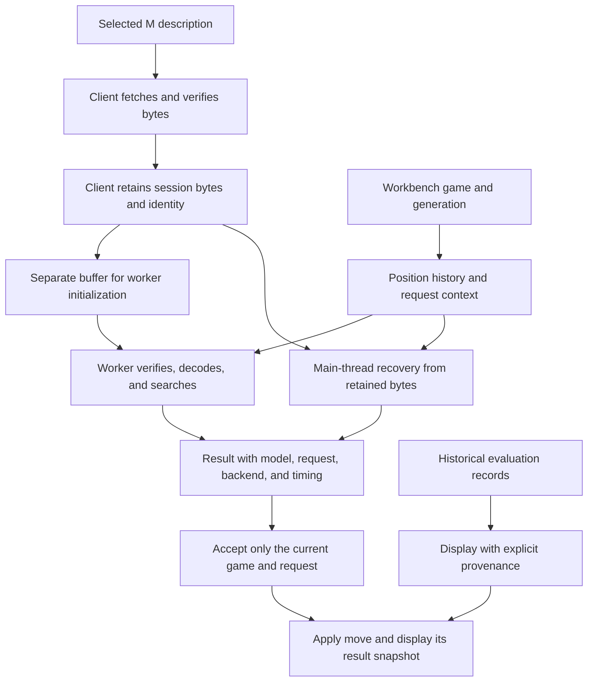
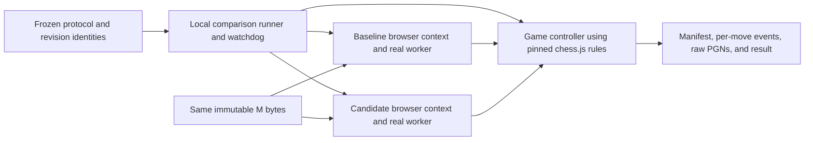

# Tinyaz: verified M delivery and bounded software evaluation

- **Author:** Hansel Hansel, with Codex
- **Status:** Proposed. All sections approved. Overview & Goals, Technical Plan, Alternatives Considered, model-loading A, evaluation runtime 1, and raw en-passant choice 3 approved by Hansel on 2026-11-01. Detailed Implementation, including Non-Functional Requirements, approved on 2026-11-02. Saved to the owner-selected destination on 2026-11-02. The five-stage independent EGM review completed on 2026-11-02. Its 21 document actions are addressed by the linked resolution under Hansel's standing auto-accept and subsequent approve/continue instruction. Production implementation and its required verification remain pending; resolving text is not a measured strength result.
- **Date:** 2026-11-01
- **Updated:** 2026-11-02
- **Predecessor:** [Accepted concepts brief](../../../concepts_brief.md), SHA256 `c69431e2c09bf93a186a94345e452da06097381bb9777364bdef3d5188be9feb`.
- **Predecessor resolution:** [Resolved annotated review](../../../goldfish_review_report.md). Hansel accepted all six text proposals on 2026-11-01.
- **Current review and resolution:** [Five-stage report](../reviews/2026-11-02-tinyaz-verified-m/consolidated_review_report.md) and [annotated resolution](../reviews/2026-11-02-tinyaz-verified-m/resolution/goldfish_review_report.md). The latter preserves the original reviewed snapshot and exact amendment patch. All original source findings remain open until implementation evidence exists.
- **Existing design authority:** [Approved M ladder](2026-08-29-tinyaz-m-ladder-design.md).
- **Source baseline:** `bb76439ea7bb4ae84bf15fe1276d75dc336d3cec`. The working branch is `chore/egm-bootstrap-tinyaz`, with existing documentation changes.
- **Selected model-loading architecture:** [Option A](../../../architecture_options.md). The browser client downloads, verifies, and retains M bytes for worker execution and main-thread recovery.
- **Selected evaluation runtime:** [Option 1: real browser contexts](../../../evaluation_options.md). The primary cohort exercises actual thinker and worker code with M bytes held constant.
- **Selected input convention:** [Choice 3: browser raw en-passant retention](../../../encoding_options.md). Align browser input with live Python; preserve separate legal-move rules and record the inspected FEN-training limitation.

## Overview

The browser's model label and stored ratings do not establish which checkpoint is choosing its moves. The source review found that browser loading selects the small S checkpoint while constants and card metadata identify the medium M checkpoint. The Python engine used through UCI already defaults to M. UCI is the command protocol used by chess GUIs and the bot.

This design restores intended delivery of the existing trained M checkpoint, exposes loading failures, identifies the active checkpoint, and rejects results from retired games or requests. It then establishes whether verified software changes improve play under a bounded, reproducible comparison. It does not assume the software fixes will raise Elo.

Browser players should know which model is playing and retain control when loading or thinking fails. Researchers should be able to distinguish a different checkpoint, a software change, more search, and a different measuring method. The first milestone ends with repaired delivery, completed documentation repairs, recorded verification commands and outcomes, and a predeclared comparison result or an inconclusive stop.

The existing M model has 2,426,706 parameters. S has 640,018. This work keeps the from-scratch model goal and the under-3M parameter limit. It uses existing weights before considering a later learning experiment.

## The Problem

The [drift report](../../../2026-11-01_DRIFT_REPORT.md) identifies ten distinct findings. F1 is the approved M-delivery requirement left unmet. F2 and F3 are inaccurate source comments. F4 through F9 are missing public-interface names in owning README contracts. F10 is missing documentation of existing UCI invalid-position behavior. The documentation findings do not establish nine additional strength defects.

The review also found failure paths that undermine model and result attribution. Failed browser loading can become random weights. A worker-to-main fallback can reload weights after readiness without refreshing the reported identity. Reset can leave an earlier search able to return into a new game. These are source-supported risks, not observed live incidents or quantified Elo losses.

Verification and measurement have separate limits. The recorded npm baseline includes 16 existing failures and stops before its TypeScript stage; separately passing chess tests do not make the full command green. PyTorch-dependent checks were not run in the checked environments. The existing snapshot comparison uses one software implementation for both models and at most eight games. It cannot by itself prove that a new engine implementation is stronger.

A larger search budget may change moves while using the same weights. A new rating protocol may change a reported number without changing moves. Loading existing M into the browser does not change the Python engine's M default. Combining these effects would obscure why a result changed and could lead to unnecessary training.

All ten implementation findings remain OPEN. This design draft does not repair code, rerun model tests, play matches, or validate a live deployment.

## Goals

1. **Restore intended model delivery.** Browser trained play must use verified existing M weights. Readiness, fallback, completed results, and card claims must identify the active checkpoint. A missing, corrupt, or mismatched intended model produces a visible failure. Random demonstration is explicitly selected and carries no trained-model rating claim. Preserve existing S utilities and legacy S/M reading.
2. **Keep results attached to their game and model.** Reset, engine replacement, and delayed replies must not apply old work to the current game. A failed turn remains stopped until explicit recovery. Carry forward the accepted checkpoint pinning, retry, and deadline requirements from the brief. Technical Plan 3 and Detailed Implementation 3 define their interfaces and fixtures.
3. **Close all ten findings with the right evidence.** Repair F1 in behavior and its contracts. Correct F2/F3 comments without changing migrations or database initialization. Complete the owning inventories for F4-F9. Document F10's current valid-prefix retention and silent command handling. Keep each finding open until its own completion evidence exists.
4. **Record required verification results.** Account for every existing failure and missing check in the accepted verification ledger. Preserve actual application integration and authentication contracts. Verify model encoding, inference, legal moves, search value/history behavior, and restoration after failure using focused fixtures. Declare numerical tolerances before parity results. Distinguish a passing subset from a green full suite.
5. **Isolate any playing-strength effect.** Preserve existing M bytes as the control. Keep browser S-to-M delivery separate from an actual same-M software change. Preserve fresh-root 64-visit results. Verify an identical-engine control before candidate comparisons. Require browser/Python parity evidence before Python games support a browser claim. Freeze software and model identities, openings, outcomes, and statistical rules before games. Report faults, raw results, uncertainty, and stopping reason. Do not claim a Python software gain when its execution did not change.
6. **Keep the first experiment finite.** Carry forward the accepted one-machine, one-game-at-a-time limits: a 10-minute preflight; at most 20 complete opening/color pairs, 40 games, or 60 minutes for the comparison; 30-second readiness and 90-second command watchdogs; 4 GiB aggregate evaluation-process resident memory; and 256 MiB of new outputs. Preserve incomplete records and faults. A fault or an early resource/time stop makes the strength result inconclusive. These limits are ceilings, not performance or statistical-power claims. Detailed Implementation 5 defines the required accounting before any run.
7. **Preserve honest historical claims.** Keep historical Stockfish-instrument results, Lichess BOT-pool ratings, and one-visit controls separate. Treat missing checkpoint or measurement provenance as unknown. Preserve the old eight-game instrument and historical records. A supported no-gain result can finish this milestone; a higher Elo number is not required for delivery correctness.
8. **Keep implementation and documentation together.** Every later meaningful code change includes affected README contracts, usage/API/configuration documentation, and design progress updates. Keep edited source and test files below 400 lines. Inspect each final diff and compare docs with behavior, interfaces, invariants, side effects, paths, and commands before a green commit or completion claim. Record why no doc change is needed when applicable. Preserve approved requirements and unrelated dirty work.

## Non-Goals

- Retraining or changing checkpoint bytes, model width, training data, targets, or the learning objective in this milestone.
- Starting training automatically after a disappointing or inconclusive comparison. A later training proposal needs an observed learning weakness or demonstrated target defect and its own criteria and budget.
- Adding a clock-management mode, increasing the published 64-visit budget, caching position evaluations, or retaining search trees between moves. Those require separate evidence and decisions.
- Changing F10 to atomic position parsing, changing migration discovery, or adding database behavior to fix comments and index omissions.
- Rebuilding the Grok authoring template, changing unrelated auth/PWA runtime behavior, or weakening checks to obtain green output. Portable test repair remains in scope.
- Expanding TypeScript serialization, introducing a model registry or publication service, or redesigning legacy promotion in order to select existing M.
- Publishing weights or metadata, deploying the app, changing a live bot/account, or running paid or remote compute.
- Replacing missing measurements with old checkpoint ratings, changing the rating instrument without a separate label, or promising a numerical Elo gain.

## Open Questions

The verification ownership, environment, commands, tolerances, experiment protocol, file map, estimates and rollback are specified by the approved Detailed Implementation and the owner-authorized review resolution on 2026-11-02. The accepted six resolution decisions and the owner's A/1/3 selections remain authoritative.

- **Execution evidence:** Actual environment imports, required test results, browser latency/resource use, numeric parity, final candidate identity and comparison outcomes remain unmeasured. These are required future outputs, not assumed passes or new policy decisions for the implementer.
- **Known deferred compatibility:** Python/browser draw-claim behavior and the inspected default-FEN training versus live raw-target input convention remain distinct. Do not claim full-engine or training consistency from numeric parity, or automatically retrain to address either gap.
- **Review:** The owner-selected final destination is this file. All five stages and nine fresh reviewers completed. Their 21 document actions have explicit resolution edits, preserving original IDs/severities and known coverage limits. Approval, review and text resolution do not establish code completion, a new full-suite pass, or an Elo gain.

## Critical User Journeys

### CUJ 1. Play with the intended trained model

- **Given:** The current M bytes are available and match the selected checkpoint description.
- **When:** A player opens the workbench and requests a model move.
- **Then:** The client verifies and retains those bytes. The worker searches with them. The card and completed result identify that model. A browser move records its own visits and timing.

### CUJ 2. Recover without changing the model

- **Given:** M is verified and a worker becomes unavailable before the operation deadline.
- **When:** The client makes its one permitted transition to main-thread execution.
- **Then:** It retires the worker and decodes the retained bytes. No second weight download occurs. The response identifies the actual backend. If time or recovery fails, the turn stops visibly.

### CUJ 3. Reset or retry after a failure

- **Given:** A search or initialization is pending, or a turn has failed.
- **When:** The player resets, retries the engine, or retries the move.
- **Then:** Old work cannot mutate the current game or its UI state. A retry is explicit and has a new request identity. Reset can clear a move failure but does not hide an unresolved load failure.

### CUJ 4. Select a random demonstration deliberately

- **Given:** The player chooses the separate random-demo action.
- **When:** A new demo engine session starts.
- **Then:** It uses deterministic S random weights and is labeled untrained. It shows no trained-checkpoint rating claim. Switching modes replaces the engine session and invalidates earlier work.

### CUJ 5. Compare software with unchanged weights

- **Given:** The browser fixture, identities, control checks, and frozen protocol have passed preflight.
- **When:** The local runner plays the one accepted comparison cohort.
- **Then:** Both versions use the same M bytes, fixed 64 visits, and the same recorded game rules. Results include raw games, faults, timing, and the stopping reason. The runner neither trains nor publishes. A fault or early resource stop leaves the strength result inconclusive.

## Technical Plan (Architecture)

Technical Plan approved by Hansel on 2026-11-01. It specifies future implementation behavior. Existing source and the ten original findings are unchanged.

### 1. Selected boundaries and data flow

The browser client owns checkpoint loading and the retained binary, as selected in option A. The primary comparison runs actual engine code in real browser contexts, as selected in evaluation option 1. The workbench remains the authority for the game. Workers receive complete requests rather than maintaining a second game between moves. Each search still starts a fresh tree.



The browser runtime requires no new JavaScript dependency, model service, registry, or database. It uses the project's installed Playwright, Vite, React, and chess.js packages. Detailed Implementation 4 separately defines the Python verification environment and dependency declarations. Exact tool and browser identities are captured before a run. The local inspection found Node 24.4.1, Playwright 1.62.1, Vite 8.2.2, chess.js 1.4.0, and an existing Playwright Chromium executable. This was a path/version inspection, not a launched-browser or performance check. Execution must re-record the actual versions and executable hash.

### 2. Checkpoint description and verification

Extend the selected-model constants beside `WEIGHTS_URL` and `MODEL_NAME`. The trained description contains the model name, URL, packed version, parameter count, byte length, and expected SHA256. Use the current M control: 2,426,706 parameters, 9,706,840 bytes, SHA256 `b716fe7b9a663c8c839f49cefd592ebc7ba771452057bac2404c24f48d2af4ee`. Do not change the general S channel default.

Create a small checkpoint module for shared types and raw-buffer validation. Check the header, supported S/M architecture, declared/exact length, finite tensor payload, and digest. Trained readiness requires the expected M description to match. Missing cryptographic verification support is a visible environment failure. Do not bypass verification or return random weights.

Change `loadPlayWeights` to return verified bytes and identity, not decoded tensors. Its default becomes the intended M description. This is an intentional internal API change. Update the client, worker, and owning contracts together. The worker stops calling this loader. Preserve `randomWeights`, generic S/M unpacking, the S writer, and the existing packed format. The separate gauntlet remains outside this workflow and is not used as the comparison runner.

The client fetches once per initialized trained session. It retains the verified binary privately. Worker initialization receives a separate buffer. The retained original must never be transferred away or exposed as a mutable view to the UI. The worker independently checks the received bytes against the pinned identity, then decodes them. It performs no weight fetch. Main-thread recovery decodes the retained original after retiring the worker.

Do not attach the current hash to old rating records without evidence. A later public weight replacement must update its matching selection description under a separately approved publication design. If current frontend selection and served bytes disagree, this milestone fails visibly rather than silently following the new file.

For the explicit random demonstration, the client generates the existing deterministic S weights with seed 2026 and uses the S packer in memory. It computes their digest and retains the resulting binary through the same ownership boundary. The mode is `random-demo`, not trained M. No file is published. There is no new M-writing use case.

### 3. Internal interfaces

The following describes data contracts, not production implementation code.

```text
CheckpointSpec
  name, url, packedVersion, parameterCount, byteLength, expectedSha256

ModelIdentity
  mode: trained | random-demo
  modelName, sha256, packedVersion, parameterCount, channels, sourceId
  seed: 2026 for the explicit demo; absent for trained M

GamePosition
  initialFen, movesUci[], expectedFen

RequestContext
  engineSessionId, gameGeneration, requestId, position, requestedVisits

SessionReady
  engineSessionId, modelIdentity

EngineState
  stage: loading | starting | ready | thinking | recovering | failed | stopped
  engineSessionId, modelIdentity?, backend?, backendEpoch, activeContext?, error?

ThinkResponse
  context, modelIdentity, backend, backendEpoch
  kind: move with result | terminal with terminal
  SearchOutcome fields defined in Detailed Implementation 3
  completedVisits, searchMs, moveElapsedMs, attempts[]
```

A trained identity requires the selected M digest. A demo identity requires its generated S digest and explicit mode. The UI cannot infer mode from a rating record. Request IDs increase within the workbench session. The engine session and backend epoch distinguish replacement engines and workers. Validate messages at the runtime boundary; TypeScript assertions alone are insufficient.

Keep `createThinker` as the application factory. It returns the initial `ready` promise, a current-state getter/subscription, `think(request)`, `cancel(requestId)`, and `terminate()`. The initial ready promise identifies the immutable session model. Ongoing backend and failure changes use state notifications and per-response fields. Request-scoped notifications carry the same context. A retired request cannot publish a failure or completion into a newer request. This avoids treating the first readiness report as the current backend forever.

The trained factory is the default. A separate explicit `random-demo` factory option creates a new session. No URL parameter or failed fetch can silently change the mode. Detailed Implementation 2 and 3 specify the field declarations, exports, and call-site migrations.

### 4. Preserve history inside a fresh search

The workbench captures an immutable position snapshot before awaiting the engine. It includes the initial FEN, complete UCI move sequence, and expected current FEN. A shared position helper replays those moves through chess.js and verifies the final FEN. Reject malformed moves or a mismatched final position before search. This private reconstruction never partially mutates the workbench game.

The current `oneVisit` reconstructs a board from FEN and loses earlier repetition counts. A rules-only probe reproduced the difference with a repeated knight sequence. This establishes a search-context defect to cover with a focused regression before changing it. The probe did not measure model strength.

Extend `search` and `searchAsync` to accept either a complete position or a legacy FEN string. Normal workbench requests use the complete position. Legacy FEN callers keep their current limited-history analysis behavior. Build one private history-bearing board for a request. Each visit pushes its selected line and restores the board in a `finally` path. Verify root FEN and history restoration after completion, cancellation, and injected error. Do not retain a tree or board between requests.

Keep selection, priors, value-sign backup, tie-breaking, and the 1/64 visit meanings unchanged. A new root expansion still consumes the first visit. Check cancellation and remaining time at visit boundaries. Main-thread search continues to yield so cancellation can be observed. An incomplete search is an abort, not a successful 64-visit result. A terminal root produces a typed terminal outcome through the engine protocol, not an illegal move or an operational-fault label.

The current browser and Python terminal predicates have a demonstrated draw-claim difference. Do not silently change Python training or UCI draw handling here. Numeric encoding/inference fixtures and full-game rule compatibility are separate checks. Preserve the known difference in the verification ledger. Python games cannot be offered as browser-strength evidence until the required compatibility exists. The primary browser comparison does not depend on that claim.

**Owner-approved input convention, 2026-11-01:** Hansel selected [en-passant choice 3](../../../encoding_options.md) after a source-level probe reproduced a second compatibility gap. Retain the raw target from the initial FEN or last double pawn move beside the private history-bearing board. Pass it into browser encoding even when no legal capture exists.

Restore that raw target on every undo, error, and cancellation path. Leave chess.js legality and repetition rules, Python encoding, and default-FEN dataset generation unchanged. Detailed Implementation specifies the exact state, APIs, files, and parity cases.

A FEN-only caller cannot recover raw information omitted before the request. The input change can alter logits, priors, and moves with existing M; selection, softmax, and backup arithmetic stay unchanged. It joins the combined software treatment and establishes neither a strength gain nor a fix for the inspected training/live-input difference. These are approved implementation requirements; the source remains unrepaired.

### 5. Worker protocol and recovery

Introduce an explicitly versioned internal thinker protocol, independent of packed-weight version 1. Initialization carries the protocol version, engine session, backend epoch, model identity, and the separate binary buffer. The worker verifies and decodes it before acknowledging readiness. A think received before successful initialization is rejected. Remove both worker-side implicit random paths.

A think carries its request context and the remaining operation budget. A response echoes context and reports actual backend/identity, completed work, and timing. A malformed or obsolete message is not accepted as a move. The client compares every response with its active session, epoch, and request. The workbench performs the additional game-generation and position check before applying a legal move.

| Event                                                         | Handling                                                                                      |
| ------------------------------------------------------------- | --------------------------------------------------------------------------------------------- |
| HTTP, format, length, digest, or trained-model mismatch       | Reject loading; retain a visible load failure. No random substitution.                        |
| Worker unavailable at construction/startup or transport crash | Retire that worker. Transition once to main execution from retained bytes if budget remains.  |
| Worker model verification or request identity mismatch        | Fail visibly. Do not treat inconsistent data as an ordinary retry.                            |
| Terminal position                                             | Return a typed terminal outcome. Do not run a retry or manufacture a move.                    |
| Search exception or illegal result                            | Stop the turn with a diagnostic category. Retry requires explicit action.                     |
| Cancellation or expired deadline                              | Reject/discard the attempt. Never start fallback after the deadline.                          |
| Engine disposal                                               | Abort initialization, retire the worker, settle pending promises, and reject future requests. |

Within a session, a successful worker-to-main recovery remains on main execution. An explicit engine retry creates a new engine session. A reset cancels or invalidates current work without changing the pinned checkpoint. A busy worker can be terminated; a later request recreates worker execution from retained bytes. That replacement increments the backend epoch and is recorded. Main-thread work stops cooperatively; a new request waits for its cleanup rather than running two main searches concurrently.

### 6. Deadlines and timing

Use the client's monotonic clock as the acceptance authority. Initialization and each requested move have an explicit start and a 90-second deadline. If a move is queued while initialization is pending, its budget includes that wait and cannot extend the initialization deadline. A move requested after successful initialization gets its own 90-second operation budget. Fallback never resets that clock.

Keep the existing eight-second worker-start acknowledgement timer as a subordinate bound after verified bytes are available. Its expiry can trigger the one permitted recovery only while the total budget remains. It is not another weight-loading attempt. The evaluation runner's accepted 30-second readiness watchdog is stricter and remains independent.

Pass remaining time to the worker, which establishes its own local monotonic check. The client still rejects a response received after its authoritative deadline. Abort fetches, terminate a stalled worker, and cancel asynchronous main search when possible. Browser scheduling and a synchronous evaluation can delay a callback. The deadline prevents acceptance or a new retry after expiry; it is not a hard real-time CPU preemption promise. Measure overrun and responsiveness instead of hiding them.

Record initial fetch/verification and backend setup separately from core search time. Record every attempt and disposition. `moveElapsedMs` covers readiness wait, queueing, setup, failed attempts, recovery, and result delivery after the request began. Core `searchMs` remains a distinct measurement. Diagnostics can record partial work; only a complete move response may claim its completed visit budget.

### 7. Workbench and card behavior

Keep game ownership in `Workbench`. Extract engine session/subscription and request-lifetime handling into a small hook so edited files stay below 400 lines. A reset increments the game generation and replaces the current game. Success, error, and finalization callbacks all check current ownership. An old callback cannot clear a newer request's thinking state or overwrite its error/result.

Provide explicit retry-engine and retry-move actions where applicable. The move retry preserves the position and starts a new request. Reset starts a new game. A load failure stays visible while recovery is pending and until recovery succeeds. Automatic-turn effects do not repeatedly restart a failed turn. The deliberate random-demo action changes mode only after a click and starts a new game/session.

The selected visit count describes the next request. Card timing, tree, value, identity, and visit count come from the last completed response snapshot. Changing the selector cannot relabel an old result. Convert value to the display perspective from that request's side to move. Keep user-facing diagnostics short; retain request IDs and detailed failures in diagnostic/run records.

The model name and parameter count come from verified identity. Random-demo mode is labeled untrained and hides trained rating claims. Legacy metadata remains unchanged and is shown as recorded history with unverified checkpoint provenance where appropriate. Missing records are unavailable, not running. The one-visit random control is not called an Elo. Label arithmetic estimates by their actual convention and architecture; they are not measured whole-move compute.

`Roadmap` is neutral project-method text, separate from active-session identity and recorded results. Make it prop-free, render a visible `Project stages` heading and the three stage descriptions below, and remove metadata-derived `current`, `rated`, `done`, and `later` badges. It never displays a numerical rating or declares the current session rated. It may remain visible in both trained and demo mode because it describes the project method. Workbench removes the `current`/`rated` call and all phase/rating derivation used to describe the active session. Session status, reset text, and the header derive model/mode information from current verified engine state; stored metadata never supplies an active-session Elo. CardPanel alone may display preserved recorded results under the explicit historical/unbound labels already required here. In demo mode, hide trained-checkpoint rating results everywhere in the rendered Workbench. ThinkPanel's next-request selector explains only its visit budget and does not promise publication or confer a rated mode.

| Stage | Title | Exact body                                                                             |
| ----- | ----- | -------------------------------------------------------------------------------------- |
| 0     | Play  | An untrained net demonstrates legal moves and the search tree.                         |
| 1     | Learn | Human games train the policy. Random-move controls are recorded separately.            |
| 2     | Climb | Self-play trains candidate checkpoints. Each recorded result states its search budget. |

### 8. Primary browser comparison

Use a dedicated evaluation-only Playwright runner and a small local Vite fixture. The fixture imports actual chess engine modules. It is not a new app route, public API, training entrypoint, or general evaluation platform. Use a separate component fixture to mount the actual workbench for UI behavior checks. Do not weaken the existing generic smoke command's path/auth/deployment checks to make it serve this purpose.



The provisional Python comparison filename in the brief is refined by the owner's real-browser selection. The driver uses the already installed JavaScript Playwright API. It does not add a Python browser dependency or claim a new Python engine result. The approved Detailed Implementation section lists the exact browser driver, fixture, baseline preparation, records, watchdog, and test file map.

Start fixture servers with explicit evaluation configuration and `configFile: false`. Bind loopback addresses. Do not load the production Vite configuration, migration hooks, or auth/PWA bootstrap. Serve only the pinned engine source roots, shared fixture, installed dependencies, and controlled model assets. The component fixture uses the installed React tooling and actual component code. No fixture entrypoint is included in the production app.

Use one recorded Chromium executable and the same launch configuration for both versions. Open two isolated player contexts for a game. Play one game at a time and close prior contexts before starting another game. The Node-side game controller uses the same pinned chess.js version as the fixture; it does not run MCTS or substitute Python draw rules. Supply full move history to the candidate. The baseline adapter supplies its legacy FEN-only request. That history difference is part of the software treatment, not hidden by rewriting baseline code.

Pin the baseline source to `bb76439ea7bb4ae84bf15fe1276d75dc336d3cec`. Freeze the candidate at an exact verified implementation commit before the final cohort. Prepare both source snapshots in separate run-owned directories and serve those immutable snapshots. Disable HMR and update-driven reloads. Do not check out over the active work or modify original production files. Share only the recorded dependency installation and record its identity.

The primary comparison is **same-M browser software**, not S-to-M delivery. The old source requests S, so the baseline fixture must explicitly serve the exact M body at that legacy request path. Record that normalization, delivered hash, response status, and ready parameter/source fields. The candidate must request the intended M URL and natively report the matching digest. Never forge a native baseline digest that its old API does not report. Attribute baseline identity to controlled delivery plus loaded-architecture evidence.

Any failed model request, random fallback, unexpected worker closure/backend change, illegal move, or protocol discrepancy makes the comparison inconclusive. This includes an old fallback that cannot preserve verifiable identity. Recovery scenarios are exercised separately and recorded, not converted into selective strength wins. Candidate UI checks independently verify the unmodified M URL and fail on an S request, so the baseline normalization cannot mask a candidate loader bug.

Before candidate games, run an identical-engine control with disjoint short fixtures. It must verify model delivery, deterministic request results, legal game handling, color swaps, and raw-record accounting. The 10-minute preflight also records cold readiness, 64-visit move latency, memory, and runtime identities. If that control or preflight cannot complete within its limits, stop before the primary cohort.

Use one locked set of 20 opening/color pairs for the final cohort. Development and control fixtures are separate. Lock candidate identity, openings, outcome rules, and the statistical method before observing candidate results. Do not tune successive candidates on that final set or silently extend the sample. The exact positions and decision method are specified in Detailed Implementation 6, approved on 2026-11-02.

The controller uses the pinned browser-library checkmate/draw predicates. It validates every engine move. There is no synthetic material winner or added ply adjudication in this browser protocol. A nonterminal game interrupted by the run cap stays incomplete. This is a new, labeled browser comparison instrument, separate from the historical Stockfish instrument. Preserve the historical 160-ply/material protocol and its records unchanged.

Enforce one machine, one game at a time, the 60-minute/40-game cohort cap, 30-second readiness and 90-second command watchdogs, 4 GiB aggregate evaluation-process resident memory, and 256 MiB of new run-owned outputs. Account for the controller, fixture servers, Chromium, and descendants. An external watchdog must be able to stop stalled browser-side work. Temporary fixture/profile/cache artifacts belong to the run and are accounted for; pre-existing dependencies and control weights remain unchanged. Record cleanup and verify that owned processes and listening ports are gone.

Persist the run manifest before games. It contains revision and source hashes, tool/browser/dependency identities, checkpoint proof and normalization, rule convention, visits, openings, resource limits, and statistical plan. Record each request, response, actual backend, attempts, timing, faults, game ID, color, moves, and outcome. Write raw PGNs and incremental events. Record a final completion or stop reason even after a crash. Never write results into public weights or legacy rating metadata.

A complete error-free cohort can support the predeclared browser-software comparison. Report W/D/L, paired uncertainty, and limitations. An incomplete or faulty cohort cannot make a strength claim. No result is automatically a new Stockfish-scale Elo, Lichess rating, or proof of a trained-weight gain. Retraining remains a separate decision.

### 9. Component and contract map

| Boundary                                               | Planned change                                                                                                              | Owning documentation                                      |
| ------------------------------------------------------ | --------------------------------------------------------------------------------------------------------------------------- | --------------------------------------------------------- |
| Model constants and `weights.ts`                       | Selected M description; strict verified-buffer loading; preserve S utilities and packed format                              | Chess README and root model-selection description         |
| New checkpoint/position/protocol modules               | Shared identity checks, history reconstruction, request/result contracts, and message guards                                | Chess and worker READMEs                                  |
| `think-client.ts` and `think.worker.ts`                | Client-owned bytes, strict initialization, deadlines, actual state/results, one recovery, cancellation/disposal             | Chess and worker READMEs                                  |
| `mcts.ts`                                              | History-bearing per-request board, restoration, cancellation checks, and typed terminal handling; same fresh-tree selection | Chess README and search API documentation                 |
| Workbench, engine hook, card, think panel, and Roadmap | Current-request ownership, explicit recovery/demo actions, truthful model/history/result display                            | Chess component README and play usage                     |
| F2/F3 source comments                                  | Correct migration/initialization descriptions without behavior changes                                                      | Migration and library contracts if comparison requires it |
| F4-F9 inventories and F10 behavior                     | Exact owning-interface additions and existing UCI error/state documentation                                                 | Owning READMEs from the repair register                   |
| Browser evaluation driver and fixtures                 | Real-browser comparison, controlled baseline, game/record/resource management                                               | Training/scripts READMEs and experiment protocol          |
| Verification environment and focused tests             | Per-failure ledger, declared numerical checks, history/error/control cases, no weakened integration checks                  | Root/training verification docs and experiment protocol   |

Detailed Implementation 2 enumerates the concrete source, documentation, and test files. Add any later required file to that map and its owning contract before editing it. Keep source/test files below 400 lines through scoped modules. Include code and corresponding documentation in each green change. Compare the final diff with actual behavior, interfaces, invariants, side effects, file paths, and commands before committing or reporting completion. The ten findings close only on implementation evidence. Drafting does not close them.

## Alternatives Considered

The selected approach uses existing M, retains verified bytes in the client, and evaluates actual engine code in real browser contexts. These decisions come from the [accepted brief](../../../concepts_brief.md), [loading choice](../../../architecture_options.md), and [evaluation choice](../../../evaluation_options.md), and [raw en-passant choice](../../../encoding_options.md). The alternatives below preserve the reasons for those choices and the conditions for later work.

### A1. Change all architecture defaults to M

- **Mechanism and benefit:** Make M the implicit width for tensor creation and parameter counting across helpers.
- **Costs and failure conditions:** Existing random generation, the TypeScript writer, tests, and S tools depend on the S default. A global width change can break those boundaries without fixing checkpoint selection consistently.
- **Reason not selected:** The approved repair selects M at the play-loading boundary. It preserves S utilities and legacy packed readers. Changing every architecture default is unnecessary for that repair.
- **Disposition:** Rejected for this milestone. A future default change needs its own compatibility case.

### A2. Retrain immediately

- **Mechanism and benefit:** New data, targets, or optimization could improve learned predictions if learning is the bottleneck.
- **Costs and failure conditions:** Training spends compute and changes the checkpoint before delivery and measurement are dependable. Better weights can still be hidden by a wrong loader or mislabeled by stale metadata. A result would also mix software and learned-weight effects.
- **Reason not selected:** Use existing M for the first repair and comparison. Training needs a repeatable learning weakness or demonstrated target defect, corrected inputs where needed, a separate budget, and independent pass/stop criteria.
- **Disposition:** Deferred. A disappointing software comparison does not automatically open training.

### A3. Increase visits immediately

- **Mechanism and benefit:** Existing controls can allocate more search to the same weights and test whether additional thinking helps.
- **Costs and failure conditions:** More visits consume time and can increase timeout or responsiveness problems. They change the compute budget. A higher-budget result cannot be relabeled as a new fixed-64 result.
- **Reason not selected:** Preserve fresh-root 64 visits for the primary comparison. Verify identity, correctness, and latency first. A later visit-versus-strength experiment must have its own declared budget and label.
- **Disposition:** Deferred. The current design does not rule out useful extra search.

### A4. Build clock management, caching, or tree reuse first

- **Mechanism and benefit:** A time manager could allocate available time; evaluation caching could avoid repeated work; tree reuse could retain useful search statistics.
- **Costs and failure conditions:** These add interruption rules, state ownership, invalidation, memory limits, and work-accounting decisions. Reused statistics change what a later request gains from 64 new visits. Benefit is unmeasured.
- **Reason not selected:** Repair context and delivery, then profile. Admit a follow-up only when evidence supports that specific change. The approved per-request history board still starts a fresh search tree and retains no search state between requests.
- **Disposition:** Deferred separately. These are not prerequisites for delivering existing M.

### A5. Change the rating ruler or use easier opposition as the improvement

- **Mechanism and benefit:** Another protocol or opponent population can answer a different playing-strength question. Easier opposition may produce more wins.
- **Costs and failure conditions:** A changed number alone cannot identify a software or weight improvement. Openings, game-end rules, opponent settings, and populations can all change the instrument.
- **Reason not selected:** Preserve the historical Stockfish instrument and records. Label the selected browser comparison separately and hold its method fixed across both software arms. It measures the browser-software comparison rather than replacing the historical Elo or Lichess rating.
- **Disposition:** Rejected as a standalone strength claim. New instruments remain valid when their purpose and limitations are explicit.

### A6. Treat F4-F9 index omissions as runtime defects

- **Mechanism and benefit:** Auditing the omitted exports can reveal an independent implementation issue if one exists.
- **Costs and failure conditions:** Missing names in a README do not by themselves justify changing behavior. Runtime refactors can create regressions in unrelated libraries and make the repair harder to verify.
- **Reason not selected:** Revalidate the exact export sets and complete their owning contracts. Admit a runtime repair only on separate evidence, with its own regression and documentation changes.
- **Disposition:** Rejected. F4-F9 remain documentation repairs.

### A7. Make F10 position parsing atomic now

- **Mechanism and benefit:** Validate a whole move list before replacing the stored position. Invalid commands would leave no applied prefix.
- **Costs and failure conditions:** This changes an existing error/state contract. It requires compatibility and history tests. No valid-game requirement violation or strength effect was established by the documentation finding.
- **Reason not selected:** Document the current valid-prefix retention and silent command handling. Keep the engine behavior unchanged for F10.
- **Disposition:** Rejected for this milestone. A later atomic-parsing change needs an approved behavior decision.

### A8. Restore the whole Grok template to make tests green

- **Mechanism and benefit:** Recreating missing authoring assets and repository defaults could satisfy some template-specific checks.
- **Costs and failure conditions:** This expands beyond chess into authoring support and workspace assumptions. It could conceal the actual ownership of a failing check or alter auth/PWA behavior to satisfy a fixture.
- **Reason not selected:** Classify failures in the verification ledger. Isolate portable fixtures, preserve real application integration checks, and decide ownership before moving or removing an authoring-template check. A passing subset is still reported as a subset.
- **Disposition:** Rejected. Narrow verification repair remains in scope.

### A9. Build a publication service now

- **Mechanism and benefit:** Coherent release activation and rollback could prevent mixed weights/metadata and old measurements attached to new bytes.
- **Costs and failure conditions:** A publication redesign adds lifecycle and compatibility work across training callers before this milestone needs new weights. An incomplete redesign could create another activation path.
- **Reason not selected:** The first comparison uses unchanged control assets and an evaluation-only runner. Verified identity fails visibly on a mismatch. Before later publication, explicitly decide missing-result behavior, complete-release identity, activation, single-writer coordination, runtime checks, and rollback.
- **Disposition:** Deferred until publication enters an approved scope. Current publisher risks remain documented.

### A10. Adopt stronger external engine weights

- **Mechanism and benefit:** External weights could provide another practical engine or comparison baseline.
- **Costs and failure conditions:** They change the from-scratch model goal. They do not demonstrate an improvement to the project's own learned weights or repair its delivery/evaluation defects.
- **Reason not selected:** The existing goal and parameter constraint remain authoritative. This milestone uses the project's existing M checkpoint.
- **Disposition:** Outside the current goal. A goal change needs explicit owner approval.

### A11. Let the worker load and download again on fallback (loading B)

- **Mechanism and benefit:** Normal loading stays in the worker. The client retains identity without keeping the original 9.7 MB binary.
- **Costs and failure conditions:** Recovery needs another fetch, verification, and decode within the remaining deadline. It fails if the network/cache is unavailable or the served asset differs from the pinned checkpoint. Less retained client data does not establish a lower total peak.
- **Reason not selected:** Hansel selected A. One client owns the download and retains verified bytes for recovery without another network request. Its memory cost remains an explicit measurement.
- **Disposition:** Not selected. Reconsider only through an approved loading-architecture change.

### A12. Let the worker load and return bytes to the client (loading C)

- **Mechanism and benefit:** Loading begins in the worker and the client receives a recovery copy before readiness is accepted.
- **Costs and failure conditions:** Both sides participate in a binary handoff and acknowledgement. A worker failure, missing buffer, cancellation, or out-of-order message before that handoff completes must not create a ready session. The client still retains the binary.
- **Reason not selected:** Hansel selected A, which places download and retention in one owner and avoids the return handshake. No startup or memory advantage of C was measured.
- **Disposition:** Not selected. A future measured need can support a new decision.

### A13. Use TypeScript search in Node as the primary comparison (runtime 2)

- **Mechanism and benefit:** A small adapter can run the same search modules without UI or browser-startup orchestration.
- **Costs and failure conditions:** It does not measure loading, worker recovery, or browser timing. Browser-to-Node parity is required before results support a browser algorithm claim. Adapter, dependency, history, and adjudication differences can invalidate the comparison.
- **Reason not selected:** Hansel selected real browser contexts for the first comparison. That exercises the actual thinker and worker. Separate component checks still cover UI claims and interactions.
- **Disposition:** Not selected as primary. Node remains useful for focused unit and controller tests; no Node engine-adapter project is added here.

### A14. Use the existing Python UCI engine as the primary comparison (runtime 3)

- **Mechanism and benefit:** Reuse the established UCI path to study Python engine behavior or compare checkpoint weights under an explicit Python protocol.
- **Costs and failure conditions:** Python already defaults to M. An unchanged Python engine cannot measure browser software repairs. The recorded draw-claim difference prevents assuming full-engine equivalence. Missing PyTorch, hidden faults, identity drift, or an altered instrument can also invalidate results.
- **Reason not selected:** Hansel selected the actual browser runtime. Keep Python checks and historical UCI records in their proper scope. Python results may support a browser claim only when the required compatibility evidence exists.
- **Disposition:** Not selected as primary. The Python runtime and old rating instrument remain unchanged by this choice.

### A15. Keep both en-passant encoders unchanged (input choice 1)

- **Mechanism and benefit:** Retain browser legal-target input and live Python raw-target input. Numeric checks on identical normalized FENs can still compare inference for those identical inputs. The primary browser-to-browser experiment remains usable with its stated software treatment.
- **Costs and failure conditions:** Live-history inputs still differ after ordinary double pawn moves and pinned-capture positions. Normalizing Python through default FEN would conceal that runtime difference if presented as full input parity. Python games still cannot support a browser claim without separate input/rule compatibility evidence.
- **Reason not selected:** Hansel selected choice 3 on 2026-11-01 to align browser input with the existing live Python raw-target convention. Keeping both unchanged would leave that accepted input repair undone.
- **Disposition:** Not selected. Preserve normalized-FEN parity only as its narrower test scope; do not use it to declare live-history compatibility.

### A16. Make Python encode only legal en-passant targets (input choice 2)

- **Mechanism and benefit:** Change Python plane 16 to include a target only when a legal en-passant capture exists. This aligns it with the current browser and the inspected default-FEN training-row path, including absent adjacent pawns and pinned captures. Other planes, checkpoint shape, weights and rules can remain unchanged.
- **Costs and failure conditions:** Existing Python inference inputs and moves can change. That is a separate Python software treatment and cannot inherit historical ratings. It does not establish a strength gain, full historical training provenance, or compatible draw-claim behavior. Regenerating data or training is outside this milestone.
- **Reason not selected:** Hansel selected browser raw-target retention instead, preserving the current Python encoder and Python inference convention. Changing Python as well would exceed that chosen repair and obscure the comparison's software treatment.
- **Disposition:** Not selected. Any later Python convention change requires its own explicit behavior decision and evidence.

### A17. Retain raw en-passant input in the browser (selected input choice 3)

- **Mechanism and benefit:** Carry the raw target from the initial FEN or last legal double pawn move beside the private history-bearing board. Pass it to the actual browser encoder and restore it with every undo/error/cancel. This aligns browser plane 16 with current live Python while preserving Python code, existing M bytes, and separate public legal-move/repetition rules.
- **Costs and failure conditions:** chess.js can discard the target when no adjacent enemy pawn exists. `fen({ forceEnpassantSquare: true })` alone cannot recover that discarded target after an ordinary `e2e4`, although it can expose a retained pinned target. Explicit position/search state is required; a missing restoration or inferred target can change model input incorrectly. An already-normalized FEN-only caller cannot recover omitted information. The inspected training path stores default FEN and reconstructs boards, so its input convention can still differ from live raw-target input. This does not establish the exact provenance of every historical M training row.
- **Reason selected:** This is Hansel's approved choice 3. It fixes the specified browser/live-Python input mismatch without changing the Python encoder. Raw target remains model input only, never a manufactured legal capture or altered repetition key.
- **Disposition:** Selected for this milestone. It joins the combined same-M browser software treatment and may alter logits, priors and moves. Exact thirteen-case parity and raw-target restoration are required. No strength gain, training consistency, new weights or retraining is implied. The draw-claim difference remains separate.

## Non-Functional Requirements

These requirements apply to the proposed implementation below. None is an observed performance result.

- **Identity:** Verify the exact M control before trained readiness, independently verify the worker copy, and keep one immutable model identity per engine session. Retain packed v1 S/M reading and S utility defaults. Do not manufacture historical checkpoint provenance.
- **Failure and ownership:** Every pending operation settles on success, explicit cancellation, disposal, or failure. Replaced sessions and requests cannot update a current game. Worker recovery uses retained bytes once; failed turns require explicit action. Main searches run sequentially and yield between bounded groups of visits.
- **Deadlines:** Initialization and a move each have the approved 90-second total-operation rule. The eight-second worker acknowledgement is subordinate. A late result is rejected even if browser scheduling delays physical interruption. The runner independently enforces 30-second readiness and 90-second command watchdogs.
- **Responsiveness:** Prefer the worker. In browser checks, record main-thread timer gaps during a real M fallback and verify that Reset can be delivered and invalidates the pending move. Report maximum observed gap and cancellation delay. Do not invent a latency target or call a cooperative deadline hard CPU preemption.
- **Resources:** Use one existing local machine and one game at a time. The throughput preflight is at most 10 minutes. The final cohort is at most 20 complete pairs, 40 games, or 60 minutes. Aggregate evaluation-process RSS is at most 4 GiB; all new evaluation-workspace outputs together are at most 256 MiB. Unknown accounting, a fault, or an early cap stop prevents a strength conclusion.
- **Reproducibility:** Freeze both source revisions, the shared dependency installation, Chromium binary/configuration, M hash, rules, opening order, fixtures, and analysis before candidate games. Never hot-reload or silently resume a partial final cohort. A new candidate or changed method needs a new decision and an unused final set.
- **Scope and data:** Bind evaluation servers to loopback and block external browser requests. Keep profiles, snapshots, caches, logs, and results inside one explicit temporary evaluation workspace. Do not include credentials in records. No training, publishing, database migration, deployment, or live account action is part of this implementation.
- **Maintainability:** Keep every edited source and test file below 400 lines. Commit a green change with its affected contracts and design progress. Compare code and docs before each commit and final handoff. A passing subset or recorded skip never becomes a green full-suite claim.

## Detailed Implementation Plan

Detailed Implementation, including Non-Functional Requirements, approved by Hansel on 2026-11-02. Overview & Goals, Technical Plan, Alternatives Considered, loading A, browser runtime 1, and raw en-passant choice 3 remain approved. All F1-F10/K1/K2 and supplementary R-M08-S/R-M08-A implementation findings remain OPEN. The file map and rules describe planned work; review-resolution edits are documentation changes, not completed functional repairs.

### 1. Approval scope, baseline, and verification ownership

Use the existing `chore/egm-bootstrap-tinyaz` branch. Before implementation, capture its full status, tracked diff, untracked documentation inventory, M/S hashes, and baseline test outputs outside the repository. Preserve unrelated work. Review and commit the accepted EGM documentation separately before functional changes; stage explicit paths, never the entire dirty tree by default. Do not commit to `main`.

The primary functional control remains source `bb76439ea7bb4ae84bf15fe1276d75dc336d3cec` and existing M SHA256 `b716fe7b9a663c8c839f49cefd592ebc7ba771452057bac2404c24f48d2af4ee`. The future candidate is one exact green implementation commit, resolved before games. Documentation-only baseline capture does not change the source control. Hash the selected M/S assets and legacy metadata again after verification and after the comparison.

Hansel selected [raw en-passant choice 3](../../../encoding_options.md) on 2026-11-01. Align the browser input plane with live Python by retaining the raw target from initial FEN or the last double pawn move. Leave Python encoding and default-FEN data generation unchanged. This can change browser logits, priors and moves with existing M. The comparison therefore tests the combined browser software repair, including this input change; it does not isolate the gain from each individual fix. The inspected FEN-based training path can still differ from live Python's raw-target convention. Do not claim that this choice repairs training/inference consistency or guarantees strength. Retraining remains outside this milestone.

**Ownership decision approved on 2026-11-02:** Move the four checks that read Grok authoring documents into an explicit `test:template-authoring` command. Three currently live in `brand-check.test.mjs`; the fourth is the recipe check in `write-atomic.test.mjs`. Keep all four assertions. Require an explicit `GROK_TEMPLATE_ROOT` containing the real authoring documents. Missing input fails that command; it is never reported as a pass or silently skipped. This app does not ship those authoring documents, so that command is an upstream authoring contract, separate from the required application test gate. Keep all brand-marker, atomic-write, authentication, PWA runtime, Nitro wiring, and deployed-asset checks required for the app. This decision does not edit the global AGENTS instructions or recreate the Grok template.

The existing 16 failures have the following exact ownership and repair plan. Reproduce them first with saved environment names and versions, without dumping secret values. Implementation and verification results are pending for every row.

| ID  | Recorded failing test                                                    | Owner and chosen repair                                                                                   | Future evidence                                                                                             |
| --- | ------------------------------------------------------------------------ | --------------------------------------------------------------------------------------------------------- | ----------------------------------------------------------------------------------------------------------- |
| V01 | `SKILL.md and AGENTS.md name the marker path and bound this script uses` | Authoring contract. Move unchanged assertion to the explicit authoring gate.                              | Selected template path plus the actual pass/fail, or clearly unavailable external input.                    |
| V02 | `the sections that own the brand-task prohibition never affirm a wait`   | Authoring contract. Move its section parser and assertions with V01.                                      | No weakening or omission of the prohibited wording checks.                                                  |
| V03 | `SKILL.md tells the pass to self-check with the flag this CLI accepts`   | Authoring contract. Retain the CLI-flag assertion in that gate.                                           | A missing skill fails the explicit command.                                                                 |
| V04 | `the build side resolves the template's shipped app-env`                 | App behavior. Supply a temporary `.grok/app-env.json` to the existing `buildAuthEnabled(root, env)` seam. | File false, explicit true override, missing/malformed no-op, and indeterminate-dev behavior remain covered. |
| V05 | `platform chrome overwrites share-card metas and always sets og:title`   | PWA behavior. Pass an empty temporary filesystem and explicit metadata/environment context.               | Existing title/card assertions pass independently of this workspace's title and card files.                 |
| V06 | `published grok.me slug is still a title fallback`                       | PWA behavior. Give the test an explicitly empty site.                                                     | The slug fallback is still asserted.                                                                        |
| V07 | `emits og:image for a public host and prefers a custom card`             | PWA behavior. Create the intended card in that test's temporary root.                                     | Custom-card precedence remains asserted.                                                                    |
| V08 | `placeholder og:image appends site.color when it is 6-digit hex`         | PWA behavior. Use a root without a custom card and an explicit color.                                     | Placeholder color validation remains asserted.                                                              |
| V09 | `document title entities are not double-escaped on og:title`             | PWA behavior. Remove incidental site-title precedence through an explicit fixture.                        | Escaping assertion unchanged.                                                                               |
| V10 | `injects into documents with no head element`                            | PWA behavior. Isolate filesystem/site context.                                                            | Existing fallback injection and title assertions remain.                                                    |
| V11 | `streaming injector matches </HEAD> case-insensitively`                  | PWA behavior. Isolate streaming context in the same way.                                                  | Case-insensitive streaming assertion remains.                                                               |
| V12 | `uses the app name in the injected title tag`                            | PWA behavior. Supply no competing site title.                                                             | App-name fallback remains asserted.                                                                         |
| V13 | `the template ships auth off`                                            | App-env reader behavior. Rename to describe a controlled fixture with auth false.                         | Fixture file is read; missing real app-env still means no override, not an auth-default change.             |
| V14 | `the wrapped command runs with the app env applied`                      | App-env CLI behavior. Copy the exact wrapper to a temporary `scripts/` beside the fixture app-env.        | Child receives false, without relying on this checkout's absent file.                                       |
| V15 | `the CLI still runs when invoked through a symlinked path`               | App-env CLI behavior. Symlink that fixture's scripts directory and invoke the copied wrapper.             | Real-path root resolution and child exit/signal propagation remain covered.                                 |
| V16 | `every hand-over the og skill prints is one this script accepts`         | Authoring contract. Move the recipe parsing assertions to the explicit authoring gate.                    | All documented card/banner/site handovers are still checked against the shipped parser.                     |

Do not change runtime auth defaults, missing-file handling, environment precedence, host validation, or PWA rendering to repair these fixtures. Clear and restore only relevant environment flags in test workers. Clean temporary directories on completion. Keep the Nitro `serverDir`, middleware/assets, and virtual-identity real-file assertions in the required PWA suite.

### 2. Unified file map

`Modify` means a scoped future edit. `Create` means a new future file. Paths beginning `./` are relative to this repository. Planned files are shown as paths rather than links until they exist. No file deletion is planned. Splitting tests moves assertions, not coverage. If a further split or behavioral repair is required, update this map and its owning contract before making it; architecture changes still require owner approval.

| Action | File                                                                       | Change and rationale                                                                                                                                                                                                                                                                                                                                                                                                                                                                                                                                                                                      |
| ------ | -------------------------------------------------------------------------- | --------------------------------------------------------------------------------------------------------------------------------------------------------------------------------------------------------------------------------------------------------------------------------------------------------------------------------------------------------------------------------------------------------------------------------------------------------------------------------------------------------------------------------------------------------------------------------------------------------- |
| Modify | `./package.json`                                                           | Add named script/core/browser gates and evaluation commands below. Keep dependencies and build/deployment commands unchanged. The default application test command must discover new core tests.                                                                                                                                                                                                                                                                                                                                                                                                          |
| Modify | `./scripts/brand-check.test.mjs`                                           | Move only V01-V03 and their document-only helpers to the authoring gate. Preserve every application brand/marker test.                                                                                                                                                                                                                                                                                                                                                                                                                                                                                    |
| Modify | `./scripts/write-atomic.test.mjs`                                          | Move only V16 and its document traversal to the authoring gate. Preserve filesystem safety, CLI, and handover behavior tests.                                                                                                                                                                                                                                                                                                                                                                                                                                                                             |
| Modify | `./scripts/check-auth-invariant.test.mjs`                                  | Repair V04 through the existing explicit-root API. Preserve divergence and unavailable-dev checks.                                                                                                                                                                                                                                                                                                                                                                                                                                                                                                        |
| Modify | `./scripts/with-app-env.test.mjs`                                          | Repair V13-V15 with exact-source temporary wrapper fixtures. Preserve override, missing/malformed file, exit-code, signal, and symlink semantics.                                                                                                                                                                                                                                                                                                                                                                                                                                                         |
| Modify | `./scripts/grok-pwa-plugin.test.mjs`                                       | First move the complete block from `injects before </head>` through `snapshotOgIdentity stamps card=custom from a public card file` into the head test file. Isolate remaining contexts, including streaming cases. Keep deployment integration assertions here. The existing file is 506 lines; both resulting files must be below 400.                                                                                                                                                                                                                                                                  |
| Create | `./scripts/grok-pwa-head.test.mjs`                                         | Own the moved head/meta/card tests and isolated temporary contexts. Together with the preceding file, repair V05-V12 without editing PWA runtime.                                                                                                                                                                                                                                                                                                                                                                                                                                                         |
| Create | `./scripts/template-authoring/contract.mjs`                                | Retain V01-V03/V16 in an explicit Node test entrypoint whose basename does not match the application's `*.test.mjs` discovery. Require `GROK_TEMPLATE_ROOT`, fail on missing docs, and use this checkout's actual parser/marker constants.                                                                                                                                                                                                                                                                                                                                                                |
| Create | `./scripts/template-authoring/README.md`                                   | State authoring ownership, required input paths, all four checks, failure behavior, and the separate invocation.                                                                                                                                                                                                                                                                                                                                                                                                                                                                                          |
| Modify | `./migrations/auth/0001_auth.sql`                                          | F2: correct the header about automatic nested migration discovery. Change comments only; preserve every SQL statement and filename.                                                                                                                                                                                                                                                                                                                                                                                                                                                                       |
| Modify | `./src/lib/db.ts`                                                          | F3: correct `getSql` JSDoc about pg versus PGlite initialization. No query, connection, migration, or ordering change.                                                                                                                                                                                                                                                                                                                                                                                                                                                                                    |
| Modify | `./src/lib/chess/constants.ts`                                             | Add the selected M descriptor and stable operation/protocol limits. Move the existing `paramCount` formula here unchanged so checkpoint validation and weights do not form an import cycle. Keep `CHANNELS` and implicit utility width at S.                                                                                                                                                                                                                                                                                                                                                              |
| Create | `./src/lib/chess/checkpoint.ts`                                            | Own descriptor/identity/verified-binary types, strict raw format/count/length/finite/digest validation, and identity comparison. Import architecture constants, not the decoder.                                                                                                                                                                                                                                                                                                                                                                                                                          |
| Modify | `./src/lib/chess/weights.ts`                                               | Default trained loading to selected M; return verified binary and identity; accept abort signal. Remove automatic random fallback. Re-export `paramCount` for existing callers. Preserve generic S/M unpacking and S pack/random helpers.                                                                                                                                                                                                                                                                                                                                                                 |
| Modify | `./src/lib/chess/encode.ts`                                                | Implement approved raw-target plane 16. Accept explicit raw-target state from search; preserve a one-argument entrypoint that derives it from actual history or the loaded raw FEN. Preserve the other 18 planes and policy layout. Never alter the rules board to force an illegal capture.                                                                                                                                                                                                                                                                                                              |
| Create | `./src/lib/chess/position.ts`                                              | Define immutable `GamePosition`, snapshot/replay full UCI history into a private board, retain initial/raw en-passant state, and verify expected legal-convention FEN without partially changing UI state. Own raw-target derivation and push/undo helpers.                                                                                                                                                                                                                                                                                                                                               |
| Create | `./src/lib/chess/mcts-core.ts`                                             | Extract selection/expansion/backup and one-visit board plus raw-target restoration behind an internal evaluator boundary. This supports deterministic fake-evaluator failure tests without adding a test flag to the public engine. Preserve selection arithmetic and tie order.                                                                                                                                                                                                                                                                                                                          |
| Create | `./src/lib/chess/search-types.ts`                                          | Own readonly move, child, terminal, SearchOutcome and SearchControl declarations. mcts.ts re-exports its existing result names; position.ts owns GamePosition.                                                                                                                                                                                                                                                                                                                                                                                                                                            |
| Modify | `./src/lib/chess/mcts.ts`                                                  | Build one private root-history/raw-target state per request, pass raw target to the actual encoder, expose typed move/terminal outcomes, run sync/async visit loops with cancellation/deadline checks, and retain separate core timing. Legacy FEN input keeps its documented limited history.                                                                                                                                                                                                                                                                                                            |
| Modify | `./src/lib/chess/gauntlet.ts`                                              | Migrate its one search-result consumer to the typed outcome API and fail on an unexpected terminal result inside its nonterminal loop. Preserve opponent, visits, 240-ply/material rule, gates, and publication behavior. Do not execute its publishing CLI as a check.                                                                                                                                                                                                                                                                                                                                   |
| Create | `./src/lib/chess/think-protocol.ts`                                        | Own protocol v1 message unions, runtime guards, context equality, error categories, and result/state types. Packed-weight version remains independently v1.                                                                                                                                                                                                                                                                                                                                                                                                                                               |
| Create | `./src/lib/chess/think-message-guards.ts`                                  | Validate unknown protocol, identity, context and result records with exact field/range constraints. Use type-only imports to avoid a runtime cycle. think-protocol.ts owns public types and re-exports the guard boundary.                                                                                                                                                                                                                                                                                                                                                                                |
| Create | `./src/lib/chess/think-runtime.ts`                                         | Centralize the actual fetch/Worker/monotonic-clock/timer capabilities used by the client. Unit tests replace those capabilities through Node mocks, without new player options, URLs, or production test modes.                                                                                                                                                                                                                                                                                                                                                                                           |
| Create | `./src/lib/chess/think-worker-client.ts`                                   | Own the worker transport, acknowledgement timer, pending-request map, strict reply checks, listener cleanup, and retirement. Model loading remains outside this module.                                                                                                                                                                                                                                                                                                                                                                                                                                   |
| Create | `./src/lib/chess/think-main.ts`                                            | Own decoded main-thread execution, cooperative cancellation, queue cleanup, and sequential requests from the same retained checkpoint.                                                                                                                                                                                                                                                                                                                                                                                                                                                                    |
| Modify | `./src/lib/chess/think-client.ts`                                          | Keep `createThinker` as the factory. Own bytes/session/deadline/state, one permitted availability recovery, explicit mode, and final response acceptance. Delegate transport and main execution so the file stays below 400 lines.                                                                                                                                                                                                                                                                                                                                                                        |
| Modify | `./src/workers/think.worker.ts`                                            | Require a verified initialization message before any think; independently validate the transferred copy; run actual search with remaining time; echo identity/context. Remove fetch and implicit random paths. A busy-worker cancellation retires that worker.                                                                                                                                                                                                                                                                                                                                            |
| Create | `./src/lib/chess/checkpoint.test.ts`                                       | Test actual M identity/header/count and S compatibility; reject missing, truncated, extra, corrupt, non-finite, unsupported, and digest-mismatched bodies. Exercise failed/aborted fetch and missing crypto.                                                                                                                                                                                                                                                                                                                                                                                              |
| Create | `./src/lib/chess/position.test.ts`                                         | Test immutable snapshots, castling/en-passant/promotion replay, initial/raw targets, double pawn moves without adjacent capturers, pinned captures, target expiry, bad-prefix rejection, final-FEN mismatch, and repetition history versus FEN-only input. Check exact encoder planes.                                                                                                                                                                                                                                                                                                                    |
| Create | `./src/lib/chess/mcts-context.test.ts`                                     | Use the internal evaluator boundary for forced mate/value sign, terminal draw, root visit accounting, board/history/raw-target restoration after a mid-descent throw or cancellation, and fresh-tree behavior. Compare sync/async paths and real deterministic S wrappers.                                                                                                                                                                                                                                                                                                                                |
| Create | `./src/lib/chess/think-client.test.ts`                                     | Test initialization/think/termination races, total deadlines and eight-second acknowledgement, one worker-to-main availability recovery with no re-fetch, independent buffer ownership, main cleanup serialization, stale contexts, malformed replies, errors, and explicit demo. Split internal test groups into the next file to keep both below 400.                                                                                                                                                                                                                                                   |
| Create | `./src/lib/chess/think-protocol.test.ts`                                   | Own message/error guard cases, init ordering, unsupported versions, invalid visit counts, duplicate replies, current versus retired epochs, and attempt-record validation.                                                                                                                                                                                                                                                                                                                                                                                                                                |
| Modify | `./src/lib/chess/chess.test.ts`                                            | Preserve existing geometry/policy/S tests, migrate typed result assertions, and make actual M reading/count/architecture checks required rather than conditional on asset presence.                                                                                                                                                                                                                                                                                                                                                                                                                       |
| Create | `./src/components/chess/use-thinker.ts`                                    | Extract React engine lifetime/subscription and request ownership. Clean up on unmount, guard all callbacks by session/request/generation, and expose explicit recovery actions. The game stays in Workbench.                                                                                                                                                                                                                                                                                                                                                                                              |
| Modify | `./src/components/chess/workbench.tsx`                                     | Capture full history before awaiting; replace game on reset; validate current ownership and legal result before applying. Stop automatic repeat after a failed turn. Add explicit engine/move retry and random-demo actions. Keep visit selection separate from the last completed snapshot. Remove metadata-derived active-session phase, rating, status, reset and header claims; migrate the prop-free Roadmap call.                                                                                                                                                                                   |
| Modify | `./src/components/chess/card-panel.tsx`                                    | Read active name/count/source/mode from verified identity. Label stored ratings and counts as historical/unbound, label missing evaluation records unavailable, hide trained claims in demo, and use completed-result visits/timing. Label arithmetic as an architecture-specific estimate.                                                                                                                                                                                                                                                                                                               |
| Modify | `./src/components/chess/think-panel.tsx`                                   | Accept the completed response and its value perspective; show core search versus whole-move timing and completed visits. Preserve the next-request selector. Selector copy describes next-request visits without a rated/publication promise.                                                                                                                                                                                                                                                                                                                                                             |
| Modify | `./src/components/chess/roadmap.tsx`                                       | Make Roadmap() a prop-free Project stages display with the exact neutral method descriptions. Remove current<1320 text and current/rated/done/later badges. No live rating lookup or metadata mutation.                                                                                                                                                                                                                                                                                                                                                                                                   |
| Create | `./train/requirements-verify.txt`                                          | Pin the four verification libraries listed below for the local Python environment. This is a verification input, not a training launch.                                                                                                                                                                                                                                                                                                                                                                                                                                                                   |
| Modify | `./train/pyproject.toml`                                                   | Add already-used `zstandard>=0.25` to the optional training/data dependencies. This closes the documented undeclared import without changing base NumPy-only package use. Keep existing Torch/chess compatibility ranges.                                                                                                                                                                                                                                                                                                                                                                                 |
| Modify | `./train/scripts/test_encode.py`                                           | Add shared policy/encoder cases with actual move history, raw initial FEN and pinned/non-capturable targets, plus mandatory existing-M load/count/identity coverage. Replace its fixed `/tmp/tinyaz-m-roundtrip.bin` scratch path with an automatically cleaned temporary path. Do not change Python encoding or write public weights.                                                                                                                                                                                                                                                                    |
| Modify | `./train/scripts/test_engine_uci.py`                                       | Add F10 valid-prefix/no-response assertions and pinned child environments for CLI/wrapper checks. Prefix the absolute project environment bin directory; fail if python3 resolves elsewhere. A test-owned temporary sitecustomize.py records the actual wrapper child executable, prefixes and version to an identity JSON sidecar, preserving stdout/protocol. Require it to match the parent/project environment, record bounded identity evidence and clean scratch paths. Preserve handshake/default M/visits/terminal/legal-search/help assertions and the production wrapper; stay below 400 lines. |
| Modify | `./train/scripts/test_climb_loop.py`                                       | Replace the two real-game cases with the required controlled snapshot aggregation and synthetic-row dispatch/append checks defined below. Preserve all other assertions, budget and strict-improvement checks, and public-weight/no-metadata-write protection. Use cleaned temporary paths and context-managed patches; forbid real model loading, search, games, pools, training, or publication. Keep the test below 400 lines.                                                                                                                                                                         |
| Create | `./train/scripts/test_climb_real_regressions.py`                           | Retain the original identical-S eight-game/one-visit snapshot and one-game/one-visit generated-policy legality test bodies and assertions, with cleaned scratch output. This standalone deferred script is excluded from required/default gates. Do not execute it in this milestone, count it as passed, or report it as a skip satisfying required coverage. A later real run needs its own approved budget.                                                                                                                                                                                            |
| Create | `./train/scripts/test_mcts.py`                                             | Add fake-evaluator value/visit/forced-mate/terminal and supplied-board restoration tests, including the reproduced failure below. Use no optimizer or self-play generation.                                                                                                                                                                                                                                                                                                                                                                                                                               |
| Modify | `./train/src/tinyaz/mcts.py`                                               | Put each descent/evaluation/backup's pushed moves behind `finally`-protected restoration. Preserve normal selection, root counts, terminal predicates, noise, and move choice. This scoped fault-path repair is justified by the fake-evaluator probe; it is not a new Python-strength treatment.                                                                                                                                                                                                                                                                                                         |
| Create | `./train/scripts/check_browser_parity.py`                                  | Public bootstrap verifies its candidate bytes and replaces itself with the frozen Node parity supervisor. Frozen isolated reference-child mode verifies the six allowed Python modules/origins and actual M planes/policy/value under CPU Float32 and one thread. Bound diagnostics; reject mismatch or missing evidence.                                                                                                                                                                                                                                                                                 |
| Create | `./train/fixtures/browser-protocol.json`                                   | Machine-readable protocol v1: fixed baseline/M identity, visits, limits, rule and statistical method IDs, and exact fixture hashes. Candidate commit is resolved into the run manifest, avoiding a self-referential Git hash in a committed file. Freeze required check IDs, IPC/record schema versions and exact HEARTBEAT_TIMEOUT self-test acceptance.                                                                                                                                                                                                                                                 |
| Create | `./train/fixtures/browser-openings.json`                                   | Store exactly the 20 final prefixes below, with stable IDs and standard initial FEN. No candidate-result-dependent edits.                                                                                                                                                                                                                                                                                                                                                                                                                                                                                 |
| Create | `./train/fixtures/browser-parity.json`                                     | Store the thirteen numeric cases below, their exact initial positions/moves, expected raw targets and policy-coordinate convention. Do not put final opening results into development fixtures.                                                                                                                                                                                                                                                                                                                                                                                                           |
| Create | `./train/fixtures/README.md`                                               | Explain schemas, numeric/development/control versus final roles, exact hashes, and the rule against tuning on the final set.                                                                                                                                                                                                                                                                                                                                                                                                                                                                              |
| Create | `./train/scripts/browser_eval/cli.mjs`                                     | Parse only `check`, `parity`, `preflight`, and `compare`; resolve explicit paths/revisions and start a monitored child. Permit a development-only `WORKTREE` candidate for check/parity, never preflight/compare. Do not offer cap increases, training, or publication flags.                                                                                                                                                                                                                                                                                                                             |
| Create | `./train/scripts/browser_eval/run.mjs`                                     | Run one monitored phase from frozen inputs, consume verified completed receipts through prerequisites.mjs, register children/listeners, and send bounded ordered records over supervisor IPC. Close servers/browser in finally; never self-authorize admission or extend deadlines.                                                                                                                                                                                                                                                                                                                       |
| Create | `./train/scripts/browser_eval/snapshots.mjs`                               | Prepare the exact browser, six-module Python, launcher/harness and fixture snapshots defined below; use candidate Git-object and active-byte comparisons, immutable extracted hashes and frozen import-origin proof. WORKTREE is check/parity only and never a committed prerequisite. Do not mutate original inputs or dependencies.                                                                                                                                                                                                                                                                     |
| Create | `./train/scripts/browser_eval/server.mjs`                                  | Start standalone Vite with explicit immutable snapshot root, configFile:false, installed Tailwind and React plugins, snapshot @ alias, no HMR, confined filesystem/scan roots, loopback-only ports, run-owned cache and controlled M/metadata routes. Keep baseline legacy-URL normalization and exclude production migration/auth/PWA hooks.                                                                                                                                                                                                                                                             |
| Create | `./train/scripts/browser_eval/fixture.html`                                | Local evaluation-only entry document. It is served by the fixture server and never registered as an app route.                                                                                                                                                                                                                                                                                                                                                                                                                                                                                            |
| Create | `./train/scripts/browser_eval/fixture.mjs`                                 | Import actual selected snapshot modules, adapt old/new thinker APIs, expose bounded evaluation operations and numeric exports, and preserve native versus externally established identity evidence. No alternative search implementation.                                                                                                                                                                                                                                                                                                                                                                 |
| Create | `./train/scripts/browser_eval/workbench-fixture.mjs`                       | Import the actual candidate Workbench and actual src/styles.css through the snapshot alias and mount with React. Use real Playwright actions and external fault injection, without production routes or component test props.                                                                                                                                                                                                                                                                                                                                                                             |
| Create | `./train/scripts/browser_eval/browser.mjs`                                 | Launch the recorded local Chromium through public launchServer/connect, register its process and loopback RPC listener before contexts/model work, and own isolated contexts, bounded operations and teardown. Reject external requests/model failures/backend changes in the cohort. Put all temp/artifacts in the evaluation workspace.                                                                                                                                                                                                                                                                 |
| Create | `./train/scripts/browser_eval/checks.mjs`                                  | Run declared real worker/main/UI failure checks, numeric export, A/A control and preflight. Before interaction, assert computed board grid and square geometry from the real stylesheet/Tailwind compilation. Keep all records separate from strength games.                                                                                                                                                                                                                                                                                                                                              |
| Create | `./train/scripts/browser_eval/match.mjs`                                   | Use pinned chess.js as the controller, replay opening/history, validate every move/outcome, complete color swaps, and retain an interrupted nonterminal game without adjudicating a winner.                                                                                                                                                                                                                                                                                                                                                                                                               |
| Create | `./train/scripts/browser_eval/records.mjs`                                 | Sole supervisor writer for canonical workspace/manifest/running/events/PGN/final/completion records. Enforce exact receipt timing, output ordering, cumulative workspace footprint and final-record reserve; preserve failed and abandoned evidence.                                                                                                                                                                                                                                                                                                                                                      |
| Create | `./train/scripts/browser_eval/prerequisites.mjs`                           | Own canonical serialization, completed receipts and artifact/hash/identity verification, fixed phase dependency closure and abandoned/workspace admission. records.mjs remains the bounded sole writer.                                                                                                                                                                                                                                                                                                                                                                                                   |
| Create | `./train/scripts/browser_eval/prerequisites.test.mjs`                      | Cover failed/missing/altered completion, identity/path/symlink/WORKTREE/closure/abandoned cases, exact required ID sets and expected self-test acceptance.                                                                                                                                                                                                                                                                                                                                                                                                                                                |
| Create | `./train/scripts/browser_eval/watchdog.mjs`                                | Own external supervisor lifecycle, 500 ms heartbeats/2000 ms stall rule, independent 30/90-second timers, fixed phase limits, expected self-test and five-second cleanup. Delegate native ownership/RSS/listener proof to processes.mjs and process-macos.py.                                                                                                                                                                                                                                                                                                                                             |
| Create | `./train/scripts/browser_eval/process-macos.py`                            | Stdlib ctypes libproc ABI, 250 ms process sampling, full PID/start identity, exact-identity signals, gated same-PID lsof exec with a private control descriptor, and bounded collector IPC. Use only the selected Python standard library; no model imports.                                                                                                                                                                                                                                                                                                                                              |
| Create | `./train/scripts/browser_eval/processes.mjs`                               | Own collector and gated lsof transport, pre-exec registration, cached identity/ancestry/group ownership, conservative RSS and PID-safe cleanup/listener proof. Every helper process is accounted and reaped.                                                                                                                                                                                                                                                                                                                                                                                              |
| Create | `./train/scripts/browser_eval/processes.test.mjs`                          | Cover parsing, ABI/tool availability, start/group reuse, reparenting, listener ambiguity, unrelated port reuse and cleanup with controlled data/short child fixtures.                                                                                                                                                                                                                                                                                                                                                                                                                                     |
| Create | `./train/scripts/browser_eval/supervisor-protocol.mjs`                     | Own versioned run/sequence/operation IPC validators and the fixed timing/category declarations used by supervisor and driver.                                                                                                                                                                                                                                                                                                                                                                                                                                                                             |
| Create | `./train/scripts/browser_eval/stats.mjs`                                   | Implement the paired sign/binomial rule and conditional exact interval below, using small-count arithmetic with no new statistics dependency. Do not compute or publish a global Elo.                                                                                                                                                                                                                                                                                                                                                                                                                     |
| Create | `./train/scripts/browser_eval/stats.test.mjs`                              | Test empty/all-tied pairs, extreme counts, exact reference probabilities/intervals, color bookkeeping, and exclusion of inference on incomplete/faulty cohorts.                                                                                                                                                                                                                                                                                                                                                                                                                                           |
| Create | `./train/scripts/browser_eval/match.test.mjs`                              | Test legal history, color-swapped pair accounting, mate/draw outcomes, illegal replies, time stops, and incomplete-pair retention with deterministic stub transports. Actual engine execution is covered separately in browser checks.                                                                                                                                                                                                                                                                                                                                                                    |
| Create | `./train/scripts/browser_eval/watchdog.test.mjs`                           | Use small child processes and temporary files to test time/RSS/output/fault stops, unavailable accounting, crash finalization, and owned-process cleanup. No long real-time sleeps.                                                                                                                                                                                                                                                                                                                                                                                                                       |
| Create | `./train/scripts/browser_eval/snapshots.test.mjs`                          | Test pinned scope and dirty functional/Python input rejection, shadowed/unexpected Python imports, frozen hash stability, baseline M proof, read-only dependency sharing, output containment and WORKTREE-parent rejection for committed preflight/compare plus mismatched development-content rejection.                                                                                                                                                                                                                                                                                                 |
| Create | `./train/scripts/browser_eval/README.md`                                   | Contract for all entrypoints/helpers, schemas, lifecycle, caps, side effects, local invocation, and required failure cases.                                                                                                                                                                                                                                                                                                                                                                                                                                                                               |
| Modify | `./README.md`                                                              | Document verified trained M and explicit demo/recovery usage only after implemented; retain dated historical claims; add required verification commands and links to protocol/evidence.                                                                                                                                                                                                                                                                                                                                                                                                                   |
| Modify | `./src/README.md`                                                          | Reconcile the browser model boundary, full-position request ownership, and worker/component links with implemented behavior.                                                                                                                                                                                                                                                                                                                                                                                                                                                                              |
| Modify | `./src/lib/README.md`                                                      | F5: add the three omitted preview exports; reconcile F3 comment and the changed chess API boundary.                                                                                                                                                                                                                                                                                                                                                                                                                                                                                                       |
| Modify | `./src/lib/app-data/README.md`                                             | F6: document the two connector-host constants with source ownership and host roles. No connector behavior edit.                                                                                                                                                                                                                                                                                                                                                                                                                                                                                           |
| Modify | `./src/lib/auth/README.md`                                                 | Preserve F7 original nine-name repair and add separate R-M08-A JwksFetch callback role/signature. No runtime/auth configuration edit or secret-value disclosure.                                                                                                                                                                                                                                                                                                                                                                                                                                          |
| Modify | `./src/lib/chess/README.md`                                                | F8 plus every new/changed chess export, internal/public boundary, raw-loader return type, raw-target encoder/history contract, typed search result, visit meanings, deadlines, cancellation, demo, and side effects. Replace obsolete drift statements only with verified evidence.                                                                                                                                                                                                                                                                                                                       |
| Modify | `./src/workers/README.md`                                                  | Replace old init/think protocol, fetch/random behavior, and missing-validation notes with the implemented strict binary initialization and runtime guards.                                                                                                                                                                                                                                                                                                                                                                                                                                                |
| Modify | `./src/components/chess/README.md`                                         | Document hook and props, game/request ownership, reset/retry/demo, completed-result display, and historical-card labels that identify records as unbound or unavailable.                                                                                                                                                                                                                                                                                                                                                                                                                                  |
| Modify | `./scripts/README.md`                                                      | Preserve F4 original 24-name repair and add separate R-M08-S fifteen-name supplementary inventory below. Reconcile current source exports with owning entries; document portable fixtures, retained authoring checks and preserved integration assertions. Do not edit shared PWA runtime for an index repair.                                                                                                                                                                                                                                                                                            |
| Modify | `./train/README.md`                                                        | Preserve the historical rating protocol and default settings; document local verification environment, the narrow Python restoration fix, browser comparison, and no automatic training/publication. Describe required controlled climb checks and the separately retained real S regressions as deferred non-pass coverage.                                                                                                                                                                                                                                                                              |
| Modify | `./train/scripts/README.md`                                                | Register numeric parity, new MCTS test and browser entrypoint with exact commands, prerequisites, limits, output meaning, and side effects. Describe required controlled climb checks and the separately retained real S regressions as deferred non-pass coverage.                                                                                                                                                                                                                                                                                                                                       |
| Modify | `./train/src/README.md`                                                    | Qualify verification versus operational work with the required controlled climb boundary, retained real-regression script, and separate non-passing coverage disposition. Preserve accurate package ownership and import contracts.                                                                                                                                                                                                                                                                                                                                                                       |
| Modify | `./train/src/tinyaz/README.md`                                             | F9 geometry names and F10 valid-prefix/no-response behavior; document guaranteed fault-path restoration after verification. State the existing raw-target encoder and the distinct default-FEN training-row convention. Keep draw-claim difference explicit. Describe required controlled climb checks and the separately retained real S regressions as deferred non-pass coverage.                                                                                                                                                                                                                      |
| Create | `./docs/experiments/README.md`                                             | Index the one bounded browser protocol and distinguish it from the retained historical rating instruments.                                                                                                                                                                                                                                                                                                                                                                                                                                                                                                |
| Create | `./docs/experiments/tinyaz-software-plan.md`                               | Own the frozen protocol, V01-V16/missing-check ledger, F1-F10 closure evidence, device/tool hashes, phase/commit checklist, numeric parity, results interpretation, rollback, and final code-to-doc comparison.                                                                                                                                                                                                                                                                                                                                                                                           |
| Modify | `./docs/superpowers/specs/2026-11-02-tinyaz-verified-m-software-design.md` | Record implementation progress/evidence without changing approved requirements. This file is the canonical design and current checklist. The root design_draft.md contains only a pointer; do not maintain a second current checklist.                                                                                                                                                                                                                                                                                                                                                                    |

**Verify-only inputs:** `package-lock.json`, `tsconfig.json`, `.gitignore`, `migrations/README.md`, `migrations/auth/README.md`, parent directory READMEs, `scripts/grok-pwa-shared.mjs`, auth/PWA runtime, Python UCI/rating/training/publishing entrypoints, checkpoint binaries, public/bundled metadata, accepted concepts brief/review artifacts, dated drift report, and approved historical specs. No changes are planned to them. Scripts-only package edits do not justify a lockfile refresh. Existing `.venv/` ignore rules cover `train/.venv`. Existing parent links and accurate migration contracts need no edit unless final comparison finds an actual mismatch. Record that reason in the change evidence.

### 3. Exact runtime contracts and source migration

Use `readonly` position/history/context records. IDs are nonempty session strings and monotonically increasing nonnegative integer generation/request/epoch values. Copy the move array and context before the first await. Validate finite numeric fields and visits as integers in `1..4096`, using the existing UCI ceiling as the explicit protocol bound; reject rather than silently clamp protocol input. The UI keeps its 1/64 choices, and the primary runner always requests exactly 64. A response cannot use the next UI selector value to describe an earlier request.

Define the selected descriptor in constants with M's name, `/weights/tinyaz-m.bin`, packed version 1, count 2,426,706, length 9,706,840 and the full pinned SHA256. Raw verification checks the 16-byte `TAZS` header, supported count/width, exact tensor payload length, finite Float32 values, and SHA256. Header source ID is recorded; mode is an explicit session choice, never inferred from a source label or metadata. `loadPlayWeights(spec = SELECTED_CHECKPOINT, signal?)` returns a `VerifiedCheckpoint` containing private retained bytes and `ModelIdentity`. The decoder still accepts a raw S/M binary; verification is mandatory at trained-session entry and in the worker.

Use the following exact declarations. `Sha256` means exactly 64 lowercase hexadecimal characters. All numeric counts and IDs are safe integers. Session strings are nonempty. Durations are finite and nonnegative. These constraints are checked at runtime as well as declared in TypeScript.

`checkpoint.ts` owns these data types. The trained identity is restricted to the pinned M control; generic S/M binary readers remain generic. Inspection of the existing M header found `TAZS`, packed version 1, count 2,426,706, source ID 1, and length 9,706,840 bytes. This was a 16-byte header and file-size read, not a model load.

```ts
export type Sha256 = string;
export type CheckpointSpec = Readonly<{
  name: string;
  url: string;
  packedVersion: 1;
  parameterCount: number;
  byteLength: number;
  expectedSha256: Sha256;
}>;
export type ModelIdentity =
  | Readonly<{
      mode: "trained";
      modelName: "tinyaz-m";
      sha256: Sha256;
      packedVersion: 1;
      parameterCount: 2426706;
      byteLength: 9706840;
      channels: 128;
      sourceId: 1;
    }>
  | Readonly<{
      mode: "random-demo";
      modelName: "tinyaz-s";
      sha256: Sha256;
      packedVersion: 1;
      parameterCount: 640018;
      byteLength: 2560088;
      channels: 64;
      sourceId: 0;
      seed: 2026;
    }>;
export type VerifiedCheckpoint = Readonly<{
  bytes: ArrayBuffer;
  identity: ModelIdentity;
}>;
```

For trained mode, the digest must equal `b716fe7b9a663c8c839f49cefd592ebc7ba771452057bac2404c24f48d2af4ee`. The demo digest is computed from the existing deterministic S generator and S packer with seed 2026. The loader returns the verified binary only to its client owner. A readonly field does not make ArrayBuffer contents immutable; privacy and copies enforce ownership. The UI, state snapshots, and subscribers receive identity, never the retained buffer or a mutable view of it.

Put search data declarations in `search-types.ts`, with type-only re-exports of `ChildStat` and `ThinkResult` in `mcts.ts` so existing import names can migrate together. Put `GamePosition` in `position.ts` and re-export it from the protocol module. Use a single explicit `result` payload for a move and a single explicit `terminal` payload for a terminal result:

```ts
import type { Square } from "chess.js";
export type Promotion = "q" | "r" | "b" | "n";
export type ChildStat = Readonly<{
  san: string;
  uci: string;
  visits: number;
  q: number;
  prior: number;
}>;
export type ThinkResult = Readonly<{
  uci: string;
  san: string;
  from: Square;
  to: Square;
  promotion?: Promotion;
  value: number;
  visits: number;
  ms: number;
  children: readonly ChildStat[];
  heatmap: Readonly<Partial<Record<Square, number>>>;
}>;
export type DrawReason =
  "stalemate" | "insufficient-material" | "threefold-repetition" | "fifty-move";
export type TerminalOutcome =
  | Readonly<{ reason: "checkmate"; winner: "w" | "b" }>
  | Readonly<{ reason: DrawReason; winner: null }>;
export type SearchOutcome =
  | Readonly<{
      kind: "move";
      result: ThinkResult;
      completedVisits: number;
      searchMs: number;
    }>
  | Readonly<{
      kind: "terminal";
      terminal: TerminalOutcome;
      completedVisits: 0;
      searchMs: number;
    }>;
export type SearchControl = Readonly<{
  signal: AbortSignal;
  deadlineMs: number;
  now: () => number;
}>;
export type GamePosition = Readonly<{
  initialFen: string;
  movesUci: readonly string[];
  expectedFen: string;
}>;
```

The `GamePosition` declaration above is owned by `position.ts`, not duplicated in `search-types.ts`. The code block collects the declarations for readability. `search` and `searchAsync` accept `GamePosition | string`, visits, weights, and optional `SearchControl`, and return `SearchOutcome` and `Promise<SearchOutcome>` respectively. There is no result field on a terminal branch and no terminal field on a move branch.

Check terminal predicates in this order: checkmate, stalemate, insufficient material, threefold repetition, fifty-move. The checkmate winner is the opposite of the current turn. These are the installed chess.js 1.4.0 predicates; the last four return winner null. This chooses a diagnostic reason when several draw predicates hold without changing draw eligibility. Do not add generic draw, resignation, timeout, material adjudication, or a new rule predicate. A terminal root returns zero visits. A move requires `completedVisits === result.visits === requestedVisits`, and `result.ms === Math.round(searchMs)`. Keep the existing move/value/child/heatmap meanings. Omit the optional promotion field when no promotion occurred. Compute searchMs once at the completion boundary and derive result.ms from that same measurement. Only complete outcomes become responses; aborts reject and retain diagnostic partial work separately.

`think-protocol.ts` owns these application-facing types. Import `ModelIdentity`, `GamePosition`, and `SearchOutcome` as types from their owning modules:

```ts
export type ErrorCode =
  | "LOAD_HTTP"
  | "LOAD_FORMAT"
  | "LOAD_LENGTH"
  | "LOAD_NONFINITE"
  | "LOAD_DIGEST"
  | "CRYPTO_UNAVAILABLE"
  | "MODEL_MISMATCH"
  | "POSITION_INVALID"
  | "PROTOCOL_INVALID"
  | "PROTOCOL_VERSION"
  | "NOT_READY"
  | "BUSY"
  | "WORKER_UNAVAILABLE"
  | "SEARCH_FAILED"
  | "ILLEGAL_RESULT"
  | "CANCELLED"
  | "DEADLINE"
  | "STOPPED";
export type Backend = "worker" | "main";
export type RequestContext = Readonly<{
  engineSessionId: string;
  gameGeneration: number;
  requestId: number;
  position: GamePosition;
  requestedVisits: number;
}>;
export type Attempt = Readonly<{
  backend: Backend;
  backendEpoch: number;
  setupMs: number;
  elapsedMs: number;
  searchMs: number | null;
  completedVisits: number | null;
  disposition: "complete" | "unavailable" | "cancelled" | "deadline" | "fault";
  code: ErrorCode | null;
}>;
export type FailureData = Readonly<{
  code: ErrorCode;
  diagnostic: string;
  context: RequestContext | null;
  attempts: readonly Attempt[];
}>;
export interface ThinkerFailure extends Error {
  readonly code: ErrorCode;
  readonly diagnostic: string;
  readonly context: RequestContext | null;
  readonly attempts: readonly Attempt[];
}
export type SessionReady = Readonly<{
  engineSessionId: string;
  modelIdentity: ModelIdentity;
  initialBackend: Backend;
  initialBackendEpoch: number;
  fetchMs: number;
  verificationMs: number;
  initializationMs: number;
  attempts: readonly Attempt[];
}>;
export type ThinkResponse = Readonly<{
  context: RequestContext;
  modelIdentity: ModelIdentity;
  backend: Backend;
  backendEpoch: number;
  moveElapsedMs: number;
  attempts: readonly Attempt[];
}> &
  SearchOutcome;
export type EngineState = Readonly<{
  stage: "loading" | "starting" | "ready" | "thinking" | "recovering" | "failed" | "stopped";
  engineSessionId: string;
  backendEpoch: number;
  modelIdentity: ModelIdentity | null;
  backend: Backend | null;
  activeContext: RequestContext | null;
  error: FailureData | null;
}>;
export type ThinkerOptions = Readonly<{ mode?: "trained" | "random-demo" }>;
export interface Thinker {
  readonly ready: Promise<SessionReady>;
  getState(): EngineState;
  subscribe(listener: (state: EngineState) => void): () => void;
  think(context: RequestContext): Promise<ThinkResponse>;
  cancel(requestId: number): boolean;
  terminate(): void;
}
export function createThinker(options?: ThinkerOptions): Thinker;
```

`ErrorCode` remains exactly `LOAD_HTTP`, `LOAD_FORMAT`, `LOAD_LENGTH`, `LOAD_NONFINITE`, `LOAD_DIGEST`, `CRYPTO_UNAVAILABLE`, `MODEL_MISMATCH`, `POSITION_INVALID`, `PROTOCOL_INVALID`, `PROTOCOL_VERSION`, `NOT_READY`, `BUSY`, `WORKER_UNAVAILABLE`, `SEARCH_FAILED`, `ILLEGAL_RESULT`, `CANCELLED`, `DEADLINE`, and `STOPPED`. Diagnostics are strings bounded to 2,048 characters. Preserve the original Error cause locally without serializing it into messages or UI text. Unknown attempt search duration/visit counts use null, rather than invented zeroes. The completed attempt must contain finite measured search duration and exact visit count. Initialization fetch and verification remain separate from backend setup and core search.

The state record always has every field. Its state constraints are:

| Stage      | Required field conditions                                                                                                                                              |
| ---------- | ---------------------------------------------------------------------------------------------------------------------------------------------------------------------- |
| loading    | No identity or backend; error null. A move queued during initialization may supply activeContext.                                                                      |
| starting   | Verified identity; backend identifies the backend being initialized; error null. activeContext is queued request or null.                                              |
| ready      | Verified identity; activeContext and error null. backend may be null only after a busy-worker cancellation retired it and replacement is deferred to the next request. |
| thinking   | Verified identity, actual backend, current activeContext, error null.                                                                                                  |
| recovering | Verified identity, backend main, error null. activeContext is current request or null for startup availability recovery.                                               |
| failed     | error nonnull, activeContext null. Its error carries the failed request context when applicable. Retain any verified identity; no automatic turn restart.              |
| stopped    | activeContext null, backend null. No future request is accepted. Preserve identity and any diagnostic as immutable facts.                                              |

Epoch zero means no backend has been assigned. Increment the epoch before assigning each new worker or main backend, including a replacement after cancellation. Retain the session's one worker-to-main availability transition allowance. A reset does not reset that allowance. Readiness settles once with immutable initial facts; current backend comes from state and each response. Initial ready-state publication precedes resolution of `ready`. Terminal and move completion publish ready state before resolving the request. A request error publishes failed state before rejecting. `cancel` returns true only when it invalidated the matching queued/current request, settles it with CANCELLED, and publishes the appropriate cleanup/ready state. An unknown or already retired ID returns false without affecting a newer request. Busy main cleanup remains sequential; a permitted successor waits inside its own deadline.

`getState` and `subscribe` expose frozen snapshots, including copied/frozen nested contexts, move arrays, errors and attempts. `subscribe` immediately delivers the current state synchronously, catches subscriber exceptions, and returns an idempotent unsubscribe. `terminate` is idempotent, publishes stopped once, settles outstanding operations, clears listeners/timers, and rejects later think calls with STOPPED. A subscription made after termination receives the stopped snapshot once and returns a no-op disposer. UI request ownership still guards success, failure and finalization, including synchronous subscriptions. The hook latches failed turns and invokes another think only for the explicit move-retry action or a newly reset game; load/protocol/session failures require engine retry, which creates a new session.

#### Concrete protocol v1 messages

All protocol messages have a top-level `protocolVersion: 1`, independent of packed-weight version. There is no wire reset or cancellation command. Busy-worker cancellation terminates that worker. A small unscoped fatal message covers invalid input before a worker has a trustworthy session envelope; transport ownership binds it to the current worker instance and epoch.

```ts
type Version = Readonly<{ protocolVersion: 1 }>;
type WireSession = Version &
  Readonly<{
    engineSessionId: string;
    backendEpoch: number;
  }>;
export type InitMessage = WireSession &
  Readonly<{
    type: "init";
    modelIdentity: ModelIdentity;
    bytes: ArrayBuffer;
  }>;
export type ThinkMessage = WireSession &
  Readonly<{
    type: "think";
    context: RequestContext;
    remainingMs: number;
  }>;
export type ReadyMessage = WireSession &
  Readonly<{
    type: "ready";
    modelIdentity: ModelIdentity;
  }>;
export type ResultMessage = WireSession &
  Readonly<{
    type: "result";
    context: RequestContext;
    modelIdentity: ModelIdentity;
    outcome: SearchOutcome;
  }>;
type WireFailure = Readonly<{
  code: ErrorCode;
  diagnostic: string;
  searchMs: number | null;
  completedVisits: number | null;
}>;
export type WorkerErrorMessage = WireSession &
  (
    | Readonly<{ type: "error"; scope: "initialization"; failure: WireFailure }>
    | Readonly<{
        type: "error";
        scope: "request";
        context: RequestContext;
        failure: WireFailure;
      }>
  );
export type FatalMessage = Version &
  Readonly<{
    type: "fatal";
    code: "PROTOCOL_INVALID" | "PROTOCOL_VERSION";
    diagnostic: string;
  }>;
export type ClientMessage = InitMessage | ThinkMessage;
export type WorkerMessage = ReadyMessage | ResultMessage | WorkerErrorMessage | FatalMessage;
```

`remainingMs` is finite, strictly positive, and at most 90,000. A think's outer session equals context.engineSessionId. Requested visits are integers 1..4096; worker backend/epoch in attempt records must agree with the accepting transport. The result message's outcome is converted into the application response's top-level kind/result-or-terminal fields without inventing another result schema. The client supplies backend worker, its authoritative whole-operation duration, and its attempt records. Main execution constructs the same application type directly. The worker never claims to measure client queueing/fetch/recovery time.

Validate inbound values from unknown, including the version, discriminator, exact allowed fields, complete nested context/identity, ArrayBuffer on init, FEN/UCI syntax, safe integers, finite numeric ranges, result branch exclusivity, visit equalities, at most eight child records, and square/value/prior/heatmap constraints. Move UCI equals from+to+optional promotion. Every square is algebraic a1..h8; promotion is q/r/b/n; value and child q lie in [-1,1]; prior and heat values lie in [0,1]; child visits lie in 0..requestedVisits-1 and child UCIs are unique. The legacy ms field is a nonnegative integer. Then validate legality and final position through the reconstructed rules board. Do not accept TypeScript assertions as guards. Worker initialization can occur once per worker; a second init is fatal PROTOCOL_INVALID. A correctly scoped think before successful init returns NOT_READY; a second active think returns BUSY. A fatal input leaves the worker failed and unable to search until the client retires it. Remove both implicit random paths.

Reply disposition is fixed:

1. The listener is bound to one worker object and captured epoch. Once retired, ignore all messages from it, including malformed payloads; record a bounded stale-message diagnostic. It cannot change current state.
2. On the current transport, a valid, fully recognizable old session/epoch or already retired request reply is stale/duplicate and discarded. Unknown future IDs, conflicting contexts for the active request, or an unexpected ready/result ordering are protocol faults. Compare all context fields, including initialFen, complete moves, expectedFen, requestedVisits, generation and request ID.
3. Any unrecognizable/malformed current-channel reply fails immediately with PROTOCOL_INVALID. A recognized unsupported version fails immediately with PROTOCOL_VERSION. An active identity mismatch fails with MODEL_MISMATCH. Retire that worker, settle the owned operation once, publish failed state, and allow no availability recovery for these faults. Do not leave these cases waiting for a timeout.
4. Only worker construction/startup unavailability, the subordinate eight-second acknowledgement expiry, or an actual transport crash can use the one availability recovery, and only before the authoritative operation deadline. A messageerror/deserialization failure is a protocol fault, not availability. Search exceptions, illegal moves, explicit error messages, cancellation and deadlines do not trigger availability recovery.
5. A recognized response arriving after its authoritative deadline is discarded and the request settles DEADLINE. Old failure/finally paths cannot mutate a newer request or game. A successful terminal response is complete protocol work with zero visits and never triggers recovery.

Keep the existing initialization/move deadlines and queueing rules unchanged. Add meaningful acceptance cases to the mapped protocol/client/search tests: every terminal reason and checkmate precedence, both outcome branches, absent/wrong versions, current garbage versus retired garbage, an unknown future request, context/identity mismatch, duplicate results, pre-init think, repeated init, exact visit counts, immediate malformed-reply failure, subscriber exceptions/unsubscribe/disposal, immutable completed display, and no recovery for protocol/model/search faults. Migrate client, worker, hook, all displays, gauntlet and tests in the same green C3 change.

`SearchOutcome` is a discriminated union for both FEN and full-position entrypoints. Update all actual source consumers found by search, including the small gauntlet migration named above. A terminal root bypasses search and returns zero visits; a successful nonterminal move must finish its requested visits. Keep existing move payload fields usable inside the `move` branch. Only the normal application path gains complete earlier repetition history; a legacy FEN input does not claim that history.

Keep `GamePosition(initialFen, movesUci, expectedFen)` as the serialized contract. Its initial FEN retains any explicitly supplied raw en-passant field; `expectedFen` uses chess.js's existing legal-capture convention for position comparison. Derive raw target once during replay, then maintain it beside the private board. Initialize from the initial FEN's fourth field. After each legal double pawn move on one file, set the midpoint square whether or not an enemy pawn can capture. Every other move clears it. Each undo restores the saved prior target together with the board. Do not infer a target from the current pawn arrangement or reload the board from FEN between visits, which would lose history.

Pass this explicit target into `encodeBoard` for every search evaluation. `null` means deliberately empty, while omitted means derive from the board's last actual history move, or `fen({ forceEnpassantSquare: true })` when it has no moves. The latter can preserve a target explicitly loaded from FEN, but cannot reconstruct a target previously removed from a normalized FEN. Record that limitation for legacy FEN callers. The production search path supplies explicit state and does not scan complete history at every neural evaluation. Plane 16 still applies the existing side-to-move rank flip; all other planes stay unchanged.

This raw target is model input only. Preserve chess.js's legal moves, en-passant availability, check/pin checks, repetition key and draw rules. Do not patch private chess.js fields or turn a raw target into a legal capture. Test that the pinned-target fixture has its input bit set but no legal en-passant capture, that a quiet intervening move clears the bit, and that push/undo/error/cancel restore the prior bit. Full-history and identical explicit raw-FEN inputs must match Python; an already-normalized FEN cannot claim discarded information. The baseline fixture keeps the old encoder unchanged. The candidate's native input export must use the actual new path, not parity-only preprocessing.

`SearchControl` is optional only for legacy direct callers. Both thinker backends always supply the active signal/deadline. A direct caller that omits it keeps finite visit-limited analysis without a new external operation timer. Protocol validation still rejects invalid budgets.

Use stable error codes: `LOAD_HTTP`, `LOAD_FORMAT`, `LOAD_LENGTH`, `LOAD_NONFINITE`, `LOAD_DIGEST`, `CRYPTO_UNAVAILABLE`, `MODEL_MISMATCH`, `POSITION_INVALID`, `PROTOCOL_INVALID`, `PROTOCOL_VERSION`, `NOT_READY`, `BUSY`, `WORKER_UNAVAILABLE`, `SEARCH_FAILED`, `ILLEGAL_RESULT`, `CANCELLED`, `DEADLINE`, and `STOPPED`. Preserve the original cause in diagnostics. An obsolete session/epoch/request reply is recorded and discarded. A reply for the active request with different identity/context is a fatal protocol/model fault. Unknown result/error shapes do not become availability recovery.

Initialization starts the 90-second initialization deadline before fetching. The eight-second worker timer starts only when verified bytes are ready to send. A queued move uses the earlier of its own 90-second deadline and the initialization deadline while waiting; worker/main transitions cannot reset either clock. A post-readiness move gets its own total deadline. Check at each visit boundary and before accepting a result. Cancellation of a busy worker terminates it; the next permitted worker is initialized from a new copy of retained bytes with an increased epoch. Retain the one worker-to-main availability transition across the session. Cancelling or resetting is not a second availability retry.

Capture one initial readiness record; publish current backend/failure state separately. A subscriber error must not break engine settlement. Dispose removes timers/listeners and settles initialization/pending requests. A request made while another remains active is `BUSY` unless the old request was explicitly cancelled and is awaiting main cleanup; that successor waits for cleanup within its own budget. The client never runs two main searches concurrently. Do not leave an unhandled rejected readiness promise after React unmount.

For search restoration, preserve the exact initial FEN, full history and raw-target state. Each visit unwinds only the moves it pushed in a `finally` path, including evaluator/encoding errors. A failed visit cannot produce a successful result. Root expansion still counts as visit one; softmax/prior construction, `C_PUCT`, backup signs, tie-breaking and final-selection arithmetic stay unchanged. Raw-target input can change numerical logits/priors and moves, as approved. Use fake-evaluator fixtures to test mechanics through the extracted internal core. Use actual deterministic S and verified M separately to test real inference and delivery.

The Python restoration probe on 2026-11-01 extracted the existing `Node`, expansion, selection, and `search_root` bodies and injected a failure on evaluator call two. From the board after `e2e4`, it returned with `g8h6` still on the supplied stack. No Torch/model was loaded. Formal tests must reproduce this through the real imported module after environment setup, then verify FEN, move stack, turn, rights and counters are restored after the narrow `finally` fix. A normal-path comparison with the same deterministic evaluator must preserve root statistics and best move. Python terminal/draw rules and UCI semantics are unchanged.

### 4. Required verification and numerical parity

Run required gates independently when diagnosing failure so the first failed stage does not hide later results. Then run the combined app command. Keep exact command, revision, environment identity, start/end, exit code, and output paths for each ledger entry. A required check that cannot run remains unresolved; do not relabel it optional to finish.

The local verification target is the inspected machine: Apple M4, `Mac16,12`, 10 logical CPUs, 24 GiB RAM, macOS 26.6.2 (25G83). This is one device, not mobile or cross-browser coverage. Re-record it at execution. Use the same recorded headless Chromium for both arms, viewport 1280×800, device scale 1, one browser, two isolated contexts per game, normal CPU scheduling, no artificial throttling and no disabling security features to obtain a pass. The engine is single-worker CPU JavaScript. Torch parity uses CPU and one intra-op/inter-op thread. Record launch arguments and actual threading/configuration.

Create a project-local Python environment with `/opt/homebrew/opt/python@3.11/bin/python3.11` (inspected version 3.11.14). Pin verification inputs to `numpy==2.3.5`, `chess==1.11.2`, `zstandard==0.25.0`, and `torch==2.10.0`; pin setup pip to 25.2. NumPy/chess/zstandard were inspected locally; Torch is not installed in that interpreter. The selected Torch release has a CPython 3.11 macOS ARM64 wheel on [PyPI](https://pypi.org/project/torch/2.10.0/). This is a compatibility proposal, not an import or parity pass. Record the resolved wheel build, file hashes, complete `pip freeze`, `pip check`, import smoke, Torch runtime and CPU configuration. If installation/import fails, retain the failure and revise the environment explicitly rather than changing versions silently. No torchvision/audio package is required.

Every verification command that can execute `train/scripts/hansel-chess-ai` must inherit a PATH beginning with the absolute `train/.venv/bin` directory. Selecting the parent's absolute Python executable alone does not pin the wrapper child. Use the same explicit child environment for direct CLI and wrapper subprocess checks. Record the parent and actual wrapper-child `sys.executable`, `sys.prefix`, `sys.base_prefix`, Python version, and selected `python3` path. Require the child's environment prefix to match the project verification environment and its interpreter/version to match the recorded parent. Compare the environment prefix as well as resolved executable identity, since virtual-environment executable symlinks can resolve to the base interpreter. Preserve the production wrapper's bare-command behavior.

Do not run operational climb, training, real self-play generation, public promotion, `elo_gauntlet.py`, the publishing TypeScript gauntlet CLI, or a live bot as verification. The current `test_climb_loop.py` dispatcher includes eight real S snapshot games and one real S self-play game. Do not execute that dispatcher before the mapped controlled rewrite. The planned required climb gate calls the real snapshot aggregation and single-worker generation dispatcher only with model-loading and game-playing boundaries replaced by controlled test doubles. It writes synthetic fixture rows to an automatically cleaned temporary directory. Its required assertions must pass. Preserve the original real S regressions separately and record their execution as deferred, not run and not passed. This planned coverage substitution selects the controlled-rewrite recommendation in the accepted review resolution; it does not establish equivalent real inference or self-play coverage. The existing `maybe_promote(keep=False, ...)` public-write protection remains required; no true publication is permitted. The rotator check continues to use its actual controlled HTTP mocks.

| Verification area             | Required evidence and pass condition                                                                                                                                                                                                                                                                                                                                                                                               |
| ----------------------------- | ---------------------------------------------------------------------------------------------------------------------------------------------------------------------------------------------------------------------------------------------------------------------------------------------------------------------------------------------------------------------------------------------------------------------------------- |
| App test recovery             | Every V01-V16 has its owner and actual result. All required script tests, new core tests, `npm test`, and `npm run typecheck` pass. The four external authoring checks have their separate disposition; do not claim they passed without real input.                                                                                                                                                                               |
| Python missing checks         | Run encode, split, revised required controlled climb, UCI, mocked rotator and new MCTS checks in the pinned environment. Every required assertion must pass. Record no-Torch and formerly missing Torch checks separately. Retained real S snapshot/self-play coverage remains deferred and unexecuted, never a pass or equivalent-coverage claim. Actual M identity and thirteen-case numeric parity remain separately mandatory. |
| Checkpoint delivery           | Actual M bytes pass native client and worker verification. Missing/HTTP error, wrong S, corrupt/truncated/extra/non-finite body, digest mismatch, unavailable crypto and aborted fetch produce the intended visible error. No fallback random session.                                                                                                                                                                             |
| Worker/main lifecycle         | Successful real M worker path and deliberate worker-unavailable recovery have the same identity. Count one fetch and one worker-to-main availability recovery. Prove stale init/reply/error/finally cannot update a later request/game. Deadline, dispose, retry, main serialization and no-second-recovery behavior pass unit and browser checks.                                                                                 |
| Search/rules                  | Legal and forced-mate moves, side-to-move backup sign, terminal typed outcomes, one/64 visit meaning, history repetition, and restoration under injected error/cancel pass. Preserve a normal-path selection control.                                                                                                                                                                                                              |
| UI                            | Real Workbench loads M URL with native identity, errors persist without auto-retry loops, Retry/Reset/demo actions work, stale moves are never applied, next-visit selection does not change old result labels, historical records are labeled unbound, and no absent evaluation is called running.                                                                                                                                |
| Browser/Python numeric parity | Same raw M hash, exact input planes and legal-move policy indices on every shared case; every policy logit/value satisfies the declared tolerance. Full-game draw-claim compatibility stays a separate unresolved limitation, not a numeric test pass.                                                                                                                                                                             |
| Harness safety                | Controlled A/A, source/weight proof, legal controller, statistics references, watchdog faults, output containment and complete cleanup pass before final games. Fault scenarios never enter strength scores as losses/wins.                                                                                                                                                                                                        |

#### Controlled climb verification and displaced real coverage

The required controlled climb checks preserve the old observable assertions while identifying their narrower evidence:

1. Rename the required snapshot case to `test_controlled_snapshot_pairs_score_is_half`. Call the real `tinyaz.rate.vs_snapshot` with the same S path twice, `games=8`, and `visits=1`. Before invocation, replace `tinyaz.rate._cpu_eval` with an inert evaluator sentinel and `tinyaz.rate._play_pair` with eight scripted candidate-relative results `[1, -1, 1, -1, 1, -1, 1, -1]`. Assert the existing `games == 8`, `visits == 1`, and `abs(score - 0.5) < 1e-9` conditions, plus four wins, zero draws, and four losses. Assert two evaluator-factory calls with the requested paths and exactly eight pair calls in actual `OPENINGS` order, each with colors `True`, then `False`, and one visit. Install fail-fast guards on `rate.load_model` and `rate.search_root` so an unintended real model/search path fails the test. This verifies real aggregation, visit forwarding, opening/color scheduling, and score accounting. It does not verify that two real identical networks score 0.5.

2. Rename the required generation case to `test_controlled_generate_rows_are_legal_and_written`. Call the real `tinyaz.generate.generate` with `games=1`, `visits=1`, `workers=1`, and an output inside `TemporaryDirectory`. Keep its real `_worker` and `_append_jsonl` paths. Before invocation, replace `_eval_from` with an inert sentinel and `play_game` with a function returning deep-copied fixed rows and a fixed draw outcome. Install fail-fast guards on `generate.load_model`, `generate.search_root`, and `generate.ProcessPoolExecutor`. Assert the evaluator factory and scripted game boundary each receive the expected path/visits and are called exactly once. No actual game is played. The fixture has a standard-start White row with literal policy pair `[76, 1.0]` for `e2e4`, and Black-to-move FEN `rnbqkbnr/pppppppp/8/8/4P3/8/PPPP1PPP/RNBQKBNR b KQkq - 0 1` with literal pair `[76, 1.0]` for `e7e5`; values are zero. These literal indices follow the current rank-flip/plane convention and must not be recomputed to manufacture the expected fixture. Preserve the old nonempty-row, output-exists, and every-index-is-legal assertions using the actual `chess.Board` and `move_index`. Also parse the actual written JSONL and require it to equal the returned fixture rows. Test an intentionally illegal index `4672` through the same legality assertion and require rejection. This verifies actual dispatch, append/serialization, and the legality check on controlled rows. It does not verify `play_game`'s generated policy distributions, actual inference, or legality across a real self-play trajectory.

Context-managed patches must restore module globals after both success and injected failure. Keep the existing public S hash before/after and `maybe_promote(False, ...)` no-metadata-write assertions. Keep M/S and all public/bundled metadata hash checks around the complete verification sequence. No test double may replace the required result assertions with hardcoded success.

Actual M tests remain separately mandatory. `test_encode.py` and `chess.test.ts` must perform the planned real M load/count/identity checks. The actual-browser/Python parity command must independently evaluate the same verified M SHA256 `b716fe7b9a663c8c839f49cefd592ebc7ba771452057bac2404c24f48d2af4ee` on all thirteen declared cases, with exact input planes and integer policy mapping and every finite logit/value within `abs(browser - python) <= 1e-4 + 1e-4 * abs(python)`. Preserve CPU Float32 and one-thread Python configuration. A controlled climb pass cannot replace or satisfy any of those real-model gates. Missing imports, missing real numeric results or numerical failure remain unfinished required verification.

| Ledger ID                   | Evidence obligation                                                                                                                                                             | Status until implementation                                |
| --------------------------- | ------------------------------------------------------------------------------------------------------------------------------------------------------------------------------- | ---------------------------------------------------------- |
| `R-B01-controlled-snapshot` | Required real aggregation with controlled loading/game boundaries; all original games/visits/score assertions and new call-order assertions pass.                               | Pending required repair/check. Failure remains unfinished. |
| `R-B01-controlled-jsonl`    | Required real single-worker dispatch/append with synthetic rows; nonempty/output/legal-index assertions, JSONL equality, negative legality fixture, and no-compute guards pass. | Pending required repair/check. Failure remains unfinished. |
| `R-B01-real-identical-S`    | Original eight-game, one-visit identical-S snapshot regression retained in `test_climb_real_regressions.py`.                                                                    | Deferred outside no-generation scope. Not run. Not passed. |
| `R-B01-real-S-selfplay`     | Original one-game, one-visit generated-row legality regression retained in `test_climb_real_regressions.py`.                                                                    | Deferred outside no-generation scope. Not run. Not passed. |

The two controlled requirements explicitly replace the original real checks for this no-generation milestone. A failed required controlled check remains unfinished repair work. The deferred real S rows are not a passing or skipped required check and do not prove equivalent inference or real self-play coverage. The final handoff must disclose that limitation even if every revised required gate passes. No original real Python integration result may be claimed without its actual evidence.

The thirteen numeric cases are fixed below. Replay the listed moves from the exact initial FEN in both implementations. Preserve that Python board and the candidate's raw-target state; do not rebuild either from the final normalized FEN before encoding. `after-e4` and `after-e4-d5` exercise actual history. `initial-raw-e3` and `pinned-ep` exercise explicit raw FEN fields even though the legal-convention final FEN omits them. Other rows have no earlier moves. Flatten planes in `plane * 64 + square` order. Check the expected raw target, exact planes, legal UCI set and each mapped policy index, including castling, both en-passant directions, queen and underpromotions.

| Case             | Initial FEN                                                   | Moves to replay | Expected raw target |
| ---------------- | ------------------------------------------------------------- | --------------- | ------------------- |
| `start`          | Standard start                                                | None            | `-`                 |
| `after-e4`       | Standard start                                                | `e2e4`          | `e3`                |
| `castle-white`   | `r3k2r/8/8/8/8/8/8/R3K2R w KQkq - 0 1`                        | None            | `-`                 |
| `castle-black`   | `r3k2r/8/8/8/8/8/8/R3K2R b KQkq - 0 1`                        | None            | `-`                 |
| `ep-white`       | `4k3/8/8/3pP3/8/8/8/4K3 w - d6 0 2`                           | None            | `d6`                |
| `ep-black`       | `4k3/8/8/8/3Pp3/8/8/4K3 b - d3 0 2`                           | None            | `d3`                |
| `promote-white`  | `7k/P7/8/8/8/8/8/7K w - - 0 1`                                | None            | `-`                 |
| `promote-black`  | `7k/8/8/8/8/8/p7/7K b - - 0 1`                                | None            | `-`                 |
| `mate`           | `7k/6Q1/6K1/8/8/8/8/8 b - - 0 1`                              | None            | `-`                 |
| `stalemate`      | `7k/5Q2/6K1/8/8/8/8/8 b - - 0 1`                              | None            | `-`                 |
| `after-e4-d5`    | Standard start                                                | `e2e4 d7d5`     | `d6`                |
| `initial-raw-e3` | `rnbqkbnr/pppppppp/8/8/4P3/8/PPPP1PPP/RNBQKBNR b KQkq e3 0 1` | None            | `e3`                |
| `pinned-ep`      | `k3r3/8/8/3pP3/8/8/8/4K3 w - d6 0 2`                          | None            | `d6`                |

For each case, independently load the verified M in browser and Python. Export the browser's actual encoder output, raw policy logits (4,672) and tanh value. Run Python in inference mode on CPU Float32. Require identical Float32 input planes and integer policy mapping. For every finite policy/value element, require `abs(browser - python) <= 1e-4 + 1e-4 * abs(python)`. Record maximum absolute/relative errors and failing indices. Do not compare just the chosen move or averages. Do not widen tolerance after observing a failure; diagnose format/order/kernel differences and seek an explicit protocol change if needed. Numeric parity does not erase different draw-claim rules.

For history, use `g1f3 g8f6 f3g1 f6g8 g1f3 g8f6 f3g1`; the next `f6g8` reaches the third occurrence. Assert full-history search sees the draw while FEN-only reconstruction does not. For forced-mate/value tests use enumerated legal mating moves plus a deterministic fake evaluator, rather than requiring the trained net to pass an arbitrary tactical puzzle. Separate learned ability from search mechanics.

### 5. Browser runner, bounded records, and preflight

The CLI accepts an explicit protocol path, absolute evaluation workspace, candidate ref and optional explicit Chromium/Python executable paths. Resolve the candidate ref once; record the full commit and refuse dirty functional/harness/fixture inputs for preflight and the final cohort. Existing uncommitted documentation changes may remain if enumerated and excluded from executed snapshots. Verify every executed harness file matches the candidate's Git object. Read the baseline only at its fixed commit. Share and hash the installed Node dependency tree/lock identity; both source snapshots use the same actual versions. No `npm install`, package upgrades or browser download occurs inside a timed cohort.

To test a change before its green commit, `check` and `parity` also accept the literal candidate `WORKTREE`. Copy only the explicit source/package/fixture/harness scope into an immutable development snapshot; record its file digests and no invented commit. This mode cannot run preflight/final games or satisfy their frozen-commit prerequisites. After committing a green implementation, run the committed-input check/parity again before preflight. That repeat binds the exact candidate and prerequisites, not a new strength sample. A changed snapshot during capture is rejected rather than read as a mixture.

#### Frozen browser, harness, and Python reference inputs

Keep the JavaScript arm snapshots at `inputs/baseline/` and `inputs/candidate/`. Each contains its commit's `src`, `package.json` and `package-lock.json`. The candidate snapshot additionally contains exactly these Python reference modules at their original relative paths:

```text
train/src/tinyaz/__init__.py
train/src/tinyaz/constants.py
train/src/tinyaz/encode.py
train/src/tinyaz/policy.py
train/src/tinyaz/model.py
train/src/tinyaz/pack.py
```

These six modules form the inspected numeric-reference import closure. Numeric parity imports encode_board, policy mapping and load_model/TinyAZ directly. It does not import mcts, training, data, generation, rating, UCI or promotion. A future additional tinyaz import is rejected until its path is added to this explicit input set and hashed. No Python reference is copied for the baseline arm.

Archive the candidate-owned launcher `train/scripts/check_browser_parity.py`, every executed mapped `train/scripts/browser_eval/` JavaScript/Python helper and HTML/module fixture, and the three mapped JSON fixtures into `inputs/harness/` with original relative paths. Use an explicit allowlist, rather than archiving data/checkpoints or the entire training tree. The allowlist consists of the executable/fixture paths in the unified file map, including the new helper rows below. Tests/README files are not required executed runtime inputs. Archive the candidate's `train/requirements-verify.txt` as recorded setup input too. Nothing is loaded from active harness or Python source after capture. The initially invoked public CLI/launcher may bootstrap capture only after proving its own bytes match the requested candidate object, then re-execs the frozen supervisor/launcher. The same installed dependency environment is recorded and shared read-only; bytecode is not written into frozen inputs.

For a commit candidate, resolve one full commit and compare the active bytes of every executed source, launcher, harness, fixture and six-module Python path with that commit's Git object before capture. Reject missing files, symlinks, dirty/mismatched Python reference files, and mixed captures even if browser source and the launcher remain clean. Hash each extracted regular file, path and size in the immutable manifest; recheck the frozen input digest before use and phase completion. Existing enumerated documentation changes remain excluded. WORKTREE check/parity captures the same explicit scope, verifies before/after content stability, records only a content digest, and never supplies a preflight/compare prerequisite.

The monitored reference child executes this fixed form with argument-array spawning and the selected absolute project Python executable:

```text
<absolute-python> -I -B
  <workspace>/inputs/harness/train/scripts/check_browser_parity.py
  --reference-child --gate-fd 3
  --reference-root <workspace>/inputs/candidate/train/src
  --manifest <workspace>/parity/manifest.json
  --browser-results <workspace>/parity/browser-results.json
```

The reference child first waits on private descriptor 3 for a versioned run-bound start acknowledgement. It imports only standard-library gate code until its driver has registered the child PID/start identity and received supervisor approval. EOF, malformed acknowledgement or deadline expiry fails before Torch, tinyaz, or M loading. The driver supplies that pipe through explicit spawn stdio. After acknowledgement, the child inserts only that explicit frozen reference root for project imports before importing tinyaz. Isolated mode ignores inherited PYTHONPATH and user-site inputs; -B suppresses Python bytecode writes. It verifies each of the six module hashes and the launcher hash before model loading. After import, record resolved `__file__`/spec origins for every `tinyaz` module and reject any outside the frozen root or outside the six-module allowlist. Recheck the frozen hashes at completion. Record sys.executable realpath/hash, Python version, full installed-package identity and the actual numpy/chess/torch import origins. Use the already approved CPU Float32, inference mode and one intra-op/inter-op thread settings. Model input is the run-owned verified M copy. All child processes, output and time remain inside parity's existing monitored 10-minute phase.

Add snapshot/parity admission cases for a dirty encode.py, changed pack.py/model.py, an installed or PYTHONPATH-shadow tinyaz package, a missing allowed module, an unexpected additional tinyaz import, an altered frozen module and WORKTREE-parent rejection for committed preflight/compare plus mismatched development-content rejection. The application and Python source behavior are unchanged by this capture repair.

The standalone servers use only the frozen inputs above. Verify extracted paths stay inside their directory, make source files read-only, and use a read-only shared dependency link. Do not follow that link in output-byte accounting. Each standalone Vite instance uses `configFile: false`, `root` set to its selected immutable snapshot root, a run-owned cache directory, `publicDir: false`, HMR disabled, strict allowed roots, and loopback-only ephemeral ports. The component server registers the installed `@tailwindcss/vite` `tailwindcss()` plugin and `@vitejs/plugin-react` React transform. Resolve `@` to that snapshot's `src`. The Workbench fixture imports that snapshot's actual `src/styles.css` and actual Workbench. With this unchanged stylesheet, the installed Tailwind plugin's automatic class-scanning base is the selected Vite snapshot root. Do not use the active checkout, shared fixture directory, repository parent, or home directory as the scan root, and do not add external `@source` paths. Resolve dependency CSS only through the recorded shared dependency installation. Allow the shared fixture and necessary resolved dependency files without serving the full home/workspace. Serve the retained verified M copy through explicit controlled routes. No production Vite config, migration, auth/PWA hook, route registration, dependency installation, or original-source rewrite is involved. Hash the stylesheet and executed fixture/configuration inputs, and count generated CSS/cache artifacts within the existing workspace output ceiling.

Baseline normalization is exactly one model route: its legacy `/weights/tinyaz-s.bin` request receives the pinned M body. The candidate must request `/weights/tinyaz-m.bin`; an S request is a failure. Log route, status, body length/hash, native ready count/source, observed worker and its closure, and baseline identity provenance `controlled-delivery-plus-ready`. The old API has no native digest; leave that field absent. In the candidate, require native session/result digest and actual worker backend. Every candidate request must echo its frozen context, 64 completed visits and identity. The baseline reports its actual result visits and is observed to keep its initialized worker. A model request failure, fallback, unexpected worker closure, backend change, or inconsistent message during a cohort ends the run as inconclusive. Explicit teardown after a completed game/request is an expected lifecycle event and is marked before closing; it must not be mistaken for a worker fault.

#### macOS watchdog and supervisor contract

##### Selected backend and availability

Use the existing Node supervisor plus one small collector process started with the same explicitly selected absolute project Python executable. The Python helper uses only standard-library ctypes, os, time, errno and JSON modules to call the system `/usr/lib/libproc.dylib`. No compiler, native extension, new package, sudo or /proc dependency is introduced. The selected ABI is the inspected macOS ARM64 one. Require Darwin/arm64, available libproc symbols, exact expected struct layouts/return sizes, the selected Python executable, and `/usr/sbin/lsof` before accepting a monitored phase. Missing/unsupported accounting stops rather than falling back to ps estimates.

The installed SDK at `/Library/Developer/CommandLineTools/SDKs/MacOSX.sdk/usr/include/` declares proc_listpids, proc_pidinfo, proc_pidpath and the following fields. Its source agrees with [Apple's proc_info.h](https://github.com/apple-oss-distributions/xnu/blob/main/bsd/sys/proc_info.h). Inspection found Darwin 25.6.0 arm64, macOS 26.6.2, both project-target Python 3.11 and /usr/bin/python3 paths, /bin/ps, /usr/sbin/lsof and SDK headers. Existing package files identify Playwright 1.62.1, Vite 8.2.2 and chess.js 1.4.0. This is availability/source inspection only; actual libproc calls, collection latency and lsof permission/behavior remain required implementation checks.

| Data                     | Exact source and interpretation                                                                                                                                                                                                                                        |
| ------------------------ | ---------------------------------------------------------------------------------------------------------------------------------------------------------------------------------------------------------------------------------------------------------------------- |
| Discoverable processes   | proc_listpids(PROC_UID_ONLY=4, current UID), with sufficient capacity and a retry if the returned byte count fills the buffer. Never silently use a truncated PID list.                                                                                                |
| Stable identity/ancestry | proc_pidinfo(pid, PROC_PIDTBSDINFO=3, ...), struct proc_bsdinfo: pbi_pid, pbi_ppid, pbi_uid, pbi_pgid, pbi_start_tvsec, pbi_start_tvusec. The start fields are integer seconds and microseconds, not ps's second-resolution printed start date.                        |
| Resident memory          | proc_pidinfo(pid, PROC_PIDTASKINFO=4, ...), struct proc_taskinfo.pti_resident_size, already bytes. Do not substitute virtual size, footprint or decimal kB.                                                                                                            |
| Root executable proof    | proc_pidpath for registered directly spawned roots; compare expected resolved executable path/recorded identity.                                                                                                                                                       |
| TCP listener proof       | /usr/sbin/lsof -nP -a -p <owned-PID-list> -iTCP -sTCP:LISTEN -F0pn; query every recorded fixture/browser RPC port separately at final teardown with -iTCP:<port> in place of -p. Parse NUL-delimited p and n fields, accepting only known loopback binds during a run. |

Use explicit ctypes field widths/alignment from the inspected SDK. For this ABI require sizeof(proc_bsdinfo)=136 and sizeof(proc_taskinfo)=96; verify the declared binding before the first driver. A short result, permission failure, parse failure or unsupported layout is unavailable accounting. For each live owned PID, bracket its taskinfo read with two BSD-info reads and require identical start identity. An ESRCH between reads is a normal exit only when a repeated process lookup confirms the old identity is gone. A still-live unreadable PID, changing identity, inconsistent UID, truncated/unstable list after the retry, collector error/EOF, or an interval over 500 ms between valid samples is ACCOUNTING_UNAVAILABLE. Preserve the last valid sample and the fault. Do not silently retain its RSS as a current observation. Foreign-user processes are not owned; unclassifiable stable current-UID processes prevent proving discovery and invalidate accounting.

```ts
type ProcessIdentity = {
  pid: number;
  startSec: string;
  startUsec: number;
};
type ProcessSample = {
  identity: ProcessIdentity;
  ppid: number;
  pgid: number;
  uid: number;
  residentBytes: number;
};
```

startSec is a decimal integer string to preserve native uint64 values exactly across JSON; startUsec is an integer 0..999999. Key cached ownership by the full tuple, not pid alone. Record OS version/build, helper source hash, Python identity, libproc load path and validated ABI layout, and lsof executable hash in common identities. Record a libproc file hash when its image is readable; if it is supplied only by the OS shared cache, explicitly record OS_SHARED_CACHE with OS/build and ABI identity rather than inventing a file hash. ps is diagnostic availability only; it is not the PID identity or RSS backend. Existing scripts/preview.mjs remains Linux-specific and unchanged.

##### Ownership and process boundaries

cli.mjs is the supervisor entrypoint. It remains outside run.mjs's driver, starts monitoring before the driver, creates the immutable records, and owns deadlines, output admission, stop/cleanup and final evidence. Start the driver through Node fork with an IPC channel, no shell, explicit frozen cwd/entrypoint, and detached:true to give it a separate process group. Keep it referenced and supervised; detachment is group isolation, not authorization to outlive the run. [Node documents detached process-group behavior](https://nodejs.org/docs/latest-v24.x/api/child_process.html#optionsdetached).

Seed ownership with supervisor, collector, driver, every directly spawned helper (including lsof), and explicitly registered Chromium/Python roots, all read back as full start identities. Discover descendants transitively through matching PPID ancestry and through a registered live owned process group. Save each discovered identity permanently for that run; changing PPID to launchd or changing groups does not remove ownership. Use groups for discovery, never an unconditional negative-PID kill. A group is retained for discovery only while a matching owned member exists; retire it when empty rather than adopting a future reused group number. An unrelated PID reuse never inherits ownership. All directly spawned helper children must be registered, accounted and reaped.

Start every lsof query through the frozen process-macos.py helper's internal --exec-gated mode using the selected absolute Python executable. The wrapper blocks on a private control pipe before executing lsof. The supervisor obtains its ChildProcess PID, verifies its Python executable and full start identity through libproc, records ownership and query purpose, then sends a versioned run-bound exec acknowledgement. Only then does the wrapper exec the fixed /usr/sbin/lsof path with the allowlisted query arguments and no shell or additional fork. Keep stdout exclusively for lsof field data and stderr exclusively for diagnostics; use a separate private descriptor for the gate. Record the permitted executable transition from pinned Python to pinned lsof under the same PID/start identity. Count that identity once and reap the child. A quick exit after acknowledgement is normal when the captured exit/output satisfy the lsof rule; exit before acknowledgement, gate timeout, wrong executable transition or failed exec is unavailable accounting. Apply the current phase/cleanup deadline to the gate and query; do not extend cleanup.

browser.mjs uses Playwright's public chromium.launchServer with explicit host 127.0.0.1, ephemeral port, the recorded executable and common headless/security configuration, then chromium.connect on its local endpoint. Register browserServer.process().pid and the local RPC listener before creating game contexts or model requests. Keep artifacts/downloads/default temporary paths inside the run by explicit API directories and driver TMPDIR. The public API supplies the child process and graceful close; no private Playwright process field is inspected. [BrowserServer documents process(), close() and wsEndpoint()](https://playwright.dev/docs/api/class-browserserver). Both source arms still share one real Chromium and two isolated contexts per game. Account the extra loopback RPC listener and redact its capability-bearing endpoint from evidence; record its host/port. Do not alter launch security flags to make a check pass.

The driver registers fixture ports immediately after loopback listen and before serving model operations. Python reference children are spawned with absolute executables and no shell, registered before model loading. Registration is accepted only if libproc proves a current descendant/owned group and the expected executable. An exited/unreadable root at registration fails the phase. No unrelated process becomes a kill target because it occupies a remembered port; an unexpected listener makes cleanup unproven instead. Sampling records observed process membership and RSS; it cannot establish every process or peak that existed entirely between samples. If registration, membership or collection evidence cannot support accounting, stop as inconclusive. Do not claim a hard quota or complete transient peak.

##### Supervisor/driver protocol and deadline authority

Use Node's fork IPC for the driver and a bounded JSON-lines stdin/stdout channel for the collector. Cap each IPC frame at 1 MiB and reject oversize, incomplete, or malformed frames without dropping records silently. Validate messages, session/run IDs, sequence numbers and arguments before acting. Every message includes ipcVersion:1 and runId. Per-direction seq starts at zero and increases by one. Request/operation IDs are nonempty strings unique within that run; acknowledgements name the exact outstanding ID. Unknown messages, invalid fields, duplicate/out-of-order sequence or a conflicting operation ID stop immediately as IPC_INVALID and enter bounded cleanup. Bound collector frames to 1 MiB and ordinary driver IPC messages to 256 KiB; artifact payloads use at most 64 KiB chunks with acknowledgement/backpressure and no unbounded in-memory queue. No callback in the driver can extend a supervisor clock.

| Driver to supervisor | Fields and action                                                                                                                                                                                                      |
| -------------------- | ---------------------------------------------------------------------------------------------------------------------------------------------------------------------------------------------------------------------- |
| hello                | driver PID, expected phase and commonIdentitySha256. Supervisor verifies actual child identity before sending start.                                                                                                   |
| heartbeat            | seq and current operation ID or null, sent every 500 ms. Do not emit from an independent timer thread that could conceal a blocked driver event loop.                                                                  |
| register             | requestId, kind browser or python or fixture, root PID when applicable, expected executable, loopback port when applicable. Supervisor validates and sends registered before work continues.                           |
| begin                | operationId and kind readiness or command. Supervisor sets its own now+30,000 or now+90,000 deadline, bounded by the phase work deadline, records it and sends begun. Driver starts the operation only after this ack. |
| end                  | operationId plus result/record payload reference. Supervisor accepts only the matching live operation before its deadline; records end before acknowledging.                                                           |
| event / artifact     | next record sequence and bounded structured event or permitted output bytes/path. Supervisor is sole writer and rejects output that consumes the final-record reserve.                                                 |
| finish               | method/check summary and requested exit/status. It requests cleanup/finalization; it is not proof of a successful phase.                                                                                               |
| closed               | graceful-close attempt and expected context/worker shutdown markers. Supervisor still independently proves process/port cleanup.                                                                                       |

| Supervisor to driver          | Fields and action                                                                                           |
| ----------------------------- | ----------------------------------------------------------------------------------------------------------- |
| start                         | frozen phase manifest path/common identity, after monitor/root readiness.                                   |
| registered / begun / recorded | matching request/operation/record ID. begun includes remainingMs, not a driver-chosen new deadline.         |
| stop                          | fixed stopReason and cleanup budget remaining. No more game, command, request or ordinary output admission. |

The collector accepts only own-root updates, sample requests, exact-identity signal requests and shutdown. It produces ready, process samples, signal results and accounting faults; all include version/run/sequence. Sampling runs every 250 ms, includes supervisor and collector RSS once, and remains outside the driver. The supervisor stops if the driver heartbeat gap exceeds 2,000 ms or IPC closes unexpectedly, even when no operation timer is pending. It also holds independent timers for every admitted readiness/command, so a stalled driver cannot disable or reset the 30/90-second watchdog. A stale end/finish after any deadline cannot turn the stop into a successful phase. Scope nested self-test IDs separately while its parent driver continues ordinary heartbeat.

Keep supervisor work asynchronous and bounded while a driver is live. Do not use synchronous filesystem walks, synchronous subprocess calls, unbounded buffers or whole-model processing in its event loop. The Python collector and bounded lsof children are included in process accounting. A failed monitor is a stop; it is never replaced by the driver's self-report. The phase clock starts before monitored driver/fixture startup. Reserve its final five seconds for cleanup by ending ordinary work at phaseDeadline minus 5,000 ms; this does not increase the existing 10-minute check/parity/preflight or 60-minute comparison ceilings. A delayed callback/cleanup overrun is recorded and invalidates compliance rather than extending a limit. The self-test and all earlier retained files remain in cumulative workspace accounting.

Resource sampling retains the approved conventions: aggregate all current owned RSS once per identity, conservatively summing shared pages; scan run-owned outputs at least once per second using lstat without following links; count each regular file as max(logical length, st_blocks*512), and directory/symlink allocation. Keep the 4 GiB/256 MiB ceilings, 2 MiB final-record reserve and ordinary-writer 254 MiB boundary. Scans include snapshots, copied M, profile/cache/temp, logs, numeric evidence, JSON and PGNs. Pre-existing dependencies/Python environment are recorded setup inputs. A sampled exceedance or missing accounting is an inconclusive stop, with actual overrun preserved. A resource sample is an observation, not kernel enforcement.

##### Five-second cleanup and finalization

At stop or normal finish, forbid new work and mark expected browser/context/worker shutdown before graceful close. From cleanup start to +2 seconds, ask the driver to close contexts, BrowserServer and fixture servers, end Python children and reap its children. Monitoring continues. At +2 seconds, issue TERM to each remaining owned workload root or descendant in the cleanup scope, descendants before roots, after rereading its exact BSD start identity. At +4 seconds, issue KILL only to still-matching workload survivors. The supervisor and healthy collector are accounting-only roots and are excluded from these workload signal passes. Keep the collector alive through descendant/listener proof, then stop and reap it explicitly last. The supervisor writes final/receipt and exits as already specified. For the watchdog self-test, the signal scope contains only its synthetic driver/child subtree and any query helpers owned by that subrun; never the parent preflight driver, browser contexts, supervisor or collector. By +5 seconds, perform independent live-identity and listener checks, record proof and finalize. Recheck identity immediately before every signal; if the tuple changed, do not signal the replacement PID. Never kill by name, pathname, old PID alone, or unvalidated process group.

For lsof, accept exit 0 only with valid field output; exit 1 with empty stdout and stderr means no matching listener. Other exits, stderr/permission warnings or malformed output make listener accounting unavailable. Query the captured owned PID set for unexpected listeners and every recorded fixture/browser RPC port after teardown. Require the old driver/descendant identities gone and every recorded listener absent. A new unrelated holder is reported and not killed. Reap driver/collector/helper child handles; stop/reap the collector last after it supplies final owned-process evidence, using its verified child handle/start identity. Only the supervisor finalizer may remain while writing final/receipt, and it is named explicitly as the expected finalizer in cleanup evidence rather than listed as a leaked survivor. It exits immediately after receipt publication; downstream admission independently requires its recorded identity gone. Write final/receipt only after the other evidence writers are closed and cleanup result is known.

CleanupProof.survivorIdentities and listenersRemaining describe only the declared workload cleanup scope and its registered ports, including query helpers that should have exited. They do not list live accounting-only supervisor/collector roots as leaked survivors while proof is collected. A top-level phase sets verified true only after its workload identities and listeners are gone and the collector has then been stopped and reaped; expectedFinalizer names the supervisor that remains solely to publish final/receipt. Downstream admission still requires that finalizer identity gone. For the internal self-test, the proof covers only its synthetic workload/query scope. The parent driver, browser contexts, supervisor and collector remain live, and the parent later proves whole-phase cleanup. Resource accounting remains the union of parent and self-test owned process identities, each counted once, including supervisor, collector and query wrappers; use the single workspace file walk without counting the nested self-test a second time. The workload-cleanup scope never narrows the aggregate RSS or output accounting scope. A verified top-level proof has scope phase-workload and a nonnull expectedFinalizer matching its running-record supervisor. A verified self-test proof has scope selftest-workload and expectedFinalizer matching the parent preflight supervisor; that parent may remain live for the internal self-test assertion only. Admission verifies these phase-specific constraints and independently confirms every top-level prerequisite finalizer identity is gone. Null is permitted only for failed/unproven cleanup and cannot admit a phase.

If the collector fails, stop admission immediately. A fresh invocation of the same recorded stdlib collector may be used only for identity-safe teardown, within the original five-second cleanup window, never to rescue the failed phase. If identity/accounting or listener proof remains unavailable, preserve CLEANUP_UNPROVEN with survivors/unknowns and an ineligible final. Do not signal an unverified PID to obtain a clean claim. Host/supervisor power loss remains abandoned evidence on the next invocation; no code can guarantee a finalizer then.

Add focused harness tests proving immediate query exit occurs only after registration/exec acknowledgement, workload termination preserves healthy supervisor/collector through proof, and self-test cleanup preserves the parent. Use short controlled child fixtures and injected clocks/collector outputs: blocked driver while the independent command timer remains live; heartbeat timeout; ignored TERM plus surviving/reparented child; changed PID/start identity before TERM/KILL; group-number reuse; collector EOF/short or unstable data/slow sample; lsof unavailable/ambiguous permission output; unrelated port reuse; final-record reserve; and full cleanup proof on normal exit and crash. The expected watchdog self-test adds the single short real-process check before final games. Do not run a browser/model workload merely to test the supervisor unit cases.

#### Completed records and prerequisite admission

Use schema version 1 and exact-byte SHA256 links. A frozen manifest records intent; it cannot establish passage. A downstream phase requires a valid completed evidence receipt, successful final state, verified artifact bytes and matching common identity.

##### Serialization and records

For every JSON record written by the harness, use UTF-8 without BOM, object keys recursively sorted in ASCII order, array order preserved, compact JSON, and exactly one final LF. Reject undefined/nonfinite values before serialization. On read, parse and require byte equality to reserialization; this rejects noncanonical encodings and duplicate-key representations. Hash the exact bytes including the LF. Each events.jsonl line uses the same encoding, with sequence numbers starting at zero and increasing by one without gaps. PGNs and other binary/text artifacts are hashed as their exact stored bytes. Digests use lowercase hexadecimal SHA256. Artifact paths are workspace-relative POSIX paths; reject absolute paths, dot/dot-dot components, symlinks and escapes. Hash no digest into itself.

`workspace.json` is written once before any phase child. It contains schemaVersion, workspaceId, and a `commonIdentity` object. The identity includes candidate kind/commit/content hashes; baseline commit and source hashes; frozen harness and Python reference input digests; protocol/parity/opening fixture hashes; M digest/header/length; baseline normalization; input/rule/visit/analysis IDs; Node/Python/dependency/Chromium identities and launch configuration; selected OS/hardware identity; and monitoring backend/tool/helper identities. `commonIdentitySha256` hashes the canonical encoding of that object. Before each committed phase, recheck actual setup/input identities against it. Changing any executed source, reference module, tool/dependency build, protocol or fixture invalidates downstream prerequisites.

Use these concrete record declarations in the record and prerequisite contracts (JSON has the corresponding literal types and fields):

```ts
type Phase = "check" | "parity" | "preflight" | "compare";
type RecordedPhase = Phase | "watchdog-selftest";
type FinalStatus = "passed" | "failed" | "inconclusive" | "abandoned";
type ArtifactRef = {
  path: string;
  byteLength: number;
  sha256: string;
};
type PrerequisiteRef = {
  phase: Phase;
  runId: string;
  completion: ArtifactRef;
};
type CheckResult = {
  id: string;
  status: "passed" | "failed";
  evidence: ArtifactRef[];
};
type CleanupProof = {
  scope: "phase-workload" | "selftest-workload";
  expectedFinalizer: ProcessIdentity | null;
  verified: boolean;
  survivorIdentities: ProcessIdentity[];
  listenersRemaining: { address: string; port: number; pid: number | null }[];
  accountingValid: boolean;
};
type PhaseFinal = {
  schemaVersion: 1;
  workspaceId: string;
  runId: string;
  phase: RecordedPhase;
  commonIdentitySha256: string;
  status: FinalStatus;
  exitCode: 0 | 1 | 2;
  stopReason: string | null;
  requiredChecks: CheckResult[];
  unplannedFaultCount: number;
  analysisEligible: boolean;
  cleanup: CleanupProof;
  summary: object;
};
type PhaseCompletion = {
  schemaVersion: 1;
  kind: "tinyaz-phase-completion";
  workspaceId: string;
  runId: string;
  phase: RecordedPhase;
  commonIdentitySha256: string;
  status: FinalStatus;
  exitCode: 0 | 1 | 2;
  prerequisites: PrerequisiteRef[];
  artifacts: ArtifactRef[];
  expectedSelfTest: null | {
    completion: ArtifactRef;
    expectedStopReason: "HEARTBEAT_TIMEOUT";
  };
};
```

`summary` retains the phase-specific measurements and existing final counts/statistical fields; it is not consulted instead of the explicit status/check/cleanup fields. `ProcessIdentity` is the macOS type in the watchdog contract below. Artifact byteLength is logical stored bytes, distinct from conservative allocated output accounting. Check evidence refs may point to the completed events.jsonl or specific bounded numeric/PGN outputs. Expected self-test fields are nonnull only in the parent preflight receipt. The self-test's own receipt has expectedSelfTest null and phase watchdog-selftest. Each receipt's artifacts array is sorted by path and contains every retained regular file in that phase directory except completion.json itself, including nested self-test evidence, manifest, running record, final, events, PGNs and bounded stdout/stderr/numeric files. Deleted ephemeral files are described in events before deletion. Shared inputs are bound by workspace/manifest digests.

| Artifact                                  | Contents                                                                          | Creation and finalization                                                                                                                                        |
| ----------------------------------------- | --------------------------------------------------------------------------------- | ---------------------------------------------------------------------------------------------------------------------------------------------------------------- |
| workspace.json                            | Common identities and workspace ID.                                               | Atomically written once before a phase starts; immutable.                                                                                                        |
| `<phase>/manifest.json`                   | Frozen phase inputs, limits, required check IDs and prerequisite completion refs. | Written before child startup or model requests; immutable.                                                                                                       |
| `<phase>/running.json`                    | Run ID, supervisor PID/start identity, phase and start time.                      | Written before starting the driver; immutable crash marker. A completion receipt distinguishes finished from unfinalized.                                        |
| `<phase>/events.jsonl`                    | Sequential operation, delivery, response, resource, fault and cleanup events.     | Appended and bounded during execution; flushed/closed before final evidence hashing.                                                                             |
| `<phase>/games/*.pgn` and numeric outputs | Raw games or actual numeric exports.                                              | Incremental/atomic bounded writes; incomplete PGNs retain result * and a stop reason. Final bytes hashed after closure.                                          |
| `<phase>/final.json`                      | PhaseFinal, existing measurements/counts, outcome/analysis meaning and cleanup.   | Supervisor writes atomically after driver settlement and cleanup proof, before computing completion refs.                                                        |
| `<phase>/completion.json`                 | PhaseCompletion with hashes of all completed evidence.                            | Supervisor writes atomically last after all referenced files are flushed/closed. Never rewrites a completed receipt. Its exact byte hash is the downstream link. |

Atomic writes use a same-directory temporary file, flush/fsync the file, rename, and flush the containing directory where supported. An unsupported/failed required write is a failed run, not successful proof. The supervisor is the sole phase record writer; the driver sends ordered record requests over IPC. This avoids a crashed driver and supervisor both rewriting final evidence. All writes, retained earlier phases and self-test files count toward the existing single-workspace cap and final-record reserve.

##### Admission and completion rules

| Phase to start | Required completed parents                                                  | Successful method evidence                                                                                                                                                                                                  |
| -------------- | --------------------------------------------------------------------------- | --------------------------------------------------------------------------------------------------------------------------------------------------------------------------------------------------------------------------- |
| check          | None.                                                                       | Every mapped actual Workbench, M-delivery, real worker/main recovery, lifecycle/failure/UI assertion passes. Required IDs cover the complete Detailed Implementation 4 functional-browser contract, without optional skips. |
| parity         | check.                                                                      | Frozen Python imports, all 13 exact input/policy cases and every logit/value tolerance check pass.                                                                                                                          |
| preflight      | check and parity.                                                           | Both cold readies, five fresh 64-visit requests per arm, both A/A control games/accounting, expected watchdog self-test, timing estimate and cleanup assertions pass.                                                       |
| compare        | check, parity and preflight, including their verified prerequisite closure. | Exactly 20 complete pairs/40 games, no unplanned fault, all legal identity-bound results, raw records, prescribed analysis and cleanup. A no-advantage or regression result can pass the method.                            |

Use these fixed required check-ID sets in browser-protocol.json. Each group passes only when all its mapped assertions/fixtures pass: check = [verified-delivery, real-worker, retained-main-recovery, request-lifecycle, explicit-failure-actions, completed-display, workbench-layout, cleanup]; parity = [frozen-python-imports, input-planes-13, policy-mapping-13, numeric-tolerance-13, cleanup]; preflight = [cold-readiness, ten-fresh-requests, aa-color-pair, watchdog-selftest, timing-estimate, cleanup]; compare = [locked-suite-complete, identity-every-turn, legal-outcomes, raw-record-accounting, paired-analysis, cleanup]. A final must contain exactly that phase's required ID set, once each; every status must be passed to produce a passed phase. They cannot be selected after seeing results. A committed parity phase requires a committed check with the same common identity. A WORKTREE parity phase may use only a completed WORKTREE check from the same workspace with the identical frozen content digest and common identity; all ordinary completion/hash/check/cleanup validation still applies. This exception is development-only. Preflight and compare reject every WORKTREE identity or WORKTREE ancestor, directly or transitively. Development check/parity evidence cannot become a committed prerequisite after a commit; repeat both with the final commit. The watchdog-selftest subrun has its own fixed checks [injected-heartbeat-timeout, zero-scored-games, surviving-child-cleanup, accounting-valid]; its expected inconclusive final remains subject to the separate acceptance rule below.

Before starting a dependent phase, resolve every parent path under the same workspace, verify the completion file's declared byte count/hash, parse its canonical schema, verify every artifact count/hash, parse its referenced final and manifest, and cross-check their workspaceId/runId/phase/commonIdentitySha256/status/exitCode. Require parent status passed, exitCode 0, zero unplanned faults, complete required checks, cleanup.verified true, no survivor/listener, and cleanup.accountingValid true. Its running-record supervisor start identity must also be gone; a receipt from a still-live finalizer is not yet an admitted parent. Require each common identity equal the actual child identity. Verify the full prerequisite closure, validating an identical shared ancestor once; refuse cycles, conflicting receipts/run IDs for the same phase, missing receipts, changed evidence or unfinalized directories. A manifest, events file, successful process exit or an unchecked final alone never satisfies this protocol.

Run the preflight watchdog self-test in a new internally tagged subrun at preflight/selftest/, with its own run ID, manifest/events/final/completion and synthetic driver/child processes. Its fixed injected condition is a blocked synthetic driver that ceases its 500 ms heartbeat while a small child survives. Expected result is exactly HEARTBEAT_TIMEOUT, status inconclusive, exitCode 2, analysisEligible false, zero scored games, and verified clean teardown/accounting. It cannot authorize any downstream phase directly. The parent preflight passes its watchdog-selftest check only after hashing/verifying this full receipt and checking those exact assertions. Its named expectedFinalizer is the parent supervisor, which may remain live during this internal assertion; only the synthetic subrun's roots/descendants must be gone then. Whole-preflight cleanup later proves all real/synthetic children gone, and downstream admission requires the parent supervisor gone too. Only that named injected fault is expected. A parent fault, an extra self-test fault, wrong reason, survivor or missing evidence fails preflight. No failed real engine context is reused for games. Existing ordinary 30/90-second and phase limits are unchanged; this self-test exercises the separate heartbeat boundary.

On ordinary failure/stop, write failed or inconclusive final/receipt with actual cleanup proof; this evidence remains ineligible. If a later invocation finds running.json without completion.json, first check its supervisor PID/start identity. A still-matching live supervisor means workspace in use. Otherwise mark the phase abandoned/inconclusive, preserve all bytes, and never resume or upgrade it to a passed parent. Attempt only bounded, identity-safe cleanup of provably owned survivors; unknown ownership remains an unresolved cleanup failure. A missing receipt after power loss cannot become passage from an old manifest.

Map admission tests in prerequisites.test.mjs for: a valid manifest with no final/receipt; failed final plus exit 0; altered final/events/PGN; wrong identity; invalid path/symlink; matching WORKTREE development parent and changed-content rejection; any WORKTREE parent in committed preflight/compare; incomplete closure/cycle; abandoned/live workspace; missing required check; a valid expected self-test; wrong injected reason or surviving self-test child; and complete no-advantage/regression method passage without a strength-gain claim. Existing exit meanings remain 0 for a completed method, 1 for invalid input/assertion failure, 2 for inconclusive/abandoned interruption or fault.

No output is copied into public metadata.

The supervisor owns final records and completion receipts under the rules above. A power loss cannot guarantee finalization; abandoned evidence remains ineligible.

Run functional browser checks first, separate from strength games. They mount the actual Workbench, intercept only test-owned network/worker behavior from Playwright, and verify M loading, one recovery with no second fetch, error/retry/demo/reset, stale responses, verified identity labels, unbound historical records, and missing evaluations labeled unavailable. Use controllable timers for unit deadline cases; do not make unit tests wait 90 real seconds. A real-M main fallback records event-loop delay and verifies Reset acceptance. Do not add hidden player-facing query flags to induce these states.

At the declared 1280×800 viewport, find all 64 square buttons by their existing algebraic aria-labels. Require their actual common board container to have computed `display: grid`, eight computed columns, and eight nonoverlapping rows. Require positive square dimensions, square width/height equality within 1 CSS pixel, and consistent square sizes/placement covering the board. Record computed geometry. Merely mounting 64 buttons or receiving a stylesheet response is insufficient. Run this against the actual component fixture before fault/retry/demo actions. Do not substitute handwritten fixture board CSS for the application's generated utilities.

Check the complete rendered Workbench in verified trained M, loading/failure, and explicit random-demo states. Include header, Roadmap, status/reset text, ThinkPanel and CardPanel. Assert that Roadmap has no numeric rating or current/rated/done/later session badge. Trained historical rating values may appear only under explicit recorded-history/unverified-provenance labels. Demo is visibly untrained and has no trained-checkpoint rating result or rating-attribution badge anywhere. Switch into demo after M history is present and require those claims to disappear; resetting and changing the next visit count cannot restore them or relabel an old result. Remove the obsolete “currently <1320” text entirely. Missing records remain unavailable, not running.

Then the 10-minute throughput preflight must complete all of the following or stop before final games:

1. Record actual software/browser/device identities and measured cold readiness for each arm. No arm exceeds the 30-second readiness watchdog.
2. Run five fresh-root 64-visit requests per arm from the ordinary start position, with independent request IDs and no earlier history. Assert legal moves, completed visits, delivery/worker proof and deterministic output within an arm. Record every latency; report sample count, median, nearest-rank p95 and maximum as descriptive measurements of five samples.
3. Run two color-swapped baseline-versus-baseline games from the disjoint control FEN `7k/8/8/8/8/8/8/KR6 w - - 99 50`. It is initially nonterminal. Rules-only validation found 15 legal moves, each reaching a draw at the next halfmove without checkmate. Each 64-visit engine chooses legally; both games must draw, with correct color/pair and PGN accounting. These short control games are not strength evidence.
4. Exercise one isolated, explicitly tagged watchdog self-test subrun outside the scoring cohort. Its own final record must be inconclusive with no fake winner and clean teardown. The parent preflight records that expected failure as a passed self-test only when those assertions hold; an unplanned fault in the parent still fails preflight. Its files/processes remain in cumulative resource accounting. Never reuse that self-test's failed engine contexts for games.
5. Estimate final elapsed time from observed setup/command latency and explicitly state that game length is unknown. If it is unlikely to finish, do not increase limits or substitute material adjudication. Proceed only with the declared possibility of an inconclusive cap stop, or stop before games with that reason.

### 6. Locked final openings, outcomes, and decision rule

Use exactly these 20 opening prefixes, numbered in the listed order. Each begins at the standard initial position, has six legal plies, and leaves White to move. Rules-only validation on the installed chess.js found 20 distinct nonterminal end FENs. No model was loaded for that validation. Development, numeric, and A/A control fixtures are disjoint from these final positions. Names are labels; UCI moves and hashes define the fixture.

| Pair | Label                   | UCI prefix from standard start  |
| ---: | ----------------------- | ------------------------------- |
|   01 | Ruy Lopez               | `e2e4 e7e5 g1f3 b8c6 f1b5 a7a6` |
|   02 | Italian                 | `e2e4 e7e5 g1f3 b8c6 f1c4 f8c5` |
|   03 | Scotch                  | `e2e4 e7e5 g1f3 b8c6 d2d4 e5d4` |
|   04 | Petrov                  | `e2e4 e7e5 g1f3 g8f6 f3e5 d7d6` |
|   05 | Vienna                  | `e2e4 e7e5 b1c3 g8f6 f2f4 d7d5` |
|   06 | Philidor                | `e2e4 e7e5 g1f3 d7d6 d2d4 g8f6` |
|   07 | Sicilian d6             | `e2e4 c7c5 g1f3 d7d6 d2d4 c5d4` |
|   08 | Sicilian Nc6            | `e2e4 c7c5 g1f3 b8c6 d2d4 c5d4` |
|   09 | French                  | `e2e4 e7e6 d2d4 d7d5 b1c3 f8b4` |
|   10 | Caro-Kann               | `e2e4 c7c6 d2d4 d7d5 b1c3 d5e4` |
|   11 | Pirc                    | `e2e4 d7d6 d2d4 g8f6 b1c3 g7g6` |
|   12 | Scandinavian            | `e2e4 d7d5 e4d5 d8d5 b1c3 d5a5` |
|   13 | Alekhine                | `e2e4 g8f6 e4e5 f6d5 d2d4 d7d6` |
|   14 | Queen's Gambit Declined | `d2d4 d7d5 c2c4 e7e6 b1c3 g8f6` |
|   15 | Slav                    | `d2d4 d7d5 c2c4 c7c6 g1f3 g8f6` |
|   16 | King's Indian           | `d2d4 g8f6 c2c4 g7g6 b1c3 f8g7` |
|   17 | Grunfeld                | `d2d4 g8f6 c2c4 g7g6 b1c3 d7d5` |
|   18 | Nimzo-Indian            | `d2d4 g8f6 c2c4 e7e6 b1c3 f8b4` |
|   19 | English                 | `c2c4 e7e5 b1c3 g8f6 g1f3 b8c6` |
|   20 | Reti                    | `g1f3 d7d5 c2c4 d5d4 e2e3 b8c6` |

Play each prefix twice with software colors swapped. For odd-numbered pairs, candidate is White in game 1; for even pairs, baseline is White in game 1. Finish both games before advancing. Use fresh contexts per game and fresh search trees per move. Use no root noise, stochastic move selection, ponder, extra visits, transposition cache, tree reuse, or cross-game state. Do not replay a convenient subset after observing results. Lock candidate, protocol and fixture hashes before preflight; preflight makes no final-opening strength measurements.

The Node chess.js controller owns position and outcome. Replay every opening move, then validate every returned UCI move against its current board and record the resulting FEN. Candidate receives the complete history and reconstructs raw-target input under approved choice 3; baseline receives its unchanged legacy FEN input and old encoder. These differences belong to the software treatment and must appear in the manifest. Use checkmate, stalemate, insufficient material, threefold repetition and the library's draw/halfmove predicates consistently. Checkmate takes precedence. No resignation, material adjudication, injected ply cap or timeout-as-loss is added. A timeout, operational fault or nonterminal resource stop produces an incomplete game and inconclusive comparison. Preserve the historical 160-ply/material instrument without editing or merging its records.

Analyze **20 color-swapped pairs**, not 40 independent games. For pair `i`, candidate's sum of two game points is `s_i` with win=1, draw=0.5 and loss=0. Classify `s_i > 1` as an advantageous pair, `< 1` as disadvantageous, and `= 1` as tied. Report all W/D/L, pair scores and ties descriptively. Let `m` be non-tied pairs and `k` advantageous pairs. The predeclared two-sided sign/binomial working-model probability is:

```text
p = min(1, 2 * sum(C(m, j), j=0..min(k, m-k)) / 2^m)
if m=0: p=1; conditional advantage-rate estimate absent; interval [0,1]
95% interval: exact Clopper-Pearson for k successes in m non-tied pairs
```

Use the standard equal-tail exact interval, including endpoints 0/1, computed by binomial-tail inversion with 60 bisection iterations. The method matches the exact binomial and confidence-interval definitions in [SciPy's binomial-test documentation](https://docs.scipy.org/doc/scipy/reference/generated/scipy.stats.binomtest.html) and [its exact-interval documentation](https://docs.scipy.org/doc/scipy/reference/generated/scipy.stats._result_classes.BinomTestResult.proportion_ci.html). No SciPy dependency is added. Unit reference values include `(m=5,k=5): p=0.0625`, `(6,6): p=0.03125`, `(20,15): p=0.04138946533203125`, and `(20,10): p=1`; for all advantageous pairs the lower interval endpoint is `0.025^(1/m)` and the upper is 1. Check color/WDL reconstruction and interval bounds separately.

Only a complete 20-pair, 40-game, zero-fault cohort is analysis-eligible. For that cohort, `p <= 0.05` with `k > m/2` yields `advantage_signal_on_locked_suite`; with `k < m/2` it yields `regression_signal_on_locked_suite`; otherwise `no_detectable_advantage`. Any fault, early stop or incomplete pair yields `inconclusive`, even if completed games look favorable. Keep raw descriptive counts without partial-cohort significance claims. No sequential significance stopping or repeated-candidate tuning is allowed.

The sign/binomial rule assumes independent pair outcomes and symmetry under its null. These deterministic, hand-selected openings share families and are not a random sample of all chess positions. The nominal probability and interval are a conditional working-model screen; neither proves those assumptions nor calibrates a population rating. The conditional interval describes advantage among non-tied pairs, not game-score rate or Elo. Report the paired score difference too, without transforming either statistic into Elo. An all-tied or nonsignificant cohort does not prove equivalence or that software can never help. A favorable screen supports only this locked browser comparison and requires an independent follow-up before broad strength claims.

### 7. Commands, green changes, effort, and admission gates

Use the following package command boundaries. The harness unit tests are required before an evaluation and included in the final verification checklist; browser/model work remains an explicit local command.

| Command                               | Definition                                                                            |
| ------------------------------------- | ------------------------------------------------------------------------------------- |
| `npm run test:scripts`                | `node --test 'scripts/**/*.test.mjs'`                                                 |
| `npm run test:core`                   | `node --experimental-strip-types --test 'src/**/*.test.ts'`                           |
| `npm test`                            | `npm run test:scripts && npm run test:core`                                           |
| `npm run test:browser-harness`        | `node --test 'train/scripts/browser_eval/*.test.mjs'`                                 |
| `npm run test:template-authoring`     | `node --test scripts/template-authoring/contract.mjs`, requiring `GROK_TEMPLATE_ROOT` |
| `npm run test:chess-browser -- …`     | `node train/scripts/browser_eval/cli.mjs check …`                                     |
| `npm run eval:browser:preflight -- …` | `node train/scripts/browser_eval/cli.mjs preflight …`                                 |
| `npm run eval:browser -- …`           | `node train/scripts/browser_eval/cli.mjs compare …`                                   |

Create the Python environment before its tests. Commands are proposed future invocations from the repository root, not steps executed during drafting:

```sh
/opt/homebrew/opt/python@3.11/bin/python3.11 -m venv train/.venv
TINYAZ_VERIFY_BIN="$PWD/train/.venv/bin"
"$TINYAZ_VERIFY_BIN/python" -m pip install pip==25.2
"$TINYAZ_VERIFY_BIN/python" -m pip install -r train/requirements-verify.txt
"$TINYAZ_VERIFY_BIN/python" -m pip check
PATH="$TINYAZ_VERIFY_BIN:$PATH" PYTHONPATH=train/src "$TINYAZ_VERIFY_BIN/python" train/scripts/test_encode.py
PATH="$TINYAZ_VERIFY_BIN:$PATH" PYTHONPATH=train/src "$TINYAZ_VERIFY_BIN/python" train/scripts/test_lichess_split.py
PATH="$TINYAZ_VERIFY_BIN:$PATH" PYTHONPATH=train/src "$TINYAZ_VERIFY_BIN/python" train/scripts/test_climb_loop.py
PATH="$TINYAZ_VERIFY_BIN:$PATH" PYTHONPATH=train/src "$TINYAZ_VERIFY_BIN/python" train/scripts/test_engine_uci.py
PATH="$TINYAZ_VERIFY_BIN:$PATH" PYTHONPATH=train/src "$TINYAZ_VERIFY_BIN/python" train/scripts/test_challenge_rotator.py
PATH="$TINYAZ_VERIFY_BIN:$PATH" PYTHONPATH=train/src "$TINYAZ_VERIFY_BIN/python" train/scripts/test_mcts.py
```

`TINYAZ_EVAL_DIR` below is an explicitly created absolute temporary directory outside the repository. Commands share its footprint/peak accounting across all phase directories. The check phase is capped at 10 minutes; parity at 10 minutes; throughput preflight at the approved 10 minutes; comparison at the approved 60 minutes. These separate verification phases do not extend the final comparison ceiling. Missing or invalid completed prerequisite receipts, final evidence, identity, or hashes fail closed.

```sh
npm run test:scripts
npm run test:core
npm test
npm run typecheck
npm run test:browser-harness
npm run test:chess-browser -- --protocol train/fixtures/browser-protocol.json --candidate HEAD --out "$TINYAZ_EVAL_DIR"
PATH="$TINYAZ_VERIFY_BIN:$PATH" PYTHONPATH=train/src "$TINYAZ_VERIFY_BIN/python" train/scripts/check_browser_parity.py --protocol train/fixtures/browser-protocol.json --candidate HEAD --out "$TINYAZ_EVAL_DIR"
npm run eval:browser:preflight -- --protocol train/fixtures/browser-protocol.json --candidate HEAD --out "$TINYAZ_EVAL_DIR"
npm run eval:browser -- --protocol train/fixtures/browser-protocol.json --candidate HEAD --out "$TINYAZ_EVAL_DIR"
```

The public Python parity entrypoint delegates with process replacement to the Node `parity` supervisor. That phase exports actual browser results, then launches the frozen archived Python entrypoint in isolated reference-child mode, using only the six verified tinyaz modules and the explicit frozen import root in Detailed Implementation 5. The active Python model process is a monitored descendant and counts toward RSS/time/output ceilings. A passed check/parity/preflight is bound to the identical candidate, model, toolchain, protocol and fixtures. Changing any executed input invalidates downstream prerequisites. The compare phase starts its own 60-minute clock before final fixture/browser startup and includes that startup/cleanup accounting. Setup/package downloads happen beforehand. A new final cohort needs a new workspace and owner decision; do not automatically rerun an inconclusive cohort. Exit 0 means the phase completed its required method/checks, including a complete comparison with no detected advantage or a regression signal. Exit 1 means invalid input or a failed functional assertion; exit 2 means an inconclusive interrupted/faulted run. Never interpret exit 0 alone as a strength gain.

Execute this sequence after final design approval and independent EGM review. Each green change includes named affected docs and an updated implementation checklist. Introduce APIs with all their consumers in the same green change; do not leave the branch intentionally uncompilable between commits.

| Change | Scope and gate                                                                                                                                                                                                                                                                                                                                                                                          | Planning effort estimate         |
| ------ | ------------------------------------------------------------------------------------------------------------------------------------------------------------------------------------------------------------------------------------------------------------------------------------------------------------------------------------------------------------------------------------------------------- | -------------------------------- |
| C0     | Preserve/review the existing documentation baseline; record source/control hashes and reproduce V01-V16 and permitted nonoperational checks. Source-inspect the old climb dispatcher without running its real S games/generation. Record missing dependencies/checks as unavailable baseline evidence. Commit only reviewed EGM docs on the scoped branch. No functional closure.                       | 1-2 engineer-hours               |
| C1     | Portable script-test repair, four retained authoring checks under their explicit ownership, package discovery scripts and related docs. Required script/core baseline plus typecheck must be green. Retain the before/after ledger.                                                                                                                                                                     | 3-5 hours                        |
| C2     | F2-F10 comments and inventories, F10 regression, local Python environment/packaging, Python restoration regression and narrow fix. Apply the controlled climb rewrite and retain its separate real regressions before running that required command. Revised required Python checks must pass; deferred real S rows remain explicitly unexecuted/non-passing. No migration, database, or live workflow. | 3-5 hours                        |
| C3     | Verified checkpoint, complete positions, raw-target state, search, protocol, client, and worker migration with all UI, Roadmap and gauntlet consumers, focused tests and all affected contracts. Actual M identity, one worker-to-main availability recovery, terminal/history/raw-target restoration, cancellation and stale-result unit gates must pass.                                              | 8-13 hours                       |
| C4     | Browser harness/fixtures/records/watchdog/statistics and usage contracts. Harness unit tests and development-snapshot Workbench/worker/main/parity checks pass, then commit green. No final-opening games yet.                                                                                                                                                                                          | 6-10 hours                       |
| C5     | Freeze the green candidate/protocol, bind check/parity evidence to that exact commit, run preflight, then one bounded final cohort if prerequisites pass. Commit protocol/evidence interpretation and F1-F10/K1/K2 closure ledger after final code-to-doc comparison. Do not modify the candidate during games.                                                                                         | 2-4 hours plus measured run time |

The total estimate is **23-39 engineer-hours**, derived from this file map and its test surface, including raw-target tracking. It is not measured implementation throughput or a delivery-date promise. Downloads/import compatibility, raw-target restoration, real M latency and browser fault control are the main uncertainties. Subdivide C2-C4 into smaller independently green changes where possible, updating this file map/checklist without splitting an incompatible API migration across commits. Commit after each such green change, not only at the end of a row. Use the preflight's observed timings to estimate the final run; the planned throughput plus cohort have at most 70 minutes of timed execution. A nonterminal long game can still exhaust the cohort and leave it inconclusive.

### 8. Finding closure, rollback, and handoff evidence

F4's inventory is exactly these 24 names, grouped by owner in the script contract: `siteDeclaresOgTypeGame`; `normalizeBodyText`, `normalizedBodyTextHash`, `bodyTextPrefix`, `derivedPaths`; `authInvariantWarnings`; `escapeHtml`, `publicAppHost`, `grokPwaHeadTags`, `readGrokProjectId`, `readXCreator`, `readXCreatorId`, `grokXCreatorHeadTags`, `customOgAssetPath`, `titleFromDocument`, `siteHasCustomCard`, `resolveOgCardAsset`, `stripShareMetaTags`; `parsePid`, `parsePgid`, `parseListenerInodes`, `looksLikePreviewProcess`; `projectRoot`, `isMainModule`. Revalidate names/signatures against source before writing their entries.

F5 adds `isGrokEmbedderOrigin`, `PREVIEW_BRIDGE_CHANNEL`, `PREVIEW_BRIDGE_VERSION`. F6 adds `CONNECTORS_HOST_STAGING`, `CONNECTORS_HOST_PROD`. F7 adds `GateJwks`, `VerifyGateIdentityTokenOptions`, `GateLinkedAccount`, `GATE_IDENTITY_HEADER`, `GATE_JWKS_PATH`, `PREVIEW_CLIENT_SECRET`, `GROK_ISSUER_DEFAULT`, `PREVIEW_ALLOWED_HOSTS`, `GrokProvider`. F8 adds `fileOf`, `rankOf`, `algebraicToIndex`, `indexToAlgebraic`. F9 adds `square_index`, `file_of`, `rank_of`, `algebraic_to_index`, `index_to_algebraic`. Document useful types/roles rather than secret values or copied implementation. F10 states that valid moves before an invalid later move remain applied and the `position` command emits no protocol response; it does not change that behavior.

F4's historical finding remains the original 24 names, and F7 remains its original nine names. Review action R-M08 separately identified 15 additional script exports (R-M08-S) and the public auth callback type `JwksFetch` (R-M08-A). Add the following source-backed entries to their existing owning README contracts. Revalidate names/signatures against actual implementation when writing them. Do not expand the historical drift report to imply that these names were in the original F4/F7 finding, and do not change runtime behavior to repair an inventory.

| Supplement | Source owner                                            | Public entry and signature/role                                                                                                                                                                                                                                                                    |
| ---------- | ------------------------------------------------------- | -------------------------------------------------------------------------------------------------------------------------------------------------------------------------------------------------------------------------------------------------------------------------------------------------- |
| R-M08-S    | `scripts/grok-pwa-shared.mjs:9`                         | `DEFAULT_APP_NAME`: fallback display-name string used when no eligible published-host name or supplied title is available.                                                                                                                                                                         |
| R-M08-S    | `scripts/grok-pwa-shared.mjs:10`                        | `OG_SERVICE_URL_DEFAULT`: default OG service base URL; `ogServiceUrl()` may select a trimmed environment override.                                                                                                                                                                                 |
| R-M08-S    | `scripts/grok-pwa-shared.mjs:11`                        | `OG_SITE_REL_PATH`: repository-relative OG site JSON path read beneath a supplied/current working root.                                                                                                                                                                                            |
| R-M08-S    | `scripts/grok-pwa-shared.mjs:62-82`                     | `appNameFromHost(hostHeader)`: returns a title-cased eligible `*.grok.me` slug or `DEFAULT_APP_NAME`. Does not fetch a host.                                                                                                                                                                       |
| R-M08-S    | `scripts/grok-pwa-shared.mjs:145-152`                   | `stripInstallParams(url)`: returns the path/query string after removing `install` and `platform` parameters.                                                                                                                                                                                       |
| R-M08-S    | `scripts/grok-pwa-shared.mjs:154-158`                   | `renderInstallPageHtml(template, {host, url} = {})`: substitutes escaped app-name/app-URL values into the supplied template string. Template-file reading belongs to its caller.                                                                                                                   |
| R-M08-S    | `scripts/grok-pwa-shared.mjs:160-183`                   | `renderWebManifest(hostHeader)`: returns serialized standalone manifest JSON, including host-derived name and fixed root scope/start URL/icon path.                                                                                                                                                |
| R-M08-S    | `scripts/grok-pwa-shared.mjs:203`                       | `GROK_EXTENSIONS_SCRIPT_SRC`: external extensions-script URL used in generated HTML; defining this constant does not make a network request.                                                                                                                                                       |
| R-M08-S    | `scripts/grok-pwa-shared.mjs:245-253`                   | `readOgSite(cwd = process.cwd())`: reads/parses `OG_SITE_REL_PATH`; returns a parsed non-array object or `{}` on absent, malformed or non-object input.                                                                                                                                            |
| R-M08-S    | `scripts/grok-pwa-shared.mjs:256-260`                   | `ogCardPublicPath(cwd = process.cwd())`: checks on-disk `public/og.jpg`, then `public/og.png`; returns the matching public path or an empty string.                                                                                                                                                |
| R-M08-S    | `scripts/grok-pwa-shared.mjs:290-293`                   | `ogServiceUrl()`: selects trimmed `VITE_OG_SERVICE_URL` or the default, then strips trailing slashes. No fetch.                                                                                                                                                                                    |
| R-M08-S    | `scripts/with-app-env.mjs:28`                           | `APP_ENV_REL_PATH`: relative `.grok/app-env.json` path used by the explicit-root app-env reader.                                                                                                                                                                                                   |
| R-M08-S    | `scripts/brand-check.mjs:41`                            | `OG_PENDING_REL_PATH`: relative `.grok/og-pending` marker path used for the bounded warning-suppression check.                                                                                                                                                                                     |
| R-M08-S    | `scripts/sign-out-plan.mjs:27`                          | `PREVIEW_SIGN_OUT_TIMEOUT_MS`: 1,500 ms default preview request bound. It does not itself cancel a timed-out request.                                                                                                                                                                              |
| R-M08-S    | `scripts/sign-out-plan.mjs:34`                          | `DEPLOYED_SIGN_OUT_TIMEOUT_MS`: 10,000 ms deployed request bound. It does not itself cancel a timed-out request.                                                                                                                                                                                   |
| R-M08-A    | `src/lib/auth/gate-identity.server.ts:22,49-52,162-176` | `JwksFetch = (url: string) => Promise<GateJwks \| null>`: injectable public JWKS-fetch callback accepted by `gateKeyResolver(url, jwksFetch)` and optional `gateIdentityFromHeaders(headers, jwksFetch)`. Documents the controlled fetch boundary; it is distinct from private `defaultJwksFetch`. |

Track the additional reproduced Python restoration defect as K1 and the browser/live-Python input mismatch as K2. Both are OPEN. These labels supplement the original F1-F10 report; they do not rewrite its findings or imply source repairs have occurred.

| Finding | Required closure proof                                                                                                                                                                                                                                                                                                                                                                                                       |
| ------- | ---------------------------------------------------------------------------------------------------------------------------------------------------------------------------------------------------------------------------------------------------------------------------------------------------------------------------------------------------------------------------------------------------------------------------- |
| F1      | Committed source/contracts plus successful actual M worker and main-recovery checks, stable identity/no re-fetch, visible load failure and explicit demo, race/deadline/history evidence, and card labels for verified identity, unbound historical records, and unavailable evaluations. A default-URL assertion alone cannot close it.                                                                                     |
| F2      | Comment-only SQL diff agrees with both actual top-level migration appliers and accurate migration contracts. SQL statements and filename unchanged. No database execution.                                                                                                                                                                                                                                                   |
| F3      | JSDoc-only diff agrees with pg, PGlite and deploy initialization. No behavior added to the pg wrapper.                                                                                                                                                                                                                                                                                                                       |
| F4-F9   | Each original F4-F9 export set and separately recorded supplementary set has source-backed owning-contract entries, valid links and signatures/roles. No unrelated runtime edits inferred from a missing inventory name.                                                                                                                                                                                                     |
| F10     | Documented existing prefix/no-response behavior agrees with source and the focused regression. UCI implementation unchanged.                                                                                                                                                                                                                                                                                                 |
| R-M08-S | All fifteen supplementary script exports have explicit owning README entries with source-backed roles, signatures, valid links and existing read/environment effects. Reconcile the complete current export sets. No runtime repair.                                                                                                                                                                                         |
| R-M08-A | Auth README states the exact JwksFetch public callback signature and injection boundary, distinct from its private default. No auth/runtime edit or secret disclosure.                                                                                                                                                                                                                                                       |
| K1      | The real imported Python search reproduces the injected evaluator failure before repair, then restores board/history on that error with the narrow fix. Deterministic normal-path search statistics and best move are unchanged.                                                                                                                                                                                             |
| K2      | Approved choice 3 is implemented in actual browser encoding/search. Thirteen shared real-history/raw-FEN cases have exact input/policy mapping parity; native M numeric output meets the predeclared tolerance; raw-target push/undo/cancel/error restoration passes. Python encoder and dataset generation remain unchanged. The inspected default-FEN training versus live-input difference stays explicit and unresolved. |

Record each F1-F10/K1/K2 finding's closure commit, check/evidence path and remaining limitation in the experiment plan and finalized design checklist. Keep the dated drift report and original accepted brief/reviews as historical evidence, not an edited account of what was originally found. Numeric parity, comparison eligibility, authoring-gate availability, draw-rule compatibility and strength conclusions have separate ledger entries. An error-free no-advantage result can finish the local milestone. An inconclusive budget stop can finish the authorized bounded attempt, but cannot be reported as a measured strength result. A failed required functional check remains unfinished repair work.

Rollback restores the previous complete scoped code and selection configuration from the captured baseline, while verifying unchanged M/S binaries and metadata against saved hashes. Use a reviewed inverse commit on the branch; preserve unrelated dirty work and evidence. Do not overwrite the whole checkout, reset main, or restore selected files while leaving mismatched API consumers. Restart local fixture/browser thinkers after rollback so cached decoders cannot retain a different session. Verify active digest/mode/backend again. If rollback returns to the old S-versus-M discrepancy, report that discrepancy as restored/unrepaired rather than claiming M delivery still works. There is no deployed or bot rollback in this scope.

Before every green commit and final completion claim, inspect the actual final diff and compare affected docs with behavior, APIs, invariants, side effects, filenames, paths and runnable commands. Review root and directory READMEs plus the experiment/design ledger. Verify that historical assets/ratings and approved requirements were preserved. Record why verify-only documentation needs no edit where it already matches. Run appropriate changed-area gates once, then the final combined required gates; do not keep rerunning green checks without a new change or unresolved concern. Report any unresolved mismatch explicitly.

The implementation handoff must include separate required controlled-climb results and deferred real S coverage dispositions, the final candidate commit, F1-F10/K1/K2 closure ledger, V01-V16 ownership/results, all required command exits, numeric errors/tolerances, browser identity, fault, and UI evidence, frozen protocol and raw game paths, complete/incomplete counts, resource peaks and PID/listener cleanup proof, completed prerequisite receipts, frozen Python module origins, statistical interpretation/limitations, unchanged asset hashes and the final code-to-doc comparison. Local evidence cannot prove deployment, live bot configuration or a new public rating. Section approval, predecessor reconciliation and the owner-selected final save are complete. The full fresh-context EGM review is complete and its text amendments are recorded in the linked resolution. Implement the reviewed plan through bounded Devin tasks and require actual source, check, documentation and closure evidence; no review artifact is an execution result.

## C1 execution progress (2026-11-02)

This block records execution status only; it changes no approved requirement, interface, budget, file-map row, finding, or review history above.

C1 is implemented and verified in this change on `fix/tinyaz-test-fixtures`, built on base `0f5c5f72e1bbd0d760f7176a5308a205715aba5b`. Sol ran the full required gates once on the verified snapshot at that base: `npm test` exit 0 with 191/191 application script cases then 39/39 core cases, both stages zero fail/cancelled/skipped/todo, and `npm run typecheck` exit 0 (2026-11-02T00:23:59-00:24:02Z; logs, hashes and the review report under `/tmp/tinyaz-c1-sol-review/`). The coordinator's static review accepted the executable change, both documentation corrections and the unchanged frozen package/source/test SHA-256s; commit and push of this change to `fix/tinyaz-test-fixtures` were authorized on that acceptance. The scoped change moved V01-V03 and V16 into `scripts/template-authoring/contract.mjs` behind explicit nonempty `GROK_TEMPLATE_ROOT` input, repaired V04 and V13-V15 with controlled `.grok/app-env.json` and exact-source wrapper fixtures, split the PWA suite into `grok-pwa-head.test.mjs` (16 moved head cases) and `grok-pwa-plugin.test.mjs` (31 retained cases including all three real integration assertions), isolated ambient site/card/env context without touching runtime precedence, and added the `test:scripts`/`test:core`/`test`/`test:template-authoring` package commands with unchanged dependencies. Evidence: 106/106 targeted application cases passed with zero failures/skips/todos; the missing-`GROK_TEMPLATE_ROOT` and empty-root probes each failed nonzero as designed. No real authoring root was supplied, so V01-V03/V16 are retained and unavailable, not passed. No model, rating, training, browser-cohort or Elo claim is attached to this packet.

## Additional Resources

- [Current five-stage review](../reviews/2026-11-02-tinyaz-verified-m/consolidated_review_report.md)
- [Current annotated resolution and exact amendments](../reviews/2026-11-02-tinyaz-verified-m/resolution/goldfish_review_report.md)
- [Accepted concepts brief](../../../concepts_brief.md)
- [Resolved annotated review](../../../goldfish_review_report.md)
- [Goldfish brainstorm findings and provenance](../../../goldfish_brainstorm_review.md)
- [Dated drift report](../../../2026-11-01_DRIFT_REPORT.md)
- [Repository overview and recorded verification](../../../README.md)
- [Approved M ladder](2026-08-29-tinyaz-m-ladder-design.md)
- [Accepted model-loading selection](../../../architecture_options.md)
- [Accepted browser-evaluation selection](../../../evaluation_options.md)
- [Accepted raw en-passant selection and evidence](../../../encoding_options.md)

_Drafted with EGM_
